```{=html}
<!-- Φόρτωση βιβλιοθήκης GeoGebra -->
<script src="https://www.geogebra.org/apps/deployggb.js"></script>

<!-- Συνάρτηση δημιουργίας applets -->
<script>
function createGeoGebra(containerId, materialId, width = 700, height = 500) {
  var params = {
    "id": "ggb-" + containerId,
    "material_id": materialId,
    "width": width,
    "height": height,
    "showToolBar": true,
    "showMenuBar": false,
    "showAlgebraInput": true
  };
  
  var applet = new GGBApplet(params, '5.2');
  applet.inject(containerId);
}
</script>
```

## Τριγωνομετρικοί αριθμοί γωνίας

### Τριγωνομετρικοί Αριθμοί Οξείας Γωνίας

#### Ορισμοί (σε Ορθογώνιο Τρίγωνο)

:::: {.math-box .definition-box}
::: {.math-title .definition-title}
Ορισμοί
:::

Σε ένα ορθογώνιο τρίγωνο $A B \Gamma$ ($\hat{A} = 90^\circ$), για μια οξεία γωνία $\omega = \hat{B}$, ορίζουμε:

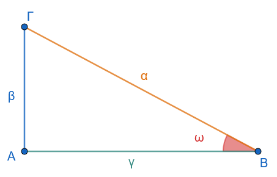{fig-align="center" width="300"}

- **Ημίτονο (**$\eta\mu\omega$): Ο λόγος της απέναντι κάθετης πλευράς προς την υποτείνουσα.
  $$\eta\mu\omega = \frac{\text{Απέναντι Κάθετη}}{\text{Υποτείνουσα}} = \frac{β}{a}$$

- **Συνημίτονο (**$\sigma\upsilon\nu\omega$): Ο λόγος της προσκείμενης κάθετης πλευράς προς την υποτείνουσα.
  $$\sigma\upsilon\nu\omega = \frac{\text{Προσκείμενη Κάθετη}}{\text{Υποτείνουσα}} = \frac{γ}{a}$$

- **Εφαπτομένη (**$\epsilon\phi\omega$): Ο λόγος της απέναντι κάθετης πλευράς προς την προσκείμενη κάθετη πλευρά.
  $$\epsilon\phi\omega = \frac{\text{Απέναντι Κάθετη}}{\text{Προσκείμενη Κάθετη}} = \frac{β}{γ}$$

- **Συνεφαπτομένη (**$\sigma\phi\omega$): Ο λόγος της προσκείμενης κάθετης πλευράς προς την απέναντι κάθετη πλευρά.
  $$\sigma\phi\omega = \frac{\text{Προσκείμενη Κάθετη}}{\text{Απέναντι Κάθετη}} = \frac{γ}{β}$$
::::

------------------------------------------------------------------------

### Τριγωνομετρικοί Αριθμοί Γωνίας $\omega$ ($0^\circ \le \omega \le 360^\circ$)

#### Ορισμοί σε Σύστημα Συντεταγμένων

:::: {.math-box .definition-box}
::: {.math-title .definition-title}
Ορισμοί

Εργαστείτε και στα applets παρακάτω
:::

Θεωρούμε ορθοκανονικό σύστημα συντεταγμένων $O x y$.
Η γωνία $\omega$ παράγεται από την περιστροφή του θετικού ημιάξονα $O x$ (αρχική πλευρά) γύρω από το $O$ μέχρι την τελική ημιευθεία $O p$ (τελική πλευρά).

Παίρνουμε ένα τυχαίο σημείο $M(x, y)$ στην τελική πλευρά $O p$ (διαφορετικό του $O$) με απόσταση από την αρχή των αξόνων $\rho = (O M) = \sqrt{x^2 + y^2} > 0$.

Ορίζουμε τους τριγωνομετρικούς αριθμούς της γωνίας $\omega$ ως εξής:

- **Ημίτονο:** $\eta\mu\omega = \dfrac{y}{\rho}$

- **Συνημίτονο:** $\sigma\upsilon\nu\omega = \dfrac{x}{\rho}$

- **Εφαπτομένη:** $\epsilon\phi\omega = \dfrac{y}{x}$ (εφόσον $x \neq 0$)

- **Συνεφαπτομένη:** $\sigma\phi\omega = \dfrac{x}{y}$ (εφόσον $y \neq 0$)
::::

------------------------------------------------------------------------

### Τριγωνομετρικοί Αριθμοί Γωνιών Μεγαλύτερων των $360^\circ$ και Αρνητικών Γωνιών

#### Γωνίες Μεγαλύτερες των $360^\circ$

:::: {.math-box .definition-box}
::: {.math-title .definition-title}
Ορισμός
:::

Αν ο ημιάξονας $O x$ πραγματοποιήσει $\nu$ πλήρεις περιστροφές κατά τη θετική φορά ($\nu \cdot 360^\circ$) και στη συνέχεια διαγράψει γωνία $\mu$ ($0^\circ \le \mu < 360^\circ$), τότε διαγράφει γωνία $\omega = \nu \cdot 360^\circ + \mu$.
::::

#### Αρνητικές Γωνίες

:::: {.math-box .definition-box}
::: {.math-title .definition-title}
Ορισμός
:::

Αν η περιστροφή γίνει κατά την **αρνητική φορά** (ωρολογιακή), τότε η γωνία είναι αρνητική, της μορφής $\omega = -(\nu \cdot 360^\circ + \mu)$.
::::

#### Γωνίες της Μορφής $k \cdot 360^\circ + \omega$ ($k \in \mathbb{Z}$)

:::: {.math-box .definition-box}
::: {.math-title .definition-title}
Ορισμός
:::

Οι γωνίες της μορφής $k \cdot 360^\circ + \omega$, με $k \in \mathbb{Z}$, έχουν την ίδια αρχική ($O x$) και την ίδια τελική πλευρά ($O p$), οπότε έχουν **ακριβώς τους ίδιους τριγωνομετρικούς αριθμούς**:

- $\eta\mu(k \cdot 360^\circ + \omega) = \eta\mu\omega$

- $\sigma\upsilon\nu(k \cdot 360^\circ + \omega) = \sigma\upsilon\nu\omega$

- $\epsilon\phi(k \cdot 360^\circ + \omega) = \epsilon\phi\omega$

- $\sigma\phi(k \cdot 360^\circ + \omega) = \sigma\phi\omega$
::::

<iframe src="https://www.geogebra.org/calculator/xdc2s7t7?embed" width="730" height="700" allowfullscreen style="border: 1px solid #e4e4e4;border-radius: 4px;" frameborder="0">

</iframe>

:::: {.math-box .odigia-box}
::: {.math-title .odigia-title}
Ακολουθήστε τις οδηγίες
:::

- Επιλέξτε τον δρομέα ω και με τα [\> ή \<]{.kbd-1} αλλάξτε την τιμή της γωνίας, ή [Shift]{.kbd-1}+[\<,\>]{.kbd-1} για μεγαλύτερη ακρίβεια.

- Διερευνήστε τους τριγωνομετρικούς αριθμούς μεγάλων γωνιών.
::::

------------------------------------------------------------------------

### Ο Τριγωνομετρικός Κύκλος

#### Ορισμός

:::: {.math-box .definition-box}
::: {.math-title .definition-title}
Ορισμός
:::

**Τριγωνομετρικός κύκλος** ονομάζεται ο κύκλος με κέντρο την αρχή των αξόνων $O(0,0)$ και ακτίνα $\rho = 1$.
::::

#### Τριγωνομετρικοί Αριθμοί στον Τριγωνομετρικό Κύκλο

:::: {.math-box .definition-box}
::: {.math-title .definition-title}
Ορισμοί
:::

Αν η τελική πλευρά της γωνίας $\omega$ τέμνει τον τριγωνομετρικό κύκλο στο σημείο $M(x, y)$, επειδή $\rho = 1$, ισχύει:

- $\eta\mu\omega = y$ (η **τεταγμένη** του σημείου $M$)

- $\sigma\upsilon\nu\omega = x$ (η **τετμημένη** του σημείου $M$)

Για το λόγο αυτό, ο άξονας $y' y$ λέγεται **άξονας των ημιτόνων** και ο άξονας $x' x$ λέγεται **άξονας των συνημίτονων**.
::::

<iframe src="https://www.geogebra.org/calculator/qwsspdd2?embed" width="730" height="600" allowfullscreen style="border: 1px solid #e4e4e4;border-radius: 4px;" frameborder="0">

</iframe>

:::: {.math-box .odigia-box}
::: {.math-title .odigia-title}
Ακολουθήστε τις οδηγίες
:::

- Επιλέξτε τον δρομέα ω και με τα [\> ή \<]{.kbd-1} αλλάξτε την τιμή της γωνίας, ή [Shift]{.kbd-1}+[\<,\>]{.kbd-1} για μεγαλύτερη ακρίβεια.

- Διερευνήστε τα όρια τιμών και το πρόσημο.
  Είναι σύμφωνα με τα παρακάτω;
::::

#### Μεταβολή και Όρια Τιμών

Επειδή το σημείο $M(x,y)$ ανήκει στον κύκλο ακτίνας $1$, ισχύει:

- $-1 \le \sigma\upsilon\nu\omega \le 1$

- $-1 \le \eta\mu\omega \le 1$

#### Πρόσημο Τριγωνομετρικών Αριθμών ανά Τεταρτημόριο

Το πρόσημο εξαρτάται από το τεταρτημόριο στο οποίο βρίσκεται η τελική πλευρά της γωνίας $\omega$:

| Τεταρτημόριο | 1ο ($0^\circ < \omega < 90^\circ$) | 2ο ($90^\circ < \omega < 180^\circ$) | 3ο ($180^\circ < \omega < 270^\circ$) | 4ο ($270^\circ < \omega < 360^\circ$) |
|:--------------|:-------------:|:-------------:|:-------------:|:-------------:|
| $\eta\mu\omega$ | $+$ | $+$ | $-$ | $-$ |
| $\sigma\upsilon\nu\omega$ | $+$ | $-$ | $-$ | $+$ |
| $\epsilon\phi\omega$ | $+$ | $-$ | $+$ | $-$ |
| $\sigma\phi\omega$ | $+$ | $-$ | $+$ | $-$ |

------------------------------------------------------------------------

### Ο Άξονας των Εφαπτομένων

#### Ορισμός & Κατασκευή

:::: {.math-box .definition-box}
::: {.math-title .definition-title}
Ορισμός
:::

Θεωρούμε την εφαπτομένη ευθεία $\epsilon$ του τριγωνομετρικού κύκλου στο σημείο $A(1, 0)$, η οποία έχει εξίσωση $x = 1$.
Η ευθεία αυτή ονομάζεται **άξονας των εφαπτομένων**.
::::

#### Ορισμός της Εφαπτομένης

:::: {.math-box .definition-box}
::: {.math-title .definition-title}
Ορισμός
:::

Αν η ευθεία της τελικής πλευράς της γωνίας $\omega$ (ή η προέκτασή της) τέμνει τον άξονα των εφαπτομένων $\epsilon$ στο σημείο $E(1, y_E)$, τότε η εφαπτομένη της γωνίας $\omega$ ισούται με την τεταγμένη του σημείου $E$: $$\epsilon\phi\omega = y_E$$

*(Για γωνίες* $\omega = 90^\circ$ και $\omega = 270^\circ$, η τελική πλευρά είναι παράλληλη στον άξονα $x=1$, οπότε η εφαπτομένη δεν ορίζεται).
::::

<iframe src="https://www.geogebra.org/calculator/afhpqcmf?embed" width="730" height="800" allowfullscreen style="border: 1px solid #e4e4e4;border-radius: 4px;" frameborder="0">

</iframe>

:::: {.math-box .odigia-box}
::: {.math-title .odigia-title}
Ακολουθήστε τις οδηγίες
:::

- Επιλέξτε το σημείο Μ και με τα [\> ή \<]{.kbd-1} αλλάξτε την τιμή της γωνίας, ή [Shift]{.kbd-1}+[\<,\>]{.kbd-1} για μεγαλύτερη ακρίβεια για να προσεγγίσετε τις γωνίες των $90^ο$, $180^ο$ και $270^ο$.

- Διερευνήστε τα όρια τιμών της εφαπτομένης και το πρόσημο.
  Κάντε έναν πίνακα.
::::

------------------------------------------------------------------------

### Το Ακτίνιο ($\text{rad}$) ως Μονάδα Μέτρησης Γωνιών

#### Ορισμός

:::: {.math-box .definition-box}
::: {.math-title .definition-title}
Ορισμός

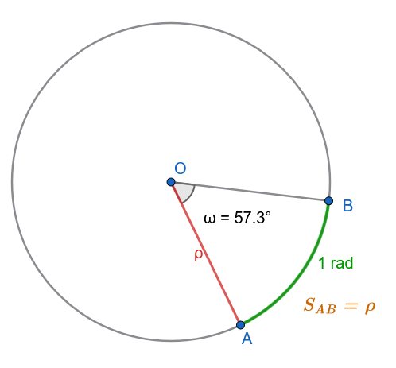{fig-align="center" width="350"}
:::

**Ακτίνιο (**$1\text{ rad}$) είναι η επίκεντρη γωνία η οποία βαίνει σε τόξο κύκλου με μήκος ίσο με την ακτίνα $\rho$ του κύκλου.
::::

#### Τύποι Μετατροπής

Αν μια γωνία είναι $\mu^\circ$ (μοίρες) και $\alpha\text{ rad}$ (ακτίνια), ισχύει ο τύπος μετατροπής: $$\frac{\mu}{180} = \frac{\alpha}{\pi}$$

- **Μετατροπή από μοίρες σε ακτίνια (**$\mu \to \alpha$): $\alpha = \dfrac{\mu \cdot \pi}{180}$

- **Μετατροπή από ακτίνια σε μοίρες (**$\alpha \to \mu$): $\mu = \dfrac{\alpha \cdot 180}{\pi}$

#### Παραδείγματα Μετατροπής

1.  **Μετατροπή** $60^\circ$ σε $\text{rad}$: $$\alpha = \frac{60 \cdot \pi}{180} = \frac{\pi}{3}\text{ rad}$$

2.  **Μετατροπή** $\dfrac{5\pi}{6}\text{ rad}$ σε μοίρες: $$\mu = \frac{\dfrac{5\pi}{6} \cdot 180}{\pi} = 5 \cdot 30 = 150^\circ$$

#### Πίνακας Τριγωνομετρικών Αριθμών Βασικών Γωνιών

*(Πρώτη στήλη σε μοίρες, τελευταία στήλη σε ακτίνια):*

| Γωνία $\omega$ ($\mu^\circ$) | $\eta\mu\omega$ | $\sigma\upsilon\nu\omega$ | $\epsilon\phi\omega$ | $\sigma\phi\omega$ | Γωνία $\omega$ ($\alpha\text{ rad}$) |
|:----------:|:----------:|:----------:|:----------:|:----------:|:----------:|
| $0^\circ$ | $0$ | $1$ | $0$ | Δεν ορίζεται | $0$ |
| $30^\circ$ | $\dfrac{1}{2}$ | $\dfrac{\sqrt{3}}{2}$ | $\dfrac{\sqrt{3}}{3}$ | $\sqrt{3}$ | $\dfrac{\pi}{6}$ |
| $45^\circ$ | $\dfrac{\sqrt{2}}{2}$ | $\dfrac{\sqrt{2}}{2}$ | $1$ | $1$ | $\dfrac{\pi}{4}$ |
| $60^\circ$ | $\dfrac{\sqrt{3}}{2}$ | $\dfrac{1}{2}$ | $\sqrt{3}$ | $\dfrac{\sqrt{3}}{3}$ | $\dfrac{\pi}{3}$ |
| $90^\circ$ | $1$ | $0$ | Δεν ορίζεται | $0$ | $\dfrac{\pi}{2}$ |

------------------------------------------------------------------------

### Εφαρμογές

:::: {.math-box .example-box}
::: {.math-title .example-title}
Εφαρμογή 1: Υπολογισμός ύψους πύργου από δύο διαφορετικές γωνίες ανύψωσης
:::

**Εκφώνηση:** Ένας παρατηρητής βλέπει την κορυφή ενός πύργου υπό γωνία ανύψωσης $30^\circ$.
Προχωρώντας $50\text{ m}$ ευθεία προς τη βάση του πύργου, βλέπει την κορυφή υπό γωνία ανύψωσης $45^\circ$.
Να υπολογιστεί το ύψος $h$ του πύργου.
::::

:::: {.math-box .examplesolution-box}
::: {.math-title .examplesolution-title}
**Λύση:**

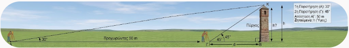{fig-align="center" width="700"}
:::

Έστω $h$ το ύψος του πύργου και $d$ η απόσταση του δεύτερου σημείου παρατήρησης από τη βάση του πύργου.

1.  Από το πρώτο ορθογώνιο τρίγωνο (με γωνία $45^\circ$): $$\epsilon\phi 45^\circ = \frac{h}{d} \implies 1 = \frac{h}{d} \implies d = h$$

2.  Από το δεύτερο ορθογώνιο τρίγωνο (με γωνία $30^\circ$ και συνολική απόσταση $d + 50$): $$\epsilon\phi 30^\circ = \frac{h}{d + 50} \implies \frac{\sqrt{3}}{3} = \frac{h}{h + 50}$$

3.  Επιλύουμε ως προς $h$: $$\sqrt{3}(h + 50) = 3h \iff 50\sqrt{3} = 3h - \sqrt{3}h \iff h(3 - \sqrt{3}) = 50\sqrt{3}$$ $$h = \frac{50\sqrt{3}}{3 - \sqrt{3}} = \frac{50\sqrt{3}(3 + \sqrt{3})}{9 - 3} = \frac{150\sqrt{3} + 150}{6} = 25(\sqrt{3} + 1)\text{ m} \approx 68{,}3\text{ m}$$
::::

------------------------------------------------------------------------

:::: {.math-box .example-box}
::: {.math-title .example-title}
Εφαρμογή 2:
:::

Υπολογισμός τριγωνομετρικών αριθμών της γωνίας $1140^\circ$
::::

:::: {.math-box .examplesolution-box}
::: {.math-title .examplesolution-title}
**Λύση:**
:::

Διαιρούμε το $1140$ με το $360$: $$1140^\circ = 3 \cdot 360^\circ + 60^\circ$$

Επειδή οι τριγωνομετρικοί αριθμοί επαναλαμβάνονται κάθε $360^\circ$:

- $\eta\mu 1140^\circ = \eta\mu(3 \cdot 360^\circ + 60^\circ) = \eta\mu 60^\circ = \dfrac{\sqrt{3}}{2}$

- $\sigma\upsilon\nu 1140^\circ = \sigma\upsilon\nu(3 \cdot 360^\circ + 60^\circ) = \sigma\upsilon\nu 60^\circ = \dfrac{1}{2}$

- $\epsilon\phi 1140^\circ = \epsilon\phi(3 \cdot 360^\circ + 60^\circ) = \epsilon\phi 60^\circ = \sqrt{3}$

- $\sigma\phi 1140^\circ = \sigma\phi(3 \cdot 360^\circ + 60^\circ) = \sigma\phi 60^\circ = \dfrac{\sqrt{3}}{3}$
::::

------------------------------------------------------------------------

:::: {.math-box .example-box}
::: {.math-title .example-title}
Εφαρμογή 3:
:::

Υπολογισμός τριγωνομετρικών αριθμών της γωνίας $\dfrac{121\pi}{6}\text{ rad}$
::::

:::: {.math-box .examplesolution-box}
::: {.math-title .examplesolution-title}
**Λύση:**
:::

Διασπούμε το κλάσμα $\dfrac{121\pi}{6}$: $$\frac{121\pi}{6} = \frac{120\pi + \pi}{6} = 20\pi + \frac{\pi}{6} = 10 \cdot (2\pi) + \frac{\pi}{6}$$

Επειδή η περίοδος είναι $2\pi\text{ rad}$ (πλήρεις περιστροφές):

- $\eta\mu\left(\dfrac{121\pi}{6}\right) = \eta\mu\left(10 \cdot 2\pi + \dfrac{\pi}{6}\right) = \eta\mu\left(\dfrac{\pi}{6}\right) = \dfrac{1}{2}$

- $\sigma\upsilon\nu\left(\dfrac{121\pi}{6}\right) = \sigma\upsilon\nu\left(10 \cdot 2\pi + \dfrac{\pi}{6}\right) = \sigma\upsilon\nu\left(\dfrac{\pi}{6}\right) = \dfrac{\sqrt{3}}{2}$

- $\epsilon\phi\left(\dfrac{121\pi}{6}\right) = \epsilon\phi\left(10 \cdot 2\pi + \dfrac{\pi}{6}\right) = \epsilon\phi\left(\dfrac{\pi}{6}\right) = \dfrac{\sqrt{3}}{3}$

- $\sigma\phi\left(\dfrac{121\pi}{6}\right) = \sigma\phi\left(10 \cdot 2\pi + \dfrac{\pi}{6}\right) = \sigma\phi\left(\dfrac{\pi}{6}\right) = \sqrt{3}$
::::

------------------------------------------------------------------------

### Ασκήσεις και Προβλήματα

#### Θέμα Α: Τριγωνομετρικοί Αριθμοί Οξείας Γωνίας & Σύστημα Συντεταγμένων

1.  Σε ορθογώνιο τρίγωνο $A B \Gamma$ ($\hat{A} = 90^\circ$) δίνεται ότι $β = 6\text{ cm}$ και $γ = 8\text{ cm}$.
    Να υπολογιστούν οι τριγωνομετρικοί αριθμοί της γωνίας $\hat{B}$.

2.  Η τελική πλευρά μιας γωνίας $\omega$ διέρχεται από το σημείο $M(-3, 4)$.
    Να υπολογιστεί η απόσταση $\rho$ και οι $4$ τριγωνομετρικοί αριθμοί της γωνίας $\omega$.

3.  Η τελική πλευρά της γωνίας $\omega$ διέρχεται από το σημείο $P(5, -12)$.
    Να βρεθούν οι τριγωνομετρικοί αριθμοί της $\omega$.

#### Θέμα Β: Γωνίες $>360^\circ$ και Αρνητικές Γωνίες

4.  Να υπολογιστούν οι τριγωνομετρικοί αριθμοί των γωνιών: $$\alpha)\ 750^\circ, \quad \beta)\ 1470^\circ$$

5.  Να υπολογιστούν οι τριγωνομετρικοί αριθμοί των αρνητικών γωνιών: $$\alpha)\ -300^\circ, \quad \beta)\ -405^\circ$$

6.  Να απλοποιηθεί η παράσταση: $$A = \eta\mu(720^\circ + \omega) + \sigma\upsilon\nu(1080^\circ - \omega) + \epsilon\phi(360^\circ + \omega)$$

#### Θέμα Γ: Τριγωνομετρικός Κύκλος & Πρόσημα

7.  Να βρεθεί το πρόσημο των παραστάσεων: $$\alpha)\ A = \eta\mu 135^\circ \cdot \sigma\upsilon\nu 210^\circ \cdot \epsilon\phi 300^\circ, \quad \beta)\ B = \eta\mu\left(\frac{7\pi}{6}\right) \cdot \sigma\upsilon\nu\left(\frac{5\pi}{4}\right)$$

8.  Αν $90^\circ < \omega < 180^\circ$ και $\eta\mu\omega = \dfrac{3}{5}$, να υπολογιστούν οι υπόλοιποι τριγωνομετρικοί αριθμοί της γωνίας $\omega$.

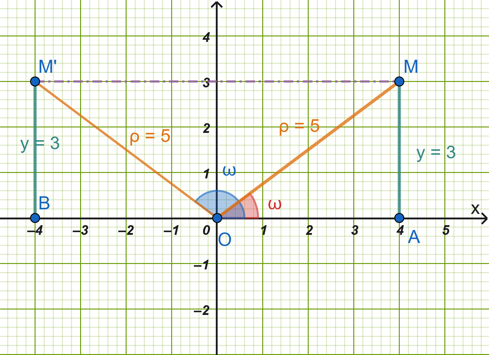{fig-align="center" width="350"}

::: callout-sos
**Υπόδειξη**

Υπάρχουν δύο γωνίες με το ίδιο ημίτονο, μια στο $1^ο$ τεταρτημόριο και μια στο $2^ο$.

Αφού η γωνία μας βρίσκεται $90^ο \le ω \le 180^o$, σημαίνει ότι $\hat ω=\widehat{AOM'}$ και Μ' το συμμετρικό του M ως προς τον άξονα Oy

Από το ορθογώνιο τρίγωνο προκύπτει ότι $x=4$

Άρα $συνω=\dfrac{x}{ρ}=\dfrac{-4}{5}$

------------------------------------------------------------------------

------------------------------------------------------------------------

------------------------------------------------------------------------
:::

9.  Αν $180^\circ < \omega < 270^\circ$ και $\sigma\upsilon\nu\omega = -\dfrac{12}{13}$, να υπολογιστούν οι $\epsilon\phi\omega$ και $\sigma\phi\omega$.

> > > Σκεφτείτε παρόμοια με την άσκηση 8.

#### Θέμα Δ: Άξονας Εφαπτομένων

10. Να κατασκευαστεί γραφικά στον τριγωνομετρικό κύκλο γωνία $\omega \in (0, 90^\circ)$ της οποίας η εφαπτομένη είναι $\epsilon\phi\omega = 2$.

> > > $εφω=\dfrac{y}{x}=\dfrac{2}{1}=2$

11. Να εξεταστεί αν υπάρχει γωνία $\omega$ για την οποία ισχύει $ημω = 2$ ή $εφω = 5$. Να αιτιολογηθεί η απάντηση με βάση τον τριγωνομετρικό κύκλο και τον άξονα των εφαπτομένων.

#### Θέμα Ε: Ακτίνια ($\text{rad}$) & Μετατροπές

12. Να μετατραπούν σε ακτίνια ($\text{rad}$) οι γωνίες: $$15^\circ, \quad 120^\circ, \quad 225^\circ, \quad 315^\circ$$

13. Να μετατραπούν σε μοίρες οι γωνίες: $$\frac{\pi}{12}\text{ rad}, \quad \frac{3\pi}{4}\text{ rad}, \quad \frac{7\pi}{6}\text{ rad}, \quad \frac{11\pi}{3}\text{ rad}$$

14. Να υπολογιστούν οι τριγωνομετρικοί αριθμοί της γωνίας $\omega = \dfrac{25\pi}{4}\text{ rad}$.

15. Να υπολογιστεί η τιμή της παράστασης: $$S = \eta\mu\left(\frac{13\pi}{6}\right) + \sigma\upsilon\nu\left(\frac{17\pi}{3}\right) - \epsilon\phi\left(\frac{9\pi}{4}\right)$$

#### Θέμα ΣΤ: Σύνθετα Προβλήματα & Εφαρμογές

16. **Μήκος Τόξου:** Ένα τόξο κύκλου ακτίνας $R = 10\text{ cm}$ αντιστοιχεί σε επίκεντρη γωνία $\omega = 120^\circ$. Να υπολογιστεί το μήκος $S$ του τόξου σε $\text{cm}$.

> > > μετατρέψτε τις $120^ο$ σε ακτίνια.
> > > $S=αρ$ \_\_\_\_\_\_\_\_\_\_\_\_\_\_\_\_\_\_\_\_\_\_

17. **Πρόβλημα Πλοίου:** Ένα πλοίο βρίσκεται σε απόσταση $200\text{ m}$ από τη βάση ενός φάρου ύψους $h$.
    Η γωνία ανύψωσης της κορυφής του φάρου από το πλοίο είναι $30^\circ$.
    Να βρεθεί το ύψος του φάρου.

18. **Πρόβλημα Αερόστατου:** Δύο παρατηρητές $A$ και $B$ βρίσκονται σε ευθεία γραμμή στη γη σε απόσταση $1000\text{ m}$ μεταξύ τους.
    Παρατηρούν ένα αερόστατο που βρίσκεται ανάμεσά τους υπό γωνίες ανύψωσης $45^\circ$ και $60^\circ$ αντίστοιχα.
    Να υπολογιστεί το ύψος του αερόστατου από το έδαφος.

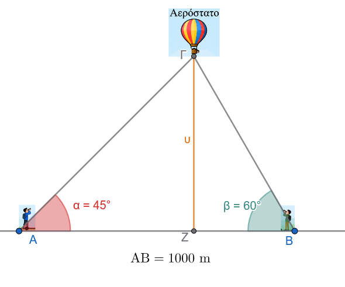{fig-align="center" width="400"}

::: callout-sos
**Υπόδειξη**

$εφ45^ο=\dfrac{υ}{ΑΖ} \implies AZ= .............................$

$εφ60^ο=\dfrac{υ}{ΖB} \implies ZB= .............................$

$AB=AZ+ZB \implies ................................$
:::

:::: {.math-box .exercise-box}
::: {.math-title .exercise-title}
19. **Υπολογισμός:**
:::

Να υπολογίσετε την τιμή της παράστασης, χωρίς τη χρήση υπολογιστή τσέπης:

$$A = \frac{\sigma\upsilon\nu 420^\circ - \eta\mu 225^\circ \cdot \sigma\upsilon\nu(-45^\circ)}{\epsilon\phi 315^\circ}$$
::::

:::: {.math-box .solution-box}
::: {.math-title .solution-title}
Λύση
:::

Υπολογίζουμε ξεχωριστά κάθε τριγωνομετρικό αριθμό ανάγοντας τις γωνίες στο $1^\circ$ τεταρτημόριο:

1.  **Για το** $\sigma\upsilon\nu 420^\circ$:

    Αφαιρούμε έναν πλήρη κύκλο ($360^\circ$): $$\sigma\upsilon\nu 420^\circ = \sigma\upsilon\nu(360^\circ + 60^\circ) = \sigma\upsilon\nu 60^\circ = \frac{1}{2}$$

2.  **Για το** $\eta\mu 225^\circ$:

    Η γωνία $225^\circ$ βρίσκεται στο $3^\circ$ τεταρτημόριο, όπου το ημίτονο είναι αρνητικό: $$\eta\mu 225^\circ = \eta\mu(180^\circ + 45^\circ) = -\eta\mu 45^\circ = -\frac{\sqrt{2}}{2}$$

3.  **Για το** $\sigma\upsilon\nu(-45^\circ)$:

    Το συνημίτονο είναι άρτια συνάρτηση ($\sigma\upsilon\nu(-\theta) = \sigma\upsilon\nu \theta$): $$\sigma\upsilon\nu(-45^\circ) = \sigma\upsilon\nu 45^\circ = \frac{\sqrt{2}}{2}$$

4.  **Για την** $\epsilon\phi 315^\circ$:

    Η γωνία $315^\circ$ βρίσκεται στο $4^\circ$ τεταρτημόριο, όπου η εφαπτομένη είναι αρνητική: $$\epsilon\phi 315^\circ = \epsilon\phi(360^\circ - 45^\circ) = -\epsilon\phi 45^\circ = -1$$

------------------------------------------------------------------------

**Αντικατάσταση στην παράσταση**

Αντικαθιστούμε τις τιμές που βρήκαμε στην αρχική παράσταση:

$$A = \frac{\dfrac{1}{2} - \left(-\dfrac{\sqrt{2}}{2}\right) \cdot \left(\dfrac{\sqrt{2}}{2}\right)}{-1}$$

Υπολογίζουμε το γινόμενο στον αριθμητή: $$\left(-\frac{\sqrt{2}}{2}\right) \cdot \left(\frac{\sqrt{2}}{2}\right) = -\frac{(\sqrt{2})^2}{4} = -\frac{2}{4} = -\frac{1}{2}$$

Επομένως, ο αριθμητής γίνεται: $$\frac{1}{2} - \left(-\frac{1}{2}\right) = \frac{1}{2} + \frac{1}{2} = 1$$

Τελικά: $$A = \frac{1}{-1} = -1$$
::::

20. **Γεωμετρική Εφαρμογή:** Σε ισοσκελές τρίγωνο $A B \Gamma$ ($A B = A \Gamma = 10\text{ cm}$) η γωνία της κορυφής είναι $\hat{A} = 120^\circ$.
    Να υπολογιστεί το μήκος της βάσης $B \Gamma$ και το εμβαδόν του τριγώνου.

21. **Απόσταση :** Στο παρακάτω σχήμα να υπολογίσετε την απόσταση ΒΔ.

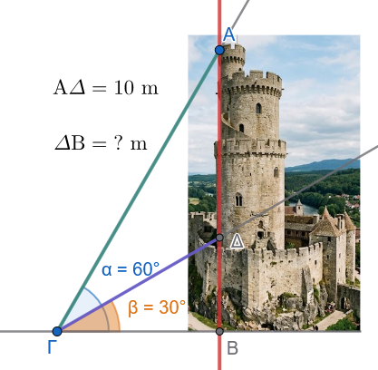{fig-align="center" width="350"}

::: callout-sos
**Υπόδειξη**

$εφ30^ο=\dfrac{ΒΔ}{ΒΓ} \implies BΓ= ................$

$εφ60^ο=\dfrac{ΒΔ+ΔΑ}{ΒΓ} \implies BΓ= ................$

$ΒΓ=ΒΓ \implies ....................$
:::

------------------------------------------------------------------------

### .... και ασκήσεων συνέχεια

**Άσκηση 1 (Ορθογώνια Τρίγωνα & Τριγωνομετρία)**

Σε τρίγωνο $AB\Gamma$ φέρουμε το ύψος $A\Delta \perp B\Gamma$.
Δίνεται ότι στο ορθογώνιο τρίγωνο $AB\Delta$ η γωνία είναι $\widehat{B} = 45^\circ$ και η υποτείνουσα $AB = 8\sqrt{2}$.
Στο ορθογώνιο τρίγωνο $A\Delta\Gamma$, η πλευρά $\Delta\Gamma$ έχει μήκος $8\sqrt{3}$.

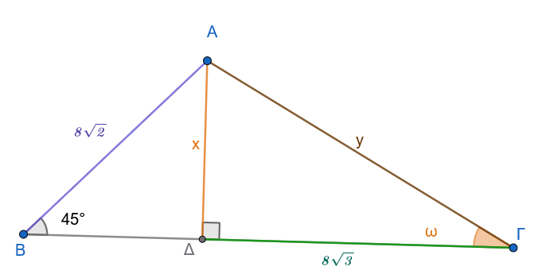{fig-align="center" width="500"}

1.  Να υπολογίσετε το ύψος $x = A\Delta$.
2.  Να υπολογίσετε την πλευρά $y = A\Gamma$.
3.  Να υπολογίσετε τη γωνία $\omega = \widehat{A\Gamma\Delta}$.

**Άσκηση 2 (Επίλυση Τριγώνου με Ύψος)**

Δίνεται τρίγωνο $AB\Gamma$ με γωνίες $\widehat{B} = 45^\circ$, $\widehat{\Gamma} = 30^\circ$ και πλευρά $B\Gamma = 6(\sqrt{3} + 1)$.

Φέρνοντας το ύψος $A\Delta \perp B\Gamma$, να υπολογίσετε τα μήκη των πλευρών $AB$ και $A\Gamma$.

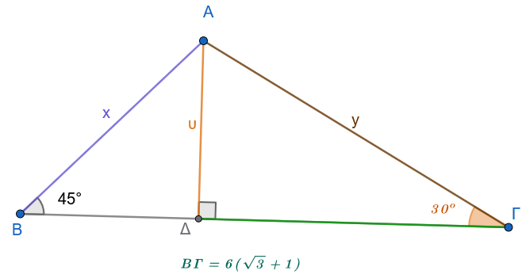{fig-align="center" width="500"}

::: callout-sos
**Υπόδειξη**

$εφ45^ο=\dfrac{ΑΔ}{ΒΔ} \implies BΔ= ................$

$εφ30^ο=\dfrac{ΑΔ}{ΔΓ} \implies ΔΓ= ................$

$ΒΓ=ΒΔ+ΔΓ \implies ....................  ΑΔ=υ= ......$

Τώρα μπορούμε να υπολογίσουμε τις πλευρές.........
:::

------------------------------------------------------------------------

**Άσκηση 3 (Μήκος Τόξου & Ακτίνια:** $s = \alpha \cdot \rho$)

Μια επίκεντρη γωνία $\omega$ βαίνει σε τόξο μήκους $s = 12\text{ cm}$.
Να εκφράσετε τη γωνία $\omega$ σε ακτίνια ($\text{rad}$), αν η ακτίνα του κύκλου είναι:

1.  $\rho = 2\text{ cm}$

2.  $\rho = 3\text{ cm}$

3.  $\rho = 4\text{ cm}$

------------------------------------------------------------------------

**Άσκηση 4 (Μετατροπή Μοιρών σε Ακτίνια)**

Να εκφράσετε σε $\text{rad}$ τις παρακάτω γωνίες:

1.  $45^\circ$

2.  $150^\circ$

3.  $1080^\circ$

4.  $-1260^\circ$

------------------------------------------------------------------------

**Άσκηση 5 (Μετατροπή Ακτινίων σε Μοίρες)**

Να μετατρέψετε σε μοίρες τις παρακάτω γωνίες:

1.  $\dfrac{\pi}{12}\text{ rad}$

2.  $\dfrac{7\pi}{4}\text{ rad}$

3.  $\dfrac{53\pi}{6}\text{ rad}$

4.  $50\text{ rad}$

------------------------------------------------------------------------

**Άσκηση 6 (Τριγωνομετρικοί Αριθμοί Μεγάλων Γωνιών)**

Να υπολογίσετε τους τριγωνομετρικούς αριθμούς ($\eta\mu, \sigma\upsilon\nu, \epsilon\phi, \sigma\phi$) των παρακάτω γωνιών:

1.  $750^\circ$

2.  $1500^\circ$

3.  $2220^\circ$

4.  $2880^\circ$

------------------------------------------------------------------------

**Άσκηση 7 (Εφαρμογή Τριγωνομετρίας σε Πρόβλημα Ύψους)**

Από δύο σημεία $A$ και $B$ που βρίσκονται στο ίδιο οριζόντιο έδαφος και απέχουν μεταξύ τους απόσταση $d = 600\text{ m}$, παρατηρείται η κορυφή $K$ ενός πύργου τηλεπικοινωνιών $K\Delta$ (όπου $K\Delta \perp AB$ και το $\Delta$ βρίσκεται στην ευθεία $AB$, ανάμεσα στα $A$ και $B$).
Από το σημείο $B$, η κορυφή $K$ παρατηρείται υπό σταθερή γωνία ανύψωσης $60^\circ$.

1.  Να εκφράσετε το ύψος $h = K\Delta$ του πύργου συναρτήσει της γωνίας ανύψωσης $\omega = \widehat{KA\Delta}$ από το σημείο $A$.

2.  Να βρείτε το ύψος $h$, αν $\omega = 30^\circ$.

3.  Πόση είναι η γωνία $\omega$, αν το ύψος είναι $h = 300\sqrt{3}\text{ m}$;

> > > Δείτε την άσκηση με το αερόστατο.

------------------------------------------------------------------------

**Άσκηση 8 (Γεωμετρικός Υπολογισμός Ημιτόνου Μισής Γωνίας)**

Θεωρούμε ημικύκλιο διαμέτρου $AB = 2$ (άρα ακτίνα $\rho = 1$) με κέντρο $O$.
Έστω σημείο $\Gamma$ του ημικυκλίου τέτοιο ώστε $\widehat{BO\Gamma} = 60^\circ$ (άρα $\widehat{BA\Gamma} = 30^\circ$).
Φέρουμε τη διχοτόμο της γωνίας $\widehat{BA\Gamma}$, η οποία τέμνει το ημικύκλιο στο σημείο $\Delta$, οπότε $\widehat{BA\Delta} = 15^\circ$.

1.  Να δείξετε ότι $(B\Gamma) = 1$ και $(A\Gamma) = \sqrt{3}$.

2.  Στο ορθογώνιο τρίγωνο $AB\Delta$ ($\widehat{A\Delta B} = 90^\circ$), να εκφράσετε την πλευρά $(B\Delta)$ συναρτήσει του $\eta\mu 15^\circ$.

3.  Χρησιμοποιώντας το ύψος OE στο τρίγωνο $OBΓ$, να υπολογίσετε την ακριβή τιμή του μήκους $(B\Delta)$.

4.  Να προσδιορίσετε την ακριβή τιμή του $\eta\mu 15^\circ$.

5.  Ποιων άλλων γωνιών μπορείτε να υπολογίσετε το ημίτονο αν συνεχιστεί η διαδικασία διχοτόμησης;

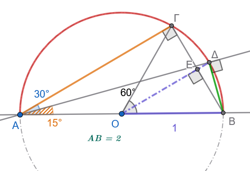

::: callout-sos
Λύση - Υπόδειξη

Οι γωνίες $\widehat {AΓΒ}=90^ο$ και $\widehat {ΑΔΒ}=90^ο \ \ \ \ \ (1)$ γιατί βαίνουν σε ημικύκλιο

Το τρίγωνο ΟΓΒ είναι ισόπλευρο, άρα ΑΒ=ΟΓ=ΒΓ=1.

Από το πυθαγόρειο θεώρημα στο τρίγωνο ΑΓΒ προκύπτει ότι $ΑΓ=\sqrt{3}$

Στο τρίγωνο ΟΒΓ το ΕΒ=0,5 και από το πυθαγόρειο θεώρημα στο τρίγωνο ΟΕΒ προκύπτει $ΟΕ=\dfrac{\sqrt{3}}{2}$, Άρα το $ΕΔ=1-ΟΕ=1-\dfrac{\sqrt{3}}{2}$.
Από το ορθογώνιο τρίγωνο ΒΔΕ μπορούμε να υπολογίσουμε το τμήμα $ΒΔ^2=ΒΕ^2+ΕΔ^2=    ......... . ...ΒΔ= ........$

Τώρα μπορούμε να υπολογίσουμε το $ημ15^ο=\dfrac{ΔΒ}{ΑΒ}$ από το ορθογώνιο τρίγωνο ΑΔΒ
:::

**Άσκηση 9 (Υπολογισμός Εμβαδού & Περιμέτρου)**

Σε ορθογώνιο τρίγωνο $AB\Gamma$ ($\widehat{B} = 90^\circ$), επί της υποτείνουσας $A\Gamma$ ή της πλευράς $B\Gamma$ θεωρούμε σημείο $\Delta \in B\Gamma$ τέτοιο ώστε $\widehat{BA\Delta} = 30^\circ$ και $\widehat{\Delta A\Gamma} = 15^\circ$ (άρα $\widehat{A} = 45^\circ$ και $\widehat{\Gamma} = 45^\circ$).
Δίνεται ότι η κάθετη πλευρά είναι $AB = 6$.

1.  Να υπολογίσετε τα μήκη των τμημάτων $B\Delta$ και $A\Delta$.

2.  Να βρείτε το μήκος της πλευράς $B\Gamma$ και του τμήματος $\Delta\Gamma$.

3.  Να υπολογίσετε την περίμετρο και το εμβαδόν του τριγώνου $A\Delta\Gamma$.

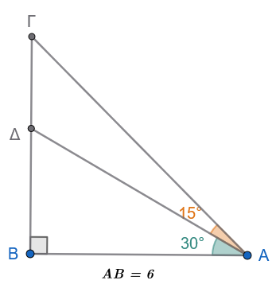

::: callout-sos
Λύση - Υπόδειξη

Προφανώς το τρίγωνο ΑΒΓ είναι ορθογώνιο ισοσκελές και άρα $ΑΒ=ΒΓ=6 \ \ \ \ \ \ (1)$

Από το ορθογώνιο τρίγωνο ΑΒΔ υπολογίζουμε την $ΒΔ=6εφ30^ο=2\sqrt{3} \ \ \ \ \ (2)$ και άρα $ΔΓ=ΒΓ-ΒΔ=6-2\sqrt{3}   \ \ \ \ \ \  (3)$

Από το ορθογώνιο τρίγωνο ΑΒΔ υπολογίζουμε την $AΔ=\dfrac{6}{συν30^ο}=4\sqrt{3} \ \ \ \ \ (4)$

Από το ορθογώνιο τρίγωνο ΑΒΓ υπολογίζουμε την $AΓ^2=6^2+6^2 \implies ΑΓ=6\sqrt{2} \ \ \ \ \ (5)$

Άρα Περίμετρος= ...........................
και Εμβαδόν=$\dfrac{ΔΓ\times ΒΔ}{2}=   ............$
:::

------------------------------------------------------------------------

:::: {.math-box .exercise-box}
::: {.math-title .exercise-title}
**Άσκηση 10 (Κυκλική Κίνηση & Γωνιακή Ταχύτητα)**
:::

Η ελάχιστη γραμμική ταχύτητα που μπορεί να διακρίνει το ανθρώπινο μάτι στην άκρη ενός δείκτη είναι $v = 0{,}5\text{ mm/s}$.

1.  Να βρείτε τη γωνιακή ταχύτητα $\omega$ (σε $\text{rad/s}$) του ωροδείκτη ενός αναλογικού ρολογιού (ο οποίος εκτελεί $1$ πλήρη περιστροφή κάθε $12$ ώρες).

2.  Να υπολογίσετε πόσο μήκος πρέπει να έχει ο ωροδείκτης ώστε να μπορούμε να αντιληφθούμε άμεσα με το μάτι την κίνηση του άκρου του.
::::

:::: {.math-box .solution-box}
::: {.math-title .solution-title}
Λύση
:::

**Δεδομένα:**

- Ελάχιστη γραμμική ταχύτητα: $v = 0{,}5 \text{ mm/s} = 0{,}5 \times 10^{-3} \text{ m/s} = 5 \times 10^{-4} \text{ m/s}$

- Περίοδος περιστροφής ωροδείκτη: $T = 12 \text{ ώρες}$

------------------------------------------------------------------------

**1. Υπολογισμός της γωνιακής ταχύτητας** $\omega$ του ωροδείκτη

Η γωνιακή ταχύτητα δίνεται από τον τύπο:

$$\omega = \frac{2\pi}{T}$$

Μετατρέπουμε την περίοδο $T$ από ώρες σε δευτερόλεπτα ($\text{s}$):

$$T = 12 \text{ ώρες} = 12 \times 3600 \text{ s} = 43.200 \text{ s}$$

Αντικαθιστούμε στον τύπο της γωνιακής ταχύτητας:

$$\omega = \frac{2\pi}{43.200} = \frac{\pi}{21.600} \text{ rad/s}$$

Υπολογίζοντας αριθμητικά:

$$\omega \approx \frac{3{,}14159}{21.600} \approx 1{,}454 \times 10^{-4} \text{ rad/s}$$

------------------------------------------------------------------------

**2. Υπολογισμός του ελάχιστου μήκους** $R$ του ωροδείκτη

Η σχέση γραμμικής ($v$) και γωνιακής ταχύτητας ($\omega$) είναι:

$$v = \omega \cdot R \implies R = \frac{v}{\omega}$$

Αντικαθιστούμε τις τιμές:

$$R = \frac{0{,}5 \text{ mm/s}}{\dfrac{\pi}{21.600} \text{ rad/s}} = \frac{0{,}5 \times 21.600}{\pi} = \dfrac{10.800}{\pi} \text{ mm}$$

Υπολογίζοντας αριθμητικά:

$$R \approx \frac{10.800}{3{,}14159} \approx 3.437{,}75 \text{ mm} \approx 3{,}44 \text{ μέτρα}$$

------------------------------------------------------------------------

**Σύνοψη Αποτελεσμάτων:**

1.  **Γωνιακή ταχύτητα:** $\omega = \dfrac{\pi}{21.600} \text{ rad/s} \approx 1{,}45 \times 10^{-4} \text{ rad/s}$

2.  **Ελάχιστο μήκος ωροδείκτη:** $R \approx 3.438 \text{ mm} \approx 3{,}44 \text{ m}$
::::

------------------------------------------------------------------------

# ΔΙΑΓΩΝΙΣΜΑ ΑΞΙΟΛΟΓΗΣΗΣ: ΤΡΙΓΩΝΟΜΕΤΡΙΚΟΙ ΑΡΙΘΜΟΙ

**Μάθημα:** Άλγεβρα Β' Γενικού Λυκείου\
**Διάρκεια:** 60 λεπτά

------------------------------------------------------------------------

### **ΘΕΜΑ Α (Θεωρία & Ερωτήσεις Κατανόησης - 25 Μονάδες)**

**Α1.** Έστω γωνία $\omega$ με αρχική πλευρά τον θετικό ημιάξονα $Ox$ και $M(x,y)$ ένα σημείο της τελικής της πλευράς $Ot$, που απέχει από την αρχή των αξόνων $O(0,0)$ απόσταση $\rho = \sqrt{x^2+y^2} > 0$.

1.  Να ορίσετε τους $4$ τριγωνομετρικούς αριθμούς της γωνίας $\omega$ ($\eta\mu\omega, \sigma\upsilon\nu\omega, \epsilon\phi\omega, \sigma\phi\omega$).
    **(4 μονάδες)**

2.  Πώς ορίζεται ο τριγωνομετρικός κύκλος και ποιες είναι οι συντεταγμένες του σημείου $M(x,y)$ τομής της τελικής πλευράς της γωνίας $\omega$ με αυτόν; **(4 μονάδες)**

**Α2.** Να χαρακτηρίσετε τις παρακάτω προτάσεις ως **Σωστό (Σ)** ή **Λάθος (Λ)**: **(10 μονάδες)**

1.  Για κάθε γωνία $\omega$ ισχύει ότι $-1 \le \eta\mu\omega \le 1$ και $-1 \le \sigma\upsilon\nu\omega \le 1$.

2.  Η εφαπτομένη γωνίας $90^\circ$ ισούται με $0$.

3.  Γωνίες της μορφής $k \cdot 360^\circ + \omega$, με $k \in \mathbb{Z}$, έχουν τους ίδιους τριγωνομετρικούς αριθμούς με την γωνία $\hatω$.

4.  Αν $90^\circ < \omega < 180^\circ$ (2ο τεταρτημόριο), τότε $\eta\mu\omega > 0$ και $\sigma\upsilon\nu\omega < 0$.

5.  Γωνία $1\text{ rad}$ είναι η επίκεντρη γωνία που βαίνει σε τόξο μήκους ίσου με την ακτίνα του κύκλου.

**Α3.** Να μετατρέψετε τη γωνία $\mu = 135^\circ$ σε ακτίνια ($\text{rad}$) και τη γωνία $\alpha = \dfrac{4\pi}{3}\text{ rad}$ σε μοίρες.
**(7 μονάδες)**

------------------------------------------------------------------------

### **ΘΕΜΑ Β (Υπολογισμοί & Περιοδικότητα - 25 Μονάδες)**

**Β1.** Στο καρτεσιανό επίπεδο $Oxy$, η τελική πλευρά μιας γωνίας $\omega$ διέρχεται από το σημείο $M(-3, 4)$.

1.  Να υπολογίσετε την απόσταση $\rho = (OM)$.
    **(3 μονάδες)**

2.  Να βρείτε τους $4$ τριγωνομετρικούς αριθμούς της γωνίας $\omega$.
    **(6 μονάδες)**

**Β2.** Να υπολογίσετε την τιμή των παραστάσεων:

1.  $A = \eta\mu 750^\circ + \sigma\upsilon\nu 1140^\circ - \epsilon\phi 405^\circ$ **(8 μονάδες)**

2.  $B = \eta\mu\left(\dfrac{25\pi}{6}\right) \cdot \sigma\upsilon\nu\left(\dfrac{13\pi}{3}\right) + \sigma\phi\left(\dfrac{9\pi}{4}\right)$ **(8 μονάδες)**

------------------------------------------------------------------------

### **ΘΕΜΑ Γ (Θεμελιώδεις Σχέσεις & Πρόσημα - 25 Μονάδες)**

Δίνεται γωνία $\omega$ με $90^\circ < \omega < 180^\circ$ (2ο τεταρτημόριο) για την οποία ισχύει: $$\eta\mu\omega = \frac{4}{5}$$

- **Γ1.** Να αιτιολογήσετε το πρόσημο του $\sigma\upsilon\nu\omega$ και να υπολογίσετε την τιμή του.
  **(8 μονάδες)**

- **Γ2.** Να υπολογίσετε τις τιμές της εφαπτομένης ($\epsilon\phi\omega$) και της συνεφαπτομένης ($\sigma\phi\omega$).
  **(8 μονάδες)**

- **Γ3.** Να υπολογίσετε την τιμή της παράστασης: $$K = \frac{5\cdot\sigma\upsilon\nu\omega + 3\cdot\epsilon\phi\omega}{4\cdot\sigma\phi\omega + 1}$$ **(9 μονάδες)**

------------------------------------------------------------------------

### **ΘΕΜΑ Δ (Πρόβλημα Εφαρμογής & Γεωμετρία - 25 Μονάδες)**

Ένας παρατηρητής βλέπει την κορυφή ενός καμπαναριού/πύργου από σημείο $A$ του εδάφους υπό γωνία ανύψωσης $30^\circ$.
Προχωρώντας ευθεία προς τη βάση του πύργου κατά $40\text{ m}$, φτάνει σε σημείο $B$ από το οποίο βλέπει την κορυφή υπό γωνία ανύψωσης $45^\circ$.

- **Δ1.** Να σχεδιάσετε το αντίστοιχο σχήμα και να εκφράσετε τις αποστάσεις των σημείων $A$ και $B$ από τη βάση του πύργου με τη βοήθεια του ύψους $h$.
  **(8 μονάδες)**

- **Δ2.** Να υπολογίσετε το ύψος $h$ του πύργου (σε αναλυτική μορφή με ριζικά).
  **(9 μονάδες)**

- **Δ3.** Αν ο παρατηρητής βρεθεί σε σημείο $\Gamma$ τέτοιο ώστε η γωνία ανύψωσης να γίνει $60^\circ$, να υπολογίσετε την απόσταση του σημείου $\Gamma$ από τη βάση του πύργου.
  **(8 μονάδες)**

------------------------------------------------------------------------

# ΑΝΑΛΥΤΙΚΕΣ ΛΥΣΕΙΣ ΔΙΑΓΩΝΙΣΜΑΤΟΣ

### **ΘΕΜΑ Α**

- **Α1.1:** $$\eta\mu\omega = \frac{y}{\rho}, \quad \sigma\upsilon\nu\omega = \frac{x}{\rho}, \quad \epsilon\phi\omega = \frac{y}{x} \ (x \neq 0), \quad \sigma\phi\omega = \frac{x}{y} \ (y \neq 0)$$

- **Α1.2:** Τριγωνομετρικός κύκλος είναι ο κύκλος με κέντρο $O(0,0)$ και ακτίνα $\rho = 1$.
  Η τελική πλευρά της γωνίας $\omega$ τέμνει τον τριγωνομετρικό κύκλο στο σημείο $M(x,y)$, όπου $x = \sigma\upsilon\nu\omega$ (τετμημένη) και $y = \eta\mu\omega$ (τεταγμένη).

- **Α2:**

  1.  **Σωστό** (οι τιμές ημιτόνου και συνημιτόνου κυμαίνονται στο $[-1, 1]$).

  2.  **Λάθος** (η εφαπτομένη των $90^\circ$ δεν ορίζεται, διότι $x = 0$).

  3.  **Σωστό** (λόγω περιοδικότητας $k$ πλήρων περιστροφών).

  4.  **Σωστό** (στο 2ο τεταρτημόριο η τεταγμένη $y>0$ και η τετμημένη $x<0$).

  5.  **Σωστό** (από τον ορισμό του ακτινίου $S = \alpha \cdot \rho \implies S = \rho$ για $\alpha = 1\text{ rad}$).

- **Α3:**

  - Για $\mu = 135^\circ$: $\alpha = \dfrac{\mu \cdot \pi}{180} = \dfrac{135\pi}{180} = \dfrac{3\pi}{4}\text{ rad}$.

  - Για $\alpha = \dfrac{4\pi}{3}\text{ rad}$: $\mu = \dfrac{\alpha \cdot 180}{\pi} = \dfrac{\dfrac{4\pi}{3} \cdot 180}{\pi} = 4 \cdot 60 = 240^\circ$.

------------------------------------------------------------------------

### **ΘΕΜΑ Β**

- **Β1.1:** $x = -3, y = 4 \implies \rho = \sqrt{(-3)^2 + 4^2} = \sqrt{9 + 16} = \sqrt{25} = 5$.

- **Β1.2:**

  - $\eta\mu\omega = \dfrac{y}{\rho} = \dfrac{4}{5}$

  - $\sigma\upsilon\nu\omega = \dfrac{x}{\rho} = -\dfrac{3}{5}$

  - $\epsilon\phi\omega = \dfrac{y}{x} = -\dfrac{4}{3}$

  - $\sigma\phi\omega = \dfrac{x}{y} = -\dfrac{3}{4}$

- **Β2.1:**

  - $750^\circ = 2 \cdot 360^\circ + 30^\circ \implies \eta\mu 750^\circ = \eta\mu 30^\circ = \dfrac{1}{2}$

  - $1140^\circ = 3 \cdot 360^\circ + 60^\circ \implies \sigma\upsilon\nu 1140^\circ = \sigma\upsilon\nu 60^\circ = \dfrac{1}{2}$

  - $405^\circ = 1 \cdot 360^\circ + 45^\circ \implies \epsilon\phi 405^\circ = \epsilon\phi 45^\circ = 1$

  - $A = \dfrac{1}{2} + \dfrac{1}{2} - 1 = 0$.

- **Β2.2:**

  - $\dfrac{25\pi}{6} = \dfrac{24\pi + \pi}{6} = 4\pi + \dfrac{\pi}{6} = 2 \cdot (2\pi) + \dfrac{\pi}{6} \implies \eta\mu\left(\dfrac{25\pi}{6}\right) = \eta\mu\left(\dfrac{\pi}{6}\right) = \dfrac{1}{2}$

  - $\dfrac{13\pi}{3} = \dfrac{12\pi + \pi}{3} = 4\pi + \dfrac{\pi}{3} = 2 \cdot (2\pi) + \dfrac{\pi}{3} \implies \sigma\upsilon\nu\left(\dfrac{13\pi}{3}\right) = \sigma\upsilon\nu\left(\dfrac{\pi}{3}\right) = \dfrac{1}{2}$

  - $\dfrac{9\pi}{4} = \dfrac{8\pi + \pi}{4} = 2\pi + \dfrac{\pi}{4} \implies \sigma\phi\left(\dfrac{9\pi}{4}\right) = \sigma\phi\left(\dfrac{\pi}{4}\right) = 1$

  - $B = \left(\dfrac{1}{2}\right) \cdot \left(\dfrac{1}{2}\right) + 1 = \dfrac{1}{4} + 1 = \dfrac{5}{4}$.

------------------------------------------------------------------------

### **ΘΕΜΑ Γ**

- **Γ1:** Επειδή $90^\circ < \omega < 180^\circ$ (2ο τεταρτημόριο), το συνημίτονο είναι αρνητικό ($\sigma\upsilon\nu\omega < 0$).

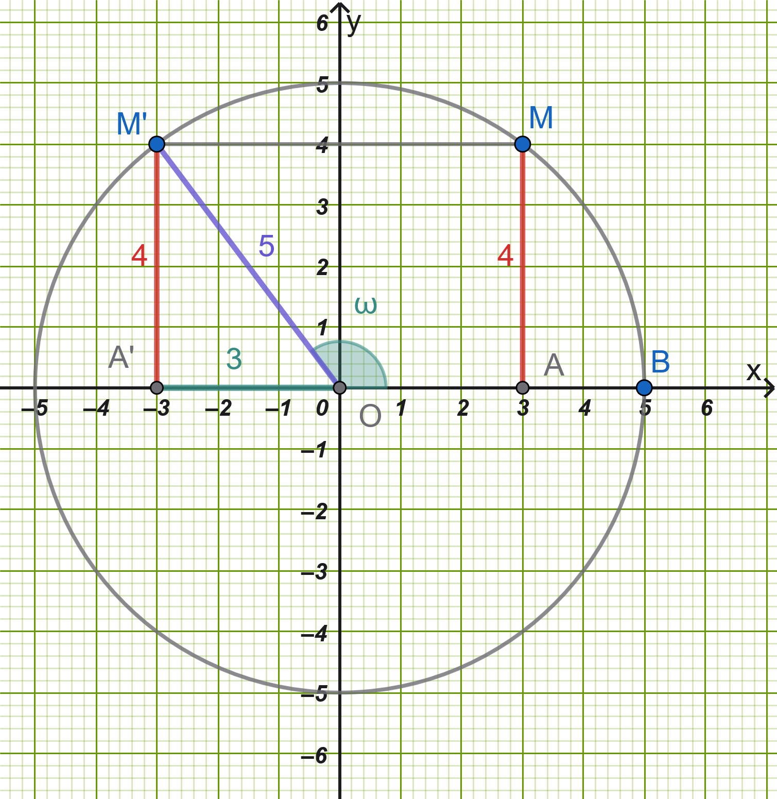{fig-align="center" width="450"}

- Επειδή $συνω < 0$, έχουμε: $συνω=  -\dfrac{3}{5}$.

- **Γ2:**

  - $εφω = \dfrac{y}{x} =  -\dfrac{4}{3}$

  - $σφω = \dfrac{y}{x} =  -\dfrac{3}{4}$

- **Γ3:** Αντικαθιστούμε τις τιμές στην παράσταση $K$: $$K = \frac{5\left(-\frac{3}{5}\right) + 3\left(-\frac{4}{3}\right)}{4\left(-\frac{3}{4}\right) + 1} = \frac{-3 - 4}{-3 + 1} = \frac{-7}{-2} = \frac{7}{2}$$

------------------------------------------------------------------------

### **ΘΕΜΑ Δ**

- **Δ1:** Έστω $K\Delta = h$ το ύψος του πύργου (όπου $\Delta$ η βάση) και $d = (B\Delta)$ η απόσταση του σημείου $B$ από τη βάση.

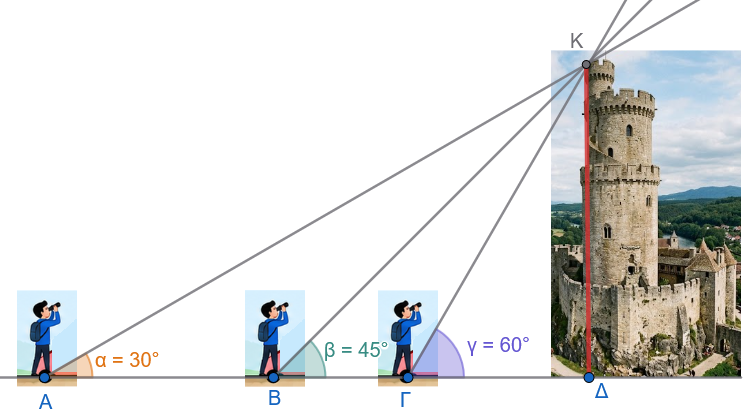{fig-align="center" width="500"}

- Στο ορθογώνιο τρίγωνο $KB\Delta$ ($\hat{B} = 45^\circ$): $$\epsilon\phi 45^\circ = \frac{h}{d} \iff 1 = \frac{h}{d} \iff d = h$$

- Στο ορθογώνιο τρίγωνο $KA\Delta$ ($\hat{A} = 30^\circ$ με συνολική απόσταση $(A\Delta) = 40 + h$): $$\epsilon\phi 30^\circ = \frac{h}{40 + h} \iff \frac{\sqrt{3}}{3} = \frac{h}{40 + h}$$

- **Δ2:** Επιλύουμε ως προς $h$: $$\sqrt{3}(40 + h) = 3h \iff 40\sqrt{3} + \sqrt{3}h = 3h \iff h(3 - \sqrt{3}) = 40\sqrt{3}$$ $$h = \frac{40\sqrt{3}}{3 - \sqrt{3}} = \frac{40\sqrt{3}(3 + \sqrt{3})}{9 - 3} = \frac{120\sqrt{3} + 120}{6} = 20(\sqrt{3} + 1)\text{ m}$$

- **Δ3:** Έστω $x = (\Gamma\Delta)$ η απόσταση του σημείου $\Gamma$ από τη βάση του πύργου.
  Στο ορθογώνιο τρίγωνο $K\Gamma\Delta$ ($\hat{\Gamma} = 60^\circ$): $$\epsilon\phi 60^\circ = \frac{h}{x} \iff \sqrt{3} = \dfrac{20(\sqrt{3} + 1)}{x} \iff x = \frac{20(\sqrt{3} + 1)}{\sqrt{3}} = \frac{20(3 + \sqrt{3})}{3}\text{ m}$$

------------------------------------------------------------------------

::: {.callout-tip style="color: brown;"}
ΚΑΛΗ ΜΕΛΕΤΗ!
:::
