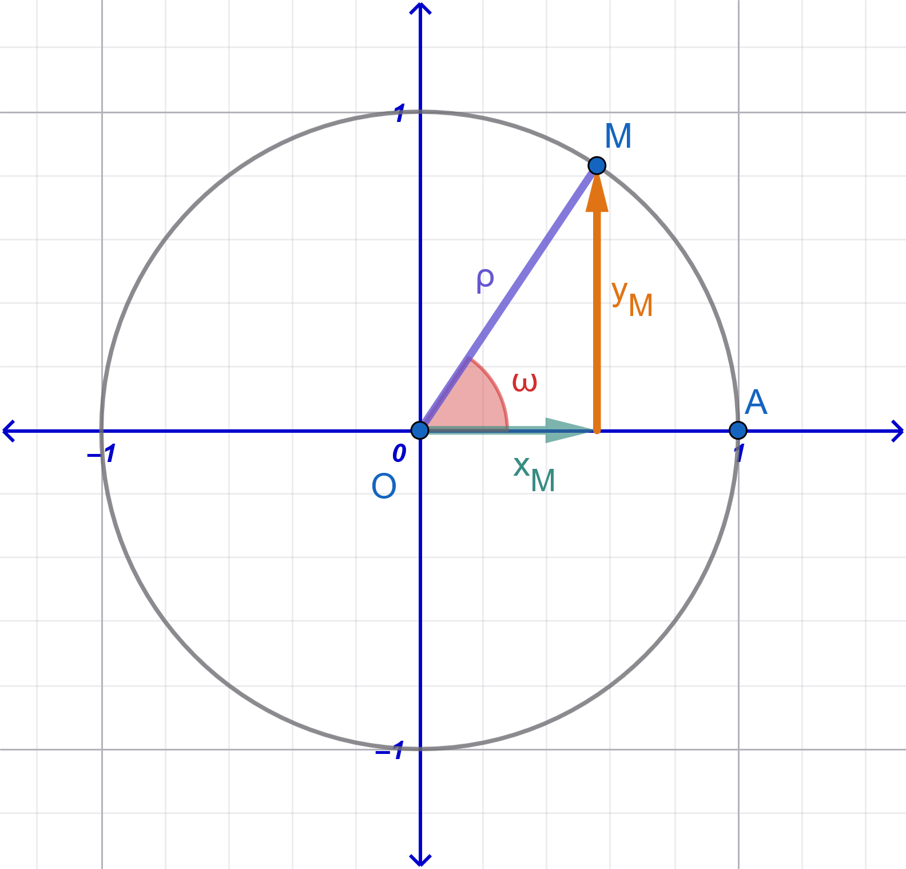

```{=html}
<!-- Φόρτωση βιβλιοθήκης GeoGebra -->
<script src="https://www.geogebra.org/apps/deployggb.js"></script>

<!-- Συνάρτηση δημιουργίας applets -->
<script>
function createGeoGebra(containerId, materialId, width = 700, height = 500) {
  var params = {
    "id": "ggb-" + containerId,
    "material_id": materialId,
    "width": width,
    "height": height,
    "showToolBar": true,
    "showMenuBar": false,
    "showAlgebraInput": true
  };
  
  var applet = new GGBApplet(params, '5.2');
  applet.inject(containerId);
}
</script>
```

## Βασικές Τριγωνομετρικές Ταυτότητες

### $ημ^2ω + συν^2ω = 1$

:::: {.math-box .proposal-box}
::: {.math-title .proposal-title}
Ταυτότητα 1
:::

$ημ^2ω + συν^2ω = 1$
::::

:::: {.math-box .proposalproof-box}
::: {.math-title .proposalproof-title}
**Απόδειξη:**

{fig-align="center" width="400"}
:::

Θεωρούμε ορθοκανονικό σύστημα συντεταγμένων και τον **τριγωνομετρικό κύκλο** με ακτίνα $\rho = 1$.

Έστω $M(x, y)$ το σημείο τομής της τελικής πλευράς της γωνίας $\omega$ με τον τριγωνομετρικό κύκλο.

Από τους ορισμούς των τριγωνομετρικών αριθμών στον τριγωνομετρικό κύκλο, ισχύει: $$x = συνω \quad \text{και} \quad y = ημω$$

Επειδή το σημείο $M(x, y)$ ανήκει στον κύκλο κέντρου $O(0,0)$ και ακτίνας $R = 1$, η απόστασή του από την αρχή των αξόνων είναι $(OM) = 1$.
Από το Πυθαγόρειο Θεώρημα ισχύει ότι: $$x^2 + y^2 = 1$$

Αντικαθιστώντας $x = συνω$ και $y = ημω$, προκύπτει: $$συν^2ω + ημ^2ω = 1 \iff \mathbf{ημ^2ω + συν^2ω = 1}$$
::::

------------------------------------------------------------------------

### $εφω = \dfrac{ημω}{συνω}$ και $σφω = \dfrac{συνω}{ημω}$

:::: {.math-box .proposal-box}
::: {.math-title .proposal-title}
Ταυτότητα 2
:::

$εφω = \dfrac{ημω}{συνω}$ και $σφω = \dfrac{συνω}{ημω}$
::::

:::: {.math-box .proposalproof-box}
::: {.math-title .proposalproof-title}
**Απόδειξη:**
:::

Από τους ορισμούς των τριγωνομετρικών αριθμών στο σύστημα συντεταγμένων, για ένα σημείο $M(x, y)$ της τελικής πλευράς της γωνίας $\omega$ στον τριγωνομετρικό κύκλο, έχουμε $x = συνω$ και $y = ημω$.

- Για την **εφαπτομένη** ($εφω$), με την προϋπόθεση ότι $x = συνω \neq 0$ (δηλαδή $\omega \neq k\pi + \dfrac{\pi}{2}, k \in \mathbb{Z}$), ορίζεται ως: $$εφω = \frac{y}{x} = \mathbf{\frac{ημω}{συνω}}$$

- Για τη **συνεφαπτομένη** ($σφω$), με την προϋπόθεση ότι $y = ημω \neq 0$ (δηλαδή $\omega \neq k\pi, k \in \mathbb{Z}$), ορίζεται ως: $$σφω = \frac{x}{y} = \mathbf{\frac{συνω}{ημω}}$$
::::

------------------------------------------------------------------------

### $εφω \cdot σφω = 1$

:::: {.math-box .proposal-box}
::: {.math-title .proposal-title}
Ταυτότητα 3
:::

$εφω \cdot σφω = 1$
::::

:::: {.math-box .proposalproof-box}
::: {.math-title .proposalproof-title}
**Απόδειξη:**
:::

Για κάθε γωνία $\omega$ για την οποία ορίζονται ταυτόχρονα η εφαπτομένη και η συνεφαπτομένη (δηλαδή με $συνω \neq 0$ και $ημω \neq 0$), αντικαθιστούμε τους τύπους των $εφω$ και $σφω$: $$εφω \cdot σφω = \frac{ημω}{συνω} \cdot \frac{συνω}{ημω} = \frac{\cancel{ημω} \cdot \cancel{συνω}}{\cancel{συνω} \cdot \cancel{ημω}} = \mathbf{1}$$
::::

------------------------------------------------------------------------

### $συν^2ω = \dfrac{1}{1 + εφ^2ω}$ και $ημ^2ω = \dfrac{εφ^2ω}{1 + εφ^2ω}$

:::: {.math-box .proposal-box}
::: {.math-title .proposal-title}
Ταυτότητα 4
:::

$συν^2ω = \dfrac{1}{1 + εφ^2ω}$ και $ημ^2ω = \dfrac{εφ^2ω}{1 + εφ^2ω}$
::::

:::: {.math-box .proposalproof-box}
::: {.math-title .proposalproof-title}
**Απόδειξη:**
:::

i)  Θεωρούμε τη θεμελιώδη ταυτότητα $ημ^2ω + συν^2ω = 1$.

Διαιρούμε και τα δύο μέλη με $συν^2ω \neq 0$: $$\frac{ημ^2ω}{συν^2ω} + \frac{συν^2ω}{συν^2ω} = \frac{1}{συν^2ω} \iff \left(\frac{ημω}{συνω}\right)^2 + 1 = \frac{1}{συν^2ω} \iff εφ^2ω + 1 = \frac{1}{συν^2ω}$$

Αντιστρέφοντας τα δύο μέλη, λαμβάνουμε: $$\mathbf{συν^2ω = \frac{1}{1 + εφ^2ω}}$$

ii) Αντικαθιστούμε την έκφραση του $συν^2ω$ στη θεμελιώδη ισότητα $ημ^2ω + συν^2ω = 1$: $$ημ^2ω + \frac{1}{1 + εφ^2ω} = 1 \iff ημ^2ω = 1 - \frac{1}{1 + εφ^2ω} \iff ημ^2ω = \frac{1 + εφ^2ω - 1}{1 + εφ^2ω}$$

Άρα προκύπτει: $$\mathbf{ημ^2ω = \frac{εφ^2ω}{1 + εφ^2ω}}$$
::::

------------------------------------------------------------------------

### Ασκήσεις και Προβλήματα Εμπέδωσης

#### **Κατηγορία Α: Υπολογισμός Τριγωνομετρικών Αριθμών**

1.  Αν $ημω = \dfrac{3}{5}$ και $\dfrac{\pi}{2} < \omega < \pi$ (2ο τεταρτημόριο), να υπολογιστούν οι υπόλοιποι τριγωνομετρικοί αριθμοί της γωνίας $\omega$.

2.  Αν $συνω = -\dfrac{12}{13}$ και $\pi < \omega < \dfrac{3\pi}{2}$ (3ο τεταρτημόριο), να υπολογιστούν τα $ημω, εφω, σφω$.

3.  Αν $εφω = -\dfrac{3}{4}$ και $\dfrac{3\pi}{2} < \omega < 2\pi$ (4ο τεταρτημόριο), να υπολογιστούν τα $συνω$ και $ημω$ με χρήση των τύπων $συν^2ω = \dfrac{1}{1+εφ^2ω}$ και $ημ^2ω = \dfrac{εφ^2ω}{1+εφ^2ω}$.

4.  Αν $σφω = \sqrt{3}$ και $\pi < \omega < \dfrac{3\pi}{2}$, να υπολογιστούν οι τιμές των $εφω, συνω, ημω$.

5.  Αν $συνω = \dfrac{4}{5}$ και $0 < \omega < \dfrac{\pi}{2}$, να υπολογιστεί η τιμή της παράστασης $P = \dfrac{5ημω - 3εφω}{4σφω + 1}$.

#### **Κατηγορία Β: Αποδείξεις Τριγωνομετρικών Ταυτοτήτων**

6.  Να αποδειχθεί ότι: $$
    ημ^4 ω - συν^4 ω =
    \begin{cases}
    ημ^2ω - συν^2ω \\
    2ημ^2ω - 1 \\
    1-2συν^2ω \\
    \end{cases}
    $$.

::: callout-sos
**Υπόδειξη - Λύση**

$ημ^4ω-σν^4ω=\overset{\text{διαφορά τετραγώνων}}{(ημ^2ω)^2-(συν^2ω)^2}= (ημ^2ω-συν^2ω)(......... +  ......... )=$
:::

7.  Να αποδειχθεί ότι: $ημ^4ω + συν^4ω = 1 - 2ημ^2ω \cdot συν^2ω$.

::: callout-sos
**Υπόδειξη - Λύση**

Ισχύει ότι: $ημ^2ω+συν^2ω=1 \implies (ημ^2ω+συν^2ω)^2\overset{\text{υψώνουμε και τα μέλη στο τετράγωνο}}{=}1^2 \implies\\ ημ^4ω+συν^4ω+2ημ^2ωσυν^2ω=1 \implies .............$
:::

8.  Να αποδειχθεί ότι: $(ημω + συνω)^2 + (ημω - συνω)^2 = 2$.

9.  Να αποδειχθεί ότι: $\dfrac{ημω}{1 + συνω} + \dfrac{1 + συνω}{ημω} = \dfrac{2}{ημω}$ (για $ημω \neq 0$ και $συνω \neq -1$).

::: callout-sos
**Υπόδειξη - Λύση**

$\dfrac{ημω}{1 + συνω} + \dfrac{1 + συνω}{ημω} \overset{\text{κάνουμε τα κλάσματα ομώνυμα}}{=} \dfrac{ημω\cdotημω}{(1 + συνω)ημω} + \dfrac{(1 + συνω)(1+συνω)}{(1+συνω)ημω}=\\ \dfrac{ημ^2ω+}{1 + συνω)ημω} + \dfrac{1^2 + 2συνω+συν^2ω}{(1+συνω)ημω}=\dfrac{2 + 2συνω}{(1+συνω)ημω}= .............$
:::

10. Να αποδειχθεί ότι: $\dfrac{εφω + σφω}{\dfrac{1}{συνω}} = \dfrac{1}{ημω}$.

::: callout-sos
**Υπόδειξη - Λύση**

$\dfrac{εφω + σφω}{\dfrac{1}{συνω}} = \dfrac{1}{ημω} \Longleftrightarrow εφω+σφω=\dfrac{1}{ημωσυνω}  \ \ \ \ (1)$

Αρκεί να αποδείξουμε την (1)

$εφω+σφω=\dfrac{ημω}{συνω}+\dfrac{συνω}{ημω} \overset{\text{τα κάνουμε ομώνυμα}}{=} \dfrac{ημωημω}{συνωημω}+\dfrac{συνωσυνω}{ημωσυνω}=\dfrac{ημ^2ω}{συνωημω}+\dfrac{συν^2ω}{ημωσυνω}=\\ \\ .........................................$
:::

11. Να αποδειχθεί ότι: $(1 - ημω)(1 + ημω)(1 + εφ^2ω) = 1$.

::: callout-sos
**Υπόδειξη - Λύση**

$\overset{\text{διαφορά τετραγώνων}}{(1 - ημω)(1 + ημω)}\overset{\text{από την }συν^2ω=\dfrac{1}{1+εφ^2ω}}{(1 + εφ^2ω)} = (1-ημ^2ω)\left(\dfrac{1}{συν^2ω}\right)=.................$
:::

12. Να αποδειχθεί ότι: $\dfrac{εφ^2ω - 1}{εφ^2ω + 1} = ημ^2ω - συν^2ω$.

#### **Κατηγορία Γ: Απλοποίηση Παραστάσεων & Σταθερές Τιμές**

13. Να απλοποιηθεί η παράσταση: $A = (ημω + συνω)^2 - 2ημωσυνω$.

14. Να δειχθεί ότι η παράσταση $B = συν^2ω \cdot (1 + εφ^2ω) + ημ^2ω \cdot (1 + \sigma\phi^2\omega)$ έχει σταθερή τιμή ανεξάρτητη του $\omega$.

15. Να απλοποιηθεί η παράσταση: $\Gamma = \dfrac{1}{1 + εφ^2ω} + \dfrac{1}{1 + \sigma\phi^2\omega}$.

::: callout-sos
**Υπόδειξη - Λύση**

$Γ=\dfrac{1}{1 + \dfrac{συν^2ω}{ημ^2ω}} +\dfrac{1}{1 + \dfrac{ημ^2x}{συν^2ω}}=\dfrac{1}{ \dfrac{ημ^2ω+συν^2ω}{ημ^2ω}} +\dfrac{1}{\dfrac{συν^2ω+ημ^2ω}{συν^2ω}}= \\ \dfrac{1}{ \dfrac{1}{ημ^2ω}} +\dfrac{1}{\dfrac{1}{συν^2ω}}= .................................. =1$
:::

:::: {.math-box .exercise-box}
::: {.math-title .exercise-title}
16. Εκφώνηση
:::

Να απλοποιήσετε τις παρακάτω παραστάσεις:

1.  $\epsilon\phi^2 \theta \cdot \sigma\upsilon\nu^2 \theta$
2.  $\dfrac{1}{\sigma\upsilon\nu^2 \theta} - \epsilon\phi^2 \theta$

*(με την προϋπόθεση ότι* $\sigma\upsilon\nu \theta \neq 0$)
::::

:::: {.math-box .solution-box}
::: {.math-title .solution-title}
Λύση
:::

**1. Για την παράσταση** $\epsilon\phi^2 \theta \cdot \sigma\upsilon\nu^2 \theta$

Γνωρίζουμε από τον ορισμό της εφαπτομένης ότι: $$\epsilon\phi \theta = \frac{\eta\mu \theta}{\sigma\upsilon\nu \theta} \implies \epsilon\phi^2 \theta = \frac{\eta\mu^2 \theta}{\sigma\upsilon\nu^2 \theta}$$

Αντικαθιστούμε στην παράσταση: $$\epsilon\phi^2 \theta \cdot \sigma\upsilon\nu^2 \theta = \frac{\eta\mu^2 \theta}{\sigma\upsilon\nu^2 \theta} \cdot \sigma\upsilon\nu^2 \theta$$

Απλοποιούμε τον όρο $\sigma\upsilon\nu^2 \theta$: $$= \eta\mu^2 \theta$$

------------------------------------------------------------------------

**2. Για την παράσταση** $\dfrac{1}{\sigma\upsilon\nu^2 \theta} - \epsilon\phi^2 \theta$

Αντικαθιστούμε την $\epsilon\phi^2 \theta = \dfrac{\eta\mu^2 \theta}{\sigma\upsilon\nu^2 \theta}$: $$\frac{1}{\sigma\upsilon\nu^2 \theta} - \epsilon\phi^2 \theta = \frac{1}{\sigma\upsilon\nu^2 \theta} - \frac{\eta\mu^2 \theta}{\sigma\upsilon\nu^2 \theta}$$

Επειδή τα κλάσματα είναι ομώνυμα, τα γράφουμε σε ένα κοινό κλάσμα: $$= \frac{1 - \eta\mu^2 \theta}{\sigma\upsilon\nu^2 \theta}$$

Από τη βασική τριγωνομετρική ταυτότητα $\eta\mu^2 \theta + \sigma\upsilon\nu^2 \theta = 1$, έχουμε: $$1 - \eta\mu^2 \theta = \sigma\upsilon\nu^2 \theta$$

Επομένως: $$= \frac{\sigma\upsilon\nu^2 \theta}{\sigma\upsilon\nu^2 \theta} = 1$$
::::

#### **Κατηγορία Δ: Σύνθετα Προβλήματα & Εφαρμογές**

17. Αν $ημω + συνω = \dfrac{7}{5}$:

    - α) Να υπολογιστεί το γινόμενο $ημω \cdot συνω$.

    - β) Να υπολογιστεί το άθροισμα $εφω + σφω$.

> > > (α) Υψώστε και τα δύο μέλη στο τετράγωνο και στη συνέχεια αναπτύξτε ...........

> > > (β) $εφω+σφω=\dfrac{ημω}{συνω}+\dfrac{συνω}{ημω}=\dfrac{ημ^2ω+συν^2ω}{ημωσυνω}= ...................$

18. Αν $εφω + σφω = 3 \ \ \ \ \ \ (1)$:

    - α) Να υπολογιστεί η τιμή της παράστασης $εφ^2ω + σφ^2ω$.

    - β) Να υπολογιστεί η τιμή της παράστασης $|εφω - σφω|$.

> > > (α) Υψώστε την (1) στο τετράγωνο

> > > (β) Κάντε το ίδιο και χρησιμοποιήστε και το αποτέλεσμα του (α)

19. Να εξεταστεί αν υπάρχει πραγματική γωνία $\omega$ για την οποία ισχύει $ημω = x + \dfrac{1}{x}$, όπου $x$ είναι ένας μη μηδενικός πραγματικός αριθμός.

> > > Επειδή $-1\le x \le 1 \implies -1\le x + \dfrac{1}{x} \le 1 \implies ...........................$


:::: {.math-box .exercise-box}
::: {.math-title .exercise-title}
20. Εκφώνηση
:::
Να αποδειχθεί ότι για κάθε γωνία $\omega$ ισχύει η ανισότητα: $$-\sqrt{2} \le ημω + συνω \le \sqrt{2}$$
::::


:::: {.math-box .solution-box}
::: {.math-title .solution-title}
Λύση
:::

Θέλουμε να αποδείξουμε ότι για κάθε γωνία $\omega$ ισχύει: $$-\sqrt{2} \le \eta\mu\omega + \sigma\upsilon\nu\omega \le \sqrt{2}$$

Η ανισότητα αυτή είναι ισοδύναμη με: $$|\eta\mu\omega + \sigma\upsilon\nu\omega| \le \sqrt{2}$$

Επειδή και τα δύο μέλη είναι μη αρνητικά, υψώνουμε στο τετράγωνο: $$(\eta\mu\omega + \sigma\upsilon\nu\omega)^2 \le (\sqrt{2})^2$$

Αναπτύσσουμε την ταυτότητα στο αριστερό μέλος: $$\eta\mu^2\omega + 2\eta\mu\omega\sigma\upsilon\nu\omega + \sigma\upsilon\nu^2\omega \le 2$$

Χρησιμοποιούμε τη βασική τριγωνομετρική ταυτότητα $\eta\mu^2\omega + \sigma\upsilon\nu^2\omega = 1$: $$1 + 2\eta\mu\omega\sigma\upsilon\nu\omega \le 2$$

Αφαιρούμε το $1$ και από τα δύο μέλη: $$2\eta\mu\omega\sigma\upsilon\nu\omega \le 1$$ $$1 - 2\eta\mu\omega\sigma\upsilon\nu\omega \ge 0$$

Αντικαθιστώντας ξανά το $1$ με $\eta\mu^2\omega + \sigma\upsilon\nu^2\omega$, έχουμε: $$(\eta\mu^2\omega + \sigma\upsilon\nu^2\omega) - 2\eta\mu\omega\sigma\upsilon\nu\omega \ge 0$$ $$(\eta\mu\omega - \sigma\upsilon\nu\omega)^2 \ge 0$$

Το οποίο ισχύει πάντοτε, καθώς το τετράγωνο οποιουδήποτε πραγματικού αριθμού είναι μεγαλύτερο ή ίσο του μηδενός.

Επομένως, αντιστρέφοντας τα βήματα, ισχύει: $$-\sqrt{2} \le \eta\mu\omega + \sigma\upsilon\nu\omega \le \sqrt{2}$$

------------------------------------------------------------------------

**Εναλλακτική Μέθοδος (με μετασχηματισμό σε ένα ημίτονο)**

Πολλαπλασιάζουμε και διαιρούμε την παράσταση με το $\sqrt{2}$: $$\eta\mu\omega + \sigma\upsilon\nu\omega = \sqrt{2}\left(\frac{\sqrt{2}}{2}\eta\mu\omega + \frac{\sqrt{2}}{2}\sigma\upsilon\nu\omega\right)$$

Επειδή $\sigma\upsilon\nu\left(\dfrac{\pi}{4}\right) = \dfrac{\sqrt{2}}{2}$ και $\eta\mu\left(\dfrac{\pi}{4}\right) = \dfrac{\sqrt{2}}{2}$, έχουμε: $$\eta\mu\omega + \sigma\upsilon\nu\omega = \sqrt{2}\left(\eta\mu\omega\cdot\sigma\upsilon\nu\frac{\pi}{4} + \sigma\upsilon\nu\omega\cdot\eta\mu\frac{\pi}{4}\right) = \sqrt{2}\,\eta\mu\left(\omega + \frac{\pi}{4}\right)$$ 

*Την τελευταία ισότητα θα την μάθουμε στη συνέχεια*

Γνωρίζουμε ότι για κάθε γωνία ισχύει: $$-1 \le \eta\mu\left(\omega + \frac{\pi}{4}\right) \le 1$$

Πολλαπλασιάζοντας όλα τα μέλη με $\sqrt{2} > 0$: $$-\sqrt{2} \le \sqrt{2}\,\eta\mu\left(\omega + \frac{\pi}{4}\right) \le \sqrt{2}$$ $$-\sqrt{2} \le \eta\mu\omega + \sigma\upsilon\nu\omega \le \sqrt{2}$$
::::


------------------------------------------------------------------------

### 🏋️‍♂️ Ομάδα 1: Προχωρημένες Αποδείξεις & Αλγεβρικές Ταυτότητες

**Άσκηση 1**

Να αποδειχθεί ότι για κάθε γωνία $\alpha$ για την οποία ορίζεται η εφαπτομένη ισχύει η ισότητα: $$\epsilon\phi^2\alpha - \eta\mu^2\alpha = \epsilon\phi^2\alpha \cdot \eta\mu^2\alpha$$

**Αναλυτική Λύση:**

Ξεκινάμε από το αριστερό μέλος και εκφράζουμε την εφαπτομένη ως προς ημίτονο και συνημίτονο: $$\epsilon\phi^2\alpha - \eta\mu^2\alpha = \frac{\eta\mu^2\alpha}{\sigma\upsilon\nu^2\alpha} - \eta\mu^2\alpha$$

Βγάζουμε κοινό παράγοντα το $\eta\mu^2\alpha$: $$= \eta\mu^2\alpha \cdot \left( \frac{1}{\sigma\upsilon\nu^2\alpha} - 1 \right) = \eta\mu^2\alpha \cdot \left( \frac{1 - \sigma\upsilon\nu^2\alpha}{\sigma\upsilon\nu^2\alpha} \right)$$

Χρησιμοποιώντας τη θεμελιώδη ταυτότητα $1 - \sigma\upsilon\nu^2\alpha = \eta\mu^2\alpha$: $$= \eta\mu^2\alpha \cdot \frac{\eta\mu^2\alpha}{\sigma\upsilon\nu^2\alpha} = \eta\mu^2\alpha \cdot \epsilon\phi^2\alpha = \epsilon\phi^2\alpha \cdot \eta\mu^2\alpha$$

------------------------------------------------------------------------

**Άσκηση 2**

Να αποδειχθεί ότι: $$\frac{\sigma\upsilon\nu^4\alpha - \eta\mu^4\alpha}{\sigma\upsilon\nu^2\alpha} = 1 - \epsilon\phi^2\alpha$$

**Αναλυτική Λύση:**

Παραγοντοποιούμε τον αριθμητή ως διαφορά τετραγώνων $x^2 - y^2 = (x - y)(x + y)$: $$\sigma\upsilon\nu^4\alpha - \eta\mu^4\alpha = (\sigma\upsilon\nu^2\alpha - \eta\mu^2\alpha)(\sigma\upsilon\nu^2\alpha + \eta\mu^2\alpha)$$

Επειδή $\sigma\upsilon\nu^2\alpha + \eta\mu^2\alpha = 1$, η παράσταση απλοποιείται σε: $$\sigma\upsilon\nu^2\alpha - \eta\mu^2\alpha$$

Διαιρούμε τώρα με τον παρονομαστή $\sigma\upsilon\nu^2\alpha$: $$\frac{\sigma\upsilon\nu^2\alpha - \eta\mu^2\alpha}{\sigma\upsilon\nu^2\alpha} = \frac{\sigma\upsilon\nu^2\alpha}{\sigma\upsilon\nu^2\alpha} - \frac{\eta\mu^2\alpha}{\sigma\upsilon\nu^2\alpha} = 1 - \epsilon\phi^2\alpha$$

------------------------------------------------------------------------

**Άσκηση 3.**

Να αποδείξετε ότι:

**i) $\eta\mu^4 x+\sigma\upsilon\nu^4 x=1-2\eta\mu^2 x\cdot\sigma\upsilon\nu^2 x$**


**Απάντηση**

Χρησιμοποιούμε την ταυτότητα:

$$\eta\mu^2 x+\sigma\upsilon\nu^2 x=1$$

Υψώνουμε στο τετράγωνο:

$$\left(\eta\mu^2 x+\sigma\upsilon\nu^2 x\right)^2=1$$

Αναπτύσσοντας το αριστερό μέλος:

$$\eta\mu^4 x+2\eta\mu^2 x\cdot\sigma\upsilon\nu^2 x+\sigma\upsilon\nu^4 x=1$$

Άρα:

$$\boxed{\eta\mu^4 x+\sigma\upsilon\nu^4 x
=1-2\eta\mu^2 x\cdot\sigma\upsilon\nu^2 x}$$

---

**ii) $\eta\mu^6 x+\sigma\upsilon\nu^6 x=1-3\eta\mu^2 x\cdot\sigma\upsilon\nu^2 x$**

**Απάντηση**

Θέτουμε:

$$a=\eta\mu^2 x,\qquad b=\sigma\upsilon\nu^2 x$$

Τότε:

$$a+b=1$$

Χρησιμοποιούμε την ταυτότητα:

$$a^3+b^3=(a+b)^3-3ab(a+b)$$

Επομένως:

$$\eta\mu^6 x+\sigma\upsilon\nu^6 x
=\left(\eta\mu^2 x+\sigma\upsilon\nu^2 x\right)^3
-3\eta\mu^2 x\cdot\sigma\upsilon\nu^2 x
\left(\eta\mu^2 x+\sigma\upsilon\nu^2 x\right)$$

Επειδή $\eta\mu^2 x+\sigma\upsilon\nu^2 x=1$, παίρνουμε:

$$\eta\mu^6 x+\sigma\upsilon\nu^6 x
=1^3-3\eta\mu^2 x\cdot\sigma\upsilon\nu^2 x\cdot1$$

Άρα:

$$\boxed{\eta\mu^6 x+\sigma\upsilon\nu^6 x
=1-3\eta\mu^2 x\cdot\sigma\upsilon\nu^2 x}$$

---

**iii) Να αποδείξετε ότι η παράσταση**

$$2(\eta\mu^6 x+\sigma\upsilon\nu^6 x)
-3(\eta\mu^4 x+\sigma\upsilon\nu^4 x)$$

είναι ανεξάρτητη του $x$.

Από τα προηγούμενα ερωτήματα γνωρίζουμε ότι:

$$\eta\mu^6 x+\sigma\upsilon\nu^6 x
=1-3\eta\mu^2 x\cdot\sigma\upsilon\nu^2 x$$

και

$$\eta\mu^4 x+\sigma\upsilon\nu^4 x
=1-2\eta\mu^2 x\cdot\sigma\upsilon\nu^2 x$$

Αντικαθιστούμε:

$$
\begin{aligned}
&2(\eta\mu^6 x+\sigma\upsilon\nu^6 x)
-3(\eta\mu^4 x+\sigma\upsilon\nu^4 x)\\
&=2\left(1-3\eta\mu^2 x\cdot\sigma\upsilon\nu^2 x\right)
-3\left(1-2\eta\mu^2 x\cdot\sigma\upsilon\nu^2 x\right)
\end{aligned}
$$

Κάνοντας τις πράξεις:

$$
\begin{aligned}
&=2-6\eta\mu^2 x\cdot\sigma\upsilon\nu^2 x
-3+6\eta\mu^2 x\cdot\sigma\upsilon\nu^2 x\\
&=-1
\end{aligned}
$$

Άρα η παράσταση έχει σταθερή τιμή:

$$\boxed{-1}$$

Επομένως είναι ανεξάρτητη του $x$.

---

### 📐 Ομάδα 2: Ταυτότητες υπό Συνθήκη

**Άσκηση 4.**

Για $-\dfrac{\pi}{2}<x<\dfrac{\pi}{2}$, να αποδείξετε ότι

$$
\sqrt{\frac{1+\eta\mu x}{1-\eta\mu x}}
-
\sqrt{\frac{1-\eta\mu x}{1+\eta\mu x}}
=2\epsilon\phi x
$$


**Απάντηση**

Αφού:

$$-\frac{\pi}{2}<x<\frac{\pi}{2}$$

έχουμε:

$$\sigma\upsilon\nu x>0$$

Άρα και:

$$1+\eta\mu x>0,\qquad 1-\eta\mu x>0$$

Χρησιμοποιούμε την ταυτότητα:

$$\sigma\upsilon\nu^2 x=1-\eta\mu^2 x$$

Έχουμε:

$$
\frac{1+\eta\mu x}{1-\eta\mu x}
=\frac{(1+\eta\mu x)(1+ημx)}{(1-\eta\mu x)(1+ημx)}
=\frac{(1+\eta\mu x)^2}{1-\eta\mu^2 x}
=\frac{(1+\eta\mu x)^2}{\sigma\upsilon\nu^2 x}
$$

Επειδή $\sigma\upsilon\nu x>0$:

$$
\sqrt{\frac{1+\eta\mu x}{1-\eta\mu x}}
=\frac{1+\eta\mu x}{\sigma\upsilon\nu x}
$$

Ομοίως:

$$
\frac{1-\eta\mu x}{1+\eta\mu x}
=\frac{(1-\eta\mu x)(1-ημx)}{(1+\eta\mu x)(1-ημx)}
=\frac{(1-\eta\mu x)^2}{1-\eta\mu^2 x}
=\frac{(1-\eta\mu x)^2}{\sigma\upsilon\nu^2 x}
$$

Άρα:

$$
\sqrt{\frac{1-\eta\mu x}{1+\eta\mu x}}
=\frac{1-\eta\mu x}{\sigma\upsilon\nu x}
$$

Επομένως:

$$
\begin{aligned}
&\sqrt{\frac{1+\eta\mu x}{1-\eta\mu x}}
-
\sqrt{\frac{1-\eta\mu x}{1+\eta\mu x}}\\
&=\frac{1+\eta\mu x}{\sigma\upsilon\nu x}
-\frac{1-\eta\mu x}{\sigma\upsilon\nu x}\\
&=\frac{1+\eta\mu x-1+\eta\mu x}{\sigma\upsilon\nu x}\\
&=\frac{2\eta\mu x}{\sigma\upsilon\nu x}\\
&=2\epsilon\phi x
\end{aligned}
$$

Άρα:

$$\boxed{
\sqrt{\frac{1+\eta\mu x}{1-\eta\mu x}}
-
\sqrt{\frac{1-\eta\mu x}{1+\eta\mu x}}
=2\epsilon\phi x
}$$

---

**Άσκηση 5.**

Για $0\le x<\dfrac{\pi}{2}$, να αποδείξετε ότι

$$
\frac{\sqrt{1+\sigma\upsilon\nu x}+\sqrt{1-\sigma\upsilon\nu x}}
{\sqrt{1+\sigma\upsilon\nu x}-\sqrt{1-\sigma\upsilon\nu x}}
=\frac{1+\eta\mu x}{\sigma\upsilon\nu x}
=\frac{\sigma\upsilon\nu x}{1-\eta\mu x}
$$


**Απάντηση**

Θέτουμε:

$$
a=\sqrt{1+\sigma\upsilon\nu x},
\qquad
b=\sqrt{1-\sigma\upsilon\nu x}
$$

Τότε η πρώτη παράσταση γράφεται:

$$\frac{a+b}{a-b}$$

Πολλαπλασιάζουμε αριθμητή και παρονομαστή με $a+b$:

$$
\frac{a+b}{a-b}
=\frac{(a+b)^2}{a^2-b^2}
$$

Υπολογίζουμε τον παρονομαστή:

$$
a^2-b^2
=(1+\sigma\upsilon\nu x)-(1-\sigma\upsilon\nu x)
=2\sigma\upsilon\nu x
$$

Υπολογίζουμε τον αριθμητή:

$$
\begin{aligned}
(a+b)^2
&=a^2+2ab+b^2\\
&=(1+\sigma\upsilon\nu x)
+2\sqrt{(1+\sigma\upsilon\nu x)(1-\sigma\upsilon\nu x)}
+(1-\sigma\upsilon\nu x)\\
&=2+2\sqrt{1-\sigma\upsilon\nu^2 x}\\
&=2+2\sqrt{\eta\mu^2 x}
\end{aligned}
$$

Επειδή $0\le x<\dfrac{\pi}{2}$, έχουμε $\eta\mu x\ge 0$, άρα:

$$\sqrt{\eta\mu^2 x}=\eta\mu x$$

Επομένως:

$$
(a+b)^2=2+2\eta\mu x=2(1+\eta\mu x)
$$

Άρα:

$$
\begin{aligned}
\frac{a+b}{a-b}
&=\frac{2(1+\eta\mu x)}{2\sigma\upsilon\nu x}\\
&=\frac{1+\eta\mu x}{\sigma\upsilon\nu x}
\end{aligned}
$$

Έτσι:

$$
\frac{\sqrt{1+\sigma\upsilon\nu x}+\sqrt{1-\sigma\upsilon\nu x}}
{\sqrt{1+\sigma\upsilon\nu x}-\sqrt{1-\sigma\upsilon\nu x}}
=\frac{1+\eta\mu x}{\sigma\upsilon\nu x}
$$

Τέλος, για τη δεύτερη ισότητα, χρησιμοποιούμε:

$$
\sigma\upsilon\nu^2 x=1-\eta\mu^2 x
=(1-\eta\mu x)(1+\eta\mu x)
$$

Άρα:

$$
\frac{1+\eta\mu x}{\sigma\upsilon\nu x}
=\frac{1+\eta\mu x}{\sigma\upsilon\nu x}
\cdot
\frac{1-\eta\mu x}{1-\eta\mu x}
$$

$$
=\frac{(1+\eta\mu x)(1-\eta\mu x)}
{\sigma\upsilon\nu x(1-\eta\mu x)}
$$

$$
=\frac{1-\eta\mu^2 x}
{\sigma\upsilon\nu x(1-\eta\mu x)}
$$

$$
=\frac{\sigma\upsilon\nu^2 x}
{\sigma\upsilon\nu x(1-\eta\mu x)}
=\frac{\sigma\upsilon\nu x}{1-\eta\mu x}
$$

Συνεπώς:

$$\boxed{
\frac{\sqrt{1+\sigma\upsilon\nu x}+\sqrt{1-\sigma\upsilon\nu x}}
{\sqrt{1+\sigma\upsilon\nu x}-\sqrt{1-\sigma\upsilon\nu x}}
=\frac{1+\eta\mu x}{\sigma\upsilon\nu x}
=\frac{\sigma\upsilon\nu x}{1-\eta\mu x}
}$$


------------------------------------------------------------------------


### ⚙️ Ομάδα 3: Απαλοιφή Μεταβλητών & Παραμετρικές Μορφές

**Άσκηση 6**

Αν ισχύουν οι σχέσεις $x = r \eta\mu\theta \sigma\upsilon\nu\phi$, $y = r \eta\mu\theta \eta\mu\phi$ και $z = r \sigma\upsilon\nu\theta$, να αποδειχθεί ότι: $$x^2 + y^2 + z^2 = r^2$$

**Αναλυτική Λύση:**

Υπολογίζουμε πρώτα το άθροισμα των τετραγώνων των $x$ και $y$: $$x^2 + y^2 = (r \eta\mu\theta \sigma\upsilon\nu\phi)^2 + (r \eta\mu\theta \eta\mu\phi)^2 = r^2 \eta\mu^2\theta \sigma\upsilon\nu^2\phi + r^2 \eta\mu^2\theta \eta\mu^2\phi$$

Βγάζουμε κοινό παράγοντα το $r^2 \eta\mu^2\theta$: $$x^2 + y^2 = r^2 \eta\mu^2\theta (\sigma\upsilon\nu^2\phi + \eta\mu^2\phi) = r^2 \eta\mu^2\theta \cdot (1) = r^2 \eta\mu^2\theta$$

Προσθέτουμε το $z^2$: $$x^2 + y^2 + z^2 = r^2 \eta\mu^2\theta + (r \sigma\upsilon\nu\theta)^2 = r^2 \eta\mu^2\theta + r^2 \sigma\upsilon\nu^2\theta$$ $$= r^2 (\eta\mu^2\theta + \sigma\upsilon\nu^2\theta) = r^2 \cdot (1) = r^2$$

------------------------------------------------------------------------

**Άσκηση 7**

Αν δίνεται ότι $\sigma\upsilon\nu\alpha - \eta\mu\alpha = \sqrt{2} \eta\mu\alpha$, να αποδειχθεί ότι: $$\sigma\upsilon\nu\alpha + \eta\mu\alpha = \sqrt{2} \sigma\upsilon\nu\alpha$$

**Αναλυτική Λύση:**

Από την αρχική σχέση απομονώνουμε το $\sigma\upsilon\nu\alpha$: $$\sigma\upsilon\nu\alpha = \sqrt{2} \eta\mu\alpha + \eta\mu\alpha \iff \sigma\upsilon\nu\alpha = (\sqrt{2} + 1) \eta\mu\alpha$$

Πολλαπλασιάζουμε και τα δύο μέλη με τη συζυγή παράσταση $(\sqrt{2} - 1)$: $$(\sqrt{2} - 1) \sigma\upsilon\nu\alpha = (\sqrt{2} - 1)(\sqrt{2} + 1) \eta\mu\alpha$$ $$\sqrt{2} \sigma\upsilon\nu\alpha - \sigma\upsilon\nu\alpha = (2 - 1) \eta\mu\alpha = \eta\mu\alpha$$

Μεταφέροντας το $-\sigma\upsilon\nu\alpha$ στο δεξί μέλος: $$\eta\mu\alpha + \sigma\upsilon\nu\alpha = \sqrt{2} \sigma\upsilon\nu\alpha$$

------------------------------------------------------------------------

### 📊 Ομάδα 4: Υπολογισμοί Δυνάμεων & Ανισότητες

**Άσκηση 8**

Αν για μια γωνία $x$ ισχύει $\epsilon\phi x + \sigma\phi x = k$ (με $|k| \ge 2$), να υπολογιστούν ως συνάρτηση του $k$ οι παραστάσεις:

1.  $A = \epsilon\phi^2 x + \sigma\phi^2 x$

2.  $B = \epsilon\phi^3 x + \sigma\phi^3 x$

**Αναλυτική Λύση:**

1.  **Για την παράσταση** $A$:

    Υψώνουμε τη δοσμένη σχέση $\epsilon\phi x + \sigma\phi x = k$ στο τετράγωνο: $$(\epsilon\phi x + \sigma\phi x)^2 = k^2 \iff \epsilon\phi^2 x + \sigma\phi^2 x + 2 \epsilon\phi x \cdot \sigma\phi x = k^2$$

    Επειδή $\epsilon\phi x \cdot \sigma\phi x = 1$, έχουμε: $$\epsilon\phi^2 x + \sigma\phi^2 x + 2 = k^2 \iff A = \mathbf{k^2 - 2}$$

2.  **Για την παράσταση** $B$:

    Χρησιμοποιούμε την ταυτότητα αθροίσματος κύβων $a^3 + b^3 = (a + b)(a^2 - ab + b^2)$: $$B = (\epsilon\phi x + \sigma\phi x)(\epsilon\phi^2 x - \epsilon\phi x \cdot \sigma\phi x + \sigma\phi^2 x)$$ $$B = k \cdot (A - 1) = k \cdot (k^2 - 2 - 1) = k \cdot (k^2 - 3) = \mathbf{k^3 - 3k}$$

------------------------------------------------------------------------

**Άσκηση 9**

Αν $a, b \in \mathbb{R}$, να αποδειχθεί η ταυτότητα του Lagrange για τριγωνομετρικές παραστάσεις: $$(a \sigma\upsilon\nu x + b \eta\mu x)^2 + (a \eta\mu x - b \sigma\upsilon\nu x)^2 = a^2 + b^2$$

**Αναλυτική Λύση:**

Αναπτύσσουμε τα δύο τετράγωνα στο αριστερό μέλος: $$(a \sigma\upsilon\nu x + b \eta\mu x)^2 = a^2 \sigma\upsilon\nu^2 x + 2ab \sigma\upsilon\nu x \eta\mu x + b^2 \eta\mu^2 x$$ $$(a \eta\mu x - b \sigma\upsilon\nu x)^2 = a^2 \eta\mu^2 x - 2ab \eta\mu x \sigma\upsilon\nu x + b^2 \sigma\upsilon\nu^2 x$$

Προσθέτουμε τις δύο εκφράσεις κατά μέλη (οι διπλάσιοι όροι $2ab \sigma\upsilon\nu x \eta\mu x$ αλληλοαναιρούνται): $$= a^2 \sigma\upsilon\nu^2 x + a^2 \eta\mu^2 x + b^2 \eta\mu^2 x + b^2 \sigma\upsilon\nu^2 x$$ $$= a^2 (\sigma\upsilon\nu^2 x + \eta\mu^2 x) + b^2 (\eta\mu^2 x + \sigma\upsilon\nu^2 x) = a^2 \cdot (1) + b^2 \cdot (1) = a^2 + b^2$$

------------------------------------------------------------------------

**Άσκηση 10**

Να αποδειχθεί ότι για κάθε $x \in \mathbb{R}$ ισχύει η ανισότητα: $$-\sqrt{2} \le \eta\mu x + \sigma\upsilon\nu x \le \sqrt{2}$$

**Αναλυτική Λύση:**

Εφαρμόζουμε την ταυτότητα της Ασκησης 9 για $a = 1$ και $b = 1$: $$(\eta\mu x + \sigma\upsilon\nu x)^2 + (\eta\mu x - \sigma\upsilon\nu x)^2 = 1^2 + 1^2 = 2$$

Επειδή κάθε τετράγωνο είναι μη αρνητικό ($(\eta\mu x - \sigma\upsilon\nu x)^2 \ge 0$), προκύπτει: $$(\eta\mu x + \sigma\upsilon\nu x)^2 \le 2$$

Παίρνοντας τετραγωνική ρίζα και στα δύο μέλη: $$|\eta\mu x + \sigma\upsilon\nu x| \le \sqrt{2} \iff -\sqrt{2} \le \eta\mu x + \sigma\upsilon\nu x \le \sqrt{2}$$

------------------------------------------------------------------------

# ΔΙΑΓΩΝΙΣΜΑ ΑΞΙΟΛΟΓΗΣΗΣ: ΒΑΣΙΚΕΣ ΤΡΙΓΩΝΟΜΕΤΡΙΚΕΣ ΤΑΥΤΟΤΗΤΕΣ

**Μάθημα:** Άλγεβρα Β' Γενικού Λυκείου\
**Διάρκεια:** 60 λεπτά

------------------------------------------------------------------------

### **ΘΕΜΑ Α (Θεωρία & Ερωτήσεις Κατανόησης - 25 Μονάδες)**

**Α1.**

1.  Να αποδείξετε τη θεμελιώδη τριγωνομετρική ταυτότητα: $$ημ^2ω + συν^2ω = 1$$ **(6 μονάδες)**

2.  Να αποδείξετε ότι για κάθε γωνία $\omega$ με $συνω \neq 0$ ισχύει: $$συν^2ω = \dfrac{1}{1 + εφ^2ω}$$ **(4 μονάδες)**

**Α2.** Να χαρακτηρίσετε τις παρακάτω προτάσεις ως **Σωστό (Σ)** ή **Λάθος (Λ)**: **(10 μονάδες)**

1.  Για κάθε γωνία $\omega$ για την οποία ορίζονται η $εφω$ και η $σφω$, ισχύει $εφω \cdot σφω = 1$.

2.  Ισχύει πάντοτε ότι $ημ^2ω = 1 + συν^2ω$.

3.  Αν $ημω = \dfrac{1}{2}$, τότε υποχρεωτικά $συνω = \dfrac{\sqrt{3}}{2}$.

4.  Για κάθε γωνία $\omega$ ισχύει ότι $\eta\mu^4\omega + \sigma\upsilon\nu^4\omega = 1 - 2ημ^2ωσυν^2ω$.

5.  Η ισότητα $εφω = \dfrac{συνω}{ημω}$ ισχύει για κάθε γωνία $\omega \neq k\pi + \dfrac{\pi}{2}$.

**Α3.** Να συμπληρώσετε τα κενά ώστε να προκύψουν αληθείς ταυτότητες: **(5 μονάδες)**

- α) $1 - συν^2ω = \text{...........}$

- β) $ημ^2ω = \dfrac{\text{...........}}{1 + εφ^2ω}$

------------------------------------------------------------------------

### **ΘΕΜΑ Β (Υπολογισμός Τριγωνομετρικών Αριθμών - 25 Μονάδες)**

**Β1.** Δίνεται γωνία $\omega$ με $\pi < \omega < \dfrac{3\pi}{2}$ (3ο τεταρτημόριο) για την οποία ισχύει: $$ημω = -\frac{3}{5}$$

1.  Να υπολογίσετε το $συνω$.
    **(7 μονάδες)**

2.  Να υπολογίσετε την $εφω$ και τη $σφω$.
    **(6 μονάδες)**

**Β2.** Δίνεται γωνία $\omega$ με $\dfrac{\pi}{2} < \omega < \pi$ (2ο τεταρτημόριο) για την οποία ισχύει: $$εφω = -2$$ Χρησιμοποιώντας τους κατάλληλους τύπους που συνδέουν τους τριγωνομετρικούς αριθμούς με την εφαπτομένη, να υπολογίσετε τις τιμές του $συνω$ και του $ημω$.
**(12 μονάδες)**

------------------------------------------------------------------------

### **ΘΕΜΑ Γ (Αποδείξεις Ταυτοτήτων & Σταθερές Παραστάσεις - 25 Μονάδες)**

**Γ1.** Να αποδείξετε την ταυτότητα: $$\frac{ημω}{1 + συνω} + \frac{1 + συνω}{ημω} = \frac{2}{ημω}$$ **(9 μονάδες)**

**Γ2.** Να αποδείξετε την ταυτότητα: $$\eta\mu^4\omega - \sigma\upsilon\nu^4\omega = 2ημ^2ω - 1$$ **(8 μονάδες)**

**Γ3.** Να αποδείξετε ότι η τιμή της παράστασης $A$ είναι σταθερή (ανεξάρτητη της γωνίας $\omega$): $$A = συν^2ω \cdot (1 + εφ^2ω) + ημ^2ω \cdot (1 + \sigma\phi^2\omega)$$ **(8 μονάδες)**

------------------------------------------------------------------------

### **ΘΕΜΑ Δ (Σύνθετη Αλγεβρική Εφαρμογή - 25 Μονάδες)**

Δίνεται γωνία $\omega$ για την οποία ισχύει η σχέση: $$ημω + συνω = \frac{1}{5}$$

- **Δ1.** Να υπολογίσετε την τιμή του γινομένου $ημω \cdot συνω$.
  **(8 μονάδες)**

- **Δ2.** Να υπολογίσετε την τιμή του αθροίσματος $εφω + σφω$.
  **(8 μονάδες)**

- **Δ3.** Να υπολογίσετε την τιμή της παράστασης $\eta\mu^3\omega + \sigma\upsilon\nu^3\omega$.
  **(9 μονάδες)**

------------------------------------------------------------------------

# ΑΝΑΛΥΤΙΚΕΣ ΛΥΣΕΙΣ ΔΙΑΓΩΝΙΣΜΑΤΟΣ

### **ΘΕΜΑ Α**

- **Α1.1:** Στον τριγωνομετρικό κύκλο, κάθε σημείο $M(x,y)$ της τελικής πλευράς της γωνίας $\omega$ έχει συντεταγμένες $x = συνω$ και $y = ημω$.
  Επειδή το σημείο $M$ ανήκει στον τριγωνομετρικό κύκλο ακτίνας $R = 1$, ισχύει η εξίσωση κύκλου $x^2 + y^2 = 1 \implies συν^2ω + ημ^2ω = 1 \iff ημ^2ω + συν^2ω = 1$.

- **Α1.2:** Διαιρούμε τη σχέση $ημ^2ω + συν^2ω = 1$ δια $συν^2ω \neq 0$: $$\frac{ημ^2ω}{συν^2ω} + 1 = \frac{1}{συν^2ω} \iff εφ^2ω + 1 = \frac{1}{συν^2ω} \iff συν^2ω = \frac{1}{1 + εφ^2ω}$$

- **Α2:**

  1.  **Σωστό** (από τον ορισμό $\dfrac{ημω}{συνω} \cdot \dfrac{συνω}{ημω} = 1$).

  2.  **Λάθος** (το σωστό είναι $ημ^2ω = 1 - συν^2ω$).

  3.  **Λάθος** (μπορεί να είναι $συνω = -\dfrac{\sqrt{3}}{2}$ αν η γωνία βρίσκεται στο 2ο τεταρτημόριο).

  4.  **Σωστό** (διότι $\eta\mu^4\omega + \sigma\upsilon\nu^4\omega = (ημ^2ω + συν^2ω)^2 - 2ημ^2ωσυν^2ω = 1^2 - 2ημ^2ωσυν^2ω$).

  5.  **Λάθος** (αυτή είναι η συνεφαπτομένη, ενώ $εφω = \dfrac{ημω}{συνω}$).

- **Α3:**

  - α) $ημ^2ω$

  - β) $εφ^2ω$

------------------------------------------------------------------------

### **ΘΕΜΑ Β**

- **Β1.1:** Από τη θεμελιώδη ταυτότητα: $$ημ^2ω + συν^2ω = 1 \iff \left(-\frac{3}{5}\right)^2 + συν^2ω = 1 \iff \frac{9}{25} + συν^2ω = 1 \iff συν^2ω = \frac{16}{25}$$

  Επειδή $\pi < \omega < \dfrac{3\pi}{2}$ (3ο τεταρτημόριο), το συνημίτονο είναι αρνητικό ($συνω < 0$), άρα: $$συνω = -\sqrt{\frac{16}{25}} = -\frac{4}{5}$$

- **Β1.2:**

  - $εφω = \dfrac{ημω}{συνω} = \dfrac{-3/5}{-4/5} = \dfrac{3}{4}$

  - $σφω = \dfrac{1}{εφω} = \dfrac{4}{3}$

- **Β2:**

  - Για το συνημίτονο: $$συν^2ω = \frac{1}{1 + εφ^2ω} = \frac{1}{1 + (-2)^2} = \frac{1}{5}$$

    Επειδή $\dfrac{\pi}{2} < \omega < \pi$ (2ο τεταρτημόριο), έχουμε $συνω < 0$, οπότε: $$συνω = -\sqrt{\frac{1}{5}} = -\frac{\sqrt{5}}{5}$$

  - Για το ημίτονο: $$ημ^2ω = \frac{εφ^2ω}{1 + εφ^2ω} = \frac{(-2)^2}{1 + (-2)^2} = \frac{4}{5}$$

    Επειδή στο 2ο τεταρτημόριο το ημίτονο είναι θετικό ($ημω > 0$), έχουμε: $$ημω = \sqrt{\frac{4}{5}} = \frac{2}{\sqrt{5}} = \frac{2\sqrt{5}}{5}$$

------------------------------------------------------------------------

### **ΘΕΜΑ Γ**

- **Γ1:** Ομώνυμα κλάσματα στο αριστερό μέλος: $$\frac{ημω}{1 + συνω} + \frac{1 + συνω}{ημω} = \frac{ημ^2ω + (1 + συνω)^2}{ημω(1 + συνω)}$$ $$= \frac{ημ^2ω + 1 + 2συνω + συν^2ω}{ημω(1 + συνω)} = \frac{(ημ^2ω + συν^2ω) + 1 + 2συνω}{ημω(1 + συνω)}$$ $$= \frac{1 + 1 + 2συνω}{ημω(1 + συνω)} = \frac{2 + 2συνω}{ημω(1 + συνω)} = \frac{2(\cancel{1 + συνω})}{ημω(\cancel{1 + συνω})} = \frac{2}{ημω}$$

- **Γ2:** Χρησιμοποιούμε τη διαφορά τετραγώνων $\alpha^2 - \beta^2 = (\alpha - \beta)(\alpha + \beta)$: $$\eta\mu^4\omega - \sigma\upsilon\nu^4\omega = (ημ^2ω - συν^2ω)(ημ^2ω + συν^2ω)$$

  Επειδή $ημ^2ω + συν^2ω = 1$ και $συν^2ω = 1 - ημ^2ω$: $$= (ημ^2ω - συν^2ω) \cdot 1 = ημ^2ω - (1 - ημ^2ω) = 2ημ^2ω - 1$$

- **Γ3:** Αντικαθιστούμε $1 + εφ^2ω = \dfrac{1}{συν^2ω}$ και $1 + \sigma\phi^2\omega = \dfrac{1}{ημ^2ω}$: $$A = συν^2ω \cdot \frac{1}{συν^2ω} + ημ^2ω \cdot \frac{1}{ημ^2ω} = 1 + 1 = 2$$

  Άρα η τιμή της παράστασης είναι σταθερή και ισούται με $2$.

------------------------------------------------------------------------

### **ΘΕΜΑ Δ**

- **Δ1:** Υψώνουμε και τα δύο μέλη της δοσμένης σχέσης στο τετράγωνο: $$(ημω + συνω)^2 = \left(\frac{1}{5}\right)^2 \iff ημ^2ω + συν^2ω + 2ημωσυνω = \frac{1}{25}$$ $$1 + 2ημωσυνω = \frac{1}{25} \iff 2ημωσυνω = \frac{1}{25} - 1 = -\frac{24}{25} \iff \mathbf{ημωσυνω = -\frac{12}{25}}$$

- **Δ2:** Εκφράζουμε την εφαπτομένη και τη συνεφαπτομένη με ημίτονο και συνημίτονο: $$εφω + σφω = \frac{ημω}{συνω} + \frac{συνω}{ημω} = \frac{ημ^2ω + συν^2ω}{ημωσυνω} = \frac{1}{ημωσυνω}$$

  Αντικαθιστώντας από το Δ1: $$εφω + σφω = \frac{1}{-\frac{12}{25}} = \mathbf{-\frac{25}{12}}$$

- **Δ3:** Χρησιμοποιούμε την ταυτότητα άθροισης κύβων $\alpha^3 + \beta^3 = (\alpha + \beta)(\alpha^2 - \alpha\beta + \beta^2)$: $$\eta\mu^3\omega + \sigma\upsilon\nu^3\omega = (ημω + συνω)(ημ^2ω - ημωσυνω + συν^2ω)$$ $$= (ημω + συνω)(1 - ημωσυνω)$$

  Αντικαθιστώντας τα γνωστά μεγέθη: $$\eta\mu^3\omega + \sigma\upsilon\nu^3\omega = \left(\frac{1}{5}\right) \cdot \left(1 - \left(-\frac{12}{25}\right)\right) = \frac{1}{5} \cdot \left(1 + \frac{12}{25}\right) = \frac{1}{5} \cdot \frac{37}{25} = \mathbf{\frac{37}{125}}$$

------------------------------------------------------------------------

::: {.callout-tip style="color: brown;"}
ΚΑΛΗ ΜΕΛΕΤΗ!
:::
