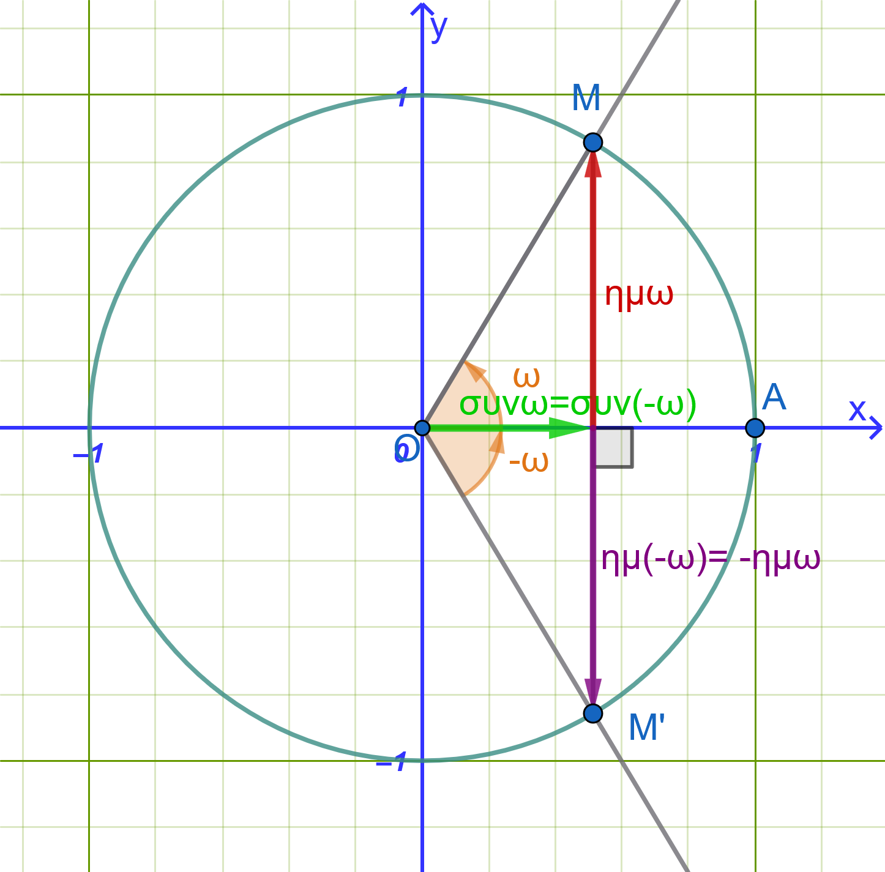
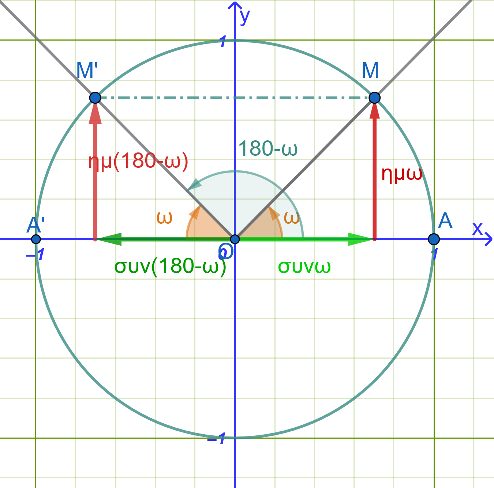
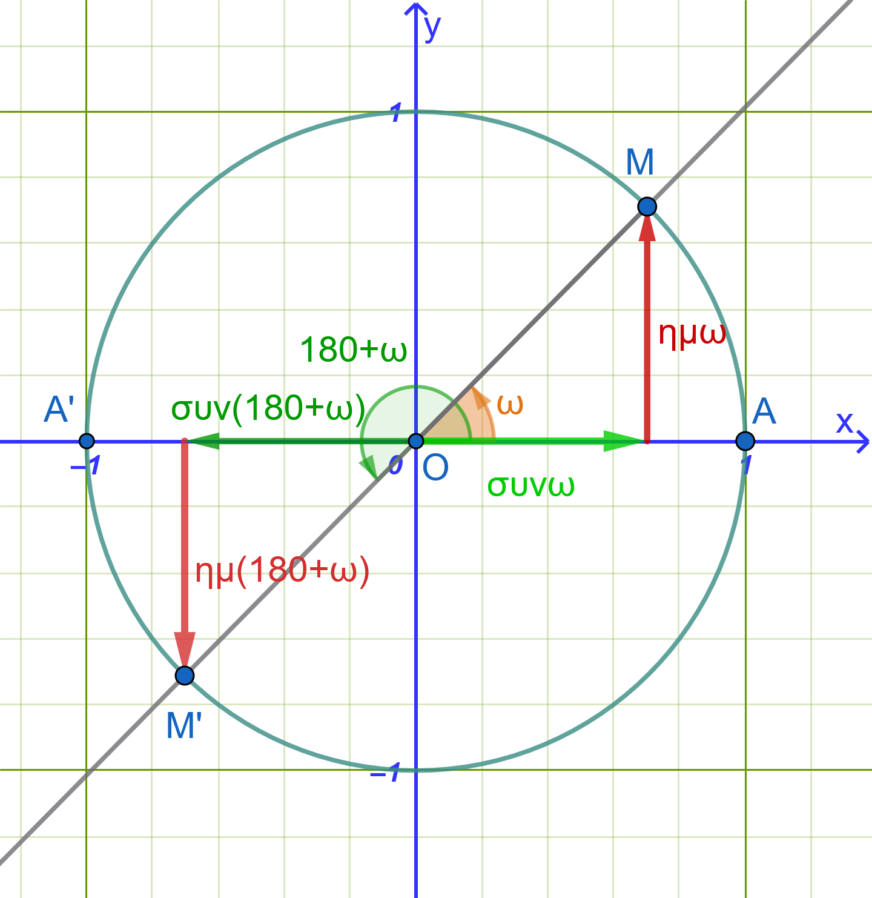
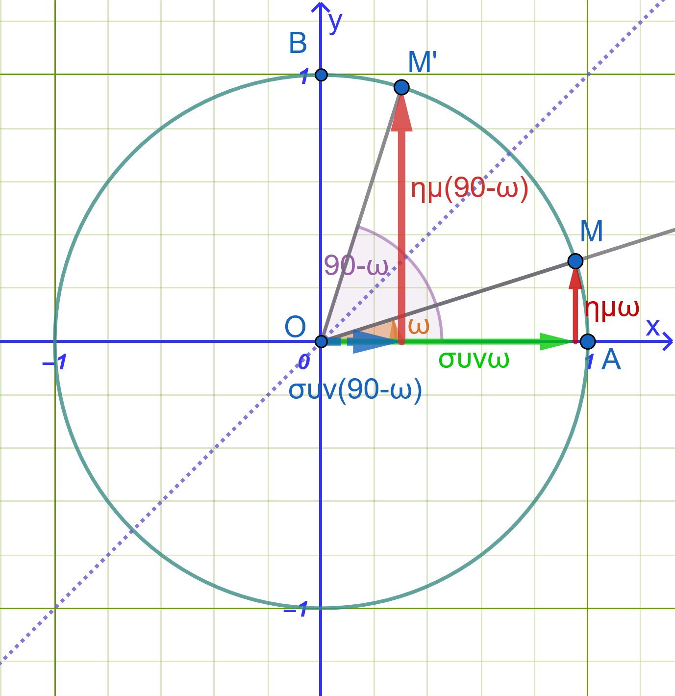
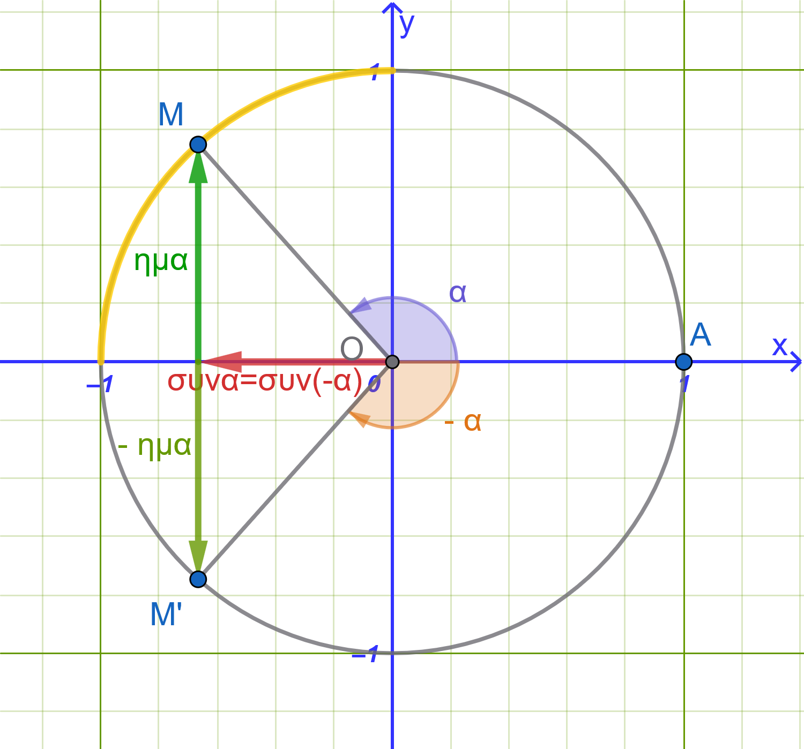

```{=html}
<!-- Φόρτωση βιβλιοθήκης GeoGebra -->
<script src="https://www.geogebra.org/apps/deployggb.js"></script>

<!-- Συνάρτηση δημιουργίας applets -->
<script>
function createGeoGebra(containerId, materialId, width = 700, height = 500) {
  var params = {
    "id": "ggb-" + containerId,
    "material_id": materialId,
    "width": width,
    "height": height,
    "showToolBar": true,
    "showMenuBar": false,
    "showAlgebraInput": true
  };
  
  var applet = new GGBApplet(params, '5.2');
  applet.inject(containerId);
}
</script>
```

## 030.3. Αναγωγή Στο $1^o$ Τεταρτημόριο

### Γωνίες Αντίθετες ($-ω$ ή $360^\circ - ω$)

:::: {.math-box .proposalproof-box}
::: {.math-title .proposalproof-title}
**Απόδειξη:**

{fig-align="center" width="400"}
:::

Θεωρούμε τον τριγωνομετρικό κύκλο με κέντρο την αρχή των αξόνων $O(0,0)$ και ακτίνα $\rho = 1$.

Έστω γωνία $ω$ της οποίας η τελική πλευρά τέμνει τον τριγωνομετρικό κύκλο στο σημείο $M(x, y)$.

Η αντίθετη γωνία $-ω$ παράγεται με περιστροφή κατά την αρνητική φορά και η τελική της πλευρά τέμνει τον τριγωνομετρικό κύκλο στο σημείο $M'(x', y')$.

Όπως φαίνεται γεωμετρικά, τα σημεία $M$ και $M'$ είναι **συμμετρικά ως προς τον άξονα** $x'x$.

Συνεπώς, έχουν την ίδια τετμημένη και αντίθετες τεταγμένες: $$x' = x \quad \text{και} \quad y' = -y$$

Από τους ορισμούς των τριγωνομετρικών αριθμών στον τριγωνομετρικό κύκλο προκύπτει:

- **Ημίτονο:** $ημ(-ω) = y' = -y = -ημω$

- **Συνημίτονο:** $συν(-ω) = x' = x = συνω$

- **Εφαπτομένη:** $εφ(-ω) = \dfrac{y'}{x'} = \dfrac{-y}{x} = -εφω$

- **Συνεφαπτομένη:** $σφ(-ω) = \dfrac{x'}{y'} = \dfrac{x}{-y} = -σφω$
::::

:::: {.math-box .proposal-box}
::: {.math-title .proposal-title}
**Συμπέρασμα:**
:::

Οι αντίθετες γωνίες έχουν το ***ίδιο συνημίτονο*** και αντίθετους τους άλλους τριγωνομετρικούς αριθμούς.
::::

#### Παραδείγματα

- **Παράδειγμα 1:** $ημ(-30^\circ) = -ημ 30^\circ = -\dfrac{1}{2}$

- **Παράδειγμα 2:** $συν(-45^\circ) = συν 45^\circ = \dfrac{\sqrt{2}}{2}$

- **Παράδειγμα 3:** $εφ\left(-\dfrac{\pi}{3}\right) = -εφ\left(\dfrac{\pi}{3}\right) = -\sqrt{3}$

------------------------------------------------------------------------

### Γωνίες με Άθροισμα $180^\circ$ ($\pi - ω$ ή $180^\circ - ω$)

:::: {.math-box .proposalproof-box}
::: {.math-title .proposalproof-title}
**Απόδειξη:**

{fig-align="center" width="400"}
:::

Θεωρούμε δύο γωνίες $ω$ και $ω'$ με άθροισμα $180^\circ$, δηλαδή $ω' = 180^\circ - ω$.

Οι τελικές πλευρές των γωνιών $ω$ και $180^\circ - ω$ τέμνουν τον τριγωνομετρικό κύκλο στα σημεία $M(x, y)$ και $M'(x', y')$ αντίστοιχα.

Τα σημεία $M$ και $M'$ είναι **συμμετρικά ως προς τον άξονα** $y'y$.

Συνεπώς, έχουν την ίδια τεταγμένη και αντίθετες τετμημένες: $$x' = -x \quad \text{και} \quad y' = y$$

Από τους ορισμούς των τριγωνομετρικών αριθμών προκύπτει:

- **Ημίτονο:** $ημ(180^\circ - ω) = y' = y = ημω$

- **Συνημίτονο:** $συν(180^\circ - ω) = x' = -x = -συνω$

- **Εφαπτομένη:** $εφ(180^\circ - ω) = \dfrac{y'}{x'} = \dfrac{y}{-x} = -εφω$

- **Συνεφαπτομένη:** $σφ(180^\circ - ω) = \dfrac{x'}{y'} = \dfrac{-x}{y} = -σφω$
::::

:::: {.math-box .proposal-box}
::: {.math-title .proposal-title}
**Συμπέρασμα:**
:::

Οι παραπληρωματικές γωνίες έχουν το ***ίδιο ημίτονο*** και αντίθετους τους άλλους τριγωνομετρικούς αριθμούς.
::::

#### Παραδείγματα

- **Παράδειγμα 1:** $ημ 150^\circ = ημ(180^\circ - 30^\circ) = ημ 30^\circ = \dfrac{1}{2}$

- **Παράδειγμα 2:** $συν 120^\circ = συν(180^\circ - 60^\circ) = -συν 60^\circ = -\dfrac{1}{2}$

- **Παράδειγμα 3:** $εφ\left(\dfrac{2\pi}{3}\right) = εφ\left(\pi - \dfrac{\pi}{3}\right) = -εφ\left(\dfrac{\pi}{3}\right) = -\sqrt{3}$

------------------------------------------------------------------------

### Γωνίες που Διαφέρουν κατά $180^\circ$ ($\pi + ω$ ή $180^\circ + ω$)

:::: {.math-box .proposalproof-box}
::: {.math-title .proposalproof-title}
**Απόδειξη:**

{fig-align="center" width="400"}
:::

Θεωρούμε δύο γωνίες $ω$ και $ω'$ που διαφέρουν κατά $180^\circ$, δηλαδή $ω' = 180^\circ + ω$.

Οι τελικές πλευρές των γωνιών τέμνουν τον τριγωνομετρικό κύκλο στα σημεία $M(x, y)$ και $M'(x', y')$ αντίστοιχα.

Τα σημεία $M$ και $M'$ είναι **συμμετρικά ως προς την αρχή των αξόνων** $O(0,0)$.

Συνεπώς, έχουν αντίθετες τετμημένες και αντίθετες τεταγμένες: $$x' = -x \quad \text{και} \quad y' = -y$$

Από τους ορισμούς των τριγωνομετρικών αριθμών προκύπτει:

- **Ημίτονο:** $ημ(180^\circ + ω) = y' = -y = -ημω$

- **Συνημίτονο:** $συν(180^\circ + ω) = x' = -x = -συνω$

- **Εφαπτομένη:** $εφ(180^\circ + ω) = \dfrac{y'}{x'} = \dfrac{-y}{-x} = εφω$

- **Συνεφαπτομένη:** $σφ(180^\circ + ω) = \dfrac{x'}{y'} = \dfrac{-x}{-y} = σφω$
::::

:::: {.math-box .proposal-box}
::: {.math-title .proposal-title}
**Συμπέρασμα:**
:::

Οι γωνίες που διαφέρουν κατά $180^\circ$ έχουν την ***ίδια εφαπτομένη και συνεφαπτομένη και αντίθετο ημίτονο και συνημίτονο.***
::::

#### Παραδείγματα

- **Παράδειγμα 1:** $ημ 210^\circ = ημ(180^\circ + 30^\circ) = -ημ 30^\circ = -\dfrac{1}{2}$

- **Παράδειγμα 2:** $συν 225^\circ = συν(180^\circ + 45^\circ) = -συν 45^\circ = -\dfrac{\sqrt{2}}{2}$

- **Παράδειγμα 3:** $εφ\left(\dfrac{4\pi}{3}\right) = εφ\left(\pi + \dfrac{\pi}{3}\right) = εφ\left(\dfrac{\pi}{3}\right) = \sqrt{3}$

------------------------------------------------------------------------

### Γωνίες με Άθροισμα $90^\circ$ ($\dfrac{\pi}{2} - ω$ ή $90^\circ - ω$)

:::: {.math-box .proposalproof-box}
::: {.math-title .proposalproof-title}
**Απόδειξη:**

{fig-align="center" width="400"}
:::

Θεωρούμε δύο συμπληρωματικές γωνίες $ω$ και $90^\circ - ω$.

Οι τελικές πλευρές των γωνιών τέμνουν τον τριγωνομετρικό κύκλο στα σημεία $M(x, y)$ και $M'(x', y')$.

Τα σημεία $M$ και $M'$ είναι **συμμετρικά ως προς τη διχοτόμο του 1ου και 3ου τεταρτημορίου (ευθεία** $y = x$).

Συνεπώς, η τετμημένη του ενός ισούται με την τεταγμένη του άλλου: $$x' = y \quad \text{και} \quad y' = x$$

Από τους ορισμούς των τριγωνομετρικών αριθμών προκύπτει:

- **Ημίτονο:** $ημ(90^\circ - ω) = y' = x = συνω$

- **Συνημίτονο:** $συν(90^\circ - ω) = x' = y = ημω$

- **Εφαπτομένη:** $εφ(90^\circ - ω) = \dfrac{y'}{x'} = \dfrac{x}{y} = σφω$

- **Συνεφαπτομένη:** $σφ(90^\circ - ω) = \dfrac{x'}{y'} = \dfrac{y}{x} = εφω$
::::

:::: {.math-box .proposal-box}
::: {.math-title .proposal-title}
**Συμπέρασμα:**
:::

Αν δύο γωνίες έχουν άθροισμα $90^\circ$, ***το ημίτονο της μιας ισούται με το συνημίτονο της άλλης και η εφαπτομένη της μιας ισούται με τη συνεφαπτομένη της άλλης***.
::::

#### Παραδείγματα

- **Παράδειγμα 1:** $ημ 60^\circ = ημ(90^\circ - 30^\circ) = συν 30^\circ = \dfrac{\sqrt{3}}{2}$

- **Παράδειγμα 2:** $συν 60^\circ = συν(90^\circ - 30^\circ) = ημ 30^\circ = \dfrac{1}{2}$

- **Παράδειγμα 3:** $εφ\left(\dfrac{\pi}{3}\right) = εφ\left(\dfrac{\pi}{2} - \dfrac{\pi}{6}\right) = σφ\left(\dfrac{\pi}{6}\right) = \sqrt{3}$

------------------------------------------------------------------------

### Τύποι αναγωγής στο 1ο τεταρτημόριο και συμπληρωματικές συναρτήσεις:

1.  Οι τύποι αναγωγής ισχύουν για οποιαδήποτε γωνία $θ$.
    Για ευκολία, θεωρούμε ότι η γωνία $θ$ είναι οξεία ($0^\circ < θ < 90^\circ$).

2.  Όταν υπολογίζουμε τιμές για γωνίες της μορφής $(180^\circ \pm θ)$, $(360^\circ \pm θ)$ και $(-θ)$, ο τριγωνομετρικός αριθμός **δεν αλλάζει** (το ημίτονο παραμένει ημίτονο, το συνημίτονο συνημίτονο κ.ο.κ.).

3.  Όταν υπολογίζουμε τιμές για γωνίες της μορφής $(90^\circ \pm θ)$ και $(θ \pm 90^\circ)$, ο τριγωνομετρικός αριθμός **αλλάζει στον συμπληρωματικό του** (το ημίτονο γίνεται συνημίτονο, το συνημίτονο ημίτονο, η εφαπτομένη συνεφαπτομένη κ.ο.κ.).

------------------------------------------------------------------------

| Δεύτερο τεταρτημόριο ($180^\circ - θ$) ή ($90^\circ + θ$) | Πρώτο τεταρτημόριο ($θ$) ή ($90^\circ - θ$) |
|:-----------------------------------|:-----------------------------------|
| $ημ(180^\circ - θ) = +ημ θ$ | **Όλοι οι τριγωνομετρικοί αριθμοί είναι θετικοί** |
| $συν(180^\circ - θ) = -συν θ$ | $ημ(360^\circ + θ) = ημ θ$ |
| $εφ(180^\circ - θ) = -εφ θ$ | $συν(360^\circ + θ) = συν θ$ |
| $ημ(90^\circ + θ) = +συν θ$ | $εφ(360^\circ + θ) = εφ θ$ |
| $συν(90^\circ + θ) = -ημ θ$ | $ημ(90^\circ - θ) = συν θ$ |
|  | $συν(90^\circ - θ) = ημ θ$ |
| **Τρίτο τεταρτημόριο (**$180^\circ + θ$) | **Τέταρτο τεταρτημόριο (**$360^\circ - θ$) ή -θ |
| $ημ(180^\circ + θ) = -ημ θ$ | $ημ(360^\circ - θ) = -ημ θ$ |
| $συν(180^\circ + θ) = -συν θ$ | $συν(360^\circ - θ) = +συν θ$ |
| $εφ(180^\circ + θ) = +εφ θ$ | $εφ(360^\circ - θ) = -εφ θ$ |

------------------------------------------------------------------------

### Εφαρμογές (Αναλυτικά Λυμένες)

:::: {.math-box .example-box}
::: {.math-title .example-title}
**Εφαρμογή 1: Απλοποίηση Αλγεβρικής Παράστασης**
:::

Να απλοποιηθεί η παράσταση: $$A = \frac{ημ(180^\circ - ω) \cdot συν(180^\circ + ω) \cdot εφ(-ω)}{ημ(90^\circ - ω) \cdot ημ(180^\circ + ω) \cdot σφ(90^\circ - ω)}$$
::::

:::: {.math-box .examplesolution-box}
::: {.math-title .examplesolution-title}
**Λύση:**
:::

Εφαρμόζουμε τους τύπους αναγωγής στο 1ο τεταρτημόριο για κάθε παράγοντα:

- $ημ(180^\circ - ω) = ημω$

- $συν(180^\circ + ω) = -συνω$

- $εφ(-ω) = -εφω$

- $ημ(90^\circ - ω) = συνω$

- $ημ(180^\circ + ω) = -ημω$

- $σφ(90^\circ - ω) = εφω$

Αντικαθιστούμε στην παράσταση $A$: $$A = \frac{(ημω) \cdot (-συνω) \cdot (-εφω)}{(συνω) \cdot (-ημω) \cdot (εφω)} = \frac{ημω \cdot συνω \cdot εφω}{-ημω \cdot συνω \cdot εφω} = \mathbf{-1}$$
::::

------------------------------------------------------------------------

:::: {.math-box .example-box}
::: {.math-title .example-title}
**Εφαρμογή 2: Τριγωνομετρικοί Αριθμοί της Γωνίας** $90^\circ + ω$
:::

Να υπολογιστούν οι τριγωνομετρικοί αριθμοί της γωνίας $90^\circ + ω$ ως προς τους τριγωνομετρικούς αριθμούς της γωνίας $ω$.
::::

:::: {.math-box .examplesolution-box}
::: {.math-title .examplesolution-title}
**Λύση:**
:::

Γράφουμε τη γωνία $90^\circ + ω$ στη μορφή $90^\circ - (-ω)$:

- $ημ(90^\circ + ω) = ημ(90^\circ - (-ω)) = συν(-ω) = \mathbf{συνω}$

- $συν(90^\circ + ω) = συν(90^\circ - (-ω)) = ημ(-ω) = \mathbf{-ημω}$

- $εφ(90^\circ + ω) = \dfrac{ημ(90^\circ + ω)}{συν(90^\circ + ω)} = \dfrac{συνω}{-ημω} = \mathbf{-σφω}$

- $σφ(90^\circ + ω) = \dfrac{συν(90^\circ + ω)}{ημ(90^\circ + ω)} = \dfrac{-ημω}{συνω} = \mathbf{-εφω}$
::::

------------------------------------------------------------------------

:::: {.math-box .example-box}
::: {.math-title .example-title}
**Εφαρμογή 3: Τριγωνομετρικοί Αριθμοί της Γωνίας** $270^\circ - ω$
:::

Να υπολογιστούν οι τριγωνομετρικοί αριθμοί της γωνίας $270^\circ - ω$ ως προς τη γωνία $ω$.
::::

:::: {.math-box .examplesolution-box}
::: {.math-title .examplesolution-title}
**Λύση:**
:::

Γράφουμε τη γωνία $270^\circ - ω$ στη μορφή $180^\circ + (90^\circ - ω)$:

- $ημ(270^\circ - ω) = ημ(180^\circ + (90^\circ - ω)) = -ημ(90^\circ - ω) = \mathbf{-συνω}$

- $συν(270^\circ - ω) = συν(180^\circ + (90^\circ - ω)) = -συν(90^\circ - ω) = \mathbf{-ημω}$

- $εφ(270^\circ - ω) = \dfrac{-συνω}{-ημω} = \mathbf{σφω}$

- $σφ(270^\circ - ω) = \dfrac{-ημω}{-συνω} = \mathbf{εφω}$
::::

------------------------------------------------------------------------

:::: {.math-box .example-box}
::: {.math-title .example-title}
**Εφαρμογή 4: Αριθμητικός Υπολογισμός Παράστασης**
:::

Να υπολογιστεί η τιμή της παράστασης: $$B = ημ 120^\circ \cdot συν 210^\circ + εφ 300^\circ \cdot σφ 135^\circ$$
::::

:::: {.math-box .examplesolution-box}
::: {.math-title .examplesolution-title}
**Λύση:**
:::

Ανάγουμε κάθε γωνία στο 1ο τεταρτημόριο:

- $ημ 120^\circ = ημ(180^\circ - 60^\circ) = ημ 60^\circ = \dfrac{\sqrt{3}}{2}$

- $συν 210^\circ = συν(180^\circ + 30^\circ) = -συν 30^\circ = -\dfrac{\sqrt{3}}{2}$

- $εφ 300^\circ = εφ(360^\circ - 60^\circ) = εφ(-60^\circ) = -εφ 60^\circ = -\sqrt{3}$

- $σφ 135^\circ = σφ(180^\circ - 45^\circ) = -σφ 45^\circ = -1$

Αντικαθιστούμε στην παράσταση $B$: $$B = \left(\frac{\sqrt{3}}{2}\right) \cdot \left(-\frac{\sqrt{3}}{2}\right) + (-\sqrt{3}) \cdot (-1) = -\frac{3}{4} + \sqrt{3} = \mathbf{\frac{4\sqrt{3} - 3}{4}}$$
::::

------------------------------------------------------------------------

### Λυμένες Ασκήσεις

:::: {.math-box .exercise-box}
::: {.math-title .exercise-title}
**Άσκηση 1: Αριθμητικός Υπολογισμός Παράστασης με Μοίρες**
:::

Να υπολογιστεί η ακριβής τιμή της παράστασης: $$A = συν 120^\circ + ημ 210^\circ - εφ 315^\circ + σφ 225^\circ$$
::::

:::: {.math-box .solution-box}
::: {.math-title .solution-title}
**Λύση:**
:::

Ανάγουμε κάθε τριγωνομετρικό αριθμό στο 1ο τεταρτημόριο:

- $συν 120^\circ$: $συν(180^\circ - 60^\circ) = -συν 60^\circ = -\mathbf{\dfrac{1}{2}}$

- $ημ 210^\circ$: $ημ(180^\circ + 30^\circ) = -ημ 30^\circ = -\mathbf{\dfrac{1}{2}}$

- $εφ 315^\circ$: $εφ(360^\circ - 45^\circ) = -εφ 45^\circ = -\mathbf{1}$

- $σφ 225^\circ$: $σφ(180^\circ + 45^\circ) = σφ 45^\circ = \mathbf{1}$

Αντικαθιστούμε τις τιμές στην παράσταση $A$: $$A = \left(-\frac{1}{2}\right) + \left(-\frac{1}{2}\right) - (-1) + 1 = -1 + 1 + 1 = \mathbf{1}$$
::::

------------------------------------------------------------------------

:::: {.math-box .exercise-box}
::: {.math-title .exercise-title}
**Άσκηση 2: Απλοποίηση Τριγωνομετρικής Παράστασης με Ακτίνια**
:::

Να απλοποιηθεί η παράσταση: $$B = \frac{ημ(\pi - x) \cdot συν\left(\dfrac{\pi}{2} - x\right)}{εφ(\pi + x) \cdot σφ\left(\dfrac{\pi}{2} + x\right)}$$
::::

:::: {.math-box .solution-box}
::: {.math-title .solution-title}
**Λύση:**
:::

Εφαρμόζουμε τους τύπους αναγωγής για κάθε όρο:

- $ημ(\pi - x) = ημ x$

- $συν\left(\dfrac{\pi}{2} - x\right) = ημ x$

- $εφ(\pi + x) = εφ x$

- $σφ\left(\dfrac{\pi}{2} + x\right) = -εφ x$

Αντικαθιστούμε στο κλάσμα: $$B = \frac{ημ x \cdot ημ x}{εφ x \cdot (-εφ x)} = \frac{ημ^2 x}{-εφ^2 x}$$

Εκφράζουμε την εφαπτομένη ως $εφ x = \dfrac{ημ x}{συν x}$: $$B = -\frac{ημ^2 x}{\frac{ημ^2 x}{συν^2 x}} = -\frac{ημ^2 x \cdot συν^2 x}{ημ^2 x} = \mathbf{-συν^2 x}$$
::::

------------------------------------------------------------------------

:::: {.math-box .exercise-box}
::: {.math-title .exercise-title}
**Άσκηση 3: Αποδείξεις Ταυτοτήτων σε Τρίγωνο** $ABC$
:::

Σε κάθε τρίγωνο $ABC$, να αποδειχθεί ότι ισχύουν οι ισότητες:

1.  $συν(A + B) + συν C = 0$

2.  $ημ(A + B) - ημ C = 0$
::::

:::: {.math-box .solution-box}
::: {.math-title .solution-title}
**Λύση:**
:::

Σε κάθε τρίγωνο το άθροισμα των γωνιών είναι $180^\circ$ ($\pi$), άρα: $$A + B + C = 180^\circ \iff A + B = 180^\circ - C$$

1.  **Για την πρώτη ισότητα:** $$συν(A + B) = συν(180^\circ - C) = -συν C$$

    Μεταφέροντας στο αριστερό μέλος: $$συν(A + B) + συν C = 0$$

2.  **Για τη δεύτερη ισότητα:** $$ημ(A + B) = ημ(180^\circ - C) = ημ C$$

    Μεταφέροντας στο αριστερό μέλος: $$ημ(A + B) - ημ C = 0$$
::::

------------------------------------------------------------------------

:::: {.math-box .exercise-box}
::: {.math-title .exercise-title}
**Άσκηση 4: Υπολογισμός με Γωνίες** $>360^\circ$ και Αρνητικές Γωνίες
:::

Να υπολογιστεί η τιμή της παράστασης: $$\Gamma = ημ(-300^\circ) + συν 750^\circ + εφ(-405^\circ)$$
::::

:::: {.math-box .solution-box}
::: {.math-title .solution-title}
**Λύση:**
:::

- $ημ(-300^\circ)$: Χρησιμοποιούμε την ιδιότητα της αντίθετης γωνίας $ημ(-x) = -ημ x$: $$ημ(-300^\circ) = -ημ 300^\circ = -ημ(360^\circ - 60^\circ) = -(-ημ 60^\circ) = ημ 60^\circ = \mathbf{\frac{\sqrt{3}}{2}}$$

- $συν 750^\circ$: Αφαιρούμε τις πλήρεις περιστροφές ($750^\circ = 2 \cdot 360^\circ + 30^\circ$): $$συν 750^\circ = συν(2 \cdot 360^\circ + 30^\circ) = συν 30^\circ = \mathbf{\frac{\sqrt{3}}{2}}$$

- $εφ(-405^\circ)$: $εφ(-405^\circ) = -εφ 405^\circ = -εφ(360^\circ + 45^\circ) = -εφ 45^\circ = \mathbf{-1}$

Αντικαθιστούμε στην παράσταση $\Gamma$: $$\Gamma = \frac{\sqrt{3}}{2} + \frac{\sqrt{3}}{2} + (-1) = \sqrt{3} - 1$$
::::

------------------------------------------------------------------------

:::: {.math-box .exercise-box}
::: {.math-title .exercise-title}
Άσκηση 5
:::

Να γραφεί η παρακάτω παράσταση ως ένας μοναδικός τριγωνομετρικός αριθμός:

$$\frac{ημ 163^\circ}{συν 197^\circ} + εφ 17^\circ + συν(180^\circ - θ) \cdot εφ(180^\circ + θ)$$
::::

:::: {.math-box .solution-box}
::: {.math-title .solution-title}
**Λύση:**
:::

Απλοποιούμε ξεχωριστά κάθε όρο της παράστασης:

1.  **Για το κλάσμα** $\dfrac{ημ 163^\circ}{συν 197^\circ}$:

    - Ανάγουμε τη γωνία $163^\circ$ στο $1^\circ$ τεταρτημόριο: $$ημ 163^\circ = ημ(180^\circ - 17^\circ) = ημ 17^\circ$$

    - Ανάγουμε τη γωνία $197^\circ$ στο $1^\circ$ τεταρτημόριο: $$συν 197^\circ = συν(180^\circ + 17^\circ) = -συν 17^\circ$$

    - Επομένως, το κλάσμα γίνεται: $$\frac{ημ 163^\circ}{συν 197^\circ} = \frac{ημ 17^\circ}{-συν 17^\circ} = -\frac{ημ 17^\circ}{συν 17^\circ} = -εφ 17^\circ$$

2.  **Για το γινόμενο** $συν(180^\circ - θ) \cdot εφ(180^\circ + θ)$:

    - Από τους τύπους αναγωγής στο $1^\circ$ τεταρτημόριο έχουμε: $$συν(180^\circ - θ) = -συν θ$$ $$εφ(180^\circ + θ) = εφ θ$$

    - Γράφουμε την εφαπτομένη ως πηλίκο ημιτόνου προς συνημίτονο: $$εφ θ = \frac{ημ θ}{συν θ}$$

    - Επομένως, το γινόμενο ισούται με: $$(-συν θ) \cdot εφ θ = (-συν θ) \cdot \frac{ημ θ}{συν θ} = -ημ θ$$

------------------------------------------------------------------------

**Τελική αντικατάσταση στην αρχική παράσταση**

Αντικαθιστούμε τα αποτελέσματα στην αρχική παράσταση:

$$\left(-εφ 17^\circ\right) + εφ 17^\circ + (-ημ θ)$$

Οι όροι $-εφ 17^\circ$ και $+εφ 17^\circ$ είναι αντίθετοι και διαγράφονται:

$$= -ημ θ$$

$$ημ(-θ)$$
::::

------------------------------------------------------------------------

:::: {.math-box .exercise-box}
::: {.math-title .exercise-title}
Άσκηση 6
:::

Να υπολογίσετε την τιμή των παρακάτω παραστάσεων χωρίς τη χρήση υπολογιστή τσέπης:
::::

:::: {.math-box .solution-box}
::: {.math-title .solution-title}
**Λύση:**
:::

**α)** $εφ 150^\circ \cdot ημ 30^\circ - συν 210^\circ$

**Υπολογισμός τριγωνομετρικών αριθμών:**

- $εφ 150^\circ = εφ(180^\circ - 30^\circ) = -εφ 30^\circ = -\dfrac{\sqrt{3}}{3}$

- $ημ 30^\circ = \dfrac{1}{2}$

- $συν 210^\circ = συν(180^\circ + 30^\circ) = -συν 30^\circ = -\dfrac{\sqrt{3}}{2}$

**Αντικατάσταση στην παράσταση:** $$\left(-\frac{\sqrt{3}}{3}\right) \cdot \frac{1}{2} - \left(-\frac{\sqrt{3}}{2}\right) = -\frac{\sqrt{3}}{6} + \frac{\sqrt{3}}{2}$$

Κάνουμε ομώνυμα τα κλάσματα: $$= -\frac{\sqrt{3}}{6} + \frac{3\sqrt{3}}{6} = \frac{2\sqrt{3}}{6} = \frac{\sqrt{3}}{3}$$

------------------------------------------------------------------------

**β)** $(1 + συν 120^\circ)(1 - ημ^2 240^\circ)$

**Υπολογισμός τριγωνομετρικών αριθμών:**

- $συν 120^\circ = συν(180^\circ - 60^\circ) = -συν 60^\circ = -\dfrac{1}{2}$

- $ημ 240^\circ = ημ(180^\circ + 60^\circ) = -ημ 60^\circ = -\dfrac{\sqrt{3}}{2}$

- $ημ^2 240^\circ = \left(-\dfrac{\sqrt{3}}{2}\right)^2 = \dfrac{3}{4}$

**Αντικατάσταση στην παράσταση:**

$$\left(1 - \frac{1}{2}\right) \cdot \left(1 - \frac{3}{4}\right) = \frac{1}{2} \cdot \frac{1}{4} = \frac{1}{8}$$

------------------------------------------------------------------------

**γ)** $συν^2 140^\circ + ημ^2 220^\circ$

**Αναγωγή στο** $1^\circ$ τεταρτημόριο:

- $συν 140^\circ = συν(180^\circ - 40^\circ) = -συν 40^\circ \implies συν^2 140^\circ = (-συν 40^\circ)^2 = συν^2 40^\circ$

- $ημ 220^\circ = ημ(180^\circ + 40^\circ) = -ημ 40^\circ \implies ημ^2 220^\circ = (-ημ 40^\circ)^2 = ημ^2 40^\circ$

**Αντικατάσταση στην παράσταση:** $$συν^2 140^\circ + ημ^2 220^\circ = συν^2 40^\circ + ημ^2 40^\circ$$

Από τη βασική τριγωνομετρική ταυτότητα $ημ^2 \omega + συν^2 \omega = 1$: $$= 1$$
::::

------------------------------------------------------------------------

:::: {.math-box .exercise-box}
::: {.math-title .exercise-title}
Άσκηση 7
:::

Να εκφράσετε τις παρακάτω παραστάσεις ως έναν μοναδικό τριγωνομετρικό αριθμό:
::::

:::: {.math-box .solution-box}
::: {.math-title .solution-title}
**Λύση:**
:::

**α)** $εφ(180^\circ - θ) \cdot ημ(180^\circ + θ)$

**Αναγωγή στο** $1^\circ$ τεταρτημόριο:

- $εφ(180^\circ - θ) = -εφ θ = -\dfrac{ημ θ}{συν θ}$

- $ημ(180^\circ + θ) = -ημ θ$

**Αντικατάσταση στο γινόμενο:** $$\left(-\frac{ημ θ}{συν θ}\right) \cdot (-ημ θ) = \frac{ημ^2 θ}{συν θ}$$

------------------------------------------------------------------------

**β)** $\dfrac{εφ(180^\circ + θ) \cdot συν(180^\circ - θ)}{ημ(180^\circ - θ)}$

**Αναγωγή στο** $1^\circ$ τεταρτημόριο:

- $εφ(180^\circ + θ) = εφ θ = \dfrac{ημ θ}{συν θ}$

- $συν(180^\circ - θ) = -συν θ$

- $ημ(180^\circ - θ) = ημ θ$

**Αντικατάσταση στην παράσταση:**

$$\frac{εφ θ \cdot (-συν θ)}{ημ θ} = \frac{\dfrac{ημ θ}{συν θ} \cdot (-συν θ)}{ημ θ} = \frac{-ημ θ}{ημ θ} = -1$$
::::

------------------------------------------------------------------------

:::: {.math-box .exercise-box}
::: {.math-title .exercise-title}
Άσκηση 8
:::

Αν $f = εφ 67^\circ$, να εκφράσετε την παρακάτω παράσταση συναρτήσει του $f$:

$$\frac{ημ 293^\circ}{συν 427^\circ} + εφ(-67^\circ) + εφ 1147^\circ$$
::::

:::: {.math-box .solution-box}
::: {.math-title .solution-title}
**Λύση:**
:::

Ανάγουμε κάθε όρο της παράστασης στη γωνία $67^\circ$:

1.  **Για το** $ημ 293^\circ$:

    Παρατηρούμε ότι $293^\circ = 360^\circ - 67^\circ$ ($4^\circ$ τεταρτημόριο): $$ημ 293^\circ = ημ(360^\circ - 67^\circ) = -ημ 67^\circ$$

2.  **Για το** $συν 427^\circ$:

    Αφαιρούμε έναν πλήρη κύκλο ($360^\circ$): $$συν 427^\circ = συν(360^\circ + 67^\circ) = συν 67^\circ$$

    Επομένως, το κλάσμα ισούται με: $$\frac{ημ 293^\circ}{συν 427^\circ} = \frac{-ημ 67^\circ}{συν 67^\circ} = -\frac{ημ 67^\circ}{συν 67^\circ} = -εφ 67^\circ = -f$$

3.  **Για το** $εφ(-67^\circ)$:

    Επειδή η εφαπτομένη είναι περιττή συνάρτηση: $$εφ(-67^\circ) = -εφ 67^\circ = -f$$

4.  **Για το** $εφ 1147^\circ$:

    Διαιρούμε το $1147^\circ$ με το $360^\circ$: $$1147^\circ = 3 \cdot 360^\circ + 67^\circ = 1080^\circ + 67^\circ$$

    Αφαιρώντας τους πλήρεις κύκλους ($3$ κύκλοι): $$εφ 1147^\circ = εφ(3 \cdot 360^\circ + 67^\circ) = εφ 67^\circ = f$$

------------------------------------------------------------------------

**Τελική αντικατάσταση**

Αντικαθιστούμε τα αποτελέσματα στην αρχική παράσταση:

$$\frac{ημ 293^\circ}{συν 427^\circ} + εφ(-67^\circ) + εφ 1147^\circ = (-f) + (-f) + f$$

$$= -f - f + f = -f$$
::::

------------------------------------------------------------------------

:::: {.math-box .exercise-box}
::: {.math-title .exercise-title}
Άσκηση 9
:::

Να απλοποιήσετε τις παρακάτω παραστάσεις
::::

:::: {.math-box .solution-box}
::: {.math-title .solution-title}
**Λύση:**
:::

**α)**

$$
\frac{εφ(180^\circ-θ)\cdotημ(360^\circ+θ)}
{συν(180^\circ+θ)\cdotεφ(360^\circ-θ)}
$$

Χρησιμοποιούμε τους τύπους αναγωγής:

$$
εφ(180^\circ-θ)=-εφθ
$$

$$
ημ(360^\circ+θ)=ημθ
$$

$$
συν(180^\circ+θ)=-συνθ
$$

$$
εφ(360^\circ-θ)=-εφθ
$$

Άρα:

$$
\frac{(-εφθ)ημθ}
{(-συνθ)(-εφθ)}
=\frac{-εφθ\cdotημθ}
{συνθ\cdotεφθ}
$$

Απλοποιούμε την $εφθ$:

$$
=-\frac{ημθ}{συνθ}
$$

Επομένως:

$$
\boxed{-εφθ}
$$

------------------------------------------------------------------------

**β)**

$$
συν^2(360^\circ+θ)
+συν(180^\circ+θ)
\cdotεφ(360^\circ-θ)
\cdotημ(360^\circ+θ)
$$

Έχουμε:

$$
συν(360^\circ+θ)=συνθ
$$

$$
συν(180^\circ+θ)=-συνθ
$$

$$
εφ(360^\circ-θ)=-εφθ
$$

$$
ημ(360^\circ+θ)=ημθ
$$

Άρα:

$$
συν^2θ
+(-συνθ)(-εφθ)(ημθ)
$$

$$
=συν^2θ
+συνθ\cdotεφθ\cdotημθ
$$

Επειδή:

$$
εφθ=\frac{ημθ}{συνθ}
$$

έχουμε:

$$
συνθ\cdotεφθ\cdotημθ
=συνθ\cdot
\frac{ημθ}{συνθ}
\cdotημθ
=ημ^2θ
$$

Επομένως:

$$
συν^2θ+ημ^2θ=1
$$

Άρα:

$$
\boxed{1}
$$

------------------------------------------------------------------------

**γ)**

$$
\frac{ημ(360^\circ+\alpha)\cdot
εφ(180^\circ+\alpha)}
{συν(360^\circ-\alpha)\cdot
εφ^2(360^\circ+\alpha)}
$$

Χρησιμοποιούμε:

$$
ημ(360^\circ+\alpha)=ημ\alpha
$$

$$
εφ(180^\circ+\alpha)=εφ\alpha
$$

$$
συν(360^\circ-\alpha)=συν\alpha
$$

$$
εφ(360^\circ+\alpha)=εφ\alpha
$$

Άρα:

$$
\frac{ημ\alpha\cdotεφ\alpha}
{συν\alpha\cdotεφ^2\alpha}
$$

Επειδή:

$$
εφ\alpha=\frac{ημ\alpha}{συν\alpha}
$$

ο αριθμητής είναι:

$$
ημ\alpha\cdot\frac{ημ\alpha}{συν\alpha}
=\frac{ημ^2\alpha}{συν\alpha}
$$

και ο παρονομαστής είναι:

$$
συν\alpha\cdot
\frac{ημ^2\alpha}{συν^2\alpha}
=\frac{ημ^2\alpha}{συν\alpha}
$$

Επομένως:

$$
\boxed{1}
$$
::::

------------------------------------------------------------------------

:::: {.math-box .exercise-box}
::: {.math-title .exercise-title}
Άσκηση 10
:::

Να απλοποιήσετε χωρίς τη χρήση υπολογιστή τσέπης
::::

:::: {.math-box .solution-box}
::: {.math-title .solution-title}
**Λύση:**
:::

**α)**

$$
\frac{συν300^\circ\cdotεφ150^\circ}
{ημ225^\circ\cdotσυν(-45^\circ)}
$$

Έχουμε:

$$
συν300^\circ=\frac12
$$

$$
εφ150^\circ=-εφ30^\circ
=-\frac{\sqrt{3}}{3}
$$

$$
ημ225^\circ=-\frac{\sqrt{2}}{2}
$$

$$
συν(-45^\circ)=συν45^\circ
=\frac{\sqrt{2}}2
$$

Άρα:

$$
\frac{\frac12\cdot\left(-\dfrac{\sqrt3}{3}\right)}
{\left(-\dfrac{\sqrt2}{2}\right)\left(\dfrac{\sqrt2}{2}\right)}
$$

Ο παρονομαστής είναι:

$$
-\frac{\sqrt2}{2}\cdot\frac{\sqrt2}{2}
=-\frac12
$$

Επομένως:

$$
\frac{-\dfrac{\sqrt3}{6}}{-\dfrac12}
=\frac{\sqrt3}{3}
$$

Άρα:

$$
\boxed{\frac{\sqrt3}{3}}
$$

------------------------------------------------------------------------

**β)**

$$
3εφ405^\circ+
2εφ330^\circ\cdotσυν750^\circ
$$

Έχουμε:

$$
εφ405^\circ=εφ45^\circ=1
$$

$$
εφ330^\circ=-εφ30^\circ
=-\frac{\sqrt3}{3}
$$

$$
συν750^\circ=συν30^\circ
=\frac{\sqrt3}{2}
$$

Άρα:

$$
3\cdot1+
2\cdot\left(-\frac{\sqrt3}{3}\right)\cdot
\frac{\sqrt3}{2}
$$

$$
=3-1
$$

Επομένως:

$$
\boxed{2}
$$

------------------------------------------------------------------------

**γ)**

$$
\frac{συν315^\circ\cdot
συν405^\circ+
ημ45^\circ\cdotημ135^\circ}
{ημ750^\circ}
$$

Έχουμε:

$$
συν315^\circ=\frac{\sqrt2}{2}
$$

$$
συν405^\circ=συν45^\circ
=\frac{\sqrt2}{2}
$$

$$
ημ45^\circ=\frac{\sqrt2}{2}
$$

$$
ημ135^\circ=\frac{\sqrt2}{2}
$$

$$
ημ750^\circ=ημ30^\circ=\frac12
$$

Άρα:

$$
\frac{\dfrac{\sqrt2}{2}\cdot\dfrac{\sqrt2}{2}
+\dfrac{\sqrt2}{2}\cdot\dfrac{\sqrt2}{2}}
{\dfrac12}
$$

$$
=\frac{\dfrac12+\dfrac12}{\dfrac12}
=\frac1{\dfrac12}
=2
$$

Άρα:

$$
\boxed{2}
$$

------------------------------------------------------------------------

**δ)**

$$
εφ150^\circ\cdotσυν390^\circ
-2ημ510^\circ
$$

Έχουμε:

$$
εφ150^\circ=-\frac{\sqrt3}{3}
$$

$$
συν390^\circ=συν30^\circ
=\frac{\sqrt3}{2}
$$

$$
ημ510^\circ=ημ150^\circ=\frac12
$$

Άρα:

$$
\left(-\frac{\sqrt3}{3}\right)
\left(\frac{\sqrt3}{2}\right)
-2\cdot\frac12
$$

$$
=-\frac12-1
$$

Επομένως:

$$
\boxed{-\frac32}
$$

------------------------------------------------------------------------

**ε)**

$$
\frac{
2ημ120^\circ+
3συν765^\circ-
2ημ240^\circ-
3συν45^\circ
}{
5ημ300^\circ+
3εφ225^\circ-
2συν60^\circ
}
$$

Υπολογίζουμε τους τριγωνομετρικούς αριθμούς:

$$
ημ120^\circ=\frac{\sqrt3}{2}
$$

$$
συν765^\circ=συν45^\circ
=\frac{\sqrt2}{2}
$$

$$
ημ240^\circ=-\frac{\sqrt3}{2}
$$

$$
συν45^\circ=\frac{\sqrt2}{2}
$$

$$
ημ300^\circ=-\frac{\sqrt3}{2}
$$

$$
εφ225^\circ=1
$$

$$
συν60^\circ=\frac12
$$

Ο αριθμητής γίνεται:

$$
2\cdot\frac{\sqrt3}{2}
+3\cdot\frac{\sqrt2}{2}
-2\cdot\left(-\frac{\sqrt3}{2}\right)
-3\cdot\frac{\sqrt2}{2}
$$

$$
=\sqrt3+\frac{3\sqrt2}{2}
+\sqrt3-\frac{3\sqrt2}{2}
=2\sqrt3
$$

Ο παρονομαστής γίνεται:

$$
5\cdot\left(-\frac{\sqrt3}{2}\right)
+3\cdot1
-2\cdot\frac12
$$

$$
=-\frac{5\sqrt3}{2}+3-1
=2-\frac{5\sqrt3}{2}
$$

Άρα:

$$
\frac{2\sqrt3}{2-\dfrac{5\sqrt3}{2}}
=\frac{4\sqrt3}{4-5\sqrt3}
$$

Ρητοποιούμε τον παρονομαστή:

$$
\frac{4\sqrt3}{4-5\sqrt3}
\cdot
\frac{4+5\sqrt3}{4+5\sqrt3}
$$

$$
=\frac{4\sqrt3(4+5\sqrt3)}
{16-75}
$$

$$
=\frac{16\sqrt3+60}{-59}
$$

Άρα:

$$
\boxed{-\frac{60+16\sqrt3}{59}}
$$
::::

------------------------------------------------------------------------

:::: {.math-box .exercise-box}
::: {.math-title .exercise-title}
Άσκηση 11
:::

Για $90^\circ<\alpha<180^\circ$, να εξηγήσετε με σχήμα γιατί:
::::

:::: {.math-box .solution-box}
::: {.math-title .solution-title}
**Λύση:**

{fig-align="center" width="400"}
:::

**α)** $ημ(-\alpha)=-ημ\alpha$

Στον τριγωνομετρικό κύκλο, οι γωνίες $\alpha$ και $-\alpha$ είναι συμμετρικές ως προς τον οριζόντιο άξονα.

Αν το σημείο που αντιστοιχεί στη γωνία $\alpha$ έχει συντεταγμένες:

$$
(συν\alpha,ημ\alpha)
$$

τότε το συμμετρικό σημείο που αντιστοιχεί στη γωνία $-\alpha$ έχει συντεταγμένες:

$$
(συν\alpha,-ημ\alpha)
$$

Το ημίτονο είναι η τεταγμένη, δηλαδή η δεύτερη συντεταγμένη.
Επομένως:

$$
\boxed{ημ(-\alpha)=-ημ\alpha}
$$

------------------------------------------------------------------------

**β)** $συν(-\alpha)=συν\alpha$

Η προηγούμενη πρόταση αφορά το ημίτονο.
Για το συνημίτονο, όμως, η συμμετρία ως προς τον οριζόντιο άξονα δεν αλλάζει την τετμημένη.

Πράγματι, τα σημεία των γωνιών $\alpha$ και $-\alpha$ είναι:

$$
(συν\alpha,ημ\alpha)
$$

και

$$
(συν\alpha,-ημ\alpha)
$$

Άρα οι τετμημένες τους είναι ίδιες.
Επομένως:

$$
\boxed{συν(-\alpha)=συν\alpha}
$$
::::

------------------------------------------------------------------------

:::: {.math-box .exercise-box}
::: {.math-title .exercise-title}
Άσκηση 12
:::

Αν $t = ημ θ$, να εκφράσετε την παρακάτω παράσταση συναρτήσει του $t$:

$$\frac{συν(θ - 90^\circ) \cdot συν(720^\circ + θ) \cdot εφ(θ - 360^\circ)}{ημ^2(θ + 360^\circ) \cdot συν(θ + 90^\circ)}$$
::::

:::: {.math-box .solution-box}
::: {.math-title .solution-title}
**Λύση:**
:::

Απλοποιούμε κάθε παράγοντα ξεχωριστά:

- $συν(θ - 90^\circ) = συν(-(90^\circ - θ)) = συν(90^\circ - θ) = ημ θ$

- $συν(720^\circ + θ) = συν(2 \cdot 360^\circ + θ) = συν θ$

- $εφ(θ - 360^\circ) = εφ(θ) = \dfrac{ημ θ}{συν θ}$

- $ημ^2(θ + 360^\circ) = ημ^2 θ$

- $συν(θ + 90^\circ) = -ημ θ$

Αντικαθιστούμε στον αριθμητή: $$\text{Αριθμητής} = ημ θ \cdot συν θ \cdot \frac{ημ θ}{συν θ} = ημ^2 θ$$

Αντικαθιστούμε στον παρονομαστή: $$\text{Παρονομαστής} = ημ^2 θ \cdot (-ημ θ) = -ημ^3 θ$$

Επομένως, το κλάσμα γίνεται: $$\frac{ημ^2 θ}{-ημ^3 θ} = -\frac{1}{ημ θ}$$

Αφού $t = ημ θ$, η παράσταση ισούται με: $$-\frac{1}{t}$$
::::

------------------------------------------------------------------------

:::: {.math-box .exercise-box}
::: {.math-title .exercise-title}
Άσκηση 13
:::

Να γράψετε τα $A$ και $B$ ως έναν μοναδικό τριγωνομετρικό αριθμό:
::::

:::: {.math-box .solution-box}
::: {.math-title .solution-title}
**Λύση:**
:::

**α)** $A = ημ(360^\circ - θ) \cdot συν(180^\circ - θ) \cdot εφ(360^\circ + θ)$

- $ημ(360^\circ - θ) = -ημ θ$

- $συν(180^\circ - θ) = -συν θ$

- $εφ(360^\circ + θ) = εφ θ = \dfrac{ημ θ}{συν θ}$

Άρα: $$A = (-ημ θ) \cdot (-συν θ) \cdot \frac{ημ θ}{συν θ} = ημ^2 θ$$

------------------------------------------------------------------------

**β)** $B = \dfrac{συν(360^\circ + θ) \cdot συν(-θ) \cdot ημ(-θ)}{συν(90^\circ + θ)}$

- $συν(360^\circ + θ) = συν θ$

- $συν(-θ) = συν θ$

- $ημ(-θ) = -ημ θ$

- $συν(90^\circ + θ) = -ημ θ$

Άρα: $$B = \frac{συν θ \cdot συν θ \cdot (-ημ θ)}{-ημ θ} = συν^2 θ$$

------------------------------------------------------------------------

**γ) Στη συνέχεια, να υπολογίσετε:**

- **i.** $A + B = ημ^2 θ + συν^2 θ = 1$

- **ii.** $\dfrac{A}{B} = \dfrac{ημ^2 θ}{συν^2 θ} = εφ^2 θ$
::::

------------------------------------------------------------------------

:::: {.math-box .exercise-box}
::: {.math-title .exercise-title}
Άσκηση 14
:::

Να εκφράσετε τα παρακάτω συναρτήσει τριγωνομετρικού αριθμού οξείας γωνίας:

- **α)** $ημ 163^\circ = ημ(180^\circ - 17^\circ) = ημ 17^\circ$

- **β)** $συν 327^\circ = συν(360^\circ - 33^\circ) = συν 33^\circ$

- **γ)** $εφ 248^\circ = εφ(180^\circ + 68^\circ) = εφ 68^\circ$

- **δ)** $συν(-213^\circ) = συν 213^\circ = συν(180^\circ + 33^\circ) = -συν 33^\circ$
::::

------------------------------------------------------------------------

:::: {.math-box .exercise-box}
::: {.math-title .exercise-title}
Άσκηση 15
:::

Να υπολογίσετε την τιμή των παρακάτω παραστάσεων, χωρίς τη χρήση υπολογιστή τσέπης:
::::

:::: {.math-box .solution-box}
::: {.math-title .solution-title}
**Λύση:**
:::

**α)** $\dfrac{ημ(-30^\circ)}{εφ 150^\circ} + συν 330^\circ$

- $ημ(-30^\circ) = -\dfrac{1}{2}$

- $εφ 150^\circ = -εφ 30^\circ = -\dfrac{\sqrt{3}}{3}$

- $συν 330^\circ = συν 30^\circ = \dfrac{\sqrt{3}}{2}$

Άρα: $$\frac{-\dfrac{1}{2}}{-\dfrac{\sqrt{3}}{3}} + \frac{\sqrt{3}}{2} = \frac{3}{2\sqrt{3}} + \frac{\sqrt{3}}{2} = \frac{\sqrt{3}}{2} + \frac{\sqrt{3}}{2} = \sqrt{3}$$

**β)** $εφ 300^\circ \cdot συν 120^\circ$

- $εφ 300^\circ = -εφ 60^\circ = -\sqrt{3}$

- $συν 120^\circ = -συν 60^\circ = -\dfrac{1}{2}$

Άρα: $$(-\sqrt{3}) \cdot \left(-\frac{1}{2}\right) = \frac{\sqrt{3}}{2}$$

**γ)** $(1 - συν 30^\circ)(1 - συν 210^\circ)$

- $συν 30^\circ = \dfrac{\sqrt{3}}{2}$

- $συν 210^\circ = -συν 30^\circ = -\dfrac{\sqrt{3}}{2}$

Άρα: $$\left(1 - \frac{\sqrt{3}}{2}\right)\left(1 + \frac{\sqrt{3}}{2}\right) = 1^2 - \left(\frac{\sqrt{3}}{2}\right)^2 = 1 - \frac{3}{4} = \frac{1}{4}$$

**δ)** $συν 780^\circ - (ημ 315^\circ)(συν 405^\circ)$

- $συν 780^\circ = συν(2 \cdot 360^\circ + 60^\circ) = συν 60^\circ = \dfrac{1}{2}$

- $ημ 315^\circ = -ημ 45^\circ = -\dfrac{\sqrt{2}}{2}$

- $συν 405^\circ = συν 45^\circ = \dfrac{\sqrt{2}}{2}$

Άρα: $$\frac{1}{2} - \left(-\frac{\sqrt{2}}{2}\right) \cdot \left(\frac{\sqrt{2}}{2}\right) = \frac{1}{2} - \left(-\frac{2}{4}\right) = \frac{1}{2} + \frac{1}{2} = 1$$
::::

------------------------------------------------------------------------

:::: {.math-box .exercise-box}
::: {.math-title .exercise-title}
Άσκηση 16
:::

Να αποδείξετε ότι ισχύει η ταυτότητα και να αναφέρετε τυχόν περιορισμούς:

$$\frac{ημ(180^\circ + \alpha) \cdot εφ(360^\circ + \alpha) \cdot συν \alpha}{συν(90^\circ - \alpha)} = -ημ \alpha$$
::::

:::: {.math-box .solution-box}
::: {.math-title .solution-title}
**Λύση:**
:::

- $ημ(180^\circ + \alpha) = -ημ \alpha$

- $εφ(360^\circ + \alpha) = εφ \alpha = \dfrac{ημ \alpha}{συν \alpha}$

- $συν(90^\circ - \alpha) = ημ \alpha$

**Απόδειξη:** $$\text{Αριστερό μέλος} = \frac{(-ημ \alpha) \cdot \left(\dfrac{ημ \alpha}{συν \alpha}\right) \cdot συν \alpha}{ημ \alpha} = \frac{-ημ^2 \alpha}{ημ \alpha} = -ημ \alpha$$

**Περιορισμοί:**

- Για να ορίζεται η $εφ \alpha$, πρέπει $συν \alpha \neq 0 \implies \alpha \neq k \cdot 180^\circ + 90^\circ,\; k \in \mathbb{Z}$.

- Για να μην μηδενίζεται ο παρονομαστής $συν(90^\circ - \alpha) = ημ \alpha$, πρέπει $ημ \alpha \neq 0 \implies \alpha \neq k \cdot 180^\circ,\; k \in \mathbb{Z}$.
::::

------------------------------------------------------------------------

:::: {.math-box .exercise-box}
::: {.math-title .exercise-title}
Άσκηση 17
:::

Να απλοποιήσετε τις παρακάτω παραστάσεις:
::::

:::: {.math-box .solution-box}
::: {.math-title .solution-title}
**Λύση:**
:::

**α)** $\dfrac{συν(90^\circ + θ) \cdot ημ(θ + 90^\circ)}{ημ(-θ)}$

- $συν(90^\circ + θ) = -ημ θ$

- $ημ(θ + 90^\circ) = συν θ$

- $ημ(-θ) = -ημ θ$

Άρα: $$\frac{(-ημ θ) \cdot συν θ}{-ημ θ} = συν θ$$

------------------------------------------------------------------------

**β)** $\dfrac{2ημ(90^\circ - x) + ημ(90^\circ + x)}{ημ(90^\circ - x) - συν(180^\circ + x)}$

- $ημ(90^\circ - x) = συν x$

- $ημ(90^\circ + x) = συν x$

- $συν(180^\circ + x) = -συν x$

Αντικαθιστούμε: $$\text{Αριθμητής} = 2συν x + συν x = 3συν x$$ $$\text{Παρονομαστής} = συν x - (-συν x) =2 συν x$$

Αρα $\dfrac{2ημ(90^\circ - x) + ημ(90^\circ + x)}{ημ(90^\circ - x) - συν(180^\circ + x)}=\dfrac{3συnx}{2συνx}=\dfrac{3}{2}$.
::::

------------------------------------------------------------------------

:::: {.math-box .exercise-box}
::: {.math-title .exercise-title}
Άσκηση 18
:::

Αν $συν 36^\circ = p$, να εκφράσετε τα παρακάτω συναρτήσει του $p$:
::::

:::: {.math-box .solution-box}
::: {.math-title .solution-title}
**Λύση:**
:::

Επειδή η γωνία $36^\circ$ ανήκει στο $1^\circ$ τεταρτημόριο, ισχύει: $$ημ 36^\circ = \sqrt{1 - συν^2 36^\circ} = \sqrt{1 - p^2}$$

- **α)** $ημ 54^\circ$:

  Είναι συμπληρωματικές γωνίες ($54^\circ + 36^\circ = 90^\circ$): $$ημ 54^\circ = ημ(90^\circ - 36^\circ) = συν 36^\circ = p$$

- **β)** $ημ 36^\circ$: $$ημ 36^\circ = \sqrt{1 - p^2}$$

- **γ)** $εφ 126^\circ$: $$εφ 126^\circ = εφ(90^\circ + 36^\circ) = -\sigma\phi 36^\circ = -\frac{συν 36^\circ}{ημ 36^\circ} = -\frac{p}{\sqrt{1 - p^2}}$$

- **δ)** $συν 324^\circ$: $$συν 324^\circ = συν(360^\circ - 36^\circ) = συν 36^\circ = p$$
::::

------------------------------------------------------------------------

### Ασκήσεις και Προβλήματα Εμπέδωσης

#### **Κατηγορία Α: Αντίθετες & Παραπληρωματικές Γωνίες**

1.  Να υπολογιστούν οι τριγωνομετρικοί αριθμοί των γωνιών: $$\alpha)\ -60^\circ, \quad \beta)\ 135^\circ, \quad \gamma)\ -\frac{\pi}{4}, \quad \delta)\ \frac{5\pi}{6}$$

2.  Να απλοποιηθεί η παράσταση: $A = ημ(-θ) \cdot συν(180^\circ - θ) + συν(-θ) \cdot ημ(180^\circ - θ)$.

3.  Αν $συνθ = \dfrac{3}{5}$ και $θ \in \left(0, \dfrac{\pi}{2}\right)$, να υπολογιστεί η τιμή της παράστασης: $$B = ημ(\pi - θ) + συν(-θ) - εφ(\pi - θ)$$

4.  Να αποδειχθεί ότι: $ημ^2(180^\circ - x) + συν^2(-x) = 1$.

5.  Να υπολογιστεί η τιμή του γινομένου: $P = εφ(-30^\circ) \cdot εφ 150^\circ \cdot σφ 120^\circ$.

#### **Κατηγορία Β: Γωνίες που Διαφέρουν κατά** $180^\circ$ & Συμπληρωματικές Γωνίες

6.  Να υπολογιστούν οι τριγωνομετρικοί αριθμοί των γωνιών: $225^\circ$ και $\dfrac{7\pi}{6}$.

7.  Να αποδειχθεί η ισότητα: $$\frac{ημ(90^\circ - x)}{συν(180^\circ + x)} + \frac{εφ(180^\circ + x)}{σφ(90^\circ - x)} = 0$$

8.  Να βρεθεί η τιμή της παράστασης: $$S = ημ^2 10^\circ + ημ^2 20^\circ + ημ^2 70^\circ + ημ^2 80^\circ$$

9.  Να αποδειχθεί ότι: $εφ(180^\circ + θ) \cdot εφ(90^\circ - θ) = 1$.

10. Να υπολογιστεί η τιμή της παράστασης: $$K = συν 200^\circ + συν 160^\circ + ημ 140^\circ - συν 50^\circ$$

#### **Κατηγορία Γ: Γωνίες της Μορφής** $90^\circ + ω$ και $270^\circ \pm ω$

11. Να υπολογιστούν οι τριγωνομετρικοί αριθμοί των γωνιών $120^\circ$ και $300^\circ$ με χρήση της γωνίας $90^\circ$ ή $270^\circ$.

12. Να απλοποιηθεί η παράσταση: $$M = \frac{ημ(90^\circ + x) \cdot συν(270^\circ - x)}{εφ(270^\circ + x) \cdot σφ(90^\circ + x)}$$

13. Δίνεται ότι $συν 36^\circ = \dfrac{\sqrt{5} + 1}{4}$.
    Να υπολογιστεί το $ημ 54^\circ$ και το $συν 126^\circ$.

14. Να αποδειχθεί ότι: $ημ(270^\circ - θ) + συν(90^\circ + θ) = -(ημθ + συνθ)$.

15. Να υπολογιστεί η τιμή της παράστασης: $$N = ημ 150^\circ + συν 240^\circ - εφ 315^\circ$$

#### **Κατηγορία Δ: Σύνθετες Ασκήσεις & Τρίγωνα**

16. Σε κάθε τρίγωνο $ABC$, να αποδειχθεί ότι: $$\alpha)\ ημ(A + B) = ημ C, \quad \beta)\ συν(A + B) = -συν C$$

17. Σε κάθε τρίγωνο $ABC$, να αποδειχθεί ότι: $$ημ\left(\frac{A + B}{2}\right) = συν\left(\frac{C}{2}\right) \quad \text{και} \quad εφ\left(\frac{A + B}{2}\right) = σφ\left(\frac{C}{2}\right)$$

18. Να λυθεί η εξίσωση στο $\mathbb{R}$: $ημ x = συν(30^\circ + x)$.

19. Να υπολογιστεί η τιμή του αθροίσματος: $$T = εφ 1^\circ \cdot εφ 2^\circ \cdot εφ 3^\circ \dots εφ 89^\circ$$

20. Να αποδειχθεί ότι για κάθε γωνία $x$ ισχύει: $$\frac{ημ(180^\circ - x) + συν(90^\circ - x)}{1 + συν(-x)} = 2εφ\left(\frac{x}{2}\right)$$

------------------------------------------------------------------------

## ΔΙΑΓΩΝΙΣΜΑ ΑΞΙΟΛΟΓΗΣΗΣ: ΑΝΑΓΩΓΗ ΣΤΟ 1ο ΤΕΤΑΡΤΗΜΟΡΙΟ

**Μάθημα:** Άλγεβρα Β' Γενικού Λυκείου\
**Διάρκεια:** 60 λεπτά

------------------------------------------------------------------------

### **ΘΕΜΑ Α (Θεωρία & Ερωτήσεις Κατανόησης - 25 Μονάδες)**

**Α1.**

1.  Να αποδείξετε ότι για δύο **παραπληρωματικές γωνίες** $ω$ και $180^\circ - ω$ (ή $\pi - ω$) ισχύει: $$ημ(180^\circ - ω) = ημω \quad \text{και} \quad συν(180^\circ - ω) = -συνω$$ **(6 μονάδες)**

2.  Να αποδείξετε ότι για δύο **συμπληρωματικές γωνίες** $ω$ και $90^\circ - ω$ (ή $\dfrac{\pi}{2} - ω$) ισχύει: $$ημ(90^\circ - ω) = συνω \quad \text{και} \quad συν(90^\circ - ω) = ημω$$ **(4 μονάδες)**

**Α2.** Να χαρακτηρίσετε τις παρακάτω προτάσεις ως **Σωστό (Σ)** ή **Λάθος (Λ)**: **(10 μονάδες)**

1.  Για κάθε γωνία $ω$ ισχύει ότι $συν(-ω) = -συνω$.

2.  Γωνίες που διαφέρουν κατά $180^\circ$ (δηλαδή $ω$ και $180^\circ + ω$) έχουν την ίδια εφαπτομένη.

3.  Ισχύει ότι $ημ(90^\circ + ω) = συνω$ για κάθε γωνία $ω$.

4.  Αν $A, B, C$ είναι οι γωνίες ενός τριγώνου $ABC$, τότε πάντα ισχύει $ημ(A + B) = ημ C$.

5.  Ισχύει ότι $εφ(180^\circ - ω) = εφω$.

**Α3.** Να συμπληρώσετε τα κενά ώστε να προκύψουν αληθείς ισότητες: **(5 μονάδες)**

- α) $ημ(270^\circ - ω) = \text{...........}$

- β) $εφ(90^\circ - ω) = \text{...........}$

------------------------------------------------------------------------

### **ΘΕΜΑ Β (Αριθμητικοί Υπολογισμοί & Απλοποίηση - 25 Μονάδες)**

**Β1.** Να υπολογίσετε την ακριβή τιμή της παράστασης:

$$A = ημ 150^\circ \cdot συν 210^\circ + εφ 300^\circ \cdot σφ 135^\circ$$ **(12 μονάδες)**

**Β2.** Να απλοποιήσετε την παράσταση:

$$B = \frac{ημ(180^\circ - ω) \cdot συν(180^\circ + ω) \cdot εφ(-ω)}{ημ(90^\circ - ω) \cdot ημ(180^\circ + ω) \cdot σφ(90^\circ - ω)}$$ **(13 μονάδες)**

------------------------------------------------------------------------

### **ΘΕΜΑ Γ (Γωνίες** $90^\circ \pm ω$, $270^\circ \pm ω$ & Τριγωνομετρικές Ταυτότητες - 25 Μονάδες)

**Γ1.** Να απλοποιήσετε την παράσταση: $$\Gamma = ημ(90^\circ + x) \cdot συν(270^\circ - x) - συν(90^\circ + x) \cdot ημ(270^\circ - x)$$ **(12 μονάδες)**

**Γ2.** Να αποδείξετε ότι για κάθε γωνία $x$ με $συν x \neq 0$ και $ημ x \neq 0$ ισχύει: $$\frac{ημ(180^\circ - x)}{συν(90^\circ - x)} + \frac{εφ(180^\circ + x)}{σφ(90^\circ - x)} = 2$$ **(13 μονάδες)**

------------------------------------------------------------------------

### **ΘΕΜΑ Δ (Εφαρμογές σε Τρίγωνα & Σύνθετα Αθροίσματα - 25 Μονάδες)**

**Δ1.** Σε κάθε τρίγωνο $ABC$, να αποδειχθεί ότι ισχύουν οι ισότητες: $$ημ\left(\frac{A + B}{2}\right) = συν\left(\frac{C}{2}\right) \quad \text{και} \quad εφ\left(\frac{A + B}{2}\right) = σφ\left(\frac{C}{2}\right)$$ **(12 μονάδες)**

**Δ2.** Να υπολογίσετε την τιμή του αθροίσματος: $$S = ημ^2 10^\circ + ημ^2 20^\circ + ημ^2 30^\circ + ημ^2 40^\circ + ημ^2 50^\circ + ημ^2 60^\circ + ημ^2 70^\circ + ημ^2 80^\circ$$ **(13 μονάδες)**

------------------------------------------------------------------------

## ΑΝΑΛΥΤΙΚΕΣ ΛΥΣΕΙΣ ΔΙΑΓΩΝΙΣΜΑΤΟΣ

### **ΘΕΜΑ Α**

- **Α1.1:** Στον τριγωνομετρικό κύκλο, τα σημεία $M(x,y)$ και $M'(x',y')$ της τελικής πλευράς των γωνιών $ω$ και $180^\circ - ω$ είναι συμμετρικά ως προς τον άξονα $y'y$.
  Συνεπώς, έχουν την ίδια τεταγμένη ($y' = y$) και αντίθετες τετμημένες ($x' = -x$).
  Από τους ορισμούς προκύπτει: $$ημ(180^\circ - ω) = y' = y = ημω \quad \text{και} \quad συν(180^\circ - ω) = x' = -x = -συνω$$

- **Α1.2:** Τα σημεία $M(x,y)$ και $M'(x',y')$ των γωνιών $ω$ και $90^\circ - ω$ είναι συμμετρικά ως προς τη διχοτόμο $y=x$.
  Συνεπώς, η τετμημένη του ενός ισούται με την τεταγμένη του άλλου ($x' = y$ και $y' = x$).
  Από τους ορισμούς προκύπτει: $$ημ(90^\circ - ω) = y' = x = συνω \quad \text{και} \quad συν(90^\circ - ω) = x' = y = ημω$$

- **Α2:**

  1.  **Λάθος** (το συνημίτονο είναι άρτια συνάρτηση, δηλαδή $συν(-ω) = συνω$).

  2.  **Σωστό** ($εφ(180^\circ + ω) = εφω$).

  3.  **Σωστό** ($ημ(90^\circ + ω) = συνω$).

  4.  **Σωστό** ($A + B = 180^\circ - C \implies ημ(A+B) = ημ(180^\circ - C) = ημ C$).

  5.  **Λάθος** ($εφ(180^\circ - ω) = -εφω$).

- **Α3:**

  - α) $-συνω$

  - β) $σφω$

------------------------------------------------------------------------

### **ΘΕΜΑ Β**

- **Β1:** Ανάγουμε κάθε γωνία στο 1ο τεταρτημόριο:

  - $ημ 150^\circ = ημ(180^\circ - 60^\circ) = ημ 60^\circ = \dfrac{\sqrt{3}}{2}$

  - $συν 210^\circ = συν(180^\circ + 30^\circ) = -συν 30^\circ = -\dfrac{\sqrt{3}}{2}$

  - $εφ 300^\circ = εφ(360^\circ - 60^\circ) = -εφ 60^\circ = -\sqrt{3}$

  - $σφ 135^\circ = σφ(180^\circ - 45^\circ) = -σφ 45^\circ = -1$

  Αντικαθιστούμε στην παράσταση: $$A = \left(\frac{\sqrt{3}}{2}\right) \cdot \left(-\frac{\sqrt{3}}{2}\right) + (-\sqrt{3}) \cdot (-1) = -\frac{3}{4} + \sqrt{3} = \mathbf{\frac{4\sqrt{3} - 3}{4}}$$

- **Β2:** Εφαρμόζουμε τους τύπους αναγωγής για κάθε όρο:

  - $ημ(180^\circ - ω) = ημω$

  - $συν(180^\circ + ω) = -συνω$

  - $εφ(-ω) = -εφω$

  - $ημ(90^\circ - ω) = συνω$

  - $ημ(180^\circ + ω) = -ημω$

  - $σφ(90^\circ - ω) = εφω$

  Αντικαθιστούμε: $$B = \frac{(ημω) \cdot (-συνω) \cdot (-εφω)}{(συνω) \cdot (-ημω) \cdot (εφω)} = \frac{ημω \cdot συνω \cdot εφω}{-ημω \cdot συνω \cdot εφω} = \mathbf{-1}$$

------------------------------------------------------------------------

### **ΘΕΜΑ Γ**

- **Γ1:** Υπολογίζουμε τους τριγωνομετρικούς αριθμούς:

  - $ημ(90^\circ + x) = συν x$

  - $συν(270^\circ - x) = -ημ x$

  - $συν(90^\circ + x) = -ημ x$

  - $ημ(270^\circ - x) = -συν x$

  Αντικαθιστούμε: $$\Gamma = (συν x)(-ημ x) - (-ημ x)(-συν x) = -ημ x συν x - ημ x συν x = \mathbf{-2ημ x συν x}$$

- **Γ2:** Μετασχηματίζουμε τους όρους:

  - $ημ(180^\circ - x) = ημ x$

  - $συν(90^\circ - x) = ημ x$

  - $εφ(180^\circ + x) = εφ x$

  - $σφ(90^\circ - x) = εφ x$

  Αντικαθιστούμε στο αριστερό μέλος: $$\frac{ημ x}{ημ x} + \frac{εφ x}{εφ x} = 1 + 1 = 2$$ που είναι το δεξί μέλος της ισότητας.

------------------------------------------------------------------------

### **ΘΕΜΑ Δ**

- **Δ1:** Σε κάθε τρίγωνο $ABC$ ισχύει $A + B + C = 180^\circ \iff A + B = 180^\circ - C$.

  Διαιρώντας δια $2$: $$\frac{A + B}{2} = 90^\circ - \frac{C}{2}$$

  Εφαρμόζουμε τους τύπους συμπληρωματικών γωνιών:

  - $ημ\left(\dfrac{A + B}{2}\right) = ημ\left(90^\circ - \dfrac{C}{2}\right) = συν\left(\dfrac{C}{2}\right)$

  - $εφ\left(\dfrac{A + B}{2}\right) = εφ\left(90^\circ - \dfrac{C}{2}\right) = σφ\left(\dfrac{C}{2}\right)$

- **Δ2:** Παρατηρούμε ότι οι γωνίες είναι συμπληρωματικές ανά ζεύγη ($80^\circ = 90^\circ - 10^\circ$, $70^\circ = 90^\circ - 20^\circ$, κ.ο.κ.):

  - $ημ 80^\circ = συν 10^\circ \implies ημ^2 80^\circ = συν^2 10^\circ$

  - $ημ 70^\circ = συν 20^\circ \implies ημ^2 70^\circ = συν^2 20^\circ$

  - $ημ 60^\circ = συν 30^\circ \implies ημ^2 60^\circ = συν^2 30^\circ$

  - $ημ 50^\circ = συν 40^\circ \implies ημ^2 50^\circ = συν^2 40^\circ$

  Αναδιατάσσουμε το άθροισμα $S$: $$S = (ημ^2 10^\circ + συν^2 10^\circ) + (ημ^2 20^\circ + συν^2 20^\circ) + (ημ^2 30^\circ + συν^2 30^\circ) + (ημ^2 40^\circ + συν^2 40^\circ)$$ $$S = 1 + 1 + 1 + 1 = \mathbf{4}$$

------------------------------------------------------------------------

::: {.callout-tip style="color: brown;"}
ΚΑΛΗ ΜΕΛΕΤΗ!
:::
