```{=html}
<!-- Φόρτωση βιβλιοθήκης GeoGebra -->
<script src="https://www.geogebra.org/apps/deployggb.js"></script>

<!-- Συνάρτηση δημιουργίας applets -->
<script>
function createGeoGebra(containerId, materialId, width = 700, height = 500) {
  var params = {
    "id": "ggb-" + containerId,
    "material_id": materialId,
    "width": width,
    "height": height,
    "showToolBar": true,
    "showMenuBar": false,
    "showAlgebraInput": true
  };
  
  var applet = new GGBApplet(params, '5.2');
  applet.inject(containerId);
}
</script>
```

## 03.04. Οι τριγωνομετρικές συναρτήσεις

### Περιοδική συνάρτηση

------------------------------------------------------------------------

### Παράδειγμα 1: Ύψος καμπίνας σε τροχό λούνα παρκ (ρόδα)

::: my-callout-theory
- **Περιγραφή:**

  Ένας επισκέπτης ανεβαίνει σε μια καμπίνα ενός τροχού λούνα παρκ (ρόδας), ο οποίος περιστρέφεται συνεχώς με σταθερή ταχύτητα.
  Η γραφική παράσταση του ύψους της καμπίνας από το έδαφος ως συνάρτηση του χρόνου $t$ (σε λεπτά, $\text{min}$) φαίνεται παρακάτω:

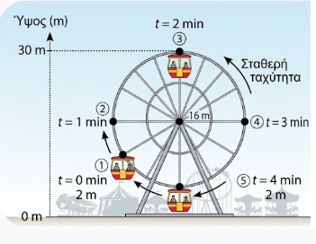{fig-align="center"}

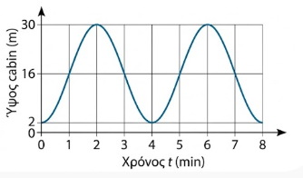{fig-align="center"}

- Τη χρονική στιγμή $t = 0\text{ min}$, η καμπίνα βρίσκεται στο χαμηλότερο σημείο, σε ύψος $2\text{ m}$.

- Σταδιακά ανεβαίνει και τη χρονική στιγμή $t = 2\text{ min}$ φτάνει στο μέγιστο ύψος των $30\text{ m}$.

- Στη συνέχεια κατεβαίνει και τη χρονική στιγμή $t = 4\text{ min}$ επιστρέφει ξανά στο χαμηλότερο σημείο των $2\text{ m}$.

- Η διαδικασία αυτή επαναλαμβάνεται ακριβώς με τον ίδιο τρόπο.

- **Μαθηματική εξήγηση:**

  Παρατηρούμε ότι κάθε $4\text{ min}$ η καμπίνα επαναλαμβάνει την ίδια ακριβώς κίνηση.

  Αυτό σημαίνει ότι σε όποιο ύψος βρίσκεται η καμπίνα σε κάποια χρονική στιγμή $t$, στο ίδιο ύψος θα βρίσκεται και τη χρονική στιγμή: $$t + 4\text{ min}$$ καθώς και τη χρονική στιγμή: $$t - 4\text{ min}$$

  Επομένως, η συνάρτηση $h(t)$ που εκφράζει το ύψος της καμπίνας από το έδαφος ως συνάρτηση του χρόνου $t$, έχει τις ίδιες τιμές τις χρονικές στιγμές $t$, $t + 4$ και $t - 4$: $$h(t) = h(t + 4) = h(t - 4)$$

  Λέμε ότι η συνάρτηση αυτή είναι **περιοδική** με **περίοδο** $T = 4\text{ min}$.
:::

------------------------------------------------------------------------

### Παράδειγμα 2: Φωτεινότητα (ή αναλαμπές) ενός φάρου

::: my-callout-theory
- **Περιγραφή:**

  Ένας περιστρεφόμενος ναυτικός φάρος εκπέμπει φωτεινές αναλαμπές προς ένα συγκεκριμένο σημείο παρατήρησης στη θάλασσα.
  Η ένταση του φωτός $I(t)$ (σε μονάδες μέτρησης έντασης) που καταγράφεται από έναν παρατηρητή ως συνάρτηση του χρόνου $t$ (σε δευτερόλεπτα, $\text{s}$) μεταβάλλεται ρυθμικά:

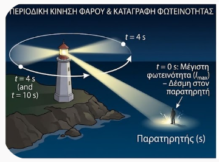{fig-align="center"}

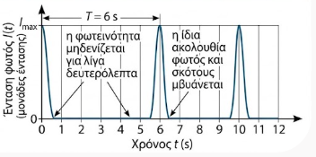{fig-align="center"}

- Τη χρονική στιγμή $t = 0\text{ s}$, καταγράφεται η μέγιστη φωτεινότητα (η δέσμη φωτός στοχεύει ακριβώς τον παρατηρητή).

- Καθώς ο φάρος περιστρέφεται, η φωτεινότητα μηδενίζεται για λίγα δευτερόλεπτα.

- Τη χρονική στιγμή $t = 6\text{ s}$, η φωτεινή δέσμη περνάει ξανά από το ίδιο σημείο και καταγράφεται πάλι η μέγιστη φωτεινότητα.

- Η ίδια ακολουθία φωτός και σκότους επαναλαμβάνεται συνεχώς.

- **Μαθηματική εξήγηση:**\

  Παρατηρούμε ότι κάθε $6\text{ s}$ η ένταση του φωτός επαναλαμβάνει τον ίδιο ακριβώς κύκλο.

  Αυτό σημαίνει ότι όποια ένταση καταγράφεται σε μια χρονική στιγμή $t$, η ίδια ένταση θα καταγράφεται και τη χρονική στιγμή: $$t + 6\text{ s}$$ καθώς και τη χρονική στιγμή: $$t - 6\text{ s}$$

  Επομένως, για τη συνάρτηση της έντασης $I(t)$ ισχύει: $$I(t) = I(t + 6) = I(t - 6)$$

  Λέμε πάλι ότι η συνάρτηση που εκφράζει την ένταση του φωτός με τη βοήθεια του χρόνου $t$ είναι **περιοδική** με **περίοδο** $T = 6\text{ s}$.
:::

------------------------------------------------------------------------

### Περιοδική Συνάρτηση

:::: {.math-box .definition-box}
::: {.math-title .definition-title}
Τι λέμε Περιοδική συνάρτηση
:::

Μία συνάρτηση $f$ με πεδίο ορισμού ένα σύνολο $A$ λέγεται **περιοδική**, όταν υπάρχει πραγματικός αριθμός $T > 0$ τέτοιος, ώστε για κάθε $x \in A$ να ισχύουν:

1.  $x + T \in A$ και $x - T \in A$

2.  $f(x + T) = f(x - T) = f(x)$

Ο πραγματικός αριθμός $T$ ονομάζεται **περίοδος** της συνάρτησης $f$.
Η μικρότερη θετική τιμή του $T$ ονομάζεται **πρωτεύουσα (ή βασική) περίοδος** της συνάρτησης.
::::

------------------------------------------------------------------------

### Τριγωνομετρικές Συναρτήσεις Πραγματικών Αριθμών

Στη Μαθηματική Ανάλυση, οι τριγωνομετρικοί αριθμοί ορίζονται για κάθε πραγματικό αριθμό $x$, θεωρώντας ότι το $x$ παριστάνει το μέτρο μιας γωνίας σε ακτίνια ($x \text{ rad}$):

:::: {.math-box .definition-box}
::: {.math-title .definition-title}
$f(x) = ημ x$
:::

- **Συνάρτηση Ημίτονο (**$f(x) = ημ x$): Αντιστοιχίζει κάθε $x \in \mathbb{R}$ στο $ημ(x \text{ rad})$.

  - Πεδίο ορισμού: $A = \mathbb{R}$

  - Σύνολο τιμών: $f(A) = [-1, 1]$

  - Περίοδος: $T = 2\pi$

    Επειδή $ημ(ω + 360^o) = ημ(ω - 360^o) = ημω$, για κάθε $x ∈ \mathbb{R}$ θα ισχύει:

$ημ(x + 2π) = ημ(x - 2π) = ημx$.
::::

:::: {.math-box .definition-box}
::: {.math-title .definition-title}
$f(x) = συν x$
:::

- **Συνάρτηση Συνημίτονο (**$f(x) = συν x$): Αντιστοιχίζει κάθε $x \in \mathbb{R}$ στο $συν(x \text{ rad})$.

  - Πεδίο ορισμού: $A = \mathbb{R}$

  - Σύνολο τιμών: $f(A) = [-1, 1]$

  - Περίοδος: $T = 2\pi$
::::

:::: {.math-box .definition-box}
::: {.math-title .definition-title}
$f(x) = εφ x$
:::

- **Συνάρτηση Εφαπτομένη (**$f(x) = εφ x = \dfrac{ημ x}{συν x}$):

  - Πεδίο ορισμού: $A = \{x \in \mathbb{R} \mid συν x \neq 0\} = \{x \in \mathbb{R} \mid x \neq k\pi + \dfrac{\pi}{2}, k \in \mathbb{Z}\}$

  - Σύνολο τιμών: $f(A) = \mathbb{R}$

  - Περίοδος: $T = \pi$

    Επειδή για κάθε $x ∈ Α$ ισχύει

$εφ(x + π) = εφ(x - π) = εφx$
::::

:::: {.math-box .definition-box}
::: {.math-title .definition-title}
$f(x) = σφ x$
:::

- **Συνάρτηση Συνεφαπτομένη (**$f(x) = σφ x = \dfrac{συν x}{ημ x}$):

  - Πεδίο ορισμού: $A = \{x \in \mathbb{R} \mid ημ x \neq 0\} = \{x \in \mathbb{R} \mid x \neq k\pi, k \in \mathbb{Z}\}$

  - Σύνολο τιμών: $f(A) = \mathbb{R}$

  - Περίοδος: $T = \pi$
::::

------------------------------------------------------------------------

### Μελέτη της Συνάρτησης $f(x) = ημ x$

<iframe src="https://www.geogebra.org/calculator/fxdwwnxc?embed" width="730" height="600" allowfullscreen style="border: 1px solid #e4e4e4;border-radius: 4px;" frameborder="0">

</iframe>

::: callout-method
**Ακολουθήστε τις οδηγίες**

Αλλάξτε την γωνία (x rad) μέσω του δρομέα x.
(Επιλέξτε τον δρομέα και μετά με [\> ή \<]{.kbd-1} αλλάξτε την τιμή του x)

Διαπιστώστε - διερευνήστε όσα αναφέρονται παρακάτω.
:::

- **Πεδίο Ορισμού & Σύνολο Τιμών:** $A = \mathbb{R}$ και $f(A) = [-1, 1]$.

- **Συμμετρία:** Είναι **περιττή** συνάρτηση, διότι $ημ(-x) = -ημ x$ για κάθε $x \in \mathbb{R}$.
  Η γραφική της παράσταση έχει κέντρο συμμετρίας την αρχή των αξόνων $O(0,0)$.

- **Περιοδικότητα:** Είναι περιοδική με βασική περίοδο $T = 2\pi$.

- **Μονοτονία & Ακρότατα στο** $[0, 2\pi]$:

  - Στο $[0, \dfrac{\pi}{2}]$ είναι **γνησίως αύξουσα** από το $0$ έως το $1$.
    Παρουσιάζει μέγιστο στο $x = \dfrac{\pi}{2}$ με τιμή $1$.

  - Στο $[\dfrac{\pi}{2}, \dfrac{3\pi}{2}]$ είναι **γνησίως φθίνουσα** από το $1$ έως το $-1$.
    Παρουσιάζει ελάχιστο στο $x = \dfrac{3\pi}{2}$ με τιμή $-1$.

  - Στο $[\dfrac{3\pi}{2}, 2\pi]$ είναι **γνησίως αύξουσα** από το $-1$ έως το $0$.

**Πίνακας Μεταβολών** $f(x) = ημ x$

| $x$ | $0$ | $\dfrac{\pi}{2}$ | $\pi$ | $\dfrac{3\pi}{2}$ | $2\pi$ |
|:----------:|:----------:|:----------:|:----------:|:----------:|:----------:|
| $ημ x$ | $0$ | $\nearrow$ $1$ (Μέγ.) | $\searrow$ $0$ | $\searrow$ $-1$ (Ελάχ.) | $\nearrow$ $0$ |

**Πίνακας Τιμών** $f(x) = ημ x$

| $x$ | $0$ | $\dfrac{\pi}{6}$ | $\dfrac{\pi}{4}$ | $\dfrac{\pi}{3}$ | $\dfrac{\pi}{2}$ | $\pi$ | $\dfrac{3\pi}{2}$ | $2\pi$ |
|:------:|:------:|:------:|:------:|:------:|:------:|:------:|:------:|:------:|
| $ημ x$ | $0$ | $\dfrac{1}{2}$ | $\dfrac{\sqrt{2}}{2}$ | $\dfrac{\sqrt{3}}{2}$ | $1$ | $0$ | $-1$ | $0$ |

------------------------------------------------------------------------

### Μελέτη της Συνάρτησης $f(x) = συν x$

<iframe src="https://www.geogebra.org/calculator/ewhbvsrf?embed" width="800" height="600" allowfullscreen style="border: 1px solid #e4e4e4;border-radius: 4px;" frameborder="0">

</iframe>

::: callout-method
**Ακολουθήστε τις οδηγίες**

Αλλάξτε την γωνία (x rad) μέσω του δρομέα x.
(Επιλέξτε τον δρομέα και μετά με [\> ή \<]{.kbd-1} αλλάξτε την τιμή του x)

Διαπιστώστε - διερευνήστε όσα αναφέρονται παρακάτω.
:::

- **Πεδίο Ορισμού & Σύνολο Τιμών:** $A = \mathbb{R}$ και $f(A) = [-1, 1]$.

- **Συμμετρία:** Είναι **άρτια** συνάρτηση, διότι $συν(-x) = συν x$ για κάθε $x \in \mathbb{R}$.
  Η γραφική της παράσταση έχει άξονα συμμετρίας τον άξονα $y'y$.

- **Περιοδικότητα:** Είναι περιοδική με βασική περίοδο $T = 2\pi$.

- **Μονοτονία & Ακρότατα στο** $[0, 2\pi]$:

  - Στο $[0, \pi]$ είναι **γνησίως φθίνουσα** από το $1$ έως το $-1$.
    Παρουσιάζει μέγιστο στο $x = 0$ ($f(0) = 1$) και ελάχιστο στο $x = \pi$ ($f(\pi) = -1$).

  - Στο $[\pi, 2\pi]$ είναι **γνησίως αύξουσα** από το $-1$ έως το $1$.
    Παρουσιάζει μέγιστο στο $x = 2\pi$ ($f(2\pi) = 1$).

**Πίνακας Μεταβολών** $f(x) = συν x$

|   $x$   |    $0$     |          $\pi$          |        $2\pi$         |
|:-------:|:----------:|:-----------------------:|:---------------------:|
| $συν x$ | $1$ (Μέγ.) | $\searrow$ $-1$ (Ελάχ.) | $\nearrow$ $1$ (Μέγ.) |

**Πίνακας Τιμών** $f(x) = συν x$

| $x$ | $0$ | $\dfrac{\pi}{6}$ | $\dfrac{\pi}{4}$ | $\dfrac{\pi}{3}$ | $\dfrac{\pi}{2}$ | $\pi$ | $\dfrac{3\pi}{2}$ | $2\pi$ |
|:------:|:------:|:------:|:------:|:------:|:------:|:------:|:------:|:------:|
| $συν x$ | $1$ | $\dfrac{\sqrt{3}}{2}$ | $\dfrac{\sqrt{2}}{2}$ | $\dfrac{1}{2}$ | $0$ | $-1$ | $0$ | $1$ |

------------------------------------------------------------------------

### Μελέτη της Συνάρτησης $f(x) = εφ x$

<iframe src="https://www.geogebra.org/calculator/c5py23sc?embed" width="730" height="750" allowfullscreen style="border: 1px solid #e4e4e4;border-radius: 4px;" frameborder="0">

</iframe>

::: callout-method
**Ακολουθήστε τις οδηγίες**

Αλλάξτε την γωνία (x rad) μέσω του δρομέα x.
(Επιλέξτε τον δρομέα και μετά με [\> ή \<]{.kbd-1} αλλάξτε την τιμή του x)

Διαπιστώστε - διερευνήστε όσα αναφέρονται παρακάτω.
:::

- **Πεδίο Ορισμού & Σύνολο Τιμών:** $A = \mathbb{R} \setminus \{k\pi + \dfrac{\pi}{2}, k \in \mathbb{Z}\}$ και $f(A) = \mathbb{R}$.

- **Συμμετρία:** Είναι **περιττή** συνάρτηση, διότι $εφ(-x) = -εφ x$.
  Κέντρο συμμετρίας η αρχή $O(0,0)$.

- **Περιοδικότητα:** Περιοδική με βασική περίοδο $T = \pi$.

- **Μονοτονία & Ασύμπτωτες:** Στο ανοικτό διάστημα $(-\dfrac{\pi}{2}, \dfrac{\pi}{2})$ είναι **γνησίως αύξουσα**.
  Οι ευθείες $x = -\dfrac{\pi}{2}$ και $x = \dfrac{\pi}{2}$ είναι κατακόρυφες ασύμπτωτες της γραφικής της παράστασης.

**Πίνακας Μεταβολών** $f(x) = εφ x$ στο $(-\dfrac{\pi}{2}, \dfrac{\pi}{2})$

|  $x$   | $-\dfrac{\pi}{2}$ |            $0$            | $\dfrac{\pi}{2}$ |
|:------:|:-----------------:|:-------------------------:|:----------------:|
| $εφ x$ |     $-\infty$     | $\nearrow$ $0$ $\nearrow$ |    $+\infty$     |

**Πίνακας Τιμών** $f(x) = εφ x$

| $x$ | $-\dfrac{\pi}{3}$ | $-\dfrac{\pi}{4}$ | $-\dfrac{\pi}{6}$ | $0$ | $\dfrac{\pi}{6}$ | $\dfrac{\pi}{4}$ | $\dfrac{\pi}{3}$ |
|:-------:|:-------:|:-------:|:-------:|:-------:|:-------:|:-------:|:-------:|
| $εφ x$ | $-\sqrt{3}$ | $-1$ | $-\dfrac{\sqrt{3}}{3}$ | $0$ | $\dfrac{\sqrt{3}}{3}$ | $1$ | $\sqrt{3}$ |

------------------------------------------------------------------------

### Μελέτη της Συνάρτησης $f(x) = σφ x$

<iframe src="https://www.geogebra.org/calculator/vrkc7xkf?embed" width="730" height="750" allowfullscreen style="border: 1px solid #e4e4e4;border-radius: 4px;" frameborder="0">

</iframe>

::: callout-method
**Ακολουθήστε τις οδηγίες**

Αλλάξτε την γωνία (x rad) μέσω του δρομέα x.
(Επιλέξτε τον δρομέα και μετά με [\> ή \<]{.kbd-1} αλλάξτε την τιμή του x)

Διαπιστώστε - διερευνήστε όσα αναφέρονται παρακάτω.
:::

- **Πεδίο Ορισμού & Σύνολο Τιμών:** $A = \mathbb{R} \setminus \{k\pi, k \in \mathbb{Z}\}$ και $f(A) = \mathbb{R}$.

- **Συμμετρία:** Είναι **περιττή** συνάρτηση, διότι $σφ(-x) = -σφ x$.

- **Περιοδικότητα:** Περιοδική με βασική περίοδο $T = \pi$.

- **Μονοτονία & Ασύμπτωτες:** Στο διάστημα $(0, \pi)$ είναι **γνησίως φθίνουσα**.
  Οι ευθείες $x = 0$ και $x = \pi$ είναι κατακόρυφες ασύμπτωτες.

**Πίνακας Μεταβολών** $f(x) = σφ x$ στο $(0, \pi)$

|  $x$   |    $0$    |     $\dfrac{\pi}{2}$      |   $\pi$   |
|:------:|:---------:|:-------------------------:|:---------:|
| $σφ x$ | $+\infty$ | $\searrow$ $0$ $\searrow$ | $-\infty$ |

**Πίνακας Τιμών** $f(x) = σφ x$

| $x$ | $\dfrac{\pi}{6}$ | $\dfrac{\pi}{4}$ | $\dfrac{\pi}{3}$ | $\dfrac{\pi}{2}$ | $\dfrac{2\pi}{3}$ | $\dfrac{3\pi}{4}$ | $\dfrac{5\pi}{6}$ |
|:-------:|:-------:|:-------:|:-------:|:-------:|:-------:|:-------:|:-------:|
| $σφ x$ | $\sqrt{3}$ | $1$ | $\dfrac{\sqrt{3}}{3}$ | $0$ | $-\dfrac{\sqrt{3}}{3}$ | $-1$ | $-\sqrt{3}$ |

------------------------------------------------------------------------

### Μελέτη της Συνάρτησης $f(x) = \rho \cdot ημ(\omega x)$ ($\rho, \omega > 0$)

<iframe src="https://www.geogebra.org/calculator/q566gn6q?embed" width="730" height="600" allowfullscreen style="border: 1px solid #e4e4e4;border-radius: 4px;" frameborder="0">

</iframe>

::: callout-method
**Ακολουθήστε τις οδηγίες**

Αλλάξτε την γωνία (x rad) μέσω του δρομέα x.
(Επιλέξτε τον δρομέα και μετά με [\> ή \<]{.kbd-1} αλλάξτε την τιμή του x)

Αλλάξτε το ρ ($ρ \in \mathbb{R^+}$) μέσω του δρομέα ρ

Αλλάξτε το ω ($ω \in \mathbb{R^+}$) μέσω του δρομέα ω

Διαπιστώστε - διερευνήστε όσα αναφέρονται παρακάτω.
:::

Για τη γενικευμένη τριγωνομετρική συνάρτηση $f(x) = \rho \cdot ημ(\omega x)$ με $\rho > 0$ και $\omega > 0$:

1.  **Ακρότατα:** Το $\rho$ καθορίζει το πλάτος της συνάρτησης.
    Έχει μέγιστη τιμή ίση με $\rho$ και ελάχιστη τιμή ίση με $-\rho$.

2.  **Περίοδος:** Το $\omega$ καθορίζει τη συχνότητα.
    Η βασική περίοδος είναι $T = \dfrac{2\pi}{\omega}$.

**Πίνακας Μεταβολών** $f(x) = \rho \cdot ημ(\omega x)$ σε μία περίοδο $[0, \dfrac{2\pi}{\omega}]$

| $x$ | $0$ | $\dfrac{\pi}{2\omega}$ | $\dfrac{\pi}{\omega}$ | $\dfrac{3\pi}{2\omega}$ | $\dfrac{2\pi}{\omega}$ |
|:----------:|:----------:|:----------:|:----------:|:----------:|:----------:|
| $f(x)$ | $0$ | $\nearrow$ $\rho$ (Μέγ.) | $\searrow$ $0$ | $\searrow$ $-\rho$ (Ελάχ.) | $\nearrow$ $0$ |

------------------------------------------------------------------------

### Παραδείγματα Εφαρμογής

:::: {.math-box .example-box}
::: {.math-title .example-title}
**1ο Παράδειγμα:**
:::

**Μελέτη & Γραφική Παράσταση της** $f(x) = 4ημ x$
::::

:::: {.math-box .examplesolution-box}
::: {.math-title .examplesolution-title}
**Λύση**

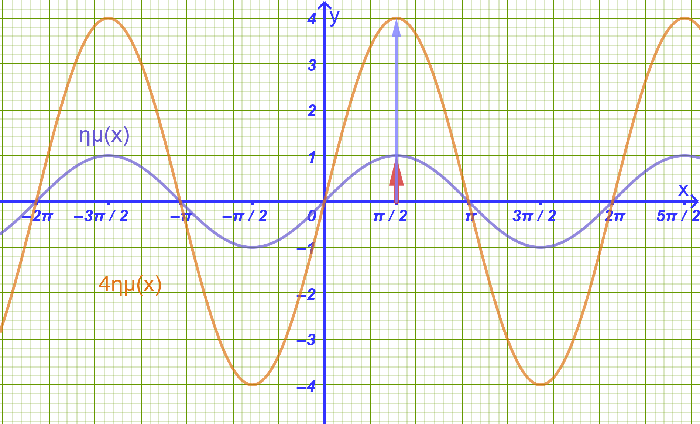{fig-align="center" width="500"}
:::

- **Χαρακτηριστικά:** Έχει πλάτος $\rho = 4$ και περίοδο $T = 2\pi$.
  Μέγιστο το $4$ (στο $x = \dfrac{\pi}{2}$) και ελάχιστο το $-4$ (στο $x = \dfrac{3\pi}{2}$).

- **Πίνακας Τιμών στο** $[0, 2\pi]$:

|   $x$   | $0$ | $\dfrac{\pi}{2}$ | $\pi$ | $\dfrac{3\pi}{2}$ | $2\pi$ |
|:-------:|:---:|:----------------:|:-----:|:-----------------:|:------:|
| $ημ x$  | $0$ |       $1$        |  $0$  |       $-1$        |  $0$   |
| $4ημ x$ | $0$ |       $4$        |  $0$  |       $-4$        |  $0$   |

- **Γραφική Παράσταση:** Είναι μια ημιτονοειδής καμπύλη με τεταγμένες 4 φορές μεγαλύτερες από τις αντίστοιχες της $y = ημ x$.
::::

------------------------------------------------------------------------

:::: {.math-box .example-box}
::: {.math-title .example-title}
**2ο Παράδειγμα:**
:::

**Μελέτη & Γραφική Παράσταση της** $f(x) = ημ(4x)$
::::

:::: {.math-box .examplesolution-box}
::: {.math-title .examplesolution-title}
**Λύση**

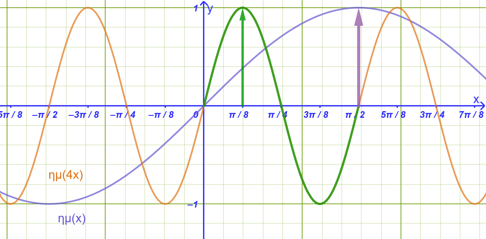{fig-align="center" width="600"}
:::

- **Χαρακτηριστικά:** Έχει πλάτος $\rho = 1$ και περίοδο $T = \dfrac{2\pi}{4} = \dfrac{\pi}{2}$.

- **Πίνακας Τιμών σε διάστημα μιας περιόδου** $[0, \dfrac{\pi}{2}]$:

| $x$ | $0$ | $\dfrac{\pi}{8}$ | $\dfrac{\pi}{4}$ | $\dfrac{3\pi}{8}$ | $\dfrac{\pi}{2}$ |
|:----------:|:----------:|:----------:|:----------:|:----------:|:----------:|
| $4x$ | $0$ | $\dfrac{\pi}{2}$ | $\pi$ | $\dfrac{3\pi}{2}$ | $2\pi$ |
| $ημ(4x)$ | $0$ | $1$ | $0$ | $-1$ | $0$ |

- **Γραφική Παράσταση:** Η κύρια περίοδος συμπιέζεται οριζόντια στο διάστημα $[0, \dfrac{\pi}{2}]$.
::::

------------------------------------------------------------------------

:::: {.math-box .example-box}
::: {.math-title .example-title}
**3ο Παράδειγμα:**
:::

**Μελέτη & Γραφική Παράσταση της** $f(x) = 2συν(3x)$
::::

:::: {.math-box .examplesolution-box}
::: {.math-title .examplesolution-title}
**Λύση**

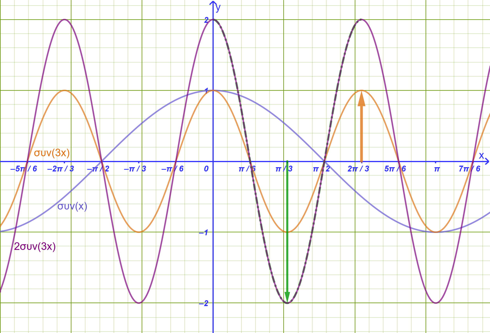{fig-align="center" width="600"}
:::

- **Χαρακτηριστικά:** Έχει πλάτος $\rho = 2$ (μέγιστο $2$, ελάχιστο $-2$).
  Η περίοδός της είναι $T = \dfrac{2\pi}{3}$.

- **Πίνακας Τιμών στο** $[0, \dfrac{2\pi}{3}]$:

| $x$ | $0$ | $\dfrac{\pi}{6}$ | $\dfrac{\pi}{3}$ | $\dfrac{\pi}{2}$ | $\dfrac{2\pi}{3}$ |
|:----------:|:----------:|:----------:|:----------:|:----------:|:----------:|
| $3x$ | $0$ | $\dfrac{\pi}{2}$ | $\pi$ | $\dfrac{3\pi}{2}$ | $2\pi$ |
| $συν(3x)$ | $1$ | $0$ | $-1$ | $0$ | $1$ |
| $2συν(3x)$ | $2$ | $0$ | $-2$ | $0$ | $2$ |
::::

------------------------------------------------------------------------

### Λυμένες ασκήσεις

:::: {.math-box .exercise-box}
::: {.math-title .exercise-title}
**Άσκηση 1: Μελέτη Συνάρτησης με Διπλάσιο Τόξο**
:::

Δίνεται η συνάρτηση $f(x) = 4ημ(2x) - 1$.

1.  Να βρεθεί η βασική περίοδος $T$ της συνάρτησης.

2.  Να βρεθεί η μέγιστη τιμή $M$ και η ελάχιστη τιμή $m$ της $f$.

3.  Να υπολογιστούν οι τιμές $f\left(\dfrac{\pi}{12}\right)$ και $f\left(\dfrac{\pi}{4}\right)$.
::::

:::: {.math-box .solution-box}
::: {.math-title .solution-title}
**Αναλυτική Λύση:**

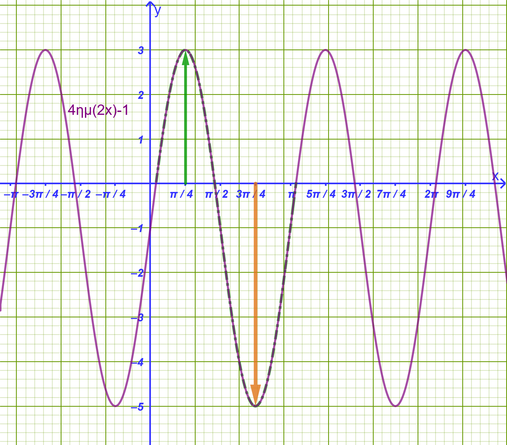{fig-align="center" width="600"}
:::

1.  Η συνάρτηση είναι της μορφής $f(x) = \rhoημ(\omega x) + c$ με $\omega = 2$.
    Η βασική περίοδος υπολογίζεται από τον τύπο $T = \dfrac{2\pi}{\omega} = \dfrac{2\pi}{2} = \mathbf{\pi}$.

2.  Για κάθε $x \in \mathbb{R}$ ισχύει: $$-1 \le ημ(2x) \le 1 \implies -4 \le 4ημ(2x) \le 4 \implies -5 \le 4ημ(2x) - 1 \le 3$$ Άρα η ελάχιστη τιμή είναι $m = -5$ και η μέγιστη τιμή είναι $M = 3$.

3.  Υπολογισμός τιμών:

    - $f\left(\dfrac{\pi}{12}\right) = 4ημ\left(2 \cdot \dfrac{\pi}{12}\right) - 1 = 4ημ\left(\dfrac{\pi}{6}\right) - 1 = 4 \cdot \dfrac{1}{2} - 1 = 2 - 1 = \mathbf{1}$.
    - $f\left(\dfrac{\pi}{4}\right) = 4ημ\left(2 \cdot \dfrac{\pi}{4}\right) - 1 = 4ημ\left(\dfrac{\pi}{2}\right) - 1 = 4 \cdot 1 - 1 = \mathbf{3}$.
::::

------------------------------------------------------------------------

:::: {.math-box .exercise-box}
::: {.math-title .exercise-title}
**Άσκηση 2: Μελέτη Συνάρτησης με Υποδιαίρεση Τόξου (Μισό Τόξο)**
:::

Δίνεται η συνάρτηση $g(x) = -3συν\left(\dfrac{x}{2}\right) + 2$.

1.  Να βρεθεί η βασική περίοδος $T$ της $g$.

2.  Να βρεθούν τα ακρότατα της συνάρτησης (μέγιστη και ελάχιστη τιμή).

3.  Να εξεταστεί αν η συνάρτηση είναι άρτια ή περιττή.
::::

:::: {.math-box .solution-box}
::: {.math-title .solution-title}
**Αναλυτική Λύση:**

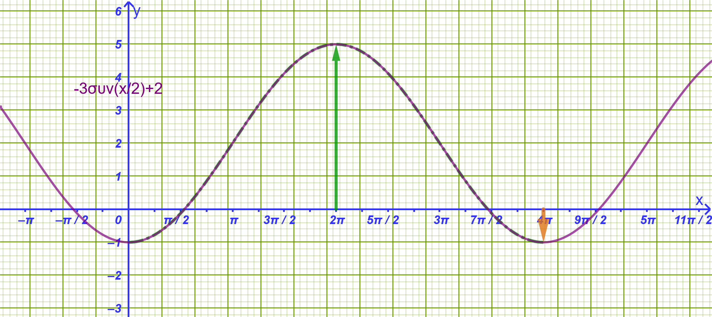{fig-align="center" width="600"}
:::

1.  Ο συντελεστής της μεταβλητής είναι $\omega = \dfrac{1}{2}$.

    Η περίοδος είναι $T = \dfrac{2\pi}{1/2} = \mathbf{4\pi}$.

2.  Για κάθε $x \in \mathbb{R}$ ισχύει: $$-1 \le συν\left(\dfrac{x}{2}\right) \le 1 \implies -3 \le -3συν\left(\dfrac{x}{2}\right) \le 3 \implies -1 \le -3συν\left(\dfrac{x}{2}\right) + 2 \le 5$$

    Άρα η ελάχιστη τιμή είναι $m = -1$ και η μέγιστη $M = 5$.

3.  Το πεδίο ορισμού είναι το $A = \mathbb{R}$ (συμμετρικό ως προς το $0$).
    $g(-x) = -3συν\left(-\dfrac{x}{2}\right) + 2 = -3συν\left(\dfrac{x}{2}\right) + 2 = g(x)$, διότι το συνημίτονο είναι άρτια συνάρτηση ($συν(-\theta) = συν\theta$).

    Άρα η συνάρτηση $g$ είναι **άρτια**.
::::

------------------------------------------------------------------------

:::: {.math-box .exercise-box}
::: {.math-title .exercise-title}
**Άσκηση 3: Συνάρτηση Εφαπτομένης με Πολλαπλάσιο Τόξο**
:::

Δίνεται η συνάρτηση $h(x) = εφ(3x)$.

1.  Να βρεθεί το πεδίο ορισμού της συνάρτησης $h$.

2.  Να βρεθεί η βασική περίοδος $T$ της $h$.

3.  Να υπολογιστεί η τιμή $h\left(\dfrac{\pi}{12}\right)$ και $h\left(\dfrac{\pi}{9}\right)$.
::::

:::: {.math-box .solution-box}
::: {.math-title .solution-title}
**Αναλυτική Λύση:**

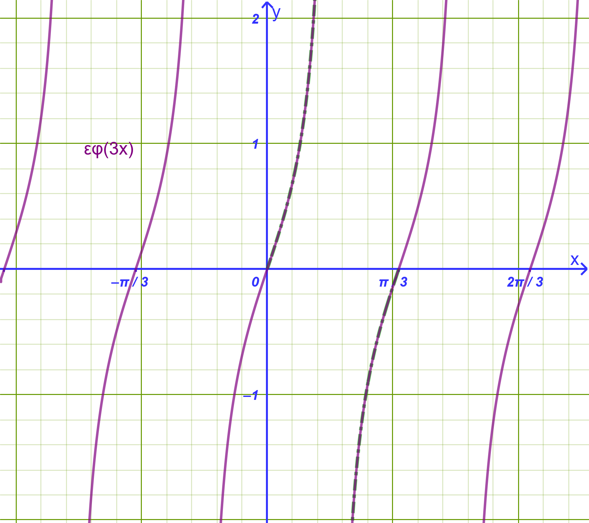{fig-align="center" width="500"}
:::

1.  Η συνάρτηση εφαπτομένη ορίζεται όταν το όρισμά της δεν μηδενίζει το συνημίτονο: $$3x \neq k\pi + \dfrac{\pi}{2} \iff x \neq \dfrac{k\pi}{3} + \dfrac{\pi}{6}, \quad k \in \mathbb{Z}$$

    Πεδίο ορισμού: $A = \mathbb{R} \setminus \left\{\dfrac{k\pi}{3} + \dfrac{\pi}{6}, k \in \mathbb{Z}\right\}$.

2.  Η βασική περίοδος της εφαπτομένης με συντελεστή $\omega = 3$ είναι $T = \dfrac{\pi}{\omega} = \mathbf{\dfrac{\pi}{3}}$.

3.  Υπολογισμός τιμών:

    - $h\left(\dfrac{\pi}{12}\right) = εφ\left(3 \cdot \dfrac{\pi}{12}\right) = εφ\left(\dfrac{\pi}{4}\right) = \mathbf{1}$.

    - $h\left(\dfrac{\pi}{9}\right) = εφ\left(3 \cdot \dfrac{\pi}{9}\right) = εφ\left(\dfrac{\pi}{3}\right) = \mathbf{\sqrt{3}}$.
::::

------------------------------------------------------------------------

:::: {.math-box .exercise-box}
::: {.math-title .exercise-title}
**Άσκηση 4: Σύγκριση Περιόδων & Πλάτους Συναρτήσεων**
:::

Δίνονται οι συναρτήσεις $f(x) = 2ημ(4x)$ και $g(x) = 5συν\left(\dfrac{x}{3}\right)$.

1.  Να βρεθούν οι βασικές περίοδοι $T_f$ και $T_g$ των δύο συναρτήσεων.

2.  Να βρεθούν τα πλάτη $\rho_f$ και $\rho_g$ των δύο συναρτήσεων.
::::

:::: {.math-box .solution-box}
::: {.math-title .solution-title}
**Αναλυτική Λύση:**

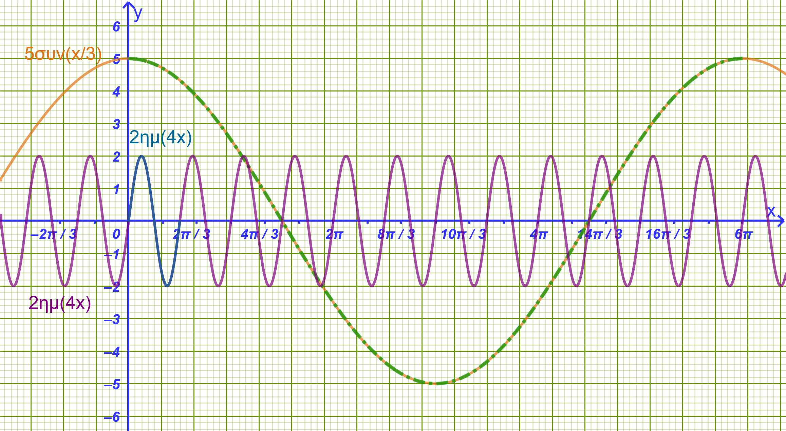{fig-align="center" width="600"}
:::

1.  Για την $f(x) = 2ημ(4x)$: $\omega_1 = 4 \implies T_f = \dfrac{2\pi}{4} = \mathbf{\dfrac{\pi}{2}}$.

    Για την $g(x) = 5συν\left(\dfrac{x}{3}\right)$: $\omega_2 = \dfrac{1}{3} \implies T_g = \dfrac{2\pi}{1/3} = \mathbf{6\pi}$.

    Παρατηρούμε ότι $T_g = 12 \cdot T_f$, δηλαδή η $g$ έχει $12$ φορές μεγαλύτερη περίοδο από την $f$.

2.  Το πλάτος της $f$ είναι $\rho_f = 2$ (με μέγιστο $2$ και ελάχιστο $-2$).

    Το πλάτος της $g$ είναι $\rho_g = 5$ (με μέγιστο $5$ και ελάχιστο $-5$).
::::

------------------------------------------------------------------------

:::: {.math-box .exercise-box}
::: {.math-title .exercise-title}
**Άσκηση 5: Προσδιορισμός Παραμέτρων Συνάρτησης** $f(x) = \rhoημ(\omega x)$
:::

Μια συνάρτηση της μορφής $f(x) = \rhoημ(\omega x)$ με $\rho > 0$ και $\omega > 0$ έχει μέγιστη τιμή $M = 3$ και περίοδο $T = \dfrac{2\pi}{5}$.

1.  Να προσδιοριστούν οι παράμετροι $\rho$ και $\omega$.

2.  Να υπολογιστούν οι τιμές της συνάρτησης στις θέσεις $x_1 = \dfrac{\pi}{10}$ και $x_2 = \dfrac{\pi}{30}$.
::::

:::: {.math-box .solution-box}
::: {.math-title .solution-title}
**Αναλυτική Λύση:**
:::

1.  Επειδή $\rho > 0$, η μέγιστη τιμή της $f(x)$ ισούται με $M = \rho$.
    Δίνεται $M = 3$, συνεπώς $\rho = 3$.

    Η περίοδος δίνεται από τον τύπο $T = \dfrac{2\pi}{\omega}$.
    Δίνεται $T = \dfrac{2\pi}{5} \implies \dfrac{2\pi}{\omega} = \dfrac{2\pi}{5} \iff \mathbf{\omega = 5}$.

    Άρα ο τύπος της συνάρτησης είναι: $f(x) = 3ημ(5x)$.

2.  Υπολογισμός τιμών:

    - $f\left(\dfrac{\pi}{10}\right) = 3ημ\left(5 \cdot \dfrac{\pi}{10}\right) = 3ημ\left(\dfrac{\pi}{2}\right) = 3 \cdot 1 = \mathbf{3}$.

    - $f\left(\dfrac{\pi}{30}\right) = 3ημ\left(5 \cdot \dfrac{\pi}{30}\right) = 3ημ\left(\dfrac{\pi}{6}\right) = 3 \cdot \dfrac{1}{2} = \mathbf{\dfrac{3}{2}}$.
::::

------------------------------------------------------------------------

:::: {.math-box .exercise-box}
::: {.math-title .exercise-title}
**Άσκηση 6: Ευρεση Σταθεράς & Ακροτάτων Συνάρτησης** $f(x) = 2συν(3x) + k$
:::

Δίνεται η συνάρτηση $f(x) = 2συν(3x) + k$, της οποίας η γραφική παράσταση διέρχεται από το σημείο $A\left(\dfrac{\pi}{9}, 2\right)$.

1.  Να υπολογιστεί η σταθερά $k \in \mathbb{R}$.

2.  Να βρεθεί η περίοδος $T$, η μέγιστη τιμή $M$ και η ελάχιστη τιμή $m$ της $f$.
::::

:::: {.math-box .solution-box}
::: {.math-title .solution-title}
**Αναλυτική Λύση:**
:::

1.  Επειδή το σημείο $A\left(\dfrac{\pi}{9}, 2\right)$ ανήκει στη γραφική παράσταση της $f$, ισχύει $f\left(\dfrac{\pi}{9}\right) = 2$: $$2συν\left(3 \cdot \dfrac{\pi}{9}\right) + k = 2 \iff \\ 2συν\left(\dfrac{\pi}{3}\right) + k = 2 \iff \\ 2 \cdot \dfrac{1}{2} + k = 2 \iff 1 + k = 2 \iff \mathbf{k = 1}$$

    Άρα ο τύπος της συνάρτησης είναι $f(x) = 2συν(3x) + 1$.

2.  Ο συντελεστής είναι $\omega = 3 \implies T = \mathbf{\dfrac{2\pi}{3}}$.

    Για κάθε $x \in \mathbb{R}$ ισχύει: $$-1 \le συν(3x) \le 1 \implies -2 \le 2συν(3x) \le 2 \implies -1 \le 2συν(3x) + 1 \le 3$$

    Άρα η ελάχιστη τιμή είναι $m = -1$ και η μέγιστη τιμή είναι $M = 3$.
::::

------------------------------------------------------------------------

### Ασκήσεις και Προβλήματα Εμπέδωσης

#### **Κατηγορία Α: Περίοδος & Ακρότατα Συναρτήσεων**

1.  Να βρεθεί η περίοδος, η μέγιστη και η ελάχιστη τιμή των παρακάτω συναρτήσεων: $$\text{α) } f(x) = 5ημ(2x), \quad \text{β) } g(x) = -3συν(4x), \quad \text{γ) } h(x) = 2εφ(3x)$$

2.  Να προσδιοριστεί η περίοδος των συναρτήσεων: $$\text{α) } f(x) = ημ\left(\dfrac{x}{3}\right), \quad \text{β) } g(x) = συν\left(\dfrac{2x}{5}\right)$$

3.  ***Αναγνώριση εξίσωσης από τη γραφική παράσταση***

Δίνονται οι παρακάτω τριγωνομετρικές συναρτήσεις της μορφής $f(x) = \rho \cdot \eta\mu(\omega x)$ ή $f(x) = \rho \cdot \sigma\upsilon\nu(\omega x)$ με $\rho > 0$ και $\omega > 0$:

1.  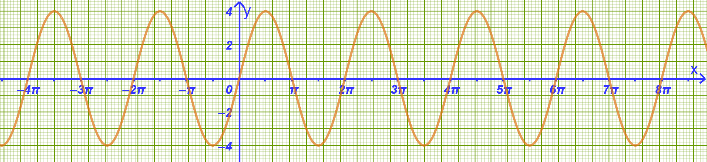{width="500"}
2.  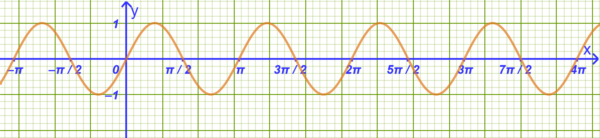{width="500"}
3.  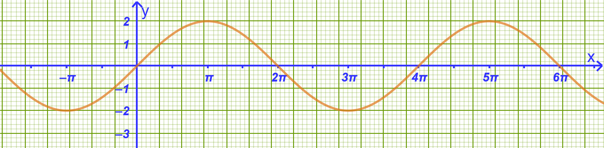{width="500"}
4.  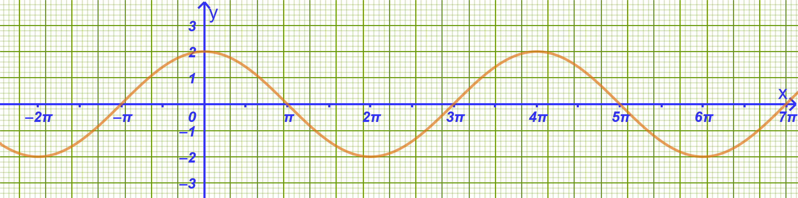{width="500"}
5.  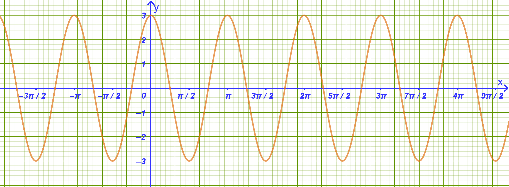{width="500"}

**Ερώτημα:**

Να βρείτε τον τύπο της κάθε συνάρτησης, προσδιορίζοντας τις παραμέτρους $\rho$ και $\omega$, χρησιμοποιώντας τους τύπους:

- Μέγιστη τιμή $= \rho$

- Περίοδος $T = \dfrac{2\pi}{\omega}$

------------------------------------------------------------------------

4.  Να βρεθούν τα ακρότατα και η περίοδος της συνάρτησης $f(x) = 3 - 2ημ(5x)$.

5.  Να εξεταστεί ως προς την περιοδικότητα η συνάρτηση $f(x) = συν^2 x$ και να αποδειχθεί ότι έχει περίοδο $T = \pi$.

#### **Κατηγορία Β: Γραφικές Παραστάσεις & Μετατοπίσεις**

6.  Στο ίδιο σύστημα αξόνων να σχεδιάσετε τις γραφικές παραστάσεις των συναρτήσεων $f(x) = ημ x$, $g(x) = 2ημ x$ και $h(x) = -2ημ x$ για $x \in [0, 2\pi]$.

7.  Να παρασταθεί γραφικά η συνάρτηση $f(x) = συν(2x)$ στο διάστημα $[0, \pi]$.

8.  Να σχεδιαστούν οι γραφικές παραστάσεις των συναρτήσεων $f(x) = ημ x$ και $g(x) = ημ x + 1$ στο ίδιο σύστημα αξόνων.

9.  Να περιγραφεί πώς προκύπτει η γραφική παράσταση της $f(x) = 2ημ(x - \dfrac{\pi}{4})$ από την $g(x) = 2ημ x$.

10. Να σχεδιαστεί η γραφική παράσταση της $f(x) = 3συν(\dfrac{x}{2})$ σε διάστημα μίας περιόδου.

#### **Κατηγορία Γ: Εύρεση Τύπου & Παραμέτρων**

11. Μια συνάρτηση της μορφής $f(x) = \rho \cdot ημ(\omega x)$ ($\rho > 0, \omega > 0$) έχει μέγιστη τιμή $6$ και περίοδο $T = \pi$. Να προσδιοριστούν τα $\rho$ και $\omega$.

:::: {.math-box .exercise-box}
::: {.math-title .exercise-title}
12. Εκφώνηση
:::

Δίνεται η συνάρτηση $f(x) = \alpha \cdot συν(\beta x) + \gamma$.
Αν η μέγιστη τιμή της είναι $5$, η ελάχιστη είναι $1$ και η περίοδος $T = 4\pi$, να υπολογιστούν τα $\alpha, \beta, \gamma > 0$.
::::

:::: {.math-box .solution-box}
::: {.math-title .solution-title}
Λύση
:::

**1. Υπολογισμός του** $\beta$ από την περίοδο

Γνωρίζουμε ότι για τη συνάρτηση $\sigma\upsilon\nu(\beta x)$ με $\beta > 0$, η περίοδος $T$ δίνεται από τον τύπο: $$T = \frac{2\pi}{\beta}$$

Από την υπόθεση έχουμε $T = 4\pi$, άρα: $$\frac{2\pi}{\beta} = 4\pi \implies \beta = \frac{2\pi}{4\pi} = \frac{1}{2}$$

------------------------------------------------------------------------

**2. Υπολογισμός των** $\alpha$ και $\gamma$ από τα ακρότατα

Επειδή $\alpha > 0$, για κάθε $x \in \mathbb{R}$ ισχύει: $$-1 \le \sigma\upsilon\nu(\beta x) \le 1$$

Πολλαπλασιάζοντας με $\alpha > 0$: $$-\alpha \le \alpha \cdot \sigma\upsilon\nu(\beta x) \le \alpha$$

Προσθέτοντας το $\gamma$: $$-\alpha + \gamma \le \alpha \cdot \sigma\upsilon\nu(\beta x) + \gamma \le \alpha + \gamma$$

Επομένως:

- Η **μέγιστη τιμή** της συνάρτησης είναι: $$\alpha + \gamma = 5 \quad \text{(1)}$$

- Η **ελάχιστη τιμή** της συνάρτησης είναι: $$-\alpha + \gamma = 1 \quad \text{(2)}$$

------------------------------------------------------------------------

**3. Επίλυση του συστήματος**

Προσθέτοντας κατά μέλη τις εξισώσεις (1) και (2): $$(\alpha + \gamma) + (-\alpha + \gamma) = 5 + 1$$ $$2\gamma = 6 \implies \gamma = 3$$

Αντικαθιστώντας το $\gamma = 3$ στην εξίσωση (1): $$\alpha + 3 = 5 \implies \alpha = 2$$

------------------------------------------------------------------------

**Τελική Απάντηση**

Οι τιμές των παραμέτρων είναι: $$\alpha = 2, \quad \beta = \frac{1}{2}, \quad \gamma = 3$$
::::

13. Η γραφική παράσταση της $f(x) = \rho \cdot ημ(\omega x)$ διέρχεται από το σημείο $A(\dfrac{\pi}{6}, 2)$ και έχει μέγιστο το $4$.
    Να βρεθούν τα $\rho$ και $\omega$.

14. Να βρεθούν τα σημεία τομής της $f(x) = 2ημ(2x)$ με τον άξονα $x'x$ στο διάστημα $[0, \pi]$.

15. Να εξεταστεί αν η συνάρτηση $f(x) = εφ(2x - \dfrac{\pi}{3})$ είναι άρτια ή περιττή.

#### **Κατηγορία Δ: Σύνθετα Προβλήματα & Φυσικές Εφαρμογές**

16. **Αρμονική Ταλάντωση:** Η απομάκρυνση ενός σώματος που εκτελεί απλή αρμονική ταλάντωση δίνεται από τον τύπο $x(t) = 0{,}2 \cdot ημ(10\pi t)$ (όπου $t$ ο χρόνος σε δευτερόλεπτα).

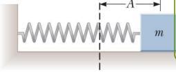{fig-align="center"}

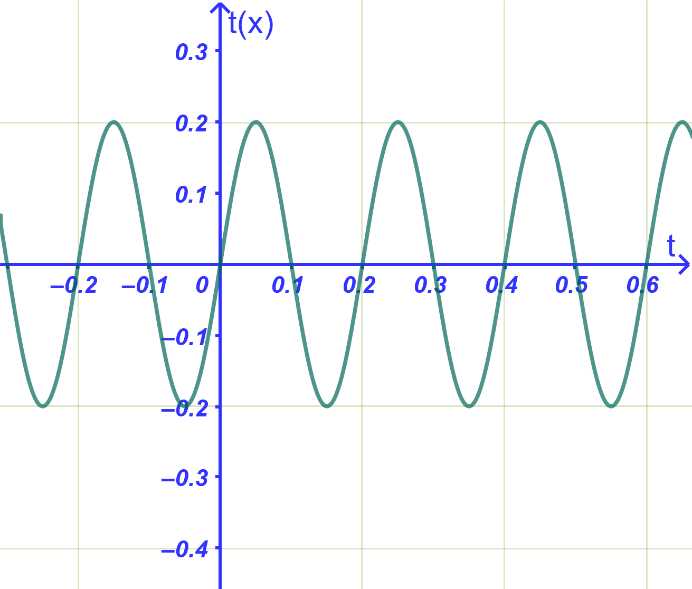{fig-align="center" width="400"}

- α) Να βρεθεί το πλάτος και η περίοδος της ταλάντωσης.

- β) Να υπολογιστεί η απομάκρυνση τις χρονικές στιγμές $t_1 = \dfrac{1}{20} \text{ s}$ και $t_2 = \dfrac{1}{60} \text{ s}$.

17. **Πιστόνι:** Η απόσταση ενός πιστονιού σε μέτρα δίνεται από $x(t) = 0{,}2 + 0{,}1 \cdot ημ(2t)$. Να υπολογιστεί το εύρος κίνησης και η μέγιστη απόστασή του.

{fig-align="center"}

18. Να μελετηθεί ως προς τα ακρότατα και την περίοδο η συνάρτηση $f(x) = 4ημ x + 3$.

19. Δίνονται παρακάτω οι γραφικές παραστάσεις των συναρτήσεων:

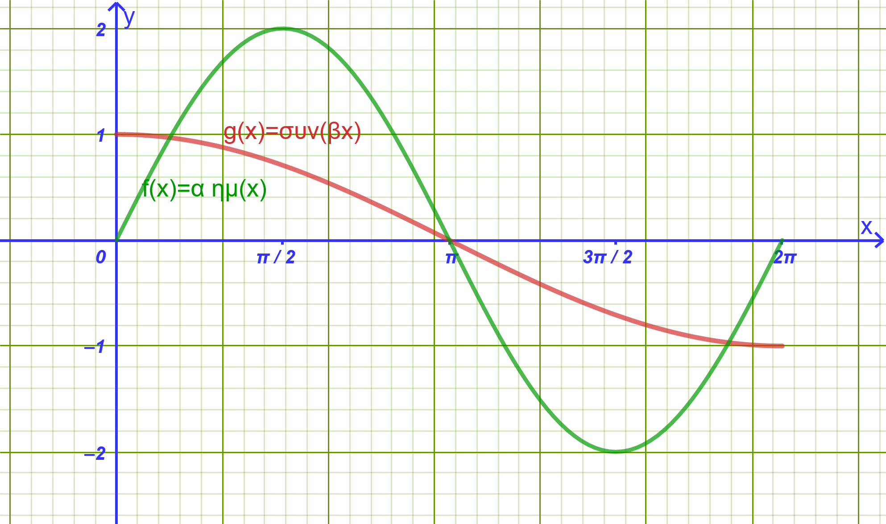{fig-align="center" width="500"}

$$f(x) = a \cdot \eta\mu x$$ $$g(x) = \sigma\upsilon\nu(βx) \quad (x \in [0^\circ, 360^\circ])$$

Να εξηγήσετε γιατί $a = 2$ και $β = \dfrac{1}{2}$.

20. **Κύματα σε λιμνοθάλασσα**

Το ύψος των κυμάτων $y$ (σε μέτρα, $\text{m}$) σε ένα συγκεκριμένο σημείο μιας ακτής μεταβάλλεται περιοδικά λόγω θαλάσσιου ρεύματος σύμφωνα με τον τύπο: $$y(t) = 2 \cdot \eta\mu\left(\frac{\pi}{4} \cdot t\right)$$ όπου $t$ είναι ο χρόνος σε ώρες ($t \ge 0$).

**Ερωτήματα:**

1.  Να βρείτε τη μέγιστη και την ελάχιστη τιμή του ύψους της στάθμης του νερού, καθώς και την υψομετρική τους διαφορά.

2.  Να βρείτε την περίοδο $T$ του φαινομένου.

3.  Να σχεδιάσετε τη γραφική παράσταση της συνάρτησης για μία πλήρη περίοδο, δηλαδή για $0 \le t \le 8$.

------------------------------------------------------------------------

21. **Σημαδούρα που ταλαντώνεται στη θάλασσα**

Μια σημαδούρα είναι δεμένη με άγκυρα στον βυθό.

Λόγω των κυματισμών, ανεβοκατεβαίνει κατακόρυφα έτσι ώστε η απόστασή της $h$ από τον βυθό (σε μέτρα) να δίνεται από τη συνάρτηση: $$h(t) = 5 + 0{,}8 \cdot συν(2t)$$ όπου $t$ είναι ο χρόνος σε δευτερόλεπτα ($\text{s}$).

**Ερωτήματα:**

1.  Να βρείτε το μέγιστο και το ελάχιστο ύψος της σημαδούρας από τον βυθό, καθώς και τη διαφορά μεταξύ τους.

2.  Να υπολογίσετε την περίοδο $T$ της ταλάντωσης της σημαδούρας.

3.  Να κάνετε τη γραφική παράσταση της συνάρτησης για $0 \le t \le \pi$.

------------------------------------------------------------------------

22. **Κίνηση βελόνας ραπτομηχανής**

Η κατακόρυφη θέση $x$ (σε εκατοστά, $\text{cm}$) της βελόνας μιας μηχανικής συσκευής ως προς την επιφάνεια εργασίας περιγράφεται από τη συνάρτηση: $$x(t) = 3 + 2 \cdot ημ(4t)$$ όπου $t$ είναι ο χρόνος σε δευτερόλεπτα ($\text{s}$).

**Ερωτήματα:**

1.  Να βρείτε το πλάτος της κίνησης της βελόνας καθώς και το διάστημα τιμών της θέσης της $x(t)$ (μέγιστη και ελάχιστη τιμή).

2.  Να βρείτε την περίοδο $T$ της κίνησης.

3.  Ποιες χρονικές στιγμές στο διάστημα $0 \le t \le \dfrac{\pi}{2}$ η απόσταση της βελόνας από την επιφάνεια είναι ακριβώς $x = 4\text{ cm}$;

------------------------------------------------------------------------

## ΔΙΑΓΩΝΙΣΜΑ ΑΞΙΟΛΟΓΗΣΗΣ: ΤΡΙΓΩΝΟΜΕΤΡΙΚΕΣ ΣΥΝΑΡΤΗΣΕΙΣ

**Μάθημα:** Άλγεβρα Β' Γενικού Λυκείου\
**Διάρκεια:** 60 λεπτά

------------------------------------------------------------------------

### **ΘΕΜΑ Α (Θεωρία & Ερωτήσεις Κατανόησης - 25 Μονάδες)**

**Α1.**

1.  Πότε μια συνάρτηση $f$ με πεδίο ορισμού $A$ ονομάζεται **περιοδική**; Ποιος αριθμός ονομάζεται περίοδος της $f$; **(5 μονάδες)**

2.  Για τη συνάρτηση $f(x) = \rho \cdot ημ(\omega x)$ ($\rho, \omega > 0$), να αναφέρετε ποια είναι η μέγιστη τιμή της, ποια η ελάχιστη τιμή της και ποιος ο τύπος της βασικής της περιόδου $T$.
    **(5 μονάδες)**

**Α2.** Να χαρακτηρίσετε τις παρακάτω προτάσεις ως **Σωστό (Σ)** ή **Λάθος (Λ)**: **(10 μονάδες)**

1.  Η συνάρτηση $f(x) = συν x$ είναι περιττή συνάρτηση και η γραφική της παράσταση έχει κέντρο συμμετρίας την αρχή των αξόνων $O(0,0)$.

2.  Η συνάρτηση $f(x) = ημ x$ είναι γνησίως αύξουσα στο διάστημα $[0, \dfrac{\pi}{2}]$.

3.  Η βασική περίοδος της συνάρτησης $f(x) = εφ x$ είναι $T = 2\pi$.

4.  Το πεδίο ορισμού της συνάρτησης $f(x) = εφ x$ είναι το σύνολο $\mathbb{R} \setminus \{k\pi + \dfrac{\pi}{2}, k \in \mathbb{Z}\}$.

5.  Η μέγιστη τιμή της συνάρτησης $f(x) = 3ημ(2x)$ είναι $y = 3$ και η ελάχιστη $y = -3$.

**Α3.** Να συμπληρώσετε τις τιμές που λείπουν στον παρακάτω πίνακα μεταβολών της συνάρτησης $f(x) = ημ x$ στο διάστημα $[0, 2\pi]$: **(5 μονάδες)**

|  $x$   | $0$ | $\dfrac{\pi}{2}$ | $\pi$ | $\dfrac{3\pi}{2}$ | $2\pi$ |
|:------:|:---:|:----------------:|:-----:|:-----------------:|:------:|
| $ημ x$ | $0$ |    **.....**     |  $0$  |     **.....**     |  $0$   |

------------------------------------------------------------------------

### **ΘΕΜΑ Β (Υπολογισμός Περιόδου & Ακροτάτων - 25 Μονάδες)**

**Β1.** Να βρείτε τη βασική περίοδο $T$, τη μέγιστη τιμή $M$ και την ελάχιστη τιμή $m$ για κάθε μία από τις παρακάτω συναρτήσεις:

1.  $f(x) = 4ημ(3x)$ **(6 μονάδες)**

2.  $g(x) = -2συν(4x)$ **(6 μονάδες)**

3.  $h(x) = 5ημ\left(\dfrac{x}{2}\right)$ **(6 μονάδες)**

**Β2.** Δίνεται η συνάρτηση $f(x) = 3 - 2συν(5x)$.

1.  Να αποδείξετε ότι για κάθε $x \in \mathbb{R}$ ισχύει $1 \le f(x) \le 5$.
    **(4 μονάδες)**

2.  Να βρείτε τη βασική περίοδο της συνάρτησης $f$.
    **(3 μονάδες)**

------------------------------------------------------------------------

### **ΘΕΜΑ Γ (Πλήρης Μελέτη & Σχεδίαση Συνάρτησης - 25 Μονάδες)**

Δίνεται η συνάρτηση $f(x) = 3ημ(2x)$ ορισμένη στο $\mathbb{R}$.

- **Γ1.** Να βρείτε το πλάτος (μέγιστη και ελάχιστη τιμή) και τη βασική περίοδο $T$ της συνάρτησης $f$.
  **(6 μονάδες)**

- **Γ2.** Να κατασκευάσετε τον πίνακα μεταβολών και τον πίνακα τιμών της $f$ στο διάστημα μίας περιόδου $[0, \pi]$.
  **(9 μονάδες)**

- **Γ3.** Να βρείτε τα σημεία τομής της γραφικής παράστασης της $f$ με τον άξονα $x'x$ στο διάστημα $[0, \pi]$.
  **(10 μονάδες)**

------------------------------------------------------------------------

### **ΘΕΜΑ Δ (Σύνθετο Πρόβλημα & Εφαρμογή Φυσικής - 25 Μονάδες)**

- **Δ1** Δίνονται οι γραφικές παραστάσεις των συναρτήσεων: $$f(\theta) = p \cdot \eta\mu(k\theta) \quad \text{και} \quad g(\theta) = q \cdot \epsilon\phi\theta$$

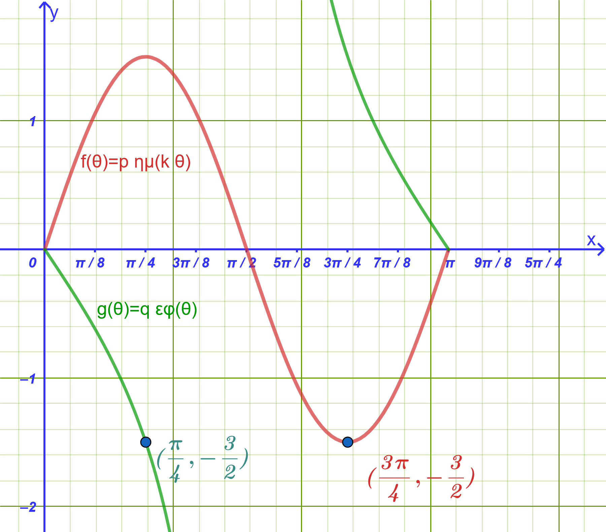{fig-align="center" width="500"}

Να προσδιορίσετε τις τιμές των παραμέτρων $p$, $k$ και $q$.
**(17 μονάδες)**

- **Δ2.** Η απομάκρυνση ενός σώματος που εκτελεί απλή αρμονική ταλάντωση δίνεται από τον τύπο $x(t) = 0{,}1 \cdot ημ(4\pi t)$ (σε μέτρα, με $t$ σε δευτερόλεπτα):

  1.  Να υπολογίσετε το πλάτος και την περίοδο της ταλάντωσης.
      **(4 μονάδες)**

  2.  Να υπολογίσετε την απομάκρυνση του σώματος τη χρονική στιγμή $t = \dfrac{1}{24}\text{ s}$.
      **(4 μονάδες)**

------------------------------------------------------------------------

## ΑΝΑΛΥΤΙΚΕΣ ΛΥΣΕΙΣ ΔΙΑΓΩΝΙΣΜΑΤΟΣ

### **ΘΕΜΑ Α**

- **Α1.1:** Μία συνάρτηση $f$ με πεδίο ορισμού $A$ ονομάζεται **περιοδική**, όταν υπάρχει πραγματικός αριθμός $T > 0$ τέτοιος, ώστε για κάθε $x \in A$ να ισχύει $x+T \in A$, $x-T \in A$ και $f(x+T) = f(x-T) = f(x)$.
  Ο θετικός αριθμός $T$ ονομάζεται περίοδος της συνάρτησης.

- **Α1.2:** Για τη συνάρτηση $f(x) = \rho \cdot ημ(\omega x)$ με $\rho, \omega > 0$:

  - **Μέγιστη τιμή:** $M = \rho$

  - **Ελάχιστη τιμή:** $m = -\rho$

  - **Βασική περίοδος:** $T = \dfrac{2\pi}{\omega}$

- **Α2:**

  1.  **Λάθος** (Η συνάρτηση $f(x) = συν x$ είναι **άρτια** με άξονα συμμετρίας τον $y'y$, ενώ η $ημ x$ είναι περιττή).

  2.  **Σωστό** (Στο διάστημα $[0, \dfrac{\pi}{2}]$, το ημίτονο αυξάνεται γνησίως από το $0$ στο $1$).

  3.  **Λάθος** (Η βασική περίοδος της εφαπτομένης είναι $T = \pi$).

  4.  **Σωστό** (Η εφαπτομένη δεν ορίζεται στις θέσεις $x = k\pi + \dfrac{\pi}{2}$, όπου μηδενίζεται το συνημίτονο).

  5.  **Σωστό** (Για $\rho = 3$, η μέγιστη τιμή είναι $3$ και η ελάχιστη $-3$).

- **Α3:**

  - Στο $x = \dfrac{\pi}{2}$: $ημ\left(\dfrac{\pi}{2}\right) = \mathbf{1}$ (Ολικό μέγιστο).

  - Στο $x = \dfrac{3\pi}{2}$: $ημ\left(\dfrac{3\pi}{2}\right) = \mathbf{-1}$ (Ολικό ελάχιστο).

------------------------------------------------------------------------

### **ΘΕΜΑ Β**

- **Β1.1:** Για την $f(x) = 4ημ(3x)$:

  - $\rho = 4 \implies M = \mathbf{4}$ και $m = \mathbf{-4}$.

  - $\omega = 3 \implies T = \mathbf{\dfrac{2\pi}{3}}$.

- **Β1.2:** Για την $g(x) = -2συν(4x)$:

  - Το πλάτος είναι $|\rho| = |-2| = 2 \implies M = \mathbf{2}$ και $m = \mathbf{-2}$.

  - $\omega = 4 \implies T = \dfrac{2\pi}{4} = \mathbf{\dfrac{\pi}{2}}$.

- **Β1.3:** Για την $h(x) = 5ημ\left(\dfrac{x}{2}\right)$:

  - $\rho = 5 \implies M = \mathbf{5}$ και $m = \mathbf{-5}$.

  - $\omega = \dfrac{1}{2} \implies T = \dfrac{2\pi}{1/2} = \mathbf{4\pi}$.

- **Β2.1:** Για κάθε $x \in \mathbb{R}$ ισχύει: $$-1 \le συν(5x) \le 1 \iff -2 \le -2συν(5x) \le 2$$

  Προσθέτοντας $3$ παντού: $$3 - 2 \le 3 - 2συν(5x) \le 3 + 2 \iff \mathbf{1 \le f(x) \le 5}$$

  Άρα η ελάχιστη τιμή της $f$ είναι $1$ και η μέγιστη $5$.

- **Β2.2:** Ο συντελεστής του $x$ είναι $\omega = 5$, συνεπώς η περίοδος είναι $T = \mathbf{\dfrac{2\pi}{5}}$.

------------------------------------------------------------------------

### **ΘΕΜΑ Γ**

- **Γ1:** Για τη συνάρτηση $f(x) = 3ημ(2x)$:

  - Πλάτος $\rho = 3 \implies$ **Μέγιστη τιμή** $M = 3$, **Ελάχιστη τιμή** $m = -3$.

  - Βασική περίοδος: $T = \dfrac{2\pi}{2} = \mathbf{\pi}$.

- **Γ2:**

  - **Πίνακας Τιμών στο** $[0, \pi]$:

| $x$ | $0$ | $\dfrac{\pi}{4}$ | $\dfrac{\pi}{2}$ | $\dfrac{3\pi}{4}$ | $\pi$ |
|:----------:|:----------:|:----------:|:----------:|:----------:|:----------:|
| $2x$ | $0$ | $\dfrac{\pi}{2}$ | $\pi$ | $\dfrac{3\pi}{2}$ | $2\pi$ |
| $ημ(2x)$ | $0$ | $1$ | $0$ | $-1$ | $0$ |
| $f(x) = 3ημ(2x)$ | $0$ | $3$ | $0$ | $-3$ | $0$ |

- **Πίνακας Μεταβολών στο** $[0, \pi]$:

| $x$ | $0$ | $\dfrac{\pi}{4}$ | $\dfrac{\pi}{2}$ | $\dfrac{3\pi}{4}$ | $\pi$ |
|:----------:|:----------:|:----------:|:----------:|:----------:|:----------:|
| $f(x)$ | $0$ | $\nearrow$ $3$ (Μέγ.) | $\searrow$ $0$ | $\searrow$ $-3$ (Ελάχ.) | $\nearrow$ $0$ |

- **Γ3:** Αναζητούμε τις ρίζες της εξίσωσης $f(x) = 0$ στο $[0, \pi]$: $$3ημ(2x) = 0 \iff ημ(2x) = 0 \iff 2x = k\pi \iff x = \dfrac{k\pi}{2}, \quad k \in \mathbb{Z}$$

  - Για $k = 0 \implies x = 0 \implies \mathbf{(0,0)}$

  - Για $k = 1 \implies x = \dfrac{\pi}{2} \implies \mathbf{\left(\dfrac{\pi}{2}, 0\right)}$

  - Για $k = 2 \implies x = \pi \implies \mathbf{(\pi, 0)}$

  Τα σημεία τομής της $C_f$ με τον άξονα $x'x$ στο διάστημα $[0, \pi]$ είναι τα $(0,0)$, $\left(\dfrac{\pi}{2}, 0\right)$ και $(\pi, 0)$.

------------------------------------------------------------------------

### **ΘΕΜΑ Δ**

- **Δ1: Προσδιορισμός των** $p$ και $k$ για τη συνάρτηση $f(\theta)$

{fig-align="center" width="500"}

Η συνάρτηση είναι της μορφής: $$f(\theta) = p \cdot \eta\mu(k\theta)$$

Από τη γραφική παράσταση της $f$:

- Η καμπύλη ολοκληρώνει έναν πλήρη κύκλο (περίοδο) στο διάστημα από $0^\circ$ έως $180^\circ$.
  Επομένως, η περίοδος είναι: $$T = 180^\circ$$

- Γνωρίζουμε ότι ο τύπος της περιόδου (σε μοίρες) είναι $T = \dfrac{360^\circ}{k}$.
  Άρα: $$\frac{360^\circ}{k} = 180^\circ \implies k = \frac{360^\circ}{180^\circ} \implies k = 2$$

- Το ελάχιστο της συνάρτησης σημειώνεται στο σημείο $\left(135^\circ, -1\dfrac{1}{2}\right) = \left(135^\circ, -\dfrac{3}{2}\right)$.

  Επειδή για $\theta = 135^\circ$ έχουμε: $$k\theta = 2 \cdot 135^\circ = 270^\circ$$ και $\eta\mu(270^\circ) = -1$, προκύπτει: $$f(135^\circ) = p \cdot \eta\mu(270^\circ) = p \cdot (-1) = -p$$

  Εξισώνοντας με την τιμή του ελαχίστου: $$-p = -\frac{3}{2} \implies p = \frac{3}{2} = 1{,}5$$

- **Προσδιορισμός του** $q$ για τη συνάρτηση $g(\theta)$

Η συνάρτηση είναι της μορφής: $$g(\theta) = q \cdot \epsilon\phi\theta$$

Από τη γραφική παράσταση, η καμπύλη της $g$ διέρχεται από το σημείο $\left(45^\circ, -\dfrac{3}{2}\right)$.

Αντικαθιστούμε τις συντεταγμένες του σημείου στον τύπο της συνάρτησης: $$g(45^\circ) = -\frac{3}{2}$$ $$q \cdot \epsilon\phi(45^\circ) = -\frac{3}{2}$$

Γνωρίζουμε ότι $\epsilon\phi(45^\circ) = 1$, επομένως: $$q \cdot 1 = -\frac{3}{2} \implies q = -\frac{3}{2} = -1{,}5$$

**Τελικές Τιμές**

$$p = \frac{3}{2} = 1{,}5$$ $$k = 2$$ $$q = -\frac{3}{2} = -1{,}5$$

- **Δ2.1:** Για τη συνάρτηση $x(t) = 0{,}1 \cdot ημ(4\pi t)$:

  - Πλάτος ταλάντωσης: $A = \mathbf{0{,}1\text{ m}}$ (ή $10\text{ cm}$).

  - Περίοδος ταλάντωσης: $T = \dfrac{2\pi}{\omega} = \dfrac{2\pi}{4\pi} = \mathbf{\dfrac{1}{2}\text{ s}} = 0{,}5\text{ s}$.

- **Δ2.2:** Αντικαθιστούμε $t = \dfrac{1}{24}\text{ s}$ στον τύπο της απομάκρυνσης: $$x\left(\dfrac{1}{24}\right) = 0{,}1 \cdot ημ\left(4\pi \cdot \dfrac{1}{24}\right) = 0{,}1 \cdot ημ\left(\dfrac{\pi}{6}\right) = 0{,}1 \cdot \dfrac{1}{2} = \mathbf{0{,}05\text{ m}} \ (\text{ή } 5\text{ cm})$$

------------------------------------------------------------------------

::: {.callout-tip style="color: brown;"}
ΚΑΛΗ ΜΕΛΕΤΗ!
:::
