```{=html}
<!-- Φόρτωση βιβλιοθήκης GeoGebra -->
<script src="https://www.geogebra.org/apps/deployggb.js"></script>

<!-- Συνάρτηση δημιουργίας applets -->
<script>
function createGeoGebra(containerId, materialId, width = 700, height = 500) {
  var params = {
    "id": "ggb-" + containerId,
    "material_id": materialId,
    "width": width,
    "height": height,
    "showToolBar": true,
    "showMenuBar": false,
    "showAlgebraInput": true
  };
  
  var applet = new GGBApplet(params, '5.2');
  applet.inject(containerId);
}
</script>
```

## Βασικές τριγωνομετρικές εξισώσεις

### Η Εξίσωση $ημ x = \alpha$

#### Θεωρία

::: my-callout-theory
Η εξίσωση $ημ x = \alpha$ έχει λύση αν και μόνο αν $|\alpha| \le 1$.

Αν $\alpha = ημ \theta$, οι λύσεις της στο $\mathbb{R}$ δίνονται από τους τύπους:

$$x = 2k\pi + \theta \quad \text{ή} \quad x = 2k\pi + \pi - \theta \quad (k \in \mathbb{Z})$$
:::

#### Λυμένες Εφαρμογές

:::: {.math-box .example-box}
::: {.math-title .example-title}
1.  Να λυθεί η εξίσωση
:::

$ημ x = \dfrac{\sqrt{2}}{2}$:
::::

:::: {.math-box .examplesolution-box}
::: {.math-title .examplesolution-title}
Λύση

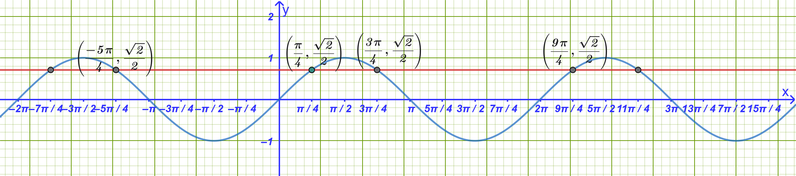{fig-align="center" width="600"}
:::

- Η λύσεις είναι τα σημεία όπου η $y=\dfrac{\sqrt{2}}{2}$ τέμνει την $y= ημ x$.

- Γνωρίζουμε ότι $\dfrac{\sqrt{2}}{2} = ημ \dfrac{\pi}{4}$.

- Η εξίσωση γίνεται $ημ x = ημ \dfrac{\pi}{4}$, οπότε: $$x = 2k\pi + \dfrac{\pi}{4} \quad \text{ή} \quad x = 2k\pi + \pi - \frac{\pi}{4} = 2k\pi + \frac{3\pi}{4}, \quad k \in \mathbb{Z}$$

**Πίνακας Λύσεων**

| $k \in \mathbb{Z}$ | $x = 2k\pi + \dfrac{\pi}{4}$ | $x = 2k\pi + \dfrac{3\pi}{4}$ |
|:----------------------:|:------------------------:|:--------------------:|
| ........... | ............ | .............. |
| $-2$ | $\dfrac{-15\pi}{4}$ | $\dfrac{-13\pi}{4}$ |
| $-1$ | $\dfrac{-7\pi}{4}$ | $\dfrac{-5\pi}{4}$ |
| $0$ | $\dfrac{\pi}{4}$ | $\dfrac{3\pi}{4}$ |
| $1$ | $\dfrac{9\pi}{4}$ | $\dfrac{11\pi}{4}$ |
| $2$ | $\dfrac{17\pi}{4}$ | $\dfrac{19\pi}{4}$ |
| ........... | ............ | .............. |
::::

:::: {.math-box .example-box}
::: {.math-title .example-title}
2.  Να λυθεί η εξίσωση
:::

$ημ x = -\dfrac{1}{2}$:
::::

:::: {.math-box .examplesolution-box}
::: {.math-title .examplesolution-title}
Λύση

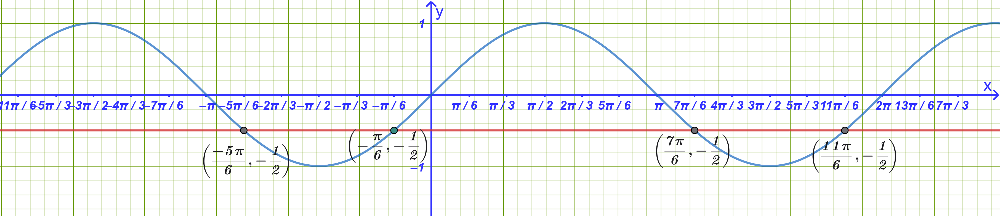{fig-align="center" width="600"}
:::

- Γνωρίζουμε ότι $-\dfrac{1}{2} = -ημ \dfrac{\pi}{6} = ημ\left(-\dfrac{\pi}{6}\right)$.

- Η εξίσωση γίνεται $ημ x = ημ\left(-\dfrac{\pi}{6}\right)$, οπότε: $$x = 2k\pi - \frac{\pi}{6} \quad \text{ή} \quad x = 2k\pi + \pi - \left(-\frac{\pi}{6}\right) = 2k\pi + \frac{7\pi}{6}, \quad k \in \mathbb{Z}$$
::::

:::: {.math-box .example-box}
::: {.math-title .example-title}
3.  Να λυθεί η εξίσωση
:::

$ημ\left(3x + \dfrac{\pi}{2}\right) = \dfrac{\sqrt{3}}{2}$:
::::

:::: {.math-box .examplesolution-box}
::: {.math-title .examplesolution-title}
Λύση

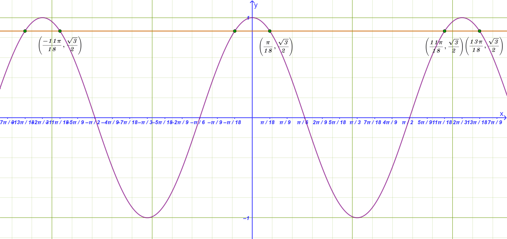{fig-align="center" width="600"}
:::

- Γνωρίζουμε ότι $\dfrac{\sqrt{3}}{2} = ημ \dfrac{\pi}{3}$.

- Η εξίσωση γίνεται $ημ\left(3x + \dfrac{\pi}{2}\right) = ημ \dfrac{\pi}{3}$, οπότε διακρίνουμε δύο περιπτώσεις:

  - **1η περίπτωση:** $3x + \dfrac{\pi}{2} = 2k\pi + \dfrac{\pi}{3} \iff 3x = 2k\pi + \dfrac{\pi}{3} - \dfrac{\pi}{2} \iff 3x = 2k\pi - \dfrac{\pi}{6} \iff \mathbf{x = \dfrac{2k\pi}{3} - \dfrac{\pi}{18}}, \, k \in \mathbb{Z}$

  - **2η περίπτωση:** $3x + \dfrac{\pi}{2} = 2k\pi + \pi - \dfrac{\pi}{3} \iff 3x + \dfrac{\pi}{2} = 2k\pi + \dfrac{2\pi}{3} \iff 3x = 2k\pi + \dfrac{\pi}{6} \iff \mathbf{x = \dfrac{2k\pi}{3} + \dfrac{\pi}{18}}, \, k \in \mathbb{Z}$
::::

------------------------------------------------------------------------

### Η Εξίσωση $συν x = \alpha$

#### Θεωρία

::: my-callout-theory
Η εξίσωση $συν x = \alpha$ έχει λύση αν και μόνο αν $|\alpha| \le 1$.

Αν $\alpha = συν \theta$, οι λύσεις της στο $\mathbb{R}$ δίνονται από τον τύπο: $$x = 2k\pi \pm \theta \quad (k \in \mathbb{Z})$$
:::

#### Λυμένες Εφαρμογές

:::: {.math-box .example-box}
::: {.math-title .example-title}
1.  Να λυθεί η εξίσωση
:::

$συν x = -\dfrac{\sqrt{3}}{2}$:
::::

:::: {.math-box .examplesolution-box}
::: {.math-title .examplesolution-title}
Λύση

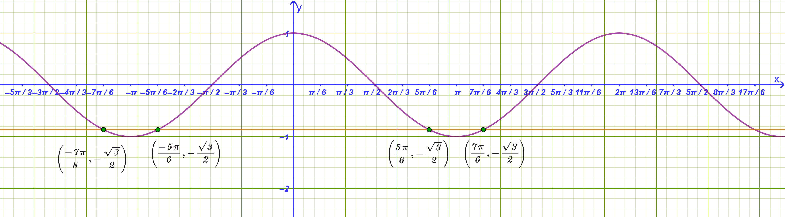{fig-align="center" width="600"}
:::

- Γνωρίζουμε ότι $-\dfrac{\sqrt{3}}{2} = -συν \dfrac{\pi}{6} = συν\left(\pi - \dfrac{\pi}{6}\right) = συν \dfrac{5\pi}{6}$.

- Η εξίσωση γίνεται $συν x = συν \dfrac{5\pi}{6}$, οπότε: $$\mathbf{x = 2k\pi \pm \frac{5\pi}{6}}, \quad k \in \mathbb{Z}$$
::::

:::: {.math-box .example-box}
::: {.math-title .example-title}
2.  Να λυθεί η εξίσωση
:::

$συν(2x) = -\dfrac{1}{2}$:
::::

:::: {.math-box .examplesolution-box}
::: {.math-title .examplesolution-title}
Λύση

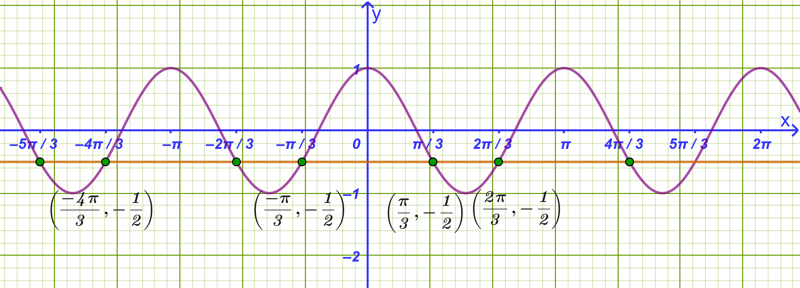{fig-align="center" width="600"}
:::

- Γνωρίζουμε ότι $-\dfrac{1}{2} = -συν \dfrac{\pi}{3} = συν\left(\pi - \dfrac{\pi}{3}\right) = συν \dfrac{2\pi}{3}$.

- Η εξίσωση γίνεται $συν(2x) = συν \dfrac{2\pi}{3}$, οπότε: $$2x = 2k\pi \pm \frac{2\pi}{3} \iff \mathbf{x = k\pi \pm \frac{\pi}{3}}, \quad k \in \mathbb{Z}$$

**Πίνακας Λύσεων**

| $k \in \mathbb{Z}$ | $\mathbf{x = k\pi + \dfrac{\pi}{3}}$ | $\mathbf{x = k\pi - \dfrac{\pi}{3}}$ |
|:----------------------:|:------------------------:|:--------------------:|
| ........... | ............ | .............. |
| $-2$ | $\dfrac{-5\pi}{3}$ | $\dfrac{-7\pi}{3}$ |
| $-1$ | $\dfrac{-2\pi}{3}$ | $\dfrac{-4\pi}{3}$ |
| $0$ | $\dfrac{\pi}{3}$ | $\dfrac{-\pi}{3}$ |
| $1$ | $\dfrac{4\pi}{3}$ | $\dfrac{2\pi}{3}$ |
| $2$ | $\dfrac{7\pi}{3}$ | $\dfrac{5\pi}{3}$ |
| ........... | ............ | .............. |
::::

:::: {.math-box .example-box}
::: {.math-title .example-title}
3.  Να λυθεί η εξίσωση
:::

$συν\left(3x + \dfrac{\pi}{4}\right) = -\dfrac{\sqrt{2}}{2}$:
::::

:::: {.math-box .examplesolution-box}
::: {.math-title .examplesolution-title}
Λύση

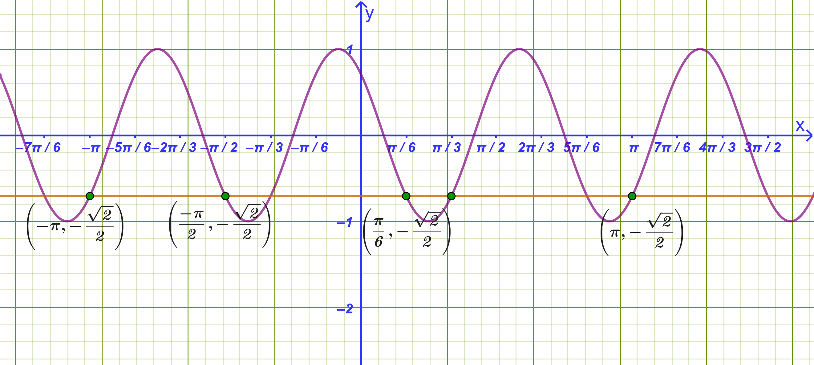{fig-align="center" width="600"}
:::

- Γνωρίζουμε ότι $-\dfrac{\sqrt{2}}{2} = -συν \dfrac{\pi}{4} = συν\left(\pi - \dfrac{\pi}{4}\right) = συν \dfrac{3\pi}{4}$.

- Η εξίσωση γίνεται $συν\left(3x + \dfrac{\pi}{4}\right) = συν \dfrac{3\pi}{4}$, οπότε:

  - **Κλάδος (+):** $3x + \dfrac{\pi}{4} = 2k\pi + \dfrac{3\pi}{4} \iff 3x = 2k\pi + \dfrac{\pi}{2} \iff \mathbf{x = \dfrac{2k\pi}{3} + \dfrac{\pi}{6}}, \, k \in \mathbb{Z}$

  - **Κλάδος (-):** $3x + \dfrac{\pi}{4} = 2k\pi - \dfrac{3\pi}{4} \iff 3x = 2k\pi - \pi \iff \mathbf{x = \dfrac{2k\pi}{3} - \dfrac{\pi}{3}}, \, k \in \mathbb{Z}$
::::

------------------------------------------------------------------------

### Η Εξίσωση $εφ x = \alpha$

#### Θεωρία

::: my-callout-theory
Η εξίσωση $εφ x = \alpha$ ορίζεται για $x \neq k\pi + \dfrac{\pi}{2}$ και έχει πάντα λύσεις για κάθε $\alpha \in \mathbb{R}$.

Αν $\alpha = εφ \theta$, οι λύσεις της δίνονται από τον τύπο: $$x = k\pi + \theta \quad (k \in \mathbb{Z})$$
:::

#### Λυμένες Εφαρμογές

:::: {.math-box .example-box}
::: {.math-title .example-title}
1.  Να λυθεί η εξίσωση
:::

$εφ x = \dfrac{\sqrt{3}}{3}$:
::::

:::: {.math-box .examplesolution-box}
::: {.math-title .examplesolution-title}
Λύση

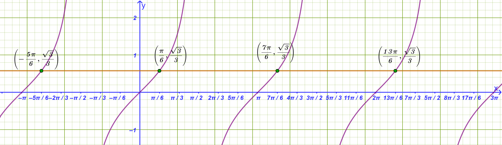{fig-align="center" width="600"}
:::

- Γνωρίζουμε ότι $\dfrac{\sqrt{3}}{3} = εφ \dfrac{\pi}{6}$.

- Η εξίσωση γίνεται $εφ x = εφ \dfrac{\pi}{6}$, οπότε: $$\mathbf{x = k\pi + \dfrac{\pi}{6}}, \quad k \in \mathbb{Z}$$
::::

:::: {.math-box .example-box}
::: {.math-title .example-title}
2.  Να λυθεί η εξίσωση
:::

$εφ(2x) = -1$:
::::

:::: {.math-box .examplesolution-box}
::: {.math-title .examplesolution-title}
Λύση

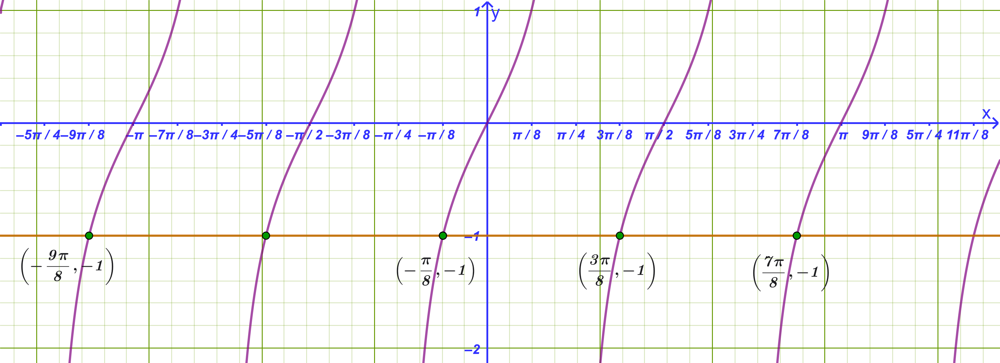{fig-align="center" width="600"}
:::

- Πρέπει $2x \neq k\pi + \dfrac{\pi}{2} \iff x \neq \dfrac{k\pi}{2} + \dfrac{\pi}{4}$.

- Γνωρίζουμε ότι $-1 = -εφ \dfrac{\pi}{4} = εφ\left(-\dfrac{\pi}{4}\right)$.

- Η εξίσωση γίνεται $εφ(2x) = εφ\left(-\dfrac{\pi}{4}\right)$, οπότε: $$2x = k\pi - \frac{\pi}{4} \iff \mathbf{x = \frac{k\pi}{2} - \frac{\pi}{8}}, \quad k \in \mathbb{Z}$$
::::

:::: {.math-box .example-box}
::: {.math-title .example-title}
3.  Να λυθεί η εξίσωση
:::

$εφ\left(x + \dfrac{\pi}{2}\right) = \sqrt{3}$:
::::

:::: {.math-box .examplesolution-box}
::: {.math-title .examplesolution-title}
Λύση

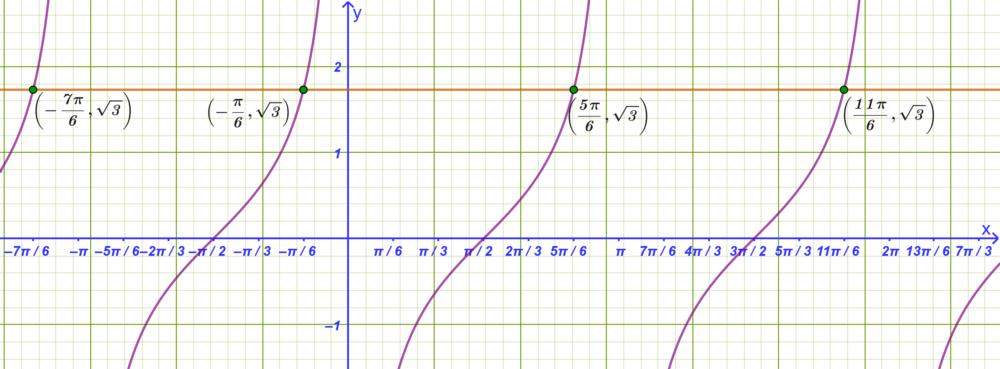{fig-align="center" width="600"}
:::

- Πρέπει $x + \dfrac{\pi}{2} \neq k\pi + \dfrac{\pi}{2} \iff x \neq k\pi$.

- Γνωρίζουμε ότι $\sqrt{3} = εφ \dfrac{\pi}{3}$.

- Η εξίσωση γίνεται $εφ\left(x + \dfrac{\pi}{2}\right) = εφ \dfrac{\pi}{3}$, οπότε: $$x + \frac{\pi}{2} = k\pi + \frac{\pi}{3} \iff x = k\pi + \frac{\pi}{3} - \frac{\pi}{2} \iff \mathbf{x = k\pi - \frac{\pi}{6}}, \quad k \in \mathbb{Z}$$

**Πίνακας Λύσεων**

| $k \in \mathbb{Z}$ | $\mathbf{x = k\pi - \dfrac{\pi}{6}}$ |
|:------------------:|:------------------------------------:|
|    ...........     |             ............             |
|        $-2$        |         $\dfrac{-13\pi}{6}$          |
|        $-1$        |          $\dfrac{-7\pi}{6}$          |
|        $0$         |          $\dfrac{-\pi}{6}$           |
|        $1$         |          $\dfrac{5\pi}{6}$           |
|        $2$         |          $\dfrac{11\pi}{6}$          |
|    ...........     |             ............             |
::::

------------------------------------------------------------------------

### Η Εξίσωση $σφ x = \alpha$

#### Θεωρία

::: my-callout-theory
Η εξίσωση $σφ x = \alpha$ ορίζεται για $x \neq k\pi$ και έχει πάντα λύσεις για κάθε $\alpha \in \mathbb{R}$.

Αν $\alpha = σφ \theta$, οι λύσεις της δίνονται από τον τύπο: $$x = k\pi + \theta \quad (k \in \mathbb{Z})$$
:::

------------------------------------------------------------------------

::: my-callout-sos

Για τον έλεγχο των αποτελεσμάτων σας και για να δείτε τις γραφικές παραστάσεις των ασκήσεων, μπορείτε να χρησιμοποιείτε το [Geogebra online](https://www.geogebra.org/calculator)

:::

------------------------------------------------------------------------

#### Λυμένες Εφαρμογές

:::: {.math-box .example-box}
::: {.math-title .example-title}
1.  Να λυθεί η εξίσωση
:::

$σφ x = \sqrt{3}$:
::::

:::: {.math-box .examplesolution-box}
::: {.math-title .examplesolution-title}
Λύση

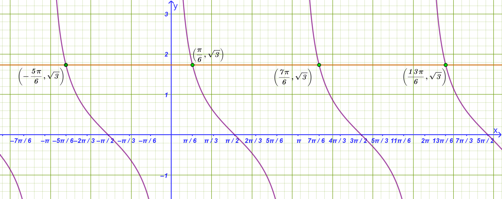{fig-align="center" width="600"}
:::

- Γνωρίζουμε ότι $\sqrt{3} = σφ \dfrac{\pi}{6}$.

- Η εξίσωση γίνεται $σφ x = σφ \dfrac{\pi}{6}$, οπότε: $$\mathbf{x = k\pi + \dfrac{\pi}{6}}, \quad k \in \mathbb{Z}$$
::::

:::: {.math-box .example-box}
::: {.math-title .example-title}
2.  Να λυθεί η εξίσωση
:::

$σφ(3x) = -1$:
::::

:::: {.math-box .examplesolution-box}
::: {.math-title .examplesolution-title}
Λύση

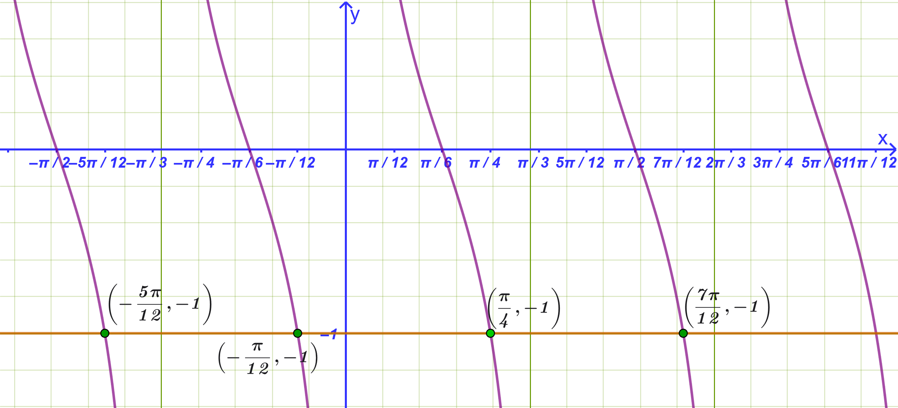{fig-align="center" width="600"}
:::

- Πρέπει $3x \neq k\pi \iff x \neq \dfrac{k\pi}{3}$.

- Γνωρίζουμε ότι $-1 = -σφ \dfrac{\pi}{4} = σφ\left(-\dfrac{\pi}{4}\right)$.

- Η εξίσωση γίνεται $σφ(3x) = σφ\left(-\dfrac{\pi}{4}\right)$, οπότε: $$3x = k\pi - \frac{\pi}{4} \iff \mathbf{x = \frac{k\pi}{3} - \frac{\pi}{12}}, \quad k \in \mathbb{Z}$$
::::

:::: {.math-box .example-box}
::: {.math-title .example-title}
3.  Να λυθεί η εξίσωση
:::

$σφ\left(2x + \dfrac{\pi}{6}\right) = \dfrac{\sqrt{3}}{3}$:
::::

:::: {.math-box .examplesolution-box}
::: {.math-title .examplesolution-title}
Λύση

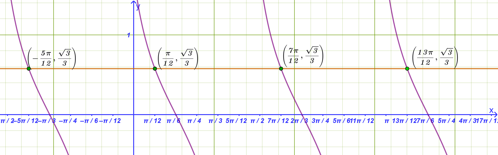{fig-align="center" width="600"}
:::

- Πρέπει $2x + \dfrac{\pi}{6} \neq k\pi \iff x \neq \dfrac{k\pi}{2} - \dfrac{\pi}{12}$.

- Γνωρίζουμε ότι $\dfrac{\sqrt{3}}{3} = σφ \dfrac{\pi}{3}$.

- Η εξίσωση γίνεται $σφ\left(2x + \dfrac{\pi}{6}\right) = σφ \dfrac{\pi}{3}$, οπότε: $$2x + \frac{\pi}{6} = k\pi + \frac{\pi}{3} \iff 2x = k\pi + \frac{\pi}{6} \iff \mathbf{x = \frac{k\pi}{2} + \frac{\pi}{12}}, \quad k \in \mathbb{Z}$$
::::

------------------------------------------------------------------------

### Γενική Μεθοδολογία

:::: callout-method
::: {.callout-method .callout-title}
Η επίλυση εξισώσεων με **αντικατάσταση** (ή με χρήση **βοηθητικού αγνώστου**) είναι μια βασική μεθοδολογία που απλοποιεί σύνθετες αλγεβρικές, πολυωνυμικές ή τριγωνομετρικές εξισώσεις, ανάγοντάς τες σε απλούστερες πολυωνυμικές εξισώσεις (συνήθως 2ου βαθμού).
:::

**4 Βήματα**

1.  **Επιλογή Βοηθητικού Αγνώστου:**

    Εντοπίζουμε στην εξίσωση μια παράσταση, έναν όρο ή έναν τριγωνομετρικό αριθμό που εμφανίζεται επανειλημμένα και τον αντικαθιστούμε με μια νέα μεταβλητή (π.χ. $t, y, \omega$).

2.  **Καθορισμός Περιορισμών:**\
    Ελέγχουμε αν η νέα μεταβλητή υπόκειται σε περιορισμούς.
    Για παράδειγμα:

    - Αν $t = ημ x$ ή $t = συν x$, τότε πρέπει υποχρεωτικά $|t| \le 1$.

    - Αν $y = x^2$ ή $y = \sqrt{P(x)}$, τότε πρέπει $y \ge 0$.

3.  **Επίλυση της Επιλύουσας Εξίσωσης:**

    Σχηματίζουμε τη νέα εξίσωση ως προς τη βοηθητική μεταβλητή (η οποία ονομάζεται **επιλύουσα εξίσωση**) και υπολογίζουμε τις ρίζες της.

4.  **Επιστροφή στην Αρχική Μεταβλητή:**

    Απορρίπτουμε τις τιμές που δεν ικανοποιούν τους περιορισμούς.
    Για τις δεκτές τιμές, αντικαθιστούμε πίσω στην αρχική σχέση και λύνουμε τις βασικές εξισώσεις που προκύπτουν για τον αρχικό άγνωστο.
::::

------------------------------------------------------------------------

#### **Αναλυτικό Παράδειγμα Εφαρμογής**

:::: {.math-box .example-box}
::: {.math-title .example-title}
**Τριγωνομετρική Εξίσωση**
:::

Να λυθεί η εξίσωση:\
$$4ημ^2 x - 2(1+\sqrt{2})ημ x + \sqrt{2} = 0$$
::::

:::: {.math-box .examplesolution-box}
::: {.math-title .examplesolution-title}
Λύση
:::

- **Βήμα 1 & 2:** Θέτουμε $t = ημ x$ με τον περιορισμό $|t| \le 1$.

- **Βήμα 3:** Η εξίσωση μετασχηματίζεται στην επιλύουσα δευτεροβάθμια: $$4t^2 - 2(1+\sqrt{2})t + \sqrt{2} = 0$$

  Υπολογίζοντας τις ρίζες της προκύπτουν: $$t_1 = \frac{1}{2} \quad \text{και} \quad t_2 = \frac{\sqrt{2}}{2}$$

  Επειδή και οι δύο τιμές βρίσκονται στο διάστημα $[-1, 1]$, είναι δεκτές.

- **Βήμα 4:** Επιστρέφουμε στο $x$ και λύνουμε τις δύο θεμελιώδεις τριγωνομετρικές εξισώσεις:

  - Από $t_1 = \dfrac{1}{2} \implies ημ x = \dfrac{1}{2} \iff x = 2k\pi + \dfrac{\pi}{6}$ ή $x = (2k+1)\pi - \dfrac{\pi}{6}$, $k \in \mathbb{Z}$.

  - Από $t_2 = \dfrac{\sqrt{2}}{2} \implies ημ x = \dfrac{\sqrt{2}}{2} \iff x = 2k\pi + \dfrac{\pi}{4}$ ή $x = (2k+1)\pi - \dfrac{\pi}{4}$, $k \in \mathbb{Z}$.
::::

------------------------------------------------------------------------

### Ασκήσεις για Εξάσκηση

#### **Ομάδα Α: Εξισώσεις της μορφής** $ημ x = \alpha$

1.  Να λυθεί η εξίσωση: $ημ x = \dfrac{1}{2}$

2.  Να λυθεί η εξίσωση: $ημ x = -\dfrac{\sqrt{3}}{2}$

3.  Να λυθεί η εξίσωση: $ημ(2x) = \dfrac{\sqrt{2}}{2}$

4.  Να λυθεί η εξίσωση: $ημ\left(x - \dfrac{\pi}{3}\right) = -\dfrac{1}{2}$

5.  Να λυθεί η εξίσωση: $ημ\left(4x + \dfrac{\pi}{6}\right) = \dfrac{\sqrt{3}}{2}$

#### **Ομάδα Β: Εξισώσεις της μορφής** $συν x = \alpha$

6.  Να λυθεί η εξίσωση: $συν x = \dfrac{\sqrt{3}}{2}$

7.  Να λυθεί η εξίσωση: $συν x = -\dfrac{\sqrt{2}}{2}$

8.  Να λυθεί η εξίσωση: $συν(3x) = \dfrac{1}{2}$

9.  Να λυθεί η εξίσωση: $συν\left(x + \dfrac{\pi}{6}\right) = -\dfrac{1}{2}$

10. Να λυθεί η εξίσωση: $συν\left(2x - \dfrac{\pi}{3}\right) = \dfrac{\sqrt{2}}{2}$

#### **Ομάδα Γ: Εξισώσεις της μορφής** $εφ x = \alpha$

11. Να λυθεί η εξίσωση: $εφ x = 1$

12. Να λυθεί η εξίσωση: $εφ x = -\sqrt{3}$

13. Να λυθεί η εξίσωση: $εφ(3x) = \dfrac{\sqrt{3}}{3}$

14. Να λυθεί η εξίσωση: $εφ\left(x - \dfrac{\pi}{4}\right) = -1$

15. Να λυθεί η εξίσωση: $εφ\left(2x + \dfrac{\pi}{3}\right) = \sqrt{3}$

#### **Ομάδα Δ: Εξισώσεις της μορφής** $σφ x = \alpha$

16. Να λυθεί η εξίσωση: $σφ x = 1$

17. Να λυθεί η εξίσωση: $σφ x = -\dfrac{\sqrt{3}}{3}$

18. Να λυθεί η εξίσωση: $σφ(2x) = \sqrt{3}$

19. Να λυθεί η εξίσωση: $σφ\left(x + \dfrac{\pi}{4}\right) = -1$

20. Να λυθεί η εξίσωση: $σφ\left(3x - \dfrac{\pi}{6}\right) = \dfrac{\sqrt{3}}{3}$

:::: {.math-box .exercise-box}
::: {.math-title .exercise-title}
21. Εκφώνηση
:::

Να βρείτε τη γενική λύση της εξίσωσης: $$ημ(\theta - 20^\circ) = συν(2\theta)$$
::::

:::: {.math-box .solution-box}
::: {.math-title .solution-title}
Λύση
:::

Χρησιμοποιούμε τη σχέση συμπληρωματικών γωνιών για να μετατρέψουμε το συνημίτονο σε ημίτονο: $$συν(2\theta) = ημ(90^\circ - 2\theta)$$

Έτσι, η εξίσωση γίνεται: $$ημ(\theta - 20^\circ) = ημ(90^\circ - 2\theta)$$

Γνωρίζουμε ότι η βασική τριγωνομετρική εξίσωση $ημ x = ημ \alpha$ έχει γενικές λύσεις (σε μοίρες): $$x = k \cdot 360^\circ + \alpha \quad \text{ή} \quad x = k \cdot 360^\circ + (180^\circ - \alpha), \quad k \in \mathbb{Z}$$

Εφαρμόζουμε τον κανόνα για τις δύο περιπτώσεις:

------------------------------------------------------------------------

**1η Περίπτωση:**

$$\theta - 20^\circ = k \cdot 360^\circ + (90^\circ - 2\theta)$$ $$\theta + 2\theta = k \cdot 360^\circ + 90^\circ + 20^\circ$$ $$3\theta = k \cdot 360^\circ + 110^\circ$$

Διαιρούμε με το $3$: $$\theta = k \cdot 120^\circ + \frac{110^\circ}{3}, \quad k \in \mathbb{Z}$$

*(ή ισοδύναμα* $\theta = k \cdot 120^\circ + 36{,}67^\circ$)

------------------------------------------------------------------------

**2η Περίπτωση:**

$$\theta - 20^\circ = k \cdot 360^\circ + [180^\circ - (90^\circ - 2\theta)]$$ $$\theta - 20^\circ = k \cdot 360^\circ + 180^\circ - 90^\circ + 2\theta$$ $$\theta - 20^\circ = k \cdot 360^\circ + 90^\circ + 2\theta$$ $$\theta - 2\theta = k \cdot 360^\circ + 90^\circ + 20^\circ$$ $$-\theta = k \cdot 360^\circ + 110^\circ$$

Πολλαπλασιάζουμε με $-1$ (σημειώνεται ότι το $-k$ παραμένει ακέραιος, οπότε μπορούμε να γράψουμε απλώς $k \cdot 360^\circ$): $$\theta = k \cdot 360^\circ - 110^\circ, \quad k \in \mathbb{Z}$$

*(ή ισοδύναμα* $\theta = k \cdot 360^\circ + 250^\circ$, προσθέτοντας $360^\circ$)

------------------------------------------------------------------------

**Τελική Απάντηση**

Οι γενικές λύσεις της εξίσωσης είναι:

$$\theta = k \cdot 120^\circ + \frac{110^\circ}{3} \quad \text{ή} \quad \theta = k \cdot 360^\circ - 110^\circ, \quad k \in \mathbb{Z}$$
::::

22. Να βρείτε τη γενική λύση κάθε μιας από τις παρακάτω εξισώσεις

**α)** $συν\alpha = 1$

- **Λύση:**

  Το συνημίτονο ισούται με $1$ στις ακέραιες πολλαπλάσιες περιόδους των $360^\circ$: $$\alpha = k \cdot 360^\circ, \quad k \in \mathbb{Z}$$

------------------------------------------------------------------------

**β)** $4ημ\theta = 0$

- **Λύση:**\
  $$4ημ\theta = 0 \iff ημ\theta = 0$$

  Το ημίτονο μηδενίζεται σε κάθε πολλαπλάσιο των $180^\circ$: $$\theta = k \cdot 180^\circ, \quad k \in \mathbb{Z}$$

------------------------------------------------------------------------

**γ)** $4συν\theta + 3 = 1$

- **Λύση:**\
  $$4συν\theta = 1 - 3 \iff 4συν\theta = -2 \iff συν\theta = -\frac{1}{2}$$

  Επειδή $συν(60^\circ) = \dfrac{1}{2}$, έχουμε $συν(180^\circ - 60^\circ) = συν(120^\circ) = -\dfrac{1}{2}$.

  Επομένως: $$\theta = k \cdot 360^\circ \pm 120^\circ, \quad k \in \mathbb{Z}$$

------------------------------------------------------------------------

**δ)** $ημ(2\theta) = -\dfrac{\sqrt{3}}{2}$

- **Λύση:**

  Γνωρίζουμε ότι $ημ(60^\circ) = \dfrac{\sqrt{3}}{2}$, άρα $-\dfrac{\sqrt{3}}{2} = ημ(-60^\circ)$.\
  Οι γενικές λύσεις για το ημίτονο είναι:

  1.  $2\theta = k \cdot 360^\circ - 60^\circ \implies \theta = k \cdot 180^\circ - 30^\circ, \quad k \in \mathbb{Z}$

  2.  $2\theta = k \cdot 360^\circ + (180^\circ - (-60^\circ)) = k \cdot 360^\circ + 240^\circ \implies \theta = k \cdot 180^\circ + 120^\circ, \quad k \in \mathbb{Z}$

------------------------------------------------------------------------

23. Να βρείτε τη γενική λύση κάθε εξίσωσης

**α)** $συν(\theta + 20^\circ) = 0$

- **Λύση:**

  Το συνημίτονο μηδενίζεται στις θέσεις $90^\circ + k \cdot 180^\circ$: $$\theta + 20^\circ = k \cdot 180^\circ + 90^\circ$$ $$\theta = k \cdot 180^\circ + 70^\circ, \quad k \in \mathbb{Z}$$

------------------------------------------------------------------------

**β)** $ημ(3\alpha) = -1$

- **Λύση:**

  Το ημίτονο γίνεται $-1$ στο $270^\circ$ (ή $-90^\circ$): $$3\alpha = k \cdot 360^\circ + 270^\circ$$

  Διαιρούμε με το $3$: $$\alpha = k \cdot 120^\circ + 90^\circ, \quad k \in \mathbb{Z}$$

------------------------------------------------------------------------

**γ)** $εφ(4\beta) = \sqrt{3}$

- **Λύση:**

  Επειδή $εφ 60^ο=\sqrt{3}$

  Η γενική λύση της εφαπτομένης είναι: $$4\beta = k \cdot 180^\circ + 60^\circ$$

  Διαιρούμε με το $4$: $$\beta = k \cdot 45^\circ + 15^\circ, \quad k \in \mathbb{Z}$$

------------------------------------------------------------------------

**δ)** $συν(\alpha - 25^\circ) = 0{,}707$

- **Λύση:**

  Παρατηρούμε ότι $0{,}707 \approx \dfrac{\sqrt{2}}{2} = συν(45^\circ)$.

  Άρα: $$\alpha - 25^\circ = k \cdot 360^\circ \pm 45^\circ$$

  - Αν πάρουμε το $+45^\circ$:\
    $$\alpha = k \cdot 360^\circ + 45^\circ + 25^\circ \implies \alpha = k \cdot 360^\circ + 70^\circ, \quad k \in \mathbb{Z}$$

  - Αν πάρουμε το $-45^\circ$:\
    $$\alpha = k \cdot 360^\circ - 45^\circ + 25^\circ \implies \alpha = k \cdot 360^\circ - 20^\circ, \quad k \in \mathbb{Z}$$

------------------------------------------------------------------------

**ε)** $2ημ\left(\dfrac{3\theta}{2}\right) = -1$

- **Λύση:**

  $$ημ\left(\frac{3\theta}{2}\right) = -\frac{1}{2} = ημ(-30^\circ)$$

  Έχουμε δύο περιπτώσεις:

  1.  $\dfrac{3\theta}{2} = k \cdot 360^\circ - 30^\circ \implies 3\theta = k \cdot 720^\circ - 60^\circ \implies \theta = k \cdot 240^\circ - 20^\circ, \quad k \in \mathbb{Z}$

  2.  $\dfrac{3\theta}{2} = k \cdot 360^\circ + (180^\circ - (-30^\circ)) = k \cdot 360^\circ + 210^\circ$\
      $$3\theta = k \cdot 720^\circ + 420^\circ \implies \theta = k \cdot 240^\circ + 140^\circ, \quad k \in \mathbb{Z}$$

------------------------------------------------------------------------

**στ)** $5εφ(\beta + 15^\circ) = \dfrac{5}{\sqrt{3}}$

- **Λύση:**

  Διαιρούμε και τα δύο μέλη με το $5$: $$εφ(\beta + 15^\circ) = \frac{1}{\sqrt{3}} = \frac{\sqrt{3}}{3}$$

  Γνωρίζουμε ότι $εφ(30^\circ) = \dfrac{1}{\sqrt{3}}$.

  Επομένως: $$\beta + 15^\circ = k \cdot 180^\circ + 30^\circ$$ $$\beta = k \cdot 180^\circ + 15^\circ, \quad k \in \mathbb{Z}$$


:::: {.math-box .exercise-box}
::: {.math-title .exercise-title}
23. Εύρεση του $\alpha \in [0^\circ, 360^\circ]$
:::
**Εκφώνηση:**

Δίνεται η εξίσωση: $$\sqrt{3}\eta\mu^2\alpha - \eta\mu\alpha \cdot \sigma\upsilon\nu\alpha = 0, \quad \text{με } \alpha \in [0^\circ, 360^\circ]$$
::::


:::: {.math-box .solution-box}
::: {.math-title .solution-title}
**Λύση**
:::
**1: Παραγοντοποίηση**

Βγάζουμε κοινό παράγοντα το $\eta\mu\alpha$: $$\eta\mu\alpha \cdot (\sqrt{3}\eta\mu\alpha - \sigma\upsilon\nu\alpha) = 0$$

Αυτό σημαίνει ότι: $$\eta\mu\alpha = 0 \quad \text{ή} \quad \sqrt{3}\eta\mu\alpha - \sigma\upsilon\nu\alpha = 0$$

**2: Διερεύνηση των περιπτώσεων**

- **1η Περίπτωση:** $\eta\mu\alpha = 0$

  Στο διάστημα $[0^\circ, 360^\circ]$, το ημίτονο μηδενίζεται στις τιμές: $$\alpha = 0^\circ, \quad \alpha = 180^\circ, \quad \alpha = 360^\circ$$

- **2η Περίπτωση:** $\sqrt{3}\eta\mu\alpha - \sigma\upsilon\nu\alpha = 0$\
  $$\sqrt{3}\eta\mu\alpha = \sigma\upsilon\nu\alpha$$

  *(Παρατηρούμε ότι αν* $\sigma\upsilon\nu\alpha = 0$, τότε αναγκαστικά $\eta\mu\alpha = 0$, πράγμα αδύνατο αφού $\eta\mu^2\alpha + \sigma\upsilon\nu^2\alpha = 1$. Άρα $\sigma\upsilon\nu\alpha \ne 0$).

  Διαιρούμε και τα δύο μέλη με $\sigma\upsilon\nu\alpha$: $$\sqrt{3} \cdot \frac{\eta\mu\alpha}{\sigma\upsilon\nu\alpha} = 1 \implies \sqrt{3}\epsilon\phi\alpha = 1 \implies \epsilon\phi\alpha = \frac{1}{\sqrt{3}} = \frac{\sqrt{3}}{3}$$

  Γνωρίζουμε ότι η βασική οξεία γωνία είναι: $$\alpha = 30^\circ$$

  Επειδή η εφαπτομένη είναι θετική στο **1ο** και στο **3ο τεταρτημόριο**, οι λύσεις στο διάστημα $[0^\circ, 360^\circ]$ είναι:

  - 1ο τεταρτημόριο: $\alpha = 30^\circ$

  - 3ο τεταρτημόριο: $\alpha = 180^\circ + 30^\circ = 210^\circ$

------------------------------------------------------------------------

**Τελική Απάντηση**

Οι δυνατές τιμές του $\alpha \in [0^\circ, 360^\circ]$ είναι: $$\alpha \in \{0^\circ, \; 30^\circ, \; 180^\circ, \; 210^\circ, \; 360^\circ\}$$
::::

------------------------------------------------------------------------

24. Να βρείτε τη γενική λύση για καθεμία από τις παρακάτω εξισώσεις ($k \in \mathbb{Z}$)

- **α)** $συν(2θ)=0$

Εφαρμογή του γενικού τύπου $x = 2k\pi \pm \theta_0$ (ή σε μοίρες: $k \cdot 360^\circ \pm \theta_0$)

Γνωρίζουμε ότι $\sigma\upsilon\nu(90^\circ) = 0$.
Άρα η εξίσωση: $$\sigma\upsilon\nu(2\theta) = 0$$ σύμφωνα με τον γενικό τύπο του συνημιτόνου δίνει δύο κλάδους: $$2\theta = k \cdot 360^\circ \pm 90^\circ, \quad k \in \mathbb{Z}$$

Διαιρώντας με το $2$: $$\theta = k \cdot 180^\circ \pm 45^\circ, \quad k \in \mathbb{Z}$$

Αυτό αναλύεται σε δύο σειρές γωνιών:

1.  $\theta = k \cdot 180^\circ + 45^\circ$

2.  $\theta = k \cdot 180^\circ - 45^\circ$

- **β)** $ημ(\alpha + 10^\circ) = \dfrac{\sqrt{3}}{2} = ημ(60^\circ)$

  1.  $\alpha + 10^\circ = k \cdot 360^\circ + 60^\circ \implies \alpha = k \cdot 360^\circ + 50^\circ$

  2.  $\alpha + 10^\circ = k \cdot 360^\circ + (180^\circ - 60^\circ) \implies \alpha = k \cdot 360^\circ + 110^\circ$

- **γ)** $2συν\left(\dfrac{\theta}{2}\right) - \sqrt{3} = 0 \iff συν\left(\dfrac{\theta}{2}\right) = \dfrac{\sqrt{3}}{2} = συν(30^\circ)$\
  $$\frac{\theta}{2} = k \cdot 360^\circ \pm 30^\circ \implies \theta = k \cdot 720^\circ \pm 60^\circ$$

- **δ)** $\sqrt{3}εφ(\beta - 30^\circ) = -1 \iff εφ(\beta - 30^\circ) = -\dfrac{\sqrt{3}}{3}$

  $εφ(\beta - 30^\circ) = -\dfrac{\sqrt{3}}{3} = -εφ(30^ο)= εφ(-30^ο) \implies$

  $εφ(\beta - 30^\circ) = εφ(-30^ο) \implies β-30^ο=κ180^ο-30^ο \implies$

  $$β=k180^ο-30^ο+30^o \implies β=k180^o$$

- **ε)** $2συν\theta = εφ(300^\circ)$\
  $εφ(300^\circ) = εφ(360^\circ - 60^\circ) = -εφ(60^\circ) = -\sqrt{3}$\
  $$2συν\theta = -\sqrt{3} \iff συν\theta = -\frac{\sqrt{3}}{2} = συν(150^ο)$$\
  $$\theta = k \cdot 360^\circ \pm 150^\circ$$

- **στ)** $3ημ\alpha = -1{,}5 \iff ημ\alpha = -0{,}5 = ημ(-30^\circ)$

  1.  $\alpha = k \cdot 360^\circ - 30^\circ$

  2.  $\alpha = k \cdot 360^\circ + (180^\circ - (-30^\circ)) = k \cdot 360^\circ + 210^\circ$

- **ζ)** $ημ(2\beta) = συν(\beta + 20^\circ) = ημ(90^\circ - (\beta + 20^\circ)) = ημ(70^\circ - \beta)$

  1.  $2\beta = k \cdot 360^\circ + 70^\circ - \beta \implies 3\beta = k \cdot 360^\circ + 70^\circ \implies \beta = k \cdot 120^\circ + \dfrac{70^\circ}{3}$

  2.  $2\beta = k \cdot 360^\circ + 180^\circ - (70^\circ - \beta) \implies \beta = k \cdot 360^\circ + 110^\circ$

- **η)**

$$\sqrt{3}εφ\theta + 2{,}5 = 1{,}5 \iff \sqrt{3}εφ\theta = -2,5+1,5=-1 \iff \\ εφ\theta = -\dfrac{\sqrt{3}}{3}=-εφ(30^ο)=εφ(-30^ο) \implies$$

$$\theta = k \cdot 180^\circ - 30^\circ$$

- **θ)** $ημ(3\alpha - 10^\circ) = ημ(\alpha + 32^\circ)$

  1.  $3\alpha - 10^\circ = k \cdot 360^\circ + \alpha + 32^\circ \implies 2\alpha = k \cdot 360^\circ + 42^\circ \implies \alpha = k \cdot 180^\circ + 21^\circ$

  2.  $3\alpha - 10^\circ = k \cdot 360^\circ + 180^\circ - (\alpha + 32^\circ) \implies 4\alpha = k \cdot 360^\circ + 158^\circ \implies \alpha = k \cdot 90^\circ + 39{,}5^\circ$

- **ι)** $ημ(2\beta) = συν(2\beta)$

  Διαιρούμε με $συν(2\beta) \ne 0$:\
  $$εφ(2\beta) = 1 = εφ(45^\circ) \implies 2\beta = k \cdot 180^\circ + 45^\circ \implies \beta = k \cdot 90^\circ + 22{,}5^\circ$$

------------------------------------------------------------------------

25. Να βρείτε το $\theta$ αν $ημ^2\theta + \dfrac{1}{2}ημ\theta = 0$ για $\theta \in [0^\circ, 360^\circ]$

$$ημ\theta \cdot \left(ημ\theta + \frac{1}{2}\right) = 0$$

- $ημ\theta = 0 \implies \theta = 0^\circ, \; 180^\circ, \; 360^\circ$
- $ημ\theta = -\dfrac{1}{2} \implies \theta = 180^\circ + 30^\circ = 210^\circ \quad \text{ή} \quad \theta = 360^\circ - 30^\circ = 330^\circ$

**Τελική απάντηση:**\
$$\theta \in \{0^\circ, \; 180^\circ, \; 210^\circ, \; 330^\circ, \; 360^\circ\}$$

------------------------------------------------------------------------

26. Να βρείτε τη γενική λύση για καθεμία από τις παρακάτω εξισώσεις ($k \in \mathbb{Z}$)

- **α)** $2συν^2\theta - 3συν\theta - 2 = 0$

  Θέτουμε $u = συν\theta$: $2u^2 - 3u - 2 = 0 \implies (2u + 1)(u - 2) = 0$.

  - $u = 2$ (απορρίπτεται, αφού $|συν\theta| \le 1$)

  - $u = -\dfrac{1}{2} \implies συν\theta = -\dfrac{1}{2} = συν(120^\circ) \implies \theta = k \cdot 360^\circ \pm 120^\circ$

- **β)** $εφ^2\theta + \sqrt{3}εφ\theta = 0 \iff εφ\theta \cdot (εφ\theta + \sqrt{3}) = 0$

  - $εφ\theta = 0 \implies \theta = k \cdot 180^\circ$

  - $εφ\theta = -\sqrt{3} \implies εφ\theta = -εφ(60^ο)=εφ(-60^ο) \implies \theta = k \cdot 180^\circ - 60^\circ$

- **γ)** $συν^2\alpha = \dfrac{1}{2} \iff συν\alpha = \pm \dfrac{\sqrt{2}}{2}$

  - Για $συν\alpha = - \dfrac{\sqrt{2}}{2}=-συν45^ο=συν135^ο$: $\alpha = k \cdot 360^\circ \pm 135^\circ$

  - Για $συν\alpha = + \dfrac{\sqrt{2}}{2}=συν45^ο$: $\alpha = k \cdot 360^\circ \pm 45^\circ$\

- **δ)** $ημ(4\beta + 35^\circ) = συν(10^\circ - \beta) = ημ(90^\circ - (10^\circ - \beta)) = ημ(80^\circ + \beta)$

  1.  $4\beta + 35^\circ = k \cdot 360^\circ + 80^\circ + \beta \implies 3\beta = k \cdot 360^\circ + 45^\circ \implies \beta = k \cdot 120^\circ + 15^\circ$

  2.  $4\beta + 35^\circ = k \cdot 360^\circ + 180^\circ - (80^\circ + \beta) \implies 5\beta = k \cdot 360^\circ + 65^\circ \implies \beta = k \cdot 72^\circ + 13^\circ$

- **ε)** $ημ(\alpha + 15^\circ) = -συν(\alpha + 15^\circ)$

  Διαιρούμε με $συν(\alpha + 15^\circ)$:

  $$εφ(\alpha + 15^\circ) = -1=-εφ(45^ο)=εφ(-45^ο)$$

  $$\alpha + 15^\circ = k \cdot 180^\circ + 45^\circ \implies \alpha = k \cdot 180^\circ + 30^\circ$$

- **στ)** $ημ^2\theta - 3συν^2\theta = 0$

  Διαιρούμε με $συν^2\theta \ne 0$:

  $$εφ^2\theta = 3 \implies εφ\theta = \pm \sqrt{3}$$

  $$\theta = k \cdot 180^\circ \pm 60^\circ$$

- **ζ)** $\dfrac{συν(2\theta + 30^\circ)}{2} - \dfrac{\sqrt{2}}{4} = 0 \iff συν(2\theta + 30^\circ) = \dfrac{\sqrt{2}}{2}=συν(45^ο)$

  $$2\theta + 30^\circ = k \cdot 360^\circ \pm 45^\circ$$

  - Με το $+$: $2\theta = k \cdot 360^\circ + 15^\circ \implies \theta = k \cdot 180^\circ + 7{,}5^\circ$

  - Με το $-$: $2\theta = k \cdot 360^\circ - 75^\circ \implies \theta = k \cdot 180^\circ - 37{,}5^\circ$

------------------------------------------------------------------------


:::: {.math-box .exercise-box}
::: {.math-title .exercise-title}
27. Να βρείτε το $\beta \in [0^\circ, 180^\circ]$ αν $εφ\beta = σφ(300^\circ)$
:::
::::


:::: {.math-box .solution-box}
::: {.math-title .solution-title}
**Λύση**
:::
**Α: Περιοδικότητα (ή γωνίες με διαφορά** $180^\circ$)

Γνωρίζουμε ότι η συνεφαπτομένη έχει περίοδο $180^\circ$, δηλαδή $\sigma\phi(180^\circ + \theta) = \sigma\phi\theta$: $$\sigma\phi(300^\circ) = \sigma\phi(180^\circ + 120^\circ) = \sigma\phi(120^\circ)$$

**Β: Παραπληρωματικές γωνίες (**$\sigma\phi(180^\circ - \theta) = -\sigma\phi\theta$)

$$\sigma\phi(120^\circ) = \sigma\phi(180^\circ - 60^\circ) = -\sigma\phi(60^\circ)$$

**Γ: Συμπληρωματικές γωνίες (**$\sigma\phi\theta = \epsilon\phi(90^\circ - \theta)$)

Επειδή $60^\circ + 30^\circ = 90^\circ$, ισχύει $\sigma\phi(60^\circ) = \epsilon\phi(30^\circ)$.
Άρα: $$-\sigma\phi(60^\circ) = -\epsilon\phi(30^\circ)$$

**Δ: Αντίθετες γωνίες (**$-\epsilon\phi\theta = \epsilon\phi(-\theta)$) ή παραπληρωματικές

($\epsilon\phi(180^\circ - \theta) = -\epsilon\phi\theta$)

$$-\epsilon\phi(30^\circ) = \epsilon\phi(180^\circ - 30^\circ) = \epsilon\phi(150^\circ)$$

Συγκεντρωτικά:

$$\sigma\phi(300^\circ) = \sigma\phi(180^\circ + 120^\circ) = \sigma\phi(120^\circ) = -\sigma\phi(60^\circ) = -\epsilon\phi(30^\circ) = \epsilon\phi(150^\circ)$$

------------------------------------------------------------------------

**Τελικά**

Η εξίσωση γίνεται: $$\epsilon\phi\beta = \epsilon\phi(150^\circ)$$

Η γενική λύση είναι: $$\beta = k \cdot 180^\circ + 150^\circ, \quad k \in \mathbb{Z}$$

Αναζητούμε τις λύσεις στο διάστημα $[0^\circ, 180^\circ]$:

- Για $k = 0$: $\beta = 150^\circ \in [0^\circ, 180^\circ]$ (δεκτή)

- Για $k = 1$: $\beta = 330^\circ \notin [0^\circ, 180^\circ]$ (απορρίπτεται)

- Για $k = -1$: $\beta = -30^\circ \notin [0^\circ, 180^\circ]$ (απορρίπτεται)

**Τελική απάντηση:** $$\beta = 150^\circ$$
::::


------------------------------------------------------------------------

## ΔΙΑΓΩΝΙΣΜΑ ΑΞΙΟΛΟΓΗΣΗΣ: ΒΑΣΙΚΕΣ ΤΡΙΓΩΝΟΜΕΤΡΙΚΕΣ ΕΞΙΣΩΣΕΙΣ

**Μάθημα:** Άλγεβρα Β' Γενικού Λυκείου\
**Διάρκεια:** 60 λεπτά

------------------------------------------------------------------------

### **ΘΕΜΑ Α (Θεωρία & Ερωτήσεις Κατανόησης - 25 Μονάδες)**

**Α1.**

1.  Να γράψετε τους τύπους επίλυσης της εξίσωσης $ημ x = ημ \theta$ στο $\mathbb{R}$.
    **(5 μονάδες)**

2.  Να γράψετε τους τύπους επίλυσης της εξίσωσης $συν x = συν \theta$ στο $\mathbb{R}$.
    **(5 μονάδες)**

**Α2.** Να χαρακτηρίσετε τις παρακάτω προτάσεις ως **Σωστό (Σ)** ή **Λάθος (Λ)**: **(10 μονάδες)**

1.  Η εξίσωση $ημ x = 2$ είναι αδύνατη στο $\mathbb{R}$.

2.  Η εξίσωση $εφ x = \sqrt{3}$ έχει λύσεις τις $x = k\pi + \dfrac{\pi}{3}, \ k \in \mathbb{Z}$.

3.  Οι λύσεις της εξίσωσης $συν x = 0$ στο $\mathbb{R}$ είναι οι $x = k\pi + \dfrac{\pi}{2}, \ k \in \mathbb{Z}$.

4.  Η εξίσωση $σφ x = \alpha$ ορίζεται για κάθε $x \in \mathbb{R}$.

5.  Αν $ημ x = ημ \alpha$, τότε υποχρεωτικά $x = 2k\pi + \alpha$.

**Α3.** Να συμπληρώσετε τα κενά ώστε να προκύψουν αληθείς ισότητες για $k \in \mathbb{Z}$: **(5 μονάδες)**

- α) $συν x = 1 \iff x = \text{...........}$

- β) $ημ x = -1 \iff x = \text{...........}$

------------------------------------------------------------------------

### **ΘΕΜΑ Β (Άμεση Επίλυση Βασικών Εξισώσεων - 25 Μονάδες)**

Να λυθούν στο $\mathbb{R}$ οι παρακάτω εξισώσεις:

- **Β1.** $ημ\left(2x - \dfrac{\pi}{4}\right) = \dfrac{\sqrt{2}}{2}$ **(8 μονάδες)**

- **Β2.** $συν\left(3x + \dfrac{\pi}{3}\right) = -\dfrac{\sqrt{3}}{2}$ **(8 μονάδες)**

- **Β3.** $εφ\left(x + \dfrac{\pi}{6}\right) = -1$ **(9 μονάδες)**

------------------------------------------------------------------------

### **ΘΕΜΑ Γ (Εξισώσεις με Μετασχηματισμό & Παραγοντοποίηση - 25 Μονάδες)**

Να λυθούν στο $\mathbb{R}$ οι εξισώσεις:

- **Γ1.** $2συν^2 x - συν x = 0$ **(12 μονάδες)**

- **Γ2.** $ημ(2x) = ημ\left(x + \dfrac{\pi}{3}\right)$ **(13 μονάδες)**

------------------------------------------------------------------------

### **ΘΕΜΑ Δ (Εξισώσεις με Αντικατάσταση & Επίλυση σε Διάστημα - 25 Μονάδες)**

Δίνεται η εξίσωση: $$2ημ^2 x - 3ημ x + 1 = 0$$

- **Δ1.** Να λυθεί η εξίσωση στο $\mathbb{R}$ με τη χρήση κατάλληλης αντικατάστασης (βοηθητικού αγνώστου).
  **(13 μονάδες)**

- **Δ2.** Να βρεθούν οι λύσεις της εξίσωσης που ανήκουν στο κλειστό διάστημα $[0, 2\pi]$.
  **(12 μονάδες)**

------------------------------------------------------------------------

## ΑΝΑΛΥΤΙΚΕΣ ΛΥΣΕΙΣ ΔΙΑΓΩΝΙΣΜΑΤΟΣ

### **ΘΕΜΑ Α**

- **Α1.1:** $ημ x = ημ \theta \iff \mathbf{x = 2k\pi + \theta} \quad \text{ή} \quad \mathbf{x = 2k\pi + \pi - \theta}, \ k \in \mathbb{Z}$.

- **Α1.2:** $συν x = συν \theta \iff \mathbf{x = 2k\pi \pm \theta}, \ k \in \mathbb{Z}$.

- **Α2:**

  1.  **Σωστό** (διότι $|ημ x| \le 1$ για κάθε $x \in \mathbb{R}$).

  2.  **Σωστό** (διότι $\sqrt{3} = εφ \dfrac{\pi}{3} \implies x = k\pi + \dfrac{\pi}{3}$).

  3.  **Σωστό** (τα σημεία μηδενισμού του συνημιτόνου στον τριγωνομετρικό κύκλο είναι τα $k\pi + \dfrac{\pi}{2}$).

  4.  **Λάθος** (πρέπει $ημ x \neq 0 \iff x \neq k\pi$).

  5.  **Λάθος** (υπάρχει και η δεύτερη οικογένεια λύσεων $x = 2k\pi + \pi - \alpha$).

- **Α3:**

  - α) $\mathbf{2k\pi}$

  - β) $\mathbf{2k\pi - \dfrac{\pi}{2}}$ (ή $2k\pi + \dfrac{3\pi}{2}$)

------------------------------------------------------------------------

### **ΘΕΜΑ Β**

- **Β1:** Γνωρίζουμε ότι $\dfrac{\sqrt{2}}{2} = ημ \dfrac{\pi}{4}$.
  Η εξίσωση γίνεται $ημ\left(2x - \dfrac{\pi}{4}\right) = ημ \dfrac{\pi}{4}$:

  - **1η περίπτωση:** $$2x - \frac{\pi}{4} = 2k\pi + \frac{\pi}{4} \iff 2x = 2k\pi + \frac{\pi}{2} \iff \mathbf{x = k\pi + \frac{\pi}{4}}, \ k \in \mathbb{Z}$$

  - **2η περίπτωση:** $$2x - \frac{\pi}{4} = 2k\pi + \pi - \frac{\pi}{4} \iff 2x = 2k\pi + \pi \iff \mathbf{x = k\pi + \frac{\pi}{2}}, \ k \in \mathbb{Z}$$

- **Β2:** Γνωρίζουμε ότι $-\dfrac{\sqrt{3}}{2} = -συν \dfrac{\pi}{6} = συν\left(\pi - \dfrac{\pi}{6}\right) = συν \dfrac{5\pi}{6}$.

  Η εξίσωση γίνεται $συν\left(3x + \dfrac{\pi}{3}\right) = συν \dfrac{5\pi}{6}$:

  - **Κλάδος (+):** $$3x + \frac{\pi}{3} = 2k\pi + \frac{5\pi}{6} \iff 3x = 2k\pi + \frac{5\pi}{6} - \frac{2\pi}{6} \iff \\ 3x = 2k\pi + \frac{\pi}{2} \iff \mathbf{x = \frac{2k\pi}{3} + \frac{\pi}{6}}, \ k \in \mathbb{Z}$$

  - **Κλάδος (-):** $$3x + \frac{\pi}{3} = 2k\pi - \frac{5\pi}{6} \iff 3x = 2k\pi - \frac{5\pi}{6} - \frac{2\pi}{6} \iff \\ 3x = 2k\pi - \frac{7\pi}{6} \iff \mathbf{x = \frac{2k\pi}{3} - \frac{7\pi}{18}}, \ k \in \mathbb{Z}$$

- **Β3:** Περιορισμός: $x + \dfrac{\pi}{6} \neq k\pi + \dfrac{\pi}{2} \iff x \neq k\pi + \dfrac{\pi}{3}$.

  Γνωρίζουμε ότι $-1 = -εφ \dfrac{\pi}{4} = εφ\left(-\dfrac{\pi}{4}\right)$.

  Η εξίσωση γίνεται $εφ\left(x + \dfrac{\pi}{6}\right) = εφ\left(-\dfrac{\pi}{4}\right)$: $$x + \frac{\pi}{6} = k\pi - \frac{\pi}{4} \iff x = k\pi - \frac{\pi}{4} - \frac{\pi}{6} \iff \mathbf{x = k\pi - \frac{5\pi}{12}}, \ k \in \mathbb{Z}$$

------------------------------------------------------------------------

### **ΘΕΜΑ Γ**

- **Γ1:** Βγάζουμε κοινό παράγοντα το $συν x$: $$συν x \cdot (2συν x - 1) = 0 \iff συν x = 0 \quad \text{ή} \quad συν x = \frac{1}{2}$$

  - Από $συν x = 0 \iff \mathbf{x = k\pi + \dfrac{\pi}{2}}, \ k \in \mathbb{Z}$.

  - Από $συν x = \dfrac{1}{2} = συν \dfrac{\pi}{3} \iff \mathbf{x = 2k\pi \pm \dfrac{\pi}{3}}, \ k \in \mathbb{Z}$.

- **Γ2:** Η εξίσωση είναι της μορφής $ημ A = ημ B$:

  - **1η περίπτωση:** $$2x = 2k\pi + x + \frac{\pi}{3} \iff \mathbf{x = 2k\pi + \frac{\pi}{3}}, \ k \in \mathbb{Z}$$

  - **2η περίπτωση:** $$2x = 2k\pi + \pi - \left(x + \frac{\pi}{3}\right) \iff 2x = 2k\pi + \pi - x - \frac{\pi}{3} \iff \\ 3x = 2k\pi + \frac{2\pi}{3} \iff \mathbf{x = \frac{2k\pi}{3} + \frac{2\pi}{9}}, \ k \in \mathbb{Z}$$

------------------------------------------------------------------------

### **ΘΕΜΑ Δ**

- **Δ1:** Θέτουμε $t = ημ x$ με τον περιορισμό $|t| \le 1$.

  Η εξίσωση μετασχηματίζεται στη δευτεροβάθμια: $$2t^2 - 3t + 1 = 0$$

  Υπολογίζουμε τη διακρίνουσα: $\Delta = (-3)^2 - 4 \cdot 2 \cdot 1 = 9 - 8 = 1$.\
  Οι ρίζες είναι: $$t_1 = \frac{3 + 1}{4} = 1 \quad \text{και} \quad t_2 = \frac{3 - 1}{4} = \frac{1}{2}$$

  Επειδή και οι δύο τιμές ικανοποιούν τον περιορισμό $|t| \le 1$, είναι **δεκτές**.

  - Για $t = 1 \implies ημ x = 1 \iff \mathbf{x = 2k\pi + \dfrac{\pi}{2}}, \ k \in \mathbb{Z}$.

  - Για $t = \dfrac{1}{2} \implies ημ x = ημ \dfrac{\pi}{6} \iff \mathbf{x = 2k\pi + \dfrac{\pi}{6}}$ ή $\mathbf{x = 2k\pi + \dfrac{5\pi}{6}}, \ k \in \mathbb{Z}$.

- **Δ2:** Αναζητούμε τις λύσεις που ικανοποιούν τη συνθήκη $0 \le x \le 2\pi$:

  - Από τον κλάδο $x = 2k\pi + \dfrac{\pi}{2}$:

    Για $k = 0 \implies \mathbf{x = \dfrac{\pi}{2}} \in [0, 2\pi]$.

  - Από τον κλάδο $x = 2k\pi + \dfrac{\pi}{6}$:

    Για $k = 0 \implies \mathbf{x = \dfrac{\pi}{6}} \in [0, 2\pi]$.

  - Από τον κλάδο $x = 2k\pi + \dfrac{5\pi}{6}$:

    Για $k = 0 \implies \mathbf{x = \dfrac{5\pi}{6}} \in [0, 2\pi]$.

  *(Για οποιαδήποτε άλλη τιμή του* $k \in \mathbb{Z}$, οι λύσεις βγαίνουν εκτός του διαστήματος $[0, 2\pi]$.)

  Συνεπώς, οι λύσεις στο διάστημα $[0, 2\pi]$ είναι οι: $$\mathbf{x \in \left\{\frac{\pi}{6}, \frac{\pi}{2}, \frac{5\pi}{6}\right\}}$$

------------------------------------------------------------------------

::: {.callout-tip style="color: brown;"}
ΚΑΛΗ ΜΕΛΕΤΗ!
:::
