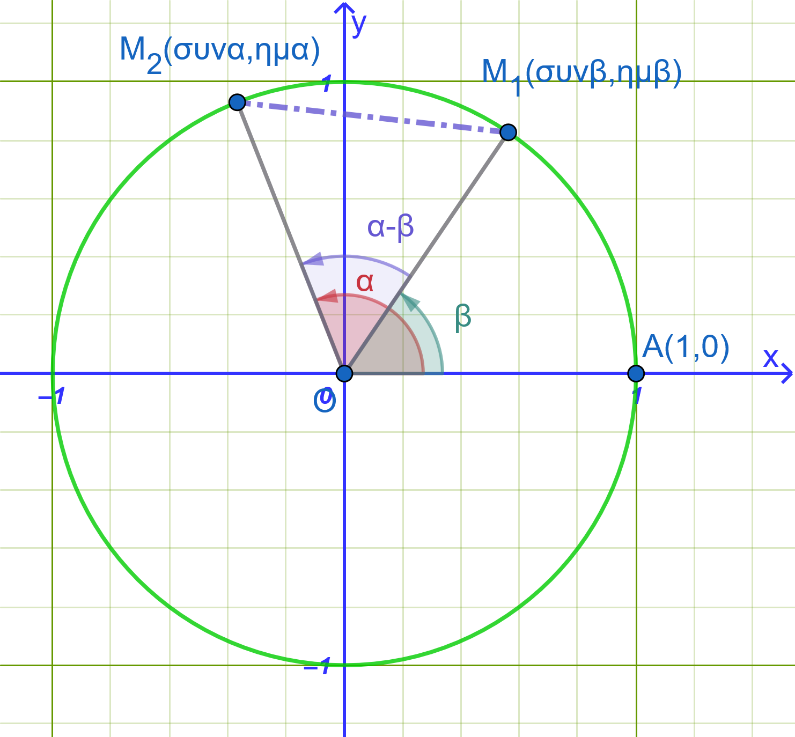
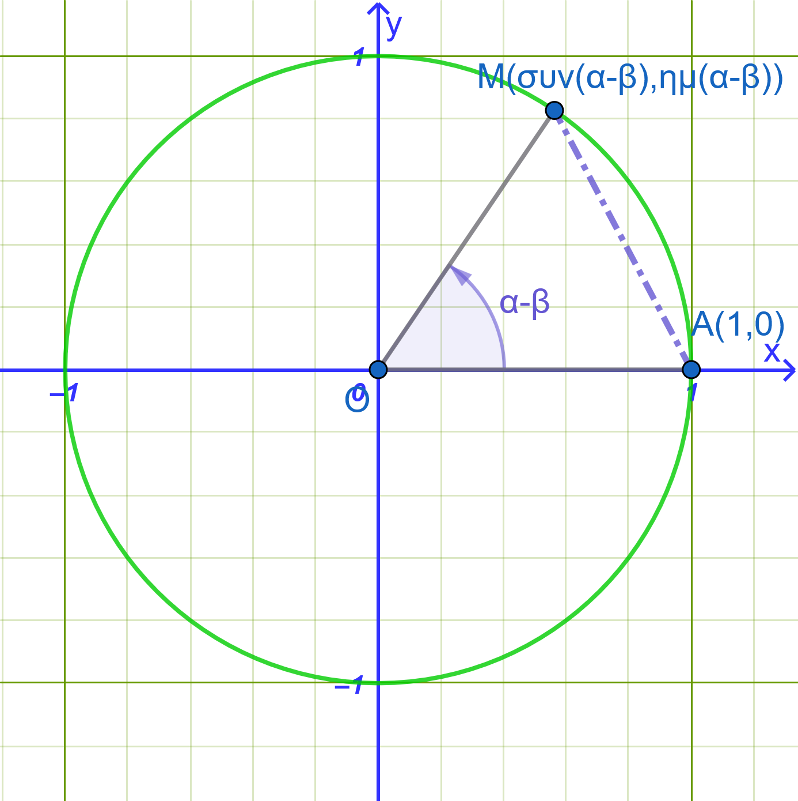

```{=html}
<!-- Φόρτωση βιβλιοθήκης GeoGebra -->
<script src="https://www.geogebra.org/apps/deployggb.js"></script>

<!-- Συνάρτηση δημιουργίας applets -->
<script>
function createGeoGebra(containerId, materialId, width = 700, height = 500) {
  var params = {
    "id": "ggb-" + containerId,
    "material_id": materialId,
    "width": width,
    "height": height,
    "showToolBar": true,
    "showMenuBar": false,
    "showAlgebraInput": true
  };
  
  var applet = new GGBApplet(params, '5.2');
  applet.inject(containerId);
}
</script>
```

## Τριγωνομετρικοί αριθμοί αθροίσματος γωνιών

### Συνημίτονο Αθροίσματος και Διαφοράς Γωνιών

:::: {.math-box .theorem-box}
::: {.math-title .theorem-title}
**Τύποι**
:::

- **Συνημίτονο Διαφοράς:** $συν(α - β) = συνα \cdot συνβ + ημα \cdot ημβ$

- **Συνημίτονο Αθροίσματος:** $συν(α + β) = συνα \cdot συνβ - ημα \cdot ημβ$
::::

:::: {.math-box .apodeixi-box}
::: {.math-title .apodeixi-title}
**Απόδειξη**

{fig-align="center" width="350"}

{fig-align="center" width="350"}
:::

Θεωρούμε στον τριγωνομετρικό κύκλο τις γωνίες $α$ και $β$ με σημείο τομής των τελικών πλευρών τους τα σημεία $M_1(συνα, ημα)$ και $M_2(συνβ, ημβ)$ αντίστοιχα (Σχήμα 1).

1.  Η απόσταση των σημείων $M_1$ και $M_2$ στο καρτεσιανό επίπεδο δίνεται από τον τύπο της απόστασης: $$(M_1 M_2)^2 = (συνα - συνβ)^2 + (ημα - ημβ)^2$$ $$= συν^2α - 2συνασυνβ + συν^2β + ημ^2α - 2ημαημβ + ημ^2β$$ $$= (συν^2α + ημ^2α) + (συν^2β + ημ^2β) - 2(συνασυνβ + ημαημβ)$$ $$= 1 + 1 - 2(συνασυνβ + ημαημβ) = 2 - 2(συνασυνβ + ημαημβ)$$

2.  Αν περιστρέψουμε το σύστημα αξόνων κατά γωνία $-β$, η γωνία $β$ συμπίπτει με τον ημιάξονα $Ox$ (σημείο $A(1,0)$) και η τελική πλευρά της γωνίας $α$ σχηματίζει πλέον γωνία $α - β$ με σημείο τομής $M(συν(α-β), ημ(α-β))$ (Σχήμα 2).

    Η απόσταση $(AM)^2$ είναι: $$(AM)^2 = (συν(α-β) - 1)^2 + (ημ(α-β) - 0)^2$$ $$= συν^2(α-β) - 2συν(α-β) + 1 + ημ^2(α-β) = 2 - 2συν(α-β)$$

3.  Επειδή η απόσταση μεταξύ των σημείων παραμένει αναλλοίωτη κατά την περιστροφή, ισχύει $(M_1 M_2)^2 = (AM)^2$: $$2 - 2συν(α-β) = 2 - 2(συνασυνβ + ημαημβ)$$ $$\mathbf{συν(α - β) = συνα \cdot συνβ + ημα \cdot ημβ}$$

4.  Αντικαθιστώντας στο παραπάνω τύπο το $β$ με το $-β$ (αφού $συν(-β) = συνβ$ και $ημ(-β) = -ημβ$): $$συν(α + β) = συν(α - (-β)) = συνασυν(-β) + ημαημ(-β)$$ $$\mathbf{συν(α + β) = συνα \cdot συνβ - ημα \cdot ημβ}$$
::::

#### **Παραδείγματα**

:::: {.math-box .example-box}
::: {.math-title .example-title}
- **Παράδειγμα 1: Υπολογισμός του**
:::

$συν 15^\circ = συν(60^\circ - 45^\circ)$
::::

:::: {.math-box .examplesolution-box}
::: {.math-title .examplesolution-title}
Λύση
:::

$$συν 15^\circ = συν(60^\circ - 45^\circ) = συν 60^\circ συν 45^\circ + ημ 60^\circ ημ 45^\circ$$ $$= \frac{1}{2} \cdot \frac{\sqrt{2}}{2} + \frac{\sqrt{3}}{2} \cdot \frac{\sqrt{2}}{2} = \mathbf{\frac{\sqrt{2} + \sqrt{6}}{4}}$$
::::

:::: {.math-box .example-box}
::: {.math-title .example-title}
- **Παράδειγμα 2: Υπολογισμός του**
:::

$συν 105^\circ = συν(60^\circ + 45^\circ)$
::::

:::: {.math-box .examplesolution-box}
::: {.math-title .examplesolution-title}
Λύση
:::

$$συν 105^\circ = συν(60^\circ + 45^\circ) = συν 60^\circ συν 45^\circ - ημ 60^\circ ημ 45^\circ$$ $$= \frac{1}{2} \cdot \frac{\sqrt{2}}{2} - \frac{\sqrt{3}}{2} \cdot \frac{\sqrt{2}}{2} = \mathbf{\frac{\sqrt{2} - \sqrt{6}}{4}}$$
::::

------------------------------------------------------------------------

### Ημίτονο Αθροίσματος και Διαφοράς Γωνιών

:::: {.math-box .theorem-box}
::: {.math-title .theorem-title}
**Τύποι**
:::

- **Ημίτονο Αθροίσματος:** $ημ(α + β) = ημα \cdot συνβ + συνα \cdot ημβ$

- **Ημίτονο Διαφοράς:** $ημ(α - β) = ημα \cdot συνβ - συνα \cdot ημβ$
::::

:::: {.math-box .apodeixi-box}
::: {.math-title .apodeixi-title}
**Απόδειξη**
:::

1.  Χρησιμοποιούμε τη σχέση συμπληρωματικών γωνιών $ημ x = συν(90^\circ - x)$: $$ημ(α + β) = συν(90^\circ - (α + β)) = συν((90^\circ - α) - β)$$

2.  Εφαρμόζουμε τον τύπο συνημιτόνου διαφοράς: $$συν((90^\circ - α) - β) = συν(90^\circ - α)συνβ + ημ(90^\circ - α)ημβ$$ $$\mathbf{ημ(α + β) = ημα \cdot συνβ + συνα \cdot ημβ}$$

3.  Αντικαθιστώντας το $β$ με το $-β$: $$ημ(α - β) = ημ(α + (-β)) = ημασυν(-β) + συναημ(-β)$$ $$\mathbf{ημ(α - β) = ημα \cdot συνβ - συνα \cdot ημβ}$$
::::

#### **Παραδείγματα**

:::: {.math-box .example-box}
::: {.math-title .example-title}
- **Παράδειγμα 1: Υπολογισμός του**
:::

$ημ 15^\circ = ημ(60^\circ - 45^\circ)$
::::

:::: {.math-box .examplesolution-box}
::: {.math-title .examplesolution-title}
Λύση
:::

$$ημ 15^\circ = ημ(60^\circ - 45^\circ) = ημ 60^\circ συν 45^\circ - συν 60^\circ ημ 45^\circ$$ $$= \frac{\sqrt{3}}{2} \cdot \frac{\sqrt{2}}{2} - \frac{1}{2} \cdot \frac{\sqrt{2}}{2} = \mathbf{\frac{\sqrt{6} - \sqrt{2}}{4}}$$
::::

:::: {.math-box .example-box}
::: {.math-title .example-title}
- **Παράδειγμα 2: Υπολογισμός του**
:::

$ημ 105^\circ = ημ(60^\circ + 45^\circ)$
::::

:::: {.math-box .examplesolution-box}
::: {.math-title .examplesolution-title}
Λύση
:::

$$ημ 105^\circ = ημ(60^\circ + 45^\circ) = ημ 60^\circ συν 45^\circ + συν 60^\circ ημ 45^\circ$$ $$= \frac{\sqrt{3}}{2} \cdot \frac{\sqrt{2}}{2} + \frac{1}{2} \cdot \frac{\sqrt{2}}{2} = \mathbf{\frac{\sqrt{6} + \sqrt{2}}{4}}$$
::::

------------------------------------------------------------------------

### Εφαπτομένη Αθροίσματος και Διαφοράς Γωνιών

:::: {.math-box .theorem-box}
::: {.math-title .theorem-title}
**Τύποι**
:::

- **Εφαπτομένη Αθροίσματος:** $εφ(α + β) = \dfrac{εφα + εφβ}{1 - εφα \cdot εφβ}$

- **Εφαπτομένη Διαφοράς:** $εφ(α - β) = \dfrac{εφα - εφβ}{1 + εφα \cdot εφβ}$

*(με τις προϋποθέσεις ότι ορίζονται οι εφαπτόμενες).*
::::

:::: {.math-box .apodeixi-box}
::: {.math-title .apodeixi-title}
**Απόδειξη**
:::

1.  Με τη βοήθεια των τύπων ημιτόνου και συνημίτονου αθροίσματος: $$εφ(α + β) = \frac{ημ(α + β)}{συν(α + β)} = \frac{ημασυνβ + συναημβ}{συνασυνβ - ημαημβ}$$

2.  Διαιρούμε αριθμητή και παρονομαστή με το γινόμενο $συνα συνβ \neq 0$: $$εφ(α + β) = \frac{\dfrac{ημασυνβ}{συνασυνβ} + \dfrac{συναημβ}{συνασυνβ}}{\dfrac{συνασυνβ}{συνασυνβ} - \dfrac{ημαημβ}{συνασυνβ}} = \mathbf{\frac{εφα + εφβ}{1 - εφα \cdot εφβ}}$$

3.  Αντικαθιστώντας το $β$ με το $-β$ (αφού $εφ(-β) = -εφβ$): $$εφ(α - β) = \mathbf{\frac{εφ α - εφβ}{1 + εφα \cdot εφβ}}$$
::::

#### **Παραδείγματα**

:::: {.math-box .example-box}
::: {.math-title .example-title}
- **Παράδειγμα 1: Υπολογισμός της**
:::

$εφ 15^\circ = εφ(60^\circ - 45^\circ)$
::::

:::: {.math-box .examplesolution-box}
::: {.math-title .examplesolution-title}
Λύση
:::

$$εφ 15^\circ = \frac{εφ 60^\circ - εφ 45^\circ}{1 + εφ 60^\circ εφ 45^\circ} = \frac{\sqrt{3} - 1}{1 + \sqrt{3} \cdot 1} = \frac{\sqrt{3} - 1}{\sqrt{3} + 1}$$

Πολλαπλασιάζουμε με τη συζυγή παράσταση $(\sqrt{3}-1)$: $$εφ 15^\circ = \frac{(\sqrt{3}-1)^2}{3-1} = \frac{3 - 2\sqrt{3} + 1}{2} = \mathbf{2 - \sqrt{3}}$$
::::

:::: {.math-box .example-box}
::: {.math-title .example-title}
- **Παράδειγμα 2: Υπολογισμός της**
:::

$εφ 105^\circ = εφ(60^\circ + 45^\circ)$
::::

:::: {.math-box .examplesolution-box}
::: {.math-title .examplesolution-title}
Λύση
:::

$$εφ 105^\circ = \frac{εφ 60^\circ + εφ 45^\circ}{1 - εφ 60^\circ εφ 45^\circ} = \frac{\sqrt{3} + 1}{1 - \sqrt{3}} = -\frac{\sqrt{3} + 1}{\sqrt{3} - 1} = \mathbf{-2 - \sqrt{3}}$$
::::

------------------------------------------------------------------------

### Συνεφαπτομένη Αθροίσματος και Διαφοράς Γωνιών

:::: {.math-box .theorem-box}
::: {.math-title .theorem-title}
**Τύποι**
:::

- **Συνεφαπτομένη Αθροίσματος:** $σφ(α + β) = \dfrac{σφα \cdot σφβ - 1}{σφβ + σφα}$

- **Συνεφαπτομένη Διαφοράς:** $σφ(α - β) = \dfrac{σφα \cdot σφβ + 1}{σφβ - σφα}$
::::

:::: {.math-box .apodeixi-box}
::: {.math-title .apodeixi-title}
**Απόδειξη**
:::

1.  Με τη βοήθεια των τύπων συνημίτονου και ημιτόνου αθροίσματος: $$σφ(α + β) = \frac{συν(α + β)}{ημ(α + β)} = \frac{συνασυνβ - ημαημβ}{ημασυνβ + συναημβ}$$

2.  Διαιρούμε αριθμητή και παρονομαστή με το γινόμενο $ημα ημβ \neq 0$: $$σφ(α + β) = \frac{\dfrac{συνασυνβ}{ημαημβ} - \dfrac{ημαημβ}{ημαημβ}}{\dfrac{ημασυνβ}{ημαημβ} + \dfrac{συναημβ}{ημαημβ}} = \mathbf{\frac{σφα \cdot σφβ - 1}{σφβ + σφα}}$$

3.  Αντικαθιστώντας το $β$ με το $-β$ (αφού $σφ(-β) = -σφβ$): $$σφ(α - β) = \mathbf{\frac{σφα \cdot σφβ + 1}{σφβ - σφα}}$$
::::

#### **Παραδείγματα**

:::: {.math-box .example-box}
::: {.math-title .example-title}
- **Παράδειγμα 1: Υπολογισμός της**
:::

$σφ 15^\circ = σφ(60^\circ - 45^\circ)$
::::

:::: {.math-box .examplesolution-box}
::: {.math-title .examplesolution-title}
Λύση
:::

$$σφ 15^\circ = \frac{σφ 60^\circ σφ 45^\circ + 1}{σφ 45^\circ - σφ 60^\circ} = \frac{\dfrac{\sqrt{3}}{3} \cdot 1 + 1}{1 - \dfrac{\sqrt{3}}{3}} = \frac{\sqrt{3} + 3}{3 - \sqrt{3}} = \mathbf{2 + \sqrt{3}}$$
::::

:::: {.math-box .example-box}
::: {.math-title .example-title}
- **Παράδειγμα 2: Υπολογισμός της**
:::

$σφ 105^\circ = σφ(60^\circ + 45^\circ)$
::::

:::: {.math-box .examplesolution-box}
::: {.math-title .examplesolution-title}
Λύση
:::

$$σφ 105^\circ = \frac{σφ 60^\circ σφ 45^\circ - 1}{σφ 45^\circ + σφ 60^\circ} = \frac{\dfrac{\sqrt{3}}{3} \cdot 1 - 1}{1 + \dfrac{\sqrt{3}}{3}} = \frac{\sqrt{3} - 3}{3 + \sqrt{3}} = \mathbf{\sqrt{3} - 2}$$
::::

------------------------------------------------------------------------

### Εφαρμογές

:::: {.math-box .problem-box}
::: {.math-title .problem-title}
**Άσκηση 1: Αριθμητικός Υπολογισμός Παραστάσεων**
:::

Να υπολογιστεί η ακριβής τιμή των παραστάσεων χωρίς τη χρήση υπολογιστή:

1.  $A = ημ 70^\circ \cdot συν 10^\circ - συν 70^\circ \cdot ημ 10^\circ$

2.  $B = \dfrac{εφ 20^\circ + εφ 25^\circ}{1 - εφ 20^\circ \cdot εφ 25^\circ}$
::::

:::: {.math-box .problemsolution-box}
::: {.math-title .problemsolution-title}
**Αναλυτική Λύση:**
:::

1.  **Για την παράσταση** $A$:\
    Αναγνωρίζουμε τη μορφή του τύπου του ημιτόνου διαφοράς $ημασυνβ - συναημβ = ημ(α - β)$ για $α = 70^\circ$ και $β = 10^\circ$: $$A = ημ(70^\circ - 10^\circ) = ημ 60^\circ = \mathbf{\frac{\sqrt{3}}{2}}$$

2.  **Για την παράσταση** $B$:\
    Αναγνωρίζουμε τη μορφή του τύπου της εφαπτομένης αθροίσματος $\dfrac{εφα + εφβ}{1 - εφαεφβ} = εφ(α + β)$ για $α = 20^\circ$ και $β = 25^\circ$: $$B = εφ(20^\circ + 25^\circ) = εφ 45^\circ = \mathbf{1}$$
::::

------------------------------------------------------------------------

:::: {.math-box .problem-box}
::: {.math-title .problem-title}
**Άσκηση 2: Απόδειξη Τριγωνομετρικής Ταυτότητας**
:::

Να αποδειχθεί ότι για οποιεσδήποτε γωνίες $α, β$ για τις οποίες ορίζονται οι παραστάσεις ισχύει: $$\frac{ημ(α + β) + ημ(α - β)}{συν(α + β) + συν(α - β)} = εφα$$
::::

:::: {.math-box .problemsolution-box}
::: {.math-title .problemsolution-title}
**Αναλυτική Λύση:**
:::

Αναπτύσσουμε τους όρους στον αριθμητή και στον παρονομαστή του αριστερού μέλους:

- **Αριθμητής:** $$ημ(α + β) + ημ(α - β) = \\ (ημασυνβ + συναημβ) + (ημασυνβ - συναημβ) = 2ημασυνβ$$

- **Παρονομαστής:** $$συν(α + β) + συν(α - β) = \\ (συνασυνβ - ημαημβ) + (συνασυνβ + ημαημβ) = 2συνασυνβ$$

Συνθέτουμε το κλάσμα: $$\frac{\text{Αριθμητής}}{\text{Παρονομαστής}} = \frac{2ημασυνβ}{2συνασυνβ} = \frac{ημα}{συνα} = \mathbf{εφα}$$
::::

------------------------------------------------------------------------

:::: {.math-box .problem-box}
::: {.math-title .problem-title}
**Άσκηση 3: Υπολογισμός με Γωνίες σε Διαφορετικά Τεταρτημόρια**
:::

Δίνονται οι γωνίες $α$ και $β$ με:

- $ημα = \dfrac{4}{5}$, όπου $\dfrac{\pi}{2} < α < \pi$ (2ο τεταρτημόριο)

- $εφβ = -\dfrac{5}{12}$, όπου $\dfrac{3\pi}{2} < β < 2\pi$ (4ο τεταρτημόριο)

Να υπολογιστεί το $συν(α - β)$.
::::

:::: {.math-box .problemsolution-box}
::: {.math-title .problemsolution-title}
**Αναλυτική Λύση:**
:::

1.  **Υπολογισμός τριγωνομετρικών αριθμών της γωνίας** $α$:

    Στο 2ο τεταρτημόριο το συνημίτονο είναι αρνητικό ($συνα < 0$): $$συνα = -\sqrt{1 - ημ^2α} = -\sqrt{1 - \left(\frac{4}{5}\right)^2} = -\sqrt{1 - \frac{16}{25}} = -\sqrt{\frac{9}{25}} = \mathbf{-\frac{3}{5}}$$

2.  **Υπολογισμός τριγωνομετρικών αριθμών της γωνίας** $β$:

    Στο 4ο τεταρτημόριο το συνημίτονο είναι θετικό ($συνβ > 0$) και το ημίτονο αρνητικό ($ημβ < 0$):

$$συν^2β = \frac{1}{1 + εφ^2β} = \frac{1}{1 + \left(-\dfrac{5}{12}\right)^2} = \frac{1}{1 + \dfrac{25}{144}} = \frac{1}{\dfrac{169}{144}} = \frac{144}{169} \implies συνβ = \mathbf{\frac{12}{13}}$$ $$ημβ = εφβ \cdot συνβ = \left(-\frac{5}{12}\right) \cdot \left(\frac{12}{13}\right) = \mathbf{-\frac{5}{13}}$$

3.  **Υπολογισμός του** $συν(α - β)$:

$$συν(α - β) = συνα \cdot συνβ + ημα \cdot ημβ$$ $$= \left(-\frac{3}{5}\right) \cdot \left(\frac{12}{13}\right) + \left(\frac{4}{5}\right) \cdot \left(-\frac{5}{13}\right) = -\frac{36}{65} - \frac{20}{65} = \mathbf{-\frac{56}{65}}$$
::::

------------------------------------------------------------------------

:::: {.math-box .problem-box}
::: {.math-title .problem-title}
**Άσκηση 4: Εφαρμογή σε Τρίγωνα (Γεωμετρικός Χαρακτηρισμός)**
:::

Σε ένα τρίγωνο $ABC$ ισχύει η σχέση: $$ημ A = 2ημ B \cdot συν C$$

Να αποδειχθεί ότι το τρίγωνο $ABC$ είναι ισοσκελές.
::::

:::: {.math-box .problemsolution-box}
::: {.math-title .problemsolution-title}
**Αναλυτική Λύση:**
:::

Σε κάθε τρίγωνο ισχύει $A + B + C = 180^\circ \iff A = 180^\circ - (B + C)$.\
Άρα: $$ημ A = ημ(180^\circ - (B + C)) = ημ(B + C)$$

Αντικαθιστούμε στην αρχική σχέση: $$ημ(B + C) = 2ημ B \cdot συν C$$

Αναπτύσσουμε το ημίτονο αθροίσματος $ημ(B + C) = ημ Bσυν C + συν Bημ C$: $$ημ B συν C + συν B ημ C = 2ημ B συν C$$ $$συν B ημ C - ημ B συν C = 0$$ $$ημ(C - B) = 0$$

Επειδή $B, C$ είναι γωνίες τριγώνου, ισχύει $-180^\circ < C - B < 180^\circ$.

Η μοναδική τιμή στο διάστημα αυτό για την οποία μηδενίζεται το ημίτονο είναι: $$C - B = 0 \iff \mathbf{B = C}$$

Συνεπώς, το τρίγωνο $ABC$ έχει δύο γωνίες ίσες, άρα είναι **ισοσκελές** με $AB = AC$.
::::

------------------------------------------------------------------------

### Ασκήσεις Εμπέδωσης & Εφαρμογών

**Κατηγορία Α: Ασκήσεις Υπολογισμού Τριγωνομετρικών Αριθμών**

1.  Να υπολογιστούν οι τριγωνομετρικοί αριθμοί $ημ 75^\circ$ και $συν 75^\circ$ αναλύοντας τη γωνία σε $45^\circ + 30^\circ$.

2.  Να υπολογιστούν οι τριγωνομετρικοί αριθμοί $εφ 75^\circ$ και $σφ 75^\circ$.

3.  Αν $ημα = \dfrac{3}{5}$ με $α \in \left(0, \dfrac{\pi}{2}\right)$ και $συνβ = \dfrac{12}{13}$ με $β \in \left(0, \dfrac{\pi}{2}\right)$, να υπολογιστούν τα $ημ(α+β)$ και $συν(α-β)$.

4.  Αν $εφα = 2$ και $εφβ = 3$, να υπολογιστούν οι τιμές των παραστάσεων $εφ(α+β)$ και $εφ(α-β)$.

5.  Να υπολογιστεί η ακριβής τιμή της παράστασης: $A = συν 80^\circ \cdot συν 20^\circ + ημ 80^\circ \cdot ημ 20^\circ$.

**Κατηγορία Β: Απλοποίηση Παραστάσεων**

:::: {.math-box .exercise-box}
::: {.math-title .exercise-title}
6.  Να απλοποιηθεί η παράσταση:
:::

$B = ημ(x+y)συν y - συν(x+y)ημ y$.
::::

:::: {.math-box .solution-box}
::: {.math-title .solution-title}
Λύση
:::

**Χρήση Τριγωνομετρικής Ταυτότητας**

Χρησιμοποιούμε τον τύπο για το ημίτονο της διαφοράς δύο γωνιών: $$ημ(\alpha - \beta) = ημ\alpha \cdot συν\beta - συν\alpha \cdot ημ\beta$$

Θέτοντας:

- $\alpha = x + y$

- $\beta = y$

η παράσταση $B$ παίρνει τη μορφή: $$B = ημ\left[(x + y) - y\right]$$

------------------------------------------------------------------------

**Απλοποίηση**

Εκτελούμε την αφαίρεση μέσα στην παρένθεση: $$B = ημ(x + y - y)$$ $$B = ημ x$$

------------------------------------------------------------------------

**Τελική Απάντηση**

$$B = ημ x$$
::::

7.  Να απλοποιηθεί η παράσταση: $γ = \dfrac{εφ(x+y) - εφ y}{1 + εφ(x+y)εφ y}$.

> > Όμοια με την 6.

8.  Να αποδειχθεί ότι: $συν\left(x + \dfrac{\pi}{4}\right) + συν\left(x - \dfrac{\pi}{4}\right) = \sqrt{2}συν x$.

> > Αναπτύξτε τα $συν\left(x + \dfrac{\pi}{4}\right)$ και $συν\left(x - \dfrac{\pi}{4}\right)$ και μετά απλοποιήστε.

9.  Να αποδειχθεί ότι: $ημ\left(x + \dfrac{\pi}{6}\right) - ημ\left(x - \dfrac{\pi}{6}\right) = συν x$.

> > Όμοια με την 8.

10. Να αποδειχθεί η ισότητα: $\dfrac{ημ(α+β)}{συνα \cdot συνβ} = εφα + εφβ$.

> > αναπτύξτε τον αριθμητή και μετά απλοποιήστε.

**Κατηγορία Γ: Αποδείξεις Τριγωνομετρικών Ταυτοτήτων**

11. Να αποδειχθεί ότι: $ημ(α+β)\cdotημ(α-β) = ημ^2α - ημ^2β = συν^2β - συν^2α$.

> > Αναπτύξτε τα $ημ(α+β)$ και $ημ(α-β) \rightarrow πολλαπλασιάστε \rightarrow απλοποιήστε$

12. Να αποδειχθεί ότι: $συν(α+β)\cdotσυν(α-β) = συν^2α - ημ^2β$.

> > Όμοια με την 11.

13. Να αποδειχθεί η ταυτότητα: $εφ\left(\dfrac{\pi}{4} + x\right) = \dfrac{1 + εφ x}{1 - εφ x}$.

14. Να αποδειχθεί ότι: $\dfrac{συν(α-β) - συν(α+β)}{ημ(α+β) + ημ(α-β)} = εφβ$.

> > Αναπτύξτε σε αριθμητή και παρονομαστή $\rightarrow$ απλοποιήστε.

15. Να γράψετε σε απλούστερη μορφή τις παραστάσεις:

**i)** $\eta\mu(3x)\sigma\upsilon\nu(2x) + \sigma\upsilon\nu(3x)\eta\mu(2x)$

**ii)** $\eta\mu\left(x + \dfrac{\pi}{3}\right)\sigma\upsilon\nu x - \sigma\upsilon\nu\left(x + \dfrac{\pi}{3}\right)\eta\mu x$

**iii)** $\dfrac{\epsilon\phi(3x) - \epsilon\phi x}{1 + \epsilon\phi(3x)\epsilon\phi x}$

**iv)** $\dfrac{\epsilon\phi\left(\dfrac{\pi}{4} + x\right) + \epsilon\phi\left(\dfrac{\pi}{4} - x\right)}{1 - \epsilon\phi\left(\dfrac{\pi}{4} + x\right)\epsilon\phi\left(\dfrac{\pi}{4} - x\right)}$

---

**Αναλυτικές Λύσεις**

**i)** $\eta\mu(3x)\sigma\upsilon\nu(2x) + \sigma\upsilon\nu(3x)\eta\mu(2x)$

- **Ταυτότητα:** $\eta\mu(\alpha + \beta) = \eta\mu\alpha\sigma\upsilon\nu\beta + \sigma\upsilon\nu\alpha\eta\mu\beta$

- Εφαρμόζουμε για $\alpha = 3x$ και $\beta = 2x$:
  $$\eta\mu(3x + 2x) = \eta\mu(5x)$$

---

**ii)** $\eta\mu\left(x + \dfrac{\pi}{3}\right)\sigma\upsilon\nu x - \sigma\upsilon\nu\left(x + \dfrac{\pi}{3}\right)\eta\mu x$

- **Ταυτότητα:** $\eta\mu(\alpha - \beta) = \eta\mu\alpha\sigma\upsilon\nu\beta - \sigma\upsilon\nu\alpha\eta\mu\beta$

- Εφαρμόζουμε για $\alpha = x + \dfrac{\pi}{3}$ και $\beta = x$:
  $$\eta\mu\left[\left(x + \frac{\pi}{3}\right) - x\right] = \eta\mu\left(\frac{\pi}{3}\right) = \frac{\sqrt{3}}{2}$$

---

**iii)** $\dfrac{\epsilon\phi(3x) - \epsilon\phi x}{1 + \epsilon\phi(3x)\epsilon\phi x}$

- **Ταυτότητα:** $\epsilon\phi(\alpha - \beta) = \dfrac{\epsilon\phi\alpha - \epsilon\phi\beta}{1 + \epsilon\phi\alpha\epsilon\phi\beta}$

- Εφαρμόζουμε για $\alpha = 3x$ και $\beta = x$:
  $$\epsilon\phi(3x - x) = \epsilon\phi(2x)$$

---

**iv)** $\dfrac{\epsilon\phi\left(\dfrac{\pi}{8} + x\right) + \epsilon\phi\left(\dfrac{\pi}{8} - x\right)}{1 - \epsilon\phi\left(\dfrac{\pi}{8} + x\right)\epsilon\phi\left(\dfrac{\pi}{8} - x\right)}$

- **Ταυτότητα:** $\epsilon\phi(\alpha + \beta) = \dfrac{\epsilon\phi\alpha + \epsilon\phi\beta}{1 - \epsilon\phi\alpha\epsilon\phi\beta}$

- Εφαρμόζουμε για $\alpha = \dfrac{\pi}{8} + x$ και $\beta = \dfrac{\pi}{8} - x$:
  $$\epsilon\phi\left[\left(\frac{\pi}{8} + x\right) + \left(\frac{\pi}{8} - x\right)\right] = \epsilon\phi\left(\frac{\pi}{8} + \frac{\pi}{8}\right) = \epsilon\phi\left(\frac{\pi}{4}\right)=1$$


**Κατηγορία Δ: Ταυτότητες υπό Συνθήκη**

16. Αν $α + β + γ = \pi$ (γωνίες μη ορθογωνίου τριγώνου), να αποδειχθεί ότι: 

$εφα + εφβ + εφγ = εφα \cdot εφβ \cdot εφγ$.

> > $α+β+γ=180^ο \implies α+β=180^ο-γ \implies εφ(α+β)=εφ(180^ο-γ) \implies ................$

:::: {.math-box .exercise-box}
::: {.math-title .exercise-title}
17. Αν $α + β + γ = \pi$, να αποδειχθεί ότι:
:::

$σφα \cdot σφβ + σφβ \cdot σφγ + σφγ \cdot σφα = 1$.
::::

:::: {.math-box .solution-box}
::: {.math-title .solution-title}
Λύση
:::

Δίνεται ότι: $$\alpha + \beta + \gamma = \pi \implies \alpha + \beta = \pi - \gamma$$

------------------------------------------------------------------------

**1: Εφαρμογή της συνεφαπτομένης**

Παίρνουμε τη συνεφαπτομένη και στα δύο μέλη: $$\sigma\phi(\alpha + \beta) = \sigma\phi(\pi - \gamma)$$

Επειδή οι γωνίες $\gamma$ και $\pi - \gamma$ είναι παραπληρωματικές, ισχύει: $$\sigma\phi(\pi - \gamma) = -\sigma\phi\gamma$$

Επομένως: $$\sigma\phi(\alpha + \beta) = -\sigma\phi\gamma$$

------------------------------------------------------------------------

**2: Ανάπτυξη του τύπου της συνεφαπτομένης αθροίσματος**

Γνωρίζουμε τον τριγωνομετρικό τύπο: $$\sigma\phi(\alpha + \beta) = \frac{\sigma\phi\alpha \cdot \sigma\phi\beta - 1}{\sigma\phi\alpha + \sigma\phi\beta}$$

Αντικαθιστούμε στη σχέση: $$\frac{\sigma\phi\alpha \cdot \sigma\phi\beta - 1}{\sigma\phi\alpha + \sigma\phi\beta} = -\sigma\phi\gamma$$

------------------------------------------------------------------------

**3: Απαλοιφή παρονομαστών και πράξεις**

Πολλαπλασιάζουμε χιαστί: $$\sigma\phi\alpha \cdot \sigma\phi\beta - 1 = -\sigma\phi\gamma \cdot (\sigma\phi\alpha + \sigma\phi\beta)$$

Κάνουμε την επιμεριστική ιδιότητα στο δεξί μέλος: $$\sigma\phi\alpha \cdot \sigma\phi\beta - 1 = -\sigma\phi\gamma \cdot \sigma\phi\alpha - \sigma\phi\gamma \cdot \sigma\phi\beta$$

------------------------------------------------------------------------

**4: Μεταφορά των όρων**

Μεταφέρουμε τους αρνητικούς όρους του δεξιού μέλους στο αριστερό και τον αριθμό $-1$ στο δεξί μέλος: $$\sigma\phi\alpha \cdot \sigma\phi\beta + \sigma\phi\beta \cdot \sigma\phi\gamma + \sigma\phi\gamma \cdot \sigma\phi\alpha = 1$$

Η σχέση αποδείχθηκε.
::::

:::: {.math-box .exercise-box}
::: {.math-title .exercise-title}
18. Αν $α + β = \dfrac{\pi}{4}$,
:::

να αποδειχθεί ότι: $(1 + εφα)(1 + εφβ) = 2$.
::::

:::: {.math-box .solution-box}
::: {.math-title .solution-title}
Λύση
:::

Δίνεται ότι: $$\alpha + \beta = \frac{\pi}{4}$$

------------------------------------------------------------------------

**1: Εφαρμογή της εφαπτομένης**

Παίρνουμε την εφαπτομένη και στα δύο μέλη: $$\epsilon\phi(\alpha + \beta) = \epsilon\phi\left(\frac{\pi}{4}\right)$$

Επειδή $\epsilon\phi\left(\dfrac{\pi}{4}\right) = 1$, έχουμε: $$\epsilon\phi(\alpha + \beta) = 1$$

------------------------------------------------------------------------

**2: Χρήση του τύπου της εφαπτομένης αθροίσματος**

Αναπτύσσουμε το αριστερό μέλος χρησιμοποιώντας τον τύπο: $$\epsilon\phi(\alpha + \beta) = \frac{\epsilon\phi\alpha + \epsilon\phi\beta}{1 - \epsilon\phi\alpha \cdot \epsilon\phi\beta}$$

Επομένως: $$\frac{\epsilon\phi\alpha + \epsilon\phi\beta}{1 - \epsilon\phi\alpha \cdot \epsilon\phi\beta} = 1$$

Πολλαπλασιάζουμε χιαστί: $$\epsilon\phi\alpha + \epsilon\phi\beta = 1 - \epsilon\phi\alpha \cdot \epsilon\phi\beta$$

Μεταφέρουμε το γινόμενο στο αριστερό μέλος: $$\epsilon\phi\alpha + \epsilon\phi\beta + \epsilon\phi\alpha \cdot \epsilon\phi\beta = 1 \quad \text{(1)}$$

------------------------------------------------------------------------

**3: Ανάπτυξη του ζητούμενου γινομένου**

Αναπτύσσουμε το αριστερό μέλος της σχέσης που θέλουμε να αποδείξουμε: $$(1 + \epsilon\phi\alpha)(1 + \epsilon\phi\beta) = 1 + \epsilon\phi\beta + \epsilon\phi\alpha + \epsilon\phi\alpha \cdot \epsilon\phi\beta$$

Αναδιατάσσουμε τους όρους: $$(1 + \epsilon\phi\alpha)(1 + \epsilon\phi\beta) = 1 + (\epsilon\phi\alpha + \epsilon\phi\beta + \epsilon\phi\alpha \cdot \epsilon\phi\beta)$$

------------------------------------------------------------------------

**4: Αντικατάσταση**

Αντικαθιστούμε από τη σχέση (1) την παράσταση $\epsilon\phi\alpha + \epsilon\phi\beta + \epsilon\phi\alpha \cdot \epsilon\phi\beta = 1$: $$(1 + \epsilon\phi\alpha)(1 + \epsilon\phi\beta) = 1 + 1 = 2$$

Η σχέση αποδείχθηκε.
::::

19. Αν $εφα = \dfrac{1}{2}$ και $εφβ = \dfrac{1}{3}$ με $α, β \in \left(0, \dfrac{\pi}{2}\right)$,

να αποδειχθεί ότι $α + β = \dfrac{\pi}{4}$.

> > $εφ(α+β)=\dfrac{εφα +εφβ}{1-εφα \cdot εφβ}$ Αντικαταστήστε, Λύστε την εξίσωση.

:::: {.math-box .exercise-box}
::: {.math-title .exercise-title}
20. Αν $συν(α+β) = 0$,
:::

να αποδειχθεί ότι: $ημ(α+2β) = ημα$.
::::

:::: {.math-box .solution-box}
::: {.math-title .solution-title}
Λύση
:::

Δίνεται ότι: $$\sigma\upsilon\nu(\alpha + \beta) = 0$$

------------------------------------------------------------------------

**1: Ανάλυση της γωνίας** $(\alpha + 2\beta)$

Παρατηρούμε ότι μπορούμε να «σπάσουμε» τη γωνία $(\alpha + 2\beta)$ ως άθροισμα των γωνιών $(\alpha + \beta)$ και $\beta$: $$\alpha + 2\beta = (\alpha + \beta) + \beta$$

Επομένως, το αριστερό μέλος γράφεται: $$\eta\mu(\alpha + 2\beta) = \eta\mu\left[(\alpha + \beta) + \beta\right]$$

------------------------------------------------------------------------

**2: Εφαρμογή του τύπου ημιτόνου αθροίσματος**

Χρησιμοποιούμε τον τύπο $\eta\mu(x + y) = \eta\mu x \cdot \sigma\upsilon\nu y + \sigma\upsilon\nu x \cdot \eta\mu y$ για $x = \alpha + \beta$ και $y = \beta$: $$\eta\mu\left[(\alpha + \beta) + \beta\right] = \eta\mu(\alpha + \beta) \cdot \sigma\upsilon\nu\beta + \sigma\upsilon\nu(\alpha + \beta) \cdot \eta\mu\beta$$

Επειδή από την υπόθεση είναι $\sigma\upsilon\nu(\alpha + \beta) = 0$, ο δεύτερος όρος μηδενίζεται: $$\eta\mu(\alpha + 2\beta) = \eta\mu(\alpha + \beta) \cdot \sigma\upsilon\nu\beta + 0 \cdot \eta\mu\beta$$ $$\eta\mu(\alpha + 2\beta) = \eta\mu(\alpha + \beta) \cdot \sigma\upsilon\nu\beta \quad \text{(1)}$$

------------------------------------------------------------------------

**3: Ανάπτυξη του** $\eta\mu(\alpha + \beta)$

Αναπτύσσουμε το $\eta\mu(\alpha + \beta)$: $$\eta\mu(\alpha + \beta) = \eta\mu\alpha \cdot \sigma\upsilon\nu\beta + \sigma\upsilon\nu\alpha \cdot \eta\mu\beta$$

Αντικαθιστούμε στη σχέση (1): $$\eta\mu(\alpha + 2\beta) = (\eta\mu\alpha \cdot \sigma\upsilon\nu\beta + \sigma\upsilon\nu\alpha \cdot \eta\mu\beta) \cdot \sigma\upsilon\nu\beta$$ $$\eta\mu(\alpha + 2\beta) = \eta\mu\alpha \cdot \sigma\upsilon\nu^2\beta + \sigma\upsilon\nu\alpha \cdot \eta\mu\beta \cdot \sigma\upsilon\nu\beta \quad \text{(2)}$$

------------------------------------------------------------------------

**4: Αξιοποίηση της υπόθεσης** $\sigma\upsilon\nu(\alpha + \beta) = 0$

Αναπτύσσουμε την υπόθεση: $$\sigma\upsilon\nu(\alpha + \beta) = 0 \implies \sigma\upsilon\nu\alpha \cdot \sigma\upsilon\nu\beta - \eta\mu\alpha \cdot \eta\mu\beta = 0$$ $$\sigma\upsilon\nu\alpha \cdot \sigma\upsilon\nu\beta = \eta\mu\alpha \cdot \eta\mu\beta$$

Πολλαπλασιάζουμε και τα δύο μέλη με $\eta\mu\beta$: $$\sigma\upsilon\nu\alpha \cdot \eta\mu\beta \cdot \sigma\upsilon\nu\beta = \eta\mu\alpha \cdot \eta\mu^2\beta$$

------------------------------------------------------------------------

**5: Τελική αντικατάσταση**

Αντικαθιστούμε το γινόμενο αυτό στη σχέση (2): $$\eta\mu(\alpha + 2\beta) = \eta\mu\alpha \cdot \sigma\upsilon\nu^2\beta + \eta\mu\alpha \cdot \eta\mu^2\beta$$

Βγάζουμε κοινό παράγοντα το $\eta\mu\alpha$: $$\eta\mu(\alpha + 2\beta) = \eta\mu\alpha \cdot (\sigma\upsilon\nu^2\beta + \eta\mu^2\beta)$$

Επειδή $\sigma\upsilon\nu^2\beta + \eta\mu^2\beta = 1$: $$\eta\mu(\alpha + 2\beta) = \eta\mu\alpha \cdot 1 = \eta\mu\alpha$$

Η ισότητα αποδείχθηκε.
::::

**Κατηγορία Ε: Ασκήσεις σε Τρίγωνα**

21. Σε κάθε τρίγωνο $ABC$, να αποδειχθεί ότι: $ημ A = ημ B \cdot συν C + συν B \cdot ημ C$.

> > $Α+Β+Γ=180^Ο \implies B+Γ=180^ο-Α \implies ημ(Β+Γ)=ημ(180^ο-Α) \implies ...............$

22. Σε κάθε τρίγωνο $ABC$, να αποδειχθεί ότι: $συν A = -συν B \cdot συν C + ημ B \cdot ημ C$.

> > Όμοια με την 21.

23. Υπολογίστε τα παρακάτω χωρίς υπολογιστή.

**α)** $\sigma\upsilon\nu(45^\circ - x)\sigma\upsilon\nu x - \eta\mu(45^\circ - x)\eta\mu x$

**β)** $\sigma\upsilon\nu^2 15^\circ - \eta\mu^2 15^\circ$

------------------------------------------------------------------------

24. Να αποδείξετε ότι:

**α)** $$\eta\mu(60^\circ - x) + \eta\mu(60^\circ + x) = \sqrt{3}\sigma\upsilon\nu x$$

**β)** Στη συνέχεια, να υπολογίσετε την τιμή της παράστασης $\eta\mu 15^\circ + \eta\mu 105^\circ$ χωρίς τη χρήση υπολογιστή τσέπης.

**γ)** Να χρησιμοποιήσετε υπολογιστή τσέπης για να επαληθεύσετε την απάντησή σας.

------------------------------------------------------------------------

25. Να απλοποιήσετε την παρακάτω παράσταση χωρίς τη χρήση υπολογιστή τσέπης:

$$\frac{\eta\mu p \cdot \sigma\upsilon\nu(45^\circ - p) + \sigma\upsilon\nu p \cdot \eta\mu(45^\circ - p)}{\sigma\upsilon\nu p \cdot \sigma\upsilon\nu(60^\circ - p) - \eta\mu p \cdot \eta\mu(60^\circ - p)}$$

> > Αναπτύξτε και κάντε απλοποιήσεις σε αριθμητή και παρονομαστή.

:::: {.math-box .exercise-box}
::: {.math-title .exercise-title}
26. Σε ένα μη ορθογώνιο τρίγωνο $ABC$ ισχύουν οι σχέσεις:
:::

$$\epsilon\phi A + \epsilon\phi B = 2\sigma\phi C \quad \text{και} \quad \epsilon\phi A \cdot \epsilon\phi B = 3$$

Να αποδείξετε ότι η γωνία $\hat{C}$ ισούται με $45^\circ$ ($\hat{C} = \dfrac{\pi}{4}$).
::::

:::: {.math-box .solution-box}
::: {.math-title .solution-title}
Λύση
:::

Σε κάθε τρίγωνο $ABC$ ισχύει: $$A + B + C = 180^\circ \implies A + B = 180^\circ - C$$

------------------------------------------------------------------------

**1: Χρήση της εφαπτομένης αθροίσματος**

Παίρνουμε την εφαπτομένη και στα δύο μέλη: $$\epsilon\phi(A + B) = \epsilon\phi(180^\circ - C)$$

Επειδή $\epsilon\phi(180^\circ - C) = -\epsilon\phi C$, έχουμε: $$\frac{\epsilon\phi A + \epsilon\phi B}{1 - \epsilon\phi A \cdot \epsilon\phi B} = -\epsilon\phi C$$

------------------------------------------------------------------------

**2: Αντικατάσταση των δεδομένων**

Αντικαθιστούμε τα δεδομένα της εκφώνησης:

- $\epsilon\phi A + \epsilon\phi B = 2\sigma\phi C$

- $\epsilon\phi A \cdot \epsilon\phi B = 3$

στην παραπάνω σχέση: $$\frac{2\sigma\phi C}{1 - 3} = -\epsilon\phi C$$ $$\frac{2\sigma\phi C}{-2} = -\epsilon\phi C$$ $$-\sigma\phi C = -\epsilon\phi C$$

Πολλαπλασιάζουμε με $-1$: $$\sigma\phi C = \epsilon\phi C$$

------------------------------------------------------------------------

**3: Υπολογισμός της γωνίας** $\hat{C}$

Γνωρίζουμε ότι $\sigma\phi C = \dfrac{1}{\epsilon\phi C}$.
Αντικαθιστούμε: $$\frac{1}{\epsilon\phi C} = \epsilon\phi C$$ $$\epsilon\phi^2 C = 1$$

Άρα: $$\epsilon\phi C = 1 \quad \text{ή} \quad \epsilon\phi C = -1$$

Εξετάζουμε τις δύο περιπτώσεις για γωνία τριγώνου ($0^\circ < C < 180^\circ$):

1.  **Αν** $\epsilon\phi C = 1$:\
    $$C = 45^\circ$$

2.  **Αν** $\epsilon\phi C = -1$:\
    $$C = 135^\circ$$

    - Αν όμως $C = 135^\circ$, τότε $\sigma\phi C = -1$.

    - Από τη δοθείσα σχέση θα είχαμε: $$\epsilon\phi A + \epsilon\phi B = 2\sigma\phi C = 2(-1) = -2 < 0$$

    - Επίσης δίνεται ότι $\epsilon\phi A \cdot \epsilon\phi B = 3 > 0$.

      Δύο αριθμοί με θετικό γινόμενο ($3$) και αρνητικό άθροισμα ($-2$) πρέπει να είναι και οι δύο αρνητικοί: $$\epsilon\phi A < 0 \quad \text{και} \quad \epsilon\phi B < 0$$

      Αυτό σημαίνει ότι και οι δύο γωνίες $A$ και $B$ θα ήταν αμβλείες ($> 90^\circ$).

      Αυτό είναι **άτοπο**, διότι ένα τρίγωνο δεν μπορεί να έχει δύο (πόσο μάλλον τρεις) αμβλείες γωνίες.

------------------------------------------------------------------------

**Συμπέρασμα**

Η μοναδική δεκτή τιμή είναι: $$\epsilon\phi C = 1 \implies \hat{C} = 45^\circ$$
::::

27. Να αποδείξετε ότι:

**α)** $$\eta\mu(A + B) - \eta\mu(A - B) = 2\sigma\upsilon\nu A \cdot \eta\mu B$$

**β)** Στη συνέχεια, να υπολογίσετε την τιμή του $\sigma\upsilon\nu 75^\circ \cdot \eta\mu 15^\circ$ χωρίς τη χρήση υπολογιστή τσέπης.

**Κατηγορία ΣΤ: Τριγωνομετρικές Εξισώσεις**

28. Να λυθεί η εξίσωση: $ημ\left(x + \dfrac{\pi}{3}\right) = συν x$.

> > $ημ\left(x + \dfrac{\pi}{3}\right) = συν x \implies συν\left(\dfrac{π}{2}-\left(x + \dfrac{\pi}{3}\right)\right)=συνx \implies ..........................$

29. Να λυθεί η εξίσωση: $εφ\left(x + \dfrac{\pi}{4}\right) = \sqrt{3}$.

30. Να λυθεί η εξίσωση: $ημ(3x)συν x - συν(3x)ημ x = \dfrac{1}{2}$.

31. Να λυθεί η εξίσωση: $συν(2x)συν x + ημ(2x)ημ x = \dfrac{\sqrt{3}}{2}$.

32. Να λυθεί η εξίσωση: $εφ x + εφ\left(x + \dfrac{\pi}{4}\right) = 0$.

------------------------------------------------------------------------

## ΔΙΑΓΩΝΙΣΜΑ ΑΞΙΟΛΟΓΗΣΗΣ: ΤΡΙΓΩΝΟΜΕΤΡΙΚΟΙ ΑΡΙΘΜΟΙ ΑΘΡΟΙΣΜΑΤΟΣ & ΔΙΑΦΟΡΑΣ ΓΩΝΙΩΝ

**Μάθημα:** Άλγεβρα Β' Γενικού Λυκείου\
**Διάρκεια:** 60 λεπτά

------------------------------------------------------------------------

### **ΘΕΜΑ Α (Θεωρία & Ερωτήσεις Κατανόησης - 25 Μονάδες)**

**Α1.** 1.
Να αποδείξετε ότι για δύο γωνίες $α, β$ με $συνασυνβ \neq 0$ και $συν(α+β) \neq 0$ ισχύει ο τύπος: $$εφ(α + β) = \frac{εφα + εφβ}{1 - εφα \cdot εφβ}$$ **(7 μονάδες)**

2.  Να γράψετε τους τύπους για το ημίτονο αθροίσματος $ημ(α+β)$ και το συνημίτονο διαφοράς $συν(α-β)$. **(3 μονάδες)**

**Α2.** Να χαρακτηρίσετε τις παρακάτω προτάσεις ως **Σωστό (Σ)** ή **Λάθος (Λ)**: **(10 μονάδες)**

1.  Για οποιεσδήποτε γωνίες $α, β$ ισχύει ότι $συν(α - β) = συνα συνβ - ημα ημβ$.

2.  Ισχύει ότι $ημ(α + β) = ημα συνβ + συνα ημβ$ για κάθε $α, β \in \mathbb{R}$.

3.  Η τιμή της εφαπτομένης $εφ 15^\circ$ ισούται με $2 - \sqrt{3}$.

4.  Για κάθε γωνία $x$ ισχύει ότι $συν\left(x + \dfrac{\pi}{4}\right) + συν\left(x - \dfrac{\pi}{4}\right) = \sqrt{2}συν x$.

5.  Σε κάθε μη ορθογώνιο τρίγωνο $ABC$ ισχύει πάντοτε $εφ A + εφ B + εφ C = εφ A \cdot εφ B \cdot εφ C$.

**Α3.** Να συμπληρώσετε τα κενά ώστε να προκύψουν αληθείς ισότητες: **(5 μονάδες)**

- α) $ημα συνβ - συνα ημβ = \text{...........}$

- β) $σφ(α - β) = \text{...........}$

------------------------------------------------------------------------

### **ΘΕΜΑ Β (Υπολογισμοί & Εφαρμογές Τύπων - 25 Μονάδες)**

**Β1.** Να υπολογίσετε την ακριβή τιμή των παραστάσεων:

1.  $A = συν 105^\circ$ **(6 μονάδες)**

2.  $B = συν 70^\circ \cdot συν 10^\circ + ημ 70^\circ \cdot ημ 10^\circ$ **(6 μονάδες)**

**Β2.** Δίνονται οι γωνίες $α, β$ με $ημα = \dfrac{3}{5}$ (όπου $0 < α < \dfrac{\pi}{2}$) και $συνβ = -\dfrac{5}{13}$ (όπου $\dfrac{\pi}{2} < β < \pi$).

1.  Να υπολογίσετε το $συνα$ και το $ημβ$.
    **(6 μονάδες)**

2.  Να υπολογίσετε τις τιμές των $ημ(α + β)$ και $συν(α + β)$.
    **(7 μονάδες)**

------------------------------------------------------------------------

### **ΘΕΜΑ Γ (Αποδείξεις Ταυτοτήτων & Εξισώσεις - 25 Μονάδες)**

**Γ1.** Να αποδείξετε ότι για οποιεσδήποτε γωνίες $α, β$ ισχύει η ταυτότητα: $$ημ(α + β) \cdot ημ(α - β) = ημ^2α - ημ^2β$$ **(12 μονάδες)**

**Γ2.** Να λυθεί στο $\mathbb{R}$ η εξίσωση: $$ημ\left(x + \frac{\pi}{6}\right) = συν x$$ **(13 μονάδες)**

------------------------------------------------------------------------

### **ΘΕΜΑ Δ (Τρίγωνα & Σύνθετη Εφαρμογή - 25 Μονάδες)**

**Δ1.** Σε κάθε μη ορθογώνιο τρίγωνο $ABC$, να αποδείξετε ότι ισχύει η σχέση: $$εφ A + εφ B + εφ C = εφ A \cdot εφ B \cdot εφ C$$ **(12 μονάδες)**

**Δ2.** Δίνονται οι οξείες γωνίες $α, β \in \left(0, \dfrac{\pi}{2}\right)$ για τις οποίες ισχύει $εφα = \dfrac{1}{2}$ και $εφβ = \dfrac{1}{3}$.

1.  Να υπολογίσετε την εφαπτομένη $εφ(α + β)$.
    **(6 μονάδες)**

2.  Να αποδείξετε ότι $α + β = \dfrac{\pi}{4}$.
    **(7 μονάδες)**

------------------------------------------------------------------------

## ΑΝΑΛΥΤΙΚΕΣ ΛΥΣΕΙΣ ΔΙΑΓΩΝΙΣΜΑΤΟΣ

### **ΘΕΜΑ Α**

- **Α1.1:** Με τη βοήθεια των τύπων ημιτόνου και συνημίτονου αθροίσματος: $$εφ(α + β) = \frac{ημ(α + β)}{συν(α + β)} = \frac{ημασυνβ + συναημβ}{συνασυνβ - ημαημβ}$$

  Διαιρούμε αριθμητή και παρονομαστή με το $συνασυνβ \neq 0$: $$εφ(α + β) = \dfrac{\dfrac{ημασυνβ}{συνασυνβ} + \dfrac{συναημβ}{συνασυνβ}}{\dfrac{συνασυνβ}{συνασυνβ} - \dfrac{ημαημβ}{συνασυνβ}} = \frac{εφα + εφβ}{1 - εφα \cdot εφβ}$$

- **Α1.2:**

  - $ημ(α + β) = ημασυνβ + συναημβ$

  - $συν(α - β) = συνασυνβ + ημαημβ$

- **Α2:**

  1.  **Λάθος** (το σωστό είναι $συν(α - β) = συνασυνβ + ημαημβ$).

  2.  **Σωστό** (είναι ο βασικός τύπος ημιτόνου αθροίσματος).

  3.  **Σωστό** ($εφ 15^\circ = εφ(60^\circ - 45^\circ) = \dfrac{\sqrt{3}-1}{1+\sqrt{3}} = 2 - \sqrt{3}$).

  4.  **Σωστό** (διότι $συν(x+\dfrac{\pi}{4}) + συν(x-\dfrac{\pi}{4}) = συν x \dfrac{\sqrt{2}}{2} - ημ x \dfrac{\sqrt{2}}{2} + συν x \dfrac{\sqrt{2}}{2} + ημ x \dfrac{\sqrt{2}}{2} = \sqrt{2}συν x$).

  5.  **Σωστό** (βασική ταυτότητα σε μη ορθογώνιο τρίγωνο).

- **Α3:**

  - α) $ημ(α - β)$

  - β) $\dfrac{σφα \cdot σφβ + 1}{σφβ - σφα}$

------------------------------------------------------------------------

### **ΘΕΜΑ Β**

- **Β1.1:** Αναλύουμε τη γωνία $105^\circ = 60^\circ + 45^\circ$:

  $$συν 105^\circ = συν(60^\circ + 45^\circ) = συν 60^\circ συν 45^\circ - ημ 60^\circ ημ 45^\circ$$ $$= \frac{1}{2} \cdot \frac{\sqrt{2}}{2} - \frac{\sqrt{3}}{2} \cdot \frac{\sqrt{2}}{2} = \mathbf{\frac{\sqrt{2} - \sqrt{6}}{4}}$$

- **Β1.2:** Εφαρμόζουμε τον τύπο συνημίτονου διαφοράς $συνασυνβ + ημαημβ = συν(α-β)$:

  $$B = συν 70^\circ συν 10^\circ + ημ 70^\circ ημ 10^\circ = συν(70^\circ - 10^\circ) = συν 60^\circ = \mathbf{\frac{1}{2}}$$

- **Β2.1:**

  - Επειδή $0 < α < \dfrac{\pi}{2}$ (1ο τεταρτημόριο): $$συνα = +\sqrt{1 - ημ^2α} = \sqrt{1 - \left(\frac{3}{5}\right)^2} = \sqrt{1 - \frac{9}{25}} = \sqrt{\frac{16}{25}} = \mathbf{\frac{4}{5}}$$

  - Επειδή $\dfrac{\pi}{2} < β < \pi$ (2ο τεταρτημόριο), το ημίτονο είναι θετικό: $$ημβ = +\sqrt{1 - συν^2β} = \sqrt{1 - \left(-\frac{5}{13}\right)^2} = \sqrt{1 - \frac{25}{169}} = \sqrt{\frac{144}{169}} = \mathbf{\frac{12}{13}}$$

- **Β2.2:**

  - $ημ(α + β) = ημασυνβ + συναημβ = \left(\dfrac{3}{5}\right)\left(-\dfrac{5}{13}\right) + \left(\dfrac{4}{5}\right)\left(\dfrac{12}{13}\right) = -\dfrac{15}{65} + \dfrac{48}{65} = \mathbf{\dfrac{33}{65}}$

  - $συν(α + β) = συνασυνβ - ημαημβ = \left(\dfrac{4}{5}\right)\left(-\dfrac{5}{13}\right) - \left(\dfrac{3}{5}\right)\left(\dfrac{12}{13}\right) = -\dfrac{20}{65} - \dfrac{36}{65} = \mathbf{-\dfrac{56}{65}}$

------------------------------------------------------------------------

### **ΘΕΜΑ Γ**

- **Γ1:** Αναπτύσσουμε το αριστερό μέλος: $$ημ(α + β)ημ(α - β) = (ημασυνβ + συναημβ)(ημασυνβ - συναημβ)$$

  Χρησιμοποιούμε τη διαφορά τετραγώνων: $$= ημ^2ασυν^2β - συν^2αημ^2β$$

  Αντικαθιστούμε $συν^2β = 1 - ημ^2β$ και $συν^2α = 1 - ημ^2α$: $$= ημ^2α(1 - ημ^2β) - (1 - ημ^2α)ημ^2β$$ $$= ημ^2α - ημ^2αημ^2β - ημ^2β + ημ^2αημ^2β = \mathbf{ημ^2α - ημ^2β}$$

- **Γ2:** Μετασχηματίζουμε το δεξί μέλος σε ημίτονο συμπληρωματικής γωνίας: $συν x = ημ\left(\dfrac{\pi}{2} - x\right)$.

  Η εξίσωση γίνεται $ημ\left(x + \dfrac{\pi}{6}\right) = ημ\left(\dfrac{\pi}{2} - x\right)$:

  - **1η περίπτωση:** $$x + \frac{\pi}{6} = 2k\pi + \frac{\pi}{2} - x \iff 2x = 2k\pi + \frac{\pi}{2} - \frac{\pi}{6} \iff \\ 2x = 2k\pi + \frac{\pi}{3} \iff \mathbf{x = k\pi + \frac{\pi}{6}}, \ k \in \mathbb{Z}$$

  - **2η περίπτωση:** $$x + \frac{\pi}{6} = 2k\pi + \pi - \left(\frac{\pi}{2} - x\right) \iff x + \frac{\pi}{6} = 2k\pi + \frac{\pi}{2} + x \iff \frac{\pi}{6} = \frac{\pi}{2} \quad (\text{Αδύνατη})$$

  Άρα οι λύσεις είναι οι $x = k\pi + \dfrac{\pi}{6}, \ k \in \mathbb{Z}$.

------------------------------------------------------------------------

### **ΘΕΜΑ Δ**

- **Δ1:** Σε κάθε τρίγωνο ισχύει $A + B + C = \pi \iff A + B = \pi - C$.

  Παίρνουμε την εφαπτομένη και στα δύο μέλη: $$εφ(A + B) = εφ(\pi - C) \iff \frac{εφ A + εφ B}{1 - εφ A \cdot εφ B} = -εφ C$$

  Πολλαπλασιάζουμε χιαστί: $$εφ A + εφ B = -εφ C \cdot (1 - εφ A \cdot εφ B)$$ $$εφ A + εφ B = -εφ C + εφ A \cdot εφ B \cdot εφ C$$

  Μεταφέροντας το $-εφ C$ στο αριστερό μέλος: $$\mathbf{εφ A + εφ B + εφ C = εφ A \cdot εφ B \cdot εφ C}$$

- **Δ2.1:** Εφαρμόζουμε τον τύπο εφαπτομένης αθροίσματος:

  $$εφ(α + β) = \frac{εφα + εφβ}{1 - εφα \cdot εφβ} = \frac{\dfrac{1}{2} + \dfrac{1}{3}}{1 - \dfrac{1}{2} \cdot \dfrac{1}{3}} = \frac{\dfrac{5}{6}}{1 - \dfrac{1}{6}} = \frac{\dfrac{5}{6}}{\dfrac{5}{6}} = \mathbf{1}$$

- **Δ2.2:** Επειδή $α, β \in \left(0, \dfrac{\pi}{2}\right)$, προσθέτοντας τις ανισότητες προκύπτει:

  $$0 < α + β < \pi$$

  Στο διάστημα $(0, \pi)$, η μοναδική γωνία της οποίας η εφαπτομένη ισούται με $1$ είναι η $\dfrac{\pi}{4}$ ($45^\circ$).

  Επειδή $εφ(α + β) = 1$, συμπεραίνουμε ότι $α + β = \dfrac{\pi}{4}$.

------------------------------------------------------------------------

::: {.callout-tip style="color: brown;"}
ΚΑΛΗ ΜΕΛΕΤΗ!
:::
