```{=html}
<!-- Φόρτωση βιβλιοθήκης GeoGebra -->
<script src="https://www.geogebra.org/apps/deployggb.js"></script>

<!-- Συνάρτηση δημιουργίας applets -->
<script>
function createGeoGebra(containerId, materialId, width = 700, height = 500) {
  var params = {
    "id": "ggb-" + containerId,
    "material_id": materialId,
    "width": width,
    "height": height,
    "showToolBar": true,
    "showMenuBar": false,
    "showAlgebraInput": true
  };
  
  var applet = new GGBApplet(params, '5.2');
  applet.inject(containerId);
}
</script>
```

## Η συνάρτηση f(x) = αημx + βσυνx

### Η Συνάρτηση $f(x) = ρημ x \quad (ρ > 0)$

::: {style="background-color: #d4deb1; border: 2px solid #2f3e50; color: #25188a; padding: 15px; border-radius: 5px;"}
Σε προηγούμενες ενότητες μελετήσαμε τη βασική συνάρτηση $g(x) = ημ x$ καθώς και τη μορφή $f(x) = ρημ x$ με $ρ > 0$.
Τα κύρια χαρακτηριστικά της είναι:

- **Πεδίο Ορισμού:** Το σύνολο των πραγματικών αριθμών $A = \mathbb{R}$.

- **Σύνολο Τιμών:** Το κλειστό διάστημα $[-ρ, ρ]$.

- **Ακρότατα:**

  - **Μέγιστη τιμή:** $M = ρ$, η οποία λαμβάνεται στις θέσεις $x = 2k\pi + \dfrac{\pi}{2}, \quad k \in \mathbb{Z}$.

  - **Ελάχιστη τιμή:** $m = -ρ$, η οποία λαμβάνεται στις θέσεις $x = 2k\pi - \dfrac{\pi}{2}, \quad k \in \mathbb{Z}$.

- **Περίοδος:** Είναι περιοδική συνάρτηση με βασική (πρωτεύουσα) περίοδο $T = 2\pi$.

- **Μονοτονία (στο διάστημα** $[0, 2\pi]$):

  - Γνησίως αύξουσα στα διαστήματα $\left[0, \dfrac{\pi}{2}\right]$ και $\left[\dfrac{3\pi}{2}, 2\pi\right]$.

  - Γνησίως φθίνουσα στο διάστημα $\left[\dfrac{\pi}{2}, \dfrac{3\pi}{2}\right]$.

- **Συμμετρία:** Είναι **περιττή** συνάρτηση, καθώς για κάθε $x \in \mathbb{R}$ ισχύει $f(-x) = ρημ(-x) = -ρημ x = -f(x)$.

Συνεπώς, η γραφική της παράσταση έχει κέντρο συμμετρίας την αρχή των αξόνων $O(0,0)$.

- **Γραφική Παράσταση:** Προκύπτει από την ημιτονοειδή καμπύλη $y = ημ x$ με κατακόρυφη διαστολή (αν $ρ > 1$) ή συστολή (αν $0 < ρ < 1$) κατά συντελεστή $ρ$, η οποία ορίζει το **πλάτος** της ταλάντωσης.

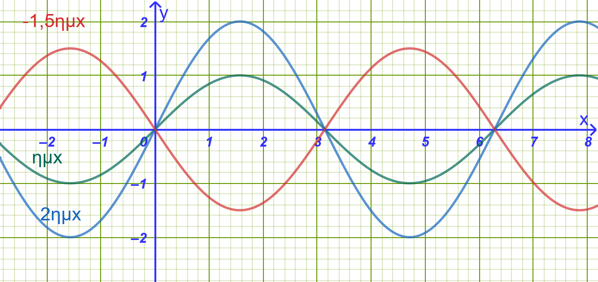{fig-align="center" width="600"}
:::

------------------------------------------------------------------------

### Η Συνάρτηση $f(x) = ρημ(x + \phi)$

#### Μελέτη μέσω του παραδείγματος $f(x) = 3ημ\left(x + \dfrac{\pi}{3}\right)$

::::: {.math-box .corollary-box}
::: {.math-title .corollary-title}
$f(x) = 3ημ\left(x + \dfrac{\pi}{3}\right)$
:::

1.  **Σχέση με τη συνάρτηση** $g(x) = 3ημ x$:

Παρατηρούμε ότι ο τύπος της $f(x)$ προκύπτει από τον τύπο της $g(x) = 3ημ x$, αν αντικαταστήσουμε τη μεταβλητή $x$ με το $x + \dfrac{\pi}{3}$, δηλαδή $f(x) = g\left(x + \dfrac{\pi}{3}\right)$.

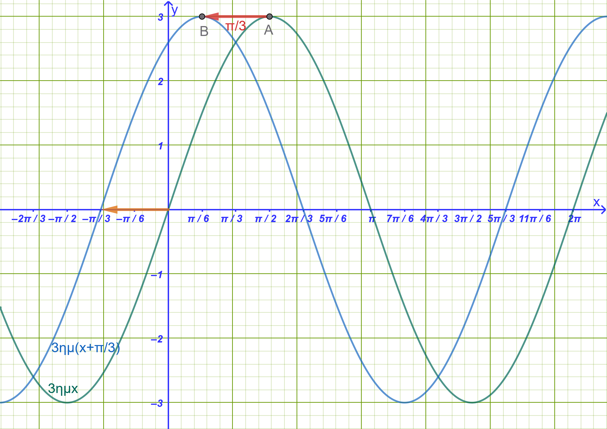{fig-align="center" width="600"}

2.  **Γεωμετρική Ερμηνεία & Διαφορά Φάσεως:**

- Η γραφική παράσταση της $f(x)$ προκύπτει από μια **οριζόντια μετατόπιση** της γραφικής παράστασης της $g(x) = 3ημ x$ κατά $\dfrac{\pi}{3}$ μονάδες προς τα **αριστερά**.

- Ο σταθερός αριθμός $\phi = \dfrac{\pi}{3}$ ονομάζεται **διαφορά φάσεως**.

- Γενικά, για τη συνάρτηση $f(x) = ρημ(x + \phi)$:

  - Αν $\phi > 0$, η καμπύλη $y = ρημ x$ μετατοπίζεται αριστερά κατά $\phi$ μονάδες.

  - Αν $\phi < 0$, μετατοπίζεται δεξιά κατά $|\phi|$ μονάδες.

3.  **Βασικά Χαρακτηριστικά της** $f(x) = 3ημ\left(x + \dfrac{\pi}{3}\right)$:

- **Πεδίο ορισμού:** $A = \mathbb{R}$.

- **Πλάτος & Ακρότατα:** Το πλάτος είναι $ρ = 3$.
  Επειδή $-1 \le ημ\left(x + \dfrac{\pi}{3}\right) \le 1$, το σύνολο τιμών είναι το $[-3, 3]$.

  - **Μέγιστη τιμή:** $M = 3$, για $x + \dfrac{\pi}{3} = 2k\pi + \dfrac{\pi}{2} \iff x = 2k\pi + \dfrac{\pi}{6}, \quad k \in \mathbb{Z}$.

  - **Ελάχιστη τιμή:** $m = -3$, για $x + \dfrac{\pi}{3} = 2k\pi - \dfrac{\pi}{2} \iff x = 2k\pi - \dfrac{5\pi}{6}, \quad k \in \mathbb{Z}$.

- **Περίοδος:** $T = 2\pi$.

4.  **Γενικά για μια συνάρτηση της μορφής** $f(x)=ρημ(x+φ)$

<iframe src="https://www.geogebra.org/calculator/amk8crer?embed" width="730" height="700" allowfullscreen style="border: 1px solid #e4e4e4;border-radius: 4px;" frameborder="0">

</iframe>

::: my-callout-sos
Αλλάξτε τις τιμέ των ρ και φ από τους αντίστοιχους δρομείς.

Διερευνήστε την συνάρτηση για τις διάφοες τιμές των ρ και φ,
:::
:::::

------------------------------------------------------------------------

### Η Συνάρτηση $f(x) = αημ x + βσυν x \quad (α, β \neq 0)$

#### Α. Παράδειγμα: Μελέτη της $f(x) = ημ x + συν x$

:::: {.math-box .corollary-box}
::: {.math-title .corollary-title}
Μελέτη της $f(x) = ημ x + συν x$
:::

Για να μελετήσουμε τη συνάρτηση αυτή, μετασχηματίζουμε το άθροισμα $ημ x + συν x$ σε μία μόνο τριγωνομετρική συνάρτηση της μορφής $ρημ(x + \phi)$:

$$f(x) = ημ x + συν x = \sqrt{2} \cdot \left( \frac{1}{\sqrt{2}}ημ x + \frac{1}{\sqrt{2}}συν x \right) = \sqrt{2} \cdot \left( ημ x \cdot \frac{\sqrt{2}}{2} + συν x \cdot \frac{\sqrt{2}}{2} \right)$$

Επειδή $συν\dfrac{\pi}{4} = \dfrac{\sqrt{2}}{2}$ και $ημ\dfrac{\pi}{4} = \dfrac{\sqrt{2}}{2}$, ο τύπος γράφεται: $$f(x) = \sqrt{2} \cdot \left( ημ x συν\frac{\pi}{4} + συν x ημ\frac{\pi}{4} \right) = \sqrt{2}ημ\left(x + \frac{\pi}{4}\right)$$

**Συμπεράσματα Μελέτης:**

- Η $f(x)$ είναι της μορφής $ρημ(x + \phi)$ με $ρ = \sqrt{2}$ και $\phi = \dfrac{\pi}{4}$.

- **Πεδίο Ορισμού:** $A = \mathbb{R}$.

- **Περίοδος:** $T = 2\pi$.

- **Σύνολο Τιμών:** $[-\sqrt{2}, \sqrt{2}]$.

- **Μέγιστη Τιμή:** $M = \sqrt{2}$, για $x = 2k\pi + \dfrac{\pi}{4}, \quad k \in \mathbb{Z}$.

- **Ελάχιστη Τιμή:** $m = -\sqrt{2}$, για $x = 2k\pi - \dfrac{3\pi}{4}, \quad k \in \mathbb{Z}$.

- **Γραφική Παράσταση:** Προκύπτει από τη γραφική παράσταση της $g(x) = \sqrt{2}ημ x$ με οριζόντια μετατόπιση κατά $\dfrac{\pi}{4}$ μονάδες προς τα αριστερά.

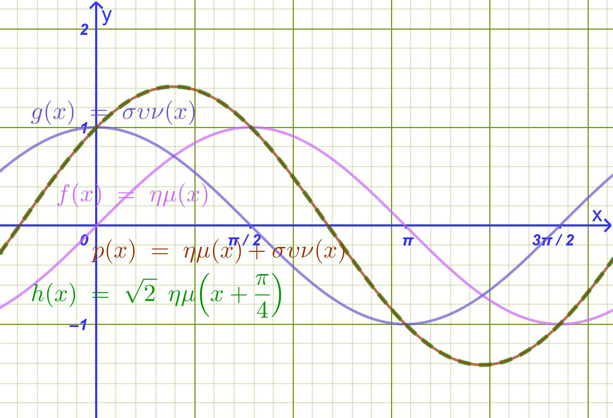{width="600"}

> > Παρατήρηση: Βλέπουμε ότι πράγματι η $ημ x + συν x$ ταυτίζεται με την $\sqrt{2}ημ\left(x + \dfrac{\pi}{4}\right)$
::::

------------------------------------------------------------------------

#### Β. Γενίκευση: Το Θεώρημα Μετασχηματισμού & η Απόδειξή του

:::: {.math-box .theorem-box}
::: {.math-title .theorem-title}
Θεώρημα
:::

Αν $α, β \neq 0$, τότε για κάθε $x \in \mathbb{R}$ ισχύει: $$ αημ x + βσυν x = ρημ(x + \phi) $$ όπου: $$ ρ = \sqrt{α^2 + β^2} $$ και $\phi \in \mathbb{R}$ είναι μια γωνία τέτοια ώστε:

$$ συν\phi = \frac{α}{ρ} = \frac{α}{\sqrt{α^2 + β^2}} \quad \text{και} \quad ημ\phi = \frac{β}{ρ} = \frac{β}{\sqrt{α^2 + β^2}} $$
::::

:::: {.math-box .apodeixi-box}
::: {.math-title .apodeixi-title}
**Απόδειξη**

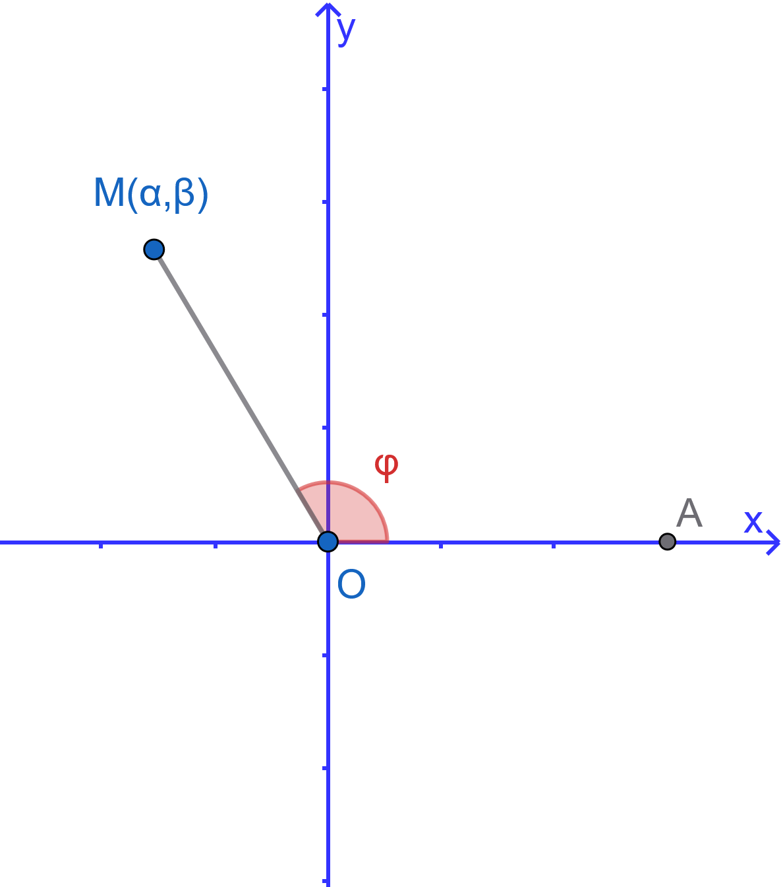{fig-align="center" width="300"}
:::

Θεωρούμε στο καρτεσιανό επίπεδο $xOy$ το σημείο $M(α, β)$.

1.  Η απόσταση του σημείου $M$ από την αρχή των αξόνων $O(0,0)$ είναι: $$ OM = ρ = \sqrt{α^2 + β^2} > 0 $$

2.  Έστω $\phi$ μία γωνία που διαγράφεται από την περιστροφή του θετικού ημιάξονα $Ox$ μέχρι την ημιευθεία $OM$.
    Από τον ορισμό των τριγωνομετρικών αριθμών γωνίας στο επίπεδο, ισχύει: $$ συν\phi = \dfrac{α}{ρ} \implies α = ρσυν\phi $$ $$ ημ\phi = \frac{β}{ρ} \implies β = ρημ\phi $$

3.  Αντικαθιστούμε τις εκφράσεις των $α$ και $β$ στην αρχική παράσταση: $$ αημ x + βσυν x = (ρσυν\phi)ημ x + (ρημ\phi)συν x $$ $$ = ρ \cdot (ημ x συν\phi + συν x ημ\phi) $$

4.  Εφαρμόζοντας τον τύπο του ημιτόνου αθροίσματος γωνιών $ημ(x + \phi) = ημ xσυν\phi + συν xημ\phi$, λαμβάνουμε: $$ αημ x + βσυν x = ρημ(x + \phi) $$

    *Όπερ έδει δείξαι.*
::::

------------------------------------------------------------------------

### Λυμένα Παραδείγματα

:::: {.math-box .example-box}
::: {.math-title .example-title}
Παράδειγμα 1:
:::

Μελέτη της $f(x) = 2ημ\left(3x - \dfrac{\pi}{6}\right)$
::::

:::: {.math-box .examplesolution-box}
::: {.math-title .examplesolution-title}
Λύση
:::

1.  **Αναγωγή στη βασική μορφή:**

    Γράφουμε τον τύπο στη μορφή $f(x) = 2ημ\left[3\left(x - \dfrac{\pi}{18}\right)\right]$.

2.  **Πεδίο Ορισμού:** $A = \mathbb{R}$.

3.  **Πλάτος & Ακρότατα:**

    - Πλάτος: $ρ = 2$.

    - Μέγιστη τιμή: $M = 2$, όταν $ημ\left(3x - \dfrac{\pi}{6}\right) = 1 \iff 3x - \dfrac{\pi}{6} = 2k\pi + \dfrac{\pi}{2} \iff 3x = 2k\pi + \dfrac{2\pi}{3} \iff x = \dfrac{2k\pi}{3} + \dfrac{2\pi}{9}, \quad k \in \mathbb{Z}$.

    - Ελάχιστη τιμή: $m = -2$, όταν $ημ\left(3x - \dfrac{\pi}{6}\right) = -1 \iff 3x - \dfrac{\pi}{6} = 2k\pi - \dfrac{\pi}{2} \iff 3x = 2k\pi - \dfrac{\pi}{3} \iff x = \dfrac{2k\pi}{3} - \dfrac{\pi}{9}, \quad k \in \mathbb{Z}$.

4.  **Περίοδος:** $T = \dfrac{2\pi}{ω} = \dfrac{2\pi}{3}$.

5.  **Γραφική Παράσταση:** Προκύπτει από τη συνάρτηση $g(x) = 2ημ(3x)$ (η οποία έχει περίοδο $\dfrac{2\pi}{3}$ και πλάτος $2$) με οριζόντια μετατόπιση προς τα δεξιά κατά $\dfrac{\pi}{18}$ μονάδες.

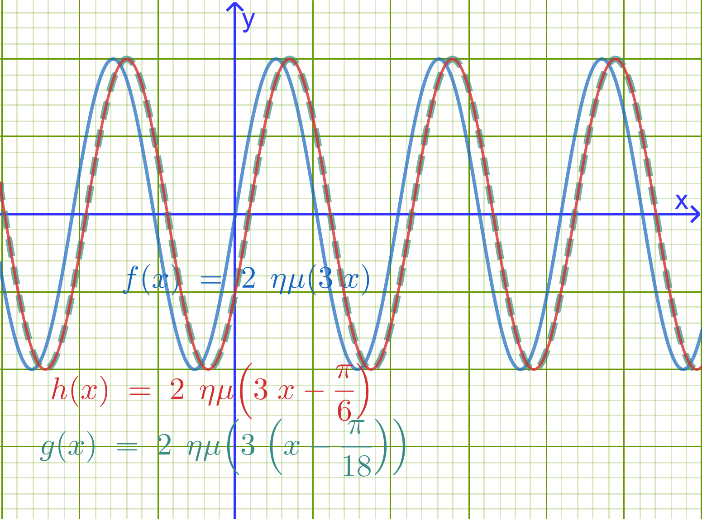{fig-align="center" width="350"}
::::

------------------------------------------------------------------------

:::: {.math-box .example-box}
::: {.math-title .example-title}
Παράδειγμα 2:
:::

Μελέτη της $f(x) = ημ(3x) - \sqrt{3}συν(3x)$
::::

:::: {.math-box .examplesolution-box}
::: {.math-title .examplesolution-title}
Λύση
:::

1.  **Μετασχηματισμός σε** $ρημ(ω x + \phi)$:

    Έχουμε $α = 1$ και $β = -\sqrt{3}$.

- $ρ = \sqrt{1^2 + (-\sqrt{3})^2} = \sqrt{1 + 3} = \sqrt{4} = 2$.

- Αναζητούμε γωνία $\phi$ τέτοια ώστε: $$ συν\phi = \frac{α}{ρ} = \frac{1}{2} \quad \text{και} \quad ημ\phi = \frac{β}{ρ} = -\frac{\sqrt{3}}{2} \implies \phi = -\frac{\pi}{3} $$

Επομένως: $$ f(x) = 2ημ\left(3x - \frac{\pi}{3}\right) = 2ημ\left[3\left(x - \frac{\pi}{9}\right)\right] $$

2.  **Μελέτη Συνάρτησης:**

- **Πεδίο ορισμού:** $A = \mathbb{R}$.

- **Πλάτος:** $ρ = 2 \implies$ Μέγιστη τιμή $M = 2$ και ελάχιστη τιμή $m = -2$.

- **Περίοδος:** $T = \dfrac{2\pi}{3}$.

- **Γραφική παράσταση:** Προκύπτει από τη $g(x) = 2ημ(3x)$ με οριζόντια μετατόπιση κατά $\dfrac{\pi}{9}$ μονάδες προς τα δεξιά.

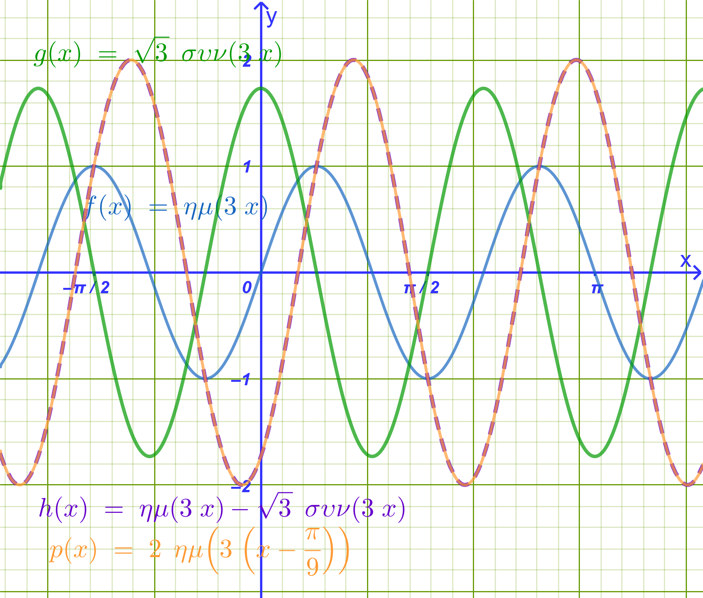{fig-align="center" width="500"}
::::

------------------------------------------------------------------------

:::: {.math-box .example-box}
::: {.math-title .example-title}
Παράδειγμα 3:
:::

Να λυθεί η εξίσωση $\sqrt{2}ημ(3x) + \sqrt{2}συν(3x) = 1$
::::

:::: {.math-box .examplesolution-box}
::: {.math-title .examplesolution-title}
Λύση
:::

1.  **Μετασχηματισμός του αριστερού μέλους:**

    Έχουμε $α = \sqrt{2}$ και $β = \sqrt{2}$.

- $ρ = \sqrt{(\sqrt{2})^2 + (\sqrt{2})^2} = \sqrt{2 + 2} = \sqrt{4} = 2$.

- $συν\phi = \dfrac{\sqrt{2}}{2}$ και $ημ\phi = \dfrac{\sqrt{2}}{2} \implies \phi = \dfrac{\pi}{4}$.

  Άρα το αριστερό μέλος γράφεται: $2ημ\left(3x + \dfrac{\pi}{4}\right)$.

2.  **Επίλυση της Εξίσωσης:** $$ 2ημ\left(3x + \dfrac{\pi}{4}\right) = 1 \iff ημ\left(3x + \frac{\pi}{4}\right) = \frac{1}{2} = ημ\frac{\pi}{6} $$

    Διακρίνουμε δύο περιπτώσεις για $k \in \mathbb{Z}$:

- **1η Περίπτωση:** $$ 3x + \frac{\pi}{4} = 2k\pi + \frac{\pi}{6} \iff 3x = 2k\pi + \frac{\pi}{6} - \frac{\pi}{4} \iff \\ 3x = 2k\pi - \frac{\pi}{12} \iff x = \frac{2k\pi}{3} - \frac{\pi}{36} $$

- **2η Περίπτωση:** $$ 3x + \frac{\pi}{4} = 2k\pi + \pi - \frac{\pi}{6} \iff 3x + \frac{\pi}{4} = 2k\pi + \frac{5\pi}{6} \iff \\ 3x = 2k\pi + \frac{7\pi}{12} \iff x = \frac{2k\pi}{3} + \frac{7\pi}{36} $$
::::

------------------------------------------------------------------------

:::: {.math-box .example-box}
::: {.math-title .example-title}
Παράδειγμα 4:
:::

Δύο εναλλασσόμενα ρεύματα με την ίδια κυκλική συχνότητα $ω$ και εντάσεις: $$I_1 = 4\sin(ω t) \quad \text{και} \quad I_2 = 4\sin\left(ω t + \frac{\pi}{3}\right)$$ διαρρέουν έναν αγωγό.

1.  Να αποδείξετε ότι η συνολική ένταση του ρεύματος $I = I_1 + I_2$ έχει την ίδια κυκλική συχνότητα $ω$.

2.  Να προσδιορίσετε το πλάτος $I_0$ και την αρχική φάση $\phi$ του συνολικού ρεύματος, γράφοντάς το στη μορφή: $$I = I_0 \sin(ω t + \phi)$$
::::

:::: {.math-box .examplesolution-box}
::: {.math-title .examplesolution-title}
**Σύντομη υπόδειξη επίλυσης:**
:::

Εφαρμόζουμε τον τύπο μετατροπής αθροίσματος ημιτόνων σε γινόμενο:

$\sin A + \sin B = 2\sin\left(\dfrac{A+B}{2}\right)\cos\left(\dfrac{A-B}{2}\right)$, από όπου προκύπτει $I = 4\sqrt{3}\sin\left(ω t + \dfrac{\pi}{6}\right)$, που έχει την ίδια κυκλική συχνότητα $ω$.
::::

------------------------------------------------------------------------

### Ασκήσεις και Προβλήματα

#### **Κατηγορία Α: Μετασχηματισμός Παραστάσεων (1–5)**

1.  Να γράψετε στη μορφή $f(x) = ρημ(x + \phi)$ τις παρακάτω συναρτήσεις:

- α) $f(x) = \sqrt{3}ημ x - συν x$

- β) $f(x) = -ημ x + συν x$

2.  Να μετατραπεί η παράσταση $A = 3ημ(2x) + 3\sqrt{3}συν(2x)$ στη μορφή $ρημ(2x + \phi)$.

3.  Να αποδείξετε ότι η παράσταση $f(x) = 5ημ x + 12συν x$ παίρνει τη μορφή $13ημ(x + \phi)$ και να υπολογίσετε τους τριγωνομετρικούς αριθμούς $συν\phi$ και $ημ\phi$.

4.  Να μετατραπεί σε μορφή ημιτόνου η παράσταση $g(x) = ημ(\pi x) + συν(\pi x)$.

5.  Να αποδειχθεί ότι για κάθε $x \in \mathbb{R}$ ισχύει $-\sqrt{5} \le 2ημ x - συν x \le \sqrt{5}$.

> > > Διότι $ρ=\sqrt{2^2+(-1)^2}=\sqrt{5}$

#### **Κατηγορία Β: Μελέτη & Γραφική Παράσταση Συναρτήσεων (6–10)**

6.  Να βρείτε την περίοδο, τη μέγιστη και την ελάχιστη τιμή της συνάρτησης $f(x) = 4ημ\left(2x + \dfrac{\pi}{4}\right)$.

7.  Να μελετήσετε και να παραστήσετε γραφικά τη συνάρτηση $f(x) = \sqrt{3}ημ x + συν x$ στο διάστημα $[0, 2\pi]$.

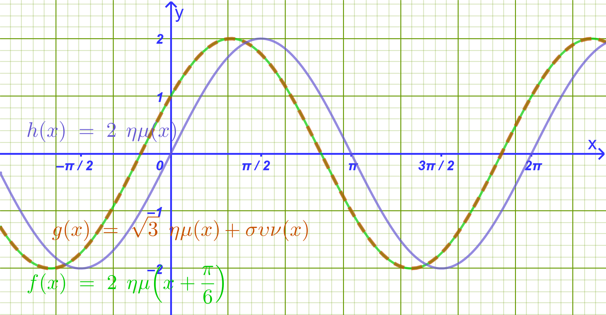{fig-align="center" width="500"}

8.  Δίνεται η συνάρτηση $f(x) = ημ(2x) - συν(2x)$.

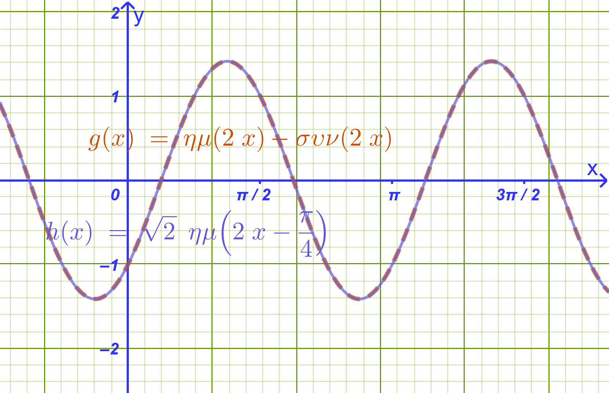{fig-align="center" width="500"}

- α) Να φέρετε τον τύπο της στη μορφή $ρημ(ω x + \phi)$.

- β) Να βρείτε τα σημεία τομής της γραφικής παράστασης της $f$ με τον άξονα $x'x$ στο διάστημα $[0, \pi]$.

9.  Να βρείτε τη διαφορά φάσεως και τη σχετική μετατόπιση μεταξύ των καμπυλών $y = 2ημ x$ και $y = 2ημ\left(x - \dfrac{\pi}{6}\right)$.

:::: {.math-box .exercise-box}
::: {.math-title .exercise-title}
10. Εκφώνηση
:::

Να μελετήσετε ως προς τα ακρότατα και την περιοδικότητα τη συνάρτηση $g(x) = 3ημ(4x) - 4συν(4x) + 2$.
::::

:::: {.math-box .solution-box}
::: {.math-title .solution-title}
Λύση
:::

**1. Περιοδικότητα**

Η συνάρτηση αποτελείται από τους όρους $\sin(4x)$ και $\cos(4x)$, οι οποίοι έχουν την ίδια βασική περίοδο.

Για συναρτήσεις της μορφής $\sin(ω x)$ και $\cos(ω x)$ με $ω = 4 > 0$, η βασική περίοδος $T$ δίνεται από τον τύπο: $$T = \frac{2\pi}{ω} = \frac{2\pi}{4} = \frac{\pi}{2}$$

Επομένως, η συνάρτηση $g$ είναι περιοδική με βασική περίοδο: $$T = \frac{\pi}{2}$$

------------------------------------------------------------------------

**2. Μετατροπή στη μορφή** $\rho\sin(4x + \phi)$

Για να προσδιορίσουμε τα ακρότατα, μετατρέπουμε την παράσταση $3\sin(4x) - 4\cos(4x)$ στη μορφή $\rho\sin(4x + \phi)$:

1.  **Υπολογισμός του** $\rho$: $$\rho = \sqrt{a^2 + b^2} = \sqrt{3^2 + (-4)^2} = \sqrt{9 + 16} = \sqrt{25} = 5$$

2.  **Υπολογισμός της γωνίας** $\phi$: $$\cos\phi = \frac{a}{\rho} = \frac{3}{5} \quad \text{και} \quad \sin\phi = \frac{b}{\rho} = -\frac{4}{5}$$

    *(Υπάρχει μοναδική γωνία* $\phi ≈ -53,13^o \in (-\pi, \pi]$ στο $4^\circ$ τεταρτημόριο που ικανοποιεί αυτές τις σχέσεις).

Συνεπώς, η παράσταση γράφεται: $$3\sin(4x) - 4\cos(4x) = 5\sin(4x + \phi)$$

και η συνάρτηση παίρνει τη μορφή: $$g(x) = 5\sin(4x + \phi) + 2$$

------------------------------------------------------------------------

**3. Ακρότατα**

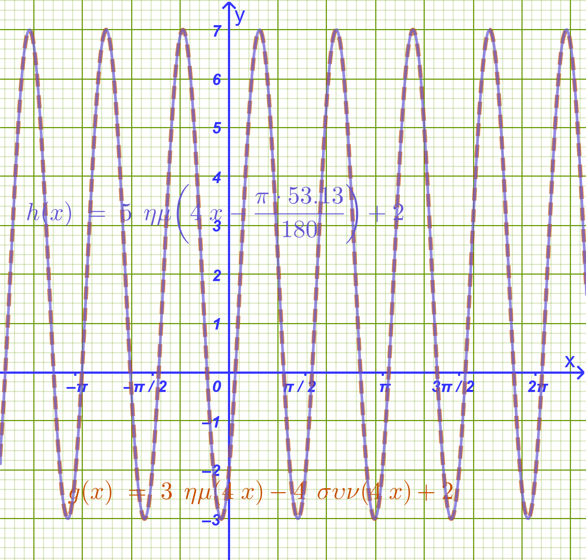{fig-align="center" width="500"}

Για κάθε $x \in \mathbb{R}$, η τιμή του ημιτόνου κυμαίνεται μεταξύ $-1$ και $1$: $$-1 \le \sin(4x + \phi) \le 1$$

Πολλαπλασιάζουμε όλα τα μέλη με το $5$ ($5 > 0$): $$-5 \le 5\sin(4x + \phi) \le 5$$

Προσθέτουμε το $2$ σε όλα τα μέλη: $$-5 + 2 \le 5\sin(4x + \phi) + 2 \le 5 + 2$$ $$-3 \le g(x) \le 7$$

- **Μέγιστη τιμή:** $$g_{\max} = 7$$ (λαμβάνεται όταν $\sin(4x + \phi) = 1$)

- **Ελάχιστη τιμή:** $$g_{\min} = -3$$ (λαμβάνεται όταν $\sin(4x + \phi) = -1$)

------------------------------------------------------------------------

**Σύνοψη**

- **Περίοδος:** $T = \dfrac{\pi}{2}$

- **Μέγιστη τιμή:** $7$

- **Ελάχιστη τιμή:** $-3$
::::

#### **Κατηγορία Γ: Τριγωνομετρικές Εξισώσεις & Ανισώσεις (11–15)**

11. Να λυθεί στο $\mathbb{R}$ η εξίσωση: $ημ x + συν x = \sqrt{2}$.

12. Να λυθεί στο $\mathbb{R}$ η εξίσωση: $\sqrt{3}ημ(2x) - συν(2x) = 1$.

13. Να λυθεί στο διάστημα $[0, 2\pi]$ η εξίσωση: $ημ x - \sqrt{3}συν x = -\sqrt{3}$.

:::: {.math-box .exercise-box}
::: {.math-title .exercise-title}
14. Εκφώνηση
:::

Να λυθεί η εξίσωση: $ημ(3x) + συν(3x) = \sqrt{2}ημ x$.
::::

:::: {.math-box .solution-box}
::: {.math-title .solution-title}
Λύση
:::

**1: Μετατροπή του αριστερού μέλους στη μορφή** $\rho\sin(3x + \phi)$

Για την παράσταση $\sin(3x) + \cos(3x)$:

- $\rho = \sqrt{1^2 + 1^2} = \sqrt{2}$

Διαιρούμε και πολλαπλασιάζουμε με το $\sqrt{2}$: $$\sin(3x) + \cos(3x) = \sqrt{2}\left(\frac{1}{\sqrt{2}}\sin(3x) + \frac{1}{\sqrt{2}}\cos(3x)\right)$$

Επειδή $\cos\left(\dfrac{\pi}{4}\right) = \sin\left(\dfrac{\pi}{4}\right) = \dfrac{\sqrt{2}}{2} = \dfrac{1}{\sqrt{2}}$, έχουμε: $$\sin(3x) + \cos(3x) = \sqrt{2}\left(\sin(3x)\cos\left(\frac{\pi}{4}\right) + \cos(3x)\sin\left(\frac{\pi}{4}\right)\right) = \sqrt{2}\sin\left(3x + \frac{\pi}{4}\right)$$

------------------------------------------------------------------------

**2: Απλοποίηση της εξίσωσης**

Αντικαθιστούμε στην αρχική εξίσωση: $$\sqrt{2}\sin\left(3x + \frac{\pi}{4}\right) = \sqrt{2}\sin x$$

Διαιρούμε και τα δύο μέλη με το $\sqrt{2}$: $$\sin\left(3x + \frac{\pi}{4}\right) = \sin x$$

------------------------------------------------------------------------

**3: Επίλυση της βασικής τριγωνομετρικής εξίσωσης**

Η εξίσωση $\sin A = \sin B$ έχει τις λύσεις: $$A = 2k\pi + B \quad \text{ή} \quad A = 2k\pi + \pi - B, \quad k \in \mathbb{Z}$$

Διακρίνουμε δύο περιπτώσεις:

- **1η Περίπτωση:**

$$3x + \frac{\pi}{4} = 2k\pi + x$$ $$3x - x = 2k\pi - \frac{\pi}{4}$$ $$2x = 2k\pi - \frac{\pi}{4}$$ $$x = k\pi - \frac{\pi}{8}, \quad k \in \mathbb{Z}$$

- **2η Περίπτωση:**

$$3x + \frac{\pi}{4} = 2k\pi + \pi - x$$ $$3x + x = 2k\pi + \pi - \frac{\pi}{4}$$ $$4x = 2k\pi + \frac{3\pi}{4}$$ $$x = \frac{k\pi}{2} + \frac{3\pi}{16}, \quad k \in \mathbb{Z}$$

------------------------------------------------------------------------

**Τελικές Λύσεις**

Οι λύσεις της εξίσωσης στο $\mathbb{R}$ είναι: $$x = k\pi - \frac{\pi}{8} \quad \text{ή} \quad x = \frac{k\pi}{2} + \frac{3\pi}{16}, \quad k \in \mathbb{Z}$$
::::

:::: {.math-box .exercise-box}
::: {.math-title .exercise-title}
15. Εκφώνηση
:::

Να λυθεί στο $\mathbb{R}$ η ανίσωση: $ημ x + συν x > 1$.
::::

:::: {.math-box .solution-box}
::: {.math-title .solution-title}
Λύση
:::

**1: Μετατροπή σε ενιαία τριγωνομετρική συνάρτηση**

Διαιρούμε και πολλαπλασιάζουμε το αριστερό μέλος με το $\sqrt{1^2 + 1^2} = \sqrt{2}$: $$\sin x + \cos x = \sqrt{2}\left(\frac{1}{\sqrt{2}}\sin x + \frac{1}{\sqrt{2}}\cos x\right)$$

Επειδή $\cos\left(\dfrac{\pi}{4}\right) = \sin\left(\dfrac{\pi}{4}\right) = \dfrac{\sqrt{2}}{2} = \dfrac{1}{\sqrt{2}}$, έχουμε: $$\sqrt{2}\left(\sin x \cos\frac{\pi}{4} + \cos x \sin\frac{\pi}{4}\right) = \sqrt{2}\sin\left(x + \frac{\pi}{4}\right)$$

Επομένως, η ανίσωση γίνεται: $$\sqrt{2}\sin\left(x + \frac{\pi}{4}\right) > 1 \iff \sin\left(x + \frac{\pi}{4}\right) > \frac{1}{\sqrt{2}} = \frac{\sqrt{2}}{2}$$

------------------------------------------------------------------------

**2: Επίλυση στο βασικό διάστημα** $[0, 2\pi)$

Θέτουμε $u = x + \dfrac{\pi}{4}$.
Η ανίσωση γίνεται: $$\sin u > \frac{\sqrt{2}}{2}$$

Στον τριγωνομετρικό κύκλο, η εξίσωση $\sin u = \dfrac{\sqrt{2}}{2}$ έχει λύσεις στο $[0, 2\pi)$ τις: $$u = \frac{\pi}{4} \quad \text{και} \quad u = \pi - \frac{\pi}{4} = \frac{3\pi}{4}$$

Η συνάρτηση του ημιτόνου είναι μεγαλύτερη από $\dfrac{\sqrt{2}}{2}$ για: $$\frac{\pi}{4} < u < \frac{3\pi}{4}$$

------------------------------------------------------------------------

**3: Εύρεση του** $x$ στο βασικό διάστημα

Επαναφέρουμε το $u = x + \dfrac{\pi}{4}$: $$\frac{\pi}{4} < x + \frac{\pi}{4} < \frac{3\pi}{4}$$

Αφαιρούμε το $\dfrac{\pi}{4}$ από όλα τα μέλη: $$\frac{\pi}{4} - \frac{\pi}{4} < x < \frac{3\pi}{4} - \frac{\pi}{4}$$ $$0 < x < \frac{\pi}{2}$$

------------------------------------------------------------------------

**4: Γενικές λύσεις στο** $\mathbb{R}$

Λόγω της περιοδικότητας της συνάρτησης του ημιτόνου με περίοδο $T = 2\pi$, προσθέτουμε το $2k\pi$ ($k \in \mathbb{Z}$): $$2k\pi < x < 2k\pi + \frac{\pi}{2}, \quad k \in \mathbb{Z}$$

ή σε μορφή διαστημάτων: $$x \in \bigcup_{k \in \mathbb{Z}} \left(2k\pi, \, 2k\pi + \frac{\pi}{2}\right)$$
::::

#### **Κατηγορία Δ: Ακρότατα & Σύνθετα Θέματα (16–18)**

16. Να βρεθεί η μέγιστη και η ελάχιστη τιμή της συνάρτησης $f(x) = \dfrac{1}{ημ x + συν x + 2}$.

:::: {.math-box .exercise-box}
::: {.math-title .exercise-title}
17. Εκφώνηση
:::

Δίνεται η συνάρτηση $f(x) = αημ x + βσυν x$.
Αν η μέγιστη τιμή της είναι $M = 5$ και $f\left(\dfrac{\pi}{6}\right) =\dfrac{5\sqrt{3}}{2}$, να προσδιοριστούν οι σταθερές $α$ και $β$.
::::

:::: {.math-box .solution-box}
::: {.math-title .solution-title}
Λύση
:::

**1: Αξιοποίηση της μέγιστης τιμής**

Γνωρίζουμε ότι για συνάρτηση της μορφής $f(x) = \alpha\sin x + \beta\cos x$, η μέγιστη τιμή της είναι: $$M = \sqrt{\alpha^2 + \beta^2}$$

Επειδή δίνεται ότι $M = 5$, έχουμε: $$\sqrt{\alpha^2 + \beta^2} = 5 \iff \alpha^2 + \beta^2 = 25 \quad \text{(Σχέση 1)}$$

------------------------------------------------------------------------

**2: Αξιοποίηση της τιμής** $f\left(\dfrac{\pi}{6}\right)$

Γνωρίζουμε ότι:

$$\sin\left(\frac{\pi}{6}\right) = \frac{1}{2} \quad \text{και} \quad \cos\left(\frac{\pi}{6}\right) = \frac{\sqrt{3}}{2}$$

Υπολογίζουμε την τιμή $f\left(\dfrac{\pi}{6}\right)$: $$f\left(\frac{\pi}{6}\right) = \alpha \cdot \frac{1}{2} + \beta \cdot \frac{\sqrt{3}}{2} = \frac{\alpha + \beta\sqrt{3}}{2}$$

Από την υπόθεση ισχύει $f\left(\dfrac{\pi}{6}\right) = \dfrac{5\sqrt{3}}{2}$, επομένως:

$$\frac{\alpha + \beta\sqrt{3}}{2} = \frac{5\sqrt{3}}{2} \iff \alpha + \beta\sqrt{3} = 5\sqrt{3} \iff \alpha = 5\sqrt{3} - \beta\sqrt{3} = \sqrt{3}(5 - \beta) \quad \text{(Σχέση 2)}$$

------------------------------------------------------------------------

**3: Επίλυση του συστήματος**

Αντικαθιστούμε την έκφραση του $\alpha$ από τη (Σχέση 2) στη (Σχέση 1):

$$[\sqrt{3}(5 - \beta)]^2 + \beta^2 = 25$$ $$3(5 - \beta)^2 + \beta^2 = 25$$ $$3(25 - 10\beta + \beta^2) + \beta^2 = 25$$ $$75 - 30\beta + 3\beta^2 + \beta^2 = 25$$ $$4\beta^2 - 30\beta + 50 = 0$$

Διαιρούμε όλους τους όρους με το $2$: $$2\beta^2 - 15\beta + 25 = 0$$

Λύνουμε το τριώνυμο ως προς $\beta$:

- $\Delta = (-15)^2 - 4 \cdot 2 \cdot 25 = 225 - 200 = 25$ $$\beta = \frac{15 \pm \sqrt{25}}{2 \cdot 2} = \frac{15 \pm 5}{4}$$

Άρα:

$$\beta_1 = \frac{15 + 5}{4} = \frac{20}{4} = 5$$ $$\beta_2 = \frac{15 - 5}{4} = \frac{10}{4} = \frac{5}{2}$$

------------------------------------------------------------------------

**4: Προσδιορισμός του** $\alpha$ για κάθε περίπτωση

Χρησιμοποιούμε τη σχέση $\alpha = \sqrt{3}(5 - \beta)$:

1.  **Αν** $\beta = 5$: $$\alpha = \sqrt{3}(5 - 5) = 0$$

2.  **Αν** $\beta = \frac{5}{2}$: $$\alpha = \sqrt{3}\left(5 - \frac{5}{2}\right) = \sqrt{3} \cdot \frac{5}{2} = \frac{5\sqrt{3}}{2}$$

------------------------------------------------------------------------

**Τελικό Αποτέλεσμα**

Τα ζεύγη τιμών $(\alpha, \beta)$ είναι:

$$(\alpha, \beta) = (0, \, 5) \quad \text{ή} \quad (\alpha, \beta) = \left(\frac{5\sqrt{3}}{2}, \, \frac{5}{2}\right)$$
::::

18. Να βρεθεί το σύνολο τιμών της συνάρτησης $f(x) = ημ^2 x + 2ημ xσυν x - 3συν^2 x$

::: my-callout-sos
(**Υπόδειξη:** χρησιμοποιήστε τους τύπους διπλάσιας γωνίας).

Θα καταλήξουμε στο $f(x)=2ημ2x-4συν2x-2$

η $2ημ2x-4συν2x$ έχει $ρ=2\sqrt{5}$.
Αρα $-2-2\sqrt{5} \le f*x) \le -2+2\sqrt{5}$
:::

#### **Κατηγορία Ε: Πρακτικές Εφαρμογές & Φυσική (19–20)**

19. **(Σύνθεση Ταλαντώσεων):** Ένα σώμα εκτελεί ταυτόχρονα δύο απλές αρμονικές ταλαντώσεις ίδιας συχνότητας στην ίδια διεύθυνση, με απομακρύνσεις $x_1(t) = 3ημ(ω t)$ και $x_2(t) = 4συν(ω t)$ (σε μέτρα).

- α) Να γράψετε τη συνολική απομάκρυνση $x(t) = x_1(t) + x_2(t)$ στη μορφή $x(t) = Aημ(ω t + \phi)$.

- β) Να υπολογίσετε το πλάτος $A$ της συνισταμένης ταλάντωσης.

::: my-callout-sos
**Υπόδειξη:**

$x(t) = x_1(t) + x_2(t)=3ημ(ω t)+4συν(ωt)=5ημ(ωt+53,13^o)$, Επειδή $A=\sqrt{3^2+4^2}=5$ και $συνφ=\dfrac{3}{5}, \ \ \ ημφ=\dfrac{4}{5} \implies φ=ημ^{-1}\dfrac{4}{5} \approx 53,13^o$
:::

20. **(Εναλλασσόμενο Ρεύμα):** Η ένταση ενός εναλλασσόμενου ρεύματος δίνεται από τον τύπο $I(t) = 5ημ(100\pi t) + 5\sqrt{3}συν(100\pi t)$ (σε Ampere).

- α) Να υπολογίσετε το μέγιστο πλάτος της έντασης του ρεύματος.

- β) Να βρείτε την πρώτη θετική χρονική στιγμή $t > 0$ κατά την οποία η ένταση γίνεται μέγιστη.

::: my-callout-sos
**Υπόδειξη:**

$I(t) = 5ημ(100\pi t) + 5\sqrt{3}συν(100\pi t)=10ημ(100πt+\dfrac{π}{3})$, Επειδή $ρ=\sqrt{5^2+5^23}=10$ και $συνφ=\dfrac{5}{10}=\dfrac{1}{2}=συν\dfrac{π}{3}=ημφ=\dfrac{5\sqrt{3}}{10}=\dfrac{\sqrt{3}}{2}=ημ\dfrac{π}{3}$

Πρέπει $10ημ(100πt+\dfrac{π}{3})=10 \implies ημ(100πt+\dfrac{π}{3})=1=ημ\dfrac{π}{2}$

Λύνοντας βρίσκουμε $t=\dfrac{1}{600}$
:::

------------------------------------------------------------------------

### ...... Ασκήσεων συνέχεια

1.  Να βρείτε την περίοδο, τη μέγιστη τιμή και την ελάχιστη τιμή των παρακάτω συναρτήσεων και στη συνέχεια να τις παραστήσετε γραφικά:

    ::: panel-tabset
    ## α $f(x) = 3ημ\left(x - \dfrac{\pi}{4}\right)$

    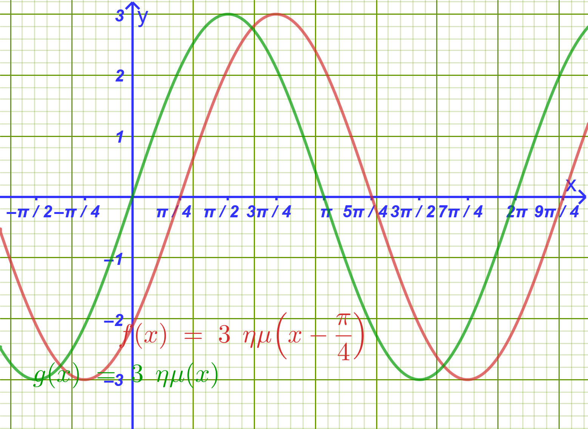{fig-align="center" width="400"}

    ## β $f(x) = ημ\left(x + \dfrac{\pi}{3}\right)$

    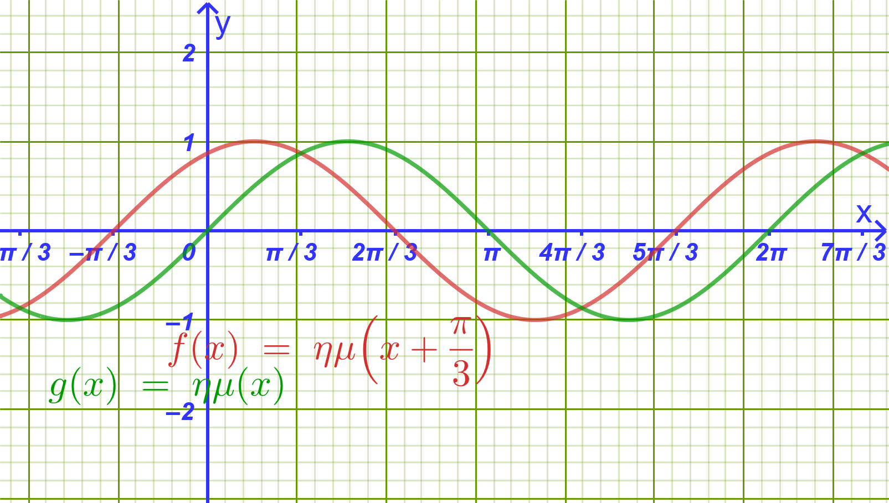{fig-align="center" width="400"}
    :::

------------------------------------------------------------------------

2.  Να γράψετε στη μορφή $f(x) = ρημ(x + \phi)$ τις συναρτήσεις:

    a.  $f(x) = ημ x + \sqrt{3}συν x$

    b.  $f(x) = -\sqrt{3}ημ x + συν x$

    c.  $f(x) = -ημ x - συν x$

    d.  $f(x) = \sqrt{3}ημ x - συν x$

------------------------------------------------------------------------

3.  Να μελετήσετε (πεδίο ορισμού, σύνολο τιμών, περίοδο, μονοτονία και ακρότατα σε διάστημα μιας περιόδου) και να παραστήσετε γραφικά τις συναρτήσεις της προηγούμενης άσκησης.

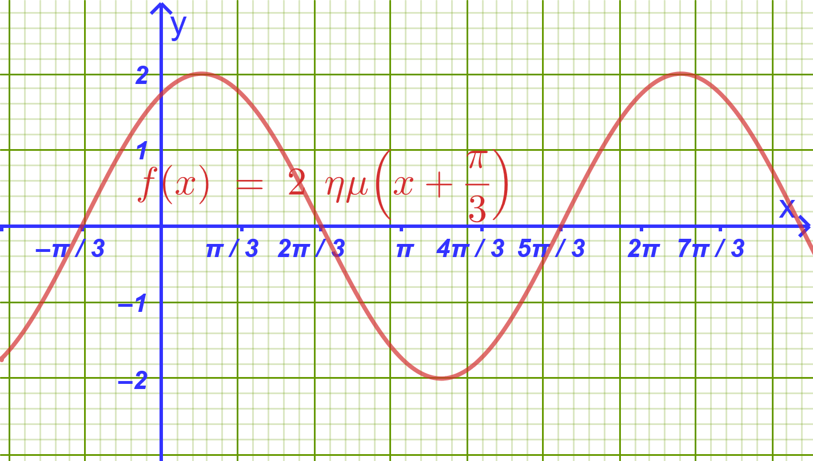{fig-align="center" width="400"}

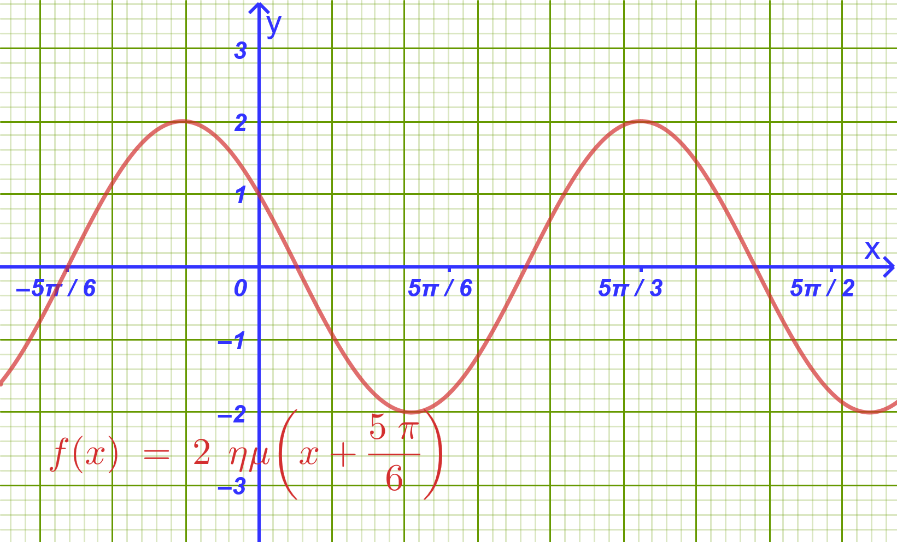{fig-align="center" width="400"}

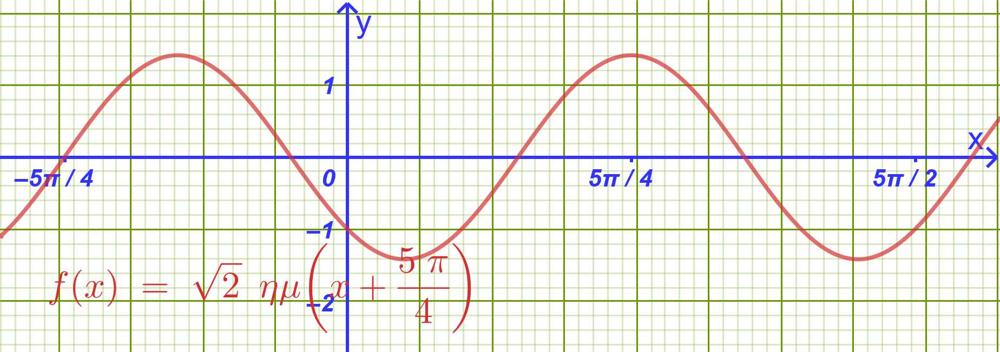{fig-align="center" width="500"}

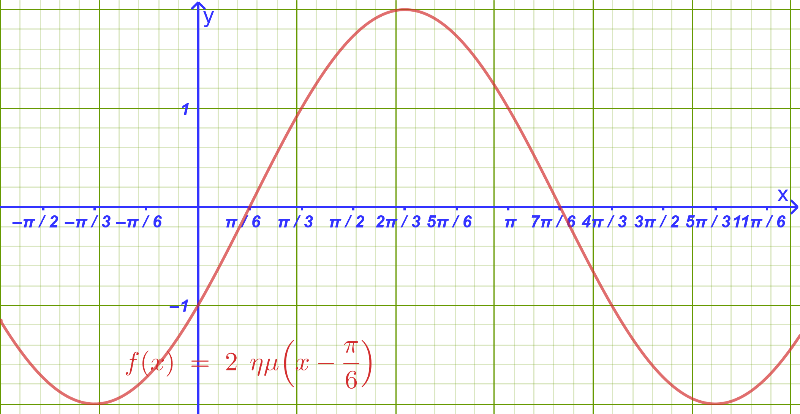{fig-align="center" width="500"}

------------------------------------------------------------------------

4.  Να λύσετε στο $\mathbb{R}$ τις εξισώσεις:

:::::: panel-tabset
## α. $ημ x + \sqrt{3}συν x = \sqrt{2}$

::: my-callout-sos
**Υπόδειξη:**

$ημ x + \sqrt{3}συν x = \sqrt{2} \implies 2ημ\left(x+\dfrac{π}{3}\right)=\sqrt{2} \implies .........$
:::

## β. $συν x - \sqrt{3}ημ x = 1$

::: my-callout-sos
**Υπόδειξη:**

$συν x - \sqrt{3}ημ x = 1 \implies - \sqrt{3}ημ x+συν x  = 1 \implies 2ημ\left(x+\dfrac{5π}{6}\right)=1 \implies ..................$
:::

## γ. $\sqrt{3}ημ x + 3συν x + \sqrt{6} = 0$

::: my-callout-sos
**Υπόδειξη:**

$\sqrt{3}ημ x + 3συν x + \sqrt{6} = 0 \implies  2\sqrt{3} ημ \left( x+ \dfrac{π}{3} \right)=-\sqrt{6} \implies 2ημ\left( x+\dfrac{π}{3}\right)= -\sqrt{2} \implies ..............$
:::
::::::

------------------------------------------------------------------------

5.  Σε ημικύκλιο διαμέτρου $AB = 6$, θεωρούμε σημείο $M$ του ημικυκλίου. Συμβολίζουμε με $ω = \widehat{MAB}$ τη γωνία που σχηματίζει η χορδή $AM$ με τη διάμετρο ($0 < ω < \dfrac{\pi}{2}$). Να υπολογίσετε τη γωνία $ω$, έτσι ώστε να ισχύει:

$$(MA) + (MB) = 6\sqrt{2}$$

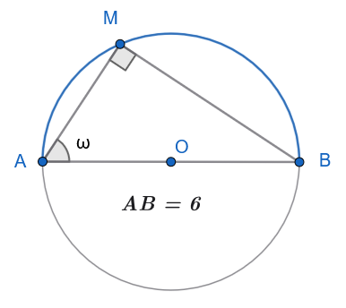{width="300"}

::: my-callout-sos
**Υπόδειξη:**

$MA=6συνω$ και $ΜΒ=6ημω$ , άρα $ΜΑ+ΜΒ=6\sqrt{2} \implies 6ημω+6συνω=6\sqrt{2} \implies ..........$
:::

------------------------------------------------------------------------

6.  Μία δοκός $AB$ μήκους $4\text{ m}$ τοποθετείται οριζόντια μεταξύ δύο κάθετων τοίχων που τέμνονται σε ορθή γωνία $O$.

    a.  Να εκφράσετε το άθροισμα των αποστάσεων $(OA) + (OB)$ ως συνάρτηση της οξείας γωνίας $\theta = \widehat{OAB}$.

    b.  Να βρείτε την τιμή της γωνίας $\theta$ για την οποία το $(OA) + (OB)$ γίνεται μέγιστο, καθώς και την τιμή του μεγίστου αυτού.

> > > Παρόμοια με την 5.

7.  Να βρείτε τη μέγιστη και την ελάχιστη τιμή των συναρτήσεων:

::::: panel-tabset
## α. $f(x) = 3ημ x + 4συν x - 2$

::: my-callout-sos
**Υπόδειξη:**

$-5 \le f(x) \le 5 \implies -7 \le f(x)-2 \le 3$ 
:::

## β. $f(x) = 6συν x(ημ x - συν x)$

::: my-callout-sos
**Υπόδειξη:**

$f(x) = 6συν x(ημ x - συν x) = 6ημxσυνx-6συν^2x=3ημ2x - 3(1+συν2x) = ...............$ 
:::
:::::

------------------------------------------------------------------------

8.  Να λύσετε στο $\mathbb{R}$ την εξίσωση: $$2ημ x(συν x - \sqrt{3}ημ x) = 1 - \sqrt{3}$$

::: my-callout-sos
**Υπόδειξη:**

$2ημ x(συν x - \sqrt{3}ημ x) = 1 - \sqrt{3} \implies 2ημxσυνx -\sqrt{3} \cdot 2ημ\^2x = 1-\sqrt{3} \implies \\ ....... ημ2x+\sqrt{3} συν2x = 1 ...................$
:::

------------------------------------------------------------------------

9.  Με σύρμα μήκους $60\text{ m}$ περιφράζουμε οικόπεδο σχήματος ορθογωνίου τριγώνου.
    Αν η υποτείνουσα έχει μήκος $h\text{ m}$ και η μία οξεία γωνία είναι $\theta\text{ rad}$:

    a.  Να αποδείξετε ότι: $$h = \frac{60}{ημ\theta + συν\theta + 1}$$

    b.  Για ποια τιμή του $\theta$ η υποτείνουσα $h$ παίρνει την ελάχιστη (μικρότερη) δυνατή τιμή και ποια είναι αυτή;

::: panel-tabset
## α. Υπόδειξη
$h+h ημθ +h συνθ=60$

## β. Υπόδειξη
Όταν το $1+ ημθ + συνθ$ γίνεται μέγιστο.

:::


------------------------------------------------------------------------

## ΔΙΑΓΩΝΙΣΜΑ ΑΞΙΟΛΟΓΗΣΗΣ

**Μάθημα:** Άλγεβρα Β' Γενικού Λυκείου

**Ενότητα:** Η Συνάρτηση $f(x) = α ημ x + β συν x$

**Διάρκεια:** 60 λεπτά

------------------------------------------------------------------------

### **ΘΕΜΑ Α (Θεωρία & Ερωτήσεις Κατανόησης - 25 Μονάδες)**

**Α1.** (10 Μονάδες)

Να διατυπώσετε και να αποδείξετε το θεώρημα μετασχηματισμού της παράστασης $f(x) = α ημ x + β συν x$ ($α, β \neq 0$) στη μορφή $f(x) = ρ ημ(x + \phi)$.

**Α2.** (5 Μονάδες)

Δίνεται η συνάρτηση $f(x) = ρ ημ(ω x + \phi)$ με $ρ > 0$ και $ω > 0$.

1.  Τι ονομάζεται **πλάτος** και τι **αρχική φάση** της συνάρτησης;

2.  Ποια είναι η βασική περίοδος $T$, η μέγιστη τιμή $M$ και η ελάχιστη τιμή $m$ της συνάρτησης;

**Α3.** (10 Μονάδες)

Να χαρακτηρίσετε τις παρακάτω προτάσεις ως **Σωστό (Σ)** ή **Λάθος (Λ)**:

1.  Η μέγιστη τιμή της συνάρτησης $f(x) = 3 ημ x + 4 συν x$ είναι $M = 7$.

2.  Η γραφική παράσταση της συνάρτησης $f(x) = 2 ημ\left(x + \dfrac{\pi}{3}\right)$ προκύπτει από τη $g(x) = 2 ημ x$ με οριζόντια μετατόπιση κατά $\dfrac{\pi}{3}$ μονάδες προς τα αριστερά.

3.  Η βασική περίοδος της συνάρτησης $f(x) = \sqrt{3} ημ(2x) - συν(2x)$ είναι $T = \pi$.

4.  Για κάθε $x \in \mathbb{R}$ ισχύει $-\sqrt{α^2 + β^2} \le α ημ x + β συν x \le \sqrt{α^2 + β^2}$.

5.  Η συνάρτηση $f(x) = ημ x + συν x$ είναι περιττή συνάρτηση.

------------------------------------------------------------------------

### **ΘΕΜΑ Β (Μετασχηματισμός & Μελέτη Συνάρτησης - 25 Μονάδες)**

Δίνεται η συνάρτηση $f(x) = ημ x - \sqrt{3}συν x$.

**Β1.** Να μετατρέψετε τον τύπο της $f(x)$ στη μορφή $f(x) = ρ ημ(x + \phi)$.
**(8 μονάδες)**

**Β2.** Να βρείτε το πλάτος $ρ$, τη βασική περίοδο $T$, τη μέγιστη τιμή $M$ και την ελάχιστη τιμή $m$ της $f(x)$.
**(8 μονάδες)**\
**Β3.** Να υπολογίσετε τα σημεία τομής της γραφικής παράστασης $C_f$ με τον άξονα $x'x$ στο διάστημα $[0, 2\pi]$.
**(9 μονάδες)**

------------------------------------------------------------------------

### **ΘΕΜΑ Γ (Τριγωνομετρικές Εξισώσεις - 25 Μονάδες)**

**Γ1.** Να λύσετε στο $\mathbb{R}$ την εξίσωση: $$ημ x + συν x = \sqrt{2}$$ **(12 μονάδες)**

**Γ2.** Να λύσετε στο $\mathbb{R}$ την εξίσωση: $$\sqrt{3}ημ(2x) - συν(2x) = 1$$ **(13 μονάδες)**

------------------------------------------------------------------------

### **ΘΕΜΑ Δ (Ακρότατα & Πρακτική Εφαρμογή - 25 Μονάδες)**

**Δ1.** Να βρεθεί η μέγιστη και η ελάχιστη τιμή της συνάρτησης: $$g(x) = \frac{6}{3ημ x + 4συν x + 10}$$ **(12 μονάδες)**

**Δ2.** Η απομάκρυνση ενός σώματος που εκτελεί σύνθετη αρμονική ταλάντωση δίνεται από τη συνάρτηση: $$x(t) = 3ημ(10t) + 3\sqrt{3}συν(10t) \quad (\text{σε μέτρα}, t \ge 0 \text{ σε δευτερόλεπτα})$$

1.  Να γράψετε τη συνάρτηση $x(t)$ στη μορφή $x(t) = A ημ(10t + \phi)$.
    **(6 μονάδες)**

2.  Να βρείτε το πλάτος $A$ της ταλάντωσης και την πρώτη θετική χρονική στιγμή $t > 0$ κατά την οποία η απομάκρυνση $x(t)$ γίνεται μέγιστη.
    **(7 μονάδες)**

------------------------------------------------------------------------

## ΑΝΑΛΥΤΙΚΕΣ ΛΥΣΕΙΣ ΔΙΑΓΩΝΙΣΜΑΤΟΣ

### **ΘΕΜΑ Α**

- **Α1.** **Θεώρημα:** Αν $α, β \neq 0$, τότε για κάθε $x \in \mathbb{R}$ ισχύει $α ημ x + β συν x = ρ ημ(x + \phi)$, όπου $ρ = \sqrt{α^2 + β^2}$ και $\phi \in \mathbb{R}$ με $συν\phi = \dfrac{α}{ρ}$ και $ημ\phi = \dfrac{β}{ρ}$.

  **Απόδειξη:** Θεωρούμε στο επίπεδο το σημείο $M(α, β)$ με απόσταση από την αρχή των αξόνων $OM = ρ = \sqrt{α^2 + β^2} > 0$.
  Αν $\phi$ είναι η γωνία που σχηματίζει η ημιευθεία $OM$ με τον θετικό ημιάξονα $Ox$, τότε $συν\phi = \dfrac{α}{ρ} \iff α = ρσυν\phi$ και $ημ\phi = \dfrac{β}{ρ} \iff β = ρημ\phi$.

  Αντικαθιστώντας στην αρχική παράσταση: $$α ημ x + β συν x = (ρσυν\phi)ημ x + (ρημ\phi)συν x = ρ(ημ xσυν\phi + συν xημ\phi) = \mathbf{ρ ημ(x + \phi)}$$.

- **Α2.**

  1.  **Πλάτος** ονομάζεται ο θετικός αριθμός $ρ$, που εκφράζει τη μέγιστη απομάκρυνση από τον άξονα ισορροπίας.
      **Αρχική φάση** ονομάζεται η σταθερά $\phi$.

  2.  Βασική περίοδος: $T = \dfrac{2\pi}{ω}$, μέγιστη τιμή: $M = ρ$, ελάχιστη τιμή: $m = -ρ$.

- **Α3.**

  1.  **Λάθος** (Η μέγιστη τιμή είναι $M = \sqrt{3^2 + 4^2} = 5$).

  2.  **Σωστό** (Επειδή $f(x) = g\left(x + \dfrac{\pi}{3}\right)$, η γραφική παράσταση μετατοπίζεται κατά $\dfrac{\pi}{3}$ αριστερά).

  3.  **Σωστό** (Ο συντελεστής είναι $ω = 2$, άρα $T = \dfrac{2\pi}{2} = \pi$).

  4.  **Σωστό** (Ισχύει διότι $-ρ \le ρημ(x+\phi) \le ρ$).

  5.  **Λάθος** (Ισχύει $f(-x) = -ημ x + συν x \neq -f(x)$).

------------------------------------------------------------------------

### **ΘΕΜΑ Β**

- **Β1.** Έχουμε $α = 1$ και $β = -\sqrt{3}$.

  - $ρ = \sqrt{1^2 + (-\sqrt{3})^2} = \sqrt{1 + 3} = \sqrt{4} = \mathbf{2}$.

  - Αναζητούμε γωνία $\phi$ τέτοια ώστε: $$συν\phi = \frac{1}{2} \quad \text{και} \quad ημ\phi = -\frac{\sqrt{3}}{2} \implies \mathbf{\phi = -\frac{\pi}{3}}$$.

  Άρα ο τύπος της συνάρτησης γράφεται: $$\mathbf{f(x) = 2 ημ\left(x - \frac{\pi}{3}\right)}$$

- **Β2.**

  - Πλάτος: $ρ = 2$.

  - Βασική περίοδος: $T = \dfrac{2\pi}{1} = 2\pi$.

  - Μέγιστη τιμή: $M = 2$.

  - Ελάχιστη τιμή: $m = -2$.

- **Β3.** Για να βρούμε τα σημεία τομής με τον άξονα $x'x$, λύνουμε την εξίσωση $f(x) = 0$: $$2 ημ\left(x - \frac{\pi}{3}\right) = 0 \iff ημ\left(x - \frac{\pi}{3}\right) = 0 \iff x - \frac{\pi}{3} = k\pi \iff \mathbf{x = k\pi + \frac{\pi}{3}}, \quad k \in \mathbb{Z}$$ Αναζητούμε τις λύσεις στο διάστημα $[0, 2\pi]$:

  - Για $k = 0 \implies \mathbf{x_1 = \dfrac{\pi}{3}} \in [0, 2\pi]$, οπότε έχουμε το σημείο $A\left(\dfrac{\pi}{3}, 0\right)$.

  - Για $k = 1 \implies \mathbf{x_2 = \pi + \dfrac{\pi}{3} = \dfrac{4\pi}{3}} \in [0, 2\pi]$, οπότε έχουμε το σημείο $B\left(\dfrac{4\pi}{3}, 0\right)$.

------------------------------------------------------------------------

### **ΘΕΜΑ Γ**

- **Γ1.** Μετασχηματίζουμε το αριστερό μέλος: $ημ x + συν x = \sqrt{2}ημ\left(x + \dfrac{\pi}{4}\right)$.

  Η εξίσωση γίνεται: $$\sqrt{2}ημ\left(x + \frac{\pi}{4}\right) = \sqrt{2} \iff ημ\left(x + \frac{\pi}{4}\right) = 1 \iff x + \frac{\pi}{4} = 2k\pi + \frac{\pi}{2} \iff \mathbf{x = 2k\pi + \frac{\pi}{4}}, \quad k \in \mathbb{Z}$$

- **Γ2.** Για το αριστερό μέλος έχουμε $α = \sqrt{3}$ και $β = -1$.

  - $ρ = \sqrt{(\sqrt{3})^2 + (-1)^2} = 2$.

  - $συν\phi = \dfrac{\sqrt{3}}{2}$ και $ημ\phi = -\dfrac{1}{2} \implies \phi = -\dfrac{\pi}{6}$.

  Άρα το αριστερό μέλος είναι $2ημ\left(2x - \dfrac{\pi}{6}\right)$.
  Η εξίσωση γράφεται: $$2ημ\left(2x - \frac{\pi}{6}\right) = 1 \iff ημ\left(2x - \frac{\pi}{6}\right) = \frac{1}{2} = ημ\frac{\pi}{6}$$

  - **1η περίπτωση:** $2x - \dfrac{\pi}{6} = 2k\pi + \dfrac{\pi}{6} \iff 2x = 2k\pi + \dfrac{\pi}{3} \iff \mathbf{x = k\pi + \dfrac{\pi}{6}}, \quad k \in \mathbb{Z}$.

  - **2η περίπτωση:** $2x - \dfrac{\pi}{6} = 2k\pi + \pi - \dfrac{\pi}{6} \iff 2x = 2k\pi + \pi \iff \mathbf{x = k\pi + \dfrac{\pi}{2}}, \quad k \in \mathbb{Z}$.

------------------------------------------------------------------------

### **ΘΕΜΑ Δ**

- **Δ1.** Θεωρούμε την παράσταση του παρονομαστή $h(x) = 3ημ x + 4συν x$.

  Μετασχηματίζουμε τη συνάρτηση $h(x)$: $α = 3, β = 4 \implies ρ = \sqrt{3^2 + 4^2} = 5$.

  Επομένως, για κάθε $x \in \mathbb{R}$ ισχύει: $$-5 \le 3ημ x + 4συν x \le 5$$

  Προσθέτουμε το $10$ σε όλα τα μέλη: $$5 \le 3ημ x + 4συν x + 10 \le 15$$

  Επειδή όλοι οι όροι είναι θετικοί, αντιστρέφουμε και πολλαπλασιάζουμε με το $6$: $$\frac{6}{15} \le \frac{6}{3ημ x + 4συν x + 10} \le \frac{6}{5} \iff \mathbf{\frac{2}{5} \le g(x) \le \frac{6}{5}}$$

  - Ελάχιστη τιμή: $m = \dfrac{2}{5}$.

  - Μέγιστη τιμή: $M = \dfrac{6}{5}$.

- **Δ2.1.** Για τη συνάρτηση $x(t) = 3ημ(10t) + 3\sqrt{3}συν(10t)$ έχουμε $α = 3$ και $β = 3\sqrt{3}$.

  - $A = \sqrt{3^2 + (3\sqrt{3})^2} = \sqrt{9 + 27} = \sqrt{36} = \mathbf{6}$.

  - $συν\phi = \dfrac{3}{6} = \dfrac{1}{2}$ και $ημ\phi = \dfrac{3\sqrt{3}}{6} = \dfrac{\sqrt{3}}{2} \implies \phi = \dfrac{\pi}{3}$.

  Άρα ο τύπος της απομάκρυνσης είναι: $$\mathbf{x(t) = 6ημ\left(10t + \frac{\pi}{3}\right)}$$

- **Δ2.2.**

  - Το πλάτος της ταλάντωσης είναι $A = 6 \text{ m}$.

  - Η απομάκρυνση γίνεται μέγιστη όταν $ημ\left(10t + \dfrac{\pi}{3}\right) = 1$: $$10t + \frac{\pi}{3} = 2k\pi + \frac{\pi}{2} \iff 10t = 2k\pi + \frac{\pi}{2} - \frac{\pi}{3} \iff 10t = 2k\pi + \frac{\pi}{6} \iff t = \frac{2k\pi}{10} + \frac{\pi}{60}$$

    Για να βρούμε την πρώτη θετική χρονική στιγμή ($t > 0$), θέτουμε $k = 0$: $$\mathbf{t = \frac{\pi}{60} \text{ sec}}$$

------------------------------------------------------------------------

## ΕΠΑΝΑΛΗΠΤΙΚΟ ΔΙΑΓΩΝΙΣΜΑ: ΟΛΟΚΛΗΡΟ ΤΟ ΚΕΦΑΛΑΙΟ ΤΗΣ ΤΡΙΓΩΝΟΜΕΤΡΙΑΣ

**Μάθημα:** Άλγεβρα Β' Γενικού Λυκείου

**Ύλη:** Τριγωνομετρικοί Αριθμοί, Συναρτήσεις, Εξισώσεις, Αθροίσματα, Διπλάσιο Τόξο & Μετασχηματισμοί

**Διάρκεια:** 3 Ώρες

------------------------------------------------------------------------

### **ΘΕΜΑ Α (Θεωρία & Ερωτήσεις Κατανόησης - 25 Μονάδες)**

**Α1.** (8 Μονάδες)

1.  Να αποδείξετε ότι για κάθε γωνία $α \in \mathbb{R}$ ισχύει $συν(2α) = 1 - 2ημ^2α$.

2.  Με τη βοήθεια του παραπάνω τύπου, να αποδείξετε τον τύπο αποτετραγωνισμού: $$ημ^2α = \frac{1 - συν(2α)}{2} \quad$$

**Α2.** (5 Μονάδες) 1.
Πότε μια συνάρτηση $f$ ονομάζεται **περιοδική** με περίοδο $T > 0$;

2.  Ποια είναι η βασική περίοδος $T$, η μέγιστη τιμή $M$ και η ελάχιστη τιμή $m$ της συνάρτησης $f(x) = ρημ(ω x)$ με $ρ > 0$ και $ω > 0$;

**Α3.** (8 Μονάδες)

Να χαρακτηρίσετε τις παρακάτω προτάσεις ως **Σωστό (Σ)** ή **Λάθος (Λ)**: 1.
Για κάθε γωνία $x \in \mathbb{R}$ ισχύει $ημ^2 x + συν^2 x = 1$.

2.  Η συνάρτηση $f(x) = εφ x$ είναι περιοδική με βασική περίοδο $T = 2\pi$.

3.  Για οποιεσδήποτε γωνίες $α, β$ ισχύει $ημ(α - β) = ημασυνβ - συναημβ$.

4.  Η εξίσωση $ημ x = 2$ έχει άπειρες λύσεις στο $\mathbb{R}$.

5.  Για κάθε $α, β \in \mathbb{R}$ ισχύει $2ημασυνβ = ημ(α + β) + ημ(α - β)$.

**Α4.** (4 Μονάδες)

Να συμπληρώσετε τα κενά στις παρακάτω τριγωνομετρικές ταυτότητες:

- α) $ημ(2α) = \text{...........}$

- β) $συν(α + β) = \text{...........}$

- γ) $ημ A + ημ B = \text{...........}$

------------------------------------------------------------------------

### **ΘΕΜΑ Β (Υπολογισμοί & Ταυτότητες - 25 Μονάδες)**

**Β1.** (12 Μονάδες)

Δίνεται γωνία $x$ με $ημ x = \dfrac{3}{5}$ και $\dfrac{\pi}{2} < x < \pi$ (2ο τεταρτημόριο).

1.  Να υπολογίσετε το $συν x$ και την $εφ x$.

2.  Να υπολογίσετε τους τριγωνομετρικούς αριθμούς $ημ(2x)$, $συν(2x)$ και $εφ(2x)$.

**Β2.** (6 Μονάδες)

Να υπολογίσετε την ακριβή τιμή του $συν 105^\circ$ χωρίς τη χρήση υπολογιστή τσέπης.

**Β3.** (7 Μονάδες)

Να αποδείξετε ότι για κάθε γωνία $x$ για την οποία ορίζονται οι παραστάσεις ισχύει η ταυτότητα: $$\frac{ημ(2x)}{1 + συν(2x)} = εφ x \quad$$

------------------------------------------------------------------------

### **ΘΕΜΑ Γ (Τριγωνομετρικές Εξισώσεις - 25 Μονάδες)**

**Γ1.** (12 Μονάδες)

Να λύσετε στο $\mathbb{R}$ την εξίσωση: $$2ημ^2 x - 3ημ x + 1 = 0$$

**Γ2.** (13 Μονάδες)

Να λύσετε στο $\mathbb{R}$ την εξίσωση: $$ημ(5x) + ημ(3x) + ημ x = 0 \quad$$

------------------------------------------------------------------------

### **ΘΕΜΑ Δ (Σύνθετη Συνάρτηση & Εφαρμογές - 25 Μονάδες)**

Δίνεται η συνάρτηση $f(x) = ημ x + \sqrt{3}συν x$ ορισμένη στο $\mathbb{R}$.

**Δ1.** (16 Μονάδες)

1.  Να γράψετε τον τύπο της $f(x)$ στη μορφή $f(x) = ρημ(x + \phi)$.
    (6 μονάδες)

2.  Να βρείτε τη βασική περίοδο $T$, τη μέγιστη τιμή $M$ και την ελάχιστη τιμή $m$ της συνάρτησης $f(x)$.
    (5 μονάδες)

3.  Να υπολογίσετε τα σημεία τομής της γραφικής παράστασης της $f(x)$ με τον άξονα $x'x$ στο διάστημα $[0, 2\pi]$.
    (5 μονάδες)

**Δ2.** (9 Μονάδες)

Σε κάθε μη ορθογώνιο τρίγωνο $ABC$, να αποδείξετε ότι ισχύει η σχέση: $$εφ A + εφ B + εφ C = εφ A \cdot εφ B \cdot εφ C$$

------------------------------------------------------------------------

## ΑΝΑΛΥΤΙΚΕΣ ΛΥΣΕΙΣ ΔΙΑΓΩΝΙΣΜΑΤΟΣ

### **ΘΕΜΑ Α**

- **Α1.1:** Από τον τύπο του συνημίτονου αθροίσματος ισχύει $συν(2α) = συν(α + α) = συν^2α - ημ^2α$.\
  Αντικαθιστώντας $συν^2α = 1 - ημ^2α$, παίρνουμε:

  $$συν(2α) = (1 - ημ^2α) - ημ^2α = \mathbf{1 - 2ημ^2α} \quad$$

- **Α1.2:** Από τη σχέση $συν(2α) = 1 - 2ημ^2α$, αναδιατάσσουμε τους όρους: $$2ημ^2α = 1 - συν(2α) \iff \mathbf{ημ^2α = \frac{1 - συν(2α)}{2}} \quad$$

- **Α2.1:** Μια συνάρτηση $f$ με πεδίο ορισμού $A$ ονομάζεται περιοδική, αν υπάρχει πραγματικός αριθμός $T > 0$ τέτοιος ώστε για κάθε $x \in A$ να ισχύει $x+T \in A$, $x-T \in A$ και $f(x+T) = f(x-T) = f(x)$.

- **Α2.2:** Βασική περίοδος $T = \dfrac{2\pi}{ω}$, μέγιστη τιμή $M = ρ$ και ελάχιστη τιμή $m = -ρ$.

- **Α3:**

  1.  **Σωστό** (θεμελιώδης τριγωνομετρική ταυτότητα).

  2.  **Λάθος** (η βασική περίοδος της εφαπτομένης είναι $T = \pi$).

  3.  **Σωστό** (τύπος ημιτόνου διαφοράς γωνιών).

  4.  **Λάθος** (ισχύει $|ημ x| \le 1$ για κάθε $x \in \mathbb{R}$, άρα η εξίσωση είναι αδύνατη).

  5.  **Σωστό** (τύπος μετασχηματισμού γινομένου σε άθροισμα).

- **Α4:**

  - α) $ημ(2α) = \mathbf{2ημασυνα}$

  - β) $συν(α + β) = \mathbf{συνασυνβ - ημαημβ}$

  - γ) $ημ A + ημ B = \mathbf{2ημ\left(\dfrac{A+B}{2}\right)συν\left(\dfrac{A-B}{2}\right)}$

------------------------------------------------------------------------

### **ΘΕΜΑ Β**

- **Β1.1:**

  Επειδή $\dfrac{\pi}{2} < x < \pi$ (2ο τεταρτημόριο), το συνημίτονο είναι αρνητικό ($συν x < 0$): $$συν x = -\sqrt{1 - ημ^2 x} = -\sqrt{1 - \left(\dfrac{3}{5}\right)^2} = -\sqrt{1 - \frac{9}{25}} = -\sqrt{\frac{16}{25}} = \mathbf{-\frac{4}{5}} \quad$$ $$εφ x = \frac{ημ x}{συν x} = \frac{\frac{3}{5}}{-\frac{4}{5}} = \mathbf{-\frac{3}{4}} \quad$$

- **Β1.2:**

  Εφαρμόζουμε τους τύπους της διπλάσιας γωνίας:

  - $ημ(2x) = 2ημ x συν x = 2 \cdot \left(\dfrac{3}{5}\right) \cdot \left(-\dfrac{4}{5}\right) = \mathbf{-\dfrac{24}{25}}$

  - $συν(2x) = 1 - 2ημ^2 x = 1 - 2 \cdot \left(\dfrac{3}{5}\right)^2 = 1 - \dfrac{18}{25} = \mathbf{\dfrac{7}{25}}$

  - $εφ(2x) = \dfrac{ημ(2x)}{συν(2x)} = \dfrac{-\dfrac{24}{25}}{\dfrac{7}{25}} = \mathbf{-\dfrac{24}{7}}$

- **Β2:**

  Αναλύουμε τη γωνία $105^\circ = 60^\circ + 45^\circ$: $$συν 105^\circ = συν(60^\circ + 45^\circ) = συν 60^\circ συν 45^\circ - ημ 60^\circ ημ 45^\circ$$ $$= \frac{1}{2} \cdot \frac{\sqrt{2}}{2} - \frac{\sqrt{3}}{2} \cdot \frac{\sqrt{2}}{2} = \mathbf{\frac{\sqrt{2} - \sqrt{6}}{4}} \quad$$

- **Β3:**

  Αναπτύσσουμε τους όρους με τους τύπους του $2x$:

  - $ημ(2x) = 2ημ x συν x$

  - $1 + συν(2x) = 1 + (2συν^2 x - 1) = 2συν^2 x$

  Συνεπώς: $$\frac{ημ(2x)}{1 + συν(2x)} = \frac{2ημ x συν x}{2συν^2 x} = \frac{ημ x}{συν x} = \mathbf{εφ x}$$

------------------------------------------------------------------------

### **ΘΕΜΑ Γ**

- **Γ1:**

  Θέτουμε $t = ημ x$ με τον περιορισμό $|t| \le 1$.

  Η εξίσωση γίνεται δευτεροβάθμια: $$2t^2 - 3t + 1 = 0$$

  Η διακρίνουσα είναι $\Delta = (-3)^2 - 4 \cdot 2 \cdot 1 = 1$.

  Οι ρίζες είναι $t_1 = 1$ και $t_2 = \dfrac{1}{2}$ (και οι δύο δεκτές).

  1.  Από $t = 1 \implies ημ x = 1 \iff \mathbf{x = 2k\pi + \dfrac{\pi}{2}}, \ k \in \mathbb{Z}$.

  2.  Από $t = \dfrac{1}{2} \implies ημ x = ημ\dfrac{\pi}{6} \iff \mathbf{x = 2k\pi + \dfrac{\pi}{6}}$ ή $\mathbf{x = 2k\pi + \dfrac{5\pi}{6}}, \ k \in \mathbb{Z}$.

- **Γ2:**

  Ομαδοποιούμε τον πρώτο και τον τρίτο όρο: $$(ημ(5x) + ημ x) + ημ(3x) = 0 \quad$$

  Μετατρέπουμε το άθροισμα σε γινόμενο: $$2ημ\left(\frac{5x+x}{2}\right)συν\left(\frac{5x-x}{2}\right) + ημ(3x) = 0 \iff 2ημ(3x)συν(2x) + ημ(3x) = 0$$

  Βγάζουμε κοινό παράγοντα το $ημ(3x)$: $$ημ(3x)(2συν(2x) + 1) = 0$$

  - **1η περίπτωση:** $ημ(3x) = 0 \iff 3x = k\pi \iff \mathbf{x = \dfrac{k\pi}{3}}, \ k \in \mathbb{Z}$.

  - **2η περίπτωση:** $2συν(2x) + 1 = 0 \iff συν(2x) = -\dfrac{1}{2} = συν\left(\dfrac{2\pi}{3}\right)$ $$2x = 2k\pi \pm \frac{2\pi}{3} \iff \mathbf{x = k\pi \pm \frac{\pi}{3}}, \ k \in \mathbb{Z}$$

------------------------------------------------------------------------

### **ΘΕΜΑ Δ**

- **Δ1.1:**

  Έχουμε $α = 1$ και $β = \sqrt{3}$.

  - $ρ = \sqrt{1^2 + (\sqrt{3})^2} = \sqrt{1 + 3} = 2$.

  - $συν\phi = \dfrac{1}{2}$ και $ημ\phi = \dfrac{\sqrt{3}}{2} \implies \phi = \dfrac{\pi}{3}$.

  Άρα ο τύπος της συνάρτησης γράφεται: $$\mathbf{f(x) = 2ημ\left(x + \frac{\pi}{3}\right)}$$

- **Δ1.2:**

  - Βασική περίοδος: $T = \dfrac{2\pi}{1} = 2\pi$.

  - Μέγιστη τιμή: $M = 2$.

  - Ελάχιστη τιμή: $m = -2$.

- **Δ1.3:**

  Λύνουμε την εξίσωση $f(x) = 0$ στο διάστημα $[0, 2\pi]$: $$2ημ\left(x + \frac{\pi}{3}\right) = 0 \iff ημ\left(x + \frac{\pi}{3}\right) = 0 \iff x + \frac{\pi}{3} = k\pi \iff x = k\pi - \frac{\pi}{3}, \ k \in \mathbb{Z}$$

  - Για $k = 1 \implies \mathbf{x_1 = \dfrac{2\pi}{3}} \in [0, 2\pi]$, άρα σημείο $A\left(\dfrac{2\pi}{3}, 0\right)$.

  - Για $k = 2 \implies \mathbf{x_2 = 2\pi - \dfrac{\pi}{3} = \dfrac{5\pi}{3}} \in [0, 2\pi]$, άρα σημείο $B\left(\dfrac{5\pi}{3}, 0\right)$.

- **Δ2:**

  Σε κάθε τρίγωνο ισχύει $A + B + C = \pi \iff A + B = \pi - C$.

  Παίρνουμε την εφαπτομένη και στα δύο μέλη: $$εφ(A + B) = εφ(\pi - C) \iff \frac{εφ A + εφ B}{1 - εφ A \cdot εφ B} = -εφ C$$

  Πολλαπλασιάζουμε χιαστί: $$εφ A + εφ B = -εφ C(1 - εφ A \cdot εφ B) \iff εφ A + εφ B = -εφ C + εφ A \cdot εφ B \cdot εφ C$$ $$\mathbf{εφ A + εφ B + εφ C = εφ A \cdot εφ B \cdot εφ C}$$

------------------------------------------------------------------------

::: {.callout-tip style="color: brown;"}
ΚΑΛΗ ΜΕΛΕΤΗ!
:::
