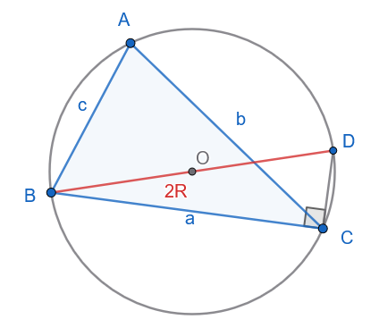
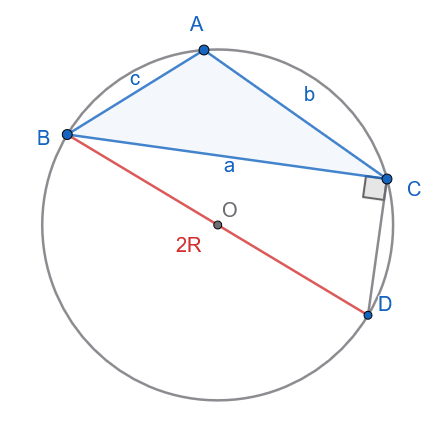
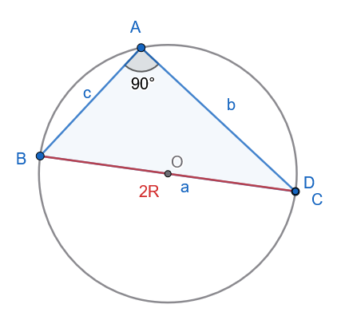
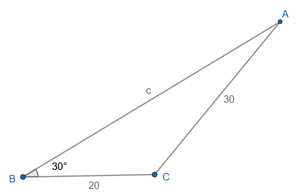
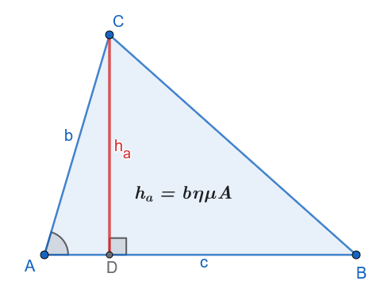

```{=html}
<!-- Φόρτωση βιβλιοθήκης GeoGebra -->
<script src="https://www.geogebra.org/apps/deployggb.js"></script>

<!-- Συνάρτηση δημιουργίας applets -->
<script>
function createGeoGebra(containerId, materialId, width = 700, height = 500) {
  var params = {
    "id": "ggb-" + containerId,
    "material_id": materialId,
    "width": width,
    "height": height,
    "showToolBar": true,
    "showMenuBar": false,
    "showAlgebraInput": true
  };
  
  var applet = new GGBApplet(params, '5.2');
  applet.inject(containerId);
}
</script>
```

## Επίλυση τριγώνου

### Νόμος των Ημιτόνων

:::: {.math-box .theorem-box}
::: {.math-title .theorem-title}
**ΘΕΩΡΗΜΑ (Νόμος των Ημιτόνων)**
:::

Σε κάθε τρίγωνο $ABC$ με πλευρές $a, b, c$ και απέναντι γωνίες $A, B, C$, ο λόγος κάθε πλευράς προς το ημίτονο της απέναντι γωνίας είναι σταθερός και ισούται με τη διάμετρο $2R$ του περιγεγραμμένου κύκλου του τριγώνου:

$$\mathbf{\frac{a}{ημ A} = \frac{b}{ημ B} = \frac{c}{ημ C} = 2R} \quad$$
::::

------------------------------------------------------------------------

:::: {.math-box .apodeixi-box}
::: {.math-title .apodeixi-title}
**ΑΠΟΔΕΙΞΗ**
:::

Έστω $(O, R)$ ο περιγεγραμμένος κύκλος του τριγώνου $ABC$.

1.  **Περίπτωση 1η (Η γωνία** $A$ είναι οξεία):

{fig-align="center" width="300"}

Φέρνουμε τη διάμετρο $BD = 2R$ και τη χορδή $CD$.
Στο εγγεγραμμένο τρίγωνο $BCD$, η γωνία $\widehat{BCD} = 90^\circ$ διότι βαίνει σε ημικύκλιο.

Από το ορθογώνιο τρίγωνο $BCD$ ισχύει: $$ημ D = \frac{\text{απέναντι κάθετη}}{\text{υποτείνουσα}} = \frac{a}{BD} = \frac{a}{2R} \implies a = 2R ημ D \quad$$

Όμως, οι εγγεγραμμένες γωνίες $A$ και $D$ βαίνουν στο ίδιο τόξο $BC$, άρα $D = A$.

Συνεπώς: $$ημ A = ημ D = \frac{a}{2R} \iff \mathbf{\frac{a}{ημ A} = 2R} \quad$$

2.  **Περίπτωση 2η (Η γωνία** $A$ είναι αμβλεία):

{fig-align="center" width="300"}

Φέρνουμε πάλι τη διάμετρο $BD = 2R$.
Το τετράπλευρο $ABDC$ είναι εγγεγραμμένο στον κύκλο, οπότε οι απέναντι γωνίες $A$ και $D$ είναι παραπληρωματικές ($A + D = 180^\circ \implies ημ D = ημ(180^\circ - A) = ημ A$).

Από το ορθογώνιο τρίγωνο $BCD$ έχουμε: $$ημ D = \frac{a}{2R} \implies ημ A = \frac{a}{2R} \iff \mathbf{\frac{a}{ημ A} = 2R} \quad$$

3.  **Περίπτωση 3η (Η γωνία** $A$ είναι ορθή, $A = 90^\circ$):

{fig-align="center" width="300"}

Τότε η πλευρά $a$ είναι η διάμετρος του κύκλου ($a = 2R$) και $ημ A = ημ 90^\circ = 1$.

Επομένως, $\dfrac{a}{ημ A} = \dfrac{2R}{1} = 2R$.

Με τον ίδιο ακριβώς τρόπο αποδεικνύεται ότι $\dfrac{b}{ημ B} = 2R$ και $\dfrac{c}{ημ C} = 2R$.
Άρα $\dfrac{a}{ημ A} = \dfrac{b}{ημ B} = \dfrac{c}{ημ C} = 2R$.

*(Όπερ έδει δείξαι)*
::::

------------------------------------------------------------------------

::: my-callout-sos
**Παρατήρηση**

Ο νόμος ημιτόνων αποτελείται από αναλογίες, Σε κάθε μία αναλογία π.χ $$\mathbf{\frac{a}{ημ A} = \frac{b}{ημ B}} \quad$$ αν γνωρίζουμε τους τρεις όρους της αναλογίας μπορούμε να βρούμε τον τέταρτο λύνοντας ως προς αυτόν τον άγνωστο όρο.

Το ίδιο και για την $$\mathbf{\frac{a}{ημ A}   = 2R} \quad$$
:::

------------------------------------------------------------------------

#### **ΠΑΡΑΔΕΙΓΜΑΤΑ**

:::: {.math-box .example-box}
::: {.math-title .example-title}
**Παράδειγμα 1:**
:::

Να επιλυθεί το τρίγωνο $ABC$ με $a = 12$, $A = 40^\circ$ και $B = 85^\circ$.
::::

:::: {.math-box .examplesolution-box}
::: {.math-title .examplesolution-title}
**Λύση**

{fig-align="center" width="300"}
:::

1.  Υπολογισμός της τρίτης γωνίας $C$: $$A + B + C = 180^\circ \implies C = 180^\circ - (40^\circ + 85^\circ) = 180^\circ - 125^\circ \implies \mathbf{C = 55^\circ}$$

2.  Υπολογισμός της πλευράς $b$ με τον Νόμο των Ημιτόνων: $$\frac{a}{ημ A} = \frac{b}{ημ B} \implies b = \frac{a \cdot ημ B}{ημ A} = \frac{12 \cdot ημ 85^\circ}{ημ 40^\circ} \approx \frac{12 \cdot 0.9962}{0.6428} \approx \mathbf{18.60}$$

3.  Υπολογισμός της πλευράς $c$: $$\frac{a}{ημ A} = \frac{c}{ημ C} \implies c = \frac{a \cdot ημ C}{ημ A} = \frac{12 \cdot ημ 55^\circ}{ημ 40^\circ} \approx \frac{12 \cdot 0.8192}{0.6428} \approx \mathbf{15.29}$$
::::

:::: {.math-box .example-box}
::: {.math-title .example-title}
**Παράδειγμα 2:**
:::

Να επιλυθεί το τρίγωνο $ABC$ με $a = 20$, $b = 30$ και $B = 30^\circ$.
::::

:::: {.math-box .examplesolution-box}
::: {.math-title .examplesolution-title}
**Λύση**

{fig-align="center" width="400"}
:::

1.  Από τον Νόμο των Ημιτόνων υπολογίζουμε το $ημ A$: $$\frac{a}{ημ A} = \frac{b}{ημ B} \implies ημ A = \frac{a \cdot ημ B}{b} = \frac{20 \cdot ημ 30^\circ}{30} = \frac{20 \cdot 0.5}{30} = \mathbf{\frac{1}{3} \approx 0.3333}$$

2.  Αναζητούμε τη γωνία $A \in (0^\circ, 180^\circ)$: $$ημ A \approx 0.3333 \implies A_1 \approx 19.47^\circ \quad \text{ή} \quad A_2 = 180^\circ - 19.47^\circ \approx 160.53^\circ$$

    - **Έλεγχος δυνατότητας:** Επειδή $a < b$ ($20 < 30$), πρέπει υποχρεωτικά και οι απέναντι γωνίες να ικανοποιούν τη σχέση $A < B = 30^\circ$.

    - Η τιμή $A_2 \approx 160.53^\circ$ απορρίπτεται διότι $A_2 > B$ (επίσης $A_2 + B = 190.53^\circ > 180^\circ$).

    - Δεκτή είναι μόνο η γωνία $A \approx 19.47^\circ$.

3.  Υπολογισμός της γωνίας $C$: $$C = 180^\circ - (A + B) \approx 180^\circ - (19.47^\circ + 30^\circ) = \mathbf{130.53^\circ}$$

4.  Υπολογισμός της πλευράς $c$: $$c = \frac{b \cdot ημ C}{ημ B} = \frac{30 \cdot ημ 130.53^\circ}{ημ 30^\circ} = \frac{30 \cdot 0.7601}{0.5} \approx \mathbf{45.61}$$
::::

------------------------------------------------------------------------

:::: {.math-box .example-box}
::: {.math-title .example-title}
**Παράδειγμα 3:**
:::

Ένα σώμα βάρους $\vec{w}$ ισορροπεί αναρτημένο από έναν κεντρικό μεταλλικό κόμβο $K$.

Στον κόμβο $K$ συνδέονται δύο μη εκτατά καλώδια $KA$ και $KB$ από την οροφή (ταβάνι), τα οποία ασκούν δυνάμεις τάσης $\vec{T}_1$ και $\vec{T}_2$ αντίστοιχα, καθώς και ένα καλώδιο με το οποίο ένα άνθρωπος τραβάει το βάρος ισορροπώντας το σύστημα ασκώντας τάση $\vec{T}_3$ .

Οι διευθύνσεις των τριών δυνάμεων σχηματίζουν μεταξύ τους γωνίες:

- $θ_1 = (\widehat{\vec{T}_2, \vec{T}_3})$

- $θ_2 = (\widehat{\vec{T}_1, \vec{T}_3})$

- $θ_3 = (\widehat{\vec{T}_1, \vec{T}_2})$

όπως φαίνεται στην ισορροπία του κόμβου ($\vec{T}_1 + \vec{T}_2 + \vec{T}_3 = \vec{0}$).

1.  Θεωρώντας ότι η συνισταμένη $\vec{T}_{12}$ των $\vec{T}_1$ και $\vec{T}_2$ εξουδετερώνει την $\vec{T}_3$ (δηλαδή $\vec{T}_{12} = -\vec{T}_3$), να σχεδιάσετε το αντίστοιχο διανυσματικό τρίγωνο.

2.  Εφαρμόζοντας το **νόμο των ημιτόνων** στο τρίγωνο αυτό και χρησιμοποιώντας τις τριγωνομετρικές ιδιότητες των παραπληρωματικών γωνιών, να αποδείξετε ότι: $$\frac{T_1}{ημθ_1} = \frac{T_2}{ημθ_2} = \frac{T_3}{ημθ_3}$$
::::

:::: {.math-box .examplesolution-box}
::: {.math-title .examplesolution-title}
**Λύση**

{fig-align="center" width="400"}
:::

Εφαρμόζουμε τον νόμο των ημιτόνων στο τρίγωνο ΚΑΓ'

$$\frac{T_1}{ημ \widehat{AΓ'Κ}} = \frac{T_2}{ημ \widehat{ΑΚΓ'}} = \frac{T_{1,2}}{ημ \widehat{KAΓ'}} \implies \frac{T_1}{ημ θ_1} = \frac{T_2}{ημθ_2} = \frac{T_{3}}{ημ θ_3}$$

Επειδή $\widehat{AΓ'Κ}=\widehat{Γ'ΚΒ}=180^ο-θ_1 \implies ημ\widehat{AΓ'Κ}=ημ\widehat{Γ'ΚΒ}=ημ(180^ο-θ_1)=ημθ_1$ ,

$\widehat{AΚΓ'}=180^ο-θ_2 \implies ημ\widehat{AΚΓ'}=ημ(180^ο-θ_2)=ημθ_2$ και

$\widehat{ΚAΓ'}=180^ο-θ_3 \implies ημ\widehat{ΚΑΓ'}=ημ(180^ο-θ_3)=ημθ_3$
::::

------------------------------------------------------------------------

### Νόμος των Συνημίτονων

:::: {.math-box .theorem-box}
::: {.math-title .theorem-title}
**ΘΕΩΡΗΜΑ (Νόμος των Συνημίτονων)**
:::

Σε κάθε τρίγωνο $ABC$, το τετράγωνο οποιασδήποτε πλευράς ισούται με το άθροισμα των τετραγώνων των δύο άλλων πλευρών, ελαττωμένο κατά το διπλάσιο γινόμενό τους επί το συνημίτονο της περιεχόμενης γωνίας τους: $$\mathbf{a^2 = b^2 + c^2 - 2bc συν A} \quad$$ $$\mathbf{b^2 = a^2 + c^2 - 2ac συν B} \quad$$ $$\mathbf{c^2 = a^2 + b^2 - 2ab συν C} \quad$$
::::

:::: {.math-box .apodeixi-box}
::: {.math-title .apodeixi-title}
**ΑΠΟΔΕΙΞΗ**

{fig-align="center" width="400"}
:::

Θεωρούμε καρτεσιανό σύστημα συντεταγμένων με αρχή την κορυφή $A(0,0)$ και τον θετικό ημιάξονα $Ax$ να ταυτίζεται με την πλευρά $AB$ (μήκους $c$).

- Οι συντεταγμένες της κορυφής $B$ είναι $B(c, 0)$.

- Οι συντεταγμένες της κορυφής $C$ εκφράζονται μέσω της γωνίας $A$ και της υποτείνουσας/πλευράς $b$ ως: $$C(x, y) = C(b συν A, b ημ A) \quad$$

Η απόσταση των σημείων $B$ και $C$ είναι το μήκος της πλευράς $a = (BC)$.

Από τον τύπο της απόστασης δύο σημείων στο επίπεδο έχουμε: $$a^2 = (BC)^2 = (x_C - x_B)^2 + (y_C - y_B)^2 \quad$$ $$a^2 = (b συν A - c)^2 + (b ημ A - 0)^2 \quad$$ $$a^2 = b^2 συν^2 A - 2bc συν A + c^2 + b^2 ημ^2 A \quad$$ $$a^2 = b^2 (ημ^2 A + συν^2 A) + c^2 - 2bc συν A \quad$$

Επειδή $ημ^2 A + συν^2 A = 1$, λαμβάνουμε: $$\mathbf{a^2 = b^2 + c^2 - 2bc συν A} \quad$$

Όμοια αποδεικνύονται και οι άλλοι τύποι.

*(Όπερ έδει δείξαι)*
::::

::: my-callout-sos
**Παρατήρηση**

Ο νόμος συνημιτόνων αποτελείται από ισότητες.
Σε κάθε μία ισότητα π.χ $$\mathbf{a^2 = b^2 + c^2 - 2bc συν A} \quad$$, αν γνωρίζουμε όλα τα στοιχεία εκτός από ένα (άγνωστο), μπορούμε να βρούμε τον άγνωστο λύνοντας ως προς αυτόν τον άγνωστο όρο.
:::

------------------------------------------------------------------------

### **ΠΟΡΙΣΜΑ: Τύποι Εμβαδού Τριγώνου**

:::: {.math-box .corollary-box}
::: {.math-title .corollary-title}
1.  **Βασικός Τύπος Ημιτόνου για το Εμβαδόν:**
:::

Το εμβαδόν $E$ ενός τριγώνου $ABC$ ισούται με το μισό του γινομένου δύο πλευρών του επί το ημίτονο της περιεχόμενης γωνίας τους:

$$\mathbf{E = \frac{1}{2}bc ημ A = \frac{1}{2}ac ημ B = \frac{1}{2}ab ημ C} \quad$$
::::

:::: {.math-box .corollaryproof-box}
::: {.math-title .corollaryproof-title}
**Απόδειξη:**

{fig-align="center" width="300"}
:::

Φέρνουμε το ύψος $h_a = CD$ από την κορυφή $C$ προς την πλευρά $c = AB$.

Στο ορθογώνιο τρίγωνο $ADC$ ισχύει $h_a = b ημ A$.

Το εμβαδόν του τριγώνου είναι: $$E = \frac{1}{2} \cdot \text{βάση} \cdot \text{ύψος} = \frac{1}{2} c \cdot h_a = \frac{1}{2} c (b ημ A) = \mathbf{\frac{1}{2}bc ημ A} \quad$$
::::

:::: {.math-box .corollary-box}
::: {.math-title .corollary-title}
2.  **Έκφραση μέσω της Ακτίνας**
:::

$R$ του Περιγεγραμμένου Κύκλου:
::::

:::: {.math-box .corollaryproof-box}
::: {.math-title .corollaryproof-title}
**Απόδειξη:**
:::

- Από τον Νόμο των Ημιτόνων ισχύει $ημ A = \dfrac{a}{2R}$.
  Αντικαθιστώντας στον τύπο του εμβαδού: $$E = \frac{1}{2}bc \cdot \left(\frac{a}{2R}\right) \implies \mathbf{E = \frac{abc}{4R}} \quad$$

- Αντικαθιστώντας $a = 2R ημ A$, $b = 2R ημ B$, $c = 2R ημ C$: $$E = \frac{(2R ημ A)(2R ημ B)(2R ημ C)}{4R} \implies \mathbf{E = 2R^2 ημ A ημ B ημ C} \quad$$
::::

:::: {.math-box .corollary-box}
::: {.math-title .corollary-title}
3.  **Τύπος του Ήρωνα:**
:::

Αν $\tau = \dfrac{a+b+c}{2}$ είναι η ημιπερίμετρος του τριγώνου, τότε:

$$\mathbf{E = \sqrt{\tau(\tau-a)(\tau-b)(\tau-c)}} \quad$$
::::

------------------------------------------------------------------------

#### **ΠΑΡΑΔΕΙΓΜΑΤΑ**

:::: {.math-box .example-box}
::: {.math-title .example-title}
**Παράδειγμα 1:**
:::

Να επιλυθεί το τρίγωνο $ABC$ με $a = 30$, $b = 20$ και $c = 40$.
::::

:::: {.math-box .examplesolution-box}
::: {.math-title .examplesolution-title}
**Λύση**

{fig-align="center" width="250"}
:::

1.  Υπολογισμός της γωνίας $A$ από τον Νόμο των Συνημίτονων: $$συν A = \frac{b^2 + c^2 - a^2}{2bc} = \frac{20^2 + 40^2 - 30^2}{2 \cdot 20 \cdot 40} = \frac{400 + 1600 - 900}{1600} =\\  \frac{1100}{1600} = \mathbf{0.6875} \implies \mathbf{A \approx 46.57^\circ}$$

2.  Υπολογισμός της γωνίας $B$: $$συν B = \frac{a^2 + c^2 - b^2}{2ac} = \frac{30^2 + 40^2 - 20^2}{2 \cdot 30 \cdot 40} = \frac{900 + 1600 - 400}{2400} = \\  \frac{2100}{2400} = \mathbf{0.875} \implies \mathbf{B \approx 28.96^\circ}$$

3.  Υπολογισμός της γωνίας $C$: $$C = 180^\circ - (A + B) \approx 180^\circ - (46.57^\circ + 28.96^\circ) = \mathbf{104.47^\circ}$$
::::

:::: {.math-box .example-box}
::: {.math-title .example-title}
**Παράδειγμα 2:**
:::

Να επιλυθεί το τρίγωνο $ABC$ με $b = 20$, $c = 35$ και $A = 60^\circ$.
::::

:::: {.math-box .examplesolution-box}
::: {.math-title .examplesolution-title}
**Λύση**
:::

1.  Υπολογισμός της πλευράς $a$ από τον Νόμο των Συνημίτονων: $$a^2 = b^2 + c^2 - 2bc συν A = 20^2 + 35^2 - 2 \cdot 20 \cdot 35 \cdot συν 60^\circ = \\  400 + 1225 - 1400 \cdot 0.5 = 1625 - 700 = 925$$ $$\mathbf{a = \sqrt{925} = 5\sqrt{37} \approx 30.41}$$

2.  Υπολογισμός της γωνίας $B$: $$συν B = \frac{a^2 + c^2 - b^2}{2ac} = \frac{925 + 1225 - 400}{2 \cdot 30.41 \cdot 35} = \frac{1750}{2128.7} \approx \mathbf{0.8221} \implies \mathbf{B \approx 34.70^\circ}$$

3.  Υπολογισμός της γωνίας $C$: $$C = 180^\circ - (60^\circ + 34.70^\circ) = \mathbf{85.30^\circ}$$
::::

------------------------------------------------------------------------

:::: {.math-box .example-box}
::: {.math-title .example-title}
**Παράδειγμα 3:**
:::

Ένα ταχύπλοο σκάφος κινείται σε ένα ποτάμι.

- Η ταχύτητα του σκάφους ως προς το νερό συμβολίζεται με $\vec{v}_1$ και έχει μέτρο $v_1$.

- Η ταχύτητα του ρεύματος του ποταμού συμβολίζεται με $\vec{v}_2$ και έχει μέτρο $v_2$.

Τα δύο διανύσματα των ταχυτήτων σχηματίζουν μεταξύ τους γωνία $\phi$.

Σύμφωνα με την αρχή της σχετικότητας της κίνησης, η ολική ταχύτητα $\vec{v}$ του σκάφους ως προς την όχθη είναι η συνισταμένη: $$\vec{v} = \vec{v}_1 + \vec{v}_2$$

Με τη βοήθεια του κανόνα του παραλληλογράμμου και εφαρμόζοντας το **νόμο των συνημιτόνων** στο κατάλληλο τρίγωνο, να αποδείξετε ότι το μέτρο $v$ της ολικής ταχύτητας δίνεται από τη σχέση: $$v^2 = v_1^2 + v_2^2 + 2v_1 v_2 συν\phi$$
::::

:::: {.math-box .examplesolution-box}
::: {.math-title .examplesolution-title}
**Λύση**

{fig-align="center" width="350"}
:::

**Σύντομη υπόδειξη επίλυσης:**

Στο τρίγωνο σύνθεσης των διανυσμάτων, η απέναντι γωνία από την ολική ταχύτητα $\vec{v}$ είναι παραπληρωματική της γωνίας $\phi$, δηλαδή $180^\circ - \phi$.

Εφαρμόζοντας τον νόμο των συνημιτόνων: $v^2 = v_1^2 + v_2^2 - 2v_1 v_2 συν(180^\circ - \phi)$.

Επειδή $συν(180^\circ - \phi) = -συν\phi$, προκύπτει άμεσα το πρόσημο $+$ στον όρο του γινομένου).
::::

------------------------------------------------------------------------

### Ασκήσεις στην Επίλυση Τριγώνου

#### **Ομάδα Α: Υπολογισμός Στοιχείων & Εμβαδού**

1.  Να επιλυθεί το τρίγωνο $ABC$ με $b = 10$, $B = 45^\circ$ και $C = 60^\circ$.

2.  Να επιλυθεί το τρίγωνο $ABC$ με $a = 7$, $b = 8$ και $c = 9$.

3.  Να υπολογιστεί το εμβαδόν $E$ και η ακτίνα $R$ του περιγεγραμμένου κύκλου τριγώνου $ABC$ με $a = 5$, $b = 6$ και $c = 7$.

4.  Σε τρίγωνο $ABC$ δίνονται $a = 10$, $b = 10\sqrt{3}$ και $A = 30^\circ$.
    Να επιλυθεί το τρίγωνο (να εξεταστεί αν υπάρχουν μία ή δύο λύσεις).

5.  Δίνεται τρίγωνο $ABC$ με $a = 4$, $b = 5$ και περιεχόμενη γωνία $C = 120^\circ$.
    Να υπολογιστούν η πλευρά $c$ και το εμβαδόν $E$.

#### **Ομάδα Β: Αποδεικτικές Σχέσεις Πλευρών και Γωνιών**

6.  Να αποδειχθεί ότι σε κάθε τρίγωνο $ABΓ$ ισχύει ο τύπος της προβολής: $$a = β συν Γ + γ συν B$$

>> Σχεδιάστε το ύψος ΑΔ και τότε α=ΒΔ+ΔΓ=.............

:::: {.math-box .exercise-box}
::: {.math-title .exercise-title}
7.  Εκφώνηση
:::
Να αποδειχθεί ότι σε κάθε τρίγωνο $ABC$ ισχύει: $$(b + c)\sin\left(\frac{A}{2}\right) = a\cos\left(\frac{B - C}{2}\right)$$
::::

:::: {.math-box .exercise-box}
::: {.math-title .exercise-title}
Λύση
:::
Για να αποδείξουμε τη σχέση σε κάθε τρίγωνο $ABC$:
$$(b + c)\sin\left(\frac{A}{2}\right) = a\cos\left(\frac{B - C}{2}\right)$$

θα χρησιμοποιήσουμε τον **νόμο των ημιτόνων** και τους **τύπους μετατροπής αθροίσματος σε γινόμενο**.

---

**1: Εφαρμογή του νόμου των ημιτόνων**

Από τον νόμο των ημιτόνων γνωρίζουμε ότι:
$$\frac{a}{\sin A} = \frac{b}{\sin B} = \frac{c}{\sin C} = 2R$$
όπου $R$ είναι η ακτίνα του περιγεγραμμένου κύκλου του τριγώνου.

Συνεπώς, οι πλευρές εκφράζονται ως:
$$a = 2R\sin A, \quad b = 2R\sin B, \quad c = 2R\sin C$$

---

**2: Ανάπτυξη του αριστερού μέλους**

Έστω $L$ το αριστερό μέλος της προς απόδειξη σχέσης:
$$L = (b + c)\sin\left(\frac{A}{2}\right)$$

Αντικαθιστούμε τα $b$ και $c$:
$$L = (2R\sin B + 2R\sin C)\sin\left(\frac{A}{2}\right) = 2R(\sin B + \sin C)\sin\left(\frac{A}{2}\right)$$

Εφαρμόζουμε τον τύπο μετατροπής αθροίσματος ημιτόνων σε γινόμενο:
$$\sin B + \sin C = 2\sin\left(\frac{B + C}{2}\right)\cos\left(\frac{B - C}{2}\right)$$

Άρα:
$$L = 2R \cdot \left[2\sin\left(\frac{B + C}{2}\right)\cos\left(\frac{B - C}{2}\right)\right]\sin\left(\frac{A}{2}\right)$$
$$L = 4R\sin\left(\frac{B + C}{2}\right)\cos\left(\frac{B - C}{2}\right)\sin\left(\frac{A}{2}\right)$$

---

**3: Αξιοποίηση της σχέσης των γωνιών του τριγώνου**

Επειδή $A + B + C = 180^\circ$, έχουμε:
$$B + C = 180^\circ - A \iff \frac{B + C}{2} = 90^\circ - \frac{A}{2}$$

Επομένως:
$$\sin\left(\frac{B + C}{2}\right) = \sin\left(90^\circ - \frac{A}{2}\right) = \cos\left(\frac{A}{2}\right)$$

Αντικαθιστούμε στο $L$:
$$L = 4R \cos\left(\frac{A}{2}\right) \cos\left(\frac{B - C}{2}\right) \sin\left(\frac{A}{2}\right)$$

Αναδιατάσσουμε τους όρους:
$$L = 2R \cdot \left[2\sin\left(\frac{A}{2}\right)\cos\left(\frac{A}{2}\right)\right] \cdot \cos\left(\frac{B - C}{2}\right)$$

---

**4: Ολοκλήρωση της απόδειξης**

Χρησιμοποιούμε τον τύπο διπλάσιου τόξου $2\sin\left(\frac{A}{2}\right)\cos\left(\frac{A}{2}\right) = \sin A$:
$$L = 2R\sin A \cdot \cos\left(\frac{B - C}{2}\right)$$

Όμως από τον νόμο των ημιτόνων ισχύει $2R\sin A = a$. 

Συνεπώς:
$$L = a\cos\left(\frac{B - C}{2}\right)$$

που είναι ακριβώς το δεξί μέλος της ισότητας.

Άρα αποδείχθηκε ότι:
$$(b + c)\sin\left(\frac{A}{2}\right) = a\cos\left(\frac{B - C}{2}\right)$$
::::


:::: {.math-box .exercise-box}
::: {.math-title .exercise-title}
8.  Εκφώνηση
:::
Να αποδειχθεί ότι σε κάθε τρίγωνο $ABC$ ισχύει: $$a^2 ημ(B - C) = (b^2 - c^2) ημ A$$
::::


:::: {.math-box .exercise-box}
::: {.math-title .exercise-title}
Λύση
:::
Για να αποδείξουμε ότι σε κάθε τρίγωνο $ABC$ ισχύει:
$$a^2 \sin(B - C) = (b^2 - c^2)\sin A$$

θα χρησιμοποιήσουμε τον **νόμο των ημιτόνων**.

---

**1: Εφαρμογή του νόμου των ημιτόνων**

Από τον νόμο των ημιτόνων έχουμε:
$$\frac{a}{\sin A} = \frac{b}{\sin B} = \frac{c}{\sin C} = 2R$$
όπου $R$ είναι η ακτίνα του περιγεγραμμένου κύκλου.

Επομένως:
$$a = 2R\sin A, \quad b = 2R\sin B, \quad c = 2R\sin C$$

---

**2: Ανάπτυξη του δεξιού μέλους**

Έστω $D$ το δεξί μέλος της ισότητας:
$$D = (b^2 - c^2)\sin A$$

Αντικαθιστούμε τα $b$ και $c$:
$$D = \left[(2R\sin B)^2 - (2R\sin C)^2\right]\sin A$$
$$D = 4R^2(\sin^2 B - \sin^2 C)\sin A$$

---

**3: Χρήση της τριγωνομετρικής ταυτότητας**

Γνωρίζουμε τη βασική ταυτότητα:
$$\sin^2 B - \sin^2 C = \sin(B + C)\sin(B - C)$$

*(Απόδειξη της ταυτότητας: $\sin^2 B - \sin^2 C = \dfrac{1 - \cos(2B)}{2} - \dfrac{1 - \cos(2C)}{2} = \dfrac{\cos(2C) - \cos(2B)}{2} = \sin(B+C)\sin(B-C)$)*

Αντικαθιστούμε την ταυτότητα στο $D$:
$$D = 4R^2 \sin(B + C)\sin(B - C)\sin A$$

---

**4: Συσχέτιση των γωνιών του τριγώνου**

Επειδή $A + B + C = 180^\circ$, ισχύει:
$$B + C = 180^\circ - A \implies \sin(B + C) = \sin(180^\circ - A) = \sin A$$

Αντικαθιστώντας το $\sin(B + C) = \sin A$:
$$D = 4R^2 \sin A \cdot \sin(B - C)\sin A$$
$$D = 4R^2 \sin^2 A \cdot \sin(B - C)$$
$$D = (2R\sin A)^2 \sin(B - C)$$

---

**5: Τελικό συμπέρασμα**

Επειδή από τον νόμο των ημιτόνων ισχύει $a = 2R\sin A$, έχουμε:
$$(2R\sin A)^2 = a^2$$

Επομένως:
$$D = a^2 \sin(B - C)$$

Άρα αποδείχθηκε ότι:
$$a^2 \sin(B - C) = (b^2 - c^2)\sin A$$
::::


9.  Να αποδειχθεί η ταυτότητα: $$a(ημ B - ημ C) + b(ημ C - ημ A) + c(ημ A - ημ B) = 0$$


10. Να αποδειχθεί ότι: $$b συν B + c συν C = a συν(B - C)$$

#### **Ομάδα Γ: Ασκήσεις με Εμβαδά και Ακτίνες**

11. Να αποδειχθεί ότι το εμβαδόν τριγώνου $ABC$ δίνεται από τον τύπο: $$E = \frac{a^2 ημ B ημ C}{2 ημ A}$$

12. Αν $R$ είναι η ακτίνα του περιγεγραμμένου κύκλου, να αποδειχθεί ότι: $$a σφ A + b σφ B + c σφ C = 2(R + r) \quad \text{(όπου } r \text{ η ακτίνα του εγγεγραμμένου κύκλου)}$$

13. Να αποδειχθεί ότι σε κάθε τρίγωνο $ABC$ ισχύει: $$E = \tau \cdot r \quad \text{και} \quad r = 4R ημ\left(\frac{A}{2}\right) ημ\left(\frac{B}{2}\right) ημ\left(\frac{C}{2}\right)$$

14. Σε τρίγωνο $ABC$ ισχύει $a^2 + b^2 + c^2 = 8R^2$.
    Να αποδειχθεί ότι το τρίγωνο είναι ορθογώνιο.

15. Να υπολογιστεί το εμβαδόν τριγώνου $ABC$ αν δίνονται $R = 6$, $A = 30^\circ$, $B = 45^\circ$.

#### **Ομάδα Δ: Χαρακτηρισμός Είδους Τριγώνου**

16. Αν σε τρίγωνο $ABC$ ισχύει $ημ A = 2 ημ B συν C$, να αποδειχθεί ότι το τρίγωνο είναι ισοσκελές ($b = c$).

17. Αν σε τρίγωνο $ABC$ ισχύει $a = 2b συν C$, να αποδειχθεί ότι το τρίγωνο είναι ισοσκελές ($a = b$).

18. Αν σε τρίγωνο $ABC$ ισχύει $ημ^2 A = ημ^2 B + ημ^2 C$, να αποδειχθεί ότι το τρίγωνο είναι ορθογώνιο ($A = 90^\circ$).

19. Αν σε τρίγωνο $ABC$ ισχύει $εφ A + εφ B = 2 σφ C$, να αποδειχθεί ότι $a^2 + b^2 = 3c^2$.

20. Αν σε τρίγωνο $ABC$ ισχύει $συν A + συν B = ημ C$, να αποδειχθεί ότι το τρίγωνο είναι ορθογώνιο.

------------------------------------------------------------------------

### Ασκήσεις επί Όλης της Τριγωνομετρίας

#### **Ενότητα 1: Βασικοί Τριγωνομετρικοί Αριθμοί & Ταυτότητες**

1.  Αν $ημ x - συν x = \frac{1}{3}$, να υπολογιστούν οι τιμές των παραστάσεων:

    - α) $ημ x \cdot συν x$

    - β) $ημ^3 x - συν^3 x$

    - γ) $ημ(2x)$

2.  Να αποδειχθεί η ταυτότητα: $$\frac{ημ^3 x + συν^3 x}{ημ x + συν x} = 1 - \frac{1}{2}ημ(2x)$$

#### **Ενότητα 2: Τριγωνομετρικές Συναρτήσεις**

3.  Δίνεται η συνάρτηση $f(x) = 3 ημ\left(2x - \frac{\pi}{3}\right)$.

    - α) Να βρεθεί η βασική περίοδος $T$, η μέγιστη τιμή $M$ και η ελάχιστη τιμή $m$.

    - β) Να υπολογιστούν τα σημεία τομής της $C_f$ με τον άξονα $x'x$ στο διάστημα $[0, \pi]$.

4.  Να μελετηθεί και να μετατραπεί στη μορφή $f(x) = \rho ημ(x + \phi)$ η συνάρτηση: $$f(x) = \sqrt{3} ημ x - συν x$$

#### **Ενότητα 3: Τριγωνομετρικές Εξισώσεις**

5.  Να λυθεί στο $\mathbb{R}$ η εξίσωση: $$ημ\left(3x + \frac{\pi}{4}\right) = \frac{\sqrt{2}}{2}$$

6.  Να λυθεί στο $\mathbb{R}$ η εξίσωση: $$2 συν^2 x - 3 συν x + 1 = 0$$

7.  Να λυθεί στο $\mathbb{R}$ η εξίσωση: $$ημ(2x) - \sqrt{3} συν x = 0$$

8.  Να λυθεί στο διάστημα $[0, 2\pi]$ η εξίσωση: $$ημ x + συν x = 1$$

#### **Ενότητα 4: Τύποι Αθροίσματος, Διπλάσιας Γωνίας & Μετασχηματισμοί**

9.  Να υπολογιστεί η ακριβής τιμή της παράστασης: $$A = συν 75^\circ \cdot συν 15^\circ + ημ 75^\circ \cdot ημ 15^\circ$$

10. Να αποδειχθεί ότι: $$εφ(15^\circ) = 2 - \sqrt{3} \quad \text{και} \quad σφ(15^\circ) = 2 + \sqrt{3}$$

11. Να αποδειχθεί η ταυτότητα διπλάσιου τόξου: $$\frac{1 - συν(2x)}{ημ(2x)} = εφ x$$

12. Να μετατραπεί σε γινόμενο η παράσταση: $$B = ημ(5x) + ημ(3x) + 2 ημ(4x)$$

#### **Ενότητα 5: Ταυτότητες υπό Συνθήκη & Επίλυση Τριγώνου**

13. Σε κάθε μη ορθογώνιο τρίγωνο $ABC$, να αποδειχθεί ότι: $$εφ A + εφ B + εφ C = εφ A \cdot εφ B \cdot εφ C \quad$$

14. Σε κάθε τρίγωνο $ABC$, να αποδειχθεί ότι: $$ημ(2A) + ημ(2B) + ημ(2C) = 4 ημ A \cdot ημ B \cdot ημ C \quad$$

15. Δύο παρατηρητές $A$ και $B$ βρίσκονται σε απόσταση $d = 100\text{ m}$ στην ίδια ευθεία με τη βάση ενός πύργου $CD$.
    Αν οι γωνίες ατενισμού της κορυφής $D$ του πύργου από τα σημεία $A$ και $B$ είναι $30^\circ$ και $45^\circ$ αντίστοιχα, να υπολογιστεί το ύψος $h = CD$ του πύργου.

------------------------------------------------------------------------

## ΔΙΑΓΩΝΙΣΜΑ ΑΞΙΟΛΟΓΗΣΗΣ: ΕΠΙΛΥΣΗ ΤΡΙΓΩΝΟΥ

**Μάθημα:** Άλγεβρα Β' Γενικού Λυκείου\
**Ενότητα:** Νόμος Ημιτόνων, Νόμος Συνημίτονων, Τύποι Εμβαδού & Εφαρμογές\
**Διάρκεια:** 60 λεπτά

------------------------------------------------------------------------

### **ΘΕΜΑ Α (Θεωρία & Ερωτήσεις Κατανόησης - 25 Μονάδες)**

**Α1.** (10 Μονάδες)

1.  Να διατυπώσετε και να αποδείξετε τον **Νόμο των Συνημίτονων** σε τυχαίο τρίγωνο $ABC$.
    (7 μονάδες)

2.  Να αποδείξετε ότι το εμβαδόν $E$ ενός τριγώνου $ABC$ δίνεται από τον τύπο $E = \frac{1}{2}bc ημ A$.
    (3 μονάδες)

**Α2.** (5 Μονάδες)

Να διατυπώσετε τον **Νόμο των Ημιτόνων** σε τυχαίο τρίγωνο $ABC$ εγγεγραμμένο σε κύκλο ακτίνας $R$.

**Α3.** (10 Μονάδες)

Να χαρακτηρίσετε τις παρακάτω προτάσεις ως **Σωστό (Σ)** ή **Λάθος (Λ)**:

1.  Σε κάθε τρίγωνο $ABC$, ισχύει $\frac{a}{ημ A} = 2R$, όπου $R$ είναι η ακτίνα του περιγεγραμμένου κύκλου.

2.  Αν σε ένα τρίγωνο $ABC$ ισχύει $a^2 = b^2 + c^2 + bc$, τότε η γωνία $A$ είναι $120^\circ$.

3.  Το εμβαδόν $E$ τριγώνου $ABC$ εκφράζεται ως $E = \frac{abc}{4R}$.

4.  Αν σε ένα τρίγωνο $ABC$ ισχύει $a = 2b συν C$, τότε το τρίγωνο είναι υποχρεωτικά ισόπλευρο.

5.  Αν δίνονται δύο πλευρές $b, c$ και η περιεχόμενη γωνία $A$, η τρίτη πλευρά $a$ υπολογίζεται άμεσα από τον Νόμο των Συνημίτονων.

------------------------------------------------------------------------

### **ΘΕΜΑ Β (Επίλυση Τριγώνου & Υπολογισμοί - 25 Μονάδες)**

**Β1.** (12 Μονάδες)

Σε τρίγωνο $ABC$ δίνονται η πλευρά $b = 20$, η πλευρά $c = 35$ και η περιεχόμενη γωνία $A = 60^\circ$.

1.  Να υπολογίσετε το μήκος της πλευράς $a$.
    (6 μονάδες)

2.  Να υπολογίσετε το συνημίτονο της γωνίας $B$ ($συν B$).
    (6 μονάδες)

**Β2.** (13 Μονάδες)

Σε τρίγωνο $ABC$ δίνονται η πλευρά $a = 12$, η γωνία $A = 40^\circ$ και η γωνία $B = 85^\circ$.

1.  Να υπολογίσετε τη γωνία $C$.
    (3 μονάδες)

2.  Να υπολογίσετε τις πλευρές $b$ και $c$ (δίνονται: $ημ 40^\circ \approx 0.64$, $ημ 85^\circ \approx 0.996$, $ημ 55^\circ \approx 0.82$).
    (10 μονάδες)

------------------------------------------------------------------------

### **ΘΕΜΑ Γ (Αποδεικτικές Σχέσεις & Ταυτότητες Τριγώνου - 25 Μονάδες)**

**Γ1.** (12 Μονάδες)

Σε κάθε τρίγωνο $ABC$, να αποδείξετε τον τύπο της προβολής: $$a = b συν C + c συν B$$

**Γ2.** (13 Μονάδες)

Σε κάθε τρίγωνο $ABC$, να αποδείξετε την ισότητα: $$a (ημ B - ημ C) + b (ημ C - ημ A) + c (ημ A - ημ B) = 0$$

------------------------------------------------------------------------

### **ΘΕΜΑ Δ (Χαρακτηρισμός Τριγώνου & Σύνθετο Πρόβλημα - 25 Μονάδες)**

**Δ1.** (12 Μονάδες)

Αν σε τρίγωνο $ABC$ ισχύει η σχέση: $$ημ A = 2 ημ B συν C$$ να αποδείξετε ότι το τρίγωνο είναι ισοσκελές ($b = c$).

**Δ2.** (13 Μονάδες)

Σε τρίγωνο $ABC$ δίνονται $a = 5$, $b = 6$ και $c = 7$.

1.  Να υπολογίσετε το εμβαδόν $E$ του τριγώνου με χρήση του τύπου του Ήρωνα.
    (6 μονάδες)

2.  Να υπολογίσετε την ακτίνα $R$ του περιγεγραμμένου κύκλου του τριγώνου $ABC$.
    (7 μονάδες)

------------------------------------------------------------------------

## ΑΝΑΛΥΤΙΚΕΣ ΛΥΣΕΙΣ ΔΙΑΓΩΝΙΣΜΑΤΟΣ

### **ΘΕΜΑ Α**

- **Α1.1:**

  **Θεώρημα:** Σε κάθε τρίγωνο $ABC$ ισχύει: $a^2 = b^2 + c^2 - 2bc συν A$.

  **Απόδειξη:** Θεωρούμε καρτεσιανό σύστημα συντεταγμένων με αρχή $A(0,0)$ και τον θετικό ημιάξονα $Ax$ να ταυτίζεται με την πλευρά $AB$ (μήκους $c$).
  Οι συντεταγμένες των κορυφών είναι $B(c, 0)$ και $C(b συν A, b ημ A)$.

  Από τον τύπο της απόστασης των σημείων $B$ και $C$: $$a^2 = (BC)^2 = (b συν A - c)^2 + (b ημ A - 0)^2$$ $$a^2 = b^2 συν^2 A - 2bc συν A + c^2 + b^2 ημ^2 A$$ $$a^2 = b^2 (ημ^2 A + συν^2 A) + c^2 - 2bc συν A$$

  Επειδή $ημ^2 A + συν^2 A = 1$, λαμβάνουμε: $a^2 = b^2 + c^2 - 2bc συν A$.

- **Α1.2:**

  Φέρνουμε το ύψος $h_a = CD$ από την κορυφή $C$ προς την πλευρά $c = AB$.
  Στο ορθογώνιο τρίγωνο $ADC$ ισχύει $h_a = b ημ A$.

  Το εμβαδόν του τριγώνου είναι: $$E = \frac{1}{2} c \cdot h_a = \frac{1}{2} c (b ημ A) \implies \mathbf{E = \frac{1}{2}bc ημ A}$$

- **Α2:**

  **Νόμος Ημιτόνων:** Σε κάθε τρίγωνο $ABC$ με πλευρές $a, b, c$ και ακτίνα περιγεγραμμένου κύκλου $R$, ο λόγος κάθε πλευράς προς το ημίτονο της απέναντι γωνίας είναι σταθερός και ισούται με $2R$: $$\frac{a}{ημ A} = \frac{b}{ημ B} = \frac{c}{ημ C} = 2R$$

- **Α3:**

  1.  **Σωστό** (Βασική διατύπωση του Νόμου των Ημιτόνων).

  2.  **Σωστό** (Από $a^2 = b^2 + c^2 - 2bc συν A$ και $a^2 = b^2 + c^2 + bc$, έχουμε $-2bc συν A = bc \iff συν A = -\dfrac{1}{2} \iff A = 120^\circ$).

  3.  **Σωστό** (Από $E = \dfrac{1}{2}bc ημ A$ και $ημ A = \dfrac{a}{2R}$, προκύπτει $E = \dfrac{abc}{4R}$).

  4.  **Λάθος** (Από τον Νόμο Ημιτόνων $2R ημ A = 4R ημ B συν C \iff ημ A = 2 ημ B συν C \iff B = C$, δηλαδή το τρίγωνο είναι ισοσκελές με $b = c$, όχι υποχρεωτικά ισόπλευρο).

  5.  **Σωστό** (Ο Νόμος των Συνημίτονων δίνει $a = \sqrt{b^2 + c^2 - 2bc συν A}$).

------------------------------------------------------------------------

### **ΘΕΜΑ Β**

- **Β1.1:**

  Εφαρμόζουμε τον Νόμο των Συνημίτονων για την πλευρά $a$: $$a^2 = b^2 + c^2 - 2bc συν A$$ $$a^2 = 20^2 + 35^2 - 2 \cdot 20 \cdot 35 \cdot συν 60^\circ$$ $$a^2 = 400 + 1225 - 1400 \cdot \frac{1}{2} = 1625 - 700 = 925$$ $$\mathbf{a = \sqrt{925} = 5\sqrt{37} \approx 30.41}$$

- **Β1.2:**

  Από τον Νόμο των Συνημίτονων υπολογίζουμε το $συν B$: $$συν B = \frac{a^2 + c^2 - b^2}{2ac} = \frac{925 + 1225 - 400}{2 \cdot 5\sqrt{37} \cdot 35} = \frac{1750}{350\sqrt{37}} = \frac{5}{\sqrt{37}} = \mathbf{\frac{5\sqrt{37}}{37} \approx 0.822}$$

- **Β2.1:**

  Το άθροισμα των γωνιών τριγώνου είναι $180^\circ$: $$C = 180^\circ - (A + B) = 180^\circ - (40^\circ + 85^\circ) = 180^\circ - 125^\circ \implies \mathbf{C = 55^\circ}$$

- **Β2.2:**

  Από τον Νόμο των Ημιτόνων:

  - Για την πλευρά $b$: $$\frac{a}{ημ A} = \frac{b}{ημ B} \implies b = \frac{a ημ B}{ημ A} \approx \frac{12 \cdot 0.996}{0.64} = \frac{11.952}{0.64} = \mathbf{18.675}$$

  - Για την πλευρά $c$: $$\frac{a}{ημ A} = \frac{c}{ημ C} \implies c = \frac{a ημ C}{ημ A} \approx \frac{12 \cdot 0.82}{0.64} = \frac{9.84}{0.64} = \mathbf{15.375}$$

------------------------------------------------------------------------

### **ΘΕΜΑ Γ**

- **Γ1:**

  Από τον Νόμο των Συνημίτονων αντικαθιστούμε τα συνημίτονα $συν C$ και $συν B$: $$συν C = \frac{a^2 + b^2 - c^2}{2ab} \quad \text{και} \quad συν B = \frac{a^2 + c^2 - b^2}{2ac}$$

  Αντικαθιστούμε στο δεξί μέλος: $$\text{Δεξί Μέλος} = b \left(\frac{a^2 + b^2 - c^2}{2ab}\right) + c \left(\frac{a^2 + c^2 - b^2}{2ac}\right)$$ $$= \frac{a^2 + b^2 - c^2}{2a} + \frac{a^2 + c^2 - b^2}{2a} = \frac{(a^2 + b^2 - c^2) + (a^2 + c^2 - b^2)}{2a} = \frac{2a^2}{2a} = \mathbf{a}$$

- **Γ2:**

  Από τον Νόμο των Ημιτόνων γνωρίζουμε ότι $ημ A = \dfrac{a}{2R}$, $ημ B = \dfrac{b}{2R}$, $ημ C = \dfrac{c}{2R}$.

  Αντικαθιστούμε στο αριστερό μέλος: $$\text{Αριστερό Μέλος} = a \left(\frac{b}{2R} - \frac{c}{2R}\right) + b \left(\frac{c}{2R} - \frac{a}{2R}\right) + c \left(\frac{a}{2R} - \frac{b}{2R}\right)$$ $$= \frac{a(b-c) + b(c-a) + c(a-b)}{2R} = \frac{ab - ac + bc - ba + ca - cb}{2R} = \frac{0}{2R} = \mathbf{0}$$

------------------------------------------------------------------------

### **ΘΕΜΑ Δ**

- **Δ1:**

  Σε κάθε τρίγωνο ισχύει $A + B + C = 180^\circ \iff A = 180^\circ - (B + C)$, οπότε: $$ημ A = ημ(180^\circ - (B + C)) = ημ(B + C)$$

  Αντικαθιστούμε στην δοσμένη σχέση: $$ημ(B + C) = 2 ημ B συν C$$

  Αναπτύσσουμε το ημίτονο αθροίσματος: $$ημ B συν C + συν B ημ C = 2 ημ B συν C$$ $$συν B ημ C - ημ B συν C = 0 \iff ημ(C - B) = 0$$

  Επειδή $B, C$ γωνίες τριγώνου, ισχύει $-180^\circ < C - B < 180^\circ$, οπότε $C - B = 0 \iff B = C$.

  Άρα το τρίγωνο είναι **ισοσκελές** με $\mathbf{b = c}$.

- **Δ2.1:**

  Υπολογίζουμε την ημιπερίμετρο $\tau$: $$\tau = \frac{a + b + c}{2} = \frac{5 + 6 + 7}{2} = \frac{18}{2} = 9$$

  Από τον τύπο του Ήρωνα: $$E = \sqrt{\tau(\tau-a)(\tau-b)(\tau-c)} = \sqrt{9(9-5)(9-6)(9-7)} = \sqrt{9 \cdot 4 \cdot 3 \cdot 2} = \sqrt{216} = \mathbf{6\sqrt{6}}$$

- **Δ2.2:**

  Χρησιμοποιούμε τον τύπο $E = \frac{abc}{4R}$: $$R = \frac{abc}{4E} = \frac{5 \cdot 6 \cdot 7}{4 \cdot 6\sqrt{6}} = \frac{210}{24\sqrt{6}} = \frac{35}{4\sqrt{6}} = \mathbf{\frac{35\sqrt{6}}{24}}$$

------------------------------------------------------------------------

## Επαναληπτικές ασκήσεις στην τριγωνομετρία

### **Κατηγορία 1: Τριγωνομετρικοί Αριθμοί & Βασικές Ταυτότητες**

1.  **Υπολογισμός Τριγωνομετρικών Αριθμών:**

    - Αν $ημ x = \dfrac{3}{5}$ με $\dfrac{\pi}{2} < x < \pi$, να υπολογιστούν οι υπόλοιποι τριγωνομετρικοί αριθμοί της γωνίας $x$.

    - Αν $συν x = -\dfrac{2}{3}$ με $\pi < x < \dfrac{3\pi}{2}$, να υπολογιστούν οι υπόλοιποι τριγωνομετρικοί αριθμοί της γωνίας $x$.

2.  **Απόδειξη Βασικών Τριγωνομετρικών Ταυτοτήτων:**

    Να αποδειχθούν οι παρακάτω ταυτότητες για κάθε γωνία $\alpha$ για την οποία ορίζονται:

    - $\dfrac{ημ \alpha}{1 + συν \alpha} = \dfrac{1 - συν \alpha}{ημ \alpha}$

    - $συν^4 \alpha - ημ^4 \alpha = 2συν^2 \alpha - 1$

    - $εφ^2 \alpha - ημ^2 \alpha = εφ^2 \alpha \cdot ημ^2 \alpha$

------------------------------------------------------------------------

### **Κατηγορία 2: Τριγωνομετρικές Συναρτήσεις & Γραφικές Παραστάσεις**

3.  **Μελέτη Περιοδικότητας & Ακροτάτων:**

    - Δίνεται η συνάρτηση $f(x) = 3ημ(2x)$.
      Να βρείτε τη βασική περίοδο $T$, τη μέγιστη τιμή $M$ και την ελάχιστη τιμή $m$ της συνάρτησης.

    - Δίνεται η συνάρτηση $g(x) = \sqrt{3}ημ x - συν x$.
      Να μετατραπεί στη μορφή $\rho ημ(x + \phi)$ και να υπολογιστούν τα ακρότατά της.

4.  **Σημεία Τομής με τους Άξονες:**

    - Να υπολογιστούν τα σημεία τομής της γραφικής παράστασης της συνάρτησης $f(x) = 2ημ\left(x - \dfrac{\pi}{3}\right)$ με τον άξονα $x'x$ στο διάστημα $[0, 2\pi]$.

------------------------------------------------------------------------

### **Κατηγορία 3: Τριγωνομετρικές Εξισώσεις**

5.  **Βασικές Τριγωνομετρικές Εξισώσεις:**

    Να λυθούν στο $\mathbb{R}$ οι εξισώσεις:

    - $ημ x = -\dfrac{1}{2}$

    - $συν x = -\dfrac{\sqrt{2}}{2}$

    - $εφ x = \sqrt{3}$

6.  **Εξισώσεις που Αναγονται σε Δευτεροβάθμιες ή με Παραγοντοποίηση:**

    - Να λυθεί στο $\mathbb{R}$ η εξίσωση: $2ημ^2 x - 3ημ x + 1 = 0$.

    - Να λυθεί στο $\mathbb{R}$ η εξίσωση: $ημ(6x)συν(3x) = ημ(5x)συν(4x)$.

------------------------------------------------------------------------

### **Κατηγορία 4: Τύποι Αθροίσματος, Διπλάσιας Γωνίας & Μετασχηματισμοί**

7.  **Ακριβής Υπολογισμός Τριγωνομετρικών Αριθμών:**

    - Να υπολογιστεί η ακριβής τιμή της $εφ 75^\circ = εφ(45^\circ + 30^\circ)$ και να αποδειχθεί ότι ισούται με $2 + \sqrt{3}$.

    - Να υπολογιστεί η ακριβής τιμή του $συν 105^\circ = συν(60^\circ + 45^\circ)$.

8.  **Αποδείξεις Σύνθετων Ταυτοτήτων & Μετασχηματισμών:**

    - Να αποδειχθεί η ταυτότητα: $\dfrac{ημ(2\alpha) + ημ \alpha}{1 + συν(2\alpha) + συν \alpha} = εφ \alpha$.

    - Να αποδειχθεί η ταυτότητα: $\dfrac{ημ \alpha + ημ(3\alpha) + ημ(5\alpha)}{συν \alpha + συν(3\alpha) + συν(5\alpha)} = εφ(3\alpha)$.

------------------------------------------------------------------------

### **Κατηγορία 5: Επίλυση Τριγώνου & Ταυτότητες σε Τρίγωνα**

9.  **Εφαρμογή Νόμου Ημιτόνων & Συνημίτονων:**

    - **Νόμος Ημιτόνων:** Να επιλυθεί το τρίγωνο $ABC$ όταν δίνονται $a = 15$, $A = 43^\circ$ και $B = 82^\circ$.

    - **Νόμος Συνημίτονων:** Να επιλυθεί το τρίγωνο $ABC$ όταν δίνονται οι πλευρές $a = 35$, $b = 20$ και $c = 42$.

    - **Νόμος Συνημίτονων:** Να υπολογιστεί η πλευρά $a$ τριγώνου $ABC$ όταν δίνονται $b = 20$, $c = 42$ και $A = 56^\circ$.

10. **Σχέσεις Πλευρών & Ταυτότητες υπό Συνθήκη:**

    - Σε κάθε τρίγωνο $ABC$, να αποδειχθεί ο τύπος της προβολής: $a = b συν C + c συν B$.

    - Αν σε ένα τρίγωνο $ABC$ ισχύει η σχέση $a = 2b συν C$, να αποδειχθεί ότι το τρίγωνο είναι ισοσκελές ($b = c$).

    - Σε κάθε μη ορθογώνιο τρίγωνο $ABC$, να αποδειχθούν οι ταυτότητες:

      - $εφ A + εφ B + εφ C = εφ A \cdot εφ B \cdot εφ C$

      - $σφ A \cdot σφ B + σφ B \cdot σφ C + σφ C \cdot σφ A = 1$

------------------------------------------------------------------------

------------------------------------------------------------------------

::: {.callout-tip style="color: brown;"}
ΚΑΛΗ ΜΕΛΕΤΗ!
:::
