```{=html}
<!-- Φόρτωση βιβλιοθήκης GeoGebra -->
<script src="https://www.geogebra.org/apps/deployggb.js"></script>

<!-- Συνάρτηση δημιουργίας applets -->
<script>
function createGeoGebra(containerId, materialId, width = 700, height = 500) {
  var params = {
    "id": "ggb-" + containerId,
    "material_id": materialId,
    "width": width,
    "height": height,
    "showToolBar": true,
    "showMenuBar": false,
    "showAlgebraInput": true
  };
  
  var applet = new GGBApplet(params, '5.2');
  applet.inject(containerId);
}
</script>
```

## Επίλυση τριγώνου

### Νόμος των Ημιτόνων

:::: {.math-box .theorem-box}
::: {.math-title .theorem-title}
**ΘΕΩΡΗΜΑ (Νόμος των Ημιτόνων)**
:::

Σε κάθε τρίγωνο $ABΓ$ με πλευρές $a, β, γ$ και απέναντι γωνίες $A, B, Γ$, ο λόγος κάθε πλευράς προς το ημίτονο της απέναντι γωνίας είναι σταθερός και ισούται με τη διάμετρο $2R$ του περιγεγραμμένου κύκλου του τριγώνου:

$$\mathbf{\frac{a}{ημ A} = \frac{β}{ημ B} = \frac{γ}{ημ Γ} = 2R} \quad$$
::::

------------------------------------------------------------------------

:::: {.math-box .apodeixi-box}
::: {.math-title .apodeixi-title}
**ΑΠΟΔΕΙΞΗ**
:::

Έστω $(O, R)$ ο περιγεγραμμένος κύκλος του τριγώνου $ABΓ$.

1.  **Περίπτωση 1η (Η γωνία** $A$ είναι οξεία):

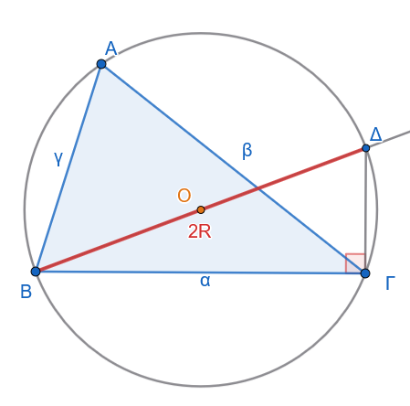{fig-align="center" width="320"}

Φέρνουμε τη διάμετρο $BΔ = 2R$ και τη χορδή $ΓΔ$.
Στο εγγεγραμμένο τρίγωνο $BΓΔ$, η γωνία $\widehat{BΓΔ} = 90^\circ$ διότι βαίνει σε ημικύκλιο.

Από το ορθογώνιο τρίγωνο $BΓΔ$ ισχύει: $$ημ Δ = \frac{\text{απέναντι κάθετη}}{\text{υποτείνουσα}} = \frac{a}{BΔ} = \frac{a}{2R} \implies a = 2R ημ Δ \quad$$

Όμως, οι εγγεγραμμένες γωνίες $A$ και $Δ$ βαίνουν στο ίδιο τόξο $BΓ$, άρα $Δ = A$.

Συνεπώς: $$ημ A = ημ Δ = \frac{a}{2R} \iff \mathbf{\frac{α}{ημ A} = 2R} \quad$$

2.  **Περίπτωση 2η (Η γωνία** $A$ είναι αμβλεία):

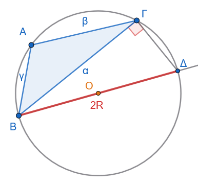{fig-align="center" width="300"}

Φέρνουμε πάλι τη διάμετρο $BΔ = 2R$.
Το τετράπλευρο $ABΔΓ$ είναι εγγεγραμμένο στον κύκλο, οπότε οι απέναντι γωνίες $A$ και $Δ$ είναι παραπληρωματικές ($A + Δ = 180^\circ \implies ημ Δ = ημ(180^\circ - A) = ημ A$).

Από το ορθογώνιο τρίγωνο $BCD$ έχουμε: $$ημ Δ = \frac{a}{2R} \implies ημ A = \frac{α}{2R} \iff \mathbf{\frac{α}{ημ A} = 2R} \quad$$

3.  **Περίπτωση 3η (Η γωνία** $A$ είναι ορθή, $A = 90^\circ$):

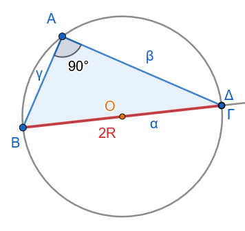{fig-align="center" width="300"}

Τότε η πλευρά $a$ είναι η διάμετρος του κύκλου ($a = 2R$) και $ημ A = ημ 90^\circ = 1$.

Επομένως, $\dfrac{a}{ημ A} = \dfrac{2R}{1} = 2R$.

Με τον ίδιο ακριβώς τρόπο αποδεικνύεται ότι $\dfrac{β}{ημ B} = 2R$ και $\dfrac{γ}{ημ Γ} = 2R$.
Άρα $\dfrac{a}{ημ A} = \dfrac{β}{ημ B} = \dfrac{γ}{ημ Γ} = 2R$.

*(Όπερ έδει δείξαι)*
::::

------------------------------------------------------------------------

::: my-callout-sos
**Παρατήρηση**

Ο νόμος ημιτόνων αποτελείται από αναλογίες, Σε κάθε μία αναλογία π.χ $$\mathbf{\frac{α}{ημ A} = \frac{β}{ημ B}} \quad$$ αν γνωρίζουμε τους τρεις όρους της αναλογίας μπορούμε να βρούμε τον τέταρτο λύνοντας ως προς αυτόν τον άγνωστο όρο.

Το ίδιο και για την $$\mathbf{\frac{α}{ημ A}   = 2R} \quad$$
:::

------------------------------------------------------------------------

#### **ΠΑΡΑΔΕΙΓΜΑΤΑ**

:::: {.math-box .example-box}
::: {.math-title .example-title}
**Παράδειγμα 1:**
:::

Να επιλυθεί το τρίγωνο $ABΓ$ με $a = 12$, $A = 40^\circ$ και $B = 85^\circ$.
::::

:::: {.math-box .examplesolution-box}
::: {.math-title .examplesolution-title}
**Λύση**

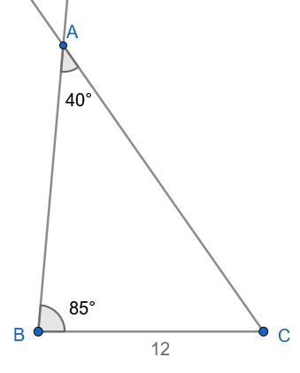{fig-align="center" width="300"}
:::

1.  Υπολογισμός της τρίτης γωνίας $Γ$: $$A + B + Γ = 180^\circ \implies Γ = 180^\circ - (40^\circ + 85^\circ) = 180^\circ - 125^\circ \implies \mathbf{Γ = 55^\circ}$$

2.  Υπολογισμός της πλευράς $β$ με τον Νόμο των Ημιτόνων: $$\frac{a}{ημ A} = \frac{β}{ημ B} \implies β = \frac{a \cdot ημ B}{ημ A} = \frac{12 \cdot ημ 85^\circ}{ημ 40^\circ} \approx \frac{12 \cdot 0.9962}{0.6428} \approx \mathbf{18.60}$$

3.  Υπολογισμός της πλευράς $c$: $$\frac{a}{ημ A} = \frac{γ}{ημ Γ} \implies γ = \frac{a \cdot ημ Γ}{ημ A} = \frac{12 \cdot ημ 55^\circ}{ημ 40^\circ} \approx \frac{12 \cdot 0.8192}{0.6428} \approx \mathbf{15.29}$$
::::

:::: {.math-box .example-box}
::: {.math-title .example-title}
**Παράδειγμα 2:**
:::

Να επιλυθεί το τρίγωνο $ABΓ$ με $a = 20$, $β = 30$ και $B = 30^\circ$.
::::

:::: {.math-box .examplesolution-box}
::: {.math-title .examplesolution-title}
**Λύση**

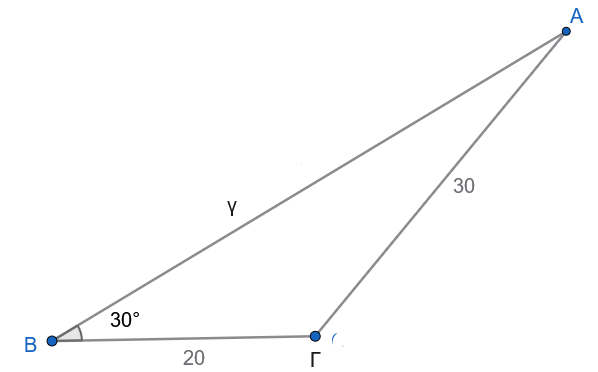{fig-align="center" width="400"}
:::

1.  Από τον Νόμο των Ημιτόνων υπολογίζουμε το $ημ A$: $$\frac{a}{ημ A} = \frac{β}{ημ B} \implies ημ A = \frac{a \cdot ημ B}{β} = \frac{20 \cdot ημ 30^\circ}{30} = \frac{20 \cdot 0.5}{30} = \mathbf{\frac{1}{3} \approx 0.3333}$$

2.  Αναζητούμε τη γωνία $A \in (0^\circ, 180^\circ)$: $$ημ A \approx 0.3333 \implies A_1 \approx 19.47^\circ \quad \text{ή} \quad A_2 = 180^\circ - 19.47^\circ \approx 160.53^\circ$$

    - **Έλεγχος δυνατότητας:** Επειδή $a < β$ ($20 < 30$), πρέπει υποχρεωτικά και οι απέναντι γωνίες να ικανοποιούν τη σχέση $A < B = 30^\circ$.

    - Η τιμή $A_2 \approx 160.53^\circ$ απορρίπτεται διότι $A_2 > B$ (επίσης $A_2 + B = 190.53^\circ > 180^\circ$).

    - Δεκτή είναι μόνο η γωνία $A \approx 19.47^\circ$.

3.  Υπολογισμός της γωνίας $Γ$: $$Γ = 180^\circ - (A + B) \approx 180^\circ - (19.47^\circ + 30^\circ) = \mathbf{130.53^\circ}$$

4.  Υπολογισμός της πλευράς $γ$: $$γ = \frac{β \cdot ημ Γ}{ημ B} = \frac{30 \cdot ημ 130.53^\circ}{ημ 30^\circ} = \frac{30 \cdot 0.7601}{0.5} \approx \mathbf{45.61}$$
::::

------------------------------------------------------------------------

:::: {.math-box .example-box}
::: {.math-title .example-title}
**Παράδειγμα 3:**
:::

Ένα σώμα βάρους $\vec{w}$ ισορροπεί αναρτημένο από έναν κεντρικό μεταλλικό κόμβο $K$.

Στον κόμβο $K$ συνδέονται δύο μη εκτατά καλώδια $KA$ και $KB$ από την οροφή (ταβάνι), τα οποία ασκούν δυνάμεις τάσης $\vec{T}_1$ και $\vec{T}_2$ αντίστοιχα, καθώς και ένα καλώδιο με το οποίο ένα άνθρωπος τραβάει το βάρος ισορροπώντας το σύστημα ασκώντας τάση $\vec{T}_3$ .

Οι διευθύνσεις των τριών δυνάμεων σχηματίζουν μεταξύ τους γωνίες:

- $θ_1 = (\widehat{\vec{T}_2, \vec{T}_3})$

- $θ_2 = (\widehat{\vec{T}_1, \vec{T}_3})$

- $θ_3 = (\widehat{\vec{T}_1, \vec{T}_2})$

όπως φαίνεται στην ισορροπία του κόμβου ($\vec{T}_1 + \vec{T}_2 + \vec{T}_3 = \vec{0}$).

1.  Θεωρώντας ότι η συνισταμένη $\vec{T}_{12}$ των $\vec{T}_1$ και $\vec{T}_2$ εξουδετερώνει την $\vec{T}_3$ (δηλαδή $\vec{T}_{12} = -\vec{T}_3$), να σχεδιάσετε το αντίστοιχο διανυσματικό τρίγωνο.

2.  Εφαρμόζοντας το **νόμο των ημιτόνων** στο τρίγωνο αυτό και χρησιμοποιώντας τις τριγωνομετρικές ιδιότητες των παραπληρωματικών γωνιών, να αποδείξετε ότι: $$\frac{T_1}{ημθ_1} = \frac{T_2}{ημθ_2} = \frac{T_3}{ημθ_3}$$
::::

:::: {.math-box .examplesolution-box}
::: {.math-title .examplesolution-title}
**Λύση**

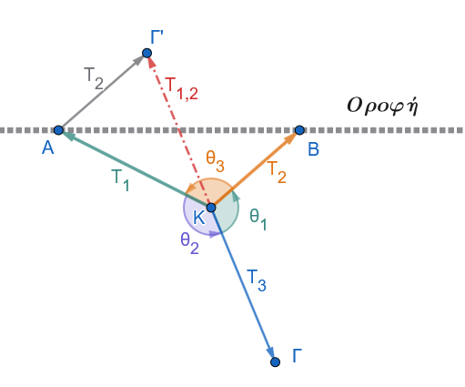{fig-align="center" width="400"}
:::

Εφαρμόζουμε τον νόμο των ημιτόνων στο τρίγωνο ΚΑΓ'

$$\frac{T_1}{ημ \widehat{AΓ'Κ}} = \frac{T_2}{ημ \widehat{ΑΚΓ'}} = \frac{T_{1,2}}{ημ \widehat{KAΓ'}} \implies \frac{T_1}{ημ θ_1} = \frac{T_2}{ημθ_2} = \frac{T_{3}}{ημ θ_3}$$

Επειδή $\widehat{AΓ'Κ}=\widehat{Γ'ΚΒ}=180^ο-θ_1 \implies ημ\widehat{AΓ'Κ}=ημ\widehat{Γ'ΚΒ}=ημ(180^ο-θ_1)=ημθ_1$ ,

$\widehat{AΚΓ'}=180^ο-θ_2 \implies ημ\widehat{AΚΓ'}=ημ(180^ο-θ_2)=ημθ_2$ και

$\widehat{ΚAΓ'}=180^ο-θ_3 \implies ημ\widehat{ΚΑΓ'}=ημ(180^ο-θ_3)=ημθ_3$
::::

------------------------------------------------------------------------

### Νόμος των Συνημίτονων

:::: {.math-box .theorem-box}
::: {.math-title .theorem-title}
**ΘΕΩΡΗΜΑ (Νόμος των Συνημίτονων)**
:::

Σε κάθε τρίγωνο $ABΓ$, το τετράγωνο οποιασδήποτε πλευράς ισούται με το άθροισμα των τετραγώνων των δύο άλλων πλευρών, ελαττωμένο κατά το διπλάσιο γινόμενό τους επί το συνημίτονο της περιεχόμενης γωνίας τους: $$\mathbf{α^2 = β^2 + γ^2 - 2βγ συν A} \quad$$ $$\mathbf{β^2 = α^2 + γ^2 - 2αγ συν B} \quad$$ $$\mathbf{γ^2 = α^2 + β^2 - 2aβ συν Γ} \quad$$
::::

:::: {.math-box .apodeixi-box}
::: {.math-title .apodeixi-title}
**ΑΠΟΔΕΙΞΗ**

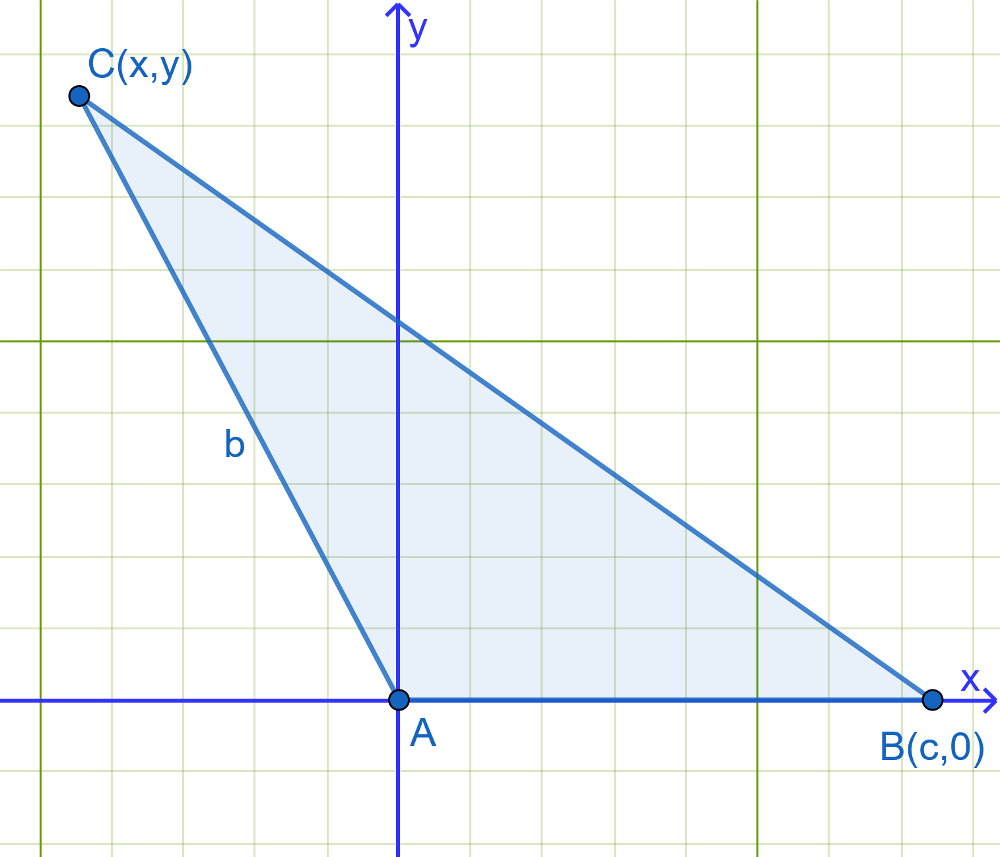{fig-align="center" width="400"}
:::

Θεωρούμε καρτεσιανό σύστημα συντεταγμένων με αρχή την κορυφή $A(0,0)$ και τον θετικό ημιάξονα $Ax$ να ταυτίζεται με την πλευρά $AB$ (μήκους $c$).

- Οι συντεταγμένες της κορυφής $B$ είναι $B(c, 0)$.

- Οι συντεταγμένες της κορυφής $C$ εκφράζονται μέσω της γωνίας $A$ και της υποτείνουσας/πλευράς $β$ ως: $$C(x, y) = C(β συν A, β ημ A) \quad$$

Η απόσταση των σημείων $B$ και $C$ είναι το μήκος της πλευράς $a = (BC)$.

Από τον τύπο της απόστασης δύο σημείων στο επίπεδο έχουμε: $$a^2 = (BC)^2 = (x_C - x_B)^2 + (y_C - y_B)^2 \quad$$ $$a^2 = (β συν A - γ)^2 + (β ημ A - 0)^2 \quad$$ $$a^2 = β^2 συν^2 A - 2βc συν A + γ^2 + β^2 ημ^2 A \quad$$ $$a^2 = β^2 (ημ^2 A + συν^2 A) + γ^2 - 2βγ συν A \quad$$

Επειδή $ημ^2 A + συν^2 A = 1$, λαμβάνουμε: $$\mathbf{α^2 = β^2 + γ^2 - 2βγ συν A} \quad$$

Όμοια αποδεικνύονται και οι άλλοι τύποι.

*(Όπερ έδει δείξαι)*
::::

::: my-callout-sos
**Παρατήρηση**

Ο νόμος συνημιτόνων αποτελείται από ισότητες.
Σε κάθε μία ισότητα π.χ $$\mathbf{α^2 = β^2 + γ^2 - 2βγ συν A} \quad$$, αν γνωρίζουμε όλα τα στοιχεία εκτός από ένα (άγνωστο), μπορούμε να βρούμε τον άγνωστο λύνοντας ως προς αυτόν τον άγνωστο όρο.
:::

------------------------------------------------------------------------

### **ΠΟΡΙΣΜΑ: Τύποι Εμβαδού Τριγώνου**

:::: {.math-box .corollary-box}
::: {.math-title .corollary-title}
1.  **Βασικός Τύπος Ημιτόνου για το Εμβαδόν:**
:::

Το εμβαδόν $E$ ενός τριγώνου $ABΓ$ ισούται με το μισό του γινομένου δύο πλευρών του επί το ημίτονο της περιεχόμενης γωνίας τους:

$$\mathbf{E = \frac{1}{2}β γ \  ημ A = \frac{1}{2}αγ \  ημ B = \frac{1}{2}αβ \ ημ Γ} \quad$$
::::

:::: {.math-box .corollaryproof-box}
::: {.math-title .corollaryproof-title}
**Απόδειξη:**

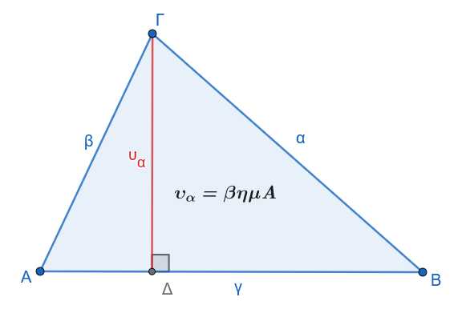{fig-align="center" width="400"}
:::

Φέρνουμε το ύψος $h_a = ΓΔ$ από την κορυφή $Γ$ προς την πλευρά $γ = AB$.

Στο ορθογώνιο τρίγωνο $AΔΓ$ ισχύει $υ_a = β ημ A$.

Το εμβαδόν του τριγώνου είναι: $$E = \frac{1}{2} \cdot \text{βάση} \cdot \text{ύψος} = \frac{1}{2} γ \cdot υ_a = \frac{1}{2} γ (β\ ημ A) = \mathbf{\frac{1}{2}βγ\ ημ A} \quad$$
::::

:::: {.math-box .corollary-box}
::: {.math-title .corollary-title}
2.  **Έκφραση μέσω της Ακτίνας**
:::

$R$ του Περιγεγραμμένου Κύκλου:
::::

:::: {.math-box .corollaryproof-box}
::: {.math-title .corollaryproof-title}
**Απόδειξη:**
:::

- Από τον Νόμο των Ημιτόνων ισχύει $ημ A = \dfrac{a}{2R}$.
  Αντικαθιστώντας στον τύπο του εμβαδού: $$E = \frac{1}{2}βγ \cdot \left(\frac{a}{2R}\right) \implies \mathbf{E = \frac{aβγ}{4R}} \quad$$

- Αντικαθιστώντας $a = 2R ημ A$, $β = 2R ημ B$, $c = 2R ημ C$: $$E = \frac{(2R ημ A)(2R ημ B)(2R ημ Γ)}{4R} \implies \mathbf{E = 2R^2 ημ A ημ B ημ Γ} \quad$$
::::

:::: {.math-box .corollary-box}
::: {.math-title .corollary-title}
3.  **Τύπος του Ήρωνα:**
:::

Αν $\tau = \dfrac{a+β+γ}{2}$ είναι η ημιπερίμετρος του τριγώνου, τότε:

$$\mathbf{E = \sqrt{τ(τ-α)(τ-β)(τ-γ)}} \quad$$
::::

------------------------------------------------------------------------

#### **ΠΑΡΑΔΕΙΓΜΑΤΑ**

:::: {.math-box .example-box}
::: {.math-title .example-title}
**Παράδειγμα 1:**
:::

Να επιλυθεί το τρίγωνο $ABΓ$ με $a = 30$, $β = 20$ και $γ = 40$.
::::

:::: {.math-box .examplesolution-box}
::: {.math-title .examplesolution-title}
**Λύση**

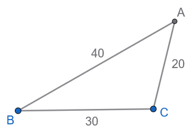{fig-align="center" width="250"}
:::

1.  Υπολογισμός της γωνίας $A$ από τον Νόμο των Συνημίτονων: $$συν A = \frac{β^2 + γ^2 - a^2}{2βc} = \frac{20^2 + 40^2 - 30^2}{2 \cdot 20 \cdot 40} = \frac{400 + 1600 - 900}{1600} =\\  \frac{1100}{1600} = \mathbf{0.6875} \implies \mathbf{A \approx 46.57^\circ}$$

2.  Υπολογισμός της γωνίας $B$: $$συν B = \frac{a^2 + γ^2 - β^2}{2ac} = \frac{30^2 + 40^2 - 20^2}{2 \cdot 30 \cdot 40} = \frac{900 + 1600 - 400}{2400} = \\  \frac{2100}{2400} = \mathbf{0.875} \implies \mathbf{B \approx 28.96^\circ}$$

3.  Υπολογισμός της γωνίας $\ Γ$: $$Γ = 180^\circ - (A + B) \approx 180^\circ - (46.57^\circ + 28.96^\circ) = \mathbf{104.47^\circ}$$
::::

:::: {.math-box .example-box}
::: {.math-title .example-title}
**Παράδειγμα 2:**
:::

Να επιλυθεί το τρίγωνο $ABΓ$ με $β = 20$, $γ = 35$ και $A = 60^\circ$.
::::

:::: {.math-box .examplesolution-box}
::: {.math-title .examplesolution-title}
**Λύση**
:::

1.  Υπολογισμός της πλευράς $a$ από τον Νόμο των Συνημίτονων: $$a^2 = β^2 + γ^2 - 2βγ συν A = 20^2 + 35^2 - 2 \cdot 20 \cdot 35 \cdot συν 60^\circ = \\  400 + 1225 - 1400 \cdot 0.5 = 1625 - 700 = 925$$ $$\mathbf{a = \sqrt{925} = 5\sqrt{37} \approx 30.41}$$

2.  Υπολογισμός της γωνίας $B$: $$συν B = \frac{a^2 + γ^2 - β^2}{2aγ} = \frac{925 + 1225 - 400}{2 \cdot 30.41 \cdot 35} = \frac{1750}{2128.7} \approx \mathbf{0.8221} \implies \mathbf{B \approx 34.70^\circ}$$

3.  Υπολογισμός της γωνίας $\ Γ$: $$Γ = 180^\circ - (60^\circ + 34.70^\circ) = \mathbf{85.30^\circ}$$
::::

------------------------------------------------------------------------

:::: {.math-box .example-box}
::: {.math-title .example-title}
**Παράδειγμα 3:**
:::

Ένα ταχύπλοο σκάφος (Α) κινείται σε ένα ποτάμι.

- Η ταχύτητα του σκάφους ως προς το νερό συμβολίζεται με $\vec{v}_1$ και έχει μέτρο $v_1$.

- Η ταχύτητα του ρεύματος του ποταμού συμβολίζεται με $\vec{v}_2$ και έχει μέτρο $v_2$.

Τα δύο διανύσματα των ταχυτήτων σχηματίζουν μεταξύ τους γωνία $\phi$.

Σύμφωνα με την αρχή της σχετικότητας της κίνησης, η ολική ταχύτητα $\vec{v}$ του σκάφους ως προς την όχθη είναι η συνισταμένη: $$\vec{v} = \vec{v}_1 + \vec{v}_2$$

Με τη βοήθεια του κανόνα του παραλληλογράμμου και εφαρμόζοντας το **νόμο των συνημιτόνων** στο κατάλληλο τρίγωνο, να αποδείξετε ότι το μέτρο $v$ της ολικής ταχύτητας δίνεται από τη σχέση: $$v^2 = v_1^2 + v_2^2 + 2v_1 v_2 συν\phi$$
::::

:::: {.math-box .examplesolution-box}
::: {.math-title .examplesolution-title}
**Λύση**

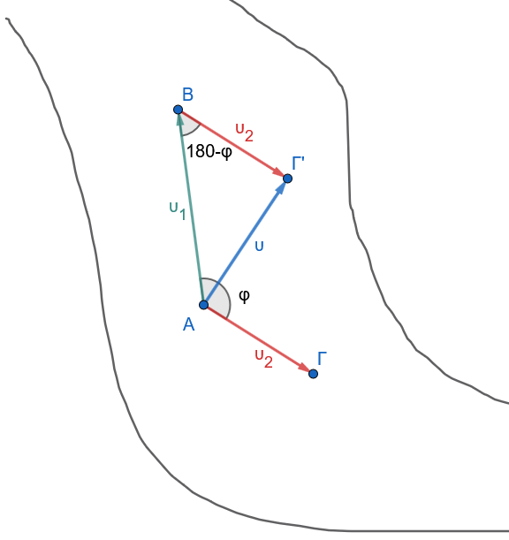{fig-align="center" width="350"}
:::

**Σύντομη υπόδειξη επίλυσης:**

Στο τρίγωνο σύνθεσης των διανυσμάτων, η απέναντι γωνία από την ολική ταχύτητα $\vec{v}$ είναι παραπληρωματική της γωνίας $\phi$, δηλαδή $180^\circ - \phi$.

Εφαρμόζοντας τον νόμο των συνημιτόνων: $v^2 = v_1^2 + v_2^2 - 2v_1 v_2 συν(180^\circ - \phi)$.

Επειδή $συν(180^\circ - \phi) = -συν\phi$, προκύπτει άμεσα το πρόσημο $+$ στον όρο του γινομένου).
::::

------------------------------------------------------------------------

### Ασκήσεις στην Επίλυση Τριγώνου

#### **Ομάδα Α: Υπολογισμός Στοιχείων & Εμβαδού**

1.  Να επιλυθεί το τρίγωνο $ABΓ$ με $β = 10$, $B = 45^\circ$ και $Γ = 60^\circ$.

2.  Να επιλυθεί το τρίγωνο $ABΓ$ με $a = 7$, $β = 8$ και $γ = 9$.

3.  Να υπολογιστεί το εμβαδόν $E$ και η ακτίνα $R$ του περιγεγραμμένου κύκλου τριγώνου $ABΓ$ με $a = 5$, $β = 6$ και $γ = 7$.

4.  Σε τρίγωνο $ABΓ$ δίνονται $a = 10$, $β = 10\sqrt{3}$ και $A = 30^\circ$.
    Να επιλυθεί το τρίγωνο (να εξεταστεί αν υπάρχουν μία ή δύο λύσεις).

5.  Δίνεται τρίγωνο $ABΓ$ με $a = 4$, $β = 5$ και περιεχόμενη γωνία $Γ = 120^\circ$.
    Να υπολογιστούν η πλευρά $γ$ και το εμβαδόν $E$.

#### **Ομάδα Β: Αποδεικτικές Σχέσεις Πλευρών και Γωνιών**

6.  Να αποδειχθεί ότι σε κάθε τρίγωνο $ABΓ$ ισχύει ο τύπος της προβολής: $$a = β συν Γ + γ συν B$$

> > Σχεδιάστε το ύψος ΑΔ και τότε α=ΒΔ+ΔΓ=.............

:::: {.math-box .exercise-box}
::: {.math-title .exercise-title}
7.  Εκφώνηση
:::

Να αποδειχθεί ότι σε κάθε τρίγωνο $ABΓ$ ισχύει: $$(β + γ)ημ\left(\frac{A}{2}\right) = aσυν\left(\frac{B - Γ}{2}\right)$$
::::

:::: {.math-box .solution-box}
::: {.math-title .solution-title}
Λύση
:::

Για να αποδείξουμε τη σχέση σε κάθε τρίγωνο $ABΓ$: $$(β + γ)ημ\left(\frac{A}{2}\right) = aσυν\left(\frac{B - Γ}{2}\right)$$

θα χρησιμοποιήσουμε τον **νόμο των ημιτόνων** και τους **τύπους μετατροπής αθροίσματος σε γινόμενο**.

------------------------------------------------------------------------

**1: Εφαρμογή του νόμου των ημιτόνων**

Από τον νόμο των ημιτόνων γνωρίζουμε ότι: $$\frac{a}{ημ A} = \frac{β}{ημ B} = \frac{γ}{ημ Γ} = 2R$$ όπου $R$ είναι η ακτίνα του περιγεγραμμένου κύκλου του τριγώνου.

Συνεπώς, οι πλευρές εκφράζονται ως: $$a = 2Rημ A, \quad β = 2Rημ B, \quad γ = 2Rημ Γ$$

------------------------------------------------------------------------

**2: Ανάπτυξη του αριστερού μέλους**

Έστω $L$ το αριστερό μέλος της προς απόδειξη σχέσης: $$L = (β + γ)ημ\left(\frac{A}{2}\right)$$

Αντικαθιστούμε τα $β$ και $c$: $$L = (2Rημ B + 2Rημ Γ)ημ\left(\frac{A}{2}\right) = 2R(ημ B + ημ Γ)ημ\left(\frac{A}{2}\right)$$

Εφαρμόζουμε τον τύπο μετατροπής αθροίσματος ημιτόνων σε γινόμενο: $$ημ B + ημ Γ = 2ημ\left(\frac{B + Γ}{2}\right)συν\left(\frac{B - Γ}{2}\right)$$

Άρα: $$L = 2R \cdot \left[2ημ\left(\frac{B + Γ}{2}\right)συν\left(\frac{B - Γ}{2}\right)\right]ημ\left(\frac{A}{2}\right)$$ $$L = 4Rημ\left(\frac{B + Γ}{2}\right)συν\left(\frac{B - Γ}{2}\right)ημ\left(\frac{A}{2}\right)$$

------------------------------------------------------------------------

**3: Αξιοποίηση της σχέσης των γωνιών του τριγώνου**

Επειδή $A + B + C = 180^\circ$, έχουμε: $$B + Γ = 180^\circ - A \iff \frac{B + Γ}{2} = 90^\circ - \frac{A}{2}$$

Επομένως: $$ημ\left(\frac{B + Γ}{2}\right) = ημ\left(90^\circ - \frac{A}{2}\right) = συν\left(\frac{A}{2}\right)$$

Αντικαθιστούμε στο $L$: $$L = 4R συν\left(\frac{A}{2}\right) συν\left(\frac{B - Γ}{2}\right) ημ\left(\frac{A}{2}\right)$$

Αναδιατάσσουμε τους όρους: $$L = 2R \cdot \left[2ημ\left(\frac{A}{2}\right)συν\left(\frac{A}{2}\right)\right] \cdot συν\left(\frac{B - Γ}{2}\right)$$

------------------------------------------------------------------------

**4: Ολοκλήρωση της απόδειξης**

Χρησιμοποιούμε τον τύπο διπλάσιου τόξου $2ημ\left(\dfrac{A}{2}\right)συν\left(\dfrac{A}{2}\right) = ημ A$: $$L = 2Rημ A \cdot συν\left(\frac{B - Γ}{2}\right)$$

Όμως από τον νόμο των ημιτόνων ισχύει $2Rημ A = a$.

Συνεπώς: $$L = aσυν\left(\frac{B - Γ}{2}\right)$$

που είναι ακριβώς το δεξί μέλος της ισότητας.

Άρα αποδείχθηκε ότι: $$(β + γ)ημ\left(\frac{A}{2}\right) = aσυν\left(\frac{B - Γ}{2}\right)$$
::::

:::: {.math-box .exercise-box}
::: {.math-title .exercise-title}
8.  Εκφώνηση
:::

Να αποδειχθεί ότι σε κάθε τρίγωνο $ABC$ ισχύει: $$a^2 ημ(B - Γ) = (β^2 - γ^2) ημ A$$
::::

:::: {.math-box .solution-box}
::: {.math-title .solution-title}
Λύση
:::

Για να αποδείξουμε ότι σε κάθε τρίγωνο $ABΓ$ ισχύει: $$a^2 ημ(B - Γ) = (β^2 - γ^2)ημ A$$

θα χρησιμοποιήσουμε τον **νόμο των ημιτόνων**.

------------------------------------------------------------------------

**1: Εφαρμογή του νόμου των ημιτόνων**

Από τον νόμο των ημιτόνων έχουμε: $$\frac{a}{ημ A} = \frac{β}{ημ B} = \frac{γ}{ημ Γ} = 2R$$ όπου $R$ είναι η ακτίνα του περιγεγραμμένου κύκλου.

Επομένως: $$a = 2Rημ A, \quad β = 2Rημ B, \quad γ = 2Rημ Γ$$

------------------------------------------------------------------------

**2: Ανάπτυξη του δεξιού μέλους**

Έστω $D$ το δεξί μέλος της ισότητας: $$D = (β^2 - γ^2)ημ A$$

Αντικαθιστούμε τα $β$ και $γ$: $$D = \left[(2Rημ B)^2 - (2Rημ Γ)^2\right]ημ A$$ $$D = 4R^2(ημ^2 B - ημ^2 Γ)ημ A$$

------------------------------------------------------------------------

**3: Χρήση της τριγωνομετρικής ταυτότητας**

Γνωρίζουμε τη βασική ταυτότητα: $$ημ^2 B - ημ^2 Γ = ημ(B + Γ)ημ(B - Γ)$$

*(Απόδειξη της ταυτότητας:* $ημ^2 B - ημ^2 Γ = \dfrac{1 - συν(2B)}{2} - \dfrac{1 - συν(2Γ)}{2} = \dfrac{συν(2Γ) - συν(2B)}{2} = ημ(B+Γ)ημ(B-Γ)$)

Αντικαθιστούμε την ταυτότητα στο $D$: $$D = 4R^2 ημ(B + Γ)ημ(B - Γ)ημ A$$

------------------------------------------------------------------------

**4: Συσχέτιση των γωνιών του τριγώνου**

Επειδή $A + B + Γ = 180^\circ$, ισχύει: $$B + Γ = 180^\circ - A \implies ημ(B + Γ) = ημ(180^\circ - A) = ημ A$$

Αντικαθιστώντας το $ημ(B + Γ) = ημ A$: $$D = 4R^2 ημ A \cdot ημ(B - Γ)ημ A$$ $$D = 4R^2 ημ^2 A \cdot ημ(B - Γ)$$ $$D = (2Rημ A)^2 ημ(B - Γ)$$

------------------------------------------------------------------------

**5: Τελικό συμπέρασμα**

Επειδή από τον νόμο των ημιτόνων ισχύει $a = 2Rημ A$, έχουμε: $$(2Rημ A)^2 = a^2$$

Επομένως: $$D = a^2 ημ(B - Γ)$$

Άρα αποδείχθηκε ότι: $$a^2 ημ(B - Γ) = (β^2 - γ^2)ημ A$$
::::

9.  Να αποδειχθεί η ταυτότητα για κάθε τρίγωνο ΑΒΓ: $$a(ημ B - ημ Γ) + β(ημ Γ - ημ A) + γ(ημ A - ημ B) = 0$$

::: my-callout-sos
**Υπόδειξη**

$ημΑ=\dfrac{α}{2R}, \ \ \ \ ημΒ=\dfrac{β}{2R}, \ \ \ \ ημΓ=\dfrac{γ}{2R}$

Αντικαταστήστε στην δοσμένη ισότητα και κάντε πράξεις.
:::

:::: {.math-box .exercise-box}
::: {.math-title .exercise-title}
10. Εκφώνηση
:::

Να αποδειχθεί ότι σε κάθε τρίγωνο ΑΒΓ ισχύει: $$β συν B + γ συν Γ = a συν(B - Γ)$$
::::

:::: {.math-box .solution-box}
::: {.math-title .solution-title}
Λύση
:::

Για να αποδείξουμε τη σχέση σε ένα τυχαίο τρίγωνο $A B Γ$, θα χρησιμοποιήσουμε τον **Νόμο των Ημιτόνων** και βασικές τριγωνομετρικές ταυτότητες.

------------------------------------------------------------------------

**1: Εφαρμογή του Νόμου των Ημιτόνων**

Από τον Νόμο των Ημιτόνων γνωρίζουμε ότι: $$\frac{a}{ημ A} = \frac{β}{ημ B} = \frac{γ}{ημ Γ} = 2R$$

όπου $R$ είναι η ακτίνα του περιγεγραμμένου κύκλου του τριγώνου $A B C$.

Επομένως, οι πλευρές εκφράζονται ως:

- $a = 2R ημ A$

- $β = 2R ημ B$

- $γ = 2R ημ Γ$

------------------------------------------------------------------------

**2: Αντικατάσταση στο αριστερό μέλος (**$A M$)

Αντικαθιστούμε τα $β$ και $c$ στο αριστερό μέλος της σχέσης: $$A M = β \cdot συν B + γ \cdot συν Γ$$ $$A M = (2R ημ B) συν B + (2R ημ Γ) συν Γ$$

Βγάζουμε κοινό παράγοντα το $R$: $$A M = R \cdot (2 ημ B συν B + 2 ημ Γ συν Γ)$$

Χρησιμοποιώντας τον τύπο του διπλάσιου τόξου $ημ(2x) = 2 ημ x συν x$, έχουμε: $$A M = R \cdot (ημ 2B + ημ 2Γ)$$

------------------------------------------------------------------------

**3: Μετατροπή του αθροίσματος ημιτόνων σε γινόμενο**

Χρησιμοποιούμε την τριγωνομετρική ταυτότητα: $$ημ x + ημ y = 2 ημ\left(\frac{x + y}{2}\right) συν\left(\frac{x - y}{2}\right)$$

Για $x = 2B$ και $y = 2Γ$: $$ημ 2B + ημ 2Γ = 2 ημ\left(\frac{2B + 2Γ}{2}\right) συν\left(\frac{2B - 2Γ}{2}\right) = 2 ημ(B + Γ) συν(B - Γ)$$

Συνεπώς, το αριστερό μέλος γίνεται: $$A M = R \cdot [2 ημ(B + Γ) συν(B - Γ)]$$

------------------------------------------------------------------------

**4: Σύνδεση με τη γωνία** $A$ και την πλευρά $a$

Επειδή $A, B, Γ$ είναι γωνίες τριγώνου, ισχύει: $$A + B + Γ = 180^\circ \implies B + Γ = 180^\circ - A$$

Άρα: $$ημ(B + Γ) = ημ(180^\circ - A) = ημ A$$

Αντικαθιστούμε πίσω στην έκφραση: $$A M = 2R ημ A \cdot συν(B - Γ)$$

Γνωρίζουμε όμως από το Βήμα 1 ότι $a = 2R ημ A$.
Άρα: $$A M = a \cdot συν(B - Γ)$$

Το οποίο είναι ακριβώς το δεξιό μέλος της ζητούμενης ισότητας.

Η ισότητα αποδείχθηκε.
::::

#### **Ομάδα Γ: Ασκήσεις με Εμβαδά και Ακτίνες**

11. Να αποδειχθεί ότι το εμβαδόν τριγώνου $ABC$ δίνεται από τον τύπο: $$E = \frac{a^2 ημ B ημ Γ}{2 ημ A}$$

::: my-callout-sos
**Υπόδειξη**

Αντικαταστήστε $ημΒ=\dfrac{β}{2R} \ \ και \ \ ημΑ=\dfrac{α}{2R}$

Απλοποιήστε
:::

:::: {.math-box .exercise-box}
::: {.math-title .exercise-title}
12. Εκφώνηση
:::

Για το παρακάτω σχήμα να αποδείξετε ότι $B Γ^2 = 2x^2 (1 + ημ \theta)$.

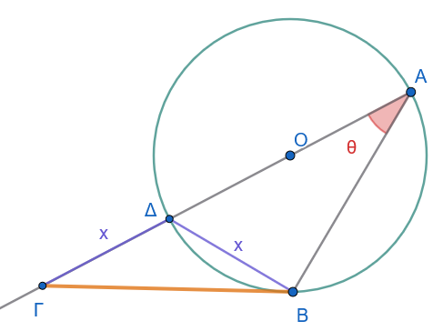{fig-align="center" width="350"}
::::

------------------------------------------------------------------------

:::: {.math-box .solution-box}
::: {.math-title .solution-title}
Λύση
:::

**1: Γεωμετρικές παρατηρήσεις**

1.  Το σημείο $O$ είναι το κέντρο του κύκλου και βρίσκεται πάνω στο ευθύγραμμο τμήμα $A Δ$.
    Συνεπώς, το τμήμα $A Δ$ είναι **διάμετρος** του κύκλου.

2.  Η γωνία $\widehat{A B Δ}$ είναι εγγεγραμμένη γωνία που βαίνει σε ημικύκλιο (στη διάμετρο $A Δ$), επομένως είναι ορθή: $$\widehat{A B Δ} = 90^\circ$$

3.  Στο ορθογώνιο τρίγωνο $A B Δ$, το άθροισμα των οξειών γωνιών ισούται με $90^\circ$: $$\widehat{A Δ B} = 90^\circ - \widehat{B A Δ} = 90^\circ - \theta$$

------------------------------------------------------------------------

**2: Υπολογισμός της γωνίας** $\widehat{B Δ Γ}$

Τα σημεία $A$, $Δ$ και $Γ$ βρίσκονται στην ίδια ευθεία (η ευθεία της διαμέτρου προεκτείνεται προς το $C$).

Επομένως, οι γωνίες $\widehat{A Δ B}$ και $\widehat{B Δ Γ}$ είναι **παραπληρωματικές**: $$\widehat{B Δ Γ} = 180^\circ - \widehat{A Δ B}$$ $$\widehat{B Δ Γ} = 180^\circ - (90^\circ - \theta) = 90^\circ + \theta$$

------------------------------------------------------------------------

**3: Εφαρμογή του Νόμου των Συνημιτόνων στο τρίγωνο** $B Δ Γ$

Στο τρίγωνο $B Δ Γ$ δίνεται ότι:

- $Γ Δ = x$

- $B Δ = x$

- $\widehat{B Δ Γ} = 90^\circ + \theta$

Εφαρμόζουμε τον **Νόμο των Συνημιτόνων** για την πλευρά $B C$: $$B Γ^2 = Γ Δ^2 + B Δ^2 - 2 \cdot Γ Δ \cdot B Δ \cdot συν(\widehat{B Δ Γ})$$

Αντικαθιστούμε τα δεδομένα μήκη και τη γωνία: $$B Γ^2 = x^2 + x^2 - 2 \cdot x \cdot x \cdot συν(90^\circ + \theta)$$ $$B Γ^2 = 2x^2 - 2x^2 συν(90^\circ + \theta)$$

------------------------------------------------------------------------

**4: Τριγωνομετρική αναγωγή**

Από τις τριγωνομετρικές ταυτότητες αναγωγής στο πρώτο τεταρτημόριο ισχύει: $$συν(90^\circ + \theta) = -ημ \theta$$

Αντικαθιστούμε στην έκφραση του $B Γ^2$: $$B Γ^2 = 2x^2 - 2x^2 (-ημ \theta)$$ $$B Γ^2 = 2x^2 + 2x^2 ημ \theta$$

Βγάζουμε κοινό παράγοντα το $2x^2$: $$B Γ^2 = 2x^2 (1 + ημ \theta)$$

Η ζητούμενη σχέση αποδείχθηκε.
::::

:::: {.math-box .exercise-box}
::: {.math-title .exercise-title}
13. Εκφώνηση
:::

Στο παρακάτω σχήμα να απαντήσετε στα ερωτήματα:

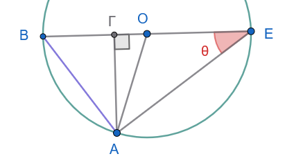{fig-align="center" width="350"}

- α) Να βρεθεί η γωνία $A\widehat{O}\Gamma$ ως συνάρτηση του $\theta$

- β) Στο τρίγωνο $\triangle A B E$, να προσδιοριστεί μια έκφραση για το $συν \theta$

- γ) Στο τρίγωνο $\triangle A \Gamma E$, να προσδιοριστεί μια έκφραση για το $ημ \theta$

- δ) Στο τρίγωνο $\triangle A \Gamma O$, να προσδιοριστεί μια έκφραση για το $ημ 2\theta$

- ε) Χρησιμοποιώντας τα αποτελέσματα των προηγούμενων ερωτημάτων, να αποδειχθεί ότι $ημ 2\theta = 2 ημ \theta συν \theta$
::::

------------------------------------------------------------------------

:::: {.math-box .solution-box}
::: {.math-title .solution-title}
Λύση
:::

**α) Να βρεθεί η γωνία** $A\widehat{O}\Gamma$ ως συνάρτηση του $\theta$

Στο τρίγωνο $O A E$, τα τμήματα $O A$ και $O E$ είναι ακτίνες του ημικυκλίου ($O A = O E = R$), επομένως το τρίγωνο $O A E$ είναι ισοσκελές.

- Άρα: $O\widehat{A}E = O\widehat{E}A = \theta$.

Η γωνία $A\widehat{O}\Gamma$ (ή $A\widehat{O}B$) είναι εξωτερική γωνία του τριγώνου $O A E$ στην κορυφή $O$.
Κάθε εξωτερική γωνία τριγώνου ισούται με το άθροισμα των δύο απέναντι εσωτερικών γωνιών: $$A\widehat{O}\Gamma = O\widehat{A}E + O\widehat{E}A = \theta + \theta = 2\theta$$

*(Ισοδύναμα, η επίκεντρη γωνία* $A\widehat{O}B$ είναι διπλάσια της αντίστοιχης εγγεγραμμένης γωνίας $A\widehat{E}B = \theta$ που βαίνει στο ίδιο τόξο $A B$, άρα $A\widehat{O}\Gamma = 2\theta$.)

------------------------------------------------------------------------

**β) Στο τρίγωνο** $\triangle A B E$, να προσδιοριστεί μια έκφραση για το $συν \theta$

Η γωνία $B\widehat{A}E$ είναι εγγεγραμμένη γωνία που βαίνει στη διάμετρο $B E$, επομένως είναι ορθή ($B\widehat{A}E = 90^\circ$).

Στο ορθογώνιο τρίγωνο $A B E$, το συνημίτονο της οξείας γωνίας $\theta$ ορίζεται ως ο λόγος της προσκείμενης κάθετης πλευράς προς την υποτείνουσα: $$συν \theta = \frac{A E}{B E}$$

Επειδή το $B E$ είναι διάμετρος, ισχύει $B E = 2R$.
Συνεπώς: $$συν \theta = \frac{A E}{2R}$$

------------------------------------------------------------------------

**γ) Στο τρίγωνο** $\triangle A \Gamma E$, να προσδιοριστεί μια έκφραση για το $ημ \theta$

Το τρίγωνο $A \Gamma E$ είναι ορθογώνιο στο $\Gamma$ (αφού $A\Gamma \perp B E$).

Το ημίτονο της γωνίας $\theta$ ορίζεται ως ο λόγος της απέναντι κάθετης πλευράς προς την υποτείνουσα: $$ημ \theta = \frac{A \Gamma}{A E}$$

------------------------------------------------------------------------

**δ) Στο τρίγωνο** $\triangle A \Gamma O$, να προσδιοριστεί μια έκφραση για το $ημ 2\theta$

Το τρίγωνο $A \Gamma O$ είναι ορθογώνιο στο $\Gamma$ με οξεία γωνία $A\widehat{O}\Gamma = 2\theta$ (από το ερώτημα α) και υποτείνουσα την ακτίνα $O A = R$.

Το ημίτονο της γωνίας $2\theta$ είναι: $$ημ 2\theta = \frac{A \Gamma}{O A} = \frac{A \Gamma}{R}$$

------------------------------------------------------------------------

**ε) Χρησιμοποιώντας τα αποτελέσματα των προηγούμενων ερωτημάτων, να αποδειχθεί ότι** $ημ 2\theta = 2 ημ \theta συν \theta$

Από τα ερωτήματα β) και γ) εκφράζουμε τα τμήματα συναρτήσει των τριγωνομετρικών αριθμών:

1.  Από το ερώτημα β): $$A E = 2R συν \theta$$

2.  Από το ερώτημα γ): $$A \Gamma = A E \cdot ημ \theta$$

Αντικαθιστούμε το $A E$ στη δεύτερη σχέση: $$A \Gamma = (2R συν \theta) \cdot ημ \theta = 2R ημ \theta συν \theta$$

Από το ερώτημα δ) γνωρίζουμε ότι: $$ημ 2\theta = \frac{A \Gamma}{R}$$

Αντικαθιστούμε το $A \Gamma$: $$ημ 2\theta = \frac{2R ημ \theta συν \theta}{R} = 2 ημ \theta συν \theta$$

Η ταυτότητα αποδείχθηκε γεωμετρικά.
::::

:::: {.math-box .exercise-box}
::: {.math-title .exercise-title}
14. Εκφώνηση
:::

Σε τρίγωνο $ABΓ$ ισχύει $a^2 + β^2 + γ^2 = 8R^2$.
Να αποδειχθεί ότι το τρίγωνο είναι ορθογώνιο.
::::

:::: {.math-box .solution-box}
::: {.math-title .solution-title}
Λύση
:::

Για να αποδείξουμε ότι το τρίγωνο $A B \Gamma$ είναι ορθογώνιο, θα μετασχηματίσουμε τη δοθείσα σχέση χρησιμοποιώντας τον **Νόμο των Ημιτόνων**.

------------------------------------------------------------------------

**1: Εφαρμογή του Νόμου των Ημιτόνων**

Από τον Νόμο των Ημιτόνων γνωρίζουμε ότι: $$a = 2R ημ A, \quad \beta = 2R ημ B, \quad \gamma = 2R ημ \Gamma$$

Υψώνουμε στο τετράγωνο: $$a^2 = 4R^2 ημ^2 A, \quad \beta^2 = 4R^2 ημ^2 B, \quad \gamma^2 = 4R^2 ημ^2 \Gamma$$

Αντικαθιστούμε στη δοθείσα σχέση $a^2 + \beta^2 + \gamma^2 = 8R^2$: $$4R^2 ημ^2 A + 4R^2 ημ^2 B + 4R^2 ημ^2 \Gamma = 8R^2$$

Διαιρώντας και τα δύο μέλη με το $4R^2$ (αφού $R \neq 0$): $$ημ^2 A + ημ^2 B + ημ^2 \Gamma = 2$$

------------------------------------------------------------------------

**2: Υποβιβασμός βαθμού με συνημίτονα**

Χρησιμοποιούμε τον τύπο υποβιβασμού βαθμού $ημ^2 x = \frac{1 - συν 2x}{2}$: $$\frac{1 - συν 2A}{2} + \frac{1 - συν 2B}{2} + ημ^2 \Gamma = 2$$

Πολλαπλασιάζουμε τα δύο πρώτα κλάσματα: $$\frac{2 - (συν 2A + συν 2B)}{2} + ημ^2 \Gamma = 2$$ $$1 - \frac{1}{2}(συν 2A + συν 2B) + ημ^2 \Gamma = 2$$

Αφαιρούμε το $1$ και από τα δύο μέλη: $$-\frac{1}{2}(συν 2A + συν 2B) + ημ^2 \Gamma = 1$$ $$ημ^2 \Gamma - 1 = \frac{1}{2}(συν 2A + συν 2B)$$

Επειδή $ημ^2 \Gamma - 1 = -συν^2 \Gamma$, έχουμε: $$-συν^2 \Gamma = \frac{1}{2}(συν 2A + συν 2B)$$

------------------------------------------------------------------------

**3: Μετατροπή σε γινόμενο**

Μετατρέπουμε το άθροισμα των συνημιτόνων σε γινόμενο: $$συν 2A + συν 2B = 2 συν(A + B) συν(A - B)$$

Αντικαθιστούμε: $$-συν^2 \Gamma = \frac{1}{2} \cdot \left[2 συν(A + B) συν(A - B)\right]$$ $$-συν^2 \Gamma = συν(A + B) συν(A - B)$$

Επειδή $A + B + \Gamma = 180^\circ$, έχουμε $A + B = 180^\circ - \Gamma$, επομένως: $$συν(A + B) = συν(180^\circ - \Gamma) = -συν \Gamma$$

Άρα η εξίσωση γίνεται: $$-συν^2 \Gamma = -συν \Gamma \cdot συν(A - B)$$

Μεταφέρουμε όλους τους όρους στο ένα μέλος: $$συν \Gamma \cdot συν(A - B) - συν^2 \Gamma = 0$$ $$συν \Gamma \left[ συν(A - B) - συν \Gamma \right] = 0$$

------------------------------------------------------------------------

**4: Παραγοντοποίηση της αγκύλης**

Αντικαθιστούμε ξανά το $συν \Gamma = -συν(A + B)$: $$συν \Gamma \left[ συν(A - B) - (-συν(A + B)) \right] = 0$$ $$συν \Gamma \left[ συν(A - B) + συν(A + B) \right] = 0$$

Χρησιμοποιούμε την ταυτότητα: $$συν(A - B) + συν(A + B) = 2 συν A συν B$$

Επομένως, η εξίσωση παίρνει την τελική μορφή: $$2 συν A συν B συν \Gamma = 0$$

------------------------------------------------------------------------

**Συμπέρασμα**

Για να μηδενίζεται το γινόμενο, πρέπει τουλάχιστον ένας από τους παράγοντες να είναι ίσος με το μηδέν: $$συν A = 0 \quad \text{ή} \quad συν B = 0 \quad \text{ή} \quad συν \Gamma = 0$$

Καθώς οι γωνίες $A, B, \Gamma$ είναι γωνίες τριγώνου ($0^\circ < A, B, \Gamma < 180^\circ$), αυτό σημαίνει ότι: $$A = 90^\circ \quad \text{ή} \quad B = 90^\circ \quad \text{ή} \quad \Gamma = 90^\circ$$

Άρα, το τρίγωνο $A B \Gamma$ είναι **ορθογώνιο**.
::::

15. Να υπολογιστεί το εμβαδόν τριγώνου $ABΓ$ αν δίνονται $R = 6$, $A = 30^\circ$, $B = 45^\circ$.

::: my-callout-sos
**Υπόδειξη**

Χρησιμοποιήστε τον τύπο $Ε=\dfrac{1}{2}αβ ημΓ$

$α=2RημΑ, \ \ \ β=2RημΒ$

$Γ=180^ο-(Α+Β)$
:::

#### **Ομάδα Δ: Χαρακτηρισμός Είδους Τριγώνου**

16. Αν σε τρίγωνο $ABΓ$ ισχύει $ημ A = 2 ημ B συν Γ$, να αποδειχθεί ότι το τρίγωνο είναι ισοσκελές ($β = γ$).

17. Αν σε τρίγωνο $ABΓ$ ισχύει $a = 2β συν Γ$, να αποδειχθεί ότι το τρίγωνο είναι ισοσκελές ($a = β$).

18. Αν σε τρίγωνο $ABΓ$ ισχύει $ημ^2 A = ημ^2 B + ημ^2 Γ$, να αποδειχθεί ότι το τρίγωνο είναι ορθογώνιο ($A = 90^\circ$).

19. Αν σε τρίγωνο $ABΓ$ ισχύει $εφ A + εφ B = 2 σφ Γ$, να αποδειχθεί ότι $a^2 + β^2 = 3γ^2$.

20. Αν σε τρίγωνο $ABC$ ισχύει $συν A + συν B = ημ C$, να αποδειχθεί ότι το τρίγωνο είναι ορθογώνιο.

:::: {.math-box .exercise-box}
::: {.math-title .exercise-title}
21. Εκφώνηση
:::

Στο παρακάτω σχήμα είναι $ΑΓ=r=ΓΟ$ και $ΑΕ=2ΔΕ$.
Να αποδείξετε ότι $συνθ=\dfrac{1}{4}$

Δεδομένα του προβλήματος:

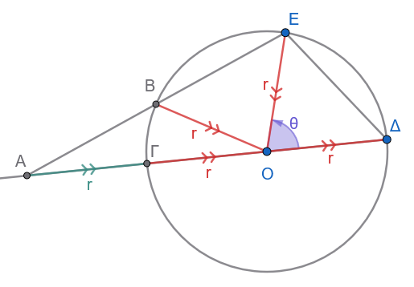{fig-align="center" width="400"}

- Το τμήμα $\Delta\Gamma$ είναι διάμετρος του κύκλου με κέντρο $O$ και ακτίνα $r$, άρα: $$O\Delta = O\Gamma = OE = r$$

- Το σημείο $A$ βρίσκεται στην προέκταση της διαμέτρου $\Delta\Gamma$ με $\Gamma A = r$.
  Επομένως, η απόσταση του $A$ από το κέντρο $O$ είναι: $$OA = O\Gamma + \Gamma A = r + r = 2r$$

- Δίνεται η γωνία $\Delta\widehat{O}E = \theta$.

- Δίνεται η σχέση μεταξύ των μηκών: $AE = 2\Delta E$.
::::

------------------------------------------------------------------------

:::: {.math-box .solution-box}
::: {.math-title .solution-title}
Λύση
:::

**1: Υπολογισμός του μήκους** $\Delta E^2$

Εξετάζουμε το τρίγωνο $O\Delta E$.

- Οι πλευρές του είναι $O\Delta = r$ και $OE = r$.

- Η περιεχόμενη γωνία είναι $\Delta\widehat{O}E = \theta$.

Εφαρμόζουμε τον **Νόμο των Συνημιτόνων** στο τρίγωνο $O\Delta E$: $$\Delta E^2 = O\Delta^2 + OE^2 - 2 \cdot O\Delta \cdot OE \cdot συν \theta$$ $$\Delta E^2 = r^2 + r^2 - 2 \cdot r \cdot r \cdot συν \theta$$ $$\Delta E^2 = 2r^2 - 2r^2 συν \theta = 2r^2 (1 - συν \theta)$$

------------------------------------------------------------------------

**Βήμα 2: Υπολογισμός του μήκους** $AE^2$

Εξετάζουμε το τρίγωνο $OAE$.

- Τα σημεία $A$, $\Gamma$, $O$, $\Delta$ είναι συνευθειακά πάνω στην ευθεία της διαμέτρου.

- Επομένως, η γωνία $A\widehat{O}E$ είναι παραπληρωματική της $\Delta\widehat{O}E = \theta$: $$A\widehat{O}E = 180^\circ - \theta$$ - Οι πλευρές που περιέχουν τη γωνία αυτή είναι $OA = 2r$ και $OE = r$.

Εφαρμόζουμε τον **Νόμο των Συνημιτόνων** στο τρίγωνο $OAE$: $$AE^2 = OA^2 + OE^2 - 2 \cdot OA \cdot OE \cdot συν(180^\circ - \theta)$$

Γνωρίζουμε ότι $συν(180^\circ - \theta) = -συν \theta$, οπότε: $$AE^2 = (2r)^2 + r^2 - 2 \cdot (2r) \cdot r \cdot (-συν \theta)$$ $$AE^2 = 4r^2 + r^2 + 4r^2 συν \theta$$ $$AE^2 = 5r^2 + 4r^2 συν \theta = r^2 (5 + 4συν \theta)$$

------------------------------------------------------------------------

**3: Χρήση της σχέσης** $AE = 2\Delta E$

Υψώνουμε τη δοθείσα σχέση $AE = 2\Delta E$ στο τετράγωνο: $$AE^2 = 4\Delta E^2$$

Αντικαθιστούμε τις εκφράσεις που βρήκαμε στα Βήματα 1 και 2: $$r^2 (5 + 4συν \theta) = 4 \cdot \left[ 2r^2 (1 - συν \theta) \right]$$ $$r^2 (5 + 4συν \theta) = 8r^2 (1 - συν \theta)$$

Επειδή η ακτίνα $r > 0$, διαιρούμε και τα δύο μέλη με το $r^2$: $$5 + 4συν \theta = 8(1 - συν \theta)$$ $$5 + 4συν \theta = 8 - 8συν \theta$$

Χωρίζουμε γνωστούς από αγνώστους: $$4συν \theta + 8συν \theta = 8 - 5$$ $$12συν \theta = 3$$ $$συν \theta = \frac{3}{12}$$ $$συν \theta = \frac{1}{4}$$

Το ζητούμενο αποδείχθηκε.
::::

:::: {.math-box .exercise-box}
::: {.math-title .exercise-title}
22. Εκφώνηση
:::

Το παρακάτω σχήμα δείχνει ένα εγγράψιμο τετράπλευρο $A B \Gamma \Delta$ με: $$\frac{B\Gamma}{\Gamma\Delta} = \frac{A\Delta}{A B}$$

**α)** Να αποδειχθεί ότι το εμβαδόν του εγγράψιμου τετραπλεύρου είναι $\Delta\Gamma \cdot \Delta A \cdot ημ \widehat{\Delta}$.

**β)** Να γραφούν δύο εκφράσεις για το $\Gamma A^2$: μία συναρτήσει του $συν \widehat{\Delta}$ και μία συναρτήσει του $συν \widehat{B}$.

**γ)** Να αποδειχθεί ότι $2\Gamma A^2 = \Gamma\Delta^2 + \Delta A^2 + A B^2 + B\Gamma^2$.

**δ)** Υποθέστε ότι $B\Gamma = 10\text{ μονάδες}$, $\Gamma\Delta = 15\text{ μονάδες}$, $A\Delta = 4\text{ μονάδες}$ και $A B = 6\text{ μονάδες}$.
Να υπολογιστεί το $\Gamma A^2$ (με προσέγγιση ενός δεκαδικού ψηφίου).

**ε)** Να βρεθεί η γωνία $\widehat{B}$.
Στη συνέχεια, να υπολογιστεί το εμβαδόν του $A B \Gamma\Delta$ (με προσέγγιση ενός δεκαδικού ψηφίου).
::::

------------------------------------------------------------------------

:::: {.math-box .solution-box}
::: {.math-title .solution-title}
Λύση

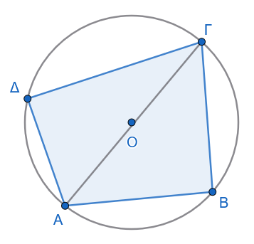{fig-align="center" width="300"}
:::

**α) Απόδειξη για το εμβαδόν του τετραπλεύρου**

Η διαγώνιος $\Gamma A$ χωρίζει το τετράπλευρο στα τρίγωνα $\triangle \Gamma\Delta A$ και $\triangle \Gamma B A$.

Το συνολικό εμβαδόν $E$ είναι: $$E = E_{\Gamma\Delta A} + E_{\Gamma B A} = \frac{1}{2}\Delta\Gamma \cdot \Delta A \cdot ημ \widehat{\Delta} + \frac{1}{2}B\Gamma \cdot A B \cdot ημ \widehat{B}$$

Επειδή το τετράπλευρο είναι εγγράψιμο, οι απέναντι γωνίες του είναι παραπληρωματικές: $$\widehat{B} + \widehat{\Delta} = 180^\circ \implies ημ \widehat{B} = ημ(180^\circ - \widehat{\Delta}) = ημ \widehat{\Delta}$$

Από τη δοθείσα αναλογία έχουμε: $$\frac{B\Gamma}{\Gamma\Delta} = \frac{A\Delta}{A B} \iff B\Gamma \cdot A B = \Delta\Gamma \cdot \Delta A$$

Αντικαθιστώντας στο εμβαδόν: $$E = \frac{1}{2}\Delta\Gamma \cdot \Delta A \cdot ημ \widehat{\Delta} + \frac{1}{2}\Delta\Gamma \cdot \Delta A \cdot ημ \widehat{\Delta} = \Delta\Gamma \cdot \Delta A \cdot ημ \widehat{\Delta}$$

------------------------------------------------------------------------

**β) Δύο εκφράσεις για το** $\Gamma A^2$

Εφαρμόζουμε τον Νόμο των Συνημιτόνων:

1.  Στο τρίγωνο $\triangle \Gamma\Delta A$: $$\Gamma A^2 = \Gamma\Delta^2 + \Delta A^2 - 2 \cdot \Gamma\Delta \cdot \Delta A \cdot συν \widehat{\Delta}$$

2.  Στο τρίγωνο $\triangle \Gamma B A$: $$\Gamma A^2 = A B^2 + B\Gamma^2 - 2 \cdot A B \cdot B\Gamma \cdot συν \widehat{B}$$

------------------------------------------------------------------------

**γ) Απόδειξη ότι** $2\Gamma A^2 = \Gamma\Delta^2 + \Delta A^2 + A B^2 + B\Gamma^2$

Επειδή $\widehat{B} = 180^\circ - \widehat{\Delta}$, ισχύει: $$συν \widehat{B} = συν(180^\circ - \widehat{\Delta}) = -συν \widehat{\Delta}$$

Επίσης, από τη δοθείσα σχέση γνωρίζουμε ότι $A B \cdot B\Gamma = \Gamma\Delta \cdot \Delta A$.

Η δεύτερη σχέση από το ερώτημα (β) γράφεται: $$\Gamma A^2 = A B^2 + B\Gamma^2 - 2 \cdot \Gamma\Delta \cdot \Delta A \cdot (-συν \widehat{\Delta}) = A B^2 + B\Gamma^2 + 2 \cdot \Gamma\Delta \cdot \Delta A \cdot συν \widehat{\Delta}$$

Προσθέτουμε κατά μέλη τις δύο εκφράσεις του $\Gamma A^2$: $$\Gamma A^2 + \Gamma A^2 = (\Gamma\Delta^2 + \Delta A^2 - 2\Gamma\Delta \cdot \Delta A \cdot συν \widehat{\Delta}) + (A B^2 + B\Gamma^2 + 2\Gamma\Delta \cdot \Delta A \cdot συν \widehat{\Delta})$$

Οι όροι με το $συν \widehat{\Delta}$ αλληλοαναιρούνται, οπότε: $$2\Gamma A^2 = \Gamma\Delta^2 + \Delta A^2 + A B^2 + B\Gamma^2$$

------------------------------------------------------------------------

**δ) Υπολογισμός του** $\Gamma A^2$

Αντικαθιστούμε τα δεδομένα μήκη στη σχέση του ερωτήματος (γ): $$2\Gamma A^2 = 15^2 + 4^2 + 6^2 + 10^2$$ $$2\Gamma A^2 = 225 + 16 + 36 + 100 = 377$$ $$\Gamma A^2 = \frac{377}{2} = 188{,}5\text{ μονάδες}^2$$

------------------------------------------------------------------------

**ε) Υπολογισμός της γωνίας** $\widehat{B}$ και του εμβαδού

Χρησιμοποιούμε τη σχέση του Νόμου των Συνημιτόνων στο $\triangle \Gamma B A$: $$\Gamma A^2 = A B^2 + B\Gamma^2 - 2 \cdot A B \cdot B\Gamma \cdot συν \widehat{B}$$ $$188{,}5 = 6^2 + 10^2 - 2 \cdot 6 \cdot 10 \cdot συν \widehat{B}$$ $$188{,}5 = 36 + 100 - 120 \cdot συν \widehat{B}$$ $$188{,}5 = 136 - 120 \cdot συν \widehat{B}$$ $$120 \cdot συν \widehat{B} = 136 - 188{,}5 = -52{,}5$$ $$συν \widehat{B} = -\frac{52{,}5}{120} = -0{,}4375$$

Επομένως: $$\widehat{B} = \tau o\xiσυν(-0{,}4375) \approx 115{,}9^\circ$$

Εφόσον $ημ \widehat{\Delta} = ημ \widehat{B} = \sqrt{1 - (-0{,}4375)^2} \approx 0{,}8992$: $$E = \Gamma\Delta \cdot \Delta A \cdot ημ \widehat{\Delta} = 15 \cdot 4 \cdot 0{,}8992 = 60 \cdot 0{,}8992 \approx 54{,}0\text{ τ.μ.}$$
::::

:::: {.math-box .exercise-box}
::: {.math-title .exercise-title}
23. Εκφώνηση
:::

Δύο κατακόρυφοι πύργοι $A B$ και $\Gamma\Delta$ έχουν ύψος $30\text{ m}$ και $27\text{ m}$, αντίστοιχα.
Ένα σημείο $P$ βρίσκεται μεταξύ των δύο πύργων.
Η γωνία ανύψωσης από το $P$ προς την κορυφή $A$ είναι $50^\circ$ και από το $P$ προς την κορυφή $\Gamma$ είναι $35^\circ$.
Απαιτείται ένα καλώδιο για να συνδέσει τις κορυφές $A$ και $\Gamma$.

**α)** Να προσδιοριστεί το ελάχιστο μήκος καλωδίου που απαιτείται για τη σύνδεση των $A$ και $\Gamma$ (στρογγυλοποιημένο στον πλησιέστερο ακέραιο σε μέτρα).

**β)** Πόσο απέχουν μεταξύ τους οι βάσεις των δύο πύργων (στρογγυλοποιημένο στον πλησιέστερο ακέραιο σε μέτρα);
::::

------------------------------------------------------------------------

:::: {.math-box .solution-box}
::: {.math-title .solution-title}
Λύση

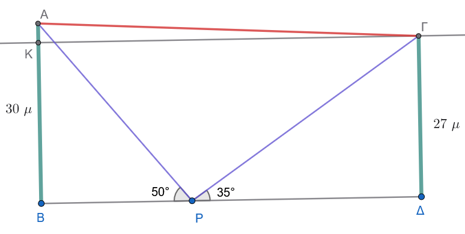{fig-align="center" width="550"}
:::

*(Σημείωση: Επιλύουμε πρώτα το ερώτημα **β** καθώς η απόσταση των βάσεων απλοποιεί άμεσα τον υπολογισμό του ερωτήματος **α**).*

------------------------------------------------------------------------

**β) Απόσταση μεταξύ των βάσεων των δύο πύργων (**$B\Delta$)

Οι πύργοι είναι κατακόρυφοι, άρα τα τρίγωνα $\triangle A B P$ και $\triangle \Gamma\Delta P$ είναι ορθογώνια στα σημεία $B$ και $\Delta$ αντίστοιχα.

1.  Στο ορθογώνιο τρίγωνο $\triangle A B P$: $$\varepsilon\varphi 50^\circ = \frac{A B}{B P} \implies B P = \frac{A B}{\varepsilon\varphi 50^\circ} = \frac{30}{\varepsilon\varphi 50^\circ} \approx \frac{30}{1{,}1918} \approx 25{,}17\text{ m}$$

2.  Στο ορθογώνιο τρίγωνο $\triangle \Gamma\Delta P$: $$\varepsilon\varphi 35^\circ = \frac{\Gamma\Delta}{P\Delta} \implies P\Delta = \frac{\Gamma\Delta}{\varepsilon\varphi 35^\circ} = \frac{27}{\varepsilon\varphi 35^\circ} \approx \frac{27}{0{,}7002} \approx 38{,}56\text{ m}$$

Η συνολική απόσταση των βάσεων $B$ και $\Delta$ είναι: $$B\Delta = B P + P\Delta \approx 25{,}17 + 38{,}56 = 63{,}73\text{ m} \approx 64\text{ m}$$

------------------------------------------------------------------------

**α) Ελάχιστο μήκος καλωδίου (**$A\Gamma$)

Το ελάχιστο μήκος καλωδίου είναι η ευθεία απόσταση $A\Gamma$.

**1ος Τρόπος (μέσω ορθογωνίου τριγώνου):**

Φέρνουμε από την κορυφή $\Gamma$ παράλληλη προς το έδαφος $B\Delta$, η οποία τέμνει τον πύργο $A B$ στο σημείο $K$.

Στο ορθογώνιο τρίγωνο $\triangle A K \Gamma$:

- Η οριζόντια πλευρά είναι: $K\Gamma = B\Delta \approx 63{,}73\text{ m}$

- Η κατακόρυφη πλευρά είναι η διαφορά των υψών: $$A K = A B - \Gamma\Delta = 30 - 27 = 3\text{ m}$$

Από το Πυθαγόρειο Θεώρημα: $$A\Gamma = \sqrt{K\Gamma^2 + A K^2} = \sqrt{(63{,}73)^2 + 3^2} = \sqrt{4061{,}51 + 9} = \sqrt{4070{,}51} \approx 63{,}80\text{ m} \approx 64\text{ m}$$

**2ος Τρόπος (με τον Νόμο των Συνημιτόνων στο** $\triangle A P \Gamma$):

- $A P = \dfrac{30}{ημ 50^\circ} \approx 39{,}16\text{ m}$

- $\Gamma P = \dfrac{27}{ημ 35^\circ} \approx 47{,}07\text{ m}$

- Η γωνία $A\widehat{P}\Gamma = 180^\circ - 50^\circ - 35^\circ = 95^\circ$

Από τον Νόμο των Συνημιτόνων: $$A\Gamma^2 = A P^2 + \Gamma P^2 - 2 \cdot A P \cdot \Gamma P \cdot συν 95^\circ \approx 4070{,}51 \implies A\Gamma \approx 64\text{ m}$$

------------------------------------------------------------------------

**Συνοπτικές Απαντήσεις:**

- **α)** Το ελάχιστο μήκος του καλωδίου είναι $64\text{ m}$.

- **β)** Η απόσταση μεταξύ των βάσεων των δύο πύργων είναι $64\text{ m}$.
::::

:::: {.math-box .exercise-box}
::: {.math-title .exercise-title}
24. Εκφώνηση
:::

Στο παρακάτω σχήμα να υπολογίσετε την απόσταση h.

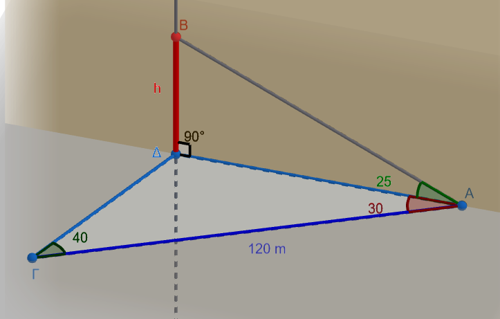{fig-align="center" width="550"}
::::

::: my-callout-sos
**Υπόδειξη**

1.  Υπολογίστε την γωνία $\widehat{ΓΔΑ}$

2.  Από τον νόμο των ημιτόνων υπολογίστε την πλευρά ΑΔ.
    $\dfrac{120}{ημΔ}=\dfrac{ΑΔ}{ημ40^ο}$

3.  Από το ορθογώνιο τρίγωνο ΑΔΒ υπολογίστε την πλευρά ΒΔ=h.
:::

:::: {.math-box .exercise-box}
::: {.math-title .exercise-title}
25. Εκφώνηση
:::

Στο παρακάτω σχήμα να αποδείξετε ότι $h=\dfrac{δημ α ημ θ}{ημ(β+θ)}$

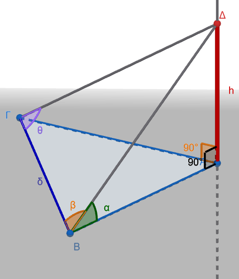{fig-align="center" width="400"}
::::

::: my-callout-sos
**Υπόδειξη**

1.  Στο τρίγωνο ΒΔΓ και από τον νόμο των ημιτόνων ορίστε μια έκφραση για την πλευρά ΒΔ.

$\widehat{BΔΓ}=180^ο-(β+θ) \implies ημ \widehat{ΒΔΓ}=ημ(β+θ$

$\dfrac{δ}{ημ(β+θ)}=\dfrac{ΒΔ}{ημθ} \implies BΔ=................$

2.  Από το ορθογώνιο τρίγωνο ΑΒΔ εκφράστε την ζητούμενη πλευρά μέσω του ημιτόνου της γωνίας α.

$h=ΒΔ ημ α$ , Αντικαταστήστε το ΒΔ .......................
:::

------------------------------------------------------------------------

:::: {.math-box .exercise-box}
::: {.math-title .exercise-title}
26. Εκφώνηση
:::

Στο παρακάτω σχήμα να αποδείξετε ότι

$$h=γεφθ(συνα-\frac{\sqrt{3}ημ α}{3})$$

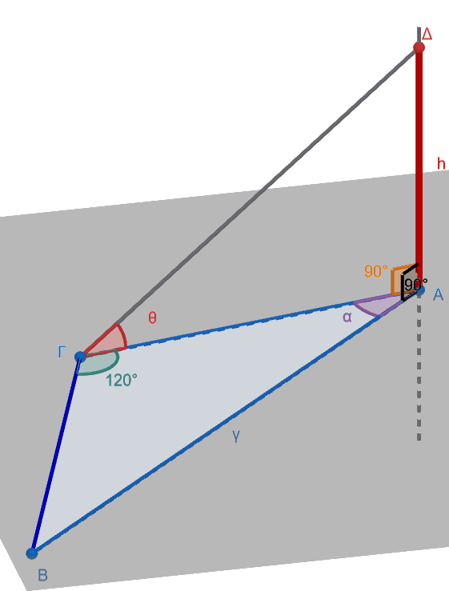{fig-align="center" width="400"}
::::

::: my-callout-sos
**Υπόδειξη**

1.  Στο τρίγωνο ΑΒΓ η γωνία $\hat B=180^o-120^ο-\hatα =60^ο-α \implies  ημ \hat B = ημ(60^ο-α) \ \ \ (1)$

Ακόμη $ημ(60^ο-α)=\dfrac{\sqrt{3}}{2}συνα - \dfrac{1}{2}ημα \ \ \ \ (2)$ και $ημ120^ο=ημ(180^ο-60^ο)=ημ60^ο=\dfrac{1}{2} \ \ \ \ \ (3)$

2.  Από τον νόμο των ημιτόνων στο τρίγωνο ΑΒΓ εκφράζουμε την πλευρά ΑΓ

$\dfrac{AΓ}{ημΒ}=\dfrac{γ}{ημ120^ο} \overset{1+2+3}{\implies} \mathbf{AΓ}=γ\dfrac{\dfrac{\sqrt{3}}{2}συνα-\dfrac{1}{2}ημα}{\dfrac{1}{2}} \implies \mathbf{ΑΓ}= ..........$ και απλοποιήστε.

3.  Από το ορθογώνιο τρίγωνο ΑΓΔ : $εφθ=\dfrac{h}{AΓ} \implies h=AΓ εφθ= .................$, αντικαταστήστε το ΑΓ και κάντε απλοποίηση της παράστασης που θα προκύψει.
:::

------------------------------------------------------------------------

:::: {.math-box .exercise-box}
::: {.math-title .exercise-title}
27. Εκφώνηση
:::

Στο παρακάτω σχήμα να αποδείξετε ότι

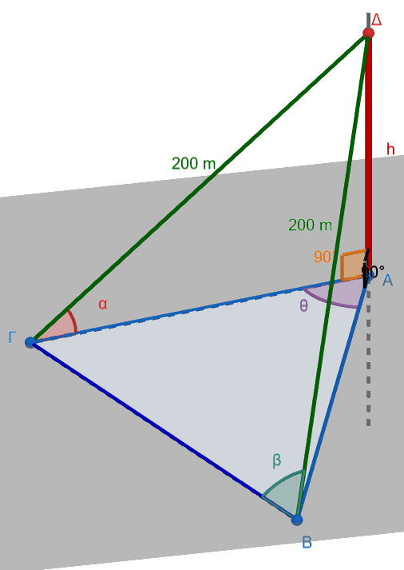{fig-align="center" width="400"}

**α)** $ΒΓ=400συνβ$

**β)** $Ε_{ΑΒΓ}=2000συν^2αημθ$
::::

::: my-callout-sos
**Υπόδειξη**

**α)** Στο ισοσκελές τρίγωνο ΔΒΓ φέρουμε το ύψος ΔΚ (σχεδιάστε στο τετράδιο σας), τότε από το ορθογώνιο τρίγωνο ΔΚΒ υπολογίζουμε την μισή πλευρά ΒΓ $ΒΚ=200συνβ \implies ΒΓ=2ΒΚ=400συνβ$

**β)** Τα ορθογώνια τρίγωνα ΔΒΑ και ΔΓΑ είναι ίσα γιατί έχουν 2 αντίστοιχες πλευρές ίσες άρα:

$ΑΒ=ΑΓ=200 συνα$

Επομένως $Ε_{ΑΒΓ}=\dfrac{1}{2}(AΓ)(ΑΒ)ημθ=...............$
:::

------------------------------------------------------------------------

:::: {.math-box .exercise-box}
::: {.math-title .exercise-title}
28. Εκφώνηση
:::

Στο παρακάτω σχήμα να βρείτε:

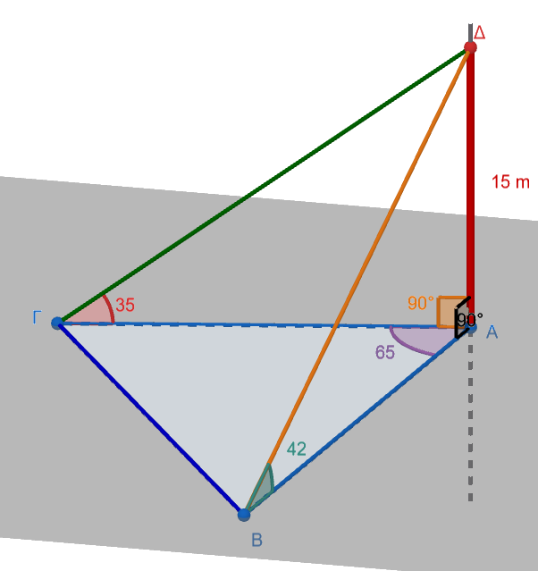{fig-align="center" width="500"}

**α)** Το εμβαδόν του τριγώνου ΑΒΓ

**β)** Αν οι γωνίες $\widehat{ΑΒΔ}=\widehat{ΑΓΔ}=45^ο$, η απόσταση $ΑΔ=d$ , $ΑΒ=x$ και η γωνία $\widehat{ΒΑΓ}=θ$, να αποδείξετε ότι $συνθ=1-\dfrac{x^2}{2d^2}$
::::

::: my-callout-sos
**Υπόδειξη**

**α)** $Ε_{ΑΒΓ}=\dfrac{1}{2}(ΑΒ)(ΑΓ) ημ 65^ο$

Όμως $ΑΒ=15 εφ42^ο$ και $ΑΓ=15 εφ35^ο$, Αντικατάσταση και υπολογισμοί .......

**β)** Αν $\widehat{ΑΒΔ}=\widehat{ΑΓΔ}=45^ο \implies$ τα τρίγωνα ΔΑΒ και ΔΑΓ είναι ορθογώνια ισοσκελή και άρα $ΑΒ=ΑΓ=ΑΔ=d$

***Σχεδιάστε το νέο σχήμα με τα νέα δεδομένα***

Από τον νόμο των συνημιτόνων έχουμε στο τρίγωνο ΑΒΓ:

$x^2=d^2+d^2-2d\cdot d\cdot συνθ \implies x^2=2d^2+2d^2συνθ \implies ........  συνθ= .....$
:::

------------------------------------------------------------------------

### Ασκήσεις επί Όλης της Τριγωνομετρίας

#### **Ενότητα 1: Βασικοί Τριγωνομετρικοί Αριθμοί & Ταυτότητες**

1.  Αν $ημ x - συν x = \dfrac{1}{3}$, να υπολογιστούν οι τιμές των παραστάσεων:

    - α) $ημ x \cdot συν x$

    - β) $ημ^3 x - συν^3 x$

    - γ) $ημ(2x)$

2.  Να αποδειχθεί η ταυτότητα: $$\frac{ημ^3 x + συν^3 x}{ημ x + συν x} = 1 - \frac{1}{2}ημ(2x)$$

#### **Ενότητα 2: Τριγωνομετρικές Συναρτήσεις**

3.  Δίνεται η συνάρτηση $f(x) = 3 ημ\left(2x - \dfrac{\pi}{3}\right)$.

    - α) Να βρεθεί η βασική περίοδος $T$, η μέγιστη τιμή $M$ και η ελάχιστη τιμή $m$.

    - β) Να υπολογιστούν τα σημεία τομής της $C_f$ με τον άξονα $x'x$ στο διάστημα $[0, \pi]$.

4.  Να μελετηθεί και να μετατραπεί στη μορφή $f(x) = \rho ημ(x + \phi)$ η συνάρτηση: $$f(x) = \sqrt{3} ημ x - συν x$$

#### **Ενότητα 3: Τριγωνομετρικές Εξισώσεις**

5.  Να λυθεί στο $\mathbb{R}$ η εξίσωση: $$ημ\left(3x + \frac{\pi}{4}\right) = \frac{\sqrt{2}}{2}$$

6.  Να λυθεί στο $\mathbb{R}$ η εξίσωση: $$2 συν^2 x - 3 συν x + 1 = 0$$

7.  Να λυθεί στο $\mathbb{R}$ η εξίσωση: $$ημ(2x) - \sqrt{3} συν x = 0$$

8.  Να λυθεί στο διάστημα $[0, 2\pi]$ η εξίσωση: $$ημ x + συν x = 1$$

#### **Ενότητα 4: Τύποι Αθροίσματος, Διπλάσιας Γωνίας & Μετασχηματισμοί**

9.  Να υπολογιστεί η ακριβής τιμή της παράστασης: $$A = συν 75^\circ \cdot συν 15^\circ + ημ 75^\circ \cdot ημ 15^\circ$$

10. Να αποδειχθεί ότι: $$εφ(15^\circ) = 2 - \sqrt{3} \quad \text{και} \quad σφ(15^\circ) = 2 + \sqrt{3}$$

11. Να αποδειχθεί η ταυτότητα διπλάσιου τόξου: $$\frac{1 - συν(2x)}{ημ(2x)} = εφ x$$

12. Να μετατραπεί σε γινόμενο η παράσταση: $$B = ημ(5x) + ημ(3x) + 2 ημ(4x)$$

#### **Ενότητα 5: Ταυτότητες υπό Συνθήκη & Επίλυση Τριγώνου**

13. Σε κάθε μη ορθογώνιο τρίγωνο $ABΓ$, να αποδειχθεί ότι: $$εφ A + εφ B + εφ Γ = εφ A \cdot εφ B \cdot εφ Γ \quad$$

14. Σε κάθε τρίγωνο $ABΓ$, να αποδειχθεί ότι: $$ημ(2A) + ημ(2B) + ημ(2Γ) = 4 ημ A \cdot ημ B \cdot ημ Γ \quad$$

15. Δύο παρατηρητές $A$ και $B$ βρίσκονται σε απόσταση $d = 100\text{ m}$ στην ίδια ευθεία με τη βάση ενός πύργου $ΓΔ$.
    Αν οι γωνίες ατενισμού της κορυφής $Δ$ του πύργου από τα σημεία $A$ και $B$ είναι $30^\circ$ και $45^\circ$ αντίστοιχα, να υπολογιστεί το ύψος $h = ΓΔ$ του πύργου.

------------------------------------------------------------------------

## ΔΙΑΓΩΝΙΣΜΑ ΑΞΙΟΛΟΓΗΣΗΣ: ΕΠΙΛΥΣΗ ΤΡΙΓΩΝΟΥ

**Μάθημα:** Άλγεβρα Β' Γενικού Λυκείου\
**Ενότητα:** Νόμος Ημιτόνων, Νόμος Συνημίτονων, Τύποι Εμβαδού & Εφαρμογές\
**Διάρκεια:** 60 λεπτά

------------------------------------------------------------------------

### **ΘΕΜΑ Α (Θεωρία & Ερωτήσεις Κατανόησης - 25 Μονάδες)**

**Α1.** (10 Μονάδες)

1.  Να διατυπώσετε και να αποδείξετε τον **Νόμο των Συνημίτονων** σε τυχαίο τρίγωνο $ABC$.
    (7 μονάδες)

2.  Να αποδείξετε ότι το εμβαδόν $E$ ενός τριγώνου $ABΓ$ δίνεται από τον τύπο $E = \dfrac{1}{2}βc ημ A$.
    (3 μονάδες)

**Α2.** (5 Μονάδες)

Να διατυπώσετε τον **Νόμο των Ημιτόνων** σε τυχαίο τρίγωνο $ABΓ$ εγγεγραμμένο σε κύκλο ακτίνας $R$.

**Α3.** (10 Μονάδες)

Να χαρακτηρίσετε τις παρακάτω προτάσεις ως **Σωστό (Σ)** ή **Λάθος (Λ)**:

1.  Σε κάθε τρίγωνο $ABΓ$, ισχύει $\dfrac{a}{ημ A} = 2R$, όπου $R$ είναι η ακτίνα του περιγεγραμμένου κύκλου.

2.  Αν σε ένα τρίγωνο $ABΓ$ ισχύει $a^2 = β^2 + γ^2 + βγ$, τότε η γωνία $A$ είναι $120^\circ$.

3.  Το εμβαδόν $E$ τριγώνου $ABC$ εκφράζεται ως $E = \dfrac{aβc}{4R}$.

4.  Αν σε ένα τρίγωνο $ABΓ$ ισχύει $a = 2β συν Γ$, τότε το τρίγωνο είναι υποχρεωτικά ισόπλευρο.

5.  Αν δίνονται δύο πλευρές $β, γ$ και η περιεχόμενη γωνία $A$, η τρίτη πλευρά $a$ υπολογίζεται άμεσα από τον Νόμο των Συνημίτονων.

------------------------------------------------------------------------

### **ΘΕΜΑ Β (Επίλυση Τριγώνου & Υπολογισμοί - 25 Μονάδες)**

**Β1.** (12 Μονάδες)

Σε τρίγωνο $ABΓ$ δίνονται η πλευρά $β = 20$, η πλευρά $γ = 35$ και η περιεχόμενη γωνία $A = 60^\circ$.

1.  Να υπολογίσετε το μήκος της πλευράς $a$.
    (6 μονάδες)

2.  Να υπολογίσετε το συνημίτονο της γωνίας $B$ ($συν B$).
    (6 μονάδες)

**Β2.** (13 Μονάδες)

Σε τρίγωνο $ABΓ$ δίνονται η πλευρά $a = 12$, η γωνία $A = 40^\circ$ και η γωνία $B = 85^\circ$.

1.  Να υπολογίσετε τη γωνία $Γ$.
    (3 μονάδες)

2.  Να υπολογίσετε τις πλευρές $β$ και $γ$ (δίνονται: $ημ 40^\circ \approx 0.64$, $ημ 85^\circ \approx 0.996$, $ημ 55^\circ \approx 0.82$).
    (10 μονάδες)

------------------------------------------------------------------------

### **ΘΕΜΑ Γ (Αποδεικτικές Σχέσεις & Ταυτότητες Τριγώνου - 25 Μονάδες)**

**Γ1.** (12 Μονάδες)

Σε κάθε τρίγωνο $ABΓ$, να αποδείξετε τον τύπο της προβολής: $$a = β συν Γ + γ συν B$$

**Γ2.** (13 Μονάδες)

Σε κάθε τρίγωνο $ABΓ$, να αποδείξετε την ισότητα: $$a (ημ B - ημ Γ) + β (ημ Γ - ημ A) + γ (ημ A - ημ B) = 0$$

------------------------------------------------------------------------

### **ΘΕΜΑ Δ (Χαρακτηρισμός Τριγώνου & Σύνθετο Πρόβλημα - 25 Μονάδες)**

**Δ1.** (12 Μονάδες)

Αν σε τρίγωνο $ABΓ$ ισχύει η σχέση: $$ημ A = 2 ημ B συν Γ$$ να αποδείξετε ότι το τρίγωνο είναι ισοσκελές ($β = γ$).

**Δ2.** (13 Μονάδες)

Σε τρίγωνο $ABC$ δίνονται $a = 5$, $β = 6$ και $γ = 7$.

1.  Να υπολογίσετε το εμβαδόν $E$ του τριγώνου με χρήση του τύπου του Ήρωνα.
    (6 μονάδες)

2.  Να υπολογίσετε την ακτίνα $R$ του περιγεγραμμένου κύκλου του τριγώνου $ABΓ$.
    (7 μονάδες)

------------------------------------------------------------------------

## ΑΝΑΛΥΤΙΚΕΣ ΛΥΣΕΙΣ ΔΙΑΓΩΝΙΣΜΑΤΟΣ

### **ΘΕΜΑ Α**

- **Α1.1:**

  **Θεώρημα:** Σε κάθε τρίγωνο $ABΓ$ ισχύει: $a^2 = β^2 + γ^2 - 2βγ συν A$.

  **Απόδειξη:** Θεωρούμε καρτεσιανό σύστημα συντεταγμένων με αρχή $A(0,0)$ και τον θετικό ημιάξονα $Ax$ να ταυτίζεται με την πλευρά $AB$ (μήκους $γ$).
  Οι συντεταγμένες των κορυφών είναι $B(γ, 0)$ και $Γ(β συν A, β ημ A)$.

  Από τον τύπο της απόστασης των σημείων $B$ και $Γ$: $$a^2 = (BΓ)^2 = (β συν A - γ)^2 + (β ημ A - 0)^2$$ $$a^2 = β^2 συν^2 A - 2βc συν A + γ^2 + β^2 ημ^2 A$$ $$a^2 = β^2 (ημ^2 A + συν^2 A) + γ^2 - 2βc συν A$$

  Επειδή $ημ^2 A + συν^2 A = 1$, λαμβάνουμε: $a^2 = β^2 + γ^2 - 2βc συν A$.

- **Α1.2:**

  Φέρνουμε το ύψος $υ_a = ΓΔ$ από την κορυφή $Γ$ προς την πλευρά $γ = AB$.
  Στο ορθογώνιο τρίγωνο $AΔΓ$ ισχύει $υ_a = β ημ A$.

  Το εμβαδόν του τριγώνου είναι: $$E = \frac{1}{2} γ \cdot υ_a = \frac{1}{2} γ (β ημ A) \implies \mathbf{E = \frac{1}{2}βγ ημ A}$$

- **Α2:**

  **Νόμος Ημιτόνων:** Σε κάθε τρίγωνο $ABΓ$ με πλευρές $a, β, γ$ και ακτίνα περιγεγραμμένου κύκλου $R$, ο λόγος κάθε πλευράς προς το ημίτονο της απέναντι γωνίας είναι σταθερός και ισούται με $2R$: $$\frac{a}{ημ A} = \frac{β}{ημ B} = \frac{γ}{ημ Γ} = 2R$$

- **Α3:**

  1.  **Σωστό** (Βασική διατύπωση του Νόμου των Ημιτόνων).

  2.  **Σωστό** (Από $a^2 = β^2 + γ^2 - 2βγ συν A$ και $a^2 = β^2 + γ^2 + βγ$, έχουμε $-2βγ συν A = βγ \iff συν A = -\dfrac{1}{2} \iff A = 120^\circ$).

  3.  **Σωστό** (Από $E = \dfrac{1}{2}βγ ημ A$ και $ημ A = \dfrac{a}{2R}$, προκύπτει $E = \dfrac{aβγ}{4R}$).

  4.  **Λάθος** (Από τον Νόμο Ημιτόνων $2R ημ A = 4R ημ B συν Γ \iff ημ A = 2 ημ B συν Γ \iff B = Γ$, δηλαδή το τρίγωνο είναι ισοσκελές με $β = γ$, όχι υποχρεωτικά ισόπλευρο).

  5.  **Σωστό** (Ο Νόμος των Συνημίτονων δίνει $a = \sqrt{β^2 + γ^2 - 2βγ συν A}$).

------------------------------------------------------------------------

### **ΘΕΜΑ Β**

- **Β1.1:**

  Εφαρμόζουμε τον Νόμο των Συνημίτονων για την πλευρά $a$: $$a^2 = β^2 + γ^2 - 2βγ συν A$$ $$a^2 = 20^2 + 35^2 - 2 \cdot 20 \cdot 35 \cdot συν 60^\circ$$ $$a^2 = 400 + 1225 - 1400 \cdot \frac{1}{2} = 1625 - 700 = 925$$ $$\mathbf{a = \sqrt{925} = 5\sqrt{37} \approx 30.41}$$

- **Β1.2:**

  Από τον Νόμο των Συνημίτονων υπολογίζουμε το $συν B$: $$συν B = \frac{a^2 + γ^2 - β^2}{2ac} = \frac{925 + 1225 - 400}{2 \cdot 5\sqrt{37} \cdot 35} = \frac{1750}{350\sqrt{37}} = \frac{5}{\sqrt{37}} = \mathbf{\frac{5\sqrt{37}}{37} \approx 0.822}$$

- **Β2.1:**

  Το άθροισμα των γωνιών τριγώνου είναι $180^\circ$: $$Γ = 180^\circ - (A + B) = 180^\circ - (40^\circ + 85^\circ) = 180^\circ - 125^\circ \implies \mathbf{C = 55^\circ}$$

- **Β2.2:**

  Από τον Νόμο των Ημιτόνων:

  - Για την πλευρά $β$: $$\frac{a}{ημ A} = \frac{β}{ημ B} \implies β = \frac{a ημ B}{ημ A} \approx \frac{12 \cdot 0.996}{0.64} = \frac{11.952}{0.64} = \mathbf{18.675}$$

  - Για την πλευρά $γ$: $$\frac{a}{ημ A} = \frac{γ}{ημ Γ} \implies γ = \frac{a ημ Γ}{ημ A} \approx \frac{12 \cdot 0.82}{0.64} = \frac{9.84}{0.64} = \mathbf{15.375}$$

------------------------------------------------------------------------

### **ΘΕΜΑ Γ**

- **Γ1:**

  Από τον Νόμο των Συνημίτονων αντικαθιστούμε τα συνημίτονα $συν Γ$ και $συν B$: $$συν Γ = \frac{a^2 + β^2 - γ^2}{2aβ} \quad \text{και} \quad συν B = \frac{a^2 + γ^2 - β^2}{2aγ}$$

  Αντικαθιστούμε στο δεξί μέλος: $$\text{Δεξί Μέλος} = β \left(\frac{a^2 + β^2 - γ^2}{2aβ}\right) + γ \left(\frac{a^2 + γ^2 - β^2}{2aγ}\right)$$ $$= \frac{a^2 + β^2 - γ^2}{2a} + \frac{a^2 + γ^2 - β^2}{2a} = \frac{(a^2 + β^2 - γ^2) + (a^2 + γ^2 - β^2)}{2a} = \frac{2a^2}{2a} = \mathbf{α}$$

- **Γ2:**

  Από τον Νόμο των Ημιτόνων γνωρίζουμε ότι $ημ A = \dfrac{a}{2R}$, $ημ B = \dfrac{β}{2R}$, $ημ Γ = \dfrac{γ}{2R}$.

  Αντικαθιστούμε στο αριστερό μέλος: $$\text{Αριστερό Μέλος} = a \left(\frac{β}{2R} - \frac{γ}{2R}\right) + β \left(\frac{γ}{2R} - \frac{a}{2R}\right) + γ \left(\frac{a}{2R} - \frac{β}{2R}\right)$$ $$= \frac{a(β-γ) + β(γ-a) + γ(a-β)}{2R} = \frac{aβ - aγ + βγ - βa + γa - γβ}{2R} = \frac{0}{2R} = \mathbf{0}$$

------------------------------------------------------------------------

### **ΘΕΜΑ Δ**

- **Δ1:**

  Σε κάθε τρίγωνο ισχύει $A + B + Γ = 180^\circ \iff A = 180^\circ - (B + Γ)$, οπότε: $$ημ A = ημ(180^\circ - (B + Γ)) = ημ(B + Γ)$$

  Αντικαθιστούμε στην δοσμένη σχέση: $$ημ(B + Γ) = 2 ημ B συν Γ$$

  Αναπτύσσουμε το ημίτονο αθροίσματος: $$ημ B συν Γ + συν B ημ Γ = 2 ημ B συν Γ$$ $$συν B ημ Γ - ημ B συν Γ = 0 \iff ημ(Γ - B) = 0$$

  Επειδή $B, C$ γωνίες τριγώνου, ισχύει $-180^\circ < Γ - B < 180^\circ$, οπότε $Γ - B = 0 \iff B = Γ$.

  Άρα το τρίγωνο είναι **ισοσκελές** με $\mathbf{β = γ}$.

- **Δ2.1:**

  Υπολογίζουμε την ημιπερίμετρο $\tau$: $$\tau = \frac{a + β + γ}{2} = \frac{5 + 6 + 7}{2} = \frac{18}{2} = 9$$

  Από τον τύπο του Ήρωνα: $$E = \sqrt{\tau(\tau-a)(\tau-β)(\tau-γ)} = \sqrt{9(9-5)(9-6)(9-7)} = \sqrt{9 \cdot 4 \cdot 3 \cdot 2} = \sqrt{216} = \mathbf{6\sqrt{6}}$$

- **Δ2.2:**

  Χρησιμοποιούμε τον τύπο $E = \dfrac{aβγ}{4R}$: $$R = \frac{aβγ}{4E} = \frac{5 \cdot 6 \cdot 7}{4 \cdot 6\sqrt{6}} = \frac{210}{24\sqrt{6}} = \frac{35}{4\sqrt{6}} = \mathbf{\frac{35\sqrt{6}}{24}}$$

------------------------------------------------------------------------

## Επαναληπτικές ασκήσεις στην τριγωνομετρία

### **Κατηγορία 1: Τριγωνομετρικοί Αριθμοί & Βασικές Ταυτότητες**

1.  **Υπολογισμός Τριγωνομετρικών Αριθμών:**

    - Αν $ημ x = \dfrac{3}{5}$ με $\dfrac{\pi}{2} < x < \pi$, να υπολογιστούν οι υπόλοιποι τριγωνομετρικοί αριθμοί της γωνίας $x$.

    - Αν $συν x = -\dfrac{2}{3}$ με $\pi < x < \dfrac{3\pi}{2}$, να υπολογιστούν οι υπόλοιποι τριγωνομετρικοί αριθμοί της γωνίας $x$.

2.  **Απόδειξη Βασικών Τριγωνομετρικών Ταυτοτήτων:**

    Να αποδειχθούν οι παρακάτω ταυτότητες για κάθε γωνία $\alpha$ για την οποία ορίζονται:

    - $\dfrac{ημ \alpha}{1 + συν \alpha} = \dfrac{1 - συν \alpha}{ημ \alpha}$

    - $συν^4 \alpha - ημ^4 \alpha = 2συν^2 \alpha - 1$

    - $εφ^2 \alpha - ημ^2 \alpha = εφ^2 \alpha \cdot ημ^2 \alpha$

------------------------------------------------------------------------

### **Κατηγορία 2: Τριγωνομετρικές Συναρτήσεις & Γραφικές Παραστάσεις**

3.  **Μελέτη Περιοδικότητας & Ακροτάτων:**

    - Δίνεται η συνάρτηση $f(x) = 3ημ(2x)$.
      Να βρείτε τη βασική περίοδο $T$, τη μέγιστη τιμή $M$ και την ελάχιστη τιμή $m$ της συνάρτησης.

    - Δίνεται η συνάρτηση $g(x) = \sqrt{3}ημ x - συν x$.
      Να μετατραπεί στη μορφή $\rho ημ(x + \phi)$ και να υπολογιστούν τα ακρότατά της.

4.  **Σημεία Τομής με τους Άξονες:**

    - Να υπολογιστούν τα σημεία τομής της γραφικής παράστασης της συνάρτησης $f(x) = 2ημ\left(x - \dfrac{\pi}{3}\right)$ με τον άξονα $x'x$ στο διάστημα $[0, 2\pi]$.

------------------------------------------------------------------------

### **Κατηγορία 3: Τριγωνομετρικές Εξισώσεις**

5.  **Βασικές Τριγωνομετρικές Εξισώσεις:**

    Να λυθούν στο $\mathbb{R}$ οι εξισώσεις:

    - $ημ x = -\dfrac{1}{2}$

    - $συν x = -\dfrac{\sqrt{2}}{2}$

    - $εφ x = \sqrt{3}$

6.  **Εξισώσεις που Αναγονται σε Δευτεροβάθμιες ή με Παραγοντοποίηση:**

    - Να λυθεί στο $\mathbb{R}$ η εξίσωση: $2ημ^2 x - 3ημ x + 1 = 0$.

    - Να λυθεί στο $\mathbb{R}$ η εξίσωση: $ημ(6x)συν(3x) = ημ(5x)συν(4x)$.

------------------------------------------------------------------------

### **Κατηγορία 4: Τύποι Αθροίσματος, Διπλάσιας Γωνίας & Μετασχηματισμοί**

7.  **Ακριβής Υπολογισμός Τριγωνομετρικών Αριθμών:**

    - Να υπολογιστεί η ακριβής τιμή της $εφ 75^\circ = εφ(45^\circ + 30^\circ)$ και να αποδειχθεί ότι ισούται με $2 + \sqrt{3}$.

    - Να υπολογιστεί η ακριβής τιμή του $συν 105^\circ = συν(60^\circ + 45^\circ)$.

8.  **Αποδείξεις Σύνθετων Ταυτοτήτων & Μετασχηματισμών:**

    - Να αποδειχθεί η ταυτότητα: $\dfrac{ημ(2\alpha) + ημ \alpha}{1 + συν(2\alpha) + συν \alpha} = εφ \alpha$.

    - Να αποδειχθεί η ταυτότητα: $\dfrac{ημ \alpha + ημ(3\alpha) + ημ(5\alpha)}{συν \alpha + συν(3\alpha) + συν(5\alpha)} = εφ(3\alpha)$.

------------------------------------------------------------------------

### **Κατηγορία 5: Επίλυση Τριγώνου & Ταυτότητες σε Τρίγωνα**

9.  **Εφαρμογή Νόμου Ημιτόνων & Συνημίτονων:**

    - **Νόμος Ημιτόνων:** Να επιλυθεί το τρίγωνο $ABΓ$ όταν δίνονται $a = 15$, $A = 43^\circ$ και $B = 82^\circ$.

    - **Νόμος Συνημίτονων:** Να επιλυθεί το τρίγωνο $ABΓ$ όταν δίνονται οι πλευρές $a = 35$, $β = 20$ και $γ = 42$.

    - **Νόμος Συνημίτονων:** Να υπολογιστεί η πλευρά $a$ τριγώνου $ABΓ$ όταν δίνονται $β = 20$, $γ = 42$ και $A = 56^\circ$.

10. **Σχέσεις Πλευρών & Ταυτότητες υπό Συνθήκη:**

    - Σε κάθε τρίγωνο $ABΓ$, να αποδειχθεί ο τύπος της προβολής: $a = β συν Γ + c συν B$.

    - Αν σε ένα τρίγωνο $ABΓ$ ισχύει η σχέση $a = 2β συν Γ$, να αποδειχθεί ότι το τρίγωνο είναι ισοσκελές ($β = γ$).

    - Σε κάθε μη ορθογώνιο τρίγωνο $ABΓ$, να αποδειχθούν οι ταυτότητες:

      - $εφ A + εφ B + εφ Γ = εφ A \cdot εφ B \cdot εφ Γ$

      - $σφ A \cdot σφ B + σφ B \cdot σφ Γ + σφ Γ \cdot σφ A = 1$

------------------------------------------------------------------------

------------------------------------------------------------------------

::: {.callout-tip style="color: brown;"}
ΚΑΛΗ ΜΕΛΕΤΗ!
:::
