```{=html}
<!-- Φόρτωση βιβλιοθήκης GeoGebra -->
<script src="https://www.geogebra.org/apps/deployggb.js"></script>

<!-- Συνάρτηση δημιουργίας applets -->
<script>
function createGeoGebra(containerId, materialId, width = 700, height = 500) {
  var params = {
    "id": "ggb-" + containerId,
    "material_id": materialId,
    "width": width,
    "height": height,
    "showToolBar": true,
    "showMenuBar": false,
    "showAlgebraInput": true
  };
  
  var applet = new GGBApplet(params, '5.2');
  applet.inject(containerId);
}
</script>
```

## Πολυωνυμικές Εξισώσεις Και Ανισώσεις

### **Πολυωνυμική Εξίσωση Βαθμού** $\nu$

:::: {.math-box .definition-box}
::: {.math-title .definition-title}
**α) Ορισμοί**
:::

- **Πολυωνυμική εξίσωση βαθμού** $\nu$ ($\nu \in \mathbb{N}$) ονομάζεται κάθε εξίσωση της μορφής: $$\mathbf{a_\nu x^\nu + a_{\nu-1} x^{\nu-1} + \dots + a_1 x + a_0 = 0}$$ όπου $a_\nu \neq 0$ και $a_0, a_1, \dots, a_\nu \in \mathbb{R}$.

- **Ρίζα** μιας πολυωνυμικής εξίσωσης ονομάζεται κάθε πραγματικός αριθμός $\rho$ που μηδενίζει το πολυώνυμο $P(x) = a_\nu x^\nu + \dots + a_0$, δηλαδή για τον οποίο ισχύει $\mathbf{P(\rho) = 0}$.
::::

------------------------------------------------------------------------

:::: {.math-box .definition-box}
::: {.math-title .definition-title}
**β) Τρόπος Επίλυσης**
:::

Για τις εξισώσεις $1$ου και $2$ου βαθμού χρησιμοποιούμε τους γνωστούς αλγεβρικούς τύπους.
Για πολυωνυμικές εξισώσεις βαθμού $\nu > 2$, η γενική μέθοδος επίλυσης στηρίζεται στη **μέθοδο της παραγοντοποίησης**.

Μετασχηματίζουμε την εξίσωση στη μορφή: $$P_1(x) \cdot P_2(x) \cdots P_k(x) = 0 \iff P_1(x) = 0 \quad \text{ή} \quad P_2(x) = 0 \quad \text{ή} \dots \text{ή} \quad P_k(x) = 0$$

Για την αναγωγή σε γινόμενο παράγοντων χρησιμοποιούμε:

1.  **Κοινό παράγοντα** και **ομαδοποίηση**.

2.  **Αλγεβρικές ταυτότητες** (διαφορά τετραγώνων, διαφορά/άθροισμα κύβων, κ.λπ.).

3.  **Το θεώρημα ακέραιων ριζών** και το **σχήμα Horner**.
::::

------------------------------------------------------------------------

#### **Παραδείγματα Επίλυσης**

:::: {.math-box .example-box}
::: {.math-title .example-title}
**Παράδειγμα 1 (Με Ομαδοποίηση):**
:::

Να λυθεί στο $\mathbb{R}$ η εξίσωση:

$$x^3 - 3x^2 - x + 3 = 0$$
::::

:::: {.math-box .examplesolution-box}
::: {.math-title .examplesolution-title}
Λύση
:::

Ομαδοποιούμε τους όρους ανά δύο:

$$x^2(x - 3) - (x - 3) = 0 \iff (x - 3)(x^2 - 1) = 0$$ $$(x - 3)(x - 1)(x + 1) = 0$$

Εξισώνουμε κάθε παράγοντα με το μηδέν:

$$x - 3 = 0 \iff \mathbf{x = 3}$$ $$x - 1 = 0 \iff \mathbf{x = 1}$$ $$x + 1 = 0 \iff \mathbf{x = -1}$$

Άρα το σύνολο λύσεων είναι $S = \{-1, 1, 3\}$.
::::

:::: {.math-box .example-box}
::: {.math-title .example-title}
**Παράδειγμα 2 (Με Κοινό Παράγοντα):**
:::

Να λυθεί στο $\mathbb{R}$ η εξίσωση:

$$2x^4 - 8x^2 = 0$$
::::

:::: {.math-box .examplesolution-box}
::: {.math-title .examplesolution-title}
Λύση
:::

Βγάζουμε κοινό παράγοντα το $2x^2$: $$2x^2(x^2 - 4) = 0 \iff 2x^2(x - 2)(x + 2) = 0$$

- $2x^2 = 0 \iff \mathbf{x = 0}$ (διπλή ρίζα)

- $x - 2 = 0 \iff \mathbf{x = 2}$

- $x + 2 = 0 \iff \mathbf{x = -2}$

Άρα $S = \{-2, 0, 2\}$.
::::

------------------------------------------------------------------------

### **Παράγοντας της Μορφής** $x - \rho$ & Θεώρημα Ακέραιων Ριζών

#### **α) Θεώρημα Ακέραιων Ριζών**

:::: {.math-box .theorem-box}
::: {.math-title .theorem-title}
**ΘΕΩΡΗΜΑ:**
:::

Έστω η πολυωνυμική εξίσωση $a_\nu x^\nu + a_{\nu-1} x^{\nu-1} + \dots + a_1 x + a_0 = 0$, με ακέραιους συντελεστές ($a_\nu \neq 0, a_0 \neq 0$).
Αν ο ακέραιος $\rho \neq 0$ είναι ρίζα της εξίσωσης, τότε ο $\rho$ είναι διαιρέτης του σταθερού όρου $a_0$.
::::

:::: {.math-box .apodeixi-box}
::: {.math-title .apodeixi-title}
**Απόδειξη Θεωρήματος:**
:::

Αφού ο $\rho \neq 0$ είναι ρίζα της εξίσωσης, επαληθεύει την ισότητα: $$a_\nu \rho^\nu + a_{\nu-1} \rho^{\nu-1} + \dots + a_1 \rho + a_0 = 0$$

Απομονώνουμε τον σταθερό όρο $a_0$ στο ένα μέλος: $$a_0 = -a_\nu \rho^\nu - a_{\nu-1} \rho^{\nu-1} - \dots - a_1 \rho$$

Βγάζουμε κοινό παράγοντα το $\rho$ στο δεξί μέλος: $$a_0 = \rho \cdot \left(-a_\nu \rho^{\nu-1} - a_{\nu-1} \rho^{\nu-2} - \dots - a_1\right)$$

Επειδή οι συντελεστές $a_1, a_2, \dots, a_\nu$ και ο $\rho$ είναι ακέραιοι αριθμοί, η παράσταση $k = -a_\nu \rho^{\nu-1} - a_{\nu-1} \rho^{\nu-2} - \dots - a_1$ είναι επίσης ακέραιος.

Επομένως, $a_0 = \rho \cdot k$, που σημαίνει ότι ο ακέραιος $\rho$ διαιρεί τον σταθερό όρο $a_0$ ($\rho \mid a_0$).
$\blacksquare$
::::

------------------------------------------------------------------------

#### **Παραδείγματα Λυμένα με Σχήμα Horner**

:::: {.math-box .example-box}
::: {.math-title .example-title}
**Παράδειγμα 1 (Εξίσωση 3ου Βαθμού):**
:::

Να λυθεί η εξίσωση $x^3 - 2x^2 - 5x + 6 = 0$.
::::

:::: {.math-box .examplesolution-box}
::: {.math-title .examplesolution-title}
Λύση
:::

Οι πιθανές ακέραιες ρίζες είναι οι διαιρέτες του σταθερού όρου $a_0 = 6$, δηλαδή οι $\pm 1, \pm 2, \pm 3, \pm 6$.

Δοκιμάζουμε την τιμή $\rho = 1$: $P(1) = 1^3 - 2(1)^2 - 5(1) + 6 = 0$.

Εφαρμόζουμε το **σχήμα Horner** για $\rho = 1$:

$$\begin{array}{c|ccc|c|c}
    1 & -2 & -5 & 6 & \rho = 1 \\
    & 1 & -1 & -6 & \\
    \hline
    1 & -1 & -6 & \mathbf{0} & 
\end{array}$$

Η εξίσωση γράφεται:

$$(x - 1)(x^2 - x - 6) = 0$$

- $x - 1 = 0 \iff \mathbf{x = 1}$

- $x^2 - x - 6 = 0 \iff (x - 3)(x + 2) = 0 \iff \mathbf{x = 3} \quad \text{ή} \quad \mathbf{x = -2}$

Άρα οι ρίζες της εξίσωσης είναι $x \in \{-2, 1, 3\}$.
::::

:::: {.math-box .example-box}
::: {.math-title .example-title}
**Παράδειγμα 2 (Εξίσωση 4ου Βαθμού):**
:::

Να λυθεί η εξίσωση $x^4 - x^3 - 7x^2 + x + 6 = 0$.
::::

:::: {.math-box .examplesolution-box}
::: {.math-title .examplesolution-title}
Λύση
:::

Οι πιθανοί διαιρέτες του $6$ είναι οι $\pm 1, \pm 2, \pm 3, \pm 6$.

Για $\rho = 1$: $P(1) = 1 - 1 - 7 + 1 + 6 = 0$.

Εφαρμόζουμε σχήμα Horner για $\rho = 1$:

$$\begin{array}{c|cccc|c|c}
    1 & -1 & -7 & 1 & 6 & \rho = 1 \\
    & 1 & 0 & -7 & -6 & \\
    \hline
    1 & 0 & -7 & -6 & \mathbf{0} & 
\end{array}$$

Το πηλίκο είναι $\pi_1(x) = x^3 - 7x - 6$.

Δοκιμάζουμε $\rho = -1$ στο $\pi_1(x)$: $\pi_1(-1) = (-1)^3 - 7(-1) - 6 = -1 + 7 - 6 = 0$.

Εφαρμόζουμε σχήμα Horner στο $\pi_1(x)$ με $\rho = -1$:

$$\begin{array}{c|ccc|c|c}
    1 & 0 & -7 & -6 & \rho = -1 \\
    & -1 & 1 & 6 & \\
    \hline
    1 & -1 & -6 & \mathbf{0} & 
\end{array}$$

Το νέο πηλίκο είναι $\pi_2(x) = x^2 - x - 6$.

Οι ρίζες του $x^2 - x - 6 = 0$ είναι $x = 3$ και $x = -2$.

Συνολικά, οι ρίζες της εξίσωσης είναι $x \in \{-2, -1, 1, 3\}$.
::::

------------------------------------------------------------------------

### **Πρόσημο Γινομένου**

Για να βρούμε το πρόσημο ενός γινομένου παράγοντων $P(x) = A(x) \cdot B(x) \cdot C(x)$:

1.  Βρίσκουμε τις ρίζες και το πρόσημο καθενός παράγοντα ξεχωριστά.

2.  Συντάσσουμε έναν **συγκεντρωτικό πίνακα προσήμων**.

3.  Εφαρμόζουμε τον κανόνα των προσήμων για το γινόμενο σε κάθε διάστημα.

------------------------------------------------------------------------

#### **Παραδείγματα**

:::: {.math-box .example-box}
::: {.math-title .example-title}
**Παράδειγμα με 3 Παράγοντες (1 Πρωτοβάθμιος & 2 Δευτεροβάθμιοι):**
:::

Να βρεθεί το πρόσημο του γινομένου: $$P(x) = (x - 1)(x^2 - 4)(x^2 + x + 1)$$
::::

:::: {.math-box .examplesolution-box}
::: {.math-title .examplesolution-title}
Λύση
:::

- **Μελέτη επιμέρους παραγόντων:**

  1.  $x - 1 = 0 \iff x = 1$.
      Είναι θετικό για $x > 1$ και αρνητικό για $x < 1$.

  2.  $x^2 - 4 = 0 \iff x = \pm 2$.
      Εντός των ριζών $(-2, 2)$ είναι ετερόσημο του $a=1$ (δηλαδή αρνητικό) και εκτός είναι θετικό.

  3.  $x^2 + x + 1$: Η διακρίνουσα είναι $\Delta = 1^2 - 4(1)(1) = -3 < 0$.
      Αφού $\Delta < 0$, το τριώνυμο διατηρεί το πρόσημο του $a = 1 > 0$ για κάθε $x \in \mathbb{R}$ (πάντα θετικό).

- **Πίνακας Προσήμων:**

$$\begin{array}{c|c cc c cc c}
x & -\infty & & -2 & & 1 & & 2 & & +\infty \\
\hline
x - 1 & & - & | & - & 0 & + & | & + & \\
x^2 - 4 & & + & 0 & - & | & - & 0 & + & \\
x^2 + x + 1 & & + & | & + & | & + & | & + & \\
\hline
\mathbf{P(x)} & & \mathbf{-} & \mathbf{0} & \mathbf{+} & \mathbf{0} & \mathbf{-} & \mathbf{0} & \mathbf{+} & 
\end{array}$$

- **Συμπέρασμα:**

  - $P(x) > 0$ για $x \in (-2, 1) \cup (2, +\infty)$

  - $P(x) < 0$ για $x \in (-\infty, -2) \cup (1, 2)$

  - $P(x) = 0$ για $x \in \{-2, 1, 2\}$
::::

------------------------------------------------------------------------

### **Ανισώσεις της Μορφής** $A(x) \cdot B(x) \cdots \Phi(x) \gtrless 0$

------------------------------------------------------------------------

#### **Παραδείγματα**

**α) 2 Παραδείγματα για** $> 0$ (3ου & 4ου Βαθμού)

:::: {.math-box .example-box}
::: {.math-title .example-title}
**Παράδειγμα 1 (3ου Βαθμού):**
:::

Να λυθεί η ανίσωση: $x^3 - 4x^2 + x + 6 > 0$
::::

:::: {.math-box .examplesolution-box}
::: {.math-title .examplesolution-title}
Λύση
:::

Δοκιμάζουμε ακέραιες ρίζες στους διαιρέτες του $6$ ($\pm 1, \pm 2, \pm 3, \pm 6$).

Για $\rho = -1$: $P(-1) = (-1)^3 - 4(-1)^2 + (-1) + 6 = -1 - 4 - 1 + 6 = 0$.

Με σχήμα Horner για $\rho = -1$, λαμβάνουμε: $$x^3 - 4x^2 + x + 6 = (x + 1)(x^2 - 5x + 6) = (x + 1)(x - 2)(x - 3)$$

**Πίνακας προσήμων για τις ρίζες** $x = -1, 2, 3$:

$$\begin{array}{c|c cc c cc c cc c}
    x & -\infty & & -1 & & 2 & & 3 & & +\infty \\
    \hline
    x + 1 & & - & 0 & + & | & + & | & + & \\
    x - 2 & & - & | & - & 0 & + & | & + & \\
    x - 3 & & - & | & - & | & - & 0 & + & \\
    \hline
    \mathbf{P(x)} & & \mathbf{-} & \mathbf{0} & \mathbf{+} & \mathbf{0} & \mathbf{-} & \mathbf{0} & \mathbf{+} & 
\end{array}$$

Επιλέγουμε τα διαστήματα όπου $P(x) > 0$: $$\mathbf{x \in (-1, 2) \cup (3, +\infty)}$$

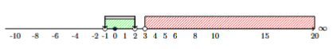{fig-align="center" width="500"}
::::

:::: {.math-box .example-box}
::: {.math-title .example-title}
**Παράδειγμα 2 (4ου Βαθμού):**
:::

Να λυθεί η ανίσωση: $(x^2 - 1)(x^2 - 3x + 2) > 0$
::::

:::: {.math-box .examplesolution-box}
::: {.math-title .examplesolution-title}
Λύση
:::

Παραγοντοποιούμε τα δύο τριώνυμα: $$x^2 - 1 = (x - 1)(x + 1)$$ $$x^2 - 3x + 2 = (x - 1)(x - 2)$$

Άρα η ανίσωση γράφεται: $$(x + 1)(x - 1)^2(x - 2) > 0$$

Οι ρίζες είναι $x = -1$, $x = 1$ (διπλή), $x = 2$.

Επειδή $(x - 1)^2 > 0$ για κάθε $x \neq 1$, το πρόσημο καθορίζεται από τους παράγοντες $(x + 1)(x - 2)$:

$$\begin{array}{c|c cc c cc c cc c}
    x & -\infty & & -1 & & 1 & & 2 & & +\infty \\
    \hline
    x + 1 & & - & 0 & + & | & + & | & + & \\
    (x - 1)^2 & & + & | & + & 0 & + & | & + & \\
    x - 2 & & - & | & - & | & - & 0 & + & \\
    \hline
    \mathbf{P(x)} & & \mathbf{+} & \mathbf{0} & \mathbf{-} & \mathbf{0} & \mathbf{-} & \mathbf{0} & \mathbf{+} & 
\end{array}$$

Επιλέγουμε τα διαστήματα με θετικό πρόσημο: $$\mathbf{x \in (-\infty, -1) \cup (2, +\infty)}$$

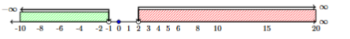{fig-align="center" width="500"}
::::

------------------------------------------------------------------------

**β) 2 Παραδείγματα για** $< 0$ (3ου & 4ου Βαθμού)

:::: {.math-box .example-box}
::: {.math-title .example-title}
**Παράδειγμα 3 (3ου Βαθμού):**
:::

Να λυθεί η ανίσωση: $x^3 - 3x - 2 < 0$
::::

:::: {.math-box .examplesolution-box}
::: {.math-title .examplesolution-title}
Λύση
:::

Δοκιμάζουμε $\rho = -1$: $P(-1) = (-1)^3 - 3(-1) - 2 = -1 + 3 - 2 = 0$.

Εφαρμόζουμε σχήμα Horner για $\rho = -1$: $$x^3 - 3x - 2 = (x + 1)(x^2 - x - 2) = (x + 1)(x + 1)(x - 2) = (x + 1)^2(x - 2)$$

Για να ισχύει $(x + 1)^2(x - 2) < 0$, πρέπει $x - 2 < 0$ και ταυτόχρονα $(x + 1)^2 \neq 0$ (δηλαδή $x \neq -1$).

Άρα $x < 2$ με $x \neq -1$.
$$\mathbf{x \in (-\infty, -1) \cup (-1, 2)}$$

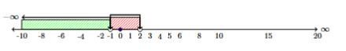{fig-align="center" width="500"}
::::

:::: {.math-box .example-box}
::: {.math-title .example-title}
**Παράδειγμα 4 (4ου Βαθμού - Διτετράγωνη):**
:::

Να λυθεί η ανίσωση: $x^4 - 5x^2 + 4 < 0$
::::

:::: {.math-box .examplesolution-box}
::: {.math-title .examplesolution-title}
Λύση
:::

Θέτουμε $y = x^2 \ge 0$.
Η ανίσωση γίνεται: $$y^2 - 5y + 4 < 0$$

Οι ρίζες του τριωνύμου είναι $y_1 = 1$ και $y_2 = 4$.

Άρα $1 < y < 4 \iff 1 < x^2 < 4$.

Λύνουμε το σύστημα ανισώσεων: $$x^2 > 1 \iff |x| > 1 \iff x < -1 \quad \text{ή} \quad x > 1$$ $$x^2 < 4 \iff |x| < 2 \iff -2 < x < 2$$

Συναληθεύοντας τα διαστήματα: $$\mathbf{x \in (-2, -1) \cup (1, 2)}$$

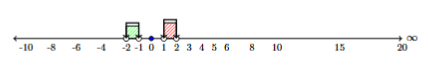{fig-align="center" width="500"}
::::

------------------------------------------------------------------------

### **Προσδιορισμός Ρίζας με Προσέγγιση**

------------------------------------------------------------------------

#### **Θεώρημα Ύπαρξης Ρίζας (Bolzano)**

:::: {.math-box .theorem-box}
::: {.math-title .theorem-title}
**ΘΕΩΡΗΜΑ:**
:::

Έστω η πολυωνυμική συνάρτηση $f(x) = a_\nu x^\nu + \dots + a_1 x + a_0$.
Αν για δύο πραγματικούς αριθμούς $a, b$ με $a < b$ οι τιμές $f(a), f(b)$ είναι ετερόσημες (δηλαδή $\mathbf{f(a) \cdot f(b) < 0}$), τότε υπάρχει μία τουλάχιστον ρίζα της εξίσωσης $f(x) = 0$ στο ανοικτό διάστημα $(a, b)$.
::::

------------------------------------------------------------------------

:::: {.math-box .apodeixi-box}
::: {.math-title .apodeixi-title}
**Γεωμετρική Ερμηνεία**
:::

Αν η γραφική παράσταση της πολυωνυμικής συνάρτησης $f$ διέρχεται από δύο σημεία $A(a, f(a))$ και $B(b, f(b))$ τα οποία βρίσκονται εκατέρωθεν του άξονα $x'x$ (το ένα πάνω και το άλλο κάτω από τον άξονα), τότε η συνεχής καμπύλη $y = f(x)$ τέμνει υποχρεωτικά τον άξονα $x'x$ σε ένα τουλάχιστον σημείο $x_0$ μεταξύ των $a$ και $b$.
::::

------------------------------------------------------------------------

#### **Παραδείγματα**

**Παραδείγματα Προσεγγιστικού Υπολογισμού**

:::: {.math-box .example-box}
::: {.math-title .example-title}
**Παράδειγμα 1 (Προσέγγιση Δεκάτου):**
:::

Να αποδειχθεί ότι η εξίσωση $x^3 + x - 3 = 0$ έχει μία τουλάχιστον ρίζα στο διάστημα $(1, 2)$ και να βρεθεί η ρίζα με προσέγγιση δεκάτου.
::::

:::: {.math-box .examplesolution-box}
::: {.math-title .examplesolution-title}
Λύση

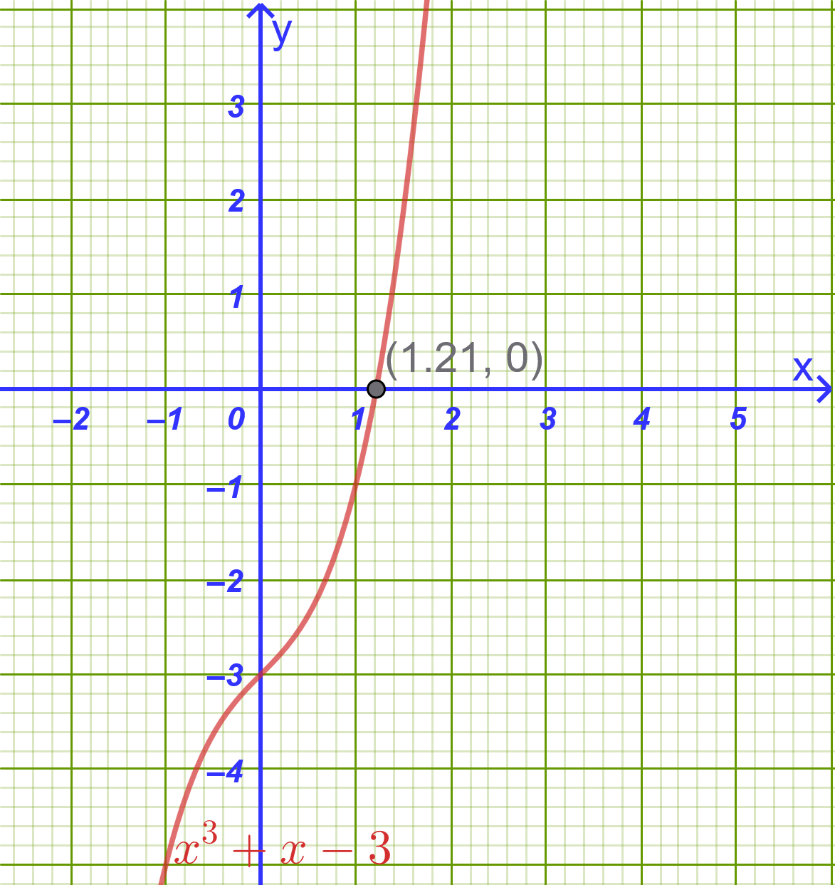{fig-align="center" width="300"}
:::

1.  **1ο Βήμα (Ύπαρξη ρίζας):**

Θεωρούμε τη συνάρτηση $f(x) = x^3 + x - 3$.

- $f(1) = 1^3 + 1 - 3 = -1 < 0$

- $f(2) = 2^3 + 2 - 3 = 7 > 0$

Επειδή $f(1) \cdot f(2) = -7 < 0$, σύμφωνα με το θεώρημα υπάρχει τουλάχιστον μία ρίζα στο διάστημα $(1, 2)$.

2.  **2ο Βήμα (Προσέγγιση δεκάτου):**

    Υπολογίζουμε διαδοχικά τις τιμές της $f(x)$ στα ενδιάμεσα σημεία:

- $f(1.1) = (1.1)^3 + 1.1 - 3 = 1.331 + 1.1 - 3 = -0.569 < 0$

- $f(1.2) = (1.2)^3 + 1.2 - 3 = 1.728 + 1.2 - 3 = -0.072 < 0$

- $f(1.3) = (1.3)^3 + 1.3 - 3 = 2.197 + 1.3 - 3 = +0.497 > 0$

Επειδή $f(1.2) \cdot f(1.3) < 0$, η εξίσωση έχει ρίζα στο διάστημα $(1.2, 1.3)$.

Άρα η ρίζα με προσέγγιση δεκάτου είναι $x \approx 1.2$.
::::

:::: {.math-box .example-box}
::: {.math-title .example-title}
**Παράδειγμα 2 (Ύπαρξη Πολλαπλών Ριζών):**
:::

Να αποδειχθεί ότι η εξίσωση $x^4 - 4x - 1 = 0$ έχει δύο τουλάχιστον πραγματικές ρίζες σε διαφορετικά διαστήματα.
::::

:::: {.math-box .examplesolution-box}
::: {.math-title .examplesolution-title}
Λύση

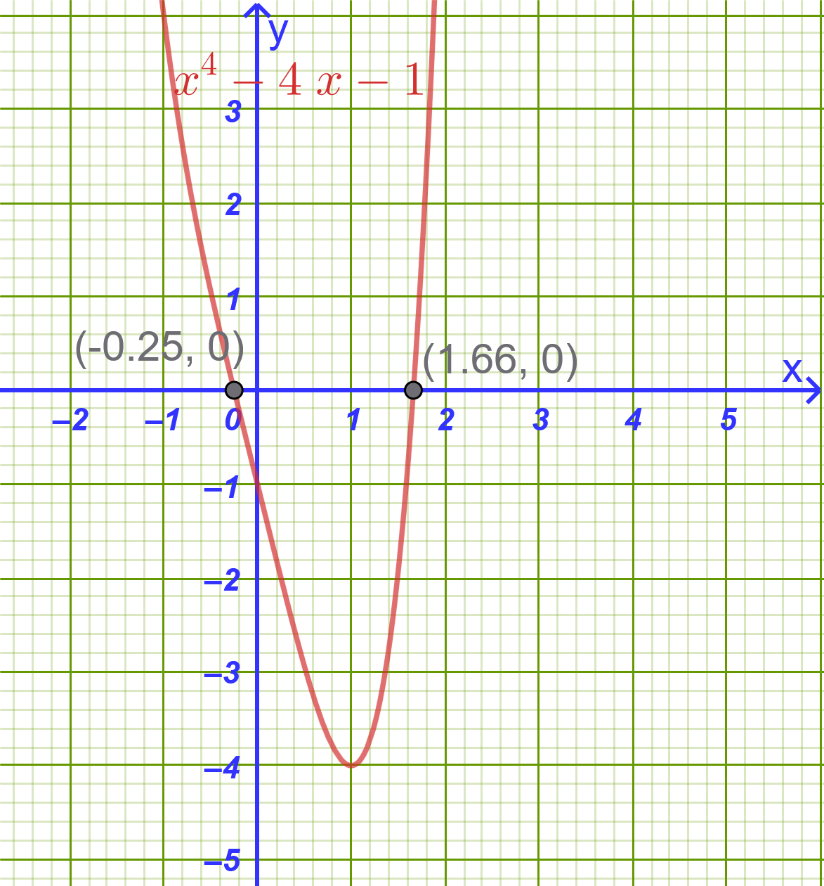{fig-align="center" width="300"}
:::

Θεωρούμε τη συνάρτηση $f(x) = x^4 - 4x - 1$.

- $f(-1) = (-1)^4 - 4(-1) - 1 = 1 + 4 - 1 = 4 > 0$

- $f(0) = 0^4 - 4(0) - 1 = -1 < 0$

- $f(2) = 2^4 - 4(2) - 1 = 16 - 8 - 1 = 7 > 0$

- Στο διάστημα $(-1, 0)$: $f(-1) \cdot f(0) = 4(-1) = -4 < 0$, άρα υπάρχει τουλάχιστον μία ρίζα $x_1 \in (-1, 0)$.

- Στο διάστημα $(0, 2)$: $f(0) \cdot f(2) = (-1)(7) = -7 < 0$, άρα υπάρχει τουλάχιστον μία ρίζα $x_2 \in (0, 2)$.

Επομένως, η εξίσωση έχει τουλάχιστον δύο πραγματικές ρίζες.
::::

------------------------------------------------------------------------

### **Ασκήσεις και Προβλήματα**

#### **Κατηγορία Α: Πολυωνυμικές Εξισώσεις & Παραγοντοποίηση (1–5)**

1.  Να λυθεί στο $\mathbb{R}$ η εξίσωση: $x^3 - 2x^2 - x + 2 = 0$.

:::: callout-method
::: {.callout-method .callout-title}
Υπόδειξη
:::

$x^3 - 2x^2 - x + 2 = 0 \implies x^2(x-2)-(x-2) =0 \implies (x-2)(x^2-1)=0 \implies ............$
::::

2.  Να λυθεί στο $\mathbb{R}$ η εξίσωση: $2x^3 + 3x^2 - 8x - 12 = 0$.

:::: callout-method
::: {.callout-method .callout-title}
Υπόδειξη
:::

$2x^3 + 3x^2 - 8x - 12 = 0 \implies 2x(x^2-4)+3(x^2-4)=0 \implies ...................$
::::

3.  Να λυθεί η εξίσωση: $x^4 - 5x^2 + 4 = 0$.

:::: callout-method
::: {.callout-method .callout-title}
Υπόδειξη
:::

$x^4 - 5x^2 + 4 = 0$ , Βάλε όπου $x^2=t ......................$
::::

4.  Να λυθεί η εξίσωση: $x^5 - 9x^3 = 0$.

5.  Να λυθεί στο $\mathbb{R}$ η εξίσωση: $(x^2 - 3x)^2 - 2(x^2 - 3x) - 8 = 0$.

:::: callout-method
::: {.callout-method .callout-title}
Υπόδειξη
:::

Βάλε όπου $x^2-3x=t$ οπότε

$(x^2 - 3x)^2 - 2(x^2 - 3x) - 8 = 0 \implies t^2-2t-8=0 \implies \begin{cases} t_1=-2 \implies x^2-3x=-2 \\ t_2=4 \implies x^2-3x=4 \end{cases}$

Λύνεις τις 2 εξισώσεις $2^{ου}$ βαθμού.
::::

#### **Κατηγορία Β: Θεώρημα Ακέραιων Ριζών & Σχήμα Horner (6–10)**

6.  Να λυθεί με το σχήμα Horner η εξίσωση: $x^3 - 6x^2 + 11x - 6 = 0$.

:::: callout-method
::: {.callout-method .callout-title}
Υπόδειξη
:::

Δοκιμάζουμε τους διαιρέτες του -6 $\pm1,\pm2,\pm3, \pm6$

Με το 1:

$$\begin{array}{|cccc||c|}
1 & -6 & 11 & -6 & \ x=1 \\
\downarrow &1 & -5 & 6 & \\
\hline
\mathbf{1} & \mathbf{-5} & \mathbf{6} & \mathbf{0} &
\end{array}$$

Έτσι η αρχική γράφεται $x^3 - 6x^2 + 11x - 6 = 0 \implies (x-1)(x^2-5x+6)=0$

..................................
::::

7.  Να βρεθούν οι ακέραιες ρίζες της εξίσωσης: $x^4 - 2x^3 - 7x^2 + 8x + 12 = 0$.

:::: callout-method
::: {.callout-method .callout-title}
Υπόδειξη
:::

Δοκιμάζουμε με τους διαιρέτες του 12

Με το -2:

$$\begin{array}{|ccccc||c|}
1 & -2 & -7 & 8 & 12 & \ x=-2 \\
\downarrow &-2 & 8 & -2 & -12\\
\hline
\mathbf{1} & \mathbf{-4} & \mathbf{1} & \mathbf{6} & \mathbf{0}
\end{array}$$

και η αρχική γίνεται $x^4 - 2x^3 - 7x^2 + 8x + 12 = 0 \implies (x+2)(x^3-4x^2+x+6)=0$

Για τον παράγοντα $x^3-4x^2+x+6$ συνεχίζουμε με Horner,

..............................................
::::

8.  Να λυθεί η εξίσωση: $2x^3 - 9x^2 + 7x + 6 = 0$.

9.  Να αποδειχθεί ότι το $x = 2$ είναι διπλή ρίζα της εξίσωσης $x^4 - 4x^3 + 5x^2 - 4x + 4 = 0$.

:::: callout-method
::: {.callout-method .callout-title}
Υπόδειξη
:::

Δύο φορές Horner με το 2
::::

10. Να βρεθούν οι τιμές του $k \in \mathbb{Z}$ ώστε η εξίσωση $x^3 - kx^2 + 3 = 0$ να έχει μία τουλάχιστον ακέραια ρίζα.

:::: callout-method
::: {.callout-method .callout-title}
Υπόδειξη
:::

Ψάχνουμε στους διαιρέτες του 3

Για $x=1 \rightarrow P(1)=1-k+3=0 \implies k=4$

Συνεχίζουμε με τους υπόλοιπους διαιρέτες .................................
::::

#### **Κατηγορία Γ: Πρόσημο Γινομένου & Πολυωνυμικές Ανισώσεις (11–15)**

11. Να λυθεί η ανίσωση: $(x - 2)(x^2 - 5x + 6) < 0$.

:::: callout-method
::: {.callout-method .callout-title}
Υπόδειξη

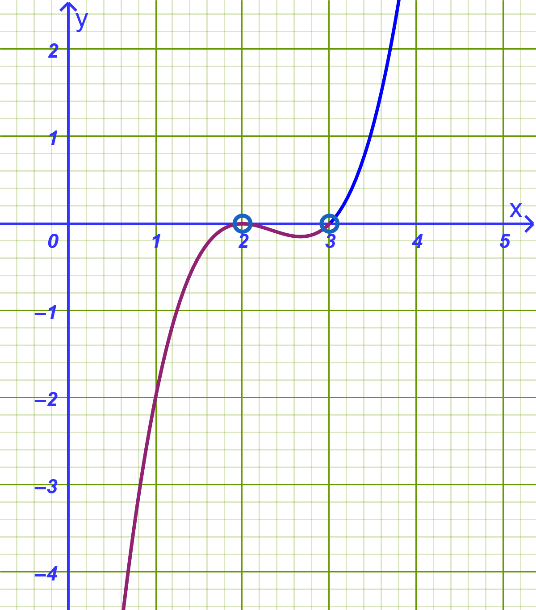{fig-align="center" width="400"}
:::

$$\begin{array}{c|c cc c cc c cc c}
  x & -\infty & & 2 & &  & & 3 & & +\infty \\
  \hline
  x - 2 & & - & 0 & + & + & + & + & + & \\
  x^2-5x+6 & & + & 0 & - & - & - & 0 & + & \\
  \hline
  \mathbf{P(x)} & & \mathbf{-} & \mathbf{0} & \mathbf{-} & \mathbf{-} & \mathbf{-} & \mathbf{0} & \mathbf{+} & 
\end{array}$$

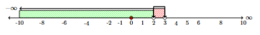{fig-align="center" width="500"}
::::

12. Να λυθεί η ανίσωση: $x^3 - 3x^2 - 4x + 12 > 0$.

:::: callout-method
::: {.callout-method .callout-title}
Υπόδειξη

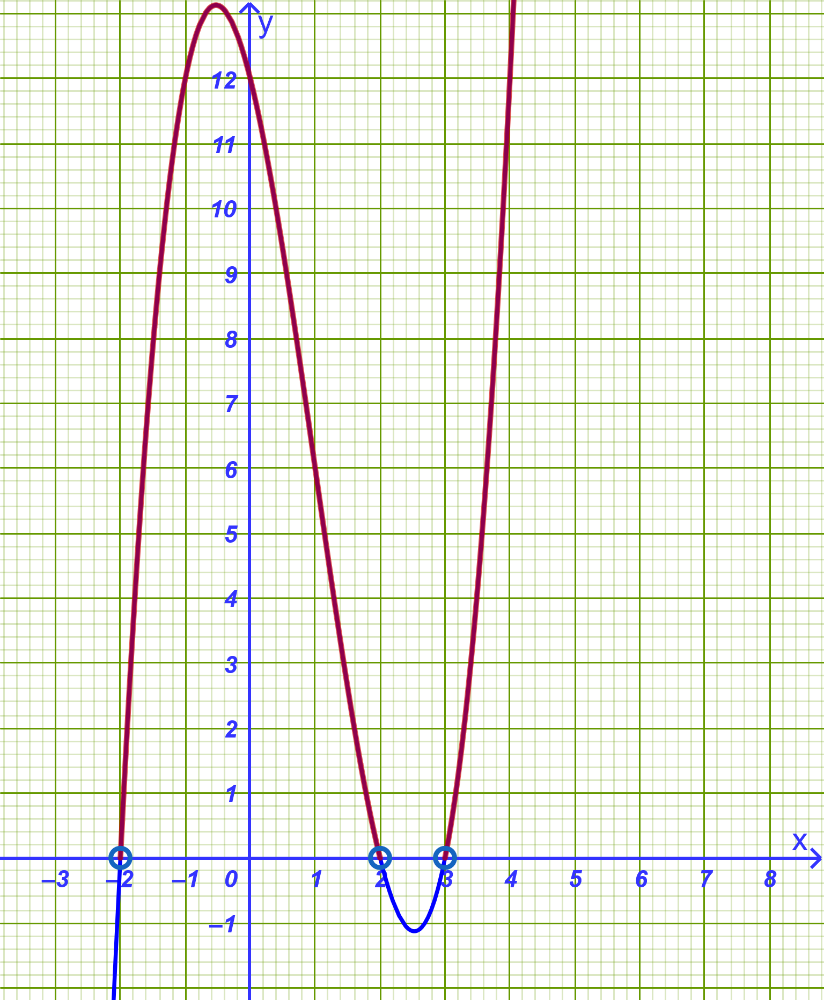{fig-align="center" width="400"}
:::

Με Horner βρίσκουμε

$$\begin{array}{|ccccc||c|}
1 & -3 & -4 & 12 &  & \ x=-2 \\
\downarrow &-2 & 10 & -12 & \\
\hline
\mathbf{1} & \mathbf{-5} & \mathbf{6} & \mathbf{0} & \mathbf{}
\end{array}$$

Άρα η ανίσωση γράφεται $(x+2)(x^2-5x+6)>0$

------------------------------------------------------------------------

$$\begin{array}{c|c cc c cc c cc c}
  x & -\infty & & -2 & &  2& & 3 & & +\infty \\
  \hline
  x + 2 & & - & 0 & + & + & + & + & + & \\
  x^2-5x+6 & & + & + & + & 0 & - & 0 & + & \\
  \hline
  \mathbf{P(x)} & & \mathbf{-} & \mathbf{0} & \mathbf{+} & \mathbf{0} & \mathbf{-} & \mathbf{0} & \mathbf{+} & 
\end{array}$$

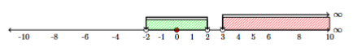{width="500"}
::::

13. Να λυθεί η ανίσωση: $x^4 - 3x^3 + 2x^2 \le 0$.

14. Να προσδιοριστεί το πρόσημο του πολυωνύμου $P(x) = (x^2 - 9)(x^2 + 2x + 5)(1 - x)$.

15. Να λυθεί η ανίσωση: $x^3 + x^2 - 5x + 3 \ge 0$.

#### **Κατηγορία Δ: Θεώρημα Bolzano & Προσέγγιση Ρίζας (16–20)**

16. Να αποδειχθεί ότι η εξίσωση $x^3 + 3x - 5 = 0$ έχει μία τουλάχιστον ρίζα στο διάστημα $(1, 2)$.

:::: callout-method
::: {.callout-method .callout-title}
Υπόδειξη
:::
$P(1)=1^3+3\cdot1-5=-1$

$P(2)=2^3+3\cdot2-5=9$. Άρα $P(1)\cdot P(2)<0$
::::

17. Να βρεθεί η ρίζα της εξίσωσης $x^3 + 5x - 3 = 0$ στο διάστημα $(0, 1)$ με προσέγγιση δεκάτου.

:::: callout-method
::: {.callout-method .callout-title}
Υπόδειξη
:::
$P(0,5)=0,5^3+5\cdot 0,5-3=-0,375$

$P(0,6)=0,6^3+5\cdot 0,6-3=0,216 \implies x\approx 0,6$ με προσέγγιση εκατοστού $x\approx 0,56$
::::

18. Να αποδειχθεί ότι η γραφική παράσταση της συνάρτησης $f(x) = x^4 - 3x - 2$ τέμνει τον άξονα $x'x$ σε ένα τουλάχιστον σημείο στο διάστημα $(1, 2)$.

:::: callout-method
::: {.callout-method .callout-title}
Υπόδειξη
:::
Πρέπει $f(1) \cdot f(2)<0$
::::

19. Να αποδειχθεί ότι η εξίσωση $2x^3 - 5x + 1 = 0$ έχει τρεις πραγματικές ρίζες στα διαστήματα $(-2, -1)$, $(0, 1)$ και $(1, 2)$.

>>> Όμοια για κάθε διάστημα όπως στην 18.

20. Να αποδειχθεί ότι η εξίσωση $x^5 + x^3 + x - 1 = 0$ έχει μοναδική πραγματική ρίζα στο διάστημα $(0, 1)$.

#### **Κατηγορία Ε: Σύνθετες Ασκήσεις & Πρακτικά Προβλήματα (21–30)**

21. **(Γεωμετρικό Πρόβλημα):** Ένα ορθογώνιο παραλληλεπίπεδο έχει διαστάσεις $x$, $x + 1$ και $x + 2$ (σε μέτρα).
    Αν ο όγκος του είναι $24 \text{ m}^3$, να υπολογιστούν οι διαστάσεις του.

:::: callout-method
::: {.callout-method .callout-title}
Υπόδειξη
:::
Θα έχουμε $V=24 \implies x(x+1)(x+2)=24 \longrightarrow \ \ \ $ Λύνουμε $\longrightarrow x=2$

.........................

::::

22. **(Παραμετρική Εξίσωση):** Δίνεται η εξίσωση $x^3 - (\alpha + 2)x^2 + (2\alpha + 1)x - \alpha = 0$.

- α) Να αποδειχθεί ότι το $x = 1$ είναι ρίζα της εξίσωσης για κάθε $\alpha \in \mathbb{R}$.

- β) Να βρεθούν οι υπόλοιπες ρίζες της εξίσωσης ως συνάρτηση του $\alpha$.

:::: callout-method
::: {.callout-method .callout-title}
Υπόδειξη
:::
- α)  Πρέπει $P(1)=0 \ \ $, Πράγματι $1^3 - (\alpha + 2)1^2 + (2\alpha + 1)1 - \alpha = 0$

- β)  Με Horner βρίσκουμε τον δεύτερο παράγοντα

$$\begin{array}{|ccccc||c|}
1 & -α-2 & 2α+1 & -α &  & \ x=1 \\
\downarrow &1 & -α-1 & α & \\
\hline
\mathbf{1} & \mathbf{-α-1} & \mathbf{α} & \mathbf{0} & \mathbf{}
\end{array}$$

Άρα ο δεύτερος παράγοντας είναι $x^2-(a+1)x+a \ \ $ Λύνουμε την εξίσωση $x^2-(a+1)x+a=0$

$Δ= ............................ = α-1, α\ge 1$

$x_{1,2}=$ ......................................  $x=a, x=1$
::::

23. **(Σύστημα Ανισώσεων):** Να λυθεί το σύστημα ανισώσεων: $$\begin{cases} x^3 - 4x > 0 \\ x^2 - 3x + 2 \le 0 \end{cases}$$

:::: callout-method
::: {.callout-method .callout-title}
Υπόδειξη
:::
Λύνουμε την κάθε ανίσωση χωριστά και βρίσκουμε που συναληθεύουν.
::::

24. **(Πολυωνυμική Συνάρτηση & Πεδίο Ορισμού):** Να βρεθεί το πεδίο ορισμού της συνάρτησης $f(x) = \sqrt{x^3 - 2x^2 - 5x + 6}$.

:::: callout-method
::: {.callout-method .callout-title}
Υπόδειξη
:::
Πρέπει $x^3 - 2x^2 - 5x + 6 \ge 0$. Λύνουμε την ανίσωση.

::::

25. **(Πρόβλημα Κατασκευής):** Από τα τέσσερα άκρα ενός τετραγώνου λαμαρίνας πλευράς $10 \text{ cm}$ κόβουμε τέσσερα ίσα τετράγωνα πλευράς $x \text{ cm}$ και διπλώνουμε τα χείλη για να σχηματίσουμε ένα ανοικτό κουτί.

- α) Να εκφράσετε τον όγκο $V(x)$ του κουτιού ως συνάρτηση του $x$.

- β) Να βρείτε για ποιες τιμές του $x$ ο όγκος του κουτιού είναι $48 \text{ cm}^3$.

:::: callout-method
::: {.callout-method .callout-title}
Υπόδειξη
:::
- α)   $V(x)=(10-2x)(10-2x)x$

...................................

- β)  Λύνουμε την εξίσωση $V(x)=(10-2x)(10-2x)x=24$

..........................................
::::

------------------------------------------------------------------------

:::: {.math-box .problem-box}
::: {.math-title .problem-title}
26. Οικολογία & Περιβαλλοντική Μηχανική

**Εκφώνηση:**
:::

Σε μια τεχνητή λίμνη εισάγεται ένας πληθυσμός ωφέλιμων μικροοργανισμών για τον καθαρισμό του νερού.
Η πυκνότητα του πληθυσμού $P$ (σε χιλιάδες ανά $\text{m}^3$) μετά από $t$ εβδομάδες ($t \ge 0$) περιγράφεται από τη σχέση: $$P(t) = \frac{4t^2 + 8t}{t^3 + 32}$$ Η πυκνότητα του πληθυσμού λαμβάνει ακρότατη τιμή όταν ο χρόνος $t$ ικανοποιεί την πολυωνυμική εξίσωση: $$t^4 + 11t^3 - 196t^2 - 260t + 1\,200 = 0$$

i)  Να λύσετε την εξίσωση στο $\mathbb{R}$.

ii) Λαμβάνοντας υπόψη ότι ο χρόνος είναι $t > 0$, να βρείτε σε ποιο χρονικό σημείο η πυκνότητα $P$ γίνεται μέγιστη και να υπολογίσετε την τιμή της μέγιστης αυτής πυκνότητας.
::::

:::: {.math-box .problemsolution-box}
::: {.math-title .problemsolution-title}
**Λύση:**
:::

**i) Επίλυση της εξίσωσης** $t^4 + 11t^3 - 196t^2 - 260t + 1\,200 = 0$

Αναζητούμε ακέραιες ρίζες στους διαιρέτες του σταθερού όρου $1\,200$ ($\pm 1, \pm 2, \dots$).

Δοκιμάζουμε για $t = 2$: $$2^4 + 11(2^3) - 196(2^2) - 260(2) + 1\,200 = 16 + 88 - 784 - 520 + 1\,200 = 0$$ Άρα το $t = 2$ είναι ρίζα του πολυωνύμου.

Εφαρμόζουμε το σχήμα Horner με το $2$:

$$\begin{array}{c|rrrrr}
 & 1 & 11 & -196 & -260 & 1\,200 \\
2 & \downarrow & 2 & 26 & -340 & -1\,200 \\
\hline
 & 1 & 13 & -170 & -600 & 0
\end{array}$$

Η εξίσωση γράφεται: $$(t - 2)(t^3 + 13t^2 - 170t - 600) = 0$$

Για το πολυώνυμο $t^3 + 13t^2 - 170t - 600$, δοκιμάζουμε το $t = 10$: $$10^3 + 13(10^2) - 170(10) - 600 = 1\,000 + 1\,300 - 1\,700 - 600 = 0$$

Άρα και το $t = 10$ είναι ρίζα.

Εφαρμόζουμε ξανά το σχήμα Horner με το $10$:

$$\begin{array}{c|rrrr}
 & 1 & 13 & -170 & -600 \\
10 & \downarrow & 10 & 230 & 600 \\
\hline
 & 1 & 23 & 60 & 0
\end{array}$$

Έτσι, το πολυώνυμο παραγοντοποιείται πλήρως ως: $$(t - 2)(t - 10)(t^2 + 23t + 60) = 0$$

Λύνουμε το τριώνυμο $t^2 + 23t + 60 = 0$: $$\Delta = 23^2 - 4(1)(60) = 529 - 240 = 289 = 17^2$$ $$t = \frac{-23 \pm 17}{2} \implies t = -3 \quad \text{ή} \quad t = -20$$

Επομένως, οι ρίζες της εξίσωσης είναι: $$t = -20, \quad t = -3, \quad t = 2, \quad t = 10$$

------------------------------------------------------------------------

**ii) Εύρεση μέγιστης πυκνότητας**

Επειδή ο χρόνος είναι $t > 0$, δεκτές είναι μόνο οι θετικές ρίζες: $$t = 2 \quad \text{και} \quad t = 10$$

Υπολογίζουμε την τιμή της πυκνότητας $P(t)$ για καθεμία από αυτές:

- Για $t = 2$: $$P(2) = \frac{4(2^2) + 8(2)}{2^3 + 32} = \frac{16 + 16}{8 + 32} = \frac{32}{40} = 0,8 \text{ χιλιάδες}/\text{m}^3$$

- Για $t = 10$: $$P(10) = \frac{4(10^2) + 8(10)}{10^3 + 32} = \frac{400 + 80}{1\,000 + 32} = \frac{480}{1\,032} \approx 0,465 \text{ χιλιάδες}/\text{m}^3$$

Συνεπώς:

- Η πυκνότητα γίνεται **μέγιστη** σε χρόνο $t = 2$ εβδομάδες.

- Η μέγιστη τιμή της πυκνότητας είναι $0,8$ χιλιάδες ανά $\text{m}^3$ (δηλαδή $800$ μικροοργανισμοί ανά $\text{m}^3$).
::::

------------------------------------------------------------------------

:::: {.math-box .problem-box}
::: {.math-title .problem-title}
27. Αεροναυπηγική – Κατανάλωση Καυσίμου Πυραύλου

**Εκφώνηση:**
:::

Κατά τη διάρκεια δοκιμαστικής πτήσης ενός μη επανδρωμένου σκάφους, η εναπομένουσα μάζα καυσίμου $M$ (σε $\text{kg}$) συναρτήσει του χρόνου $t$ (σε λεπτά) από την εκτόξευση δίνεται από τον τύπο: $$M(t) = 5\left(1\,000 - 300t + 30t^2 - t^3\right), \quad 0 \le t \le 15$$

Να βρείτε σε πόσα λεπτά μετά την εκτόξευση θα εξαντληθούν πλήρως τα καύσιμα του σκάφους.
::::

:::: {.math-box .problemsolution-box}
::: {.math-title .problemsolution-title}
**Λύση:**
:::

Τα καύσιμα εξαντλούνται πλήρως όταν η μάζα μηδενιστεί, δηλαδή $M(t) = 0$: $$5\left(1\,000 - 300t + 30t^2 - t^3\right) = 0$$

Διαιρούμε με το $5$: $$1\,000 - 300t + 30t^2 - t^3 = 0$$

Αναγνωρίζουμε την ταυτότητα αναπτύγματος κύβου διαφοράς: $$(10 - t)^3 = 0 \iff 10 - t = 0 \iff t = 10\text{ λεπτά}$$

Άρα τα καύσιμα θα εξαντληθούν ακριβώς στα $10$ λεπτά.
::::

------------------------------------------------------------------------

:::: {.math-box .problem-box}
::: {.math-title .problem-title}
28. Σεισμολογία – Απόσβεση Δόνησης

**Εκφώνηση:**
:::

Κατά τη διάρκεια σεισμικής δόνησης, η κατακόρυφη μετατόπιση $y$ (σε $\text{cm}$) ενός αντικραδασμικού ελατηρίου βάσης κτιρίου δίνεται, $t$ δευτερόλεπτα μετά την εκδήλωση του φαινομένου, από τον τύπο: $$y(t) = 8t\left(t^2 - 9t + 14\right)$$

Ποιες χρονικές στιγμές ($t > 0$) το ελατήριο διέρχεται από τη θέση ισορροπίας του ($y = 0$);
::::

:::: {.math-box .problemsolution-box}
::: {.math-title .problemsolution-title}
**Λύση:**
:::

Το ελατήριο βρίσκεται στη θέση ισορροπίας όταν $y(t) = 0$: $$8t\left(t^2 - 9t + 14\right) = 0$$

Επειδή αναζητούμε στιγμές μετά την έναρξη ($t > 0$), ισχύει: $$t^2 - 9t + 14 = 0$$

Παραγοντοποιούμε το δευτεροβάθμιο τριώνυμο: $$(t - 2)(t - 7) = 0$$ Άρα: $$t = 2\text{ s} \quad \text{και} \quad t = 7\text{ s}$$

Το ελατήριο περνά από τη θέση ισορροπίας στα $2$ δευτερόλεπτα και στα $7$ δευτερόλεπτα.
::::

------------------------------------------------------------------------

:::: {.math-box .problem-box}
::: {.math-title .problem-title}
29. Αρχιτεκτονική & Logistics – Σχεδιασμός Ψυκτικού Θαλάμου

**Εκφώνηση:**
:::

Μια εταιρεία logistics κατασκευάζει έναν επιμήκη ψυκτικό θάλαμο σχήματος ορθογωνίου παραλληλεπιπέδου με τετραγωνική πρόσοψη πλευράς $x\text{ m}$ και μήκος $y\text{ m}$.

Λόγω προδιαγραφών του συστήματος μόνωσης, το άθροισμα του μήκους $y$ και της περιμέτρου της πρόσοψης δεν πρέπει να ξεπερνά τα $36\text{ m}$.

Αν ο απαιτούμενος όγκος αποθήκευσης είναι $432\text{ m}^3$, να βρείτε τις ακριβείς διαστάσεις $x$ και $y$ του θαλάμου.
::::

:::: {.math-box .problemsolution-box}
::: {.math-title .problemsolution-title}
**Λύση:**
:::

1.  Η περίμετρος της τετραγωνικής πρόσοψης είναι $4x$.

    Σύμφωνα με τον περιορισμό: $$y + 4x = 36 \implies y = 36 - 4x$$ με φυσικούς περιορισμούς $x > 0$ και $36 - 4x > 0 \implies 0 < x < 9$.

2.  Ο τύπος του όγκου είναι: $$V = x^2 \cdot y = 432$$

    Αντικαθιστούμε το $y$: $$x^2(36 - 4x) = 432 \implies 36x^2 - 4x^3 = 432$$

    Διαιρούμε όλους τους όρους με το $4$ και αναδιατάσσουμε: $$x^3 - 9x^2 + 108 = 0$$

3.  Αναζητούμε ακέραιες ρίζες στους διαιρέτες του $108$:

    Δοκιμάζουμε $x = 6$: $$6^3 - 9(6^2) + 108 = 216 - 9(36) + 108 = 216 - 324 + 108 = 0$$

    Άρα το $x = 6$ είναι δεκτή λύση.

4.  Υπολογίζουμε το μήκος $y$: $$y = 36 - 4(6) = 36 - 24 = 12\text{ m}$$

*(Σημείωση: Με σχήμα Horner,* $x^3 - 9x^2 + 108 = (x - 6)(x^2 - 3x - 18) = (x - 6)^2(x + 3) = 0$, οπότε η μόνη θετική λύση είναι $x = 6$).\
Οι διαστάσεις του θαλάμου είναι $6\text{ m} \times 6\text{ m} \times 12\text{ m}$.
::::

------------------------------------------------------------------------

:::: {.math-box .problem-box}
::: {.math-title .problem-title}
30. Μικροοικονομία – Σημείο Ισορροπίας Κόστους και Εσόδων

**Εκφώνηση:**
:::

Σε μια βιομηχανία παραγωγής εξαρτημάτων, η συνάρτηση συνολικών εσόδων $R(x)$ (σε χιλιάδες ευρώ) συνδέεται με την παραγωγή $x$ (σε χιλιάδες τεμάχια) μέσω της καμπύλης: $$y = x^3 - 2x^2$$

Η γραμμή του μεταβλητού κόστους είναι μια ευθεία που διέρχεται από τα σημεία $A(1, 4)$ και $B(3, 14)$.

i)  Να βρείτε την εξίσωση της ευθείας του κόστους.

ii) Να δείξετε ότι τα επίπεδα παραγωγής στα οποία τα έσοδα ισούνται με το κόστος προσδιορίζονται από τις ρίζες της εξίσωσης: $$x^3 - 2x^2 - 5x + 1 = 0$$

iii) Αν η ευθεία κόστους ήταν αντ' αυτού η $y = 7x - 12$, να βρείτε όλα τα σημεία τομής της με την καμπύλη εσόδων.
::::

:::: {.math-box .problemsolution-box}
::: {.math-title .problemsolution-title}
**Λύση:**
:::

**i)** Βρίσκουμε τον συντελεστή διεύθυνσης της ευθείας: $$\lambda = \frac{14 - 4}{3 - 1} = \frac{10}{2} = 5$$

Η εξίσωση της ευθείας είναι: $$y - 4 = 5(x - 1) \implies y = 5x - 1$$

**ii)** Για την εξίσωση εσόδων και κόστους: $$x^3 - 2x^2 = 5x - 1 \iff x^3 - 2x^2 - 5x + 1 = 0$$

**iii)** Εξισώνουμε με τη νέα ευθεία $y = 7x - 12$: $$x^3 - 2x^2 = 7x - 12 \iff x^3 - 2x^2 - 7x + 12 = 0$$

Εξετάζουμε ακέραιες ρίζες στους διαιρέτες του $12$:\
Για $x = 3$: $$3^3 - 2(3^2) - 7(3) + 12 = 27 - 18 - 21 + 12 = 0$$

Με σχήμα Horner ή παραγοντοποίηση: $$(x - 3)(x^2 + x - 4) = 0$$

Οι υπόλοιπες ρίζες προκύπτουν από το τριώνυμο $x^2 + x - 4 = 0$ ($\Delta = 1 + 16 = 17$): $$x_{1,2} = \frac{-1 \pm \sqrt{17}}{2}$$

Άρα το ακέραιο σημείο τομής είναι για $x = 3$ με τεταγμένη $y = 7(3) - 12 = 9$, δηλαδή το σημείο $(3, 9)$.
::::

------------------------------------------------------------------------

## ΔΙΑΓΩΝΙΣΜΑ ΑΞΙΟΛΟΓΗΣΗΣ: ΠΟΛΥΩΝΥΜΙΚΕΣ ΕΞΙΣΩΣΕΙΣ ΚΑΙ ΑΝΙΣΩΣΕΙΣ

**Μάθημα:** Άλγεβρα Β' Γενικού Λυκείου\
**Ενότητα:** Πολυωνυμικές Εξισώσεις, Θεώρημα Ακέραιων Ριζών, Σχήμα Horner, Πρόσημο Γινομένου, Πολυωνυμικές Ανισώσεις & Θεώρημα Bolzano\
**Διάρκεια:** 60 λεπτά

------------------------------------------------------------------------

### **ΘΕΜΑ Α (Θεωρία & Αποδείξεις — 25 Μονάδες)**

**Α1.** (8 Μονάδες)

1.  Τι ονομάζεται **πολυωνυμική εξίσωση βαθμού** $\nu$ και τι **ρίζα** αυτής;

2.  Πώς επιλύεται μια πολυωνυμική εξίσωση βαθμού $\nu > 2$ με τη μέθοδο της παραγοντοποίησης;

**Α2.** (10 Μονάδες)

Να διατυπώσετε και να αποδείξετε το **Θεώρημα Ακέραιων Ριζών** για πολυωνυμική εξίσωση με ακέραιους συντελεστές.

**Α3.** (7 Μονάδες)

Να χαρακτηρίσετε τις παρακάτω προτάσεις ως **Σωστό (Σ)** ή **Λάθος (Λ)**:

1.  Αν ο ακέραιος $\rho \neq 0$ είναι ρίζα μιας πολυωνυμικής εξίσωσης με ακέραιους συντελεστές, τότε ο $\rho$ είναι διαιρέτης του σταθερού όρου $a_0$.

2.  Κάθε πολυωνυμική εξίσωση περιττού βαθμού με πραγματικούς συντελεστές έχει τουλάχιστον μία πραγματική ρίζα.

3.  Η ανίσωση $A(x) \cdot B(x) > 0$ είναι πάντοτε ισοδύναμη με την κλασματική ανίσωση $\dfrac{A(x)}{B(x)} > 0$ (για τις τιμές όπου $B(x) \neq 0$).

4.  Αν για μια πολυωνυμική συνάρτηση $f$ ισχύει $f(a) \cdot f(b) < 0$ σε ένα διάστημα $[a, b]$, τότε η εξίσωση $f(x) = 0$ έχει υποχρεωτικά μία μόνο ρίζα στο $(a, b)$.

5.  Οι πιθανές ακέραιες ρίζες της εξίσωσης $x^3 - 3x^2 + 2x - 5 = 0$ είναι οι αριθμοί $\pm 1, \pm 5$.

------------------------------------------------------------------------

### **ΘΕΜΑ Β (Πολυωνυμικές Εξισώσεις — 25 Μονάδες)**

**Β1.** (12 Μονάδες)

Να λυθεί στο $\mathbb{R}$ η πολυωνυμική εξίσωση 3ου βαθμού: $$x^3 - 4x^2 + x + 6 = 0$$

**Β2.** (13 Μονάδες)

Να λυθεί στο $\mathbb{R}$ η πολυωνυμική εξίσωση 4ου βαθμού: $$2x^4 - 3x^3 - 11x^2 + 6x = 0$$

------------------------------------------------------------------------

### **ΘΕΜΑ Γ (Πολυωνυμικές Ανισώσεις & Πρόσημο Γινομένου — 25 Μονάδες)**

**Γ1.** (12 Μονάδες)

Να λυθεί στο $\mathbb{R}$ η ανίσωση: $$(x^2 - 4)(x^2 - 3x + 2) \le 0$$

**Γ2.** (13 Μονάδες)

Να λυθεί στο $\mathbb{R}$ η ανίσωση: $$x^3 - 2x^2 - 5x + 6 > 0$$

------------------------------------------------------------------------

### **ΘΕΜΑ Δ (Σύνθετο Θέμα & Προσεγγιστικός Υπολογισμός Ρίζας — 25 Μονάδες)**

**Δ1.** (12 Μονάδες)

Δίνεται η πολυωνυμική συνάρτηση $f(x) = x^3 + 2x - 5$.

1.  Να αποδείξετε ότι η εξίσωση $f(x) = 0$ έχει τουλάχιστον μία πραγματική ρίζα στο ανοικτό διάστημα $(1, 2)$.

2.  Να προσδιορίσετε τη ρίζα αυτή με προσέγγιση δεκάτου.

**Δ2.** (13 Μονάδες)

Δίνεται το πολυώνυμο $P(x) = x^3 - (\alpha + 1)x^2 + (\alpha - 2)x + 2$, όπου $\alpha \in \mathbb{R}$.

1.  Να αποδείξετε ότι το $x = 1$ είναι ρίζα του $P(x)$ για κάθε τιμή της παραμέτρου $\alpha \in \mathbb{R}$.

2.  Να βρείτε τις τιμές του $\alpha \in \mathbb{R}$ για τις οποίες η εξίσωση $P(x) = 0$ έχει **τρεις πραγματικές και άνισες ρίζες**.

------------------------------------------------------------------------

## ΑΝΑΛΥΤΙΚΕΣ ΛΥΣΕΙΣ ΔΙΑΓΩΝΙΣΜΑΤΟΣ

### **ΘΕΜΑ Α**

- **Α1.1:** **Πολυωνυμική εξίσωση βαθμού** $\nu$ ονομάζεται κάθε εξίσωση της μορφής $a_\nu x^\nu + a_{\nu-1} x^{\nu-1} + \dots + a_1 x + a_0 = 0$, με $a_\nu \neq 0$.
  **Ρίζα** της εξίσωσης ονομάζεται κάθε πραγματικός αριθμός $\rho$ για τον οποίο η αριθμητική τιμή του πολυωνύμου ισούται με μηδέν, δηλαδή $P(\rho) = 0$.

- **Α1.2:** Για εξισώσεις βαθμού $\nu > 2$, μεταφέρουμε όλους τους όρους στο πρώτο μέλος ώστε η εξίσωση να πάρει τη μορφή $P(x) = 0$.
  Στη συνέχεια παραγοντοποιούμε το $P(x)$ σε γινόμενο πρωτοβάθμιων ή δευτεροβάθμιων παραγόντων $P_1(x) \cdot P_2(x) \cdots P_k(x) = 0$, οπότε αναγόμαστε στις απλούστερες εξισώσεις $P_1(x) = 0 \text{ ή } P_2(x) = 0 \dots \text{ ή } P_k(x) = 0$.

- **Α2:** **Θεώρημα Ακέραιων Ριζών:** Έστω η πολυωνυμική εξίσωση $a_\nu x^\nu + a_{\nu-1} x^{\nu-1} + \dots + a_1 x + a_0 = 0$ με ακέραιους συντελεστές ($a_\nu \neq 0, a_0 \neq 0$).
  Αν ο ακέραιος $\rho \neq 0$ είναι ρίζα της εξίσωσης, τότε ο $\rho$ είναι διαιρέτης του σταθερού όρου $a_0$.

  **Απόδειξη:** Αφού ο $\rho \neq 0$ είναι ρίζα της εξίσωσης, ισχύει: $$a_\nu \rho^\nu + a_{\nu-1} \rho^{\nu-1} + \dots + a_1 \rho + a_0 = 0$$

  Απομονώνουμε τον σταθερό όρο $a_0$: $$a_0 = -a_\nu \rho^\nu - a_{\nu-1} \rho^{\nu-1} - \dots - a_1 \rho$$

  Βγάζουμε κοινό παράγοντα το $\rho$: $$a_0 = \rho \cdot \left(-a_\nu \rho^{\nu-1} - a_{\nu-1} \rho^{\nu-2} - \dots - a_1\right)$$

  Επειδή οι συντελεστές $a_1, \dots, a_\nu$ και ο $\rho$ είναι ακέραιοι, η παράσταση εντός της παρενθέσεως είναι ακέραιος αριθμός $k$.
  Επομένως $a_0 = \rho \cdot k$, που σημαίνει ότι ο $\rho$ διαιρεί τον $a_0$.

- **Α3:**

  1.  **Σωστό** (Βασική διατύπωση του θεωρήματος ακέραιων ριζών).

  2.  **Σωστό** (Λόγω της συνέχειας των πολυωνυμικών συναρτήσεων και των ορίων στο $\pm \infty$).

  3.  **Σωστό** (Το πρόσημο του γινομένου και του πηλίκου δύο παραστάσεων ταυτίζεται για τις τιμές όπου ορίζεται το πηλίκο).

  4.  **Λάθος** (Το θεώρημα Bolzano εξασφαλίζει την ύπαρξη *τουλάχιστον μίας* ρίζας, όχι απαραίτητα μοναδικής).

  5.  **Σωστό** (Οι διαιρέτες του σταθερού όρου $a_0 = -5$ είναι οι $\pm 1, \pm 5$).

------------------------------------------------------------------------

### **ΘΕΜΑ Β**

- **Β1:**

  Για την εξίσωση $x^3 - 4x^2 + x + 6 = 0$, οι πιθανές ακέραιες ρίζες είναι οι διαιρέτες του $6$, δηλαδή οι $\pm 1, \pm 2, \pm 3, \pm 6$.

  - Για $\rho = -1$: $P(-1) = (-1)^3 - 4(-1)^2 + (-1) + 6 = -1 - 4 - 1 + 6 = 0$.

  - Εφαρμόζουμε το **σχήμα Horner** για $\rho = -1$:

  $$\begin{array}{c|ccc|c|c}
  1 & -4 & 1 & 6 & \rho = -1 \\
  & -1 & 5 & -6 & \\
  \hline
  1 & -5 & 6 & \mathbf{0} & 
  \end{array}$$

  Η εξίσωση γράφεται:

  $$(x + 1)(x^2 - 5x + 6) = 0$$

  - $x + 1 = 0 \iff \mathbf{x = -1}$
  - $x^2 - 5x + 6 = 0 \iff (x - 2)(x - 3) = 0 \iff \mathbf{x = 2} \quad \text{ή} \quad \mathbf{x = 3}$

  Άρα το σύνολο λύσεων είναι $S = \{-1, 2, 3\}$.

- **Β2:**

  Βγάζουμε κοινό παράγοντα το $x$: $$x(2x^3 - 3x^2 - 11x + 6) = 0 \iff x = 0 \quad \text{ή} \quad 2x^3 - 3x^2 - 11x + 6 = 0$$

  Για την εξίσωση $Q(x) = 2x^3 - 3x^2 - 11x + 6 = 0$, οι διαιρέτες του $6$ είναι οι $\pm 1, \pm 2, \pm 3, \pm 6$.

  - Δοκιμάζουμε $\rho = 3$: $Q(3) = 2(27) - 3(9) - 11(3) + 6 = 54 - 27 - 33 + 6 = 0$.

  - Εφαρμόζουμε σχήμα Horner με $\rho = 3$:

  $$\begin{array}{c|ccc|c|c}
  2 & -3 & -11 & 6 & \rho = 3 \\
  & 6 & 9 & -6 & \\
  \hline
  2 & 3 & -2 & \mathbf{0} & 
  \end{array}$$

  Το πηλίκο είναι το τριώνυμο $2x^2 + 3x - 2 = 0$.

  Υπολογίζουμε τη διακρίνουσα: $\Delta = 3^2 - 4(2)(-2) = 9 + 16 = 25$.

  Οι ρίζες του τριωνύμου είναι: $$x = \frac{-3 \pm 5}{4} \implies \mathbf{x = \frac{1}{2}} \quad \text{ή} \quad \mathbf{x = -2}$$

  Άρα οι λύσεις της αρχικής εξίσωσης είναι $S = \left\{-2, 0, \frac{1}{2}, 3\right\}$.

------------------------------------------------------------------------

### **ΘΕΜΑ Γ**

- **Γ1:**

  Παραγοντοποιούμε τους δύο παράγοντες του γινομένου:

  - $x^2 - 4 = (x - 2)(x + 2)$

  - $x^2 - 3x + 2 = (x - 1)(x - 2)$

  Άρα η ανίσωση παίρνει τη μορφή: $$(x + 2)(x - 1)(x - 2)^2 \le 0$$

  Συντάσσουμε τον **πίνακα προσήμων**:

  $$\begin{array}{c|c cc c cc c cc c}
  x & -\infty & & -2 & & 1 & & 2 & & +\infty \\
  \hline
  x + 2 & & - & 0 & + & | & + & | & + & \\
  x - 1 & & - & | & - & 0 & + & | & + & \\
  (x - 2)^2 & & + & | & + & | & + & 0 & + & \\
  \hline
  \mathbf{P(x)} & & \mathbf{+} & \mathbf{0} & \mathbf{-} & \mathbf{0} & \mathbf{+} & \mathbf{0} & \mathbf{+} & 
  \end{array}$$

  Αναζητούμε τις τιμές όπου $P(x) \le 0$:

  - Η ανίσωση αληθεύει για $x \in [-2, 1]$ καθώς και για τη μεμονωμένη ρίζα $x = 2$.

  Άρα το σύνολο λύσεων είναι $x \in [-2, 1] \cup \{2\}$.

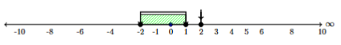{fig-align="center" width="500"}

- **Γ2:**

  Βρίσκουμε τις ρίζες του πολυώνυμου $P(x) = x^3 - 2x^2 - 5x + 6$.

  Με δοκιμή διαιρετών του $6$, διαπιστώνουμε ότι $P(1) = 1 - 2 - 5 + 6 = 0$.

  Με σχήμα Horner για $\rho = 1$, παίρνουμε $P(x) = (x - 1)(x^2 - x - 6) = (x - 1)(x - 3)(x + 2)$.

  Πίνακας προσήμων για τις ρίζες $x = -2, 1, 3$:

  $$\begin{array}{c|c cc c cc c cc c}
  x & -\infty & & -2 & & 1 & & 3 & & +\infty \\
  \hline
  x + 2 & & - & 0 & + & | & + & | & + & \\
  x - 1 & & - & | & - & 0 & + & | & + & \\
  x - 3 & & - & | & - & | & - & 0 & + & \\
  \hline
  \mathbf{P(x)} & & \mathbf{-} & \mathbf{0} & \mathbf{+} & \mathbf{0} & \mathbf{-} & \mathbf{0} & \mathbf{+} & 
  \end{array}$$

  Επιλέγουμε τα διαστήματα στα οποία $P(x) > 0$: $$\mathbf{x \in (-2, 1) \cup (3, +\infty)}$$

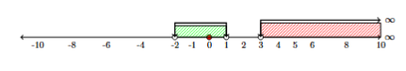{fig-align="center" width="500"}

------------------------------------------------------------------------

### **ΘΕΜΑ Δ**

- **Δ1.1:**

  Η συνάρτηση $f(x) = x^3 + 2x - 5$ είναι πολυωνυμική, άρα συνεχής στο \$\$.

  - $f(1) = 1^3 + 2(1) - 5 = 3 - 5 = -2 < 0$

  - $f(2) = 2^3 + 2(2) - 5 = 8 + 4 - 5 = 7 > 0$

  Επειδή $f(1) \cdot f(2) = (-2) \cdot 7 = -14 < 0$, σύμφωνα με το **Θεώρημα Bolzano**, υπάρχει τουλάχιστον μία ρίζα $x_0 \in (1, 2)$ τέτοια ώστε $f(x_0) = 0$.

- **Δ1.2:**

  Υπολογίζουμε τις τιμές της $f(x)$ στα ενδιάμεσα σημεία με βήμα $0.1$:

  - $f(1.3) = (1.3)^3 + 2(1.3) - 5 = 2.197 + 2.6 - 5 = -0.203 < 0$

  - $f(1.4) = (1.4)^3 + 2(1.4) - 5 = 2.744 + 2.8 - 5 = +0.544 > 0$

  Επειδή $f(1.3) \cdot f(1.4) < 0$, η ρίζα βρίσκεται στο διάστημα $(1.3, 1.4)$.\
  Επομένως, η ρίζα με προσέγγιση δεκάτου είναι $x \approx 1.3$.

- **Δ2.1:**

  Υπολογίζουμε την τιμή $P(1)$: $$P(1) = 1^3 - (\alpha + 1)(1)^2 + (\alpha - 2)(1) + 2 = 1 - \alpha - 1 + \alpha - 2 + 2 = 0$$

  Άρα το $x = 1$ είναι πράγματι ρίζα του πολυωνύμου $P(x)$ για κάθε $\alpha \in \mathbb{R}$.

- **Δ2.2:**

  Εφαρμόζουμε το σχήμα Horner στο $P(x)$ για την γνωστή ρίζα $\rho = 1$:

  $$\begin{array}{c|ccc|c|c}
  1 & -(\alpha+1) & \alpha-2 & 2 & \rho = 1 \\
  & 1 & -\alpha & -2 & \\
  \hline
  1 & -\alpha & -2 & \mathbf{0} & 
  \end{array}$$

  Το πηλίκο είναι το δευτεροβάθμιο τριώνυμο $Q(x) = x^2 - \alpha x - 2$.

  Για να έχει η εξίσωση $P(x) = 0$ τρεις πραγματικές και άνισες ρίζες, πρέπει:

  1.  Το τριώνυμο $Q(x)$ να έχει δύο πραγματικές και άνισες ρίζες, δηλαδή η διακρίνουσά του να είναι θετική: $$\Delta = (-\alpha)^2 - 4(1)(-2) = \alpha^2 + 8 > 0$$

      Η ανισότητα αυτή ισχύει για **κάθε** $\alpha \in \mathbb{R}$.

  2.  Η ρίζα $x = 1$ να μην είναι ρίζα του τριωνύμου $Q(x)$ (ώστε οι τρεις ρίζες να είναι διακεκριμένες): $$Q(1) \neq 0 \iff 1^2 - \alpha(1) - 2 \neq 0 \iff -1 - \alpha \neq 0 \iff \mathbf{\alpha \neq -1}$$

  Συνεπώς, η εξίσωση $P(x) = 0$ έχει 3 πραγματικές και άνισες ρίζες για κάθε $\alpha \in \mathbb{R} \setminus \{-1\}$.

------------------------------------------------------------------------

:::: {.callout-sos}
::: {.callout-sos .callout-title}
Εύχομαι
:::
ΚΑΛΗ ΜΕΛΕΤΗ!
::::
