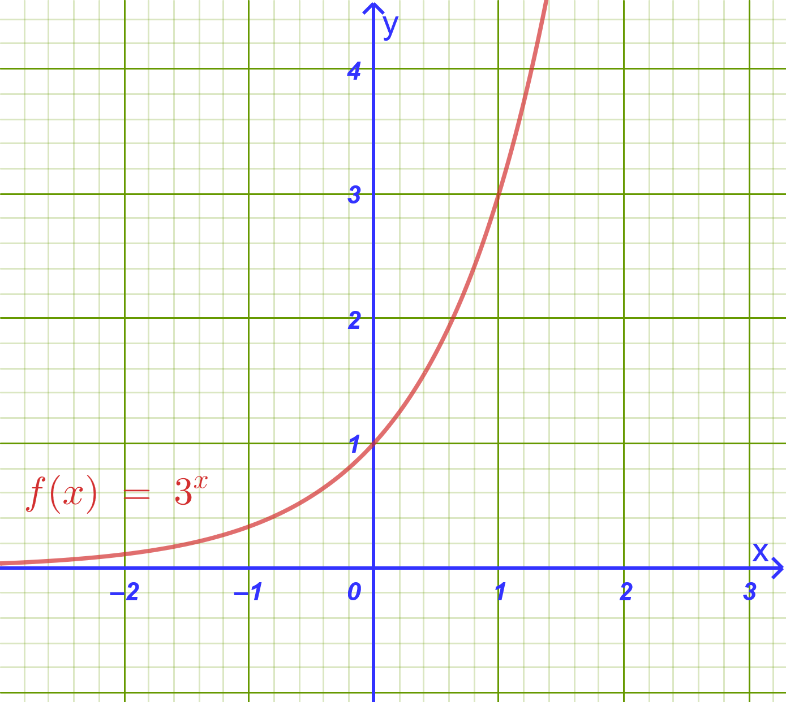
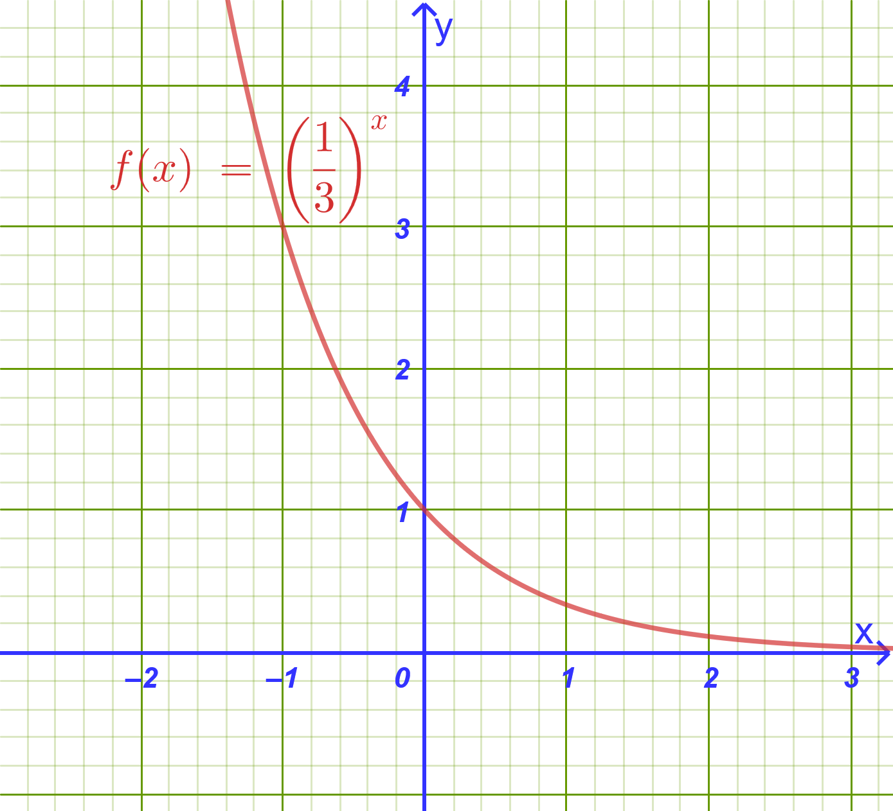
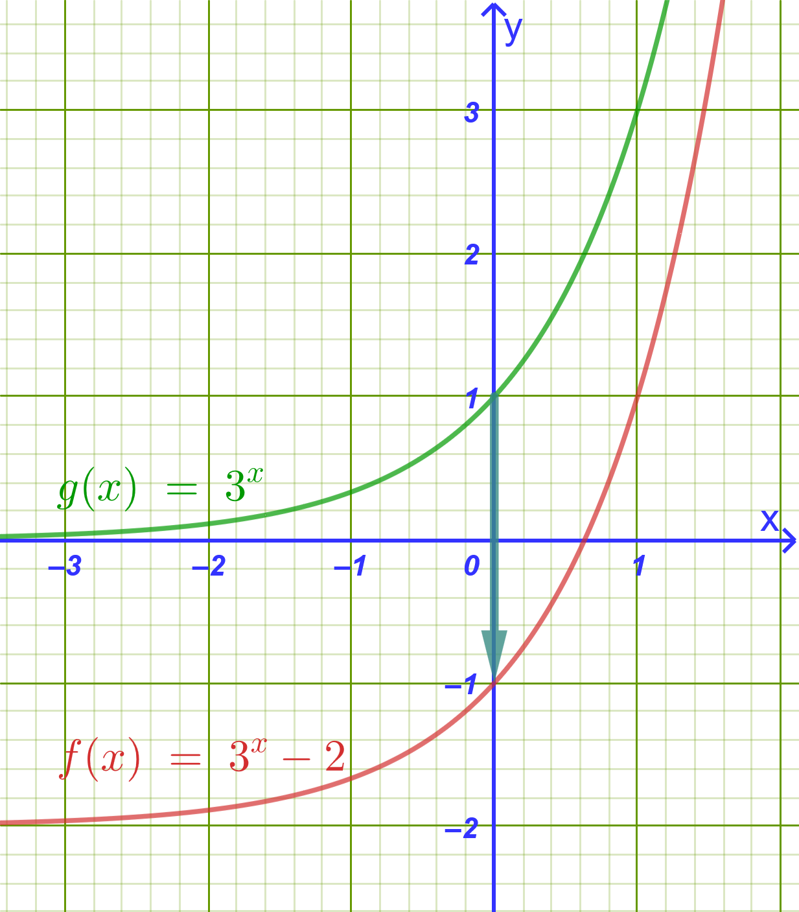
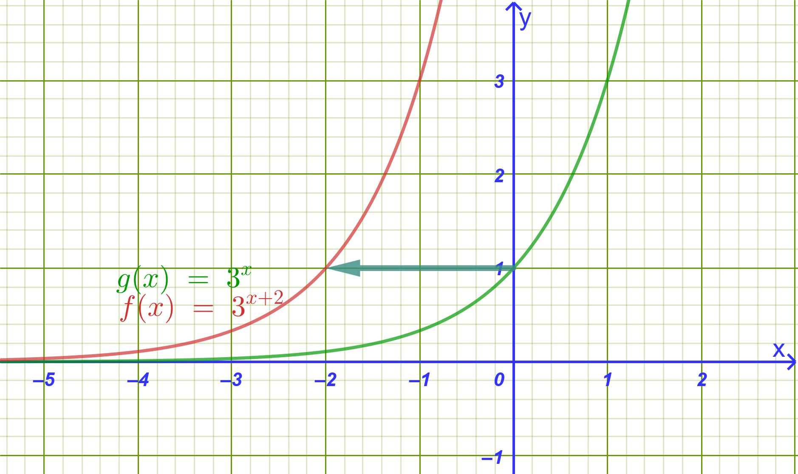
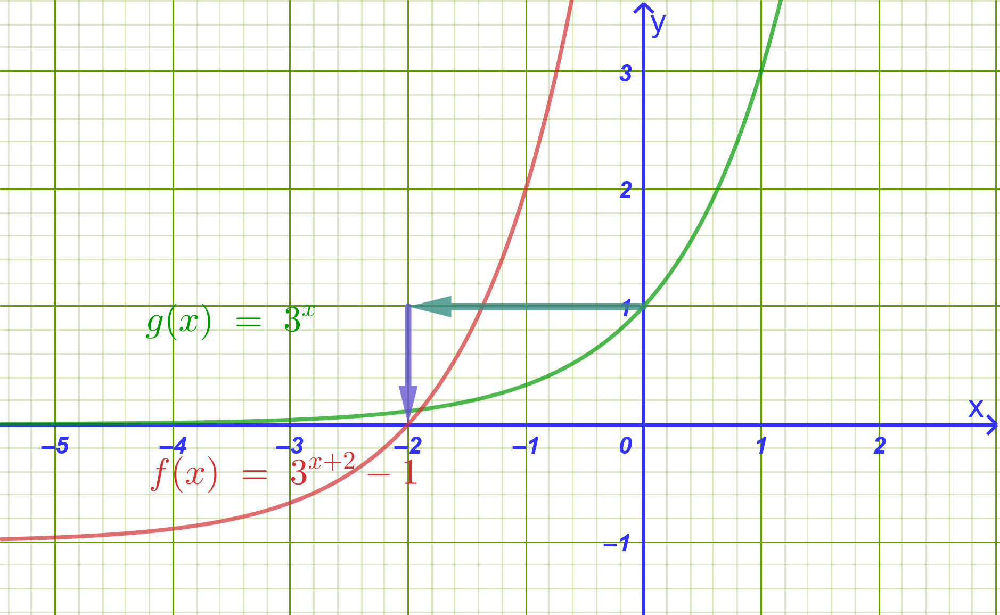
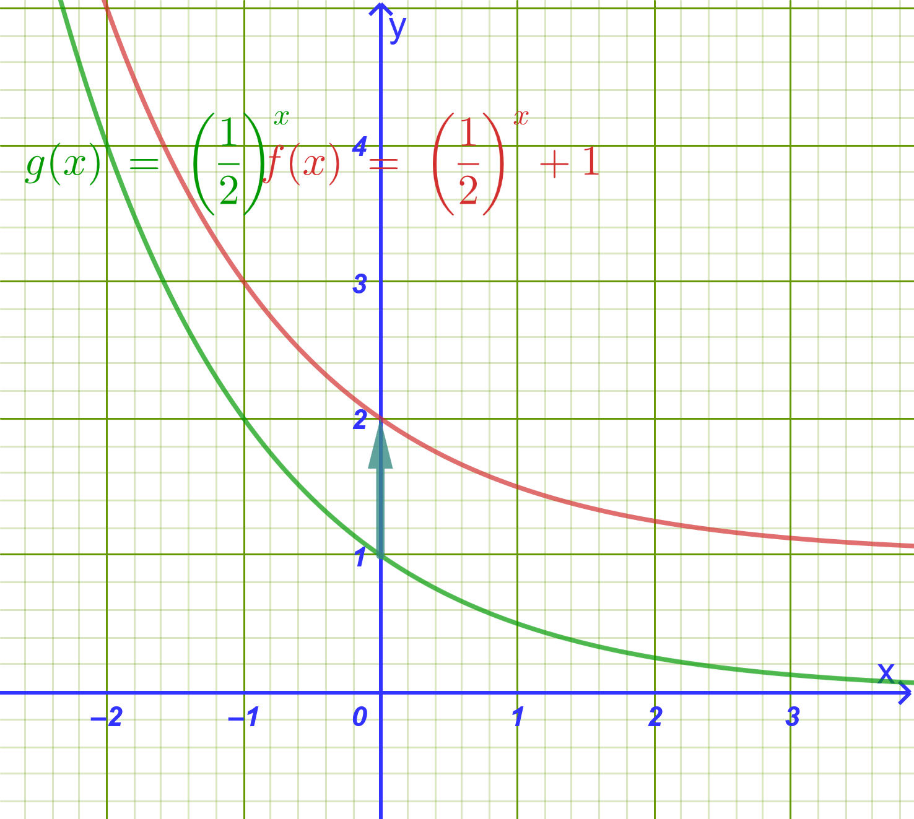
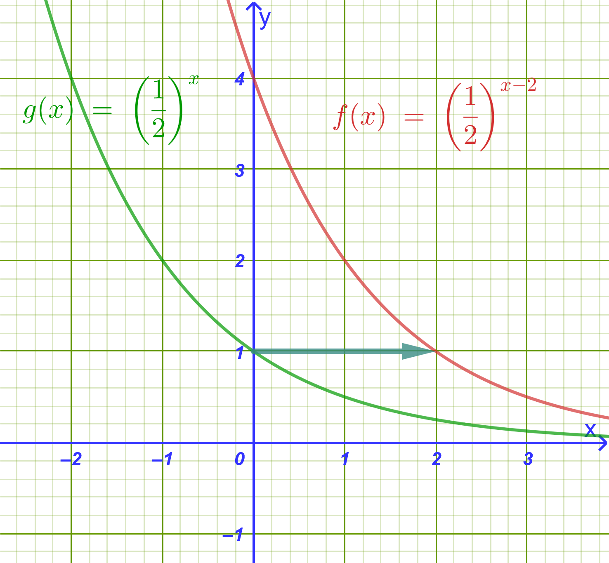
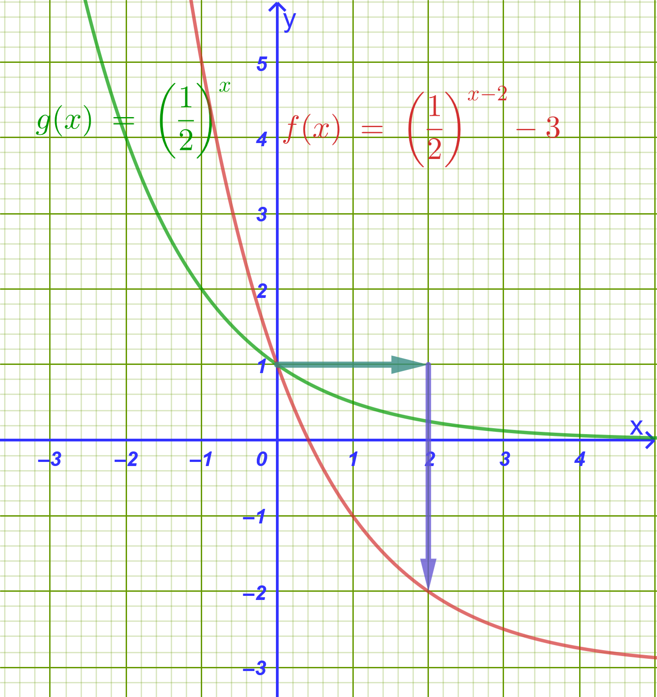

```{=html}
<!-- Φόρτωση βιβλιοθήκης GeoGebra -->
<script src="https://www.geogebra.org/apps/deployggb.js"></script>

<!-- Συνάρτηση δημιουργίας applets -->
<script>
function createGeoGebra(containerId, materialId, width = 700, height = 500) {
  var params = {
    "id": "ggb-" + containerId,
    "material_id": materialId,
    "width": width,
    "height": height,
    "showToolBar": true,
    "showMenuBar": false,
    "showAlgebraInput": true
  };
  
  var applet = new GGBApplet(params, '5.2');
  applet.inject(containerId);
}
</script>
```

## Εκθετική συνάρτηση

### Δυνάμεις με Ρητό Εκθέτη

#### **α) Ορισμός**

:::: {.math-box .definition-box}
::: {.math-title .definition-title}
Ορισμός
:::

Αν $\alpha > 0$, $\mu \in \mathbb{Z}$ και $\nu \in \mathbb{N}^*$ ($\nu \ge 2$), ορίζουμε ως **δύναμη του** $\alpha$ με ρητό εκθέτη $\dfrac{\mu}{\nu}$ την παράσταση:

$$\mathbf{\alpha^{\dfrac{\mu}{\nu}} = \sqrt[\nu]{\alpha^\mu}}$$

- **Ειδική περίπτωση:** Αν $\mu, \nu \in \mathbb{N}^*$, ορίζουμε $0^{\dfrac{\mu}{\nu}} = 0$.
::::

------------------------------------------------------------------------

#### **β) Ιδιότητες Δυνάμεων με Ρητό Εκθέτη**

:::: {.math-box .property-box}
::: {.math-title .property-title}
Ιδιότητες
:::

Για οποιουσδήποτε θετικούς πραγματικούς αριθμούς $\alpha, \beta > 0$ και ρητούς αριθμούς $r, r_1, r_2 \in \mathbb{Q}$, ισχύουν όλες οι γνωστές ιδιότητες των ακεραίων εκθετών:

1.  **Γινόμενο δυνάμεων με ίδια βάση:** $\alpha^{r_1} \cdot \alpha^{r_2} = \alpha^{r_1 + r_2}$

2.  **Πηλίκο δυνάμεων με ίδια βάση:** $\dfrac{\alpha^{r_1}}{\alpha^{r_2}} = \alpha^{r_1 - r_2}$

3.  **Δύναμη γινομένου:** $(\alpha \cdot \beta)^r = \alpha^r \cdot \beta^r$

4.  **Δύναμη πηλίκου:** $\left(\dfrac{\alpha}{\beta}\right)^r = \dfrac{\alpha^r}{\beta^r}$

5.  **Δύναμη σε δύναμη:** $\left(\alpha^{r_1}\right)^{r_2} = \alpha^{r_1 \cdot r_2}$
::::

------------------------------------------------------------------------

#### **γ) Υπολογισμός με Υπολογιστή Τσέπης (Κομπιουτεράκι)**

:::: {.math-box .method-box}
::: {.math-title .method-title}
Πως χρησιμοποιούμε τον υπολογιστή τσέπης
:::

Για τον υπολογισμό μιας δύναμης $\alpha^{\dfrac{\mu}{\nu}}$ στο κομπιουτεράκι χρησιμοποιούμε το πλήκτρο [$x^y$]{.kbd-1} (ή [$y^x$]{.kbd-1} [/]{.kbd-1} [$\wedge$]{.kbd-1}):

- **Βήματα:**

  1.  Πληκτρολογούμε τη βάση $\alpha$.

  2.  Πιέζουμε το πλήκτρο [$x^y$]{.kbd-1}.

  3.  Ανοίγουμε παρένθεση [(]{.kbd-1}, πληκτρολογούμε τον αριθμητή $\mu$, το σύμβολο της διαίρεσης [/]{.kbd-1}, τον παρονομαστή $\nu$ και κλείνουμε την παρένθεση [)]{.kbd-1}.

  4.  Πιέζουμε [=]{.kbd-1}.

- **Παράδειγμα:** Για να υπολογίσουμε το $8^{\dfrac{2}{3}}$:

  - Πληκτρολόγηση: [8]{.kbd-1} $\rightarrow$ [$x^y$]{.kbd-1} $\rightarrow$ [(]{.kbd-1} $\rightarrow$ [2]{.kbd-1} $\rightarrow$ [÷]{.kbd-1} $\rightarrow$ [3]{.kbd-1} $\rightarrow$ [)]{.kbd-1} $\rightarrow$ [=]{.kbd-1}

  - **Αποτέλεσμα:** `4` (αφού $8^{\dfrac{2}{3}} = \sqrt[3]{8^2} = \sqrt[3]{64} = 4$).
::::

------------------------------------------------------------------------

#### **δ) Λυμένα Παραδείγματα**

:::: {.math-box .example-box}
::: {.math-title .example-title}
**Παράδειγμα 1 (Υπολογισμός Τιμών):**
:::

Να υπολογιστούν οι αριθμητικές τιμές των παραστάσεων:

- α) $27^{\dfrac{2}{3}} = \sqrt[3]{27^2} = (\sqrt[3]{27})^2 = 3^2 = \mathbf{9}$

- β) $16^{-\dfrac{3}{4}} = \dfrac{1}{16^{\dfrac{3}{4}}} = \dfrac{1}{(\sqrt[4]{16})^3} = \dfrac{1}{2^3} = \mathbf{\dfrac{1}{8}}$

- γ) $81^{0.75} = 81^{\dfrac{3}{4}} = (\sqrt[4]{81})^3 = 3^3 = \mathbf{27}$
::::

------------------------------------------------------------------------

:::: {.math-box .example-box}
::: {.math-title .example-title}
**Παράδειγμα 2 (Απλοποίηση Παράστασης):**
:::

Να απλοποιηθεί η παράσταση $A = \dfrac{\alpha^{\dfrac{3}{4}} \cdot \alpha^{\dfrac{1}{2}}}{\alpha^{\dfrac{1}{4}}}$ για $\alpha > 0$.
::::

:::: {.math-box .examplesolution-box}
::: {.math-title .examplesolution-title}
**Λύση:**
:::

$$A = \frac{\alpha^{\dfrac{3}{4} + \dfrac{1}{2}}}{\alpha^{\dfrac{1}{4}}} = \frac{\alpha^{\dfrac{5}{4}}}{\alpha^{\dfrac{1}{4}}} = \alpha^{\dfrac{5}{4} - \dfrac{1}{4}} = \alpha^{\dfrac{4}{4}} = \mathbf{\alpha}$$
::::

------------------------------------------------------------------------

### Δυνάμεις με Άρρητο Εκθέτη

#### **α) Ορισμός**

:::: {.math-box .definition-box}
::: {.math-title .definition-title}
Ορισμός
:::

Έστω $\alpha > 0$ και $x$ ένας άρρητος αριθμός.

Θεωρούμε την ακολουθία των ρητών προσεγγίσεων $\rho_\nu$ του $x$ κατ' έλλειψη με $\nu$ δεκαδικά ψηφία ($\rho_1, \rho_2, \rho_3, \dots$).

Καθώς το $\nu \to +\infty$, οι όροι της ακολουθίας $\alpha^{\rho_\nu}$ προσεγγίζουν έναν ορισμένο πραγματικό αριθμό.

Ο αριθμός αυτός ονομάζεται **δύναμη του** $\alpha$ με εκθέτη τον άρρητο $x$ και συμβολίζεται με $\alpha^x$:

$$\mathbf{\alpha^x = \lim_{\nu \to \infty} \alpha^{\rho_\nu}}$$

- **Ιδιότητες:** Οι βασικές ιδιότητες των δυνάμεων ισχύουν αμετάβλητες για όλους τους πραγματικούς εκθέτες $x_1, x_2 \in \mathbb{R}$.
::::

------------------------------------------------------------------------

#### **β) Υπολογισμός με Υπολογιστή Τσέπης**

:::: {.math-box .example-box}
::: {.math-title .example-title}
- **Παράδειγμα:** Υπολογισμός της δύναμης $3^{\sqrt{2}}$:
:::

- Γνωρίζουμε ότι $\sqrt{2} \approx 1.41421356...$

- Πληκτρολόγηση: [3]{.kbd-1} $\rightarrow$ [$x^y$]{.kbd-1} $\rightarrow$ [2]{.kbd-1} $\rightarrow$ [√]{.kbd-1} $\rightarrow$ [=]{.kbd-1}

- **Αποτέλεσμα:** $\mathbf{3^{\sqrt{2}} \approx 4.728804}$
::::

------------------------------------------------------------------------

#### **γ) Λυμένα Παραδείγματα**

:::: {.math-box .example-box}
::: {.math-title .example-title}
**Παράδειγμα 1:**
:::

Να απλοποιηθεί η παράσταση $B = \left(2^{\sqrt{3}}\right)^{\sqrt{3}} \cdot 2^{1-\sqrt{3}} \cdot 2^{\sqrt{3}}$.
::::

:::: {.math-box .examplesolution-box}
::: {.math-title .examplesolution-title}
**Λύση:**
:::

$$B = 2^{\sqrt{3} \cdot \sqrt{3}} \cdot 2^{(1-\sqrt{3}) + \sqrt{3}} = 2^3 \cdot 2^1 = 8 \cdot 2 = \mathbf{16}$$
::::

------------------------------------------------------------------------

:::: {.math-box .example-box}
::: {.math-title .example-title}
**Παράδειγμα 2:**
:::

Να συγκριθούν οι αριθμοί $5^{\sqrt{2}}$ και $5^{\sqrt{3}}$.
::::

:::: {.math-box .examplesolution-box}
::: {.math-title .examplesolution-title}
**Λύση:**
:::

Επειδή η βάση είναι $\alpha = 5 > 1$ και ισχύει $\sqrt{2} < \sqrt{3}$, η συνάρτηση είναι γνησίως αύξουσα, οπότε: $$\mathbf{5^{\sqrt{2}} < 5^{\sqrt{3}}}$$
::::

------------------------------------------------------------------------

### Εκθετική Συνάρτηση

#### **α) Ορισμός**

:::: {.math-box .definition-box}
::: {.math-title .definition-title}
Ορισμός
:::

Έστω $\alpha > 0$ με $\alpha \neq 1$.
Η συνάρτηση $f: \mathbb{R} \to \mathbb{R}$ με τύπο:

$$\mathbf{f(x) = \alpha^x}$$

ονομάζεται **εκθετική συνάρτηση με βάση** $\alpha$.

- **Σημείωση:** Αν $\alpha = 1$, προκύπτει η σταθερή συνάρτηση $f(x) = 1^x = 1$.
::::

------------------------------------------------------------------------

#### **β) Μελέτη & Ιδιότητες της Εκθετικής Συνάρτησης**

| Ιδιότητα | Περίπτωση $\alpha > 1$ | Περίπτωση $0 < \alpha < 1$ |
|:-----------------------|:-----------------------|:-----------------------|
| **Πεδίο Ορισμού** | $A = \mathbb{R}$ | $A = \mathbb{R}$ |
| **Σύνολο Τιμών** | $f(A) = (0, +\infty)$ | $f(A) = (0, +\infty)$ |
| **Μονοτονία** | **Γνησίως αύξουσα** στο $\mathbb{R}$ ($x_1 < x_2 \implies \alpha^{x_1} < \alpha^{x_2}$) | **Γνησίως φθίνουσα** στο $\mathbb{R}$ ($x_1 < x_2 \implies \alpha^{x_1} > \alpha^{x_2}$) |
| **Σημεία Τομής** | Τέμνει τον $y'y$ στο $(0,1)$. Δεν τέμνει τον $x'x$. | Τέμνει τον $y'y$ στο $(0,1)$. Δεν τέμνει τον $x'x$. |
| **Ασύμπτωτη** | Ο αρνητικός ημιάξονας $Ox'$ ($y=0$ όταν $x \to -\infty$) | Ο θετικός ημιάξονας $Ox$ ($y=0$ όταν $x \to +\infty$) |
| **Ιδιότητα 1-1** | $\alpha^{x_1} = \alpha^{x_2} \iff x_1 = x_2$ | $\alpha^{x_1} = \alpha^{x_2} \iff x_1 = x_2$ |

------------------------------------------------------------------------

<iframe src="https://www.geogebra.org/calculator/h2jb9hjj?embed" width="730" height="600" allowfullscreen style="border: 1px solid #e4e4e4;border-radius: 4px;" frameborder="0">

</iframe>

:::: {.math-box .odigia-box}
::: {.mathtitle .odigia-title}
Οδηγία
:::

Διερευνήστε την εκθετική συνάρτηση για τις διάφορες τιμές του α.

Αλλάξτε την τιμή του α απο τον δρομέα α.

- Όταν $α \gt 1$

- Όταν $α=1$

- Όταν $0\lt α \lt 1$
::::

------------------------------------------------------------------------

#### **γ) Παράδειγμα Μελέτης:** $f(x) = 3^x$ και $g(x) = \left(\dfrac{1}{3}\right)^x$

:::: {.math-box .example-box}
::: {.math-title .example-title}
1.  **Μελέτη της** $f(x) = 3^x$ ($\alpha = 3 > 1$):
:::
::::

:::: {.math-box .examplesolution-box}
::: {.math-title .examplesolution-title}
**Λύση:**

{fig-align="center" width="400"}
:::

- **Πεδίο ορισμού:** $\mathbb{R}$, **Σύνολο τιμών:** $(0, +\infty)$.

- **Μονοτονία:** Γνησίως αύξουσα στο $\mathbb{R}$.

- **Πίνακας Τιμών:**

  |     $x$      |      $-2$      |      $-1$      | $0$ | $1$ | $2$ |
  |:------------:|:--------------:|:--------------:|:---:|:---:|:---:|
  | $f(x) = 3^x$ | $\dfrac{1}{9}$ | $\dfrac{1}{3}$ | $1$ | $3$ | $9$ |
::::

------------------------------------------------------------------------

:::: {.math-box .example-box}
::: {.math-title .example-title}
2.  **Μελέτη της** $g(x) = \left(\dfrac{1}{3}\right)^x = 3^{-x}$ ($0 < \alpha = \dfrac{1}{3} < 1$):
:::
::::

:::: {.math-box .examplesolution-box}
::: {.math-title .examplesolution-title}
**Λύση:**

{fig-align="center" width="400"}
:::

- **Πεδίο ορισμού:** $\mathbb{R}$, **Σύνολο τιμών:** $(0, +\infty)$.

- **Μονοτονία:** Γνησίως φθίνουσα στο $\mathbb{R}$.

- **Πίνακας Τιμών:**

  | $x$ | $-2$ | $-1$ | $0$ | $1$ | $2$ |
  |:----------:|:----------:|:----------:|:----------:|:----------:|:----------:|
  | $g(x) = \left(\dfrac{1}{3}\right)^x$ | $9$ | $3$ | $1$ | $\dfrac{1}{3}$ | $\dfrac{1}{9}$ |

- **Γεωμετρική Παρατήρηση:** Επειδή $g(x) = f(-x)$, οι γραφικές παραστάσεις των συναρτήσεων $y = 3^x$ και $y = \left(\dfrac{1}{3}\right)^x$ είναι **συμμετρικές ως προς τον άξονα** $y'y$.
::::

### Παραδείγματα εκθετικών εξισώσεων

:::: {.math-box .example-box}
::: {.math-title .example-title}
**Παραδείγματα 1:**
:::

**Να λυθούν οι εξισώσεις:**

**i)** $3^{2x} = \dfrac{1}{81}$

**ii)** $4^x - 3 \cdot 2^x - 4 = 0$

**iii)** $5^{4x-1} = \dfrac{1}{125}$

**iv)** $25^x - 6 \cdot 5^x + 5 = 0$
::::

------------------------------------------------------------------------

:::: {.math-box .examplesolution-box}
::: {.math-title .examplesolution-title}
**Λύση:**
:::

- **i)** $3^{2x} = \dfrac{1}{81}$

$$\Rightarrow 3^{2x} = \frac{1}{3^4}$$

$$\Rightarrow 3^{2x} = 3^{-4}$$

$$\Rightarrow 2x = -4 \Rightarrow x = -2$$

------------------------------------------------------------------------

- **ii)** $4^x - 3 \cdot 2^x - 4 = 0 \Rightarrow (2^2)^x - 3 \cdot 2^x - 4 = 0 \Rightarrow (2^x)^2 - 3 \cdot 2^x - 4 = 0$ Θέτουμε $y = 2^x > 0$:

$$y^2 - 3y - 4 = 0$$

Διακρίνουσα $\Delta = (-3)^2 - 4(1)(-4) = 9 + 16 = 25$.

$$y_{1,2} = \frac{3 \pm 5}{2} \Rightarrow \begin{cases} y_1 = 4 \\ y_2 = -1 & (\text{απορρίπτεται, αφού } y > 0) \end{cases}$$

Για $y = 4$:

$$2^x = 4 \Rightarrow 2^x = 2^2 \Rightarrow x = 2$$

------------------------------------------------------------------------

- **iii)** $5^{4x-1} = \dfrac{1}{125}$

$$\Rightarrow 5^{4x-1} = \frac{1}{5^3}$$

$$\Rightarrow 5^{4x-1} = 5^{-3}$$

$$\Rightarrow 4x - 1 = -3 \Rightarrow 4x = -2 \Rightarrow x = -\frac{1}{2}$$

------------------------------------------------------------------------

- **iv)** $25^x - 6 \cdot 5^x + 5 = 0 \Rightarrow (5^x)^2 - 6 \cdot 5^x + 5 = 0$ Θέτουμε $y = 5^x > 0$:

$$y^2 - 6y + 5 = 0$$

Οι ρίζες είναι $y_1 = 5$ και $y_2 = 1$ (και οι δύο δεκτές).

- Για $y = 5 \Rightarrow 5^x = 5^1 \Rightarrow x = 1$

- Για $y = 1 \Rightarrow 5^x = 5^0 \Rightarrow x = 0$
::::

------------------------------------------------------------------------

:::: {.math-box .example-box}
::: {.math-title .example-title}
**Παραδείγματα 2:**
:::

**i) Να λυθεί το σύστημα:**

$$\begin{cases} 3 \cdot 2^x - 2 \cdot 5^y = 2 \\ 2 \cdot 2^x + 5^y = 13 \end{cases}$$

------------------------------------------------------------------------

**ii) Να λυθεί το σύστημα:**

$$\begin{cases} 5 \cdot 3^x - 2 \cdot 2^y = 37 \\ 2 \cdot 3^x + \dfrac{1}{2} \cdot 2^y = 20 \end{cases}$$
::::

:::: {.math-box .examplesolution-box}
::: {.math-title .examplesolution-title}
**Λύση:**
:::

**(i)**

Θέτουμε $u = 2^x > 0$ και $v = 5^y > 0$.
Το σύστημα γίνεται:

$$\begin{cases} 3u - 2v = 2 \quad (1) \\ 2u + v = 13 \quad (2) \end{cases}$$

Από την $(2)$ έχουμε $v = 13 - 2u$.
Αντικαθιστούμε στην $(1)$:

$$3u - 2(13 - 2u) = 2 \Rightarrow 3u - 26 + 4u = 2 \Rightarrow 7u = 28 \Rightarrow u = 4$$

Τότε $v = 13 - 2(4) = 5$.

- Για $u = 4 \Rightarrow 2^x = 4 \Rightarrow 2^x = 2^2 \Rightarrow x = 2$

- Για $v = 5 \Rightarrow 5^y = 5 \Rightarrow 5^y = 5^1 \Rightarrow y = 1$

**Λύση:** $(x, y) = (2, 1)$

------------------------------------------------------------------------

**(ii)** $$\begin{cases} 5 \cdot 3^x - 2 \cdot 2^y = 37 \\ 2 \cdot 3^x + \dfrac{1}{2} \cdot 2^y = 20 \end{cases}$$

Θέτουμε $u = 3^x > 0$ και $v = 2^y > 0$:

$$\begin{cases} 5u - 2v = 37 \quad (1) \\ 2u + \frac{1}{2}v = 20 \quad (2) \end{cases}$$

Πολλαπλασιάζουμε την $(2)$ με $4$:

$$8u + 2v = 80 \quad (3)$$

Προσθέτουμε τις $(1)$ και $(3)$:

$$13u = 117 \Rightarrow u = 9$$

Από την $(3)$: $8(9) + 2v = 80 \Rightarrow 72 + 2v = 80 \Rightarrow 2v = 8 \Rightarrow v = 4$.

- $u = 9 \Rightarrow 3^x = 9 \Rightarrow x = 2$
- $v = 4 \Rightarrow 2^y = 4 \Rightarrow y = 2$

**Λύση:** $(x, y) = (2, 2)$
::::

------------------------------------------------------------------------

:::: {.math-box .example-box}
::: {.math-title .example-title}
**Παραδείγματα 3:**
:::

**Να λυθούν οι ανισώσεις:**

**i)** $2^{x^2 - 4x} > \dfrac{1}{8}$

**ii)** $\left(\dfrac{1}{3}\right)^{x^2 + 2x} < \dfrac{1}{27}$

**iii)** $5^{x^2 - 5x} \ge \dfrac{1}{625}$

**iv)** $\left(\dfrac{1}{5}\right)^{x^2 - 3x} \le \dfrac{1}{25}$
::::

:::: {.math-box .examplesolution-box}
::: {.math-title .examplesolution-title}
**Λύση:**
:::

- **i)** $2^{x^2 - 4x} > \dfrac{1}{8}$

$$\Rightarrow 2^{x^2 - 4x} > 2^{-3}$$

Επειδή η βάση είναι $2 > 1$, η συνάρτηση $f(t) = 2^t$ είναι γνησίως αύξουσα, οπότε η φορά διατηρείται:

$$x^2 - 4x > -3 \Rightarrow x^2 - 4x + 3 > 0$$

Οι ρίζες του τριωνύμου είναι $x_1 = 1$ και $x_2 = 3$.

Άρα $x \in (-\infty, 1) \cup (3, +\infty)$.

------------------------------------------------------------------------

- **ii)** $\left(\dfrac{1}{3}\right)^{x^2 + 2x} < \dfrac{1}{27}$

$$\Rightarrow \left(\dfrac{1}{3}\right)^{x^2 + 2x} < \left(\dfrac{1}{3}\right)^3$$

Επειδή η βάση είναι $0 < \frac{1}{3} < 1$, η συνάρτηση $g(t) = \left(\frac{1}{3}\right)^t$ είναι γνησίως φθίνουσα, οπότε η φορά αλλάζει:

$$x^2 + 2x > 3 \Rightarrow x^2 + 2x - 3 > 0$$

Οι ρίζες του τριωνύμου είναι $x_1 = -3$ και $x_2 = 1$.
Άρα $x \in (-\infty, -3) \cup (1, +\infty)$.

------------------------------------------------------------------------

- **iii)** $5^{x^2 - 5x} \ge \dfrac{1}{625} \Rightarrow 5^{x^2 - 5x} \ge 5^{-4}$

Επειδή $5 > 1$:

$$x^2 - 5x \ge -4 \Rightarrow x^2 - 5x + 4 \ge 0$$

Οι ρίζες είναι $x_1 = 1$ και $x_2 = 4$.

Άρα $x \in (-\infty, 1] \cup [4, +\infty)$.

------------------------------------------------------------------------

- **iv)** $\left(\dfrac{1}{5}\right)^{x^2 - 3x} \le \dfrac{1}{25} \Rightarrow \left(\dfrac{1}{5}\right)^{x^2 - 3x} \le \left(\dfrac{1}{5}\right)^2$ Επειδή $0 < \frac{1}{5} < 1$:

$$x^2 - 3x \ge 2 \Rightarrow x^2 - 3x - 2 \ge 0$$

Διακρίνουσα $\Delta = 9 - 4(1)(-2) = 17$.

Οι ρίζες είναι $x_{1,2} = \dfrac{3 \pm \sqrt{17}}{2}$.

Άρα $x \in \left(-\infty, \dfrac{3 - \sqrt{17}}{2}\right] \cup \left[\dfrac{3 + \sqrt{17}}{2}, +\infty\right)$.
::::

------------------------------------------------------------------------

:::: {.math-box .example-box}
::: {.math-title .example-title}
**Να γίνουν οι γραφικές παραστάσεις των συναρτήσεων:**
:::

**i)** $f(x) = 3^x - 2$

**ii)** $g(x) = 3^{x+2}$

**iii)** $h(x) = 3^{x+2} - 1$

**iv)** $f(x) = \left(\dfrac{1}{2}\right)^x + 1$

**v)** $g(x) = \left(\dfrac{1}{2}\right)^{x-2}$

**vi)** $h(x) = \left(\dfrac{1}{2}\right)^{x-2} - 3$
::::

:::: {.math-box .examplesolution-box}
::: {.math-title .examplesolution-title}
**Λύση:**
:::

**(με βασική την** $y = 3^x$)

- **i)** $f(x) = 3^x - 2$

{fig-align="center" width="350"}

- **Μετατόπιση:** Προκύπτει από τη γραφική παράσταση της $y = 3^x$ με **κατακόρυφη μετατόπιση κατά 2 μονάδες προς τα κάτω**.

- **Ασύμπτωτη:** Η οριζόντια ασύμπτωτη γίνεται η ευθεία $y = -2$.

- **Χαρακτηριστικά σημεία:**

- Για $x=0: f(0) = 3^0 - 2 = -1 \Rightarrow (0, -1)$

- Για $x=1: f(1) = 3^1 - 2 = 1 \Rightarrow (1, 1)$

------------------------------------------------------------------------

- **ii)** $g(x) = 3^{x+2}$

{fig-align="center" width="500"}

- **Μετατόπιση:** Προκύπτει από τη γραφική παράσταση της $y = 3^x$ με **οριζόντια μετατόπιση κατά 2 μονάδες προς τα αριστερά**.

- **Ασύμπτωτη:** Παραμένει ο άξονας $x'x$ ($y = 0$).

- **Χαρακτηριστικά σημεία:**

- Για $x=0: g(0) = 3^2 = 9 \Rightarrow (0, 9)$

- Για $x=-2: g(-2) = 3^0 = 1 \Rightarrow (-2, 1)$

------------------------------------------------------------------------

- **iii)** $h(x) = 3^{x+2} - 1$

{fig-align="center" width="500"}

- **Μετατόπιση:** Προκύπτει από τη γραφική παράσταση της $y = 3^x$ με **οριζόντια μετατόπιση κατά 2 μονάδες προς τα αριστερά** και **κατακόρυφη μετατόπιση κατά 1 μονάδα προς τα κάτω**.

- **Ασύμπτωτη:** Η ευθεία $y = -1$.

- **Χαρακτηριστικά σημεία:**

- Για $x=-2: h(-2) = 3^0 - 1 = 0 \Rightarrow (-2, 0)$

- Για $x=-1: h(-1) = 3^1 - 1 = 2 \Rightarrow (-1, 2)$

------------------------------------------------------------------------

- **iv)** $f(x) = \left(\dfrac{1}{2}\right)^x + 1$

{fig-align="center" width="400"}

- **Μετατόπιση:** Κατακόρυφη μετατόπιση κατά 1 μονάδα προς τα πάνω.

- **Ασύμπτωτη:** $y = 1$.

- **Σημεία:** $(0, 2)$ και $(1, 1.5)$.

------------------------------------------------------------------------

- **v)** $g(x) = \left(\dfrac{1}{2}\right)^{x-2}$

{fig-align="center" width="400"}

- **Μετατόπιση:** Οριζόντια μετατόπιση κατά 2 μονάδες προς τα δεξιά.

- **Ασύμπτωτη:** $y = 0$.

- **Σημεία:** $(2, 1)$ και $(0, 4)$.

------------------------------------------------------------------------

- **vi)** $h(x) = \left(\dfrac{1}{2}\right)^{x-2} - 3$

{fig-align="center" width="400"}

- **Μετατόπιση:** 2 μονάδες δεξιά και 3 μονάδες κάτω.

- **Ασύμπτωτη:** $y = -3$.

- **Σημεία:** $(2, -2)$ και $(0, 1)$.
::::

------------------------------------------------------------------------

### Ο Αριθμός $e$

#### **α) Ορισμός**

:::: {.math-box .definition-box}
::: {.math-title .definition-title}
Ορισμός
:::

Ο αριθμός $e$ (σταθερά του Euler) ορίζεται ως το όριο της ακολουθίας $\left(1 + \dfrac{1}{\nu}\right)^\nu$ καθώς το $\nu \to +\infty$:

$$\mathbf{e = \lim_{\nu \to \infty} \left(1 + \frac{1}{\nu}\right)^\nu \approx 2.71828}$$

Είναι άρρητος αριθμός.
Η συνάρτηση $f(x) = e^x$ ονομάζεται **απλώς εκθετική συνάρτηση**.
::::

------------------------------------------------------------------------

#### **β) Παραδείγματα Εκθετικών Εξισώσεων, Ανισώσεων & Συστημάτων**

:::: {.math-box .example-box}
::: {.math-title .example-title}
**Παράδειγμα 1 (Εκθετική Εξίσωση):**
:::

Να λυθεί στο $\mathbb{R}$ η εξίσωση: $e^{2x} - 3e^x + 2 = 0$.
::::

:::: {.math-box .examplesolution-box}
::: {.math-title .examplesolution-title}
**Λύση:**
:::

Θέτουμε $u = e^x > 0$.
Η εξίσωση γίνεται: $$u^2 - 3u + 2 = 0 \iff (u - 1)(u - 2) = 0 \iff u = 1 \quad \text{ή} \quad u = 2$$

- Αν $u = 1 \iff e^x = 1 \iff e^x = e^0 \iff \mathbf{x = 0}$

- Αν $u = 2 \iff e^x = 2 \iff \mathbf{x = \ln 2}$ , την συνάρτηση ln θα την συναντήσουμε στα επόμενα μαθήματα.
::::

------------------------------------------------------------------------

:::: {.math-box .example-box}
::: {.math-title .example-title}
**Παράδειγμα 2 (Εκθετική Ανίσωση):**
:::

Να λυθεί στο $\mathbb{R}$ η ανίσωση: $e^{3x-1} > e^{x+5}$.
::::

:::: {.math-box .examplesolution-box}
::: {.math-title .examplesolution-title}
**Λύση:**
:::

Επειδή η βάση είναι $e \approx 2.718 > 1$, η συνάρτηση $f(t) = e^t$ είναι γνησίως αύξουσα.
Επομένως: $$e^{3x-1} > e^{x+5} \iff 3x - 1 > x + 5 \iff 2x > 6 \iff \mathbf{x > 3}$$
::::

------------------------------------------------------------------------

:::: {.math-box .example-box}
::: {.math-title .example-title}
**Παράδειγμα 3 (Εκθετικό Σύστημα):**
:::

Να λυθεί το σύστημα: $$\begin{cases} e^x \cdot e^y = e^5 \\ e^{2x} \cdot e^{-y} = e^4 \end{cases}$$
::::

:::: {.math-box .examplesolution-box}
::: {.math-title .examplesolution-title}
**Λύση:**
:::

Εφαρμόζουμε τις ιδιότητες των δυνάμεων: $$\begin{cases} e^{x+y} = e^5 \\ e^{2x-y} = e^4 \end{cases} \iff \begin{cases} x + y = 5 \\ 2x - y = 4 \end{cases}$$

Προσθέτοντας κατά μέλη: $3x = 9 \iff \mathbf{x = 3}$.

Αντικαθιστώντας: $3 + y = 5 \iff \mathbf{y = 2}$.
::::

------------------------------------------------------------------------

### Ο Νόμος της Εκθετικής Μεταβολής

#### **α) Ορισμός**

:::: {.math-box .definition-box}
::: {.math-title .definition-title}
Ορισμός
:::

Ο **νόμος της εκθετικής μεταβολής** περιγράφει τη μεταβολή ενός φυσικού μεγέθους $Q(t)$ συναρτήσει του χρόνου $t$ μέσω της συνάρτησης:

$$\mathbf{Q(t) = Q_0 \cdot e^{c \cdot t}}$$

όπου:

- $Q_0 = Q(0) > 0$: η αρχική τιμή του μεγέθους (για $t = 0$).

- $c \in \mathbb{R}^*$: μια σταθερά που εξαρτάται από το φαινόμενο.
::::

------------------------------------------------------------------------

<iframe src="https://www.geogebra.org/calculator/h3dddxgf?embed" width="730" height="600" allowfullscreen style="border: 1px solid #e4e4e4;border-radius: 4px;" frameborder="0">

</iframe>

:::: {.math-box .odigia-box}
::: {.mathtitle .odigia-title}
Οδηγία
:::

Διερευνήστε την εκθετική μεταβολή για τις διάφορες τιμές των $Q_0$ και $c$.

Αλλάξτε την τιμή των $Q_0$ και $c$ από τους αντίστοιχους δρομείς.

- Όταν $Q_0$ μεταβάλετε.

- Όταν $c \gt 0$

- Όταν $c\lt 0$
::::

------------------------------------------------------------------------

#### **β) Εκθετική Αύξηση & Εκθετική Απόσβεση**

1.  **Εκθετική Αύξηση (**$c > 0$): Η συνάρτηση $Q(t)$ είναι γνησίως αύξουσα.
    Μοντελοποιεί φαινόμενα όπως η πληθυσμιακή αύξηση, ο ανατοκισμός και η ανάπτυξη μικροοργανισμών.

2.  **Εκθετική Απόσβεση / Μείωση (**$c < 0$): Η συνάρτηση $Q(t)$ είναι γνησίως φθίνουσα.
    Μοντελοποιεί φαινόμενα όπως η ραδιενεργός διάσπαση, η ψύξη ενός σώματος και η απόσβεση ταλαντώσεων.

------------------------------------------------------------------------

#### **γ) Παραδείγματα**

:::: {.math-box .example-box}
::: {.math-title .example-title}
**Παράδειγμα 1 (Εκθετική Αύξηση — Πληθυσμός Βακτηρίων):**
:::

Ο αριθμός των βακτηρίων σε μια καλλιέργεια διπλασιάζεται κάθε $3$ ώρες σύμφωνα με τον τύπο $N(t) = N_0 \cdot 2^{\dfrac{t}{3}}$, όπου $t$ ο χρόνος σε ώρες.
Αν αρχικά υπάρχουν $N_0 = 1000$ βακτήρια:

- α) Πόσα βακτήρια θα υπάρχουν μετά από $9$ ώρες;

- β) Μετά από πόσες ώρες ο πληθυσμός θα φτάσει τα $16000$ βακτήρια;
::::

:::: {.math-box .examplesolution-box}
::: {.math-title .examplesolution-title}
**Λύση:**
:::

- α) Για $t = 9$: $$N(9) = 1000 \cdot 2^{\dfrac{9}{3}} = 1000 \cdot 2^3 = 1000 \cdot 8 = \mathbf{8000 \text{ βακτήρια}}$$

- β) Αναζητούμε το $t$ ώστε $N(t) = 16000$: $$1000 \cdot 2^{\dfrac{t}{3}} = 16000 \iff 2^{\dfrac{t}{3}} = 16 \iff 2^{\dfrac{t}{3}} = 2^4 \iff \dfrac{t}{3} = 4 \iff \mathbf{t = 12 \text{ ώρες}}$$
::::

------------------------------------------------------------------------

:::: {.math-box .example-box}
::: {.math-title .example-title}
**Παράδειγμα 2 (Εκθετική Απόσβεση — Ραδιενεργός Διάσπαση):**
:::

Η ποσότητα $Q(t)$ (σε γραμμάρια) μιας ραδιενεργού ουσίας που απομένει μετά από $t$ χρόνια δίνεται από τον τύπο $Q(t) = 80 \cdot 2^{-\dfrac{t}{5}}$.

- α) Ποια ήταν η αρχική ποσότητα της ουσίας;

- β) Ποια ποσότητα απομένει μετά από $15$ χρόνια;
::::

:::: {.math-box .examplesolution-box}
::: {.math-title .examplesolution-title}
**Λύση:**
:::

- α) Για $t = 0$: $Q(0) = 80 \cdot 2^0 = \mathbf{80 \text{ gr}}$.

- β) Για $t = 15$: $$Q(15) = 80 \cdot 2^{-\dfrac{15}{5}} = 80 \cdot 2^{-3} = 80 \cdot \frac{1}{8} = \mathbf{10 \text{ gr}}$$
::::

------------------------------------------------------------------------

### Ασκήσεις και Προβλήματα

#### **Κατηγορία Α: Δυνάμεις με Ρητό & Άρρητο Εκθέτη (1–4)**

1.  Να υπολογίσετε τις αριθμητικές τιμές των παραστάσεων:

- α) $16^{\dfrac{3}{4}}$

- β) $32^{-\dfrac{2}{5}}$

- γ) $\left(\dfrac{8}{27}\right)^{-\dfrac{2}{3}}$

2.  Να απλοποιήσετε την παράσταση: $$A = \frac{\left(a^{\dfrac{2}{3}}\right)^3 \cdot a^{-\dfrac{1}{2}}}{\sqrt{a}} \quad (a > 0)$$

3.  Να συγκρίνετε τους αριθμούς:

- α) $3^{\sqrt{5}}$ και $3^{\sqrt{7}}$

- β) $\left(\frac{1}{2}\right)^{\sqrt{2}}$ και $\left(\frac{1}{2}\right)^{\sqrt{3}}$

4.  Να υπολογίσετε την τιμή της παράστασης $B = 5^{2\sqrt{2}} \cdot 25^{1-\sqrt{2}}$.

------------------------------------------------------------------------

#### **Κατηγορία Β: Εκθετική Συνάρτηση & Μονοτονία (5–8)**

5.  Να βρείτε το πεδίο ορισμού των συναρτήσεων:

- α) $f(x) = 5^{\dfrac{x+1}{x-2}}$

- β) $g(x) = \left(\dfrac{1}{2}\right)^{\sqrt{x^2 - 4}}$

6.  Να μελετήσετε ως προς τη μονοτονία τις συναρτήσεις:

- α) $f(x) = 4^{x-3}$

- β) $g(x) = \left(\dfrac{2}{5}\right)^{1-x}$

7.  Να σχεδιάσετε στο ίδιο σύστημα αξόνων τις γραφικές παραστάσεις των συναρτήσεων $f(x) = 2^x$, $g(x) = 2^x + 1$ και $h(x) = 2^{x-2}$.

8.  Για ποιες τιμές του $\lambda \in \mathbb{R}$ ορίζεται η εκθετική συνάρτηση $f(x) = \left(\lambda^2 - 3\lambda + 3\right)^x$;

------------------------------------------------------------------------

#### **Κατηγορία Γ: Εκθετικές Εξισώσεις & Συστήματα (9–12)**

9.  Να λύσετε στο $\mathbb{R}$ τις εξισώσεις:

- α) $2^{x^2 - 5x + 6} = 1$

- β) $3^{2x-1} = \dfrac{1}{27}$

  - γ) $4^x - 5 \cdot 2^x + 4 = 0$

10. Να λύσετε στο $\mathbb{R}$ τις εξισώσεις:

- α) $9^x - 4 \cdot 3^x + 3 = 0$

- β) $e^{2x} + e^x - 2 = 0$

11. Να λύσετε την εξίσωση: $$5^{x+1} + 5^{x} + 5^{x-1} = 31$$

12. Να λύσετε το σύστημα εξισώσεων: $$\begin{cases} 3^x \cdot 9^y = 81 \\ 2^{x+y} = 32 \end{cases}$$

------------------------------------------------------------------------

#### **Κατηγορία Δ: Εκθετικές Ανισώσεις (13–16)**

13. Να λύσετε στο $\mathbb{R}$ τις ανισώσεις:

- α) $3^{2x-5} > 27$

- β) $\left(\dfrac{1}{2}\right)^{x^2 - 3} \ge \dfrac{1}{8}$

14. Να λύσετε την ανίσωση: $$4^x - 3 \cdot 2^x + 2 < 0$$

15. Να λύσετε την ανίσωση: $$e^{2x - 1} \le e^{x+2}$$

16. Να βρείτε τα διαστήματα στα οποία η γραφική παράσταση της συνάρτησης $f(x) = 9^x - 10 \cdot 3^x + 9$ βρίσκεται κάτω από τον άξονα $x'x$.

------------------------------------------------------------------------

#### **Κατηγορία Ε: Προβλήματα Εκθετικής Μεταβολής (17–20)**

17. **(Πληθυσμιακή Αύξηση):** Ο πληθυσμός μιας πόλης αυξάνεται εκθετικά σύμφωνα με τον τύπο $P(t) = 50000 \cdot e^{0.02 t}$, όπου $t$ ο χρόνος σε έτη από το 2020.

- α) Ποιος ήταν ο πληθυσμός της πόλης το 2020;

- β) Ποιος θα είναι ο πληθυσμός το 2030;

------------------------------------------------------------------------

:::: {.math-box .problem-box}
::: {.math-title .problem-title}
18. **(Ραδιενεργός Διάσπαση & Ημιζωή):**
:::

Η ημιζωή ενός ραδιενεργού υλικού είναι $5$ έτη.
Αν αρχικά υπάρχουν $160 \text{ gr}$ του υλικού:

- α) Να γράψετε τον τύπο της ποσότητας $Q(t) = Q_0 \cdot 2^{-\dfrac{t}{5}}$ που απομένει μετά από $t$ έτη.

- β) Πόση ποσότητα θα απομείνει μετά από $20$ έτη;
::::

:::: {.math-box .problemsolution-box}
::: {.math-title .problemsolution-title}
Λύση
:::

**α) Τύπος της ποσότητας** $Q(t)$

Η αρχική ποσότητα του υλικού είναι $Q_0 = 160\text{ gr}$.

Αντικαθιστώντας την τιμή $Q_0 = 160$ στον δοσμένο τύπο $Q(t) = Q_0 \cdot 2^{-\dfrac{t}{5}}$, παίρνουμε:

$$Q(t) = 160 \cdot 2^{-\dfrac{t}{5}}$$

*(όπου το* $t$ εκφράζεται σε έτη και το $Q(t)$ σε γραμμάρια).

------------------------------------------------------------------------

**β) Ποσότητα που απομένει μετά από 20 έτη**

Για να βρούμε την ποσότητα μετά από $t = 20$ έτη, αντικαθιστούμε $t = 20$ στον τύπο που βρήκαμε:

$$Q(20) = 160 \cdot 2^{-\frac{20}{5}}$$

$$Q(20) = 160 \cdot 2^{-4}$$

Επειδή $2^{-4} = \dfrac{1}{2^4} = \dfrac{1}{16}$:

$$Q(20) = 160 \cdot \frac{1}{16} = 10\text{ gr}$$

**Απάντηση:** Μετά από $20$ έτη θα απομείνουν $10\text{ gr}$ από το ραδιενεργό υλικό.
::::

------------------------------------------------------------------------

19. **(Ανατοκισμός):** Ένα κεφάλαιο $K_0 = 10000 \text{ €}$ τοκίζεται με ετήσιο επιτόκιο $5\%$ με συνεχή ανατοκισμό, σύμφωνα με τον τύπο $K(t) = 10000 \cdot (1.05)^t$, όπου $t$ τα έτη.

- α) Ποιο θα είναι το συνολικό ποσό μετά από $2$ έτη;

- β) Μετά από πόσα έτη το κεφάλαιο θα γίνει $12100 \text{ €}$;

------------------------------------------------------------------------

:::: {.math-box .problem-box}
::: {.math-title .problem-title}
20. **(Ψύξη Σώματος — Νόμος του Νεύτωνα):**
:::

Η θερμοκρασία $T(t)$ (σε ${}^\circ\text{C}$) ενός ροφήματος που ψύχεται δίνεται από τον τύπο $T(t) = 20 + 60 \cdot e^{-0.1 t}$, όπου $t$ ο χρόνος σε λεπτά.

- α) Ποια είναι η αρχική θερμοκρασία του ροφήματος;

- β) Ποια είναι η θερμοκρασία του περιβάλλοντος χώρου (όταν $t \to +\infty$);
::::

:::: {.math-box .problemsolution-box}
::: {.math-title .problemsolution-title}
Λύση
:::

**α) Αρχική θερμοκρασία του ροφήματος**

Η αρχική θερμοκρασία αντιστοιχεί στη στιγμή $t = 0$ λεπτά.

Αντικαθιστώντας $t = 0$ στον τύπο $T(t) = 20 + 60 \cdot e^{-0.1 t}$:

$$T(0) = 20 + 60 \cdot e^{-0.1 \cdot 0}$$

$$T(0) = 20 + 60 \cdot e^0$$

Επειδή $e^0 = 1$:

$$T(0) = 20 + 60 \cdot 1 = 80^\circ\text{C}$$

**Απάντηση:** Η αρχική θερμοκρασία του ροφήματος είναι $80^\circ\text{C}$.

------------------------------------------------------------------------

**β) Θερμοκρασία του περιβάλλοντος χώρου (όταν** $t \to +\infty$)

Όταν ο χρόνος $t$ αυξάνεται απεριόριστα ($t \to +\infty$), ο εκθέτης $-0.1 t \to -\infty$, οπότε:

$$\lim_{t \to +\infty} e^{-0.1 t} = 0$$

Επομένως, για τη θερμοκρασία του ροφήματος έχουμε:

$$\lim_{t \to +\infty} T(t) = 20 + 60 \cdot 0 = 20^\circ\text{C}$$

**Απάντηση:** Η θερμοκρασία του περιβάλλοντος χώρου είναι $20^\circ\text{C}$.
::::

------------------------------------------------------------------------

#### **Κατηγορία ΣΤ: Ειδικού χειρισμού (21-31)**

21. **Αναγωγή στην ίδια βάση (**$a^{f(x)} = a^{g(x)}$)

- **Εξίσωση 21α:**

  $$2^{x^2 - 3x} = 16$$

  *(Υπόδειξη: Γράψτε το* $16$ ως $2^4$)

- **Απάντηση:** $x = 4$ ή $x = -1$

------------------------------------------------------------------------

- **Εξίσωση 21β:**

  $$9^{x-1} = \left(\frac{1}{27}\right)^{x+2}$$

  *(Υπόδειξη: Εκφράστε και τα δύο μέλη με βάση το* $3$)

  - **Απάντηση:** $x = -\dfrac{4}{5}$

------------------------------------------------------------------------

22. **Κοινός παράγοντας (Άθροισμα δυνάμεων)**

- **Εξίσωση 22α:**

  $$3^{x+2} + 3^{x+1} + 3^x = 117$$

  *(Υπόδειξη: Βγάλτε κοινό παράγοντα το* $3^x$)

  - **Απάντηση:** $x = 2$

- **Εξίσωση 22β:**

  $$2^{x+3} - 2^{x+1} + 2^x = 56$$

  - **Απάντηση:** $x = 3$

------------------------------------------------------------------------

23. **Αναγωγή σε Δευτεροβάθμιες (Αντικατάσταση** $u = a^x$)

- **Εξίσωση 23α:**

  $$4^x - 6 \cdot 2^x + 8 = 0$$

  *(Υπόδειξη: Θέστε* $u = 2^x > 0$)

  - **Απάντηση:** $x = 1$ ή $x = 2$

- **Εξίσωση 23β:**

  $$9^x - 2 \cdot 3^x - 3 = 0$$

  *(Υπόδειξη: Θέστε* $u = 3^x > 0$)

  - **Απάντηση:** $x = 1$ (η τιμή $u = -1$ απορρίπτεται)

- **Εξίσωση 23γ (Με βάση το** $e$):

  $$e^{2x} - (e + 1)e^x + e = 0$$

  - **Απάντηση:** $x = 0$ ή $x = 1$

------------------------------------------------------------------------

24. **Διαφορετικές Βάσεις & Ομογενείς Εκθετικές**

- **Εξίσωση 24α:**

  $$5^{x-1} = 3^{x-1}$$

  *(Υπόδειξη: Διαιρέστε με* $3^{x-1}$ ώστε να σχηματιστεί $\left(\dfrac{5}{3}\right)^{x-1} = 1$)

  - **Απάντηση:** $x = 1$

- **Εξίσωση 24β (Ομογενής 2ου βαθμού):**

  $$2 \cdot 4^x - 5 \cdot 6^x + 3 \cdot 9^x = 0$$

  *(Υπόδειξη: Διαιρέστε όλους τους όρους με το* $9^x \neq 0$ και θέστε $u = \left(\dfrac{2}{3}\right)^x$)

  - **Απάντηση:** $x = 0$ ή $x = -1$

------------------------------------------------------------------------

:::: {.math-box .example-box}
::: {.math-title .example-title}
25. Να λυθεί η εξίσωση
:::

$(x^2 - 9x + 19)^{(x^2 + x - 56)} = 1$
::::

:::: {.math-box .examplesolution-box}
::: {.math-title .examplesolution-title}
**Λύση:**
:::

Για να λύσουμε την εξίσωση $(x^2 - 9x + 19)^{(x^2 + x - 56)} = 1$, της μορφής $[A(x)]^{B(x)} = 1$, εξετάζουμε τις τρεις δυνατές περιπτώσεις:

------------------------------------------------------------------------

**Περίπτωση 1: Ο εκθέτης είναι 0 και η βάση είναι διάφορη του 0**

$$B(x) = 0 \quad \text{και} \quad A(x) \neq 0$$

1.  **Λύνουμε τον εκθέτη:**

$$x^2 + x - 56 = 0$$

$\Delta = 1^2 - 4(1)(-56) = 1 + 224 = 225 = 15^2$

$$x = \frac{-1 \pm 15}{2} \Rightarrow x_1 = 7 \quad \text{και} \quad x_2 = -8$$

2.  **Ελέγχουμε τη βάση** $A(x) = x^2 - 9x + 19$:

- Για $x = 7$: $A(7) = 7^2 - 9(7) + 19 = 49 - 63 + 19 = 5 \neq 0$ (Δεκτή)

- Για $x = -8$: $A(-8) = (-8)^2 - 9(-8) + 19 = 64 + 72 + 19 = 155 \neq 0$ (Δεκτή)

**Λύσεις Περίπτωσης 1:** $x = 7$ και $x = -8$

------------------------------------------------------------------------

**Περίπτωση 2: Η βάση είναι ίση με 1**

$$A(x) = 1$$

$$x^2 - 9x + 19 = 1 \Rightarrow x^2 - 9x + 18 = 0$$

$\Delta = (-9)^2 - 4(1)(18) = 81 - 72 = 9 = 3^2$

$$x = \frac{9 \pm 3}{2} \Rightarrow x_3 = 6 \quad \text{και} \quad x_4 = 3$$

*(Στη βάση* $1$, η δύναμη ισούται πάντα με $1$ για οποιονδήποτε πραγματικό εκθέτη)

**Λύσεις Περίπτωσης 2:** $x = 6$ και $x = 3$

------------------------------------------------------------------------

**Περίπτωση 3: Η βάση είναι ίση με** $-1$ και ο εκθέτης είναι άρτιος ακέραιος

$$A(x) = -1 \quad \text{και} \quad B(x) \in 2\mathbb{Z}$$

1.  **Λύνουμε τη βάση:**

$$x^2 - 9x + 19 = -1 \Rightarrow x^2 - 9x + 20 = 0$$

$\Delta = (-9)^2 - 4(1)(20) = 81 - 80 = 1$

$$x = \frac{9 \pm 1}{2} \Rightarrow x_5 = 5 \quad \text{και} \quad x_6 = 4$$

2.  **Ελέγχουμε αν ο εκθέτης** $B(x) = x^2 + x - 56$ είναι άρτιος:

- Για $x = 5$:

$$B(5) = 5^2 + 5 - 56 = 25 + 5 - 56 = -26 \quad (\text{άρτιος})$$

Τότε $(-1)^{-26} = 1$ (Δεκτή) \* Για $x = 4$:

$$B(4) = 4^2 + 4 - 56 = 16 + 4 - 56 = -36 \quad (\text{άρτιος})$$

Τότε $(-1)^{-36} = 1$ (Δεκτή)

**Λύσεις Περίπτωσης 3:** $x = 5$ και $x = 4$

------------------------------------------------------------------------

**Σύνολο Λύσεων**

Οι ρίζες της εξίσωσης είναι:

$$x \in \{-8, 3, 4, 5, 6, 7\}$$
::::

------------------------------------------------------------------------

:::: {.math-box .example-box}
::: {.math-title .example-title}
26. Να λυθεί η εξίσωση:
:::

$$2^m + 4^m + 8^m = 84$$
::::

:::: {.math-box .examplesolution-box}
::: {.math-title .examplesolution-title}
**Λύση:**
:::

**1: Μετασχηματισμός σε δυνάμεις του 2**

Γράφουμε τις βάσεις ως δυνάμεις του $2$:

$$2^m + (2^m)^2 + (2^m)^3 = 84$$

------------------------------------------------------------------------

**2: Αλλαγή μεταβλητής**

Θέτουμε $y = 2^m$ με $y > 0$.
Η εξίσωση γίνεται:

$$y^3 + y^2 + y - 84 = 0$$

------------------------------------------------------------------------

**3: Εύρεση ριζών**

Δοκιμάζουμε ακέραιες ρίζες (διαιρέτες του $84$):

- Για $y = 4$:

$$4^3 + 4^2 + 4 = 64 + 16 + 4 = 84 \quad (\text{επαληθεύει})$$

Άρα το $y = 4$ είναι ρίζα.

Με παραγοντοποίηση (ή σχήμα Horner) διαιρώντας με το $(y - 4)$:

$$(y - 4)(y^2 + 5y + 21) = 0$$

Ελέγχουμε το τριώνυμο $y^2 + 5y + 21$:

$$\Delta = 5^2 - 4(1)(21) = 25 - 84 = -59 < 0$$

Επειδή η διακρίνουσα είναι αρνητική, δεν υπάρχουν άλλες πραγματικές ρίζες.

Άρα η μοναδική δεκτή πραγματική ρίζα είναι $y = 4$.

------------------------------------------------------------------------

**4: Υπολογισμός του** $m$

Επιστρέφουμε στην αντικατάσταση $2^m = y$:

$$2^m = 4 \Rightarrow 2^m = 2^2 \Rightarrow m = 2$$

**(Η λύση είναι ακέραιος:** $m = 2 \in \mathbb{N}$)
::::

------------------------------------------------------------------------

:::: {.math-box .example-box}
::: {.math-title .example-title}
27. Να λυθεί η εξίσωση:
:::

$$8^{x+1} + 8^{x-1} = 1040$$
::::

:::: {.math-box .example-box}
::: {.math-title .example-title}
Λύση
:::

**1: Ανάλυση των εκθετών**

Χρησιμοποιούμε τις ιδιότητες των δυνάμεων $8^{a+b} = 8^a \cdot 8^b$:

$$8^x \cdot 8^1 + 8^x \cdot 8^{-1} = 1040$$

Γράφουμε το $8^{-1}$ ως κλάσμα $\frac{1}{8}$:

$$8 \cdot 8^x + \frac{1}{8} \cdot 8^x = 1040$$

------------------------------------------------------------------------

**2: Βγάζουμε κοινό παράγοντα το** $8^x$

$$8^x \left( 8 + \frac{1}{8} \right) = 1040$$

Κάνουμε ομώνυμα τα κλάσματα μέσα στην παρένθεση:

$$8^x \left( \frac{64 + 1}{8} \right) = 1040$$

$$8^x \cdot \frac{65}{8} = 1040$$

------------------------------------------------------------------------

**3: Επιλύουμε ως προς** $8^x$

Πολλαπλασιάζουμε και με τα δύο μέλη επί $\frac{8}{65}$:

$$8^x = 1040 \cdot \frac{8}{65}$$

Εκτελούμε τη διαίρεση $1040 \div 65 = 16$:

$$8^x = 16 \cdot 8$$

$$8^x = 128$$

------------------------------------------------------------------------

**4: Εκφράζουμε ως δυνάμεις του 2**

Γράφουμε το $8$ και το $128$ ως δυνάμεις του $2$ ($8 = 2^3$ και $128 = 2^7$):

$$(2^3)^x = 2^7$$

$$2^{3x} = 2^7$$

Εξισώνοντας τους εκθέτες:

$$3x = 7 \Rightarrow x = \frac{7}{3}$$
::::

------------------------------------------------------------------------

:::: {.math-box .example-box}
::: {.math-title .example-title}
28. Να λυθεί η εξίσωση:
:::

$$25^x - 2 \cdot 15^x + 9^x = 0$$
::::

:::: {.math-box .examplesolution-box}
::: {.math-title .examplesolution-title}
**Λύση:**
:::

**Μέθοδος 1: Μορφή Τελείου Τετραγώνου**

Εκφράζουμε τις βάσεις ως δυνάμεις των πρώτων αριθμών $5$ και $3$:

- $25^x = (5^2)^x = (5^x)^2$

- $9^x = (3^2)^x = (3^x)^2$

- $15^x = (5 \cdot 3)^x = 5^x \cdot 3^x$

Η εξίσωση γίνεται:

$$(5^x)^2 - 2 \cdot (5^x \cdot 3^x) + (3^x)^2 = 0$$

Παρατηρούμε ότι το αριστερό μέλος είναι της μορφής $a^2 - 2ab + b^2 = (a - b)^2$, όπου $a = 5^x$ και $b = 3^x$:

$$(5^x - 3^x)^2 = 0$$

Επομένως:

$$5^x - 3^x = 0 \Rightarrow 5^x = 3^x$$

Διαιρούμε με το $3^x \neq 0$:

$$\left(\frac{5}{3}\right)^x = 1 \Rightarrow \left(\frac{5}{3}\right)^x = \left(\frac{5}{3}\right)^0 \Rightarrow x = 0$$

------------------------------------------------------------------------

**Μέθοδος 2: Διαίρεση με το** $9^x$ (Ομογενής Εκθετική)

Διαιρούμε όλους τους όρους της εξίσωσης με το $9^x \neq 0$:

$$\frac{25^x}{9^x} - 2 \cdot \frac{15^x}{9^x} + \frac{9^x}{9^x} = 0$$

$$\left(\frac{25}{9}\right)^x - 2 \cdot \left(\frac{15}{9}\right)^x + 1 = 0$$

Απλοποιούμε τα κλάσματα:

$$\left[\left(\frac{5}{3}\right)^2\right]^x - 2 \cdot \left(\frac{5}{3}\right)^x + 1 = 0 \Rightarrow \left(\frac{5}{3}\right)^{2x} - 2 \cdot \left(\frac{5}{3}\right)^x + 1 = 0$$

Θέτουμε $y = \left(\frac{5}{3}\right)^x > 0$:

$$y^2 - 2y + 1 = 0 \Rightarrow (y - 1)^2 = 0 \Rightarrow y = 1$$

Επιστρέφουμε στη μεταβλητή $x$:

$$\left(\frac{5}{3}\right)^x = 1 \Rightarrow x = 0$$

------------------------------------------------------------------------

**Μοναδική Λύση**

$$x = 0$$
::::

------------------------------------------------------------------------

:::: {.math-box .example-box}
::: {.math-title .example-title}
29. Να βρείτε τις τιμές των $x$ και $y$ (στους φυσικούς/πραγματικούς αριθμούς) που επαληθεύουν την εξίσωση:
:::

$$\sqrt{2}^{\sqrt{x}} - \sqrt{2}^{\sqrt{y}} = 60$$
::::

:::: {.math-box .examplesolution-box}
::: {.math-title .examplesolution-title}
**Λύση:**
:::

**1: Περιορισμοί & Μετασχηματισμός με βάση το 2**

Για να ορίζονται οι ρίζες, πρέπει $x \ge 0$ και $y \ge 0$.

Γράφουμε τη βάση $\sqrt{2}$ ως δύναμη $2^{1/2}$:

$$\left(2^{1/2}\right)^{\sqrt{x}} - \left(2^{1/2}\right)^{\sqrt{y}} = 60$$

$$2^{\frac{\sqrt{x}}{2}} - 2^{\frac{\sqrt{y}}{2}} = 60$$

------------------------------------------------------------------------

**2: Αλλαγή μεταβλητών**

Θέτουμε $u = \dfrac{\sqrt{x}}{2} \ge 0$ και $v = \dfrac{\sqrt{y}}{2} \ge 0$.

Η εξίσωση γίνεται:

$$2^u - 2^v = 60$$

Επειδή το δεξί μέλος είναι θετικό ($60 > 0$), συμπεραίνουμε ότι $2^u > 2^v$, άρα $u > v \ge 0$.

------------------------------------------------------------------------

**3: Παραγοντοποίηση**

Βγάζουμε κοινό παράγοντα το $2^v$:

$$2^v \left( 2^{u-v} - 1 \right) = 60$$

Αναλύουμε το $60$ σε γινόμενο μίας δύναμης του $2$ και ενός περιττού αριθμού:

$$60 = 4 \cdot 15 = 2^2 \cdot 15$$

Άρα η εξίσωση παίρνει τη μορφή:

$$2^v \left( 2^{u-v} - 1 \right) = 2^2 \cdot 15$$

------------------------------------------------------------------------

**4: Επίλυση συστήματος**

Εφόσον ο παράγοντας $2^{u-v} - 1$ είναι περιττός αριθμός (για $u - v \ge 1$ ακέραιο) και το $2^v$ είναι δύναμη του $2$, εξισώνουμε τους αντίστοιχους παράγοντες:

1.  **Δύναμη του 2:**

$$2^v = 2^2 \Rightarrow v = 2$$

2.  **Περιττός παράγοντας:**

$$2^{u-v} - 1 = 15 \Rightarrow 2^{u-v} = 16 \Rightarrow 2^{u-v} = 2^4 \Rightarrow u - v = 4$$

Αντικαθιστούμε το $v = 2$:

$$u - 2 = 4 \Rightarrow u = 6$$

------------------------------------------------------------------------

**5: Υπολογισμός των** $x$ και $y$

Επιστρέφουμε στις αρχικές μεταβλητές:

- **Για το** $x$:

$$u = 6 \Rightarrow \frac{\sqrt{x}}{2} = 6 \Rightarrow \sqrt{x} = 12 \Rightarrow x = 12^2 = 144$$

- **Για το** $y$:

$$v = 2 \Rightarrow \frac{\sqrt{y}}{2} = 2 \Rightarrow \sqrt{y} = 4 \Rightarrow y = 4^2 = 16$$

------------------------------------------------------------------------

**Επαλήθευση**

Για $x = 144$ και $y = 16$:

$$\sqrt{2}^{\sqrt{144}} - \sqrt{2}^{\sqrt{16}} = \sqrt{2}^{12} - \sqrt{2}^4 = 2^6 - 2^2 = 64 - 4 = 60 \quad (\text{Σωστό})$$

------------------------------------------------------------------------

**Τελική Απάντηση**

$$(x, y) = (144, 16)$$
::::

------------------------------------------------------------------------

:::: {.math-box .example-box}
::: {.math-title .example-title}
30. Να λυθεί η εξίσωση:
:::

$$9^x - x^4 = 65$$
::::

:::: {.math-box .examplesolution-box}
::: {.math-title .examplesolution-title}
**Λύση:**
:::

**1: Μετασχηματισμός & Διαφορά Τετραγώνων**

Γράφουμε το $9^x$ ως $(3^x)^2$ και το $x^4$ ως $(x^2)^2$:

$$(3^x)^2 - (x^2)^2 = 65$$

Χρησιμοποιούμε την ταυτότητα της διαφοράς τετραγώνων $a^2 - b^2 = (a - b)(a + b)$, όπου $a = 3^x$ και $b = x^2$:

$$(3^x - x^2)(3^x + x^2) = 65$$

------------------------------------------------------------------------

**2: Ανάλυση στους Φυσικούς / Ακεραίους (**$x \in \mathbb{N}$)

Αν αναζητούμε ακέραιες λύσεις, αναλύουμε το $65$ σε γινόμενα θετικών παραγόντων, αφού $3^x + x^2 > 0$:

$$65 = 1 \cdot 65 = 5 \cdot 13$$

Επειδή $3^x + x^2 > 3^x - x^2$, έχουμε δύο πιθανά συστήματα:

**Περίπτωση Α:**

$$\begin{cases} 3^x + x^2 = 65 \\ 3^x - x^2 = 1 \end{cases}$$

Προσθέτοντας κατά μέλη:

$$2 \cdot 3^x = 66 \Rightarrow 3^x = 33 \quad (\text{δεν δίνει ακέραιο } x)$$

**Περίπτωση Β:**

$$\begin{cases} 3^x + x^2 = 13 \\ 3^x - x^2 = 5 \end{cases}$$

Προσθέτοντας κατά μέλη:

$$2 \cdot 3^x = 18 \Rightarrow 3^x = 9 \Rightarrow 3^x = 3^2 \Rightarrow x = 2$$

Αφαιρώντας κατά μέλη:

$$2x^2 = 8 \Rightarrow x^2 = 4 \Rightarrow x = 2 \quad (\text{ή } x = -2)$$

- Για $x = 2$: $3^2 - 2^2 = 9 - 4 = 5$ και $3^2 + 2^2 = 9 + 4 = 13$ (Επαληθεύει: $5 \cdot 13 = 65$).

------------------------------------------------------------------------

**3: Μοναδικότητα στους Πραγματικούς Αριθμούς (**$x \in \mathbb{R}$)

Η απόδειξη της μοναδικότητας της ρίζας 2 απαιτεί την γνώση παραγώγων

------------------------------------------------------------------------

**Τελική Απάντηση**

$$x = 2$$
::::

------------------------------------------------------------------------

:::: {.math-box .example-box}
::: {.math-title .example-title}
31. Να λυθεί η εκθετική εξίσωση:
:::

$$3^{a+7} + 3^{a+13} = 730$$
::::

:::: {.math-box .examplesolution-box}
::: {.math-title .examplesolution-title}
**Λύση:**
:::

**1: Βγάζουμε κοινό παράγοντα τη μικρότερη δύναμη**

Εκφράζουμε τον όρο $3^{a+13}$ ως $3^{a+7} \cdot 3^6$:

$$3^{a+7} + 3^{a+7} \cdot 3^6 = 730$$

Βγάζουμε κοινό παράγοντα το $3^{a+7}$:

$$3^{a+7} \left( 1 + 3^6 \right) = 730$$

------------------------------------------------------------------------

**2: Υπολογισμός της παρένθεσης**

Υπολογίζουμε τη δύναμη $3^6$:

$$3^6 = 729$$

Αντικαθιστούμε στην παρένθεση:

$$3^{a+7} (1 + 729) = 730$$

$$3^{a+7} \cdot 730 = 730$$

------------------------------------------------------------------------

**3: Επίλυση ως προς** $a$

Διαιρούμε και τα δύο μέλη με το $730$:

$$3^{a+7} = 1$$

Γράφουμε το $1$ ως δύναμη του $3$ ($3^0 = 1$):

$$3^{a+7} = 3^0$$

Εξισώνοντας τους εκθέτες:

$$a + 7 = 0 \Rightarrow a = -7$$

------------------------------------------------------------------------

**Τελική Απάντηση**

$$a = -7$$
::::

------------------------------------------------------------------------

## ΔΙΑΓΩΝΙΣΜΑ ΑΞΙΟΛΟΓΗΣΗΣ: ΕΚΘΕΤΙΚΗ ΣΥΝΑΡΤΗΣΗ

**Μάθημα:** Άλγεβρα Β' Γενικού Λυκείου

**Ενότητα:** Δυνάμεις με Ρητό/Άρρητο Εκθέτη, Εκθετική Συνάρτηση, Εκθετικές Εξισώσεις, Ανισώσεις & Νόμος Εκθετικής Μεταβολής

**Διάρκεια:** 60 λεπτά

------------------------------------------------------------------------

### **ΘΕΜΑ Α (Θεωρία & Ερωτήσεις Κατανόησης — 25 Μονάδες)**

**Α1.** (10 Μονάδες)

1.  Τι ονομάζεται **εκθετική συνάρτηση με βάση** $\alpha$ ($\alpha > 0, \alpha \neq 1$); *(4 μονάδες)*

2.  Να αναφέρετε το πεδίο ορισμού, το σύνολο τιμών, τη μονοτονία και τα σημεία τομής με τους άξονες της συνάρτησης $f(x) = \alpha^x$ για τις περιπτώσεις $\alpha > 1$ και $0 < \alpha < 1$.
    *(6 μονάδες)*

**Α2.** (5 Μονάδες)

Πώς ορίζεται ο αριθμός $e$ (σταθερά του Euler);

**Α3.** (10 Μονάδες)

Να χαρακτηρίσετε τις παρακάτω προτάσεις ως **Σωστό (Σ)** ή **Λάθος (Λ)**:

1.  Για κάθε $\alpha > 0$, $\mu \in \mathbb{Z}$ και $\nu \in \mathbb{N}^*$ ($\nu \ge 2$), ισχύει $\alpha^{\frac{\mu}{\nu}} = \sqrt[\nu]{\alpha^\mu}$.

2.  Η εκθετική συνάρτηση $f(x) = \left(\dfrac{1}{2}\right)^x$ είναι γνησίως αύξουσα στο $\mathbb{R}$.

3.  Η γραφική παράσταση της συνάρτησης $f(x) = \alpha^x$ τέμνει τον άξονα $x'x$ στο σημείο $(1,0)$.

4.  Για κάθε $x \in \mathbb{R}$ ισχύει $e^x > 0$.

5.  Οι γραφικές παραστάσεις των συναρτήσεων $f(x) = 2^x$ και $g(x) = \left(\dfrac{1}{2}\right)^x$ είναι συμμετρικές ως προς τον άξονα $y'y$.

------------------------------------------------------------------------

### **ΘΕΜΑ Β (Απλοποίηση Παραστάσεων & Εκθετικές Εξισώσεις — 25 Μονάδες)**

**Β1.** (10 Μονάδες)

Να υπολογιστεί η αριθμητική τιμή της παράστασης: $$A = \frac{27^{\dfrac{2}{3}} \cdot 16^{-\dfrac{3}{4}}}{81^{-0.25}}$$

**Β2.** (15 Μονάδες)

Να λυθούν στο $\mathbb{R}$ οι παρακάτω εξισώσεις:

1.  $3^{x^2 - 4x + 3} = 1$ *(7 μονάδες)*

2.  $4^x - 5 \cdot 2^x + 4 = 0$ *(8 μονάδες)*

------------------------------------------------------------------------

### **ΘΕΜΑ Γ (Εκθετικές Ανισώσεις & Μελέτη Συνάρτησης — 25 Μονάδες)**

**Γ1.** (12 Μονάδες)

Να λυθούν στο $\mathbb{R}$ οι ανισώσεις:

1.  $\left(\dfrac{1}{3}\right)^{2x - 1} \ge 9$ *(6 μονάδες)*

2.  $e^{2x} - e^{x+1} - e^x + e \le 0$ *(6 μονάδες)*

**Γ2.** (13 Μονάδες)

Δίνεται η συνάρτηση $f(x) = 9^x - 4 \cdot 3^x + 3$.

1.  Να βρείτε τα σημεία τομής της γραφικής παράστασης της $f$ με τον άξονα $x'x$.
    *(7 μονάδες)*

2.  Να βρείτε τα διαστήματα στα οποία η γραφική παράσταση της $f$ βρίσκεται κάτω από τον άξονα $x'x$.
    *(6 μονάδες)*

------------------------------------------------------------------------

### **ΘΕΜΑ Δ (Νόμος Εκθετικής Μεταβολής — 25 Μονάδες)**

Η ποσότητα $Q(t)$ (σε γραμμάρια) μιας ραδιενεργού ουσίας που απομένει σε ένα δείγμα μετά από $t$ έτη δίνεται από τη συνάρτηση: $$Q(t) = Q_0 \cdot 2^{-\dfrac{t}{10}}$$ όπου $Q_0 > 0$ η αρχική ποσότητα της ουσίας.

1.  Αν η αρχική ποσότητα της ουσίας είναι $Q_0 = 160\text{ gr}$, να βρείτε την ποσότητα που θα απομείνει μετά από $30$ έτη.
    *(7 μονάδες)*

2.  Να βρεθεί ο χρόνος ημιζωής της ουσίας, δηλαδή ο χρόνος $t$ στον οποίο η αρχική ποσότητα υποδιπλασιάζεται ($Q(t) = \dfrac{Q_0}{2}$).
    *(8 μονάδες)*

3.  Μετά από πόσα έτη η ποσότητα που θα απομείνει στο δείγμα θα είναι ίση με $5\text{ gr}$; *(10 μονάδες)*

------------------------------------------------------------------------

## ΑΝΑΛΥΤΙΚΕΣ ΛΥΣΕΙΣ ΔΙΑΓΩΝΙΣΜΑΤΟΣ

### **ΘΕΜΑ Α**

- **Α1.1:** Έστω $\alpha > 0$ με $\alpha \neq 1$.
  Η συνάρτηση $f: \mathbb{R} \to \mathbb{R}$ με τύπο $f(x) = \alpha^x$ ονομάζεται **εκθετική συνάρτηση με βάση** $\alpha$.

- **Α1.2:**

  - **Πεδίο Ορισμού:** $A = \mathbb{R}$.

  - **Σύνολο Τιμών:** $f(A) = (0, +\infty)$.

  - **Μονοτονία:** Αν $\alpha > 1$, η συνάρτηση είναι **γνησίως αύξουσα** στο $\mathbb{R}$.
    Αν $0 < \alpha < 1$, είναι **γνησίως φθίνουσα** στο $\mathbb{R}$.

  - **Σημεία τομής:** Τέμνει τον άξονα $y'y$ στο σημείο $(0,1)$.
    Δεν τέμνει τον άξονα $x'x$ (έχει ασύμπτωτη τον άξονα $x'x$).

- **Α2:** Ο αριθμός $e$ (σταθερά του Euler) ορίζεται ως το όριο της ακολουθίας $\left(1 + \dfrac{1}{\nu}\right)^\nu$ καθώς το $\nu \to +\infty$: $$e = \lim_{\nu \to \infty} \left(1 + \frac{1}{\nu}\right)^\nu \approx 2.71828$$

- **Α3:**

  1.  **Σωστό** (Ορισμός δύναμης με ρητό εκθέτη).

  2.  **Λάθος** (Επειδή $\alpha = \dfrac{1}{2} < 1$, η συνάρτηση είναι γνησίως φθίνουσα).

  3.  **Λάθος** (Τέμνει τον άξονα $y'y$ στο $(0,1)$, ενώ τον $x'x$ δεν τον τέμνει ποτέ).

  4.  **Σωστό** (Το σύνολο τιμών της εκθετικής είναι το $(0, +\infty)$).

  5.  **Σωστό** (Ισχύει $g(x) = (1/2)^x = 2^{-x} = f(-x)$).

------------------------------------------------------------------------

### **ΘΕΜΑ Β**

- **Β1:**

  Μετατρέπουμε τις βάσεις σε δυνάμεις του $2$ και του $3$:

  - $27^{\dfrac{2}{3}} = \left(3^3\right)^{\dfrac{2}{3}} = 3^{3 \cdot \dfrac{2}{3}} = 3^2 = 9$

  - $16^{-\dfrac{3}{4}} = \left(2^4\right)^{-\dfrac{3}{4}} = 2^{4 \cdot \left(-\dfrac{3}{4}\right)} = 2^{-3} = \dfrac{1}{2^3} = \dfrac{1}{8}$

  - $81^{-0.25} = 81^{-\dfrac{1}{4}} = \left(3^4\right)^{-\dfrac{1}{4}} = 3^{-1} = \dfrac{1}{3}$

  Αντικαθιστούμε στην παράσταση $A$: $$A = \frac{9 \cdot \dfrac{1}{8}}{\dfrac{1}{3}} = \frac{\dfrac{9}{8}}{\dfrac{1}{3}} = \frac{9 \cdot 3}{8 \cdot 1} = \mathbf{\frac{27}{8}}$$

- **Β2.1:**\
  $$3^{x^2 - 4x + 3} = 1 \iff 3^{x^2 - 4x + 3} = 3^0$$

  Επειδή η εκθετική συνάρτηση είναι 1-1: $$x^2 - 4x + 3 = 0 \iff (x - 1)(x - 3) = 0 \iff \mathbf{x = 1} \quad \text{ή} \quad \mathbf{x = 3}$$

- **Β2.2:**\
  $$4^x - 5 \cdot 2^x + 4 = 0 \iff \left(2^x\right)^2 - 5 \cdot 2^x + 4 = 0$$

  Θέτουμε $u = 2^x > 0$.
  Η εξίσωση γίνεται: $$u^2 - 5u + 4 = 0 \iff (u - 1)(u - 4) = 0 \iff u = 1 \quad \text{ή} \quad u = 4$$

  - Αν $u = 1 \iff 2^x = 1 \iff 2^x = 2^0 \iff \mathbf{x = 0}$

  - Αν $u = 4 \iff 2^x = 4 \iff 2^x = 2^2 \iff \mathbf{x = 2}$

  Άρα $S = \{0, 2\}$.

------------------------------------------------------------------------

### **ΘΕΜΑ Γ**

- **Γ1.1:**\
  $$\left(\frac{1}{3}\right)^{2x - 1} \ge 9 \iff \left(\frac{1}{3}\right)^{2x - 1} \ge \left(\frac{1}{3}\right)^{-2}$$

  Επειδή η βάση είναι $\alpha = \dfrac{1}{3} < 1$, η συνάρτηση είναι γνησίως φθίνουσα, οπότε η φορά της ανισότητας αλλάζει: $$2x - 1 \le -2 \iff 2x \le -1 \iff \mathbf{x \le -\frac{1}{2}}$$

- **Γ1.2:**

  Παραγοντοποιούμε κατά ομάδες: $$e^{2x} - e^{x+1} - e^x + e \le 0 \iff e^x(e^x - e) - 1(e^x - e) \le 0 \iff (e^x - 1)(e^x - e) \le 0$$

  - Οι ρίζες των παραγόντων είναι: $e^x = 1 \iff x = 0$ και $e^x = e \iff x = 1$.

  - Επειδή η $y = e^x$ είναι γνησίως αύξουσα, το γινόμενο είναι αρνητικό ή μηδέν ανάμεσα στις δύο ρίζες: $$\mathbf{x \in}$$

- **Γ2.1:**

  Για να βρούμε τα σημεία τομής με τον $x'x$, λύνουμε την εξίσωση $f(x) = 0$: $$9^x - 4 \cdot 3^x + 3 = 0 \iff \left(3^x\right)^2 - 4 \cdot 3^x + 3 = 0$$

  Θέτουμε $u = 3^x > 0$: $$u^2 - 4u + 3 = 0 \iff u = 1 \quad \text{ή} \quad u = 3$$

  - $3^x = 1 \iff x = 0 \implies \text{Σημείο } \mathbf{A(0, 0)}$

  - $3^x = 3 \iff x = 1 \implies \text{Σημείο } \mathbf{B(1, 0)}$

- **Γ2.2:**

  Η γραφική παράσταση της $f$ βρίσκεται κάτω από τον $x'x$ όταν $f(x) < 0$: $$(3^x - 1)(3^x - 3) < 0 \iff 1 < 3^x < 3 \iff 3^0 < 3^x < 3^1$$

  Επειδή η βάση $3 > 1$ (γνησίως αύξουσα): $$\mathbf{0 < x < 1} \iff \mathbf{x \in (0, 1)}$$

------------------------------------------------------------------------

### **ΘΕΜΑ Δ**

- **Δ1:**

  Για $Q_0 = 160\text{ gr}$ και $t = 30$ έτη: $$Q(30) = 160 \cdot 2^{-\dfrac{30}{10}} = 160 \cdot 2^{-3} = 160 \cdot \frac{1}{8} = \mathbf{20\text{ gr}}$$

- **Δ2:**

  Αναζητούμε το $t$ ώστε $Q(t) = \dfrac{Q_0}{2}$: $$Q_0 \cdot 2^{-\dfrac{t}{10}} = \frac{Q_0}{2} \iff 2^{-\dfrac{t}{10}} = 2^{-1} \iff -\frac{t}{10} = -1 \iff \mathbf{t = 10\text{ έτη}}$$

- **Δ3:**

  Για $Q_0 = 160\text{ gr}$, αναζητούμε το $t$ ώστε $Q(t) = 5\text{ gr}$: $$160 \cdot 2^{-\dfrac{t}{10}} = 5 \iff 2^{-\dfrac{t}{10}} = \frac{5}{160} \iff 2^{-\dfrac{t}{10}} = \frac{1}{32} \iff 2^{-\dfrac{t}{10}} = 2^{-5}$$ $$-\frac{t}{10} = -5 \iff \mathbf{t = 50\text{ έτη}}$$

------------------------------------------------------------------------

:::: callout-sos
::: {.callout-sos .callout-title}
Εύχομαι
:::

ΚΑΛΗ ΜΕΛΕΤΗ!
::::
