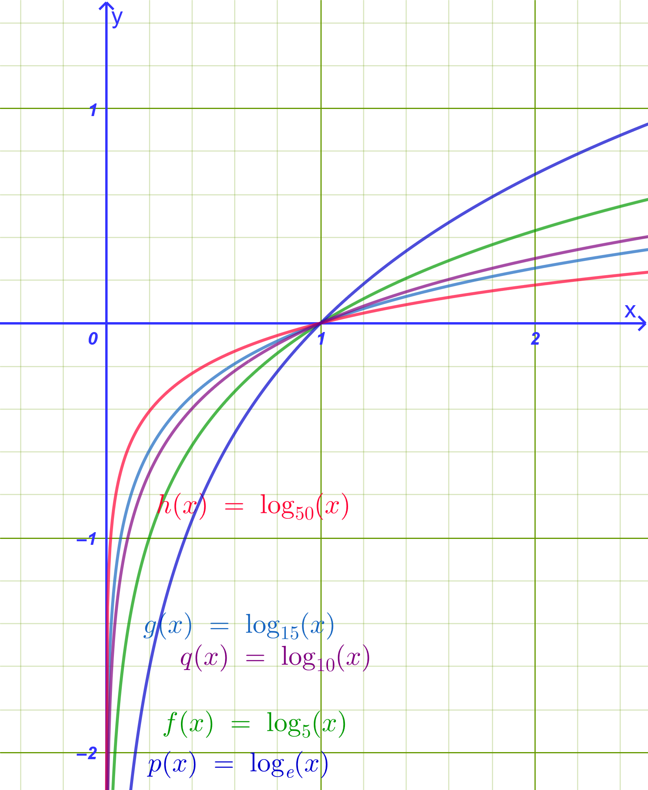
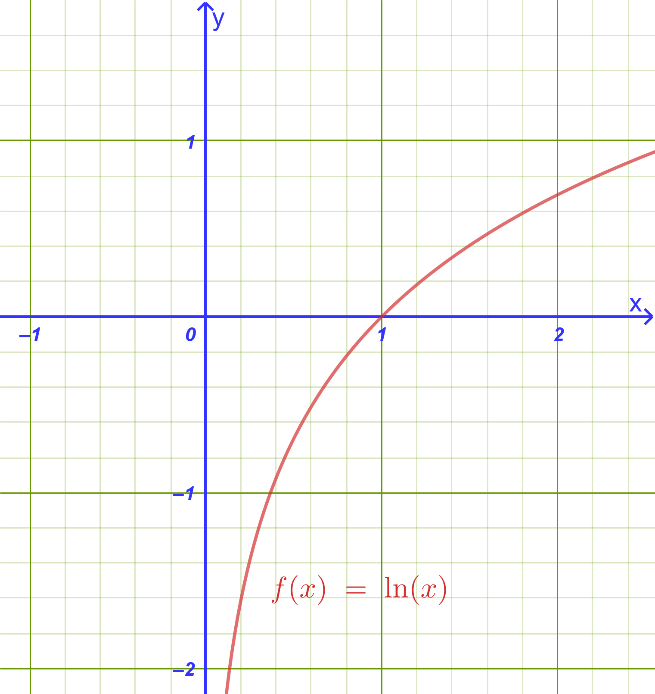
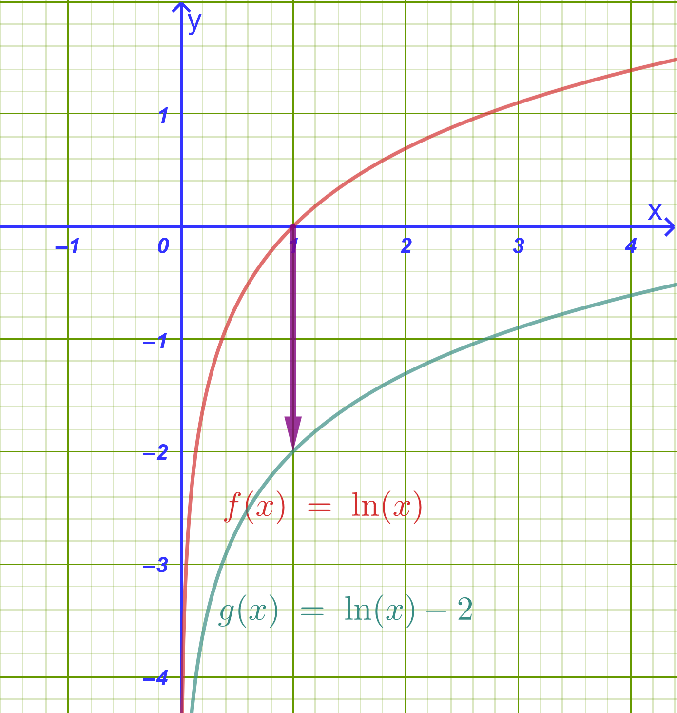
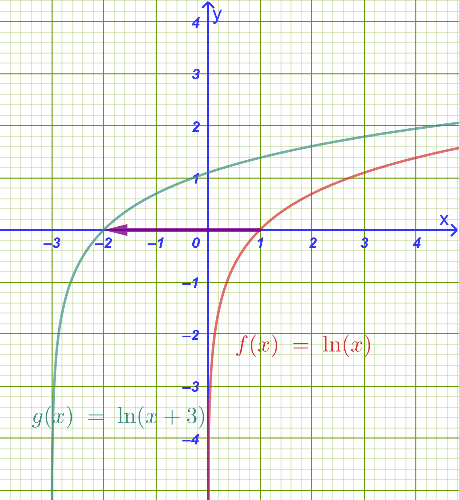
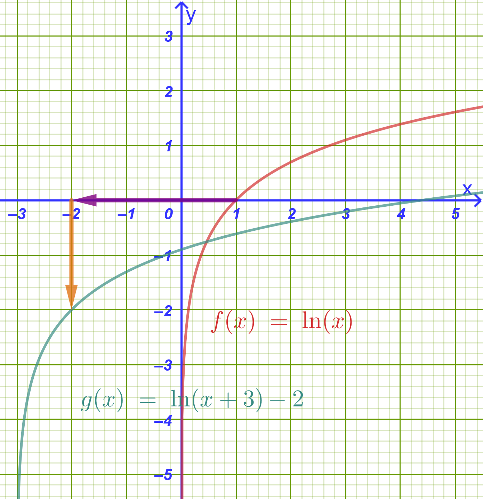

```{=html}
<!-- Φόρτωση βιβλιοθήκης GeoGebra -->
<script src="https://www.geogebra.org/apps/deployggb.js"></script>

<!-- Συνάρτηση δημιουργίας applets -->
<script>
function createGeoGebra(containerId, materialId, width = 700, height = 500) {
  var params = {
    "id": "ggb-" + containerId,
    "material_id": materialId,
    "width": width,
    "height": height,
    "showToolBar": true,
    "showMenuBar": false,
    "showAlgebraInput": true
  };
  
  var applet = new GGBApplet(params, '5.2');
  applet.inject(containerId);
}
</script>
```

## Λογαριθμική συνάρτηση

------------------------------------------------------------------------

### **Ορισμός της Λογαριθμικής Συνάρτησης**

:::: {.math-box .definition-box}
::: {.math-title .definition-title}
Ορισμός
:::

Έστω $a$ ένας θετικός αριθμός διαφορετικός της μονάδας ($a > 0, a \neq 1$).

Για κάθε $x \in (0, +\infty)$ ορίζεται ο λογάριθμος $\log_a x$.

Αντιστοιχίζοντας κάθε $x \in (0, +\infty)$ στο $\log_a x$, ορίζουμε τη συνάρτηση: $$\mathbf{f: (0, +\infty) \to \mathbb{R} \quad \text{με τύπο} \quad f(x) = \log_a x}$$ Η συνάρτηση αυτή ονομάζεται **λογαριθμική συνάρτηση με βάση** $a$.

{fig-align="center" width="400"}

- **Σύνδεση με την Εκθετική Συνάρτηση:**

  Η λογαριθμική συνάρτηση $f(x) = \log_a x$ ορίζεται ως η **αντίστροφη συνάρτηση** της εκθετικής συνάρτησης $g(x) = a^x$ ($a > 0, a \neq 1$).

  - **Πεδίο Ορισμού:** $D_f = (0, +\infty)$ (το σύνολο τιμών της εκθετικής).

  - **Σύνολο Τιμών:** $f(D_f) = \mathbb{R}$ (το πεδίο ορισμού της εκθετικής).
::::

------------------------------------------------------------------------

### **Συμμετρία με την** $y = a^x$ & Μελέτη της Λογαριθμικής Συνάρτησης

#### **α) Συμμετρία ως προς την ευθεία** $y = x$

::: my-callout-theory
Επειδή ισχύει η ισοδυναμία $y = \log_a x \iff x = a^y$, αν το σημείο $M(\xi, \eta)$ ανήκει στη γραφική παράσταση της $y = \log_a x$, τότε το σημείο $N(\eta, \xi)$ ανήκει στη γραφική παράσταση της $y = a^x$ και αντιστρόφως.

Τα σημεία $M(\xi, \eta)$ και $N(\eta, \xi)$ είναι συμμετρικά ως προς την ευθεία $y = x$ (τη διχοτόμο της 1ης και 3ης γωνίας των αξόνων).

**Συμπέρασμα:** Οι γραφικές παραστάσεις των συναρτήσεων $y = \log_a x$ και $y = a^x$ είναι **συμμετρικές ως προς την ευθεία** $y = x$.
:::

------------------------------------------------------------------------

<iframe src="https://www.geogebra.org/calculator/uqracveb?embed" width="730" height="600" allowfullscreen style="border: 1px solid #e4e4e4;border-radius: 4px;" frameborder="0">

</iframe>

:::: {.math-box .odigia-box}
::: {.math-title .odigia-title}
Οδηγία
:::

Επιλέξτε το δρομέα και με [\>]{.kbd-alt} η [\<]{.kbd} αλλάζετε την τιμή της βάσης α.

Για ακρίβεια (κυρίως μεταξύ 0 και 1) [Shift]{.kbd-alt}+[\>]{.kbd-alt} η [Shift]{.kbd}+[\<]{.kbd}

- Τι συμβαίνει καθώς η βάση αυξάνει;

- Τι συμβαίνει όταν η βάση βρίσκεται μεταξύ 0 και 1;

Παρατηρήστε σε κάθε περίπτωση την συμμετρία με την εκθετική συνάρτηση.

Διερευνήστε με βάση την γραφική παράσταση τον παρακάτω πίνακα.
::::

------------------------------------------------------------------------

#### **β) Μελέτη της Συνάρτησης** $f(x) = \log_a x$

| Ιδιότητα / Χαρακτηριστικό | Περίπτωση $a > 1$ (π.χ. $f(x) = \ln x$ ή $\log_2 x$) | Περίπτωση $0 < a < 1$ (π.χ. $f(x) = \log_{1/2} x$) |
|:-----------------------|:-----------------------|:-----------------------|
| **Πεδίο Ορισμού** | $D = (0, +\infty)$ | $D = (0, +\infty)$ |
| **Σύνολο Τιμών** | $f(D) = \mathbb{R}$ | $f(D) = \mathbb{R}$ |
| **Μονοτονία** | **Γνησίως αύξουσα** στο $(0, +\infty)$ ($x_1 < x_2 \implies \log_a x_1 < \log_a x_2$) | **Γνησίως φθίνουσα** στο $(0, +\infty)$ ($x_1 < x_2 \implies \log_a x_1 > \log_a x_2$) |
| **Πρόσημο Τιμών** | $\log_a x < 0$ για $0 < x < 1$ <br> $\log_a x > 0$ για $x > 1$ | $\log_a x > 0$ για $0 < x < 1$ <br> $\log_a x < 0$ για $x > 1$ |
| **Σημεία Τομής** | Τέμνει τον άξονα $x'x$ στο $A(1,0)$. Δεν τέμνει τον $y'y$. | Τέμνει τον άξονα $x'x$ στο $A(1,0)$. Δεν τέμνει τον $y'y$. |
| **Ασύμπτωτη** | Ο αρνητικός ημιάξονας $Oy'$ ($x = 0$ όταν $y \to -\infty$). | Ο θετικός ημιάξονας $Oy$ ($x = 0$ όταν $y \to +\infty$). |
| **Ιδιότητα 1-1** | $\log_a x_1 = \log_a x_2 \iff x_1 = x_2$ | $\log_a x_1 = \log_a x_2 \iff x_1 = x_2$ |

------------------------------------------------------------------------

### **Λύση Λογαριθμικών Εξισώσεων**

**Μεθοδολογία Επίλυσης:**

::: callout-method
1.  **Πεδίο Ορισμού (Περιορισμοί):** Βρίσκουμε το πεδίο ορισμού απαιτώντας οι υπόλογαριθμες παραστάσεις να είναι αυστηρά θετικές ($f(x) > 0$) και οι βάσεις θετικές και διάφορες της μονάδας.

2.  **Αναγωγή σε Ισοδύναμη Μορφή:** Εφαρμόζουμε τις ιδιότητες των λογαρίθμων:

    - Μορφή $\log_a f(x) = \log_a g(x) \iff f(x) = g(x)$.

    - Μορφή $\log_a f(x) = k \iff f(x) = a^k$.

    - Μορφή $A \log_a^2 f(x) + B \log_a f(x) + C = 0$ (θέτοντας $u = \log_a f(x)$).

3.  **Εξαγωγή & Έλεγχος ριζών:** Δεχόμαστε μόνο τις ρίζες που ανήκουν στο πεδίο ορισμού.
:::

------------------------------------------------------------------------

#### **Παραδείγματα Εξισώσεων:**

:::: {.math-box .example-box}
::: {.math-title .example-title}
**Παράδειγμα 1:**
:::

Να λυθεί η εξίσωση: $\log(x + 1) + \log(x - 1) = \log 3$
::::

:::: {.math-box .examplesolution-box}
::: {.math-title .examplesolution-title}
**Λύση**
:::

1.  **Περιορισμοί:** $x + 1 > 0 \iff x > -1$ και $x - 1 > 0 \iff x > 1$.
    Συναληθεύοντας: $x > 1$.

2.  **Επίλυση:** $$\log[(x + 1)(x - 1)] = \log 3 \iff (x + 1)(x - 1) = 3 \iff \\ x^2 - 1 = 3 \iff x^2 = 4 \iff x = 2 \quad \text{ή} \quad x = -2$$

3.  **Έλεγχος:** Η τιμή $x = -2$ απορρίπτεται ($x \ngtr 1$).
    Η τιμή $x = 2$ είναι η μοναδική δεκτή ρίζα.
::::

------------------------------------------------------------------------

:::: {.math-box .example-box}
::: {.math-title .example-title}
**Παράδειγμα 2:**
:::

Να λυθεί η εξίσωση: $\log_2(x^2 - 3x + 6) = 3$
::::

:::: {.math-box .examplesolution-box}
::: {.math-title .examplesolution-title}
**Λύση**
:::

1.  **Περιορισμοί:** $x^2 - 3x + 6 > 0$, το οποίο ισχύει για κάθε $x \in \mathbb{R}$ (αφού $\Delta = 9 - 24 = -15 < 0$).

2.  **Επίλυση:** $$x^2 - 3x + 6 = 2^3 \iff x^2 - 3x + 6 = 8 \iff x^2 - 3x - 2 = 0$$ $$\Delta = (-3)^2 - 4(1)(-2) = 9 + 8 = 17 \implies \mathbf{x = \frac{3 \pm \sqrt{17}}{2}}$$
::::

------------------------------------------------------------------------

:::: {.math-box .example-box}
::: {.math-title .example-title}
**Παράδειγμα 3 (Με Αλλαγή Μεταβλητής):**
:::

Να λυθεί η εξίσωση: $\log^2 x - 5 \log x + 6 = 0$
::::

:::: {.math-box .examplesolution-box}
::: {.math-title .examplesolution-title}
**Λύση**
:::

1.  **Περιορισμός:** $x > 0$.

2.  **Επίλυση:** Θέτουμε $u = \log x$.
    Η εξίσωση γίνεται: $$u^2 - 5u + 6 = 0 \iff (u - 2)(u - 3) = 0 \iff u = 2 \quad \text{ή} \quad u = 3$$

- Αν $u = 2 \iff \log x = 2 \iff \log x = \log 100 \iff \mathbf{x = 100}$

- Αν $u = 3 \iff \log x = 3 \iff \log x = \log 1000 \iff \mathbf{x = 1000}$
::::

------------------------------------------------------------------------

### **Λύση Λογαριθμικών Συστημάτων**

#### **Παραδείγματα Συστημάτων:**

:::: {.math-box .example-box}
::: {.math-title .example-title}
**Παράδειγμα 1:**
:::

Να λυθεί το σύστημα: $$\begin{cases} x + y = 25 \\ \log x + \log y = 2 \end{cases}$$
::::

:::: {.math-box .examplesolution-box}
::: {.math-title .examplesolution-title}
**Λύση**
:::

1.  **Περιορισμοί:** $x > 0$ και $y > 0$.

2.  **Επεξεργασία 2ης εξίσωσης:** $$\log x + \log y = 2 \iff \log(xy) = \log 100 \iff xy = 100$$

3.  **Επίλυση αλγεβρικού συστήματος:**

Οι $x, y$ είναι ρίζες της εξίσωσης $t^2 - 25t + 100 = 0 \iff (t - 5)(t - 20) = 0 \iff t = 5$ ή $t = 20$.

Άρα οι λύσεις είναι τα ζεύγη $(x, y) = (5, 20)$ ή $(x, y) = (20, 5)$.
::::

------------------------------------------------------------------------

:::: {.math-box .example-box}
::: {.math-title .example-title}
**Παράδειγμα 2:**
:::

Να λυθεί το σύστημα: $$\begin{cases} \log x - \log y = 1 \\ \log x + 2 \log y = 4 \end{cases}$$
::::

:::: {.math-box .examplesolution-box}
::: {.math-title .examplesolution-title}
**Λύση**
:::

1.  **Περιορισμοί:** $x > 0, y > 0$.

2.  **Αλλαγή μεταβλητών:** Θέτουμε $u = \log x$ και $v = \log y$: $$\begin{cases} u - v = 1 \\ u + 2v = 4 \end{cases}$$

Αφαιρούμε κατά μέλη: $3v = 3 \iff v = 1$.

Τότε $u - 1 = 1 \iff u = 2$.

3.  **Επιστροφή στους αγνώστους:**

- $\log x = 2 \iff \mathbf{x = 100}$

- $\log y = 1 \iff \mathbf{y = 10}$

Άρα η μοναδική λύση είναι το ζεύγος $(x, y) = (100, 10)$.
::::

------------------------------------------------------------------------

:::: {.math-box .example-box}
::: {.math-title .example-title}
**Παράδειγμα 3:**
:::

Να λυθεί το σύστημα: $$\begin{cases} x \cdot y = 100 \\ \log x \cdot \log y = 2 \end{cases}$$
::::

:::: {.math-box .examplesolution-box}
::: {.math-title .examplesolution-title}
**Λύση**
:::

1.  **Περιορισμοί:** $x > 0, y > 0$.

2.  Λογαριθμίζουμε την 1η εξίσωση: $\log(xy) = \log 100 \iff \log x + \log y = 2$.

3.  Έχουμε το σύστημα: $\begin{cases} \log x + \log y = 2 \\ \log x \cdot \log y = 2 \end{cases}$.

Οι $\log x, \log y$ είναι ρίζες της εξίσωσης $w^2 - 2w + 2 = 0$.

Επειδή $\Delta = (-2)^2 - 4(1)(2) = 4 - 8 = -4 < 0$, η εξίσωση δεν έχει πραγματικές ρίζες.

Άρα το σύστημα είναι **αδύνατο στο** $\mathbb{R}$.
::::

------------------------------------------------------------------------

### **Λύση Λογαριθμικών Ανισώσεων**

#### **Μεθοδολογία Επίλυσης:**

::: callout-method
1.  **Πεδίο Ορισμού:** Επιβάλλουμε περιορισμούς θετικότητας για όλες τις υπόλογαριθμες εκφράσεις.

2.  **Χρήση Μονοτονίας:**

- **Αν** $a > 1$: $\log_a f(x) > \log_a g(x) \iff f(x) > g(x)$ (διατηρείται η φορά).

- **Αν** $0 < a < 1$: $\log_a f(x) > \log_a g(x) \iff f(x) < g(x)$ (αλλάζει η φορά).

3.  **Συναλήθευση:** Συναληθεύουμε τις λύσεις με το πεδίο ορισμού.
:::

------------------------------------------------------------------------

#### **Παραδείγματα Ανισώσεων:**

:::: {.math-box .example-box}
::: {.math-title .example-title}
**Παράδειγμα 1 (Βάση** $a > 1$):
:::

Να λυθεί η ανίσωση: $\log_2(2x - 1) < 3$
::::

:::: {.math-box .examplesolution-box}
::: {.math-title .examplesolution-title}
**Λύση**
:::

1.  **Περιορισμός:** $2x - 1 > 0 \iff x > \dfrac{1}{2}$.

2.  **Επίλυση:**

Επειδή η βάση είναι $2 > 1$, η συνάρτηση είναι γνησίως αύξουσα: $$\log_2(2x - 1) < \log_2(2^3) \iff 2x - 1 < 8 \iff 2x < 9 \iff x < \frac{9}{2}$$

3.  **Συναλήθευση:** $\dfrac{1}{2} < x < \dfrac{9}{2} \iff \mathbf{x \in \left(\dfrac{1}{2}, \dfrac{9}{2}\right)}$.
::::

------------------------------------------------------------------------

:::: {.math-box .example-box}
::: {.math-title .example-title}
**Παράδειγμα 2 (Βάση** $0 < a < 1$):
:::

Να λυθεί η ανίσωση: $\log_{0.5}(x^2 - 5x + 6) \ge -1$
::::

:::: {.math-box .examplesolution-box}
::: {.math-title .examplesolution-title}
**Λύση**
:::

1.  **Περιορισμός:** $x^2 - 5x + 6 > 0 \iff (x - 2)(x - 3) > 0 \iff x < 2 \quad \text{ή} \quad x > 3$.

2.  **Επίλυση:**

    Επειδή η βάση είναι $0.5 < 1$, η συνάρτηση είναι γνησίως φθίνουσα, οπότε η φορά αλλάζει: $$\log_{0.5}(x^2 - 5x + 6) \ge \log_{0.5}\left((0.5)^{-1}\right) \iff x^2 - 5x + 6 \le 2 \iff x^2 - 5x + 4 \le 0$$ $$(x - 1)(x - 4) \le 0 \iff 1 \le x \le 4$$

3.  **Συναλήθευση με το πεδίο ορισμού:** $$\mathbf{x \in [1, 2) \cup (3, 4]}$$
::::

------------------------------------------------------------------------

:::: {.math-box .example-box}
::: {.math-title .example-title}
**Παράδειγμα 3 (Άθροισμα Λογαρίθμων):**
:::

Να λυθεί η ανίσωση: $\ln(x - 1) + \ln(x + 2) < \ln 4$
::::

:::: {.math-box .examplesolution-box}
::: {.math-title .examplesolution-title}
**Λύση**
:::

1.  **Περιορισμοί:** $x - 1 > 0 \iff x > 1$ και $x + 2 > 0 \iff x > -2$.
    Συναληθεύοντας: $x > 1$.

2.  **Επίλυση:** $$\ln[(x - 1)(x + 2)] < \ln 4 \iff (x - 1)(x + 2) < 4 \iff x^2 + x - 2 < 4 \iff x^2 + x - 6 < 0$$ $$(x + 3)(x - 2) < 0 \iff -3 < x < 2$$

3.  **Συναλήθευση:** Για $x > 1$ και $-3 < x < 2$, προκύπτει $x \in (1, 2)$.
::::

------------------------------------------------------------------------

### **Γραφική Παράσταση & Μετατοπίσεις Συναρτήσεων στο ίδιο Σύστημα Αξόνων**

Εξετάζουμε τις συναρτήσεις:

1.  $\phi(x) = \ln x$

2.  $f(x) = \ln x - 2$

3.  $g(x) = \ln(x+3)$

4.  $h(x) = \ln(x+3) - 2$

------------------------------------------------------------------------

#### **α) Αναλυτική Ερμηνεία των Μετατοπίσεων**

1.  $\phi(x) = \ln x$ (Αρχική Συνάρτηση):

{fig-align="center" width="400"}

- **Πεδίο Ορισμού:** $(0, +\infty)$, **Σύνολο Τιμών:** $\mathbb{R}$.

- **Μονοτονία:** Γνησίως αύξουσα.

- **Χαρακτηριστικά Σημεία:** Τέμνει τον $x'x$ στο $(1, 0)$ και διέρχεται από το σημείο $(e, 1) \approx (2.72, 1)$.

- **Κατακόρυφη Ασύμπτωτη:** Ο άξονας $y'y$ (ευθεία $x = 0$).

2.  $f(x) = \ln x - 2$ (Κατακόρυφη Μετατόπιση):

{fig-align="center" width="400"}

- Προκύπτει από μια **κατακόρυφη μετατόπιση της καμπύλης** $y = \ln x$ κατά $2$ μονάδες προς τα κάτω.

- **Πεδίο Ορισμού:** $(0, +\infty)$, **Κατακόρυφη Ασύμπτωτη:** $x = 0$.

- **Τομή με τον** $x'x$: $\ln x - 2 = 0 \iff \ln x = 2 \iff x = e^2 \approx 7.39 \implies (e^2, 0)$.

- **Τομή με τον** $y'y$: Δεν τέμνει τον $y'y$.

3.  $g(x) = \ln(x+3)$ (Οριζόντια Μετατόπιση):

{fig-align="center" width="400"}

- Προκύπτει από μια **οριζόντια μετατόπιση της καμπύλης** $y = \ln x$ κατά $3$ μονάδες προς τα αριστερά.

- **Πεδίο Ορισμού:** $x + 3 > 0 \iff (-3, +\infty)$.

- **Κατακόρυφη Ασύμπτωτη:** Η ευθεία $x = -3$.

- **Τομή με τον** $x'x$: $\ln(x+3) = 0 \iff x + 3 = 1 \iff x = -2 \implies (-2, 0)$.

- **Τομή με τον** $y'y$: Για $x = 0 \implies g(0) = \ln 3 \approx 1.10 \implies (0, \ln 3)$.

4.  $h(x) = \ln(x+3) - 2$ (Συνδυασμένη Μετατόπιση):

{fig-align="center" width="400"}

- Προκύπτει από **οριζόντια μετατόπιση κατά** $3$ μονάδες προς τα αριστερά και κατακόρυφη μετατόπιση κατά $2$ μονάδες προς τα κάτω της καμπύλης $y = \ln x$.

- **Πεδίο Ορισμού:** $(-3, +\infty)$, **Κατακόρυφη Ασύμπτωτη:** Η ευθεία $x = -3$.

- **Τομή με τον** $x'x$: $\ln(x+3) - 2 = 0 \iff \ln(x+3) = 2 \iff x + 3 = e^2 \iff x = e^2 - 3 \approx 4.39 \implies (e^2 - 3, 0)$.

- **Τομή με τον** $y'y$: Για $x = 0 \implies h(0) = \ln 3 - 2 \approx -0.90 \implies (0, \ln 3 - 2)$.

------------------------------------------------------------------------

#### **β) Συγκεντρωτικός Πίνακας Μελέτης & Σχεδίασης στο ίδιο Σύστημα Αξόνων**

| Συνάρτηση | Πεδίο Ορισμού | Κατακόρυφη Ασύμπτωτη | Σημείο Τομής με $x'x$ | Σημείο Τομής με $y'y$ | Είδη Μετατόπισης |
|:-----------|:-----------|:-----------|:-----------|:-----------|:-----------|
| $\phi(x) = \ln x$ | $(0, +\infty)$ | $x = 0$ ($y'y$) | $(1, 0)$ | Δεν υπάρχει | Αρχική καμπύλη |
| $f(x) = \ln x - 2$ | $(0, +\infty)$ | $x = 0$ ($y'y$) | $(e^2, 0) \approx (7.39, 0)$ | Δεν υπάρχει | $2$ μονάδες ΚΑΤΩ |
| $g(x) = \ln(x+3)$ | $(-3, +\infty)$ | $x = -3$ | $(-2, 0)$ | $(0, \ln 3) \approx (0, 1.10)$ | $3$ μονάδες ΑΡΙΣΤΕΡΑ |
| $h(x) = \ln(x+3) - 2$ | $(-3, +\infty)$ | $x = -3$ | $(e^2 - 3, 0) \approx (4.39, 0)$ | $(0, \ln 3 - 2) \approx (0, -0.90)$ | $3$ ΑΡΙΣΤΕΡΑ & $2$ ΚΑΤΩ |

------------------------------------------------------------------------

### **Ασκήσεις Εμπέδωσης**

#### **Κατηγορία Α: Πεδίο Ορισμού & Ιδιότητες (1–4)**

1.  Να βρεθεί το πεδίο ορισμού των συναρτήσεων:

- α) $f(x) = \ln(x^2 - 9)$

- β) $g(x) = \log_5\left(\dfrac{x - 1}{4 - x}\right)$

::::{.my-callout-theory}
::: {.my-callout-theory .callout-title}
Υπόδειξη
:::
Λύνουμε την ανίσωση $\dfrac{x-1}{x-4} \gt0$
::::

- γ) $h(x) = \log_{x-2}(10 - x)$

::::{.my-callout-theory}
::: {.my-callout-theory .callout-title}
Υπόδειξη
:::
πρέπει $x-2 \gt 0 \quad$, $\quad x-2\ne 1 \quad$ και $\quad 10-x \gt 0$ 
::::

2.  Να υπολογιστεί η τιμή της παράστασης:

$A = \log_3 18 + \log_3 12 - 2 \log_3 2 - \log_3 6$

3.  Να αποδειχθεί ότι: $\ln(e^3 \cdot \sqrt{e}) - \ln\left(\dfrac{1}{e}\right) = 4.5$.

::::{.my-callout-theory}
::: {.my-callout-theory .callout-title}
Υπόδειξη
:::
$\ln(e^3 \cdot \sqrt{e}) - \ln\left(\dfrac{1}{e}\right)=\ln\left( \dfrac{e^3\cdot\sqrt{e}}{\dfrac{1}{e}}\right)=\ln\left(e^4\cdot e^\dfrac{1}{2}\right)=\ln\left(e^{\dfrac{9}{2}}\right)= ............$

Εναλλακτικά μπορείτε να χρησιμοποιήσετε το $\ln\left(\dfrac{1}{e}\right)=-\ln e$
::::

4.  Να προσδιοριστεί το πρόσημο των τιμών: $\log_2 0.3$, $\log_{0.2} 0.5$ και $\ln(\pi - 2)$.

#### **Κατηγορία Β: Λογαριθμικές Εξισώσεις (5–8)**

5.  Να λυθούν στο $\mathbb{R}$ οι εξισώσεις:

- α) $\log_3(3x - 2) = 2$

- β) $\ln(x^2 - 5x + 7) = 0$

::::{.my-callout-theory}
::: {.my-callout-theory .callout-title}
Υπόδειξη
:::
$\ln (x^2-5x+7)=0=\ln 1 \implies .........................$
::::

6.  Να λυθεί η εξίσωση:

$\log(x + 2) + \log(x - 1) = 1$

::::{.my-callout-theory}
::: {.my-callout-theory .callout-title}
Υπόδειξη
:::
$\implies \log[(x+2)(x-1)]=\log 10 \implies ..................$

Πάντα να λαμβάνετε υπ' όψιν τους περιορισμούς.
::::

7.  Να λυθεί η εξίσωση:

$\log_2^2 x - 4 \log_2 x + 3 = 0$

::::{.my-callout-theory}
::: {.my-callout-theory .callout-title}
Υπόδειξη
:::
Θέσε $\log_2 x=λ$ και λύσε το τριώνυμο. Μην ξεχνάς να βρίσκεις πρώτα τους περιορισμούς.
::::

---

:::: {.math-box .exercise-box}
::: {.math-title .exercise-title}
8.  Εκφώνηση
:::
Να λυθεί η εκθετική εξίσωση με τη βοήθεια λογαρίθμων:

  $5^{2x - 1} = 3^{x + 2}$
::::

:::: {.math-box .solution-box}
::: {.math-title .solution-title}
Λύση
:::
$$5^{2x - 1} = 3^{x + 2}$$

**1: Λογαριθμίζουμε και τα δύο μέλη**

Επειδή οι δύο βάσεις ($5$ και $3$) είναι διαφορετικές και θετικές, εφαρμόζουμε τον δεκαδικό λογάριθμο ($\log$) ή τον φυσικό λογάριθμο ($\ln$) και στα δύο μέλη:

$$\log(5^{2x - 1}) = \log(3^{x + 2})$$

---

**2: Χρήση της ιδιότητας των δυνάμεων**

Κατεβάζουμε τους εκθέτες μπροστά από τους λογαρίθμους:

$$(2x - 1) \cdot \log 5 = (x + 2) \cdot \log 3$$

---

**3: Εκτέλεση των πολλαπλασιασμών**

Επιμερίζουμε τους όρους:

$$2x \cdot \log 5 - \log 5 = x \cdot \log 3 + 2\log 3$$

---

**4: Χωρισμός γνωστών από αγνώστους**

Συγκεντρώνουμε όλους τους όρους που περιέχουν το $x$ στο αριστερό μέλος και τους σταθερούς όρους στο δεξί μέλος:

$$2x \cdot \log 5 - x \cdot \log 3 = 2\log 3 + \log 5$$

Βγάζουμε κοινό παράγοντα το $x$:

$$x \cdot (2\log 5 - \log 3) = 2\log 3 + \log 5$$

---

**5: Επίλυση ως προς $x$**

Διαιρούμε με τον συντελεστή του $x$:

$$x = \frac{2\log 3 + \log 5}{2\log 5 - \log 3}$$

---

**6: Απλοποίηση με ιδιότητες λογαρίθμων (προαιρετικά)**

Χρησιμοποιώντας τις ιδιότητες των λογαρίθμων:

*   Αριθμητής: $2\log 3 + \log 5 = \log(3^2) + \log 5 = \log 9 + \log 5 = \log(9 \cdot 5) = \log 45$

*   Παρονομαστής: $2\log 5 - \log 3 = \log(5^2) - \log 3 = \log 25 - \log 3 = \log\left(\dfrac{25}{3}\right)$

Άρα η λύση μπορεί να γραφτεί και ως:

$$x = \frac{\log 45}{\log\left(\frac{25}{3}\right)}$$

ή μέσω του τύπου αλλαγής βάσης:

$$x = \log_{\frac{25}{3}}(45)$$
::::

#### **Κατηγορία Γ: Λογαριθμικά Συστήματα (9–12)**

9.  Να λυθεί το σύστημα: $$\begin{cases} x + y = 11 \\ \log x + \log y = 1 \end{cases}$$

::::{.my-callout-theory}
::: {.my-callout-theory .callout-title}
Υπόδειξη
:::
Η δεύτερη εξίσωση γράφεται $\log x + \log y= \log 10 \implies xy=10$

Έτσι λύνουμε το σύστημα $$\begin{cases}x+y=11 \\  xy=10\end{cases}$$
::::

10. Να λυθεί το σύστημα: $$\begin{cases} \ln x - \ln y = \ln 2 \\ x^2 + y^2 = 20 \end{cases}$$

::::{.my-callout-theory}
::: {.my-callout-theory .callout-title}
Υπόδειξη
:::
Περιορισμοί .........................

Η πρώτη γράφεται $\ln \dfrac{x}{y}=\ln 2 \implies \dfrac{x}{y}=2$
::::

11. Να λυθεί το σύστημα: $$\begin{cases} \log_2 x + \log_2 y = 5 \\ \log_2 x \cdot \log_2 y = 6 \end{cases}$$

::::{.my-callout-theory}
::: {.my-callout-theory .callout-title}
Υπόδειξη
:::
Περιορισμοί ................................

Βάλε $\log_2 x=m \quad$ και $\log_2 y=n$
::::

12. Να λυθεί το σύστημα: $$\begin{cases} 2^{\log x} + 3^{\log y} = 11 \\ 4^{\log x} - 3^{\log y} = 5 \end{cases}$$

::::{.my-callout-theory}
::: {.my-callout-theory .callout-title}
Υπόδειξη
:::
Περιορισμοί ............................

Βάλε $2^{\log x}=m \quad$ και $3^{\log y}=n$
::::

#### **Κατηγορία Δ: Λογαριθμικές Ανισώσεις (13–16)**

13. Να λυθεί στο $\mathbb{R}$ η ανίσωση:

$\log_3(4x - 1) < 2$

::::{.my-callout-theory}
::: {.my-callout-theory .callout-title}
Υπόδειξη
:::
$2=\log_3 9$
::::

14. Να λυθεί η ανίσωση:

$\log_{0.2}(x^2 - 3x) \ge -1$

::::{.my-callout-theory}
::: {.my-callout-theory .callout-title}
Υπόδειξη
:::
$-1=\log_{0,2} 5$
::::

15. Να λυθεί η ανίσωση:

$\ln(x^2 - 4) \le \ln(3x)$

16. Να λυθεί η ανίσωση:

$\log^2 x - 3 \log x + 2 > 0$

::::{.my-callout-theory}
::: {.my-callout-theory .callout-title}
Υπόδειξη
:::
$\log x=m$
::::

#### **Κατηγορία Ε: Μετατοπίσεις Γραφικών Παραστάσεων & Σύνθετα Θέματα (17–20)**

17. Δίνεται η συνάρτηση $f(x) = \ln(x - 2) + 3$.

- α) Να βρεθεί το πεδίο ορισμού και η κατακόρυφη ασύμπτωτη της $f$.

- β) Πώς προκύπτει η γραφική παράσταση της $f$ από τη γραφική παράσταση της $y = \ln x$;

18. Να βρεθούν τα σημεία τομής των γραφικών παραστάσεων των συναρτήσεων $f(x) = \ln(x^2 + 2)$ και $g(x) = \ln(3x)$.

---

:::: {.math-box .exercise-box}
::: {.math-title .exercise-title}
19.  Εκφώνηση
:::
Να αποδειχθεί ότι για κάθε $x > 0$ ισχύει:

$\log\left(x + \dfrac{1}{x}\right) \ge \log 2$

::::


:::: {.math-box .solution-box}
::: {.math-title .solution-title}
Λύση
:::

**1: Απόδειξη της βασικής αλγεβρικής ανισότητας**

Για κάθε θετικό πραγματικό αριθμό $x > 0$, εξετάζουμε τη διαφορά:

$$x + \frac{1}{x} - 2$$

Κάνουμε ομώνυμα τα κλάσματα:

$$x + \frac{1}{x} - 2 = \frac{x^2 + 1 - 2x}{x} = \frac{x^2 - 2x + 1}{x} = \frac{(x - 1)^2}{x}$$

Επειδή για κάθε $x \in \mathbb{R}$ ισχύει $(x - 1)^2 \ge 0$ και για $x > 0$ ο παρονομαστής είναι θετικός, έχουμε:

$$\frac{(x - 1)^2}{x} \ge 0$$

Συνεπώς:

$$x + \frac{1}{x} - 2 \ge 0 \iff x + \frac{1}{x} \ge 2$$

*(Η ισότητα ισχύει αν και μόνο αν $x - 1 = 0 \iff x = 1$)*.

---

**2: Εφαρμογή της λογαριθμικής συνάρτησης**

Θεωρούμε τη συνάρτηση:
$$f(t) = \log t, \quad t > 0$$

Επειδή η βάση του δεκαδικού λογαρίθμου είναι $10 > 1$, η συνάρτηση $f(t) = \log t$ είναι **γνησίως αύξουσα** στο $(0, +\infty)$.

Επομένως, διατηρεί τη φορά της ανισότητας:

$$x + \frac{1}{x} \ge 2 \implies \log\left(x + \frac{1}{x}\right) \ge \log 2$$

---

Η ανισότητα αποδείχθηκε, με την ισότητα να ισχύει όταν $x = 1$.

::::

----

20. **(Σύνθετη Άσκηση):** Δίνεται η συνάρτηση $f(x) = \ln\left(\frac{1 - x}{1 + x}\right)$.

- α) Να βρεθεί το πεδίο ορισμού της $f$.

- β) Να αποδειχθεί ότι η συνάρτηση $f$ είναι περιττή.

------------------------------------------------------------------------

:::: {.math-box .exercise-box}
::: {.math-title .exercise-title}
21. Να λυθεί η εξίσωση:
:::

$$x^{\log_3 x} = 81x^3$$
::::

:::: {.math-box .solution-box}
::: {.math-title .solution-title}
Λύση
:::

**Περιορισμοί**

Για να ορίζεται ο λογάριθμος $\log_3 x$, πρέπει: $$x > 0$$

------------------------------------------------------------------------

**1: Λογαριθμίζουμε και τα δύο μέλη**

Επειδή η βάση του λογαρίθμου στον εκθέτη είναι το $3$, εφαρμόζουμε τον $\log_3$ και στα δύο μέλη της εξίσωσης:

$$\log_3\left(x^{\log_3 x}\right) = \log_3\left(81x^3\right)$$

------------------------------------------------------------------------

**2: Εφαρμογή των ιδιοτήτων των λογαρίθμων**

1.  **Αριστερό μέλος:** Ο εκθέτης $\log_3 x$ «κατεβαίνει» μπροστά ως συντελεστής: $$\log_3\left(x^{\log_3 x}\right) = (\log_3 x) \cdot (\log_3 x) = (\log_3 x)^2$$

2.  **Δεξί μέλος:** Ο λογάριθμος του γινομένου γίνεται άθροισμα λογαρίθμων: $$\log_3\left(81x^3\right) = \log_3(81) + \log_3(x^3)$$

    - Επειδή $81 = 3^4$, έχουμε $\log_3(81) = \log_3(3^4) = 4$.

    - Κατεβάζουμε τον εκθέτη: $\log_3(x^3) = 3\log_3 x$.

Επομένως, η εξίσωση γίνεται: $$(\log_3 x)^2 = 4 + 3\log_3 x$$

------------------------------------------------------------------------

**3: Επίλυση της δευτεροβάθμιας εξίσωσης**

Μεταφέρουμε όλους τους όρους στο αριστερό μέλος: $$(\log_3 x)^2 - 3\log_3 x - 4 = 0$$

Θέτουμε $u = \log_3 x$: $$u^2 - 3u - 4 = 0$$

Παραγοντοποιούμε το τριώνυμο: $$(u - 4)(u + 1) = 0$$

Άρα οι λύσεις για το $u$ είναι: $$u = 4 \quad \text{ή} \quad u = -1$$

------------------------------------------------------------------------

**4: Εύρεση του** $x$

Επιστρέφουμε στην αρχική μεταβλητή ($u = \log_3 x$):

- **Για** $u = 4$: $$\log_3 x = 4 \iff x = 3^4 \iff x = 81$$

- **Για** $u = -1$: $$\log_3 x = -1 \iff x = 3^{-1} \iff x = \frac{1}{3}$$

Και οι δύο τιμές είναι θετικές ($x > 0$), άρα γίνονται δεκτές.

------------------------------------------------------------------------

**Τελικές Λύσεις**

Οι λύσεις της εξίσωσης είναι: $$x = 81 \quad \text{και} \quad x = \frac{1}{3}$$
::::

------------------------------------------------------------------------

:::: {.math-box .exercise-box}
::: {.math-title .exercise-title}
22. Να λυθεί η εξίσωση:
:::

$$7^{\cos^2 x} + 7^{\sin^2 x} = 8$$
::::

:::: {.math-box .solution-box}
::: {.math-title .solution-title}
Λύση
:::

**1: Χρήση της βασικής τριγωνομετρικής ταυτότητας**

Από τη θεμελιώδη τριγωνομετρική ταυτότητα γνωρίζουμε ότι: $$\sin^2 x + \cos^2 x = 1 \implies \cos^2 x = 1 - \sin^2 x$$

Αντικαθιστούμε στην εξίσωση: $$7^{1 - \sin^2 x} + 7^{\sin^2 x} = 8$$

Χρησιμοποιώντας την ιδιότητα των δυνάμεων $a^{m-n} = \frac{a^m}{a^n}$: $$\frac{7}{7^{\sin^2 x}} + 7^{\sin^2 x} = 8$$

------------------------------------------------------------------------

**2: Αλλαγή μεταβλητής**

Θέτουμε: $$u = 7^{\sin^2 x}$$

Επειδή $0 \le \sin^2 x \le 1$, ισχύει ότι $7^0 \le u \le 7^1$, δηλαδή $1 \le u \le 7$.

Η εξίσωση γίνεται: $$\frac{7}{u} + u = 8$$

Πολλαπλασιάζουμε και τα δύο μέλη με $u$ ($u > 0$): $$7 + u^2 = 8u \iff u^2 - 8u + 7 = 0$$

------------------------------------------------------------------------

**3: Επίλυση της δευτεροβάθμιας εξίσωσης**

Παραγοντοποιούμε το τριώνυμο: $$(u - 1)(u - 7) = 0$$

Άρα οι τιμές για το $u$ είναι: $$u = 1 \quad \text{ή} \quad u = 7$$

Και οι δύο τιμές βρίσκονται στο διάστημα $[1, 7]$, άρα είναι δεκτές.

------------------------------------------------------------------------

**4: Επιστροφή στην αρχική μεταβλητή και εύρεση του** $x$

- **Περίπτωση 1:** $u = 1$ $$7^{\sin^2 x} = 1 \iff 7^{\sin^2 x} = 7^0 \iff \sin^2 x = 0 \iff \sin x = 0$$

  Οι λύσεις της $\sin x = 0$ είναι: $$x = k\pi, \quad k \in \mathbb{Z}$$

- **Περίπτωση 2:** $u = 7$ $$7^{\sin^2 x} = 7 \iff 7^{\sin^2 x} = 7^1 \iff \sin^2 x = 1 \iff \cos^2 x = 0 \iff \cos x = 0$$

  Οι λύσεις της $\cos x = 0$ είναι: $$x = k\pi + \frac{\pi}{2}, \quad k \in \mathbb{Z}$$

------------------------------------------------------------------------

**Τελικές Λύσεις**

Συνδυάζοντας τις δύο περιπτώσεις ($x = k\pi$ και $x = k\pi + \frac{\pi}{2}$), οι λύσεις μπορούν να γραφτούν ενιαία ως:

$$x = \frac{k\pi}{2}, \quad k \in \mathbb{Z}$$
::::

------------------------------------------------------------------------

:::: {.math-box .exercise-box}
::: {.math-title .exercise-title}
23. Να λυθεί η εξίσωση:
:::

$$\log_3(x^2 - 5x + 13) = 2$$
::::

:::: {.math-box .solution-box}
::: {.math-title .solution-title}
Λύση
:::

**Περιορισμοί**

Για να ορίζεται ο λογάριθμος, πρέπει η παράσταση στο εσωτερικό του να είναι θετική: $$x^2 - 5x + 13 > 0$$

Ελέγχουμε τη διακρίνουσα $\Delta$ του τριωνύμου: $$\Delta = (-5)^2 - 4 \cdot 1 \cdot 13 = 25 - 52 = -27 < 0$$

Επειδή $\Delta < 0$ και ο συντελεστής του $x^2$ είναι $1 > 0$, το τριώνυμο είναι θετικό για κάθε $x \in \mathbb{R}$.
Επομένως, η εξίσωση ορίζεται για κάθε $x \in \mathbb{R}$.

------------------------------------------------------------------------

**Επίλυση**

Από τον βασικό ορισμό του λογαρίθμου ($\log_a y = b \iff y = a^b$):

$$x^2 - 5x + 13 = 3^2$$

$$x^2 - 5x + 13 = 9$$

Μεταφέρουμε το $9$ στο αριστερό μέλος:

$$x^2 - 5x + 13 - 9 = 0$$

$$x^2 - 5x + 4 = 0$$

Παραγοντοποιούμε το τριώνυμο:

$$(x - 1)(x - 4) = 0$$

Άρα οι λύσεις είναι:

$$x = 1 \quad \text{ή} \quad x = 4$$

------------------------------------------------------------------------

**Τελικές Λύσεις**

$$x = 1 \quad \text{και} \quad x = 4$$
::::

------------------------------------------------------------------------

:::: {.math-box .exercise-box}
::: {.math-title .exercise-title}
24. Να λυθεί η εξίσωση:
:::

$$\log_3(x + 1) = \log_9(x + 4)$$
::::

:::: {.math-box .solution-box}
::: {.math-title .solution-title}
Λύση
:::

**Περιορισμοί**

Για να ορίζονται οι λογάριθμοι, πρέπει οι παραστάσεις στο εσωτερικό τους να είναι θετικές:

- $x + 1 > 0 \implies x > -1$

- $x + 4 > 0 \implies x > -4$

Συναληθεύοντας, έχουμε τον κοινό περιορισμό: $$x > -1$$

------------------------------------------------------------------------

**1: Αλλαγή βάσης στον λογάριθμο με βάση** $9$

Εκφράζουμε τον $\log_9(x + 4)$ με βάση το $3$, χρησιμοποιώντας τον τύπο αλλαγής βάσης $\log_b a = \dfrac{\log_c a}{\log_c b}$:

$$\log_9(x + 4) = \frac{\log_3(x + 4)}{\log_3(9)}$$

Επειδή $9 = 3^2$, έχουμε $\log_3(9) = 2$.
Άρα:

$$\log_9(x + 4) = \frac{\log_3(x + 4)}{2} = \frac{1}{2}\log_3(x + 4)$$

------------------------------------------------------------------------

**2: Εξίσωση των λογαρίθμων**

Αντικαθιστούμε στην αρχική εξίσωση:

$$\log_3(x + 1) = \frac{1}{2}\log_3(x + 4)$$

Πολλαπλασιάζουμε και τα δύο μέλη με $2$:

$$2\log_3(x + 1) = \log_3(x + 4)$$

Ανεβάζουμε τον συντελεστή $2$ ως εκθέτη:

$$\log_3\left((x + 1)^2\right) = \log_3(x + 4)$$

------------------------------------------------------------------------

**3: Επίλυση της εξίσωσης**

Επειδή η λογαριθμική συνάρτηση είναι «1-1», εξισώνουμε τα ορίσματα:

$$(x + 1)^2 = x + 4$$

Αναπτύσσουμε το τετράγωνο:

$$x^2 + 2x + 1 = x + 4$$

Μεταφέρουμε όλους τους όρους στο αριστερό μέλος:

$$x^2 + x - 3 = 0$$

Χρησιμοποιούμε τον τύπο της διακρίνουσας για το τριώνυμο ($a=1, β=1, γ=-3$):

$$\Delta = β^2 - 4aγ = 1^2 - 4 \cdot 1 \cdot (-3) = 1 + 12 = 13$$

Οι ρίζες είναι:

$$x = \frac{-1 \pm \sqrt{13}}{2}$$

------------------------------------------------------------------------

**4: Έλεγχος των περιορισμών (**$x > -1$)

Γνωρίζουμε ότι $9 < 13 < 16$, άρα $3 < \sqrt{13} < 4$ (περίπου $\sqrt{13} \approx 3,61$).

1.  **Για τη θετική ρίζα:** $$x_1 = \frac{-1 + \sqrt{13}}{2} \approx \frac{-1 + 3,61}{2} = \frac{2,61}{2} \approx 1,305 > -1 \quad (\Delta\epsilon\kappa\tau\acute{\eta})$$

2.  **Για την αρνητική ρίζα:** $$x_2 = \frac{-1 - \sqrt{13}}{2} \approx \frac{-1 - 3,61}{2} = \frac{-4,61}{2} \approx -2,305 < -1 \quad (\text{A}\pi\text{o}\rho\rho\acute{\iota}\pi\tau\epsilon\tauα\iota)$$

------------------------------------------------------------------------

**Τελική Λύση**

$$x = \frac{-1 + \sqrt{13}}{2}$$
::::

------------------------------------------------------------------------

:::: {.math-box .exercise-box}
::: {.math-title .exercise-title}
25. Να λυθεί η εξίσωση:
:::

$$\log_5 x = \log_{25}(x + 1)$$
::::

:::: {.math-box .solution-box}
::: {.math-title .solution-title}
Λύση
:::

**Περιορισμοί**

Για να ορίζονται οι λογάριθμοι, πρέπει:

- $x > 0$

- $x + 1 > 0 \implies x > -1$

Συναληθεύοντας, έχουμε τον κοινό περιορισμό: $$x > 0$$

------------------------------------------------------------------------

**1: Αλλαγή βάσης στον λογάριθμο με βάση** $25$

Εκφράζουμε τον $\log_{25}(x + 1)$ με βάση το $5$, χρησιμοποιώντας τον τύπο αλλαγής βάσης:

$$\log_{25}(x + 1) = \frac{\log_5(x + 1)}{\log_5(25)}$$

Επειδή $25 = 5^2$, έχουμε $\log_5(25) = 2$.
Άρα:

$$\log_{25}(x + 1) = \frac{\log_5(x + 1)}{2} = \frac{1}{2}\log_5(x + 1)$$

------------------------------------------------------------------------

**2: Εξίσωση των λογαρίθμων**

Αντικαθιστούμε στην αρχική εξίσωση:

$$\log_5 x = \frac{1}{2}\log_5(x + 1)$$

Πολλαπλασιάζουμε και τα δύο μέλη με το $2$:

$$2\log_5 x = \log_5(x + 1)$$

Ανεβάζουμε το $2$ ως εκθέτη:

$$\log_5(x^2) = \log_5(x + 1)$$

------------------------------------------------------------------------

**3: Επίλυση της εξίσωσης**

Επειδή η λογαριθμική συνάρτηση είναι «1-1», εξισώνουμε τα ορίσματα:

$$x^2 = x + 1$$

Μεταφέρουμε όλους τους όρους στο αριστερό μέλος:

$$x^2 - x - 1 = 0$$

Υπολογίζουμε τη διακρίνουσα ($a = 1, β = -1, γ = -1$):

$$\Delta = β^2 - 4aγ = (-1)^2 - 4 \cdot 1 \cdot (-1) = 1 + 4 = 5$$

Οι ρίζες της εξίσωσης είναι:

$$x = \frac{1 \pm \sqrt{5}}{2}$$

------------------------------------------------------------------------

**4: Έλεγχος των περιορισμών (**$x > 0$)

Γνωρίζουμε ότι $\sqrt{5} \approx 2,24 > 1$:

1.  **Για τη θετική ρίζα:** $$x_1 = \frac{1 + \sqrt{5}}{2} > 0 \quad (\Delta\epsilon\kappa\tau\acute{\eta})$$ *(Είναι ο γνωστός «χρυσός αριθμός»* $\varphi$)

2.  **Για την άλλη ρίζα:** $$x_2 = \frac{1 - \sqrt{5}}{2} < 0 \quad (\text{A}\pi\text{o}\rho\rho\acute{\iota}\pi\tau\epsilon\tauα\iota)$$

------------------------------------------------------------------------

**Τελική Λύση**

$$x = \frac{1 + \sqrt{5}}{2}$$
::::

------------------------------------------------------------------------

:::: {.math-box .exercise-box}
::: {.math-title .exercise-title}
26. Να λυθεί η εξίσωση:
:::

$$\log_2 x + \log_x 4 = 3$$
::::

:::: {.math-box .solution-box}
::: {.math-title .solution-title}
Λύση
:::

**Περιορισμοί**

- Για τον λογάριθμο $\log_2 x$, πρέπει: $x > 0$.

- Για τον λογάριθμο $\log_x 4$, το $x$ βρίσκεται στη βάση, επομένως πρέπει: $x > 0$ και $x \neq 1$.

Συνεπώς, ο περιορισμός είναι: $$x > 0 \quad \text{και} \quad x \neq 1$$

------------------------------------------------------------------------

**1: Αλλαγή βάσης στον δεύτερο λογάριθμο**

Εκφράζουμε τον $\log_x 4$ με βάση το $2$, χρησιμοποιώντας τον τύπο αλλαγής βάσης:

$$\log_x 4 = \frac{\log_2 4}{\log_2 x}$$

Επειδή $4 = 2^2$, έχουμε $\log_2 4 = 2$.
Άρα:

$$\log_x 4 = \frac{2}{\log_2 x}$$

------------------------------------------------------------------------

**2: Αλλαγή μεταβλητής**

Αντικαθιστούμε στην αρχική εξίσωση:

$$\log_2 x + \frac{2}{\log_2 x} = 3$$

Θέτουμε $u = \log_2 x$ (με $u \neq 0$, αφού $x \neq 1$):

$$u + \frac{2}{u} = 3$$

------------------------------------------------------------------------

**3: Επίλυση της δευτεροβάθμιας εξίσωσης**

Πολλαπλασιάζουμε και τα δύο μέλη με $u$:

$$u^2 + 2 = 3u$$

$$u^2 - 3u + 2 = 0$$

Παραγοντοποιούμε το τριώνυμο:

$$(u - 1)(u - 2) = 0$$

Άρα:

$$u = 1 \quad \text{ή} \quad u = 2$$

------------------------------------------------------------------------

**4: Εύρεση του** $x$

Επιστρέφουμε στη μεταβλητή $x$ ($u = \log_2 x$):

- **Για** $u = 1$: $$\log_2 x = 1 \iff x = 2^1 \iff x = 2$$

- **Για** $u = 2$: $$\log_2 x = 2 \iff x = 2^2 \iff x = 4$$

Και οι δύο τιμές ικανοποιούν τους περιορισμούς ($x > 0$ και $x \neq 1$), άρα είναι δεκτές.

------------------------------------------------------------------------

**Τελικές Λύσεις**

$$x = 2 \quad \text{και} \quad x = 4$$
::::

------------------------------------------------------------------------

:::: {.math-box .exercise-box}
::: {.math-title .exercise-title}
27. Να λυθεί η εξίσωση:
:::

$$\log(\log x) + \log(\log x^3 - 2) = 0$$

*(Όπου* $\log = \log_{10}$ ο δεκαδικός λογάριθμος)
::::

:::: {.math-box .solution-box}
::: {.math-title .solution-title}
Λύση
:::

**Περιορισμοί**

Για να ορίζονται όλοι οι λογάριθμοι, πρέπει τα ορίσματά τους να είναι θετικά:

1.  Από τον εσωτερικό λογάριθμο $\log x$: $$x > 0$$

2.  Από τον εξωτερικό λογάριθμο $\log(\log x)$: $$\log x > 0 \iff x > 1$$

3.  Από τον δεύτερο εξωτερικό λογάριθμο $\log(\log x^3 - 2)$: $$\log x^3 - 2 > 0 \iff 3\log x > 2 \iff \log x > \frac{2}{3} \iff x > 10^{2/3}$$

Συναληθεύοντας τους περιορισμούς, αφού $10^{2/3} > 1$, απαιτείται: $$\log x > \frac{2}{3}$$

------------------------------------------------------------------------

**1: Απλοποίηση με ιδιότητες λογαρίθμων**

Χρησιμοποιούμε την ιδιότητα $\log x^3 = 3\log x$.
Η εξίσωση γράφεται: $$\log(\log x) + \log(3\log x - 2) = 0$$

Το άθροισμα των λογαρίθμων γίνεται λογάριθμος του γινομένου: $$\log\left[\log x \cdot (3\log x - 2)\right] = 0$$

------------------------------------------------------------------------

**2: Απαλοιφή του εξωτερικού λογαρίθμου**

Από τον ορισμό του δεκαδικού λογαρίθμου ($\log A = 0 \iff A = 10^0 = 1$): $$\log x \cdot (3\log x - 2) = 1$$

------------------------------------------------------------------------

**3: Επίλυση της δευτεροβάθμιας εξίσωσης**

Θέτουμε $u = \log x$: $$u(3u - 2) = 1$$ $$3u^2 - 2u - 1 = 0$$

Υπολογίζουμε τη διακρίνουσα ($a = 3, β = -2, γ = -1$): $$\Delta = (-2)^2 - 4 \cdot 3 \cdot (-1) = 4 + 12 = 16$$

Οι λύσεις για το $u$ είναι: $$u = \frac{2 \pm \sqrt{16}}{2 \cdot 3} = \frac{2 \pm 4}{6}$$

- $u_1 = \dfrac{6}{6} = 1$
- $u_2 = \dfrac{-2}{6} = -\dfrac{1}{3}$

------------------------------------------------------------------------

**4: Έλεγχος περιορισμών και εύρεση του** $x$

Από τον περιορισμό γνωρίζουμε ότι πρέπει $u = \log x > \dfrac{2}{3}$:

- Για $u = -\dfrac{1}{3}$: Απορρίπτεται, διότι $-\dfrac{1}{3} < \dfrac{2}{3}$.

- Για $u = 1$: Είναι δεκτή, διότι $1 > \dfrac{2}{3}$.

Επιστρέφουμε στη μεταβλητή $x$: $$\log x = 1 \iff x = 10^1 \iff x = 10$$

------------------------------------------------------------------------

**Τελική Λύση**

$$x = 10$$
::::

------------------------------------------------------------------------

:::: {.math-box .exercise-box}
::: {.math-title .exercise-title}
28. Να λυθεί η εξίσωση:
:::

$$\log_{x+1}(x^2 + x - 6)^2 = 4$$
::::

:::: {.math-box .solution-box}
::: {.math-title .solution-title}
Λύση
:::

**Περιορισμοί**

1.  **Για τη βάση:**

    - $x + 1 > 0 \implies x > -1$

    - $x + 1 \neq 1 \implies x \neq 0$

2.  **Για το όρισμα:**

    Επειδή το όρισμα είναι υψωμένο στο τετράγωνο, είναι μη αρνητικό.
    Απαιτούμε απλώς να μην μηδενίζεται: $$(x^2 + x - 6)^2 > 0 \iff x^2 + x - 6 \neq 0$$

    Παραγοντοποιούμε: $(x + 3)(x - 2) \neq 0 \implies x \neq -3$ και $x \neq 2$.

Συναληθεύοντας όλους τους περιορισμούς: $$x \in (-1, 0) \cup (0, 2) \cup (2, +\infty)$$

------------------------------------------------------------------------

**1: Χρήση του ορισμού του λογαρίθμου**

Από τον ορισμό $\log_b y = c \iff y = b^c$:

$$(x^2 + x - 6)^2 = (x + 1)^4$$

------------------------------------------------------------------------

**2: Απλοποίηση της εξίσωσης**

Γράφουμε το δεξί μέλος ως τετράγωνο: $$(x^2 + x - 6)^2 = \left[(x + 1)^2\right]^2$$

Από τη σχέση $A^2 = B^2 \iff A = B$ ή $A = -B$, διακρίνουμε δύο περιπτώσεις:

- **Περίπτωση 1:**

$$x^2 + x - 6 = (x + 1)^2$$ $$x^2 + x - 6 = x^2 + 2x + 1$$

Απλοποιούμε το $x^2$: $$x - 6 = 2x + 1 \iff x = -7$$

*Έλεγχος:* Το $x = -7$ **απορρίπτεται**, διότι δεν ικανοποιεί τον περιορισμό $x > -1$.

------------------------------------------------------------------------

- **Περίπτωση 2:**

$$x^2 + x - 6 = -(x + 1)^2$$ $$x^2 + x - 6 = -(x^2 + 2x + 1)$$ $$x^2 + x - 6 = -x^2 - 2x - 1$$

Μεταφέρουμε όλους τους όρους στο αριστερό μέλος: $$2x^2 + 3x - 5 = 0$$

Υπολογίζουμε τη διακρίνουσα: $$\Delta = 3^2 - 4 \cdot 2 \cdot (-5) = 9 + 40 = 49$$

Οι ρίζες είναι: $$x = \frac{-3 \pm \sqrt{49}}{2 \cdot 2} = \frac{-3 \pm 7}{4}$$

- $x_1 = \dfrac{-3 + 7}{4} = \dfrac{4}{4} = 1$

- $x_2 = \dfrac{-3 - 7}{4} = \dfrac{-10}{4} = -\dfrac{5}{2} = -2,5$

------------------------------------------------------------------------

**3: Έλεγχος των λύσεων**

- Για $x = -2,5$: **Απορρίπτεται**, διότι $-2,5 < -1$.

- Για $x = 1$: Είναι **δεκτή**, διότι $1 \in (-1, 0) \cup (0, 2) \cup (2, +\infty)$ ($1 > -1, 1 \neq 0, 1 \neq 2$).

------------------------------------------------------------------------

**Τελική Λύση**

$$x = 1$$
::::

------------------------------------------------------------------------

:::: {.math-box .exercise-box}
::: {.math-title .exercise-title}
29. Να λυθεί η ανίσωση:
:::

$$\log_5 x + \log_x \left(\frac{x}{3}\right) > \frac{(\log_5 x)(2 - \log_3 x)}{\log_3 x}$$
::::

:::: {.math-box .solution-box}
::: {.math-title .solution-title}
Λύση
:::

**Περιορισμοί**

Για να ορίζονται όλοι οι όροι της ανίσωσης:

1.  Από τον $\log_5 x$: $x > 0$.

2.  Από τον $\log_x\left(\frac{x}{3}\right)$: $\frac{x}{3} > 0 \implies x > 0$, και επειδή το $x$ είναι βάση: $x > 0$ και $x \neq 1$.

3.  Από τον $\log_3 x$ στον παρονομαστή: $x > 0$ και $\log_3 x \neq 0 \implies x \neq 1$.

Συνεπώς, το πεδίο ορισμού είναι: $$x \in (0, 1) \cup (1, +\infty)$$

------------------------------------------------------------------------

**1: Απλοποίηση των δύο μελών**

- **Αριστερό μέλος (LHS):**

$$\log_x \left(\frac{x}{3}\right) = \log_x x - \log_x 3 = 1 - \log_x 3$$ Άρα: $$\text{LHS} = \log_5 x + 1 - \log_x 3$$

- **Δεξί μέλος (RHS):**

Χρησιμοποιώντας τον τύπο αλλαγής βάσης, παρατηρούμε ότι: $$\frac{\log_5 x}{\log_3 x} = \frac{\dfrac{\ln x}{\ln 5}}{\dfrac{\ln x}{\ln 3}} = \frac{\ln 3}{\ln 5} = \log_5 3$$

Επομένως, το δεξί μέλος γίνεται: $$\text{RHS} = (\log_5 3)(2 - \log_3 x) = 2\log_5 3 - (\log_5 3 \cdot \log_3 x)$$

Επειδή $\log_5 3 \cdot \log_3 x = \log_5 x$, έχουμε: $$\text{RHS} = 2\log_5 3 - \log_5 x$$

------------------------------------------------------------------------

**2: Ανασύνταξη της ανίσωσης**

Η αρχική ανίσωση γράφεται: $$\log_5 x + 1 - \log_x 3 > 2\log_5 3 - \log_5 x$$

Μεταφέρουμε όλους τους όρους στο αριστερό μέλος: $$2\log_5 x + 1 - 2\log_5 3 - \log_x 3 > 0$$

Εκφράζουμε τον $\log_x 3$ με βάση το $5$: $\log_x 3 = \dfrac{\log_5 3}{\log_5 x}$.

Θέτουμε για ευκολία: $$y = \log_5 x \quad \text{και} \quad a = \log_5 3$$

Η ανίσωση γίνεται: $$2y + 1 - 2a - \frac{a}{y} > 0$$

Κάνουμε ομώνυμα τα κλάσματα: $$\frac{2y^2 + (1 - 2a)y - a}{y} > 0$$

------------------------------------------------------------------------

**3: Παραγοντοποίηση του αριθμητή**

Παρατηρούμε ότι ο αριθμητής παραγοντοποιείται: $$2y^2 + y - 2ay - a = y(2y + 1) - a(2y + 1) = (2y + 1)(y - a)$$

Έτσι, η ανίσωση παίρνει τη μορφή: $$\frac{(2y + 1)(y - a)}{y} > 0$$

Οι ρίζες του κλάσματος είναι:

- $y = -\dfrac{1}{2}$

- $y = 0$ (από τον παρονομαστή)

- $y = a = \log_5 3$ (σημειώνουμε ότι επειδή $1 < 3 < 5$, ισχύει $0 < a < 1$)

Η διάταξη των ριζών στον άξονα είναι: $$-\dfrac{1}{2} < 0 < \log_5 3$$

------------------------------------------------------------------------

**4: Πρόσημο του κλάσματος**

Μελετούμε το πρόσημο του πηλίκου $P(y) = \dfrac{(2y + 1)(y - a)}{y}$:

- Για $y < -\dfrac{1}{2}$: $P(y) < 0$

- Για $-\dfrac{1}{2} < y < 0$: $P(y) > 0$

- Για $0 < y < a$: $P(y) < 0$

- Για $y > a$: $P(y) > 0$

Επομένως, θέλουμε $P(y) > 0$, δηλαδή: $$-\frac{1}{2} < y < 0 \quad \text{ή} \quad y > a$$

------------------------------------------------------------------------

**5: Επιστροφή στη μεταβλητή** $x$

Θυμόμαστε ότι $y = \log_5 x$ και $a = \log_5 3$:

1.  **Πρώτο διάστημα:** $$-\frac{1}{2} < \log_5 x < 0$$

    Επειδή η συνάρτηση $\log_5$ είναι γνησίως αύξουσα ($5 > 1$): $$5^{-1/2} < x < 5^0 \iff \frac{1}{\sqrt{5}} < x < 1 \iff \frac{\sqrt{5}}{5} < x < 1$$

2.  **Δεύτερο διάστημα:** $$\log_5 x > \log_5 3 \iff x > 3$$

Και τα δύο διαστήματα ικανοποιούν πλήρως τους αρχικούς περιορισμούς ($x > 0$ και $x \neq 1$).

------------------------------------------------------------------------

**Τελική Λύση**

$$x \in \left(\frac{\sqrt{5}}{5}, 1\right) \cup (3, +\infty)$$
::::

------------------------------------------------------------------------

:::: {.math-box .exercise-box}
::: {.math-title .exercise-title}
30. **(Ταυτότητα & Εξίσωση)**
:::

Να αποδείξετε ότι για κάθε $x > 0$ ισχύει $x^{\log 3} = 3^{\log x}$ και στη συνέχεια να λύσετε την εξίσωση:

$$3^{2\log x} = 2 + x^{\log 3}$$
::::

:::: {.math-box .solution-box}
::: {.math-title .solution-title}
Απόδειξη:
:::

Εφαρμόζουμε τον δεκαδικό λογάριθμο στα δύο μέλη: $$\log\left(x^{\log 3}\right) = \log 3 \cdot \log x$$ $$\log\left(3^{\log x}\right) = \log x \cdot \log 3$$

Επειδή τα δεύτερα μέλη είναι ίσα, έπεται ότι $x^{\log 3} = 3^{\log x}$.

**Επίλυση της εξίσωσης:**

Περιορισμός: $x > 0$.

Χρησιμοποιώντας την ιδιότητα των δυνάμεων $3^{2\log x} = (3^{\log x})^2$ και αντικαθιστώντας $x^{\log 3} = 3^{\log x}$: $$(3^{\log x})^2 = 2 + 3^{\log x}$$

Θέτουμε $u = 3^{\log x}$ ($u > 0$): $$u^2 - u - 2 = 0 \iff (u - 2)(u + 1) = 0$$

- $u = -1$ (απορρίπτεται, καθώς $u > 0$)

- $u = 2$ (δεκτή)

Επομένως: $$3^{\log x} = 2$$

Λογαριθμίζουμε με $\log$: $$\log\left(3^{\log x}\right) = \log 2 \iff \log x \cdot \log 3 = \log 2 \iff \log x = \frac{\log 2}{\log 3} = \log_3 2$$

Άρα: $$x = 10^{\log_3 2}$$
::::

------------------------------------------------------------------------

:::: {.math-box .exercise-box}
::: {.math-title .exercise-title}
31. **(Συστήματα)**
:::

Να λύσετε τα παρακάτω συστήματα:
::::

:::: {.math-box .solution-box}
::: {.math-title .solution-title}
Λύσεις
:::

**i)**

$$\begin{cases} 
\log(xy) = 5\log 3 \\ 
\log x \cdot \log y = 6(\log 3)^2 
\end{cases}$$

**Λύση:**

Περιορισμοί: $x > 0$ και $y > 0$.

Η πρώτη εξίσωση γράφεται: $\log x + \log y = 5\log 3$.

Θέτουμε $u = \log x$ και $v = \log y$.
Το σύστημα γίνεται:

$$\begin{cases} 
u + v = 5\log 3 \\ 
u \cdot v = 6(\log 3)^2 
\end{cases}$$

Τα $u, v$ είναι ρίζες της δευτεροβάθμιας εξίσωσης: $$t^2 - (5\log 3)t + 6(\log 3)^2 = 0 \iff (t - 2\log 3)(t - 3\log 3) = 0$$

Άρα:

- $\{u, v\} = \{2\log 3, 3\log 3\} = \{\log(3^2), \log(3^3)\} = \{\log 9, \log 27\}$

Επομένως, οι λύσεις $(x, y)$ είναι: $$(x, y) = (9, 27) \quad \text{ή} \quad (x, y) = (27, 9)$$

------------------------------------------------------------------------

**ii)**

$$\begin{cases} 
xy = 16 \\ 
\log y = 3\log x 
\end{cases}$$

**Λύση:**

Περιορισμοί: $x > 0, y > 0$.

Από τη δεύτερη εξίσωση: $\log y = \log(x^3) \iff y = x^3$.

Αντικαθιστούμε στην πρώτη εξίσωση: $$x \cdot x^3 = 16 \iff x^4 = 16 \overset{x > 0}{\iff} x = 2$$

Τότε: $$y = 2^3 = 8$$

Άρα η λύση είναι: $$(x, y) = (2, 8)$$

------------------------------------------------------------------------

**iii)**

$$\begin{cases} 
y = 3x \\ 
2\log y = \log x + \log 12 
\end{cases}$$

**Λύση:**

Περιορισμοί: $x > 0, y > 0$.

Η δεύτερη εξίσωση γράφεται: $$\log(y^2) = \log(12x) \iff y^2 = 12x$$

Αντικαθιστούμε $y = 3x$: $$(3x)^2 = 12x \iff 9x^2 - 12x = 0 \iff 3x(3x - 4) = 0$$

Επειδή $x > 0$, έχουμε: $$3x - 4 = 0 \iff x = \frac{4}{3}$$

Τότε: $$y = 3 \cdot \frac{4}{3} = 4$$

Άρα η λύση είναι: $$(x, y) = \left(\frac{4}{3}, 4\right)$$
::::

------------------------------------------------------------------------

:::: {.math-box .exercise-box}
::: {.math-title .exercise-title}
32. **(Ανισώσεις)**
:::

Να λύσετε τις ανισώσεις:
::::

:::: {.math-box .solution-box}
::: {.math-title .solution-title}
Λύσεις
:::

**i)** $\log(x^3) > (\log x)^2$

**Λύση:**

Περιορισμός: $x > 0$.

Η ανίσωση γράφεται: $$3\log x > (\log x)^2 \iff (\log x)^2 - 3\log x < 0$$

Θέτουμε $u = \log x$: $$u^2 - 3u < 0 \iff u(u - 3) < 0 \iff 0 < u < 3$$

Επιστρέφουμε στο $x$: $$0 < \log x < 3 \iff 10^0 < x < 10^3 \iff 1 < x < 1.000$$

------------------------------------------------------------------------

**ii)** $\log(x^2 - 5) < \log(4x)$

**Λύση:**

Περιορισμοί:

- $x^2 - 5 > 0 \iff x > \sqrt{5}$ ή $x < -\sqrt{5}$

- $4x > 0 \iff x > 0$

Κοινός περιορισμός: $x > \sqrt{5}$ (σημειώνουμε $\sqrt{5} \approx 2,236$).

Επειδή η συνάρτηση $\log$ είναι γνησίως αύξουσα: $$x^2 - 5 < 4x \iff x^2 - 4x - 5 < 0 \iff (x - 5)(x + 1) < 0 \iff -1 < x < 5$$

Συναληθεύουμε με τον περιορισμό $x > \sqrt{5}$: $$\sqrt{5} < x < 5$$

------------------------------------------------------------------------

**iii)** $x^{\log x} > 100$

**Λύση:**

Περιορισμός: $x > 0$.

Λογαριθμίζουμε και τα δύο μέλη με $\log$: $$\log\left(x^{\log x}\right) > \log(100)$$ $$\log x \cdot \log x > 2 \iff (\log x)^2 > 2$$

Αυτό σημαίνει: $$\log x > \sqrt{2} \quad \text{ή} \quad \log x < -\sqrt{2}$$

Επομένως: $$x > 10^{\sqrt{2}} \quad \text{ή} \quad 0 < x < 10^{-\sqrt{2}}$$

Δηλαδή: $$x \in \left(0, 10^{-\sqrt{2}}\right) \cup \left(10^{\sqrt{2}}, +\infty\right)$$
::::

------------------------------------------------------------------------

:::: {.math-box .exercise-box}
::: {.math-title .exercise-title}
33. **Εκθετικές εξισώσεις της μορφής** $[f(x)]^{g(x)} = [f(x)]^{h(x)}$
:::

Να λύσετε τις εξισώσεις:

**i)** $(x^2 - 5x + 5)^{2x - 6} = 1$

**ii)** $x^{x^2 - 4x + 4} = x$
::::

:::: {.math-box .solution-box}
::: {.math-title .solution-title}
Λύση
:::

**i)** Μια εξίσωση της μορφής $[A(x)]^{B(x)} = 1$ αληθεύει όταν:

1.  **Ο εκθέτης ισούται με μηδέν** και η βάση είναι διάφορη του μηδενός: $$2x - 6 = 0 \iff x = 3$$

    *Έλεγχος βάσης:* Για $x = 3 \implies 3^2 - 5(3) + 5 = 9 - 15 + 5 = -1 \neq 0$ (Δεκτή).

2.  **Η βάση ισούται με** $1$: $$x^2 - 5x + 5 = 1 \iff x^2 - 5x + 4 = 0 \iff (x - 1)(x - 4) = 0 \iff x = 1 \quad \text{ή} \quad x = 4$$

3.  **Η βάση ισούται με** $-1$ και ο εκθέτης είναι άρτιος ακέραιος: $$x^2 - 5x + 5 = -1 \iff x^2 - 5x + 6 = 0 \iff (x - 2)(x - 3) = 0$$

    - Για $x = 2$: εκθέτης $= 2(2) - 6 = -2$ (άρτιος $\Rightarrow$ Δεκτή).

    - Για $x = 3$: εκθέτης $= 2(3) - 6 = 0$ (άρτιος $\Rightarrow$ Ήδη βρέθηκε στο βήμα 1).

*Σύνολο λύσεων:* $x \in \{1, 2, 3, 4\}$.

------------------------------------------------------------------------

**ii)** Η εξίσωση $x^{x^2 - 4x + 4} = x^1$ (με περιορισμό $x > 0$ για γενικό πραγματικό εκθέτη):

1.  **Η βάση είναι** $1$: $x = 1$.

2.  **Οι εκθέτες είναι ίσοι:** $$x^2 - 4x + 4 = 1 \iff x^2 - 4x + 3 = 0 \iff (x - 1)(x - 3) = 0 \iff x = 1 \quad \text{ή} \quad x = 3$$

*Σύνολο λύσεων:* $x \in \{1, 3\}$.
::::

------------------------------------------------------------------------

:::: {.math-box .exercise-box}
::: {.math-title .exercise-title}
34. Λογάριθμοι και Ορθογώνιο Τρίγωνο
:::

Αν το τρίγωνο $ABγ$ είναι ορθογώνιο στο $B$ (με υποτείνουσα $β$ και κάθετες πλευρές $α, γ$), να αποδείξετε ότι:

$$\log_{β+α}γ + \log_{β-α}γ = 2\log_{β+α}γ \cdot \log_{β-α}γ \quad (β+α, β-α \neq 1)$$
::::

:::: {.math-box .solution-box}
::: {.math-title .solution-title}
Απόδειξη:
:::

Από το Πυθαγόρειο θεώρημα: $β^2 = α^2 + γ^2 \iff β^2 - α^2 = γ^2 \iff (β + α)(β - α) = γ^2$.

Αλλάζουμε βάση στους λογαρίθμους με νέα βάση το $γ$ ($\log_bγ = \dfrac{1}{\log_γ b}$):

Διαιρούμε και τα δύο μέλη της ζητούμενης σχέσης με το γινόμενο $\log_{β+α}γ \cdot \log_{β-α}γ$: $$\frac{1}{\log_{β-α}γ} + \frac{1}{\log_{β+α}γ} = 2 \iff \log_γ(β - α) + \log_γ(β + α) = 2$$

Το αριστερό μέλος γίνεται: $$\log_γ\left[(β - α)(β + α)\right] = \log_γ(β^2 - α^2) = \log_γ(γ^2) = 2$$ που ισχύει, άρα η αρχική σχέση αποδείχθηκε.
::::

------------------------------------------------------------------------

:::: {.math-box .exercise-box}
::: {.math-title .exercise-title}
35. Αριθμητική Πρόοδος Λογαρίθμων
:::

Αν $(αγ)^{\log_αβ} = β^2$, να αποδείξετε ότι οι αριθμοί $\log_αθ, \log_βθ$ και $\log_γθ$ είναι διαδοχικοί όροι αριθμητικής προόδου ($0 < α, β, γ \neq 1$ και $θ > 0$).
::::

:::: {.math-box .solution-box}
::: {.math-title .solution-title}
Απόδειξη:
:::

Αρκεί να δείξουμε ότι: $$\log_αθ + \log_γθ = 2\log_βθ \iff \frac{1}{\log_θα} + \frac{1}{\log_θγ} = \frac{2}{\log_θβ}$$

Λογαριθμίζουμε τη δοθείσα ισότητα με βάση $α$: $$\log_α\left[(αγ)^{\log_αβ}\right] = \log_α(β^2) \iff \log_αβ \cdot \log_α(αγ) = 2\log_αβ$$ Επειδή $β \neq 1 \implies \log_αβ \neq 0$, διαιρούμε με $\log_αβ$: $$\log_α(αγ) = 2 \iff \log_αα + \log_αγ = 2 \iff 1 + \frac{\log_θγ}{\log_θα} = 2 \cdot \frac{\log_θγ}{\log_θβ}$$ Διαιρώντας δια $\log_θγ$: $$\frac{1}{\log_θγ} + \frac{1}{\log_θα} = \frac{2}{\log_θβ}$$ που αποδεικνύει το ζητούμενο.
::::

------------------------------------------------------------------------

:::: {.math-box .exercise-box}
::: {.math-title .exercise-title}
36. Γεωμετρική Πρόοδος και Λόγος Διαφορών
:::

Αν οι θετικοί αριθμοί $α, β, γ$ είναι διαδοχικοί όροι γεωμετρικής προόδου, να αποδείξετε ότι:

$$\frac{\log_αθ - \log_βθ}{\log_βθ - \log_γθ} = \frac{\log_αθ}{\log_γθ}$$
::::

:::: {.math-box .solution-box}
::: {.math-title .solution-title}
Απόδειξη:
:::

Επειδή οι $α, β, γ$ είναι διαδοχικοί όροι Γ.Π., ισχύει $β^2 = αγ \iff \log_θ(β^2) = \log_θ(αγ) \iff 2\log_θβ = \log_θα + \log_θγ$.

Άρα οι $\log_θα, \log_θβ, \log_θγ$ αποτελούν αριθμητική πρόοδο, επομένως: $$\log_θβ - \log_θα = \log_θγ - \log_θβ$$

Εκφράζουμε το αριστερό μέλος με βάση το $θ$: $$\frac{\dfrac{1}{\log_θα} - \dfrac{1}{\log_θβ}}{\dfrac{1}{\log_θβ} - \dfrac{1}{\log_θγ}} = \dfrac{\dfrac{\log_θβ - \log_θα}{\log_θα \cdot \log_θβ}}{\dfrac{\log_θγ - \log_θβ}{\log_θβ \cdot \log_θγ}} = \dfrac{\log_θβ - \log_θ α}{\log_θ γ - \log_θβ} \cdot \frac{\log_θγ}{\log_θα}$$ Επειδή $\log_θβ - \log_θα = \log_θγ - \log_θβ \neq 0$, ο πρώτος λόγος απλοποιείται σε $1$: $$= \frac{\log_θγ}{\log_θα} = \frac{\dfrac{1}{\log_αθ}}{\dfrac{1}{\log_γθ}} = \frac{\log_αθ}{\log_γθ}$$
::::

------------------------------------------------------------------------

:::: {.math-box .exercise-box}
::: {.math-title .exercise-title}
37. Ταυτότητα και Εξίσωση
:::

Να αποδείξετε ότι $\log 2 = 1 - \log 5$ και στη συνέχεια να λύσετε την εξίσωση:

$$x^{\log(5x)} = 2$$
::::

:::: {.math-box .solution-box}
::: {.math-title .solution-title}
Λύση
:::

- **Απόδειξη:** $\log 2 = \log\left(\dfrac{10}{5}\right) = \log 10 - \log 5 = 1 - \log 5$.

- **Εξίσωση (**$x > 0$): Λογαριθμίζουμε και τα δύο μέλη με $\log$: $$\log\left(x^{\log(5x)}\right) = \log 2 \iff \log(5x) \cdot \log x = \log 2$$ $$(\log 5 + \log x)\log x = \log 2 \iff (\log x)^2 + (\log 5)\log x - \log 2 = 0$$

  Αντικαθιστούμε $\log 2 = 1 - \log 5$: $$(\log x)^2 + (\log 5)\log x + (\log 5 - 1) = 0$$

  Παραγοντοποιείται άμεσα ως:

$$(\log x + 1)(\log x + \log 5 - 1) = 0$$

- $\log x = -1 \iff x = 10^{-1} = \dfrac{1}{10}$

- $\log x = 1 - \log 5 = \log 2 \iff x = 2$

*Λύσεις:* $x \in \left\{\dfrac{1}{10}, 2\right\}$.
::::

------------------------------------------------------------------------

:::: {.math-box .exercise-box}
::: {.math-title .exercise-title}
38. Τριγωνομετρική Λογαριθμική Εξίσωση
:::

Να λύσετε στο διάστημα $\left(0, \dfrac{\pi}{2}\right)$ την εξίσωση:

$$\log_{\sin x} 4 + \log_{\cos x} 4 + \log_{\sin x} 4 \cdot \log_{\cos x} 4 = 0$$
::::

:::: {.math-box .solution-box}
::: {.math-title .solution-title}
Λύση
:::

Για $x \in \left(0, \frac{\pi}{2}\right)$ ισχύει $0 < \sin x, \cos x < 1$, άρα οι λογάριθμοι ορίζονται και είναι μη μηδενικοί.

Διαιρούμε ολόκληρη την εξίσωση με το γινόμενο $\log_{\sin x} 4 \cdot \log_{\cos x} 4$: $$\frac{1}{\log_{\cos x} 4} + \frac{1}{\log_{\sin x} 4} + 1 = 0 \iff \log_4(\cos x) + \log_4(\sin x) = -1$$ $$\log_4(\sin x \cos x) = -1 \iff \sin x \cos x = 4^{-1} = \frac{1}{4}$$

Πολλαπλασιάζουμε με $2$:

$$2\sin x \cos x = \frac{1}{2} \iff \sin(2x) = \frac{1}{2}$$

Επειδή $x \in \left(0, \frac{\pi}{2}\right) \implies 2x \in (0, \pi)$:

$$2x = \frac{\pi}{6} \implies x = \frac{\pi}{12} \quad \text{ή} \quad 2x = \frac{5\pi}{6} \implies x = \frac{5\pi}{12}$$
::::

------------------------------------------------------------------------

:::: {.math-box .exercise-box}
::: {.math-title .exercise-title}
39. Εξίσωση με Εφαπτομένη και Συνεφαπτομένη
:::

Να λύσετε στο διάστημα $\left(0, \dfrac{\pi}{2}\right)$ την εξίσωση:

$$(εφ x)^{\cos x} = (σφ x)^{\sin x}$$
::::

:::: {.math-box .solution-box}
::: {.math-title .solution-title}
Λύση
:::

Στο $\left(0, \dfrac{\pi}{2}\right)$ ισχύει $εφ x > 0$ και $σφ x = \dfrac{1}{εφ x} = (εφ x)^{-1}$.

Η εξίσωση γράφεται: $$(εφ x)^{\cos x} = \left[(εφ x)^{-1}\right]^{\sin x} \iff (εφ x)^{\cos x} = (εφ x)^{-\sin x}$$

Διακρίνουμε δύο περιπτώσεις: 1.
**Η βάση ισούται με** $1$: $$εφ x = 1 \iff x = \frac{\pi}{4} \in \left(0, \frac{\pi}{2}\right)$$

2.  **Οι εκθέτες είναι ίσοι:** $$\cos x = -\sin x \iff εφ x = -1$$

Αδύνατη στο $\left(0, \frac{\pi}{2}\right)$ όπου $εφ x > 0$.

*Μοναδική λύση:* $x = \dfrac{\pi}{4}$.
::::

------------------------------------------------------------------------

:::: {.math-box .exercise-box}
::: {.math-title .exercise-title}
40. Ομογενής Εκθετική Ανίσωση
:::

Να λύσετε την ανίσωση:

$$8^x + 18^x - 2 \cdot 27^x > 0$$
::::

:::: {.math-box .solution-box}
::: {.math-title .solution-title}
Λύση
:::

Παρατηρούμε ότι οι βάσεις αναλύονται σε δυνάμεις των $2$ και $3$: $8 = 2^3$, $18 = 2 \cdot 3^2$, $27 = 3^3$.

Διαιρούμε με το $27^x = 3^{3x} > 0$: $$\left(\frac{8}{27}\right)^x + \left(\frac{18}{27}\right)^x - 2 > 0 \iff \left(\frac{2}{3}\right)^{3x} + \left(\frac{2}{3}\right)^x - 2 > 0$$

Θέτουμε $u = \left(\frac{2}{3}\right)^x > 0$: $$u^3 + u - 2 > 0$$

Παραγοντοποιούμε (το $u = 1$ είναι προφανής ρίζα): $$(u - 1)(u^2 + u + 2) > 0$$

Το τριώνυμο $u^2 + u + 2$ έχει διακρίνουσα $\Delta = 1 - 8 = -7 < 0$, άρα είναι πάντα θετικό ($u^2 + u + 2 > 0$).

Επομένως, αρκεί: $$u - 1 > 0 \iff u > 1$$

Επιστρέφουμε στη μεταβλητή $x$: $$\left(\frac{2}{3}\right)^x > 1 \iff \left(\frac{2}{3}\right)^x > \left(\frac{2}{3}\right)^0$$

Επειδή η βάση είναι $\frac{2}{3} < 1$, η εκθετική συνάρτηση είναι **γνησίως φθίνουσα**, οπότε αλλάζει η φορά: $$x < 0$$
::::

------------------------------------------------------------------------

## ΔΙΑΓΩΝΙΣΜΑ ΑΞΙΟΛΟΓΗΣΗΣ: ΛΟΓΑΡΙΘΜΙΚΗ ΣΥΝΑΡΤΗΣΗ

**Μάθημα:** Άλγεβρα Β' Γενικού Λυκείου

**Ενότητα:** Λογαριθμική Συνάρτηση, Ιδιότητες, Εξισώσεις, Ανισώσεις, Συστήματα & Αποδεικτικές Σχέσεις

**Διάρκεια:** 60 λεπτά

------------------------------------------------------------------------

### **ΘΕΜΑ Α (Θεωρία & Αποδείξεις — 25 Μονάδες)**

**Α1.** (10 Μονάδες)

1.  Να δώσετε τον ορισμό της **λογαριθμικής συνάρτησης** με βάση $a$ ($a > 0, a \neq 1$).
    Ποιο είναι το πεδίο ορισμού, το σύνολο τιμών, η κατακόρυφη ασύμπτωτη και η μονοτονία της όταν $a > 1$ και όταν $0 < a < 1$; *(6 μονάδες)*

2.  Τι γνωρίζετε για τη **συμμετρία** των γραφικών παραστάσεων των συναρτήσεων $y = a^x$ και $y = \log_a x$; *(4 μονάδες)*

**Α2.** (5 Μονάδες)

Να αποδείξετε ότι για οποιουσδήποτε θετικούς αριθμούς $θ_1, θ_2 > 0$ και βάση $a > 0$ ($a \neq 1$) ισχύει: $$\log_a (θ_1 \cdot θ_2) = \log_a θ_1 + \log_a θ_2$$

**Α3.** (10 Μονάδες)

Να χαρακτηρίσετε τις παρακάτω προτάσεις ως **Σωστό (Σ)** ή **Λάθος (Λ)**:

1.  Η λογαριθμική συνάρτηση $f(x) = \log_a x$ ορίζεται για κάθε πραγματικό αριθμό $x \in \mathbb{R}$.

2.  Η συνάρτηση $f(x) = \ln x$ είναι γνησίως αύξουσα στο $(0, +\infty)$.

3.  Για $0 < a < 1$, αν $x_1 < x_2$, τότε ισχύει $\log_a x_1 < \log_a x_2$.

4.  Για κάθε $a, b, θ > 0$ ($a, b \neq 1$) ισχύει ο τύπος αλλαγής βάσης $\log_b θ = \frac{\log_a θ}{\log_a b}$.

5.  Η γραφική παράσταση της $y = \log_a x$ τέμνει τον άξονα $x'x$ στο σημείο $A(1,0)$.

------------------------------------------------------------------------

### **ΘΕΜΑ Β (Αποδεικτικές Σχέσεις — 25 Μονάδες)**

**Β1.** (13 Μονάδες)

Αν $α, β > 0$ με $α > β$ και ισχύει η ισότητα $α^2 + β^2 = 11αβ$, να αποδείξετε ότι: $$\log\left(\frac{α - β}{3}\right) = \frac{1}{2}(\logα + \logβ)$$

**Β2.** (12 Μονάδες)

Με τη βοήθεια του τύπου αλλαγής βάσης, να αποδείξετε τις παρακάτω ισότητες:

1.  $\log_a b \cdot \log_b a = 1$, για κάθε $a, b > 0$ με $a, b \neq 1$.
    *(5 μονάδες)*

2.  $\log_2 3 \cdot \log_3 5 \cdot \log_5 8 = 3$.
    *(7 μονάδες)*

------------------------------------------------------------------------

### **ΘΕΜΑ Γ (Λογαριθμικές Εξισώσεις & Ανισώσεις — 25 Μονάδες)**

**Γ1.** (13 Μονάδες)

Να λυθεί στο $\mathbb{R}$ η λογαριθμική εξίσωση: $$\log(x + 2) + \log(x - 1) = 1$$

**Γ2.** (12 Μονάδες)

Να λυθεί στο $\mathbb{R}$ η λογαριθμική ανίσωση: $$\log_{0.5}(x^2 - 3x + 2) \ge -1$$

------------------------------------------------------------------------

### **ΘΕΜΑ Δ (Λογαριθμικό Σύστημα & Μελέτη Συνάρτησης — 25 Μονάδες)**

**Δ1.** (13 Μονάδες)

Να λυθεί το λογαριθμικό σύστημα: $$\begin{cases} x + y = 25 \\ \log x + \log y = 2 \end{cases}$$

**Δ2.** (12 Μονάδες)

Δίνεται η συνάρτηση $f(x) = \ln(x^2 - 4x + 3)$.

1.  Να βρείτε το πεδίο ορισμού της συνάρτησης $f$.
    *(5 μονάδες)*

2.  Να λύσετε την ανίσωση $f(x) \le \ln 3$.
    *(7 μονάδες)*

------------------------------------------------------------------------

## ΑΝΑΛΥΤΙΚΕΣ ΛΥΣΕΙΣ ΔΙΑΓΩΝΙΣΜΑΤΟΣ

### **ΘΕΜΑ Α**

- **Α1.1:**

  - **Ορισμός:** Έστω $a > 0$ με $a \neq 1$.
    Η συνάρτηση $f: (0, +\infty) \to \mathbb{R}$ με τύπο $f(x) = \log_a x$ ονομάζεται **λογαριθμική συνάρτηση με βάση** $a$.

  - **Πεδίο Ορισμού:** $D_f = (0, +\infty)$.

  - **Σύνολο Τιμών:** $f(D_f) = \mathbb{R}$.

  - **Κατακόρυφη Ασύμπτωτη:** Ο άξονας $y'y$ (ευθεία $x = 0$).

  - **Μονοτονία:**

    - Για $a > 1$, η συνάρτηση είναι **γνησίως αύξουσα** στο $(0, +\infty)$.

    - Για $0 < a < 1$, η συνάρτηση είναι **γνησίως φθίνουσα** στο $(0, +\infty)$.

- **Α1.2:**

  Οι γραφικές παραστάσεις των συναρτήσεων $y = a^x$ και $y = \log_a x$ είναι **συμμετρικές ως προς την ευθεία** $y = x$ (τη διχοτόμο του 1ου και 3ου τεταρτημορίου), καθώς η μία αποτελεί την αντίστροφη της άλλης.

- **Α2:**

  Έστω $x_1 = \log_a θ_1$ και $x_2 = \log_a θ_2$, οπότε από τον ορισμό ισχύει $a^{x_1} = θ_1$ και $a^{x_2} = θ_2$.

  Πολλαπλασιάζουμε κατά μέλη: $$θ_1 \cdot θ_2 = a^{x_1} \cdot a^{x_2} = a^{x_1 + x_2}$$

  Από τον ορισμό του λογαρίθμου, η σχέση αυτή ισοδυναμεί με: $$\log_a (θ_1 \cdot θ_2) = x_1 + x_2 = \log_a θ_1 + \log_a θ_2 \quad \blacksquare$$

- **Α3:**

  1.  **Λάθος** (Ορίζεται μόνο για $x > 0$).

  2.  **Σωστό** (Βάση $e \approx 2.718 > 1$, άρα γνησίως αύξουσα).

  3.  **Λάθος** (Για $0 < a < 1$ η συνάρτηση είναι γνησίως φθίνουσα, οπότε η φορά αλλάζει).

  4.  **Σωστό** (Βασικός τύπος αλλαγής βάσης).

  5.  **Σωστό** (Αφού $\log_a 1 = 0$, διέρχεται από το σημείο $(1,0)$).

------------------------------------------------------------------------

### **ΘΕΜΑ Β**

- **Β1:**

  Ξεκινάμε από τη δεδομένη ισότητα $α^2 + β^2 = 11αβ$: $$α^2 - 2αβ + β^2 = 11αβ - 2αβ \iff (α - β)^2 = 9αβ \iff \frac{(α - β)^2}{9} = αβ \iff \left(\frac{α - β}{3}\right)^2 = αβ$$

  Επειδή $α > β > 0$, η παράσταση $\frac{α - β}{3}$ είναι θετική.
  Λογαριθμίζουμε και τα δύο μέλη με τη βάση $10$: $$\log\left(\frac{α - β}{3}\right)^2 = \log(α \cdot β) \iff 2 \cdot \log\left(\frac{α - β}{3}\right) = \logα + \logβ$$

  Διαιρούμε με το $2$: $$\mathbf{\log\left(\frac{α - β}{3}\right) = \frac{1}{2}(\logα + \logβ)} \quad \blacksquare$$

- **Β2.1:**

  Από τον τύπο αλλαγής βάσης $\log_b a = \frac{\log a}{\log b}$: $$\log_a b \cdot \log_b a = \frac{\log b}{\log a} \cdot \frac{\log a}{\log b} = \mathbf{1} \quad \blacksquare$$

- **Β2.2:**

  Μετατρέπουμε όλους τους λογάριθμους σε δεκαδικούς (βάση $10$): $$\log_2 3 \cdot \log_3 5 \cdot \log_5 8 = \frac{\log 3}{\log 2} \cdot \frac{\log 5}{\log 3} \cdot \frac{\log 8}{\log 5} = \frac{\log 8}{\log 2}$$

  Επειδή $\log 8 = \log(2^3) = 3 \log 2$: $$\frac{3 \log 2}{\log 2} = \mathbf{3} \quad \blacksquare$$

------------------------------------------------------------------------

### **ΘΕΜΑ Γ**

- **Γ1:**

  1.  **Πεδίο Ορισμού:**

      Πρέπει $x + 2 > 0 \iff x > -2$ και $x - 1 > 0 \iff x > 1$.

      Συναληθεύοντας: $x > 1$.

  2.  **Επίλυση:** $$\log(x + 2) + \log(x - 1) = 1 \iff \log[(x + 2)(x - 1)] = \log 10$$

      Επειδή η συνάρτηση $f(t) = \log t$ είναι $1-1$: $$(x + 2)(x - 1) = 10 \iff x^2 + x - 2 = 10 \iff x^2 + x - 12 = 0$$ $$(x + 4)(x - 3) = 0 \iff x = -4 \quad \text{ή} \quad x = 3$$

  3.  **Έλεγχος:**

      - Η τιμή $x = -4$ **απορρίπτεται** διότι $-4 \ngtr 1$.

      - Η τιμή $x = 3$ είναι **δεκτή** διότι $3 > 1$.

      Άρα μοναδική ρίζα είναι η $x = 3$.

- **Γ2:**

  1.  **Πεδίο Ορισμού:**

      Πρέπει $x^2 - 3x + 2 > 0 \iff (x - 1)(x - 2) > 0 \iff \mathbf{x < 1 \text{ ή } x > 2}$.

  2.  **Επίλυση:**

      Επειδή η βάση είναι $a = 0.5 < 1$, η συνάρτηση είναι γνησίως φθίνουσα, οπότε η φορά της ανισότητας αλλάζει: $$\log_{0.5}(x^2 - 3x + 2) \ge -1 \iff \log_{0.5}(x^2 - 3x + 2) \ge \log_{0.5}\left((0.5)^{-1}\right)$$ $$x^2 - 3x + 2 \le 2 \iff x^2 - 3x \le 0 \iff x(x - 3) \le 0 \iff \mathbf{0 \le x \le 3}$$

  3.  **Συναλήθευση:**

      Συναληθεύουμε το διάστημα $0 \le x \le 3 \quad$ με το πεδίο ορισμού $(-\infty, 1) \cup (2, +\infty)$: $$\mathbf{x \in [0, 1) \cup (2, 3]}$$

------------------------------------------------------------------------

### **ΘΕΜΑ Δ**

- **Δ1:**

  1.  **Περιορισμοί:** $x > 0$ και $y > 0$.

  2.  **Επεξεργασία 2ης εξίσωσης:** $$\log x + \log y = 2 \iff \log(xy) = \log 100 \iff xy = 100$$

  3.  **Επίλυση συστήματος:** Έχουμε το αλγεβρικό σύστημα: $$\begin{cases} x + y = 25 \\ xy = 100 \end{cases}$$ Οι αριθμοί $x, y$ είναι ρίζες της δευτεροβάθμιας εξίσωσης $t^2 - 25t + 100 = 0$: $$(t - 5)(t - 20) = 0 \iff t = 5 \quad \text{ή} \quad t = 20$$ Επομένως, τα δεκτά ζεύγη λύσεων είναι $(x, y) = (5, 20)$ και $(x, y) = (20, 5)$.

- **Δ2.1:**

  Για να ορίζεται η συνάρτηση $f(x) = \ln(x^2 - 4x + 3)$, πρέπει η υπόλογαριθμη ποσότητα να είναι αυστηρά θετική: $$x^2 - 4x + 3 > 0 \iff (x - 1)(x - 3) > 0 \iff \mathbf{D_f = (-\infty, 1) \cup (3, +\infty)}$$

- **Δ2.2:**

  Για $x \in D_f$, η ανίσωση γράφεται: $$f(x) \le \ln 3 \iff \ln(x^2 - 4x + 3) \le \ln 3$$

  Επειδή η βάση είναι $e \approx 2.718 > 1$, η συνάρτηση είναι γνησίως αύξουσα, άρα διατηρείται η φορά της ανισότητας: $$x^2 - 4x + 3 \le 3 \iff x^2 - 4x \le 0 \iff x(x - 4) \le 0 \iff \mathbf{0 \le x \le 4}$$

  Συναληθεύουμε με το πεδίο ορισμού $D_f = (-\infty, 1) \cup (3, +\infty)$: $$\mathbf{x \in [0, 1) \cup (3, 4]}$$


------------------------------------------------------------------------

:::: callout-sos
::: {.callout-sos .callout-title}
Εύχομαι
:::

ΚΑΛΗ ΜΕΛΕΤΗ!
::::
