```{=html}
<!-- Φόρτωση βιβλιοθήκης GeoGebra -->
<script src="https://www.geogebra.org/apps/deployggb.js"></script>

<!-- Συνάρτηση δημιουργίας applets -->
<script>
function createGeoGebra(containerId, materialId, width = 700, height = 500) {
  var params = {
    "id": "ggb-" + containerId,
    "material_id": materialId,
    "width": width,
    "height": height,
    "showToolBar": true,
    "showMenuBar": false,
    "showAlgebraInput": true
  };
  
  var applet = new GGBApplet(params, '5.2');
  applet.inject(containerId);
}
</script>
```

## Η Εννοια Του Διανύσματος

------------------------------------------------------------------------

### Ορισμός του Διανύσματος

:::: {.math-box .definition-box}
::: {.math-title .definition-title}
Ορισμοί
:::

- **Μονόμετρα ή Βαθμωτά Μεγέθη:** Είναι τα μεγέθη τα οποία προσδιορίζονται πλήρως από το μέτρο τους και την αντίστοιχη μονάδα μέτρησης (όπως η μάζα, ο όγκος, η πυκνότητα, η θερμοκρασία).

- **Διανυσματικά Μεγέθη & Διάνυσμα:** Διανυσματικά είναι τα μεγέθη για τον προσδιορισμό των οποίων απαιτείται, εκτός από το μέτρο και τη μονάδα μέτρησης, η διεύθυνση και η φορά τους (όπως η δύναμη, η ταχύτητα, η επιτάχυνση, η μετατόπιση).

  - Στη Γεωμετρία, **διάνυσμα** ορίζεται ως ένα προσανατολισμένο ευθύγραμμο τμήμα, δηλαδή ένα ευθύγραμμο τμήμα του οποίου τα άκρα θεωρούνται διατεταγμένα.

  - Το πρώτο άκρο $A$ λέγεται **αρχή** (ή σημείο εφαρμογής) και το δεύτερο $B$ λέγεται **πέρας**.
    Συμβολίζεται με $\vec{AB}$ και παριστάνεται με ένα βέλος από το $A$ προς το $B$.

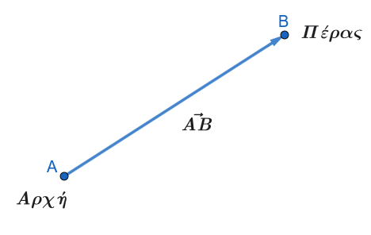{fig-align="center" width="300"}

- **Μηδενικό Διάνυσμα:** Είναι το διάνυσμα του οποίου η αρχή και το πέρας συμπίπτουν (π.χ. $\vec{AA} = \vec{0}$).
  Έχει μέτρο μηδέν και δεν έχει ορισμένη διεύθυνση ή φορά.

- **Μέτρο ή Μήκος Διανύσματος:** Είναι η απόσταση των άκρων του, δηλαδή το μήκος του ευθύγραμμου τμήματος $AB$, και συμβολίζεται με $|\vec{AB}|$.

- **Μοναδιαίο Διάνυσμα:** Ονομάζεται κάθε διάνυσμα που έχει μέτρο ίσο με τη μονάδα ($|\vec{a}| = 1$).

- **Φορέας Διανύσματος:** Είναι η ευθεία πάνω στην οποία βρίσκεται ένα μη μηδενικό διάνυσμα $\vec{AB}$.
  Ως φορέα του μηδενικού διανύσματος μπορούμε να θεωρήσουμε οποιαδήποτε ευθεία διέρχεται από την αρχή του.

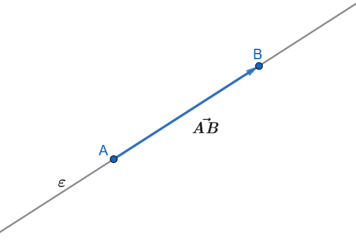{fig-align="center" width="350"}

- **Παράλληλα ή Συγγραμμικά Διανύσματα:** Δύο μη μηδενικά διανύσματα που έχουν τον ίδιο φορέα ή παράλληλους φορείς. Στην περίπτωση αυτή λέμε ότι έχουν την **ίδια διεύθυνση** και γράφουμε $\vec{AB} \parallel \vec{\Gamma\Delta}$.

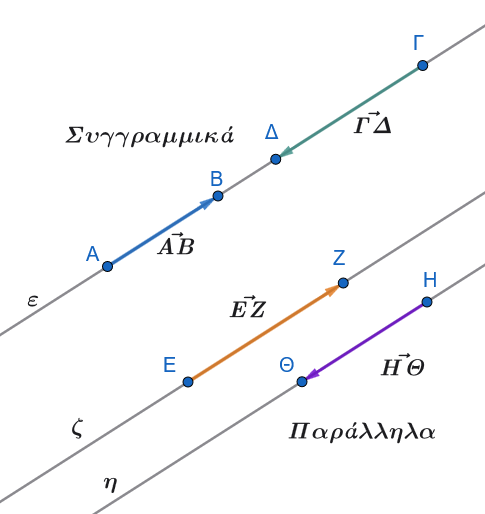{fig-align="center" width="350"}

- **Ομόρροπα Διανύσματα:** Δύο συγγραμμικά διανύσματα $\vec{AB}$ και $\vec{\Gamma\Delta}$ που έχουν την ίδια φορά/κατεύθυνση ($\vec{AB} \uparrow\uparrow \vec{\Gamma\Delta}$). Αυτό συμβαίνει όταν:

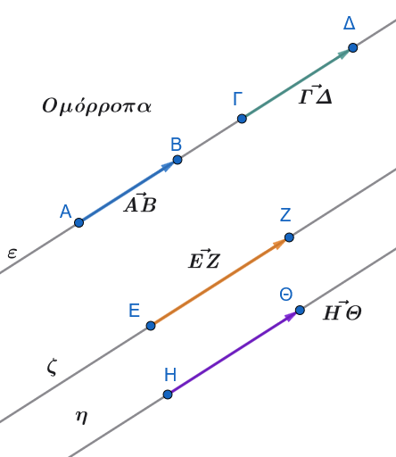{fig-align="center" width="350"}

1.  Έχουν παράλληλους φορείς και βρίσκονται στο ίδιο ημιεπίπεδο ως προς την ευθεία που ενώνει τις αρχές τους $A\Gamma$.

2.  Έχουν τον ίδιο φορέα και μία από τις ημιευθείες $AB$ και $\Gamma\Delta$ περιέχει την άλλη.

- **Αντίρροπα Διανύσματα:** Δύο συγγραμμικά διανύσματα που δεν είναι ομόρροπα, δηλαδή έχουν αντίθετη φορά/κατεύθυνση ($\vec{AB} \uparrow\downarrow \vec{\Gamma\Delta}$).

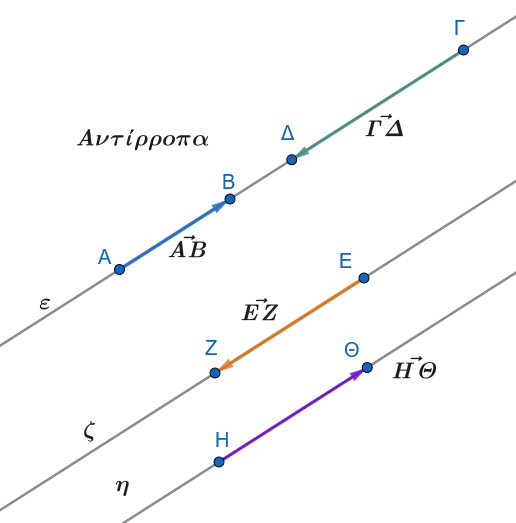{fig-align="center" width="350"}
::::

------------------------------------------------------------------------

### Ίσα Διανύσματα

:::: {.math-box .definition-box}
::: {.math-title .definition-title}
**Ορισμός:**
:::

Δύο μη μηδενικά διανύσματα λέγονται **ίσα** όταν έχουν την ίδια κατεύθυνση (δηλαδή ίδια διεύθυνση και ίδια φορά) και ίσα μέτρα.

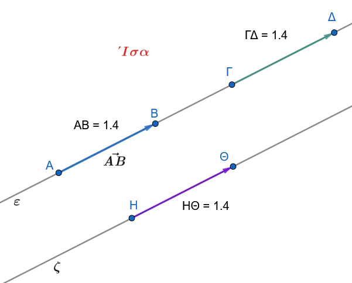{fig-align="center" width="400"}

Γράφουμε $\vec{AB} = \vec{\Gamma\Delta}$.

Τα μηδενικά διανύσματα θεωρούνται ίσα μεταξύ τους.
::::

------------------------------------------------------------------------

:::: {.math-box .property-box}
::: {.math-title .property-title}
**Γεωμετρικές Ιδιότητες:**
:::

1.  Αν $\vec{AB} = \vec{\Gamma\Delta}$, τότε ισχύει $\vec{A\Gamma} = \vec{B\Delta}$, $\vec{\Delta B} = \vec{\Gamma A}$ και $\vec{BA} = \vec{\Delta\Gamma}$.

2.  Αν $M$ είναι το μέσο του ευθύγραμμου τμήματος $AB$, τότε $\vec{AM} = \vec{MB}$ και αντιστρόφως.
::::

:::: {.math-box .propertyproof-box}
::: {.math-title .propertyproof-title}
**Αποδείξεις Γεωμετρικών Ιδιοτήτων**

Για την απόδειξη πρέπει να χρησιμοποιήσουμε πράξεις.

Όταν στα επόμενα μαθήματα θα μάθετε τις πράξεις , επιστρέφετε εδώ να δείτε τις αποδείξεις.
:::

**Μέρος 1: Απόδειξη των ισοτήτων με υπόθεση** $\vec{AB} = \vec{\Gamma\Delta}$

Δίνεται ότι: $$\vec{AB} = \vec{\Gamma\Delta}$$

Θεωρούμε ένα αυθαίρετο σημείο αναφοράς $O$ (αρχή των αξόνων).
Για οποιοδήποτε διάνυσμα $\vec{XY}$, ισχύει: $$\vec{XY} = \vec{OY} - \vec{OX}$$

Επομένως, η δοσμένη σχέση γράφεται: $$\vec{OB} - \vec{OA} = \vec{O\Delta} - \vec{O\Gamma}$$

------------------------------------------------------------------------

**1. Απόδειξη ότι** $\vec{A\Gamma} = \vec{B\Delta}$

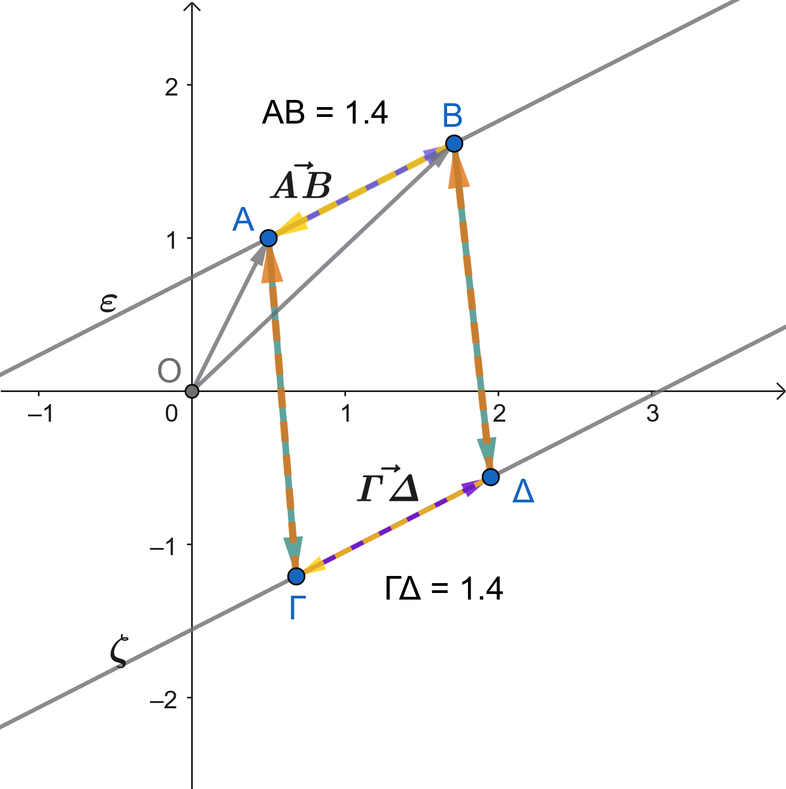{fig-align="center" width="400"}

Αναδιατάσσουμε τους όρους της σχέσης: $$\vec{OB} - \vec{OA} = \vec{O\Delta} - \vec{O\Gamma}$$

Μεταφέρουμε το $\vec{O\Gamma}$ στο αριστερό μέλος και το $\vec{OB}$ στο δεξί μέλος: $$\vec{O\Gamma} - \vec{OA} = \vec{O\Delta} - \vec{OB}$$

Από τον ορισμό των διανυσμάτων θέσης:

- $\vec{O\Gamma} - \vec{OA} = \vec{A\Gamma}$

- $\vec{O\Delta} - \vec{OB} = \vec{B\Delta}$

Άρα: $$\vec{A\Gamma} = \vec{B\Delta}$$

------------------------------------------------------------------------

**2. Απόδειξη ότι** $\vec{\Delta B} = \vec{\Gamma A}$

Πολλαπλασιάζουμε και τα δύο μέλη της προηγούμενης ισότητας $\vec{A\Gamma} = \vec{B\Delta}$ με $-1$: $$-\vec{A\Gamma} = -\vec{B\Delta}$$

Γνωρίζουμε ότι το αντίθετο ενός διανύσματος προκύπτει με αντιστροφή των άκρων του ($-\vec{XY} = \vec{YX}$):

- $-\vec{A\Gamma} = \vec{\Gamma A}$

- $-\vec{B\Delta} = \vec{\Delta B}$

Επομένως: $$\vec{\Gamma A} = \vec{\Delta B} \iff \vec{\Delta B} = \vec{\Gamma A}$$

------------------------------------------------------------------------

**3. Απόδειξη ότι** $\vec{BA} = \vec{\Delta\Gamma}$

Ξεκινώντας απευθείας από την αρχική υπόθεση: $$\vec{AB} = \vec{\Gamma\Delta}$$

Πολλαπλασιάζουμε και τα δύο μέλη με $-1$: $$-\vec{AB} = -\vec{\Gamma\Delta}$$

Επειδή $-\vec{AB} = \vec{BA}$ και $-\vec{\Gamma\Delta} = \vec{\Delta\Gamma}$, έχουμε άμεσα: $$\vec{BA} = \vec{\Delta\Gamma}$$

------------------------------------------------------------------------

**Μέρος 2: Απόδειξη ότι το** $M$ είναι μέσον του $AB \iff \vec{AM} = \vec{MB}$

Η πρόταση είναι ισοδυναμία («και αντιστρόφως»), οπότε αποδεικνύουμε και τις δύο κατευθύνσεις:

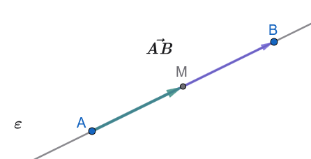{fig-align="center" width="350"}

**Ευθύ (**$\implies$): Αν το $M$ είναι μέσον του $AB$, τότε $\vec{AM} = \vec{MB}$

- Εφόσον το $M$ είναι το μέσον του ευθύγραμμου τμήματος $AB$, βρίσκεται πάνω στην ευθεία $AB$ μεταξύ των $A$ και $B$.
  Συνεπώς, τα διανύσματα $\vec{AM}$ και $\vec{MB}$ έχουν την **ίδια διεύθυνση** (τον ίδιο φορέα).

- Το διάνυσμα $\vec{AM}$ ξεκινά από το $A$ και κατευθύνεται προς το $M$, ενώ το $\vec{MB}$ ξεκινά από το $M$ και κατευθύνεται προς το $B$.
  Άρα έχουν την **ίδια φορά**.

- Επειδή το $M$ είναι μέσον, τα μήκη των τμημάτων είναι ίσα: $(AM) = (MB)$, δηλαδή έχουν **ίσα μέτρα**: $$|\vec{AM}| = |\vec{MB}|$$

Έχοντας ίδια διεύθυνση, ίδια φορά και ίσα μέτρα, τα διανύσματα είναι ίσα: $$\vec{AM} = \vec{MB}$$

**Αντίστροφο (**$\impliedby$): Αν $\vec{AM} = \vec{MB}$, τότε το $M$ είναι μέσον του $AB$

- Από την ισότητα των διανυσμάτων $\vec{AM} = \vec{MB}$, προκύπτει ότι έχουν την ίδια διεύθυνση.
  Επειδή έχουν κοινό σημείο το $M$, τα σημεία $A$, $M$ και $B$ είναι **συνευθειακά**.

- Επειδή έχουν την ίδια φορά, το σημείο $M$ βρίσκεται **ανάμεσα** στα σημεία $A$ και $B$.

- Από την ισότητα των μέτρων τους: $$|\vec{AM}| = |\vec{MB}| \implies (AM) = (MB)$$

Συνεπώς, το σημείο $M$ ισαπέχει από τα άκρα του τμήματος $AB$ και ανήκει σε αυτό, άρα είναι το **μέσον** του $AB$.
::::

------------------------------------------------------------------------

### Αντίθετα Διανύσματα

:::: {.math-box .definition-box}
::: {.math-title .definition-title}
**Ορισμός:**
:::

Δύο διανύσματα λέγονται **αντίθετα** όταν έχουν αντίθετη κατεύθυνση (δηλαδή ίδια διεύθυνση και αντίθετη φορά) και ίσα μέτρα.

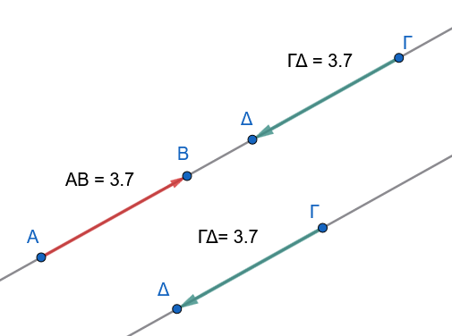{fig-align="center" width="350"}

- **Συμβολισμός & Σχέσεις:**

  - Γράφουμε $\vec{AB} = -\vec{\Gamma\Delta}$ ή $\vec{\Gamma\Delta} = -\vec{AB}$.

  - Ισχύει η ισοδυναμία: $\vec{AB} = -\vec{\Gamma\Delta} \Leftrightarrow \vec{AB} = \vec{\Delta\Gamma}$.

  - Ειδικότερα, για τα άκρα του ίδιου τμήματος ισχύει $\vec{BA} = -\vec{AB}$.
::::

------------------------------------------------------------------------

### Γωνία δύο Διανυσμάτων

:::: {.math-box .definition-box}
::: {.math-title .definition-title}
**Ορισμοί:**
:::

Έστω δύο μη μηδενικά διανύσματα $\vec{a}$ και $\vec{\beta}$.

Με αρχή ένα τυχαίο σημείο $O$, σχεδιάζουμε τα διανύσματα $\vec{OA} = \vec{a}$ και $\vec{OB} = \vec{\beta}$.

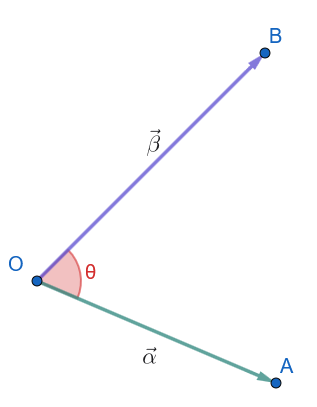{fig-align="center" width="250"}

Την κυρτή γωνία $\widehat{AOB}$ που ορίζουν οι ημιευθείες $OA$ και $OB$ ονομάζουμε **γωνία των διανυσμάτων** $\vec{a}$ και $\vec{\beta}$ και τη συμβολίζουμε με $(\widehat{\vec{a}, \vec{\beta}})$ ή $\theta$.

- **Όρια Γωνίας:** Η γωνία $\theta$ είναι ανεξάρτητη από την επιλογή του σημείου $O$ και ισχύει: $$0^\circ \le \theta \le 180^\circ \quad \text{ή} \quad 0 \le \theta \le \pi$$

  - Αν $\vec{a} \uparrow\uparrow \vec{\beta}$ (ομόρροπα), τότε $\theta = 0^\circ$.

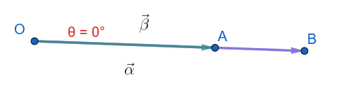{fig-align="center" width="350"}

- Αν $\vec{a} \uparrow\downarrow \vec{\beta}$ (αντίρροπα), τότε $\theta = 180^\circ = \pi$.

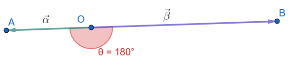{fig-align="center" width="450"}

- **Ορθογώνια ή Κάθετα Διανύσματα:** Αν $\theta = 90^\circ = \dfrac{\pi}{2}$, τότε τα διανύσματα $\vec{a}$ και $\vec{\beta}$ λέγονται **ορθογώνια** ή **κάθετα** και γράφουμε $\vec{a} \perp \vec{\beta}$.

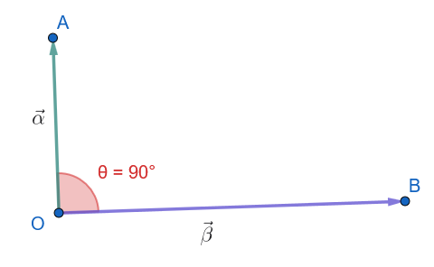{fig-align="center" width="350"}

- **Μηδενικό Διάνυσμα:** Αν ένα από τα διανύσματα είναι το μηδενικό, ως γωνία θεωρούμε οποιαδήποτε γωνία $\theta \in [0, \pi]$.

  Έτσι, το μηδενικό διάνυσμα μπορεί να θεωρηθεί ομόρροπο, αντίρροπο ή κάθετο σε κάθε άλλο διάνυσμα.
::::

------------------------------------------------------------------------

### Ασκήσεις στην Έννοια του Διανύσματος

**Άσκηση 1 (Χαρακτηρισμός Προτάσεων)**

Να χαρακτηρίσετε τις παρακάτω προτάσεις ως Σωστές ($\Sigma$) ή Λανθασμένες ($\Lambda$):

1.  Δύο διανύσματα με ίσα μέτρα είναι υποχρεωτικά ίσα.

2.  Αν $\vec{AB} = \vec{\Gamma\Delta}$, τότε τα ευθύγραμμα τμήματα $AB$ και $\Gamma\Delta$ έχουν ίσα μήκη.

3.  Το μηδενικό διάνυσμα έχει ορισμένη διεύθυνση και φορά.

4.  Αν δύο διανύσματα είναι αντίθετα, τότε έχουν τους ίδιους ή παράλληλους φορείς.

5.  Αν $(\widehat{\vec{a}, \vec{\beta}}) = 0^\circ$, τότε τα διανύσματα $\vec{a}$ και $\vec{\beta}$ είναι αντίρροπα.

**Άσκηση 2 (Διανύσματα σε Παραλληλόγραμμο)**

Δίνεται παραλληλόγραμμο $AB\Gamma\Delta$ με κέντρο (σημείο τομής των διαγωνίων) το $O$.

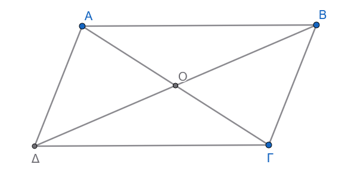{fig-align="center" width="450"}

1.  Να γράψετε όλα τα ζεύγη ίσων διανυσμάτων που σχηματίζονται από τις πλευρές του παραλληλογράμμου.

2.  Να βρείτε το αντίθετο διάνυσμα του $\vec{AO}$ με αρχή το σημείο $C$ ($\Gamma$).

3.  Ποιο διάνυσμα είναι ίσο με το $\vec{BO}$;

**Άσκηση 3 (Έννοια Μέσου Τμήματος)**

Έστω ευθύγραμμο τμήμα $AB$ και $M$ το μέσο του.

1.  Να εξετάσετε αν ισχύουν οι ισότητες: $$\text{α) } \vec{AM} = \vec{MB}, \quad \text{β) } \vec{AM} = \vec{MA}, \quad \text{γ) } |\vec{AM}| = |\vec{MB}|, \quad \text{δ) } \vec{AB} = -\vec{BA}$$

2.  Ποια είναι η σχετική θέση και η φορά των διανυσμάτων $\vec{MA}$ και $\vec{MB}$;

**Άσκηση 4 (Διανύσματα σε Ρόμβο)**

Δίνεται ρόμβος $AB\Gamma\Delta$.

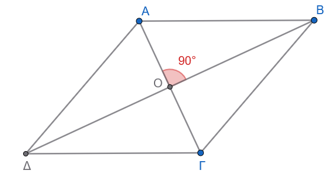{fig-align="center" width="450"}

1.  Είναι τα διανύσματα $\vec{AB}$ και $\vec{B\Gamma}$ ίσα; Να αιτιολογήσετε την απάντησή σας.

2.  Ποια είναι η γωνία των διανυσμάτων $\vec{A\Gamma}$ και $\vec{B\Delta}$;

3.  Υπάρχουν ίσα διανύσματα τα οποία έχουν αρχή ή πέρας το σημείο τομής των διαγωνίων Ο.

**Άσκηση 5 (Διανύσματα σε Κανονικό Εξάγωνο)**

Δίνεται κανονικό εξάγωνο $AB\Gamma\Delta EZ$ με κέντρο $O$.

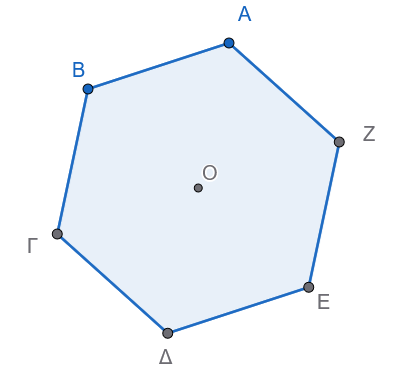{fig-align="center" width="350"}

Να βρείτε όλα τα διανύσματα που έχουν αρχή και πέρας κορυφές του εξαγώνου ή το $O$ και είναι:

α) ίσα με το $\vec{AB}$,

β) αντίθετα του $\vec{B\Gamma}$,

γ) ομόρροπα με το $\vec{AO}$.

**Άσκηση 6 (Συγγραμμικότητα & Μεταβατικότητα)**

Έστω τρία μη μηδενικά διανύσματα $\vec{a}, \vec{\beta}, \vec{\gamma}$.

1.  Αν $\vec{a} \parallel \vec{\beta}$ και $\vec{\beta} \parallel \vec{\gamma}$, τι συμπεραίνετε για τη διεύθυνση των $\vec{a}$ και $\vec{\gamma}$;

2.  Αν $\vec{a} \uparrow\uparrow \vec{\beta}$ και $\vec{\beta} \uparrow\downarrow \vec{\gamma}$, ποια είναι η σχέση κατεύθυνσης μεταξύ $\vec{a}$ και $\vec{\gamma}$;

**Άσκηση 7 (Γεωμετρικός Σχηματισμός Ισότητας)**

Δίνονται τέσσερα σημεία $A, B, \Gamma, \Delta$.

1.  Αν $\vec{AB} = \vec{\Gamma\Delta}$ και τα σημεία $A, B, \Gamma, \Delta$ δεν είναι συνευθειακά, τι είδος τετραπλεύρου είναι το $AB\Delta\Gamma$;

2.  Τι συμβαίνει με τα τμήματα $A\Gamma$ και $B\Delta$ (ποια είναι η σχέση μεταξύ τους);

**Άσκηση 8 (Γωνία Διανυσμάτων σε Ισόπλευρο Τρίγωνο)**

Δίνεται ισόπλευρο τρίγωνο $AB\Gamma$.

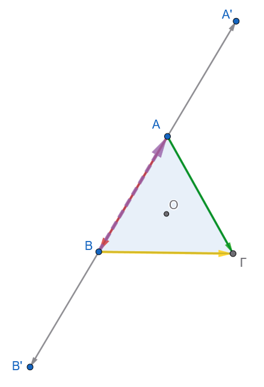{fig-align="center" width="350"}

1.  Να υπολογίσετε τη γωνία των διανυσμάτων: $$\text{α) } (\widehat{\vec{AB}, \vec{A\Gamma}}), \quad \text{β) } (\widehat{\vec{AB}, \vec{B\Gamma}}), \quad \text{γ) } (\widehat{\vec{BA}, \vec{A\Gamma}})$$

**Άσκηση 9 (Γωνία Διανυσμάτων σε Τετράγωνο)**

Δίνεται τετράγωνο $AB\Gamma\Delta$ με κέντρο $O$.
Να βρεθούν οι γωνίες:

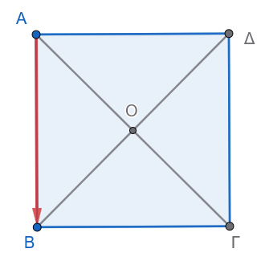{fig-align="center" width="280"}

1.  $(\widehat{\vec{AB}, \vec{A\Delta}})$

2.  $(\widehat{\vec{OA}, \vec{O\Gamma}})$

3.  $(\widehat{\vec{OA}, \vec{OB}})$

4.  $(\widehat{\vec{AB}, \vec{\Delta\Gamma}})$

**Άσκηση 10 (Αναγνώριση Κατεύθυνσης και Μέτρου)**

Δίνονται τα διανύσματα $\vec{a}$ και $\vec{\beta}$ με $|\vec{a}| = 5$ και $|\vec{\beta}| = 5$.

1.  Συνεπάγεται κατ' ανάγκη ότι $\vec{a} = \vec{\beta}$;

2.  Αν επιπλέον δοθεί ότι $\vec{a} \parallel \vec{\beta}$, ποιες είναι οι δυνατές τιμές για τη γωνία $(\widehat{\vec{a}, \vec{\beta}})$;

3.  Σε ποια περίπτωση θα ισχύει $\vec{a} = -\vec{\beta}$;

------------------------------------------------------------------------

## Φύλλο Εργασίας: Εισαγωγή στα Διανύσματα & Γεωμετρικές Ιδιότητες

**Μάθημα:** Μαθηματικά Β' Λυκείου (Προσανατολισμού Θετικών Σπουδών)

**Θεματική Ενότητα:** 1.1 Έννοια του Διανύσματος - Ίσα & Αντίθετα Διανύσματα - Γωνία Διανυσμάτων

------------------------------------------------------------------------

### Θέμα Α: Ερωτήσεις Θεωρίας & Αντικειμενικού Τύπου

#### Α1. Ερωτήσεις Σωστού / Λάθους

Να χαρακτηρίσετε τις παρακάτω προτάσεις ως **Σωστή (Σ)** ή **Λανθασμένη (Λ)**:

1.  Δύο διανύσματα που έχουν ίσα μέτρα είναι πάντα ίσα.

2.  Αν $\vec{AB} = \vec{\Gamma\Delta}$, τότε $A\Gamma = B\Delta$.

3.  Το μηδενικό διάνυσμα είναι κάθετο σε κάθε άλλο διάνυσμα.

4.  Δύο αντίθετα διανύσματα έχουν υποχρεωτικά παράλληλους ή ίδιους φορείς.

5.  Αν η γωνία δύο διανυσμάτων $\vec{a}$ και $\vec{b}$ είναι $180^\circ$, τότε τα διανύσματα είναι ομόρροπα.

6.  Για οποιοδήποτε ευθύγραμμο τμήμα $AB$ ισχύει $\vec{BA} = -\vec{AB}$.

7.  Αν δύο διανύσματα είναι παράλληλα, έχουν υποχρεωτικά την ίδια φορά.

#### Α2. Ερωτήσεις Πολλαπλής Επιλογής

1.  Δίνεται παραλληλόγραμμο $AB\Gamma\Delta$ με κέντρο $O$. Ποιο από τα παρακάτω διανύσματα είναι ίσο με το $\vec{AO}$;

- α) $\vec{O\Gamma}$

- β) $\vec{\Gamma O}$

- γ) $\vec{BO}$

- δ) $\vec{O\Delta}$

2.  Αν για δύο μη μηδενικά διανύσματα $\vec{a}, \vec{b}$ ισχύει $\vec{a} = -\vec{b}$, τότε η γωνία τους $(\widehat{\vec{a}, \vec{b}})$ είναι ίση με:

- α) $0^\circ$

- β) $45^\circ$

- γ) $90^\circ$

- δ) $180^\circ$

------------------------------------------------------------------------

### Θέμα Β: Ασκήσεις Κατανόησης & Γεωμετρικών Σχηματισμών

#### Άσκηση Β1 (Διανύσματα σε Παραλληλόγραμμο)

Δίνεται παραλληλόγραμμο $AB\Gamma\Delta$ με κέντρο (σημείο τομής των διαγωνίων) το $O$.

1.  Να καταγράψετε όλα τα ζεύγη ίσων διανυσμάτων που σχηματίζονται από τις πλευρές του παραλληλογράμμου.

2.  Να βρείτε τα αντίθετα διανύσματα των $\vec{AB}$, $\vec{AO}$ και $\vec{O\Delta}$.

3.  Να δικαιολογήσετε γιατί $\vec{AB} = \vec{\Delta\Gamma}$ ενώ $\vec{AB} \neq \vec{\Gamma\Delta}$.

### Άσκηση Β2 (Διανύσματα σε Κανονικό Εξάγωνο)

Έστω κανονικό εξάγωνο $AB\Gamma\Delta EZ$ με κέντρο $O$.

1.  Να βρείτε όλα τα διανύσματα με αρχή και πέρας τις κορυφές του εξαγώνου ή το κέντρο $O$ που είναι ίσα με το διάνυσμα $\vec{AB}$.

2.  Να βρείτε όλα τα διανύσματα που είναι αντίθετα του $\vec{B\Gamma}$.

3.  Ποια είναι η γωνία των διανυσμάτων $(\widehat{\vec{OA}, \vec{OB}})$ και $(\widehat{\vec{OA}, \vec{O\Delta}})$;

#### Άσκηση Β3 (Διανύσματα σε Ρόμβο & Τετράγωνο)

1.  Δίνεται ρόμβος $AB\Gamma\Delta$.
    Εξετάστε αν ισχύει $\vec{AB} = \vec{B\Gamma}$ και αιτιολογήστε την απάντησή σας.

2.  Αν το $AB\Gamma\Delta$ είναι τετράγωνο με κέντρο $O$, υπολογίστε τις γωνίες:

- α) $(\widehat{\vec{AB}, \vec{A\Delta}})$

- β) $(\widehat{\vec{OA}, \vec{O\Gamma}})$

- γ) $(\widehat{\vec{OA}, \vec{OB}})$

------------------------------------------------------------------------

### Θέμα Γ: Σύνθετες Ασκήσεις & Γεωμετρικές Αποδείξεις

#### Άσκηση Γ1 (Κατασκευή & Ισότητα Διανυσμάτων)

Δίνεται τρίγωνο $AB\Gamma$ και $M$ το μέσο της πλευράς $A\Gamma$.
Θεωρούμε τα σημεία $\Delta$ και $E$ τέτοια ώστε $\vec{M\Delta} = \vec{\Gamma B}$ και $\vec{ME} = \vec{BA}$.

1.  Να σχεδιάσετε το αντίστοιχο γεωμετρικό σχήμα.

2.  Να αποδείξετε ότι το σημείο $A$ είναι το μέσο του ευθύγραμμου τμήματος $\Delta E$.

#### Άσκηση Γ2 (Γωνίες σε Ισόπλευρο Τρίγωνο)

Δίνεται ισόπλευρο τρίγωνο $AB\Gamma$.

1.  Να υπολογίσετε τις γωνίες των διανυσμάτων:

- α) $(\widehat{\vec{AB}, \vec{A\Gamma}})$

- β) $(\widehat{\vec{AB}, \vec{B\Gamma}})$

- γ) $(\widehat{\vec{BA}, \vec{A\Gamma}})$

------------------------------------------------------------------------

### Αναλυτικές Απαντήσεις & Λύσεις

#### Απαντήσεις Θέματος Α

- **Α1:**

  1.  **Λάθος** (Πρέπει να έχουν και την ίδια κατεύθυνση).

  2.  **Σωστό** (Από την ιδιότητα του παραλληλογράμμου $AB\Delta\Gamma$).

  3.  **Σωστό** (Σύμφωνα με τον ορισμό, το μηδενικό διάνυσμα θεωρείται κάθετο σε κάθε διάνυσμα).

  4.  **Σωστό** (Αφού έχουν αντίθετη φορά, είναι συγγραμμικά).

  5.  **Λάθος** (Όταν η γωνία είναι $180^\circ$, τα διανύσματα είναι αντίρροπα).

  6.  **Σωστό** (Έχουν ίδιο μέτρο, ίδια διεύθυνση και αντίθετη φορά).

  7.  **Λάθος** (Μπορεί να είναι και αντίρροπα).

- **Α2:**

  1.  **α)** $\vec{O\Gamma}$ (Διότι το $O$ είναι μέσο της διαγωνίου $A\Gamma$).

  2.  **δ)** $180^\circ$ (Τα αντίθετα διανύσματα έχουν αντίθετη φορά).

------------------------------------------------------------------------

#### Λύσεις Θέματος Β

- **Άσκηση Β1:**

  1.  Ίσα ζεύγη πλευρών: $$\vec{AB} = \vec{\Delta\Gamma}, \quad \vec{BA} = \vec{\Gamma\Delta}, \quad \vec{A\Delta} = \vec{B\Gamma}, \quad \vec{\Delta A} = \vec{\Gamma B}$$

  2.  Αντίθετα:

  - $-\vec{AB} = \vec{BA} = \vec{\Gamma\Delta}$

  - $-\vec{AO} = \vec{OA} = \vec{O\Gamma}$

  - $-\vec{O\Delta} = \vec{\Delta O} = \vec{OB}$

  3.  Το $\vec{AB}$ είναι ίσο με το $\vec{\Delta\Gamma}$ διότι έχουν την ίδια φορά (από αριστερά προς τα δεξιά στη βάση).

  Το $\vec{\Gamma\Delta}$ έχει την αντίθετη φορά, οπότε $\vec{AB} = -\vec{\Gamma\Delta}$.

- **Άσκηση Β2:**

  1.  Ίσα με το $\vec{AB} \quad$: $\vec{EO}$, $\vec{O\Delta}$, $\vec{Z\Gamma}$.

  2.  Αντίθετα του $\vec{B\Gamma} \quad$: $\vec{\Gamma B}$, $\vec{E Z}$, $\vec{O A}$, $\vec{\Delta O}$.

  3.  Γωνίες:

  - $(\widehat{\vec{OA}, \vec{OB}}) = 60^\circ$ (αφού τα τρίγωνα του κανονικού εξαγώνου είναι ισόπλευρα).

  - $(\widehat{\vec{OA}, \vec{O\Delta}}) = 180^\circ$ (αφού $A, O, \Delta$ είναι συνευθειακά και τα διανύσματα αντίρροπα).

- **Άσκηση Β3:**

  1.  Στον ρόμβο ισχύει $(AB) = (B\Gamma)$ (ίσα μέτρα), αλλά οι φορείς $AB$ και $B\Gamma$ τέμνονται στη κορυφή $B$, άρα δεν είναι παράλληλοι.
      Συνεπώς $\vec{AB} \neq \vec{B\Gamma}$.

  2.  Στο τετράγωνο:

  - α) $(\widehat{\vec{AB}, \vec{A\Delta}}) = 90^\circ$ (ορθή γωνία τετραγώνου).

  - β) $(\widehat{\vec{OA}, \vec{O\Gamma}}) = 180^\circ$ (αντίρροπα διανύσματα στη διαγώνιο).

  - γ) $(\widehat{\vec{OA}, \vec{OB}}) = 90^\circ$ (οι διαγώνιοι τετραγώνου τέμνονται κάθετα).

------------------------------------------------------------------------

#### Λύσεις Θέματος Γ

- **Άσκηση Γ1:**

  - **Απόδειξη:**

  Από την υπόθεση έχουμε $\vec{M\Delta} = \vec{\Gamma B} \quad$ (1) και $\vec{ME} = \vec{BA} \quad$ (2).

  Επειδή το $M$ είναι μέσο του $A\Gamma$, ισχύει $\vec{AM} = \vec{M\Gamma} \quad$ (3).

  Από τη σχέση (1), επειδή $\vec{M\Delta} = \vec{\Gamma B}$, το τετράπλευρο $M\Delta B\Gamma$ είναι παραλληλόγραμμο, άρα: $$\vec{M\Gamma} = \vec{\Delta B}$$

  Από τη σχέση (3) προκύπτει ότι $\vec{AM} = \vec{\Delta B}$, οπότε το τετράπλευρο $AMB\Delta$ είναι παραλληλόγραμμο.

  Συνεπώς: $$\vec{\Delta A} = \vec{BM} \quad (4)$$

  Όμοια, από τη σχέση (2) $\vec{ME} = \vec{BA}$, το τετράπλευρο $AEBM$ είναι παραλληλόγραμμο, οπότε: $$\vec{AE} = \vec{MB} \quad (5)$$

  Επειδή $\vec{BM} = -\vec{MB}$, από τις (4) και (5) προκύπτει ότι: $$\vec{\Delta A} = \vec{AE}$$

  Άρα, τα διανύσματα $\vec{\Delta A}$ και $\vec{AE}$ είναι ίσα, πράγμα που σημαίνει ότι τα σημεία $\Delta, A, E$ είναι συνευθειακά και $(\Delta A) = (AE)$.

  Επομένως, το $A$ είναι το μέσο του ευθύγραμμου τμήματος $\Delta E$.

- **Άσκηση Γ2:**

  - **α)** $(\widehat{\vec{AB}, \vec{A\Gamma}}) = 60^\circ$ (εσωτερική γωνία ισόπλευρου τριγώνου με κοινή αρχή το $A$).

  - **β)** Για τη γωνία $(\widehat{\vec{AB}, \vec{B\Gamma}})$, μεταφέρουμε το $\vec{AB}$ ώστε να έχει κοινή αρχή με το $\vec{B\Gamma}$ το σημείο $B$ (προέκταση της $AB$).
    Η σχηματιζόμενη γωνία είναι παραπληρωματική της εσωτερικής γωνίας του τριγώνου: $$180^\circ - 60^\circ = 120^\circ$$

  - **γ)** $(\widehat{\vec{BA}, \vec{A\Gamma}})$: Το $\vec{BA}$ έχει πέρας το $A$ και το $\vec{A\Gamma}$ αρχή το $A$.
    Μεταφέροντας το $\vec{BA}$ στην προέκτασή του πέραν του $A$, η γωνία είναι: $$180^\circ - 60^\circ = 120^\circ$$

------------------------------------------------------------------------

:::: callout-sos
::: {.callout-sos .callout-title}
Εύχομαι
:::

ΚΑΛΗ ΜΕΛΕΤΗ!
::::
