```{=html}
<!-- Φόρτωση βιβλιοθήκης GeoGebra -->
<script src="https://www.geogebra.org/apps/deployggb.js"></script>

<!-- Συνάρτηση δημιουργίας applets -->
<script>
function createGeoGebra(containerId, materialId, width = 700, height = 500) {
  var params = {
    "id": "ggb-" + containerId,
    "material_id": materialId,
    "width": width,
    "height": height,
    "showToolBar": true,
    "showMenuBar": false,
    "showAlgebraInput": true
  };
  
  var applet = new GGBApplet(params, '5.2');
  applet.inject(containerId);
}
</script>
```

## Πρόσθεση Και Αφαίρεση Διανυσμάτων

------------------------------------------------------------------------

### Πρόσθεση Διανυσμάτων

:::: {.math-box .definition-box}
::: {.math-title .definition-title}
**Ορισμός & Μέθοδος (Κανόνας Τριγώνου):**
:::

Έστω δύο διανύσματα $\vec{a}$ και $\vec{β}$.

Με αρχή ένα τυχαίο σημείο $O$, σχεδιάζουμε το διάνυσμα $\vec{OA} = \vec{a}$ και στη συνέχεια, με αρχή το πέρας $A$, σχεδιάζουμε το διάνυσμα $\vec{AB} = \vec{β}$.

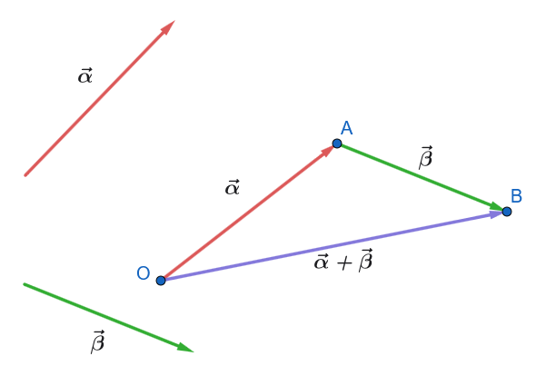{fig-align="center" width="400"}

Το διάνυσμα $\vec{OB}$ ορίζεται ως το **άθροισμα** των διανυσμάτων $\vec{a}$ και $\vec{b}$ και συμβολίζεται με $\vec{a} + \vec{β}$: $$\vec{a} + \vec{β} = \vec{OA} + \vec{AB} = \vec{OB}$$

*(Σχέση Chasles:* $\vec{OA} + \vec{AB} = \vec{OB}$)

- **Κανόνας Παραλληλογράμμου:** Αν σχεδιάσουμε τα διανύσματα $\vec{a}$ και $\vec{β}$ με κοινή αρχή $O$, δηλαδή $\vec{OA} = \vec{a}$ και $\vec{OΓ} = \vec{β}$, τότε το άθροισμα $\vec{a} + \vec{β}$ παριστάνεται από τη διαγώνιο $\vec{OB}$ του παραλληλογράμμου $OABΓ$ που έχει προσκείμενες πλευρές τις $OA$ και $OΓ$.

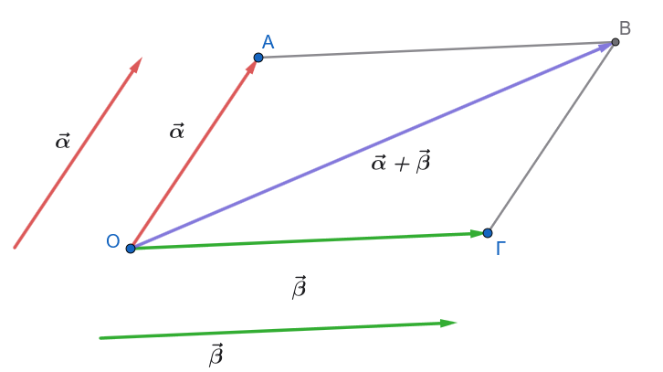{fig-align="center" width="450"}
::::

------------------------------------------------------------------------

- **Απόδειξη ότι το άθροισμα είναι ανεξάρτητο της επιλογής του σημείου** $O$:

:::: {.math-box .theorem-box}
::: {.math-title .theorem-title}
**Υπόθεση:**
:::

Έστω $O$ και $O'$ δύο διαφορετικά σημεία αναφοράς στο επίπεδο.

- Με αρχή το $O$, σχεδιάζουμε $\vec{OA} = \vec{a}$ και $\vec{AM} = \vec{β}$, οπότε $\vec{OM} = \vec{a} + \vec{β}$.

- Με αρχή το $O'$, σχεδιάζουμε $\vec{O'A'} = \vec{a}$ και $\vec{A'M'} = \vec{β}$, οπότε $\vec{O'M'} = \vec{a} + \vec{β}$.
::::

:::: {.math-box .apodeixi-box}
::: {.math-title .apodeixi-title}
**Απόδειξη:**

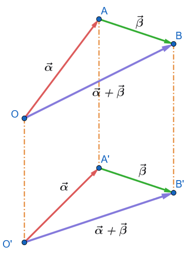{fig-align="center" width="300"}
:::

1.  Επειδή $\vec{OA} = \vec{O'A'} = \vec{a}$, τα διανύσματα αυτά είναι ίσα, οπότε το τετράπλευρο $OO'A'A$ είναι παραλληλόγραμμο (ή ισχύει $\vec{OO'} = \vec{AA'}$).

2.  Επειδή $\vec{AΒ} = \vec{A'Β'} = \vec{β}$, ισχύει $\vec{AA'} = \vec{ΒΒ'}$.

3.  Από τις δύο παραπάνω ισότητες προκύπτει ότι $\vec{OO'} = \vec{ΒΒ'}$, που σημαίνει ότι και το τετράπλευρο $OO'Β'Β$ είναι παραλληλόγραμμο.

4.  Συνεπώς, $\vec{OΒ} = \vec{O'Β'}$, δηλαδή το διάνυσμα του αθροίσματος είναι μοναδικό και εντελώς ανεξάρτητο από τη θέση της αρχής $O$.
::::

------------------------------------------------------------------------

### Ιδιότητες Πρόσθεσης Διανυσμάτων & Αποδείξεις

Για οποιαδήποτε διανύσματα $\vec{a}, \vec{β}, \vec{\gamma}$ ισχύουν οι εξής ιδιότητες:

:::: {.math-box .property-box}
::: {.math-title .property-title}
1.  **Αντιμεταθετική Ιδιότητα:**
:::

$$\vec{a} + \vec{β} = \vec{β} + \vec{a}$$
::::

:::: {.math-box .propertyproof-box}
::: {.math-title .propertyproof-title}
**Απόδειξη:**

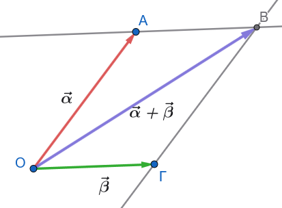{fig-align="center" width="350"}
:::

Θεωρούμε παραλληλόγραμμο $OABΓ$ με $\vec{OA} = \vec{a}$ και $\vec{OΓ} = \vec{β}$.
Τότε οι απέναντι πλευρές είναι ίσες διανυσματικά: $\vec{ΓB} = \vec{OA} = \vec{a}$ και $\vec{AB} = \vec{OΓ} = \vec{β}$.

- Από το τρίγωνο $OAB$: $\quad \vec{a} + \vec{β} = \vec{OA} + \vec{AB} = \vec{OB}$.

- Από το τρίγωνο $OΓB$: $\quad \vec{β} + \vec{a} = \vec{OΓ} + \vec{ΓB} = \vec{OB}$.

Άρα $\vec{a} + \vec{β} = \vec{β} + \vec{a}$.
::::

------------------------------------------------------------------------

:::: {.math-box .property-box}
::: {.math-title .property-title}
2.  **Προσεταιριστική Ιδιότητα:**
:::

$$(\vec{a} + \vec{β}) + \vec{\gamma} = \vec{a} + (\vec{β} + \vec{\gamma})$$
::::

:::: {.math-box .propertyproof-box}
::: {.math-title .propertyproof-title}
**Απόδειξη:**
:::

Με αρχή ένα σημείο $O$, παίρνουμε τα διαδοχικά διανύσματα $\vec{OA} = \vec{a}$, $\vec{AB} = \vec{β}$ και $\vec{B\Gamma} = \vec{\gamma}$.

- Πρώτο μέλος: $(\vec{a} + \vec{β}) + \vec{\gamma} = (\vec{OA} + \vec{AB}) + \vec{B\Gamma} = \vec{OB} + \vec{B\Gamma} = \vec{O\Gamma}$.

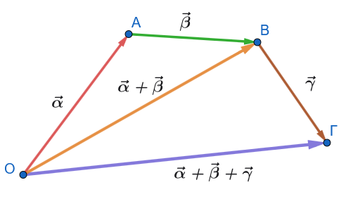{fig-align="center" width="350"}

- Δεύτερο μέλος: $\vec{a} + (\vec{β} + \vec{\gamma}) = \vec{OA} + (\vec{AB} + \vec{B\Gamma}) = \vec{OA} + \vec{A\Gamma} = \vec{O\Gamma}$.

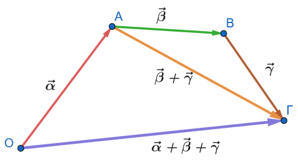{fig-align="center" width="350"}

Άρα $(\vec{a} + \vec{β}) + \vec{\gamma} = \vec{a} + (\vec{β} + \vec{\gamma})$.
::::

------------------------------------------------------------------------

:::: {.math-box .property-box}
::: {.math-title .property-title}
3.  **Ύπαρξη Ουδέτερου Στοιχείου:**
:::

$$\vec{a} + \vec{0} = \vec{a}$$

*(Το μηδενικό διάνυσμα* $\vec{0}$ είναι το ουδέτερο στοιχείο της πρόσθεσης).
::::

------------------------------------------------------------------------

:::: {.math-box .property-box}
::: {.math-title .property-title}
4.  **Ύπαρξη Αντίθετου Στοιχείου:**
:::

$$\vec{a} + (-\vec{a}) = \vec{0}$$

*(Για κάθε διάνυσμα* $\vec{a}$, υπάρχει το αντίθετό του $-\vec{a}$ με $\vec{a} + (-\vec{a}) = \vec{0}$).
::::

------------------------------------------------------------------------

:::: {.math-box .lemma-box}
::: {.math-title .lemma-title}
**Πολυγωνικός Κανόνας (Πρόσθεση** $n$ Διανυσμάτων):

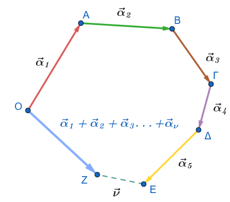{fig-align="center" width="350"}
:::

Για να προσθέσουμε $n$ διανύσματα $\vec{a}_1, \vec{a}_2, \dots, \vec{a}_n$, τα τοποθετούμε διαδοχικά.

Το άθροισμά τους είναι το διάνυσμα που έχει αρχή την αρχή του πρώτου και πέρας το πέρας του τελευταίου:

$$\vec{ΟA} + \vec{AΒ} + \vec{ΒΓ}+\vec{ΓΔ}+\dots   = \vec{ΟΖ}$$
::::

------------------------------------------------------------------------

### Αφαίρεση Διανυσμάτων

:::: {.math-box .definition-box}
::: {.math-title .definition-title}
**Ορισμός:**
:::

Η **διαφορά** $\vec{a} - \vec{β}$ του διανύσματος $\vec{β}$ από το διάνυσμα $\vec{a}$ ορίζεται ως το άθροισμα του διανύσματος $\vec{a}$ με το αντίθετο του $\vec{β}$: $$\vec{a} - \vec{β} = \vec{a} + (-\vec{β})$$
::::

------------------------------------------------------------------------

:::: {.math-box .proposal-box}
::: {.math-title .proposal-title}
- **Απόδειξη Μοναδικότητας της Λύσης Εξίσωσης:**

**Πρόταση:**
:::

Για οποιαδήποτε διανύσματα $\vec{a}$ και $\vec{β}$, υπάρχει **μοναδικό** διάνυσμα $\vec{x}$ τέτοιο ώστε $\vec{β} + \vec{x} = \vec{a}$.
::::

:::: {.math-box .proposalproof-box}
::: {.math-title .proposalproof-title}
**Απόδειξη:**
:::

$$\vec{β} + \vec{x} = \vec{a} \iff (-\vec{β}) + (\vec{β} + \vec{x}) = (-\vec{β}) + \vec{a}$$ $$\iff ((-\vec{β}) + \vec{β}) + \vec{x} = \vec{a} + (-\vec{β})$$ $$\iff \vec{0} + \vec{x} = \vec{a} + (-\vec{β})$$ $$\iff \vec{x} = \vec{a} - \vec{β}$$

Εφόσον κάθε βήμα είναι ισοδύναμο, η λύση $\vec{x} = \vec{a} - \vec{β}$ υπάρχει και είναι **μοναδική**.
::::

------------------------------------------------------------------------

:::: {.math-box .lemma-box}
::: {.math-title .lemma-title}
- **Γεωμετρικός Κανόνας Αφαίρεσης:**

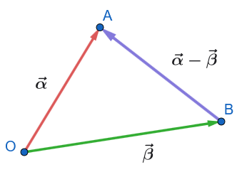{fig-align="center" width="280"}
:::

Αν κατασκευάσουμε τα διανύσματα $\vec{a}$ και $\vec{β}$ με κοινή αρχή $O$, δηλαδή $\vec{OA} = \vec{a}$ και $\vec{OB} = \vec{β}$, τότε η διαφορά $\vec{a} - \vec{β}$ παριστάνεται από το διάνυσμα $\vec{BA}$ (από το πέρας του αφαιρετέου προς το πέρας του μειωτέου): $$\vec{OA} - \vec{OB} = \vec{BA}$$
::::

------------------------------------------------------------------------

### Διάνυσμα Θέσεως & Σημείο Αναφοράς

:::: {.math-box .definition-box}
::: {.math-title .definition-title}
- **Ορισμός Σημείου Αναφοράς & Διανύσματος Θέσεως:**
:::

- Έστω $O$ ένα σταθερό σημείο του επιπέδου ή του χώρου, το οποίο ονομάζεται **σημείο αναφοράς**.

- Για κάθε σημείο $M$, το διάνυσμα $\vec{OM}$ ονομάζεται **διάνυσμα θέσεως** ή **διανυσματική ακτίνα** του σημείου $M$ ως προς το σημείο αναφοράς $O$.
::::

------------------------------------------------------------------------

:::: {.math-box .definition-box}
::: {.math-title .definition-title}
- **Βασική Πρόταση Αναλύσεως Διανύσματος:**

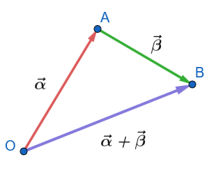{fig-align="center" width="250"}
:::

Για οποιοδήποτε διάνυσμα $\vec{AB}$ και τυχαίο σημείο αναφοράς $O$, ισχύει: $$\vec{OA} + \vec{AB} = \vec{OB} \iff \vec{AB} = \vec{OB} - \vec{OA}$$

> **«Κάθε διάνυσμα ισούται με τη διανυσματική ακτίνα του πέρατος μείον τη διανυσματική ακτίνα της αρχής»**.
::::

------------------------------------------------------------------------

### Μέτρο Αθροίσματος Διανυσμάτων

:::: {.math-box .definition-box}
::: {.math-title .definition-title}
**Τριγωνική Ανισότητα Διανυσμάτων:**
:::

Για οποιαδήποτε διανύσματα $\vec{a}$ και $\vec{β}$, ισχύει η διπλή ανισότητα: $$||\vec{a}| - |\vec{β}|| \le |\vec{a} + \vec{β}| \le |\vec{a}| + |\vec{β}|$$

**Συνθήκες Ισότητας:**

1.  **Δεξιά ισότητα:** $|\vec{a} + \vec{β}| = |\vec{a}| + |\vec{β}|$ ισχύει αν και μόνο αν τα διανύσματα $\vec{a}$ και $\vec{β}$ είναι **ομόρροπα** ($\vec{a} \uparrow\uparrow \vec{β}$).

2.  **Αριστερή ισότητα:** $|\vec{a} + \vec{β}| = ||\vec{a}| - |\vec{β}||$ ισχύει αν και μόνο αν τα διανύσματα $\vec{a}$ και $\vec{b}$ είναι **αντίρροπα** ($\vec{a} \uparrow\downarrow \vec{β}$).
::::

------------------------------------------------------------------------

### Εφαρμογές

:::: {.math-box .example-box}
::: {.math-title .example-title}
**Εφαρμογή 1: Σχέση Chasles & Απλοποίηση Διανυσματικών Σχέσεων**

**Εκφώνηση:**
:::

Δίνεται τυχαίο τετράπλευρο $AB\Gamma\Delta$.

1.  Να αποδείξετε ότι για οποιοδήποτε σημείο αναφοράς $O$ ισχύει η ισότητα: $$\vec{AB} + \vec{\Gamma\Delta} = \vec{A\Delta} + \vec{\Gamma B}$$

2.  Αν για τα σημεία $A, B, \Gamma, \Delta, M$ ισχύει η σχέση $\vec{AM} + \vec{\Gamma\Delta} = \vec{A\Delta} + \vec{BM}$, να αποδείξετε ότι τα σημεία $B$ και $\Gamma$ συμπίπτουν.
::::

:::: {.math-box .examplesolution-box}
::: {.math-title .examplesolution-title}
**Λύση:**
:::

1.  **1ος Τρόπος (με διανύσματα θέσεως):**

Εκφράζουμε κάθε διάνυσμα ως διαφορά διανυσματικών ακτινών ως προς το σημείο αναφοράς $O$ ($\vec{XY} = \vec{OY} - \vec{OX}$):

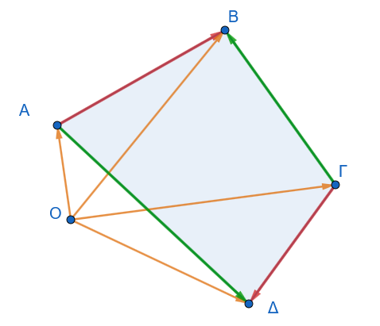{fig-align="center" width="350"}

$$\vec{AB} + \vec{\Gamma\Delta} = (\vec{OB} - \vec{OA}) + (\vec{O\Delta} - \vec{O\Gamma})$$

Αναδιατάσσουμε τους όρους στο δεύτερο μέλος: $$\vec{AB} + \vec{\Gamma\Delta} = (\vec{O\Delta} - \vec{OA}) + (\vec{OB} - \vec{O\Gamma}) = \vec{A\Delta} + \vec{\Gamma B}$$

**2ος Τρόπος (με σχέση Chasles):**

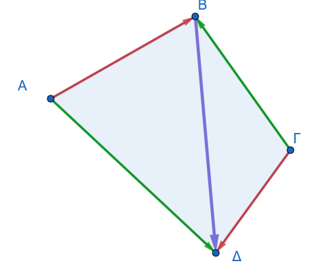{fig-align="center" width="350"}

Από το παραπάνω σχήμα βλέπουμε ότι: $$\vec{BΔ} = \vec{ΑΔ} - \vec{Α B} \quad  \text{ και } \quad \vec{BΔ} = \vec{ΓΔ}- \vec{ΓΒ}$$

Άρα: $$\vec{AΔ} - \vec{ΑΒ} = \vec{ΓΔ} - \vec{Γ B}$$

Αναδιατάσσουμε τους όρους: $$\vec{AΔ} + \vec{ΓΒ} = \vec{AΒ} + \vec{ΓΔ}$$
::::

------------------------------------------------------------------------

### Ασκήσεις στην Πρόσθεση, Αφαίρεση & Διάνυσμα Θέσεως

#### **Ομάδα Α: Απλοποίηση Παραστάσεων & Σχέση Chasles**

1.  **Άσκηση 1:** Να απλοποιήσετε τις παρακάτω διανυσματικές παραστάσεις:

    - α) $\vec{u} = \vec{AB} + \vec{B\Gamma} + \vec{\Gamma\Delta}$

    - β) $\vec{v} = \vec{A\Gamma} - \vec{B\Gamma} + \vec{BA}$

    - γ) $\vec{w} = \vec{AB} - \vec{A\Delta} + \vec{\Gamma\Delta} - \vec{\Gamma B}$

2.  **Άσκηση 2:** Δίνεται τετράπλευρο $AB\Gamma\Delta$.
    Να αποδείξετε ότι: $$\vec{AB} + \vec{\Gamma\Delta} = \vec{A\Delta} + \vec{\Gamma B}$$

3.  **Άσκηση 3:** Για πέντε τυχαία σημεία $A, B, \Gamma, \Delta, E$, να αποδείξετε ότι: $$\vec{AB} + \vec{B\Gamma} + \vec{\Gamma\Delta} + \vec{\Delta E} + \vec{EA} = \vec{0}$$

------------------------------------------------------------------------

#### **Ομάδα Β: Χρήση Σημείου Αναφοράς & Διανύσματος Θέσεως**

4.  **Άσκηση 4:** Έστω $O$ τυχαίο σημείο αναφοράς και σημεία $A, B, \Gamma, \Delta$. Να αποδείξετε ότι:

$$\vec{AB} + \vec{\Gamma\Delta} = (\vec{OB} - \vec{OA}) + (\vec{O\Delta} - \vec{O\Gamma})$$

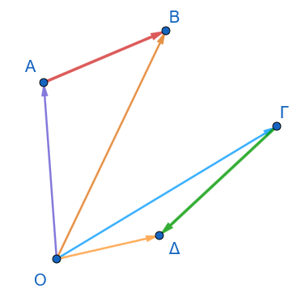{fig-align="center" width="280"}

:::: my-callout-theory
::: {.my-callout-theory .callout-title}
Υπόδειξη
:::

Εξ ορισμού $\vec{OB} - \vec{OA}=\vec{AB}$ .............................
::::

5.  **Άσκηση 5:** Δίνεται παραλληλόγραμμο $AB\Gamma\Delta$ με κέντρο $O$. Να αποδείξετε ότι για τυχαίο σημείο $M$ του επιπέδου ισχύει:

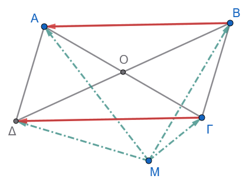{fig-align="center" width="350"}

$$\vec{MA} + \vec{M\Gamma} = \vec{MB} + \vec{M\Delta}$$

:::: my-callout-theory
::: {.my-callout-theory .callout-title}
Υπόδειξη
:::

$$\vec{MA} + \vec{M\Gamma} = \vec{MB} + \vec{M\Delta} \overset{αναδιατάσουμε}{\implies} \vec{ΜΑ} - \vec{ΜΒ} =\vec{ΜΔ} - \vec{ΜΓ} \implies .....................$$
::::

6.  **Άσκηση 6:** Αν $O$ είναι το κέντρο παραλληλογράμμου $AB\Gamma\Delta$, να αποδείξετε ότι:

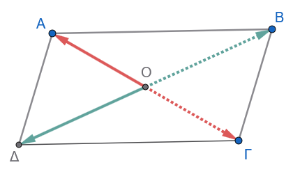{fig-align="center" width="350"}

$$\vec{OA} + \vec{OB} + \vec{O\Gamma} + \vec{O\Delta} = \vec{0}$$

------------------------------------------------------------------------

#### **Ομάδα Γ: Μέτρο Αθροίσματος & Ανισότητες**

7.  **Άσκηση 7:** Δίνονται διανύσματα $\vec{a}$ και $\vec{b}$ με μέτρα $|\vec{a}| = 3$ και $|\vec{b}| = 4$.

- α) Να βρείτε τα όρια (ελάχιστη και μέγιστη τιμή) του μέτρου $|\vec{a} + \vec{b}|$.

- β) Σε ποια περίπτωση ισχύει $|\vec{a} + \vec{b}| = 7$;

- γ) Σε ποια περίπτωση ισχύει $|\vec{a} + \vec{b}| = 1$;

------------------------------------------------------------------------

:::: {.math-box .exercise-box}
::: {.math-title .exercise-title}
8.  **Άσκηση 8:**
:::

Αν για τα μη μηδενικά διανύσματα $\vec{a}$ και $\vec{b}$ ισχύει $|\vec{a} + \vec{b}| = |\vec{a} - \vec{b}|$, να αποδείξετε γεωμετρικά (με χρήση παραλληλογράμμου) ότι τα διανύσματα $\vec{a}$ και $\vec{b}$ είναι κάθετα ($\vec{a} \perp \vec{b}$).
::::

:::: {.math-box .solution-box}
::: {.math-title .solution-title}
Γεωμετρική Απόδειξη με Χρήση Παραλληλογράμμου

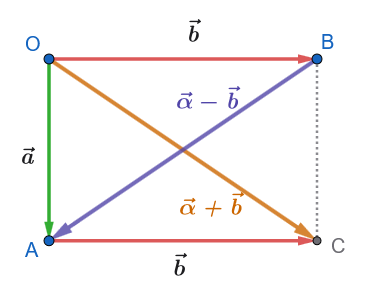{fig-align="center" width="260"}
:::

Θεωρούμε ένα σημείο αναφοράς $O$ και σχεδιάζουμε τα μη μηδενικά διανύσματα $\vec{a}$ και $\vec{b}$ με κοινή αρχή το $O$: $$\vec{OA} = \vec{a} \quad \text{και} \quad \vec{OB} = \vec{b}$$

Ολοκληρώνουμε το παραλληλόγραμμο $OACB$, ορίζοντας το σημείο $C$ τέτοιο ώστε: $$\vec{AC} = \vec{OB} = \vec{b}$$

------------------------------------------------------------------------

**1. Έκφραση των διαγωνίων του παραλληλογράμμου**

- **Κύρια διαγώνιος** $\vec{OC}$ (Άθροισμα):

  Από τον κανόνα του τριγώνου στο $\triangle OAC$: $$\vec{OC} = \vec{OA} + \vec{AC} = \vec{a} + \vec{b}$$

  Συνεπώς, το μήκος της διαγωνίου $OC$ είναι: $$(OC) = |\vec{OC}| = |\vec{a} + \vec{b}|$$

- **Δευτερεύουσα διαγώνιος** $\vec{BA}$ (Διαφορά):

  Από τη διανυσματική αφαίρεση (ή τον κανόνα του τριγώνου στο $\triangle OBA$): $$\vec{BA} = \vec{OA} - \vec{OB} = \vec{a} - \vec{b}$$

  Συνεπώς, το μήκος της διαγωνίου $BA$ είναι: $$(BA) = |\vec{BA}| = |\vec{a} - \vec{b}|$$

------------------------------------------------------------------------

**2. Συσχέτιση με τη δοσμένη υπόθεση**

Δίνεται ότι: $$|\vec{a} + \vec{b}| = |\vec{a} - \vec{b}|$$

Αντικαθιστώντας τα μήκη των διαγωνίων: $$(OC) = (BA)$$

Δηλαδή, οι διαγώνιοι του παραλληλογράμμου $OACB$ είναι **ίσες**.

------------------------------------------------------------------------

**3. Συμπέρασμα**

Από τη Γεωμετρία γνωρίζουμε ότι:

> > *Ένα παραλληλόγραμμο με ίσες διαγώνιους είναι **ορθογώνιο**.*

Επομένως, όλες οι γωνίες του $OACB$ είναι ορθές, ειδικότερα: $$\widehat{AOB} = 90^\circ$$

Εφόσον η γωνία μεταξύ των διανυσμάτων $\vec{OA} = \vec{a}$ και $\vec{OB} = \vec{b}$ είναι ορθή, προκύπτει άμεσα ότι: $$\vec{a} \perp \vec{b}$$
::::

------------------------------------------------------------------------

9.  **Άσκηση 9:** Αν για τα διανύσματα $\vec{a}, \vec{b}, \vec{\gamma}$ ισχύει $\vec{a} + \vec{b} + \vec{\gamma} = \vec{0}$, να αποδείξετε ότι: $$|\vec{a}| \le |\vec{b}| + |\vec{\gamma}|$$

> > > τα τρία διανύσματα θα είναι διαδοχικά και η αρχή του πρώτου θα είναι το τέλος του τελευταίου.
> > > Αυτό σημαίνει ότι το σχήμα θα είναι ......................

10. **Άσκηση 10:** Δίνεται τρίγωνο $AB\Gamma$. Να αποδείξετε ότι για οποιοδήποτε σημείο $M$ του επιπέδου ισχύει η ανισότητα: $$|\vec{MA} + \vec{MB}| \le |\vec{M\Gamma}| + |\vec{\Gamma A}| + |\vec{\Gamma B}|$$

------------------------------------------------------------------------

:::: {.math-box .exercise-box}
::: {.math-title .exercise-title}
11. **Άσκηση 11 (Ισορροπία δυνάμεων σε σημείο)**
:::

Σε ένα σημειακό σώμα $O$ ασκούνται τέσσερις ομοεπίπεδες δυνάμεις $\vec{F}_1, \vec{F}_2, \vec{F}_3, \vec{F}_4$.

1.  Ποια δύναμη $\vec{F}_{\text{ισ}}$ πρέπει να εφαρμοστεί επιπλέον στο σώμα ώστε αυτό να παραμείνει ακίνητο (σε ισορροπία);

2.  Αν επιπλέον γνωρίζουμε ότι $\vec{F}_1 + \vec{F}_3 = \vec{0}$ (είναι αντίθετες) και $\vec{F}_2 = -\vec{F}_4$, ποια είναι η αναγκαία δύναμη $\vec{F}_{\text{ισ}}$;
::::

:::: {.math-box .solution-box}
::: {.math-title .solution-title}
Λύση

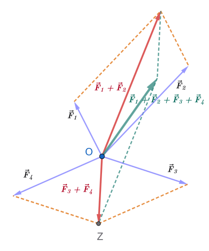{fig-align="center" width="350"}
:::

1.  Για να ισορροπεί το σώμα, η συνισταμένη όλων των δυνάμεων που ασκούνται σε αυτό πρέπει να ισούται με το μηδενικό διάνυσμα: $$\vec{F}_1 + \vec{F}_2 + \vec{F}_3 + \vec{F}_4 + \vec{F}_{\text{ισ}} = \vec{0}$$

Λύνοντας ως προς $\vec{F}_{\text{ισ}}$: $$\vec{F}_{\text{ισ}} = -(\vec{F}_1 + \vec{F}_2 + \vec{F}_3 + \vec{F}_4)$$ Δηλαδή, η απαιτούμενη δύναμη είναι το αντίθετο διάνυσμα της συνισταμένης των αρχικών τεσσάρων δυνάμεων.

2.  Αν $\vec{F}_1 + \vec{F}_3 = \vec{0}$ και $\vec{F}_2 + \vec{F}_4 = \vec{0}$, τότε:

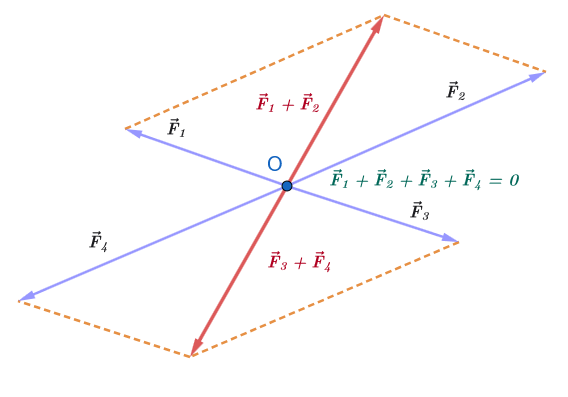{fig-align="center" width="400"}

$$\vec{F}_1 + \vec{F}_2 + \vec{F}_3 + \vec{F}_4 = (\vec{F}_1 + \vec{F}_3) + (\vec{F}_2 + \vec{F}_4) = \vec{0} + \vec{0} = \vec{0}$$ Επομένως: $$\vec{F}_{\text{ισ}} = -\vec{0} = \vec{0}$$ Δεν χρειάζεται να ασκηθεί καμία επιπλέον δύναμη.
::::

------------------------------------------------------------------------

:::: {.math-box .exercise-box}
::: {.math-title .exercise-title}
12. Άσκηση 12 (Γεωμετρική διερεύνηση μέσω διανυσμάτων θέσης)
:::

Έστω τέσσερα σημεία $K, \Lambda, M, N$ ενός επιπέδου με διανύσματα θέσης $\vec{r}_K, \vec{r}_\Lambda, \vec{r}_M, \vec{r}_N$ ως προς σημείο αναφοράς $O$.

Τι είδους τετράπλευρο είναι το $K\Lambda MN$ αν ισχύουν:

1.  $\vec{r}_K - \vec{r}_\Lambda = \vec{r}_N - \vec{r}_M$

2.  $|\vec{r}_M - \vec{r}_K| = |\vec{r}_N - \vec{r}_\Lambda|$

3.  Και οι δύο παραπάνω συνθήκες ταυτόχρονα;
::::

:::: {.math-box .solution-box}
::: {.math-title .solution-title}
Λύση
:::

1.  Από τον ορισμό των διανυσμάτων θέσης:

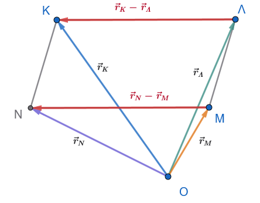{fig-align="center" width="350"}

$$\vec{r}_K - \vec{r}_\Lambda = \vec{\Lambda K} \quad \text{και} \quad \vec{r}_N - \vec{r}_M = \vec{MN}$$ Άρα η ισότητα γράφεται: $$\vec{\Lambda K} = \vec{MN} \iff -\vec{K\Lambda} = -\vec{NM} \iff \vec{K\Lambda} = \vec{NM}$$ Εφόσον οι απέναντι πλευρές είναι ίσες ως διανύσματα ($\vec{K\Lambda} = \vec{NM}$), είναι παράλληλες και ίσου μήκους.
Άρα το $K\Lambda MN$ είναι **παραλληλόγραμμο**.

2.  Παρατηρούμε ότι: $$\vec{r}_M - \vec{r}_K = \vec{KM} \quad \text{και} \quad \vec{r}_N - \vec{r}_\Lambda = \vec{\Lambda N}$$ Τα τμήματα $KM$ και $\Lambda N$ είναι οι διαγώνιοι του τετραπλεύρου.
    Η ισότητα των μέτρων σημαίνει: $$|\vec{KM}| = |\vec{\Lambda N}| \iff (KM) = (\Lambda N)$$ Δηλαδή, το τετράπλευρο έχει **ίσες διαγώνιους**.

3.  Όταν ισχύουν και οι δύο σχέσεις ταυτόχρονα, το τετράπλευρο είναι παραλληλόγραμμο με ίσες διαγώνιους, άρα είναι **ορθογώνιο παραλληλόγραμμο**.
::::

------------------------------------------------------------------------

:::: {.math-box .exercise-box}
::: {.math-title .exercise-title}
13. Άσκηση 13 (Κλειστό πολύγωνο και έκφραση διανύσματος)
:::

Σε ένα κλειστό πεντάγωνο $P_1P_2P_3P_4P_5$, τα διανύσματα των διαδοχικών πλευρών του είναι: $$\vec{u}_1 = \vec{P_1P_2}, \quad \vec{u}_2 = \vec{P_2P_3}, \quad \vec{u}_3 = \vec{P_3P_4}, \quad \vec{u}_4 = \vec{P_4P_5}, \quad \vec{x} = \vec{P_1P_5}$$

Να εκφράσετε το διάνυσμα $\vec{x}$ ως συνάρτηση των $\vec{u}_1, \vec{u}_2, \vec{u}_3, \vec{u}_4$.
::::

:::: {.math-box .solution-box}
::: {.math-title .solution-title}
Λύση
:::

Εφαρμόζουμε τη διαδοχική πρόσθεση διανυσμάτων (κανόνας Chasles): $$\vec{P_1P_5} = \vec{P_1P_2} + \vec{P_2P_3} + \vec{P_3P_4} + \vec{P_4P_5}$$ Αντικαθιστώντας τα δοσμένα σύμβολα: $$\vec{x} = \vec{u}_1 + \vec{u}_2 + \vec{u}_3 + \vec{u}_4$$
::::

------------------------------------------------------------------------

:::: {.math-box .exercise-box}
::: {.math-title .exercise-title}
14. Άσκηση 14 (Σχέση κορυφών και παραλληλόγραμμο)
:::

Θεωρούμε τέσσερα σημεία $A, B, \Gamma, \Delta$ του επιπέδου για τα οποία ισχύει: $$\vec{AB} - \vec{A\Delta} = \vec{\Gamma B} - \vec{\Gamma\Delta}$$ Είναι η σχέση αυτή αληθής για οποιαδήποτε τέσσερα σημεία;
::::

:::: {.math-box .solution-box}
::: {.math-title .solution-title}
Λύση
:::

Απλοποιούμε το αριστερό και το δεξί μέλος της πρώτης σχέσης: $$\vec{AB} - \vec{A\Delta} = \vec{\Delta B}$$ $$\vec{\Gamma B} - \vec{\Gamma\Delta} = \vec{\Delta B}$$ Επομένως $\vec{\Delta B} = \vec{\Delta B}$, το οποίο **ισχύει πάντοτε ως ταυτότητα** για οποιαδήποτε σημεία του επιπέδου.
::::

------------------------------------------------------------------------

:::: {.math-box .exercise-box}
::: {.math-title .exercise-title}
15. Άσκηση 15 (Διανύσματα με μέσον τμήματος)
:::

Έστω ευθύγραμμο τμήμα $AB$ και $M$ το μέσον του.

Αν $P$ είναι ένα οποιοδήποτε άλλο σημείο του επιπέδου, να αποδείξετε ότι: $$\vec{PA} + \vec{PB} = \vec{PM} + \vec{PM} \quad (\delta\eta\lambda\alpha\delta\acute{\eta} \ \vec{PA} + \vec{PB} = 2\vec{PM})$$ χρησιμοποιώντας αποκλειστικά πρόσθεση/αφαίρεση διανυσμάτων και την ιδιότητα $\vec{MA} + \vec{MB} = \vec{0}$.
::::

:::: {.math-box .solution-box}
::: {.math-title .solution-title}
Λύση
:::

Αναλύουμε τα διανύσματα $\vec{PA}$ και $\vec{PB}$ μέσω του σημείου $M$: $$\vec{PA} = \vec{PM} + \vec{MA}$$ $$\vec{PB} = \vec{PM} + \vec{MB}$$

Προσθέτουμε κατά μέλη τις δύο ισότητες: $$\vec{PA} + \vec{PB} = (\vec{PM} + \vec{MA}) + (\vec{PM} + \vec{MB})$$ $$\vec{PA} + \vec{PB} = \vec{PM} + \vec{PM} + (\vec{MA} + \vec{MB})$$

Επειδή το $M$ είναι το μέσον του τμήματος $AB$, τα διανύσματα $\vec{MA}$ και $\vec{MB}$ είναι αντίθετα, δηλαδή $\vec{MA} + \vec{MB} = \vec{0}$.
Επομένως: $$\vec{PA} + \vec{PB} = \vec{PM} + \vec{PM}$$
::::

------------------------------------------------------------------------

:::: {.math-box .exercise-box}
::: {.math-title .exercise-title}
16. Άσκηση 16 (Διανύσματα σε κανονικό εξάγωνο)
:::

Έστω κανονικό εξάγωνο $ABCDEF$ με κέντρο $O$.

Θέτουμε $\vec{u} = \vec{AB}$ και $\vec{v} = \vec{BC}$.

Να εκφράσετε τα παρακάτω διανύσματα αποκλειστικά ως συνδυασμό προσθέσεων και αφαιρέσεων των $\vec{u}$ και $\vec{v}$:

1.  Το διάνυσμα $\vec{AC}$

2.  Το διάνυσμα θέσης του κέντρου ως προς το $A$, δηλαδή το $\vec{AO}$

3.  Το διάνυσμα $\vec{CD}$
::::

:::: {.math-box .solution-box}
::: {.math-title .solution-title}
Λύση

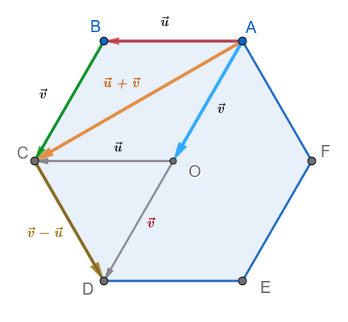{fig-align="center" width="350"}
:::

1.  Για το διάνυσμα $\vec{AC}$, από τον κανόνα του τριγώνου στο $\triangle ABC$: $$\vec{AC} = \vec{AB} + \vec{BC} = \vec{u} + \vec{v}$$

2.  Σε ένα κανονικό εξάγωνο, το τετράπλευρο $ABCO$ είναι παραλληλόγραμμο (αφού $\vec{AO}$ είναι παράλληλο και ίσο με το $\vec{BC}$, και $\vec{OC}$ παράλληλο και ίσο με το $\vec{AB}$).
    Επομένως: $$\vec{AO} = \vec{BC} = \vec{v}$$

3.  Για το διάνυσμα $\vec{CD}$: Στο τρίγωνο $\triangle OCD$, παρατηρούμε ότι $\vec{OD} = \vec{BC} = \vec{v}$ και $\vec{OC} = \vec{AB} = \vec{u}$.
    Από τη διανυσματική αφαίρεση: $$\vec{CD} = \vec{OD} - \vec{OC} = \vec{v} - \vec{u}$$
::::

------------------------------------------------------------------------

:::: {.math-box .exercise-box}
::: {.math-title .exercise-title}
17. Άσκηση 17 (Μηδενικό άθροισμα σε τυχαίο πολύγωνο)
:::

Για οποιοδήποτε τυχαίο επτάγωνο $A_1A_2A_3A_4A_5A_6A_7$, να αποδείξετε ότι: $$\vec{A_1A_3} + \vec{A_3A_5} + \vec{A_5A_7} + \vec{A_7A_2} + \vec{A_2A_4} + \vec{A_4A_6} + \vec{A_6A_1} = \vec{0}$$
::::

:::: {.math-box .solution-box}
::: {.math-title .solution-title}
Λύση
:::

Εφαρμόζουμε διαδοχικά τον κανόνα πρόσθεσης (Chasles), συνδυάζοντας τα διανύσματα ανά δύο:

1.  $\vec{A_1A_3} + \vec{A_3A_5} = \vec{A_1A_5}$

2.  $\vec{A_1A_5} + \vec{A_5A_7} = \vec{A_1A_7}$

3.  $\vec{A_1A_7} + \vec{A_7A_2} = \vec{A_1A_2}$

4.  $\vec{A_1A_2} + \vec{A_2A_4} = \vec{A_1A_4}$

5.  $\vec{A_1A_4} + \vec{A_4A_6} = \vec{A_1A_6}$

6.  $\vec{A_1A_6} + \vec{A_6A_1} = \vec{A_1A_1} = \vec{0}$

Συνεπώς, το συνολικό άθροισμα καταλήγει στο ίδιο αρχικό σημείο $A_1$, άρα ισούται με το μηδενικό διάνυσμα $\vec{0}$.
::::

------------------------------------------------------------------------

:::: callout-sos
::: {.callout-sos .callout-title}
Εύχομαι
:::

ΚΑΛΗ ΜΕΛΕΤΗ!
::::
