```{=html}
<!-- Φόρτωση βιβλιοθήκης GeoGebra -->
<script src="https://www.geogebra.org/apps/deployggb.js"></script>

<!-- Συνάρτηση δημιουργίας applets -->
<script>
function createGeoGebra(containerId, materialId, width = 700, height = 500) {
  var params = {
    "id": "ggb-" + containerId,
    "material_id": materialId,
    "width": width,
    "height": height,
    "showToolBar": true,
    "showMenuBar": false,
    "showAlgebraInput": true
  };
  
  var applet = new GGBApplet(params, '5.2');
  applet.inject(containerId);
}
</script>
```

## Πρόσθεση Και Αφαίρεση Διανυσμάτων

------------------------------------------------------------------------

### Πρόσθεση Διανυσμάτων

:::: {.math-box .definition-box}
::: {.math-title .definition-title}
**Ορισμός & Μέθοδος (Κανόνας Τριγώνου):**
:::

Έστω δύο διανύσματα $\vec{a}$ και $\vec{β}$.

Με αρχή ένα τυχαίο σημείο $O$, σχεδιάζουμε το διάνυσμα $\vec{OA} = \vec{a}$ και στη συνέχεια, με αρχή το πέρας $A$, σχεδιάζουμε το διάνυσμα $\vec{AB} = \vec{β}$.

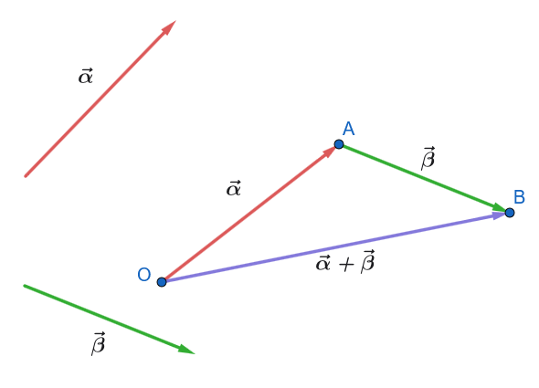{fig-align="center" width="400"}

Το διάνυσμα $\vec{OB}$ ορίζεται ως το **άθροισμα** των διανυσμάτων $\vec{a}$ και $\vec{b}$ και συμβολίζεται με $\vec{a} + \vec{β}$: $$\vec{a} + \vec{β} = \vec{OA} + \vec{AB} = \vec{OB}$$

*(Σχέση Chasles:* $\vec{OA} + \vec{AB} = \vec{OB}$)

- **Κανόνας Παραλληλογράμμου:** Αν σχεδιάσουμε τα διανύσματα $\vec{a}$ και $\vec{β}$ με κοινή αρχή $O$, δηλαδή $\vec{OA} = \vec{a}$ και $\vec{OΓ} = \vec{β}$, τότε το άθροισμα $\vec{a} + \vec{β}$ παριστάνεται από τη διαγώνιο $\vec{OB}$ του παραλληλογράμμου $OABΓ$ που έχει προσκείμενες πλευρές τις $OA$ και $OΓ$.

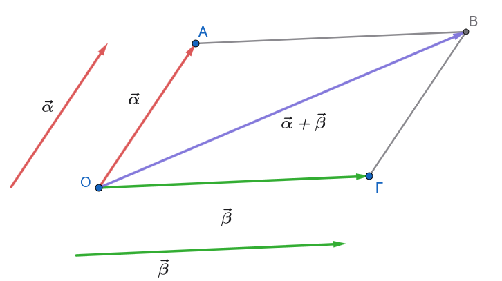{fig-align="center" width="450"}
::::

------------------------------------------------------------------------

- **Απόδειξη ότι το άθροισμα είναι ανεξάρτητο της επιλογής του σημείου** $O$:

:::: {.math-box .theorem-box}
::: {.math-title .theorem-title}
**Υπόθεση:**
:::

Έστω $O$ και $O'$ δύο διαφορετικά σημεία αναφοράς στο επίπεδο.

- Με αρχή το $O$, σχεδιάζουμε $\vec{OA} = \vec{a}$ και $\vec{AM} = \vec{β}$, οπότε $\vec{OM} = \vec{a} + \vec{β}$.

- Με αρχή το $O'$, σχεδιάζουμε $\vec{O'A'} = \vec{a}$ και $\vec{A'M'} = \vec{β}$, οπότε $\vec{O'M'} = \vec{a} + \vec{β}$.
::::

:::: {.math-box .apodeixi-box}
::: {.math-title .apodeixi-title}
**Απόδειξη:**

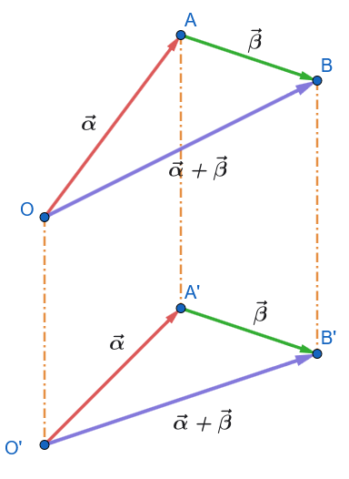{fig-align="center" width="300"}
:::

1.  Επειδή $\vec{OA} = \vec{O'A'} = \vec{a}$, τα διανύσματα αυτά είναι ίσα, οπότε το τετράπλευρο $OO'A'A$ είναι παραλληλόγραμμο (ή ισχύει $\vec{OO'} = \vec{AA'}$).

2.  Επειδή $\vec{AΒ} = \vec{A'Β'} = \vec{β}$, ισχύει $\vec{AA'} = \vec{ΒΒ'}$.

3.  Από τις δύο παραπάνω ισότητες προκύπτει ότι $\vec{OO'} = \vec{ΒΒ'}$, που σημαίνει ότι και το τετράπλευρο $OO'Β'Β$ είναι παραλληλόγραμμο.

4.  Συνεπώς, $\vec{OΒ} = \vec{O'Β'}$, δηλαδή το διάνυσμα του αθροίσματος είναι μοναδικό και εντελώς ανεξάρτητο από τη θέση της αρχής $O$.
::::

------------------------------------------------------------------------

### Ιδιότητες Πρόσθεσης Διανυσμάτων & Αποδείξεις

Για οποιαδήποτε διανύσματα $\vec{a}, \vec{β}, \vec{\gamma}$ ισχύουν οι εξής ιδιότητες:

:::: {.math-box .property-box}
::: {.math-title .property-title}
1.  **Αντιμεταθετική Ιδιότητα:**
:::

$$\vec{a} + \vec{β} = \vec{β} + \vec{a}$$
::::

:::: {.math-box .propertyproof-box}
::: {.math-title .propertyproof-title}
**Απόδειξη:**

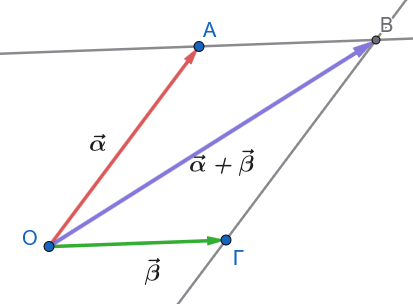{fig-align="center" width="350"}
:::

Θεωρούμε παραλληλόγραμμο $OABΓ$ με $\vec{OA} = \vec{a}$ και $\vec{OΓ} = \vec{β}$.
Τότε οι απέναντι πλευρές είναι ίσες διανυσματικά: $\vec{ΓB} = \vec{OA} = \vec{a}$ και $\vec{AB} = \vec{OΓ} = \vec{β}$.

- Από το τρίγωνο $OAB$: $\quad \vec{a} + \vec{β} = \vec{OA} + \vec{AB} = \vec{OB}$.

- Από το τρίγωνο $OΓB$: $\quad \vec{β} + \vec{a} = \vec{OΓ} + \vec{ΓB} = \vec{OB}$.

Άρα $\vec{a} + \vec{β} = \vec{β} + \vec{a}$.
::::

------------------------------------------------------------------------

:::: {.math-box .property-box}
::: {.math-title .property-title}
2.  **Προσεταιριστική Ιδιότητα:**
:::

$$(\vec{a} + \vec{β}) + \vec{\gamma} = \vec{a} + (\vec{β} + \vec{\gamma})$$
::::

:::: {.math-box .propertyproof-box}
::: {.math-title .propertyproof-title}
**Απόδειξη:**
:::

Με αρχή ένα σημείο $O$, παίρνουμε τα διαδοχικά διανύσματα $\vec{OA} = \vec{a}$, $\vec{AB} = \vec{β}$ και $\vec{B\Gamma} = \vec{\gamma}$.

- Πρώτο μέλος: $(\vec{a} + \vec{β}) + \vec{\gamma} = (\vec{OA} + \vec{AB}) + \vec{B\Gamma} = \vec{OB} + \vec{B\Gamma} = \vec{O\Gamma}$.

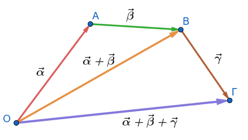{fig-align="center" width="350"}

- Δεύτερο μέλος: $\vec{a} + (\vec{β} + \vec{\gamma}) = \vec{OA} + (\vec{AB} + \vec{B\Gamma}) = \vec{OA} + \vec{A\Gamma} = \vec{O\Gamma}$.

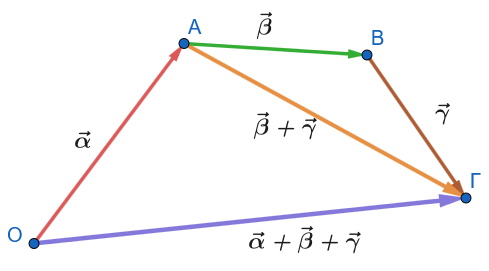{fig-align="center" width="350"}

Άρα $(\vec{a} + \vec{β}) + \vec{\gamma} = \vec{a} + (\vec{β} + \vec{\gamma})$.
::::

------------------------------------------------------------------------

:::: {.math-box .property-box}
::: {.math-title .property-title}
3.  **Ύπαρξη Ουδέτερου Στοιχείου:**
:::

$$\vec{a} + \vec{0} = \vec{a}$$

*(Το μηδενικό διάνυσμα* $\vec{0}$ είναι το ουδέτερο στοιχείο της πρόσθεσης).
::::

------------------------------------------------------------------------

:::: {.math-box .property-box}
::: {.math-title .property-title}
4.  **Ύπαρξη Αντίθετου Στοιχείου:**
:::

$$\vec{a} + (-\vec{a}) = \vec{0}$$

*(Για κάθε διάνυσμα* $\vec{a}$, υπάρχει το αντίθετό του $-\vec{a}$ με $\vec{a} + (-\vec{a}) = \vec{0}$).
::::

------------------------------------------------------------------------

:::: {.math-box .lemma-box}
::: {.math-title .lemma-title}
**Πολυγωνικός Κανόνας (Πρόσθεση** $n$ Διανυσμάτων):

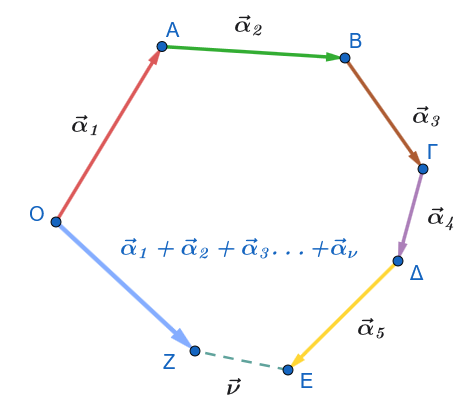{fig-align="center" width="350"}
:::

Για να προσθέσουμε $n$ διανύσματα $\vec{a}_1, \vec{a}_2, \dots, \vec{a}_n$, τα τοποθετούμε διαδοχικά.

Το άθροισμά τους είναι το διάνυσμα που έχει αρχή την αρχή του πρώτου και πέρας το πέρας του τελευταίου:

$$\vec{ΟA} + \vec{AΒ} + \vec{ΒΓ}+\vec{ΓΔ}+\dots   = \vec{ΟΖ}$$
::::

------------------------------------------------------------------------

### Αφαίρεση Διανυσμάτων

:::: {.math-box .definition-box}
::: {.math-title .definition-title}
**Ορισμός:**
:::

Η **διαφορά** $\vec{a} - \vec{β}$ του διανύσματος $\vec{β}$ από το διάνυσμα $\vec{a}$ ορίζεται ως το άθροισμα του διανύσματος $\vec{a}$ με το αντίθετο του $\vec{β}$: $$\vec{a} - \vec{β} = \vec{a} + (-\vec{β})$$
::::

------------------------------------------------------------------------

:::: {.math-box .proposal-box}
::: {.math-title .proposal-title}
- **Απόδειξη Μοναδικότητας της Λύσης Εξίσωσης:**

**Πρόταση:**
:::

Για οποιαδήποτε διανύσματα $\vec{a}$ και $\vec{b}$, υπάρχει **μοναδικό** διάνυσμα $\vec{x}$ τέτοιο ώστε $\vec{β} + \vec{x} = \vec{a}$.
::::

:::: {.math-box .proposalproof-box}
::: {.math-title .proposalproof-title}
**Απόδειξη:**
:::

$$\vec{β} + \vec{x} = \vec{a} \iff (-\vec{β}) + (\vec{β} + \vec{x}) = (-\vec{β}) + \vec{a}$$ $$\iff ((-\vec{β}) + \vec{β}) + \vec{x} = \vec{a} + (-\vec{β})$$ $$\iff \vec{0} + \vec{x} = \vec{a} + (-\vec{β})$$ $$\iff \vec{x} = \vec{a} - \vec{β}$$

Εφόσον κάθε βήμα είναι ισοδύναμο, η λύση $\vec{x} = \vec{a} - \vec{β}$ υπάρχει και είναι **μοναδική**.
::::

------------------------------------------------------------------------

:::: {.math-box .lemma-box}
::: {.math-title .lemma-title}
- **Γεωμετρικός Κανόνας Αφαίρεσης:**

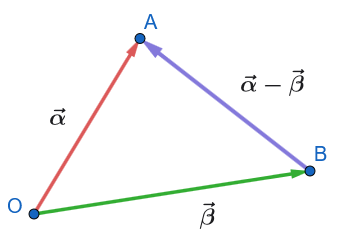{fig-align="center" width="280"}
:::

Αν κατασκευάσουμε τα διανύσματα $\vec{a}$ και $\vec{β}$ με κοινή αρχή $O$, δηλαδή $\vec{OA} = \vec{a}$ και $\vec{OB} = \vec{β}$, τότε η διαφορά $\vec{a} - \vec{β}$ παριστάνεται από το διάνυσμα $\vec{BA}$ (από το πέρας του αφαιρετέου προς το πέρας του μειωτέου): $$\vec{OA} - \vec{OB} = \vec{BA}$$
::::

------------------------------------------------------------------------

### Διάνυσμα Θέσεως & Σημείο Αναφοράς

:::: {.math-box .definition-box}
::: {.math-title .definition-title}
- **Ορισμός Σημείου Αναφοράς & Διανύσματος Θέσεως:**
:::

- Έστω $O$ ένα σταθερό σημείο του επιπέδου ή του χώρου, το οποίο ονομάζεται **σημείο αναφοράς**.

- Για κάθε σημείο $M$, το διάνυσμα $\vec{OM}$ ονομάζεται **διάνυσμα θέσεως** ή **διανυσματική ακτίνα** του σημείου $M$ ως προς το σημείο αναφοράς $O$.
::::

------------------------------------------------------------------------

:::: {.math-box .definition-box}
::: {.math-title .definition-title}
- **Βασική Πρόταση Αναλύσεως Διανύσματος:**

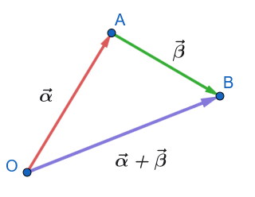{fig-align="center" width="250"}
:::

Για οποιοδήποτε διάνυσμα $\vec{AB}$ και τυχαίο σημείο αναφοράς $O$, ισχύει: $$\vec{OA} + \vec{AB} = \vec{OB} \iff \vec{AB} = \vec{OB} - \vec{OA}$$

> **«Κάθε διάνυσμα ισούται με τη διανυσματική ακτίνα του πέρατος μείον τη διανυσματική ακτίνα της αρχής»**.
::::

------------------------------------------------------------------------

### Μέτρο Αθροίσματος Διανυσμάτων

:::: {.math-box .definition-box}
::: {.math-title .definition-title}
**Τριγωνική Ανισότητα Διανυσμάτων:**
:::

Για οποιαδήποτε διανύσματα $\vec{a}$ και $\vec{β}$, ισχύει η διπλή ανισότητα: $$||\vec{a}| - |\vec{β}|| \le |\vec{a} + \vec{β}| \le |\vec{a}| + |\vec{β}|$$

**Συνθήκες Ισότητας:**

1.  **Δεξιά ισότητα:** $|\vec{a} + \vec{β}| = |\vec{a}| + |\vec{β}|$ ισχύει αν και μόνο αν τα διανύσματα $\vec{a}$ και $\vec{β}$ είναι **ομόρροπα** ($\vec{a} \uparrow\uparrow \vec{β}$).

2.  **Αριστερή ισότητα:** $|\vec{a} + \vec{β}| = ||\vec{a}| - |\vec{β}||$ ισχύει αν και μόνο αν τα διανύσματα $\vec{a}$ και $\vec{b}$ είναι **αντίρροπα** ($\vec{a} \uparrow\downarrow \vec{β}$).
::::

------------------------------------------------------------------------

### Εφαρμογές

:::: {.math-box .example-box}
::: {.math-title .example-title}
**Εφαρμογή 1: Σχέση Chasles & Απλοποίηση Διανυσματικών Σχέσεων**

**Εκφώνηση:**
:::

Δίνεται τυχαίο τετράπλευρο $AB\Gamma\Delta$.

1.  Να αποδείξετε ότι για οποιοδήποτε σημείο αναφοράς $O$ ισχύει η ισότητα: $$\vec{AB} + \vec{\Gamma\Delta} = \vec{A\Delta} + \vec{\Gamma B}$$

2.  Αν για τα σημεία $A, B, \Gamma, \Delta, M$ ισχύει η σχέση $\vec{AM} + \vec{\Gamma\Delta} = \vec{A\Delta} + \vec{BM}$, να αποδείξετε ότι τα σημεία $B$ και $\Gamma$ συμπίπτουν.
::::

:::: {.math-box .examplesolution-box}
::: {.math-title .examplesolution-title}
**Λύση:**
:::

1.  **1ος Τρόπος (με διανύσματα θέσεως):**

Εκφράζουμε κάθε διάνυσμα ως διαφορά διανυσματικών ακτινών ως προς το σημείο αναφοράς $O$ ($\vec{XY} = \vec{OY} - \vec{OX}$):

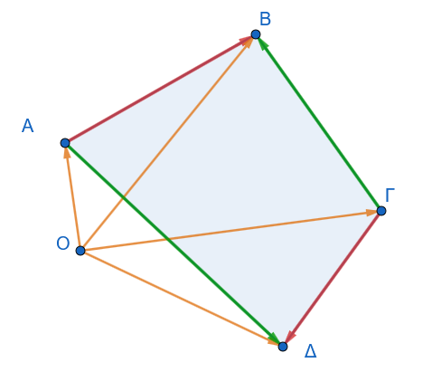{fig-align="center" width="350"}

$$\vec{AB} + \vec{\Gamma\Delta} = (\vec{OB} - \vec{OA}) + (\vec{O\Delta} - \vec{O\Gamma})$$

Αναδιατάσσουμε τους όρους στο δεύτερο μέλος: $$\vec{AB} + \vec{\Gamma\Delta} = (\vec{O\Delta} - \vec{OA}) + (\vec{OB} - \vec{O\Gamma}) = \vec{A\Delta} + \vec{\Gamma B}$$

**2ος Τρόπος (με σχέση Chasles):**

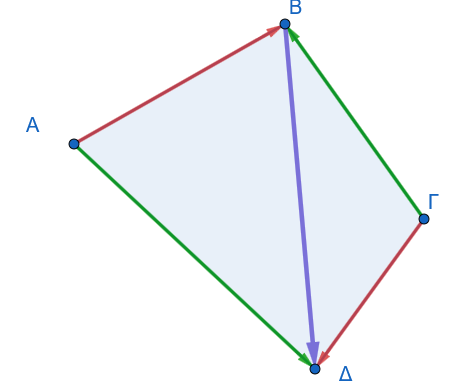{fig-align="center" width="350"}

Από το παραπάνω σχήμα βλέπουμε ότι: $$\vec{BΔ} = \vec{ΑΔ} - \vec{Α B} \quad  \text{ και } \quad \vec{BΔ} = \vec{ΓΔ}- \vec{ΓΒ}$$

Άρα: $$\vec{AΔ} - \vec{ΑΒ} = \vec{ΓΔ} - \vec{Γ B}$$

Αναδιατάσσουμε τους όρους: $$\vec{AΔ} + \vec{ΓΒ} = \vec{AΒ} + \vec{ΓΔ}$$
::::

------------------------------------------------------------------------

:::: {.math-box .example-box}
::: {.math-title .example-title}
**Εφαρμογή 2: Διάνυσμα Θέσεως Μέσου Τμήματος**

**Εκφώνηση:**
:::

Δίνεται τετράπλευρο $AB\Gamma\Delta$.
Αν $K$ είναι το μέσο της πλευράς $AB$ και $L$ το μέσο της πλευράς $\Gamma\Delta$, να αποδείξετε ότι:

1.  $\vec{KL} = \dfrac{\vec{A\Gamma} + \vec{B\Delta}}{2}$

2.  $\vec{A\Delta} + \vec{B\Gamma} = 2\vec{KL}$
::::

:::: {.math-box .examplesolution-box}
::: {.math-title .examplesolution-title}
**Λύση:**

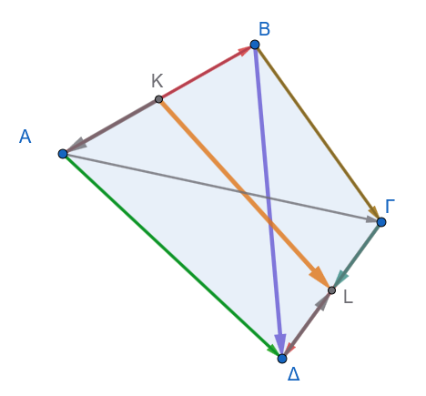{fig-align="center" width="350"}
:::

$\mathbf{1^{ος}}$ **τρόπος**

1.  Θεωρούμε τυχαίο σημείο αναφοράς $O$ στο επίπεδο.

    - Επειδή το $K$ είναι μέσο του ευθύγραμμου τμήματος $AB$, η διανυσματική του ακτίνα είναι: $$\vec{OK} = \frac{\vec{OA} + \vec{OB}}{2}$$

    - Επειδή το $L$ είναι μέσο του ευθύγραμμου τμήματος $\Gamma\Delta$, η διανυσματική του ακτίνα είναι: $$\vec{OL} = \frac{\vec{O\Gamma} + \vec{O\Delta}}{2}$$

    Υπολογίζουμε το διάνυσμα $\vec{KL}$: $$\vec{KL} = \vec{OL} - \vec{OK} = \frac{\vec{O\Gamma} + \vec{O\Delta}}{2} - \frac{\vec{OA} + \vec{OB}}{2} = \frac{(\vec{O\Gamma} - \vec{OA}) + (\vec{O\Delta} - \vec{OB})}{2}$$

    Επειδή $\vec{O\Gamma} - \vec{OA} = \vec{A\Gamma}$ και $\vec{O\Delta} - \vec{OB} = \vec{B\Delta}$, λαμβάνουμε: $$\vec{KL} = \frac{\vec{A\Gamma} + \vec{B\Delta}}{2}$$

2.  Ομαδοποιώντας διαφορετικά τους όρους στο ίδιο κλάσμα: $$\vec{KL} = \frac{(\vec{O\Delta} - \vec{OA}) + (\vec{O\Gamma} - \vec{OB})}{2} = \frac{\vec{A\Delta} + \vec{B\Gamma}}{2}$$

    Πολλαπλασιάζοντας επί $2$: $$2\vec{KL} = \vec{A\Delta} + \vec{B\Gamma} \iff \vec{A\Delta} + \vec{B\Gamma} = 2\vec{KL}$$

------------------------------------------------------------------------

$\mathbf{2^{ος}}$ **τρόπος**

Από το σχήμα βλέπουμε ότι:

$$KL=\begin{cases} \vec{ΚΒ}+\vec{ΒΓ}+\vec{ΓL} \\ \vec{KA}+\vec{ΑΔ}+\vec{ΔL}\end{cases}$$

Προσθέτοντας έχουμε $$2KL=\vec{ΚΒ}+\vec{ΒΓ}+\vec{ΓL} + \vec{KA}+\vec{ΑΔ}+\vec{ΔL}$$

$$2KL=\textcolor{red}{\cancel{\vec{ΚΒ}}}+\vec{ΒΓ}+\textcolor{green}{\cancel{\vec{ΓL}}} + \textcolor{red}{\cancel{\vec{KA}}}+\vec{ΑΔ}+\textcolor{green}{\cancel{\vec{ΔL}}}$$

και τελικά $$2KL=\vec{ΒΓ}+\vec{ΑΔ}$$ Αποδείξαμε την (2)

Όμως $$ΑΓ=\begin{cases} \textcolor{red}{\vec{ΑΒ}+\vec{ΒΓ}}\\ \vec{ΑΔ}+\vec{ΔΓ}\end{cases} \quad (1)$$ και

$$ΒΑ=\begin{cases} \vec{ΒΓ}+\vec{ΓΔ}\\ \textcolor{red}{\vec{ΒA}+\vec{ΑΔ}}\end{cases} \quad  (2)$$

(1)+(2)$\overset{Κόκκινα}{\longrightarrow} \vec{AΓ}+\vec{ΒΔ}=\textcolor{red}{\cancel{\vec{ΑΒ}}+\vec{ΒΓ}}+\textcolor{red}{\cancel{\vec{ΒA}}+\vec{ΑΔ}}=\vec{ΒΓ}+\vec{AΔ}$ Το οποίο όπως δείξαμε ισούται με $2KL$

Άρα $$ΚL=\dfrac{\vec{ΑΓ}+\vec{ΒΔ}}{2}$$
::::

------------------------------------------------------------------------

:::: {.math-box .example-box}
::: {.math-title .example-title}
**Εφαρμογή 3: Χαρακτηριστική Ιδιότητα & Διάνυσμα Θέσεως Κέντρου Βάρους**

**Εκφώνηση:**
:::

Δίνεται τρίγωνο $AB\Gamma$.

1.  Να αποδείξετε ότι το σημείο $G$ είναι το κέντρο βάρους (βαρύκεντρο) του τριγώνου $AB\Gamma$ αν και μόνο αν ισχύει: $$\vec{GA} + \vec{GB} + \vec{G\Gamma} = \vec{0}$$

2.  Αν $G$ είναι το κέντρο βάρους του τριγώνου $AB\Gamma$, να αποδείξετε ότι για οποιοδήποτε σημείο $O$ ισχύει: $$\vec{OG} = \frac{\vec{OA} + \vec{OB} + \vec{O\Gamma}}{3}$$
::::

:::: {.math-box .examplesolution-box}
::: {.math-title .examplesolution-title}
**Λύση:**

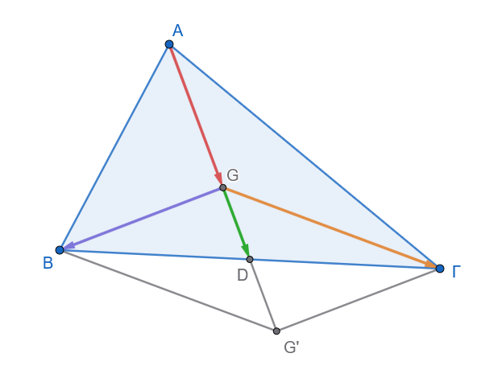{fig-align="center" width="450"}
:::

1.  **Ευθύ (**$\implies$): Έστω $G$ το κέντρο βάρους του τριγώνου $AB\Gamma$ και $D$ το μέσο της πλευράς $B\Gamma$.

    - Από τη Γεωμετρία γνωρίζουμε ότι το κέντρο βάρους διαιρεί τη διάμεσο $AD$ σε λόγο $2:1$ από την κορυφή, άρα $\vec{AG} = 2\vec{GD} \iff \vec{GA} = -2\vec{GD}$.

    - Επειδή το $D$ είναι μέσο της $B\Gamma$, ισχύει $\vec{GB} + \vec{G\Gamma} =\vec{GG'}= 2\vec{GD}$.

    Προσθέτοντας κατά μέλη: $$\vec{GA} + \vec{GB} + \vec{G\Gamma} = -2\vec{GD} + 2\vec{GD} = \vec{0}$$

    **Αντίστροφο (**$\impliedby$): Έστω ότι για ένα σημείο $G$ ισχύει $\vec{GA} + \vec{GB} + \vec{G\Gamma} = \vec{0}$.

    - Αν $D$ είναι το μέσο της $B\Gamma$, αντικαθιστούμε $\vec{GB} + \vec{G\Gamma} = 2\vec{GD}$: $$\vec{GA} + 2\vec{GD} = \vec{0} \iff \vec{AG} = 2\vec{GD}$$

    - Η σχέση αυτή δηλώνει ότι το $G$ βρίσκεται πάνω στη διάμεσο $AD$ και απέχει από την κορυφή $A$ διπλάσια απόσταση από ό,τι από το μέσο $D$, άρα το $G$ είναι το κέντρο βάρους του τριγώνου.

2.  Εκφράζουμε τη σχέση $\vec{GA} + \vec{GB} + \vec{G\Gamma} = \vec{0}$ με σημείο αναφοράς το $O$: $$(\vec{OA} - \vec{OG}) + (\vec{OB} - \vec{OG}) + (\vec{O\Gamma} - \vec{OG}) = \vec{0}$$ $$\vec{OA} + \vec{OB} + \vec{O\Gamma} - 3\vec{OG} = \vec{0} \iff 3\vec{OG} = \vec{OA} + \vec{OB} + \vec{O\Gamma}$$ $$\vec{OG} = \frac{\vec{OA} + \vec{OB} + \vec{O\Gamma}}{3}$$
::::

------------------------------------------------------------------------

:::: {.math-box .example-box}
::: {.math-title .example-title}
**Εφαρμογή 4: Μέτρο Αθροίσματος & Γεωμετρικός Τόπος**

**Εκφώνηση:**
:::

1.  Δίνονται διανύσματα $\vec{a}$ και $\vec{b}$ με μέτρα $|\vec{a}| = 5$ και $|\vec{b}| = 3$.
    Να βρείτε την ελάχιστη και τη μέγιστη τιμή που μπορεί να λάβει το μέτρο $|\vec{a} + \vec{b}|$ και να προσδιορίσετε τη σχετική θέση των διανυσμάτων σε κάθε περίπτωση.

2.  Δίνεται ευθύγραμμο τμήμα $AB$ μήκους $6\text{ cm}$.
    Να βρεθεί ο γεωμετρικός τόπος των σημείων $M$ του επιπέδου για τα οποία ισχύει: $$|\vec{MA} + \vec{MB}| = |\vec{MA} - \vec{MB}|$$
::::

:::: {.math-box .examplesolution-box}
::: {.math-title .examplesolution-title}
**Λύση:**

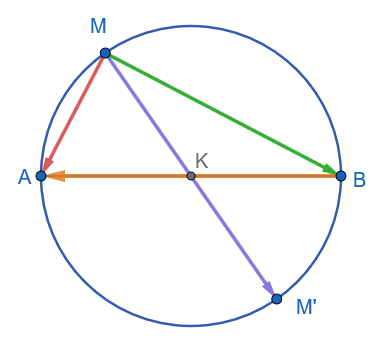{fig-align="center" width="300"}
:::

1.  Από την τριγωνική ανισότητα διανυσμάτων ισχύει η διπλή ανισότητα: $$||\vec{a}| - |\vec{b}|| \le |\vec{a} + \vec{b}| \le |\vec{a}| + |\vec{b}|$$

    Αντικαθιστώντας τα μέτρα $|\vec{a}| = 5$ και $|\vec{b}| = 3$: $$|5 - 3| \le |\vec{a} + \vec{b}| \le 5 + 3 \iff 2 \le |\vec{a} + \vec{b}| \le 8$$

    - **Μέγιστη τιμή:** $8$, όταν τα διανύσματα είναι **ομόρροπα** ($\vec{a} \uparrow\uparrow \vec{b}$).

    - **Ελάχιστη τιμή:** $2$, όταν τα διανύσματα είναι **αντίρροπα** ($\vec{a} \uparrow\downarrow \vec{b}$).

2.  Αναλύουμε τα δύο μέλη της δοσμένης εξίσωσης:

    - **Πρώτο μέλος:** Αν $K$ είναι το μέσο του ευθύγραμμου τμήματος $AB$, τότε $\vec{MA} + \vec{MB} = 2\vec{MK}$.

      Άρα: $$|\vec{MA} + \vec{MB}| = |2\vec{MK}| = 2|\vec{MK}| = 2(MK)$$

    - **Δεύτερο μέλος:** Από τον κανόνα αφαίρεσης διανυσμάτων ισχύει $\vec{MA} - \vec{MB} = \vec{BA}$.

      Άρα: $$|\vec{MA} - \vec{MB}| = |\vec{BA}| = (AB) = 6\text{ cm}$$

    Εξισώνοντας τα δύο μέλη: $$2(MK) = 6 \iff (MK) = 3\text{ cm}$$

    Επειδή το σημείο $K$ (μέσο του $AB$) είναι σταθερό, η σχέση $(MK) = 3\text{ cm}$ σημαίνει ότι το σημείο $M$ απέχει σταθερή απόσταση $3\text{ cm}$ από το $K$.

    **Συμπέρασμα:** Ο γεωμετρικός τόπος του σημείου $M$ είναι **κύκλος με κέντρο το μέσο** $K$ του τμήματος $AB$ και ακτίνα $R = 3\text{ cm}$ (δηλαδή ο κύκλος με διάμετρο το τμήμα $AB$).
::::

------------------------------------------------------------------------

### Ασκήσεις στην Πρόσθεση, Αφαίρεση & Διάνυσμα Θέσεως

#### **Ομάδα Α: Απλοποίηση Παραστάσεων & Σχέση Chasles**

1.  **Άσκηση 1:** Να απλοποιήσετε τις παρακάτω διανυσματικές παραστάσεις:

    - α) $\vec{u} = \vec{AB} + \vec{B\Gamma} + \vec{\Gamma\Delta}$

    - β) $\vec{v} = \vec{A\Gamma} - \vec{B\Gamma} + \vec{BA}$

    - γ) $\vec{w} = \vec{AB} - \vec{A\Delta} + \vec{\Gamma\Delta} - \vec{\Gamma B}$

2.  **Άσκηση 2:** Δίνεται τετράπλευρο $AB\Gamma\Delta$.
    Να αποδείξετε ότι: $$\vec{AB} + \vec{\Gamma\Delta} = \vec{A\Delta} + \vec{\Gamma B}$$

3.  **Άσκηση 3:** Για πέντε τυχαία σημεία $A, B, \Gamma, \Delta, E$, να αποδείξετε ότι: $$\vec{AB} + \vec{B\Gamma} + \vec{\Gamma\Delta} + \vec{\Delta E} + \vec{EA} = \vec{0}$$

------------------------------------------------------------------------

#### **Ομάδα Β: Χρήση Σημείου Αναφοράς & Διανύσματος Θέσεως**

4.  **Άσκηση 4:** Έστω $O$ τυχαίο σημείο αναφοράς και σημεία $A, B, \Gamma, \Delta$. Να αποδείξετε ότι:

$$\vec{AB} + \vec{\Gamma\Delta} = (\vec{OB} - \vec{OA}) + (\vec{O\Delta} - \vec{O\Gamma})$$

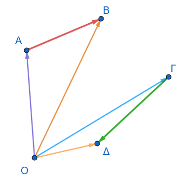{fig-align="center" width="280"}

:::: my-callout-theory
::: {.my-callout-theory .callout-title}
Υπόδειξη
:::

Εξ ορισμού $\vec{OB} - \vec{OA}=\vec{AB}$ .............................
::::

5.  **Άσκηση 5:** Δίνεται παραλληλόγραμμο $AB\Gamma\Delta$ με κέντρο $O$. Να αποδείξετε ότι για τυχαίο σημείο $M$ του επιπέδου ισχύει:

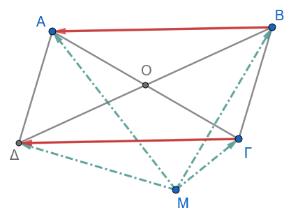{fig-align="center" width="350"}

$$\vec{MA} + \vec{M\Gamma} = \vec{MB} + \vec{M\Delta}$$

:::: my-callout-theory
::: {.my-callout-theory .callout-title}
Υπόδειξη
:::

$$\vec{MA} + \vec{M\Gamma} = \vec{MB} + \vec{M\Delta} \overset{αναδιατάσουμε}{\implies} \vec{ΜΑ} - \vec{ΜΒ} =\vec{ΜΔ} - \vec{ΜΓ} \implies .....................$$
::::

6.  **Άσκηση 6:** Αν $O$ είναι το κέντρο παραλληλογράμμου $AB\Gamma\Delta$, να αποδείξετε ότι:

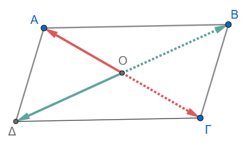{fig-align="center" width="350"}

$$\vec{OA} + \vec{OB} + \vec{O\Gamma} + \vec{O\Delta} = \vec{0}$$

7.  **Άσκηση 7:** Δίνονται τέσσερα σημεία $A, B, \Gamma, \Delta$. Αν για το σημείο $O$ ισχύει $\vec{OA} + \vec{O\Gamma} = \vec{OB} + \vec{O\Delta}$, να αποδείξετε ότι το τετράπλευρο $AB\Gamma\Delta$ είναι παραλληλόγραμμο.

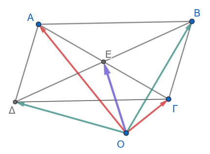{fig-align="center" width="350"}

:::: my-callout-theory
::: {.my-callout-theory .callout-title}
Υπόδειξη
:::

Στο τρίγωνο $\triangle{ΑΓΟ} : \quad$ $\vec{OA} + \vec{O\Gamma}=2\vec{OE} \quad$, όπου Ε το μέσον της ΑΓ.

Στο τρίγωνο $\triangle{ΔΒΟ} : \quad$ $\vec{OB} + \vec{O\Delta}=2\vec{OE'} \quad$, όπου Ε' το μέσον της ΔΒ.

....................................................

........................................................
::::

------------------------------------------------------------------------

#### **Ομάδα Γ: Γεωμετρικές Εφαρμογές & Μέσο Ευθύγραμμου Τμήματος**

8.  **Άσκηση 8:** Αν $M$ είναι το μέσο ευθύγραμμου τμήματος $AB$ και $O$ τυχαίο σημείο αναφοράς, να αποδείξετε ότι: $$\vec{OA} + \vec{OB} = 2\vec{OM}$$

9.  **Άσκηση 9:** Δίνεται τρίγωνο $AB\Gamma$ και $M, N, P$ τα μέσα των πλευρών $B\Gamma, \Gamma A, AB$ αντίστοιχα.
    Να αποδείξετε ότι:

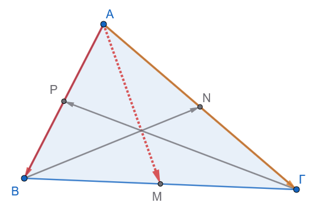{fig-align="center" width="400"}

$$\vec{AM} + \vec{BN} + \vec{\Gamma P} = \vec{0}$$

:::: my-callout-theory
::: {.my-callout-theory .callout-title}
Υπόδειξη
:::

$\vec{AB} + \vec{ΑΓ}=2 \vec{AM} \qquad  (1)$

Όμοια $\qquad \vec{BΑ} + \vec{ΒΓ}=2 \vec{ΒΝ} \qquad  (2)$

και ..........................................
(3)

Προσθέτουμε (1)+(2)+(3)= ............................................
::::

10. **Άσκηση 10:** Σε τετράπλευρο $AB\Gamma\Delta$, $K$ είναι το μέσο της $AB$ και $L$ το μέσο της $\Gamma\Delta$. Να αποδείξετε ότι: $$\vec{A\Gamma} + \vec{B\Delta} = 2\vec{KL}$$

> > Δείτε την εφαρμογή

11. **Άσκηση 11:** Δίνεται τρίγωνο $AB\Gamma$. Αν για ένα σημείο $P$ ισχύει $\vec{PA} + \vec{PB} + \vec{P\Gamma} = \vec{0}$, να αποδείξετε ότι το $P$ συμπίπτει με το κέντρο βάρους $G$ του τριγώνου $AB\Gamma$.

> > Δείτε την εφαρμογή.

------------------------------------------------------------------------

#### **Ομάδα Δ: Μέτρο Αθροίσματος & Ανισότητες**

12. **Άσκηση 12:** Δίνονται διανύσματα $\vec{a}$ και $\vec{b}$ με μέτρα $|\vec{a}| = 3$ και $|\vec{b}| = 4$.

- α) Να βρείτε τα όρια (ελάχιστη και μέγιστη τιμή) του μέτρου $|\vec{a} + \vec{b}|$.

- β) Σε ποια περίπτωση ισχύει $|\vec{a} + \vec{b}| = 7$;

- γ) Σε ποια περίπτωση ισχύει $|\vec{a} + \vec{b}| = 1$;

13. **Άσκηση 13:** Αν για τα μη μηδενικά διανύσματα $\vec{a}$ και $\vec{b}$ ισχύει $|\vec{a} + \vec{b}| = |\vec{a} - \vec{b}|$, να αποδείξετε γεωμετρικά (με χρήση παραλληλογράμμου) ότι τα διανύσματα $\vec{a}$ και $\vec{b}$ είναι κάθετα ($\vec{a} \perp \vec{b}$).

> > Δείτε την εφαρμογή με τον γεωμετρικό τόπο.

14. **Άσκηση 14:** Αν για τα διανύσματα $\vec{a}, \vec{b}, \vec{\gamma}$ ισχύει $\vec{a} + \vec{b} + \vec{\gamma} = \vec{0}$, να αποδείξετε ότι: $$|\vec{a}| \le |\vec{b}| + |\vec{\gamma}|$$

> > > τα τρία διανύσματα θα είναι διαδοχικά και η αρχή του πρώτου θα είναι το τέλος του τελευταίου.
> > > Αυτό σημαίνει ότι το σχήμα θα είναι ......................

15. **Άσκηση 15:** Δίνεται τρίγωνο $AB\Gamma$. Να αποδείξετε ότι για οποιοδήποτε σημείο $M$ του επιπέδου ισχύει η ανισότητα: $$|\vec{MA} + \vec{MB}| \le |\vec{M\Gamma}| + |\vec{\Gamma A}| + |\vec{\Gamma B}|$$

------------------------------------------------------------------------

:::: callout-sos
::: {.callout-sos .callout-title}
Εύχομαι
:::

ΚΑΛΗ ΜΕΛΕΤΗ!
::::
