```{=html}
<!-- Φόρτωση βιβλιοθήκης GeoGebra -->
<script src="https://www.geogebra.org/apps/deployggb.js"></script>

<!-- Συνάρτηση δημιουργίας applets -->
<script>
function createGeoGebra(containerId, materialId, width = 700, height = 500) {
  var params = {
    "id": "ggb-" + containerId,
    "material_id": materialId,
    "width": width,
    "height": height,
    "showToolBar": true,
    "showMenuBar": false,
    "showAlgebraInput": true
  };
  
  var applet = new GGBApplet(params, '5.2');
  applet.inject(containerId);
}
</script>
```

## Πολλαπλασιασμός Αριθμού με Διάνυσμα

------------------------------------------------------------------------

### Ορισμός Πολλαπλασιασμού Αριθμού με Διάνυσμα

:::: {.math-box .definition-box}
::: {.math-title .definition-title}
**Ορισμός:**
:::

Έστω $λ \in \mathbb{R}$ ένας πραγματικός αριθμός με $λ \neq 0$ και $\vec{α}$ ένα μη μηδενικό διάνυσμα.
Ονομάζουμε **γινόμενο του** $λ$ με το $\vec{α}$ και συμβολίζουμε με $λ \cdot \vec{α}$ ή $λ \vec{α}$ ένα διάνυσμα το οποίο:

1.  Είναι **ομόρροπο** του $\vec{α}$ ($λ \vec{α} \uparrow\uparrow \vec{α}$), αν $λ > 0$, και **αντίρροπο** του $\vec{α}$ ($λ \vec{α} \uparrow\downarrow \vec{α}$), αν $λ < 0$.

2.  Έχει **μέτρο** $|λ \vec{α}| = |λ| \cdot |\vec{α}|$.

- **Ειδική περίπτωση:** Αν $λ = 0$ ή $\vec{α} = \vec{0}$, τότε ορίζουμε ως $λ \vec{α}$ το μηδενικό διάνυσμα $\vec{0}$.

- **Συμβολισμός κλάσματος:** Το γινόμενο $\dfrac{1}{λ} \cdot \vec{α}$ συμβολίζεται και ως $\dfrac{\vec{α}}{λ}$.
::::

<iframe src="https://www.geogebra.org/calculator/u9dh66yr?embed" width="730" height="600" allowfullscreen style="border: 1px solid #e4e4e4;border-radius: 4px;" frameborder="0">

</iframe>

:::: {.math-box .odigia-box}
::: {.math-title .odigia-title}
Οδηγία
:::

Αλλάξτε την τιμή του α και του λ από τους αντίστοιχους δρομείς.

Επιλέξτε τον δρομέα και μετά [Shift]{.kbd}+[\> ή \<]{.kbd} για μεγαλύτερη ακρίβεια.

Διερευνήστε όσα αναφέρονται στον ορισμό, όταν λ\>0 και όταν λ\<0.
::::

------------------------------------------------------------------------

- **Παράδειγμα:** Αν το διάνυσμα $\vec{α}$ έχει μέτρο $|\vec{α}| = 2$:

  - Το διάνυσμα $3\vec{α}$ είναι ομόρροπο με το $\vec{α}$ και έχει μέτρο $|3\vec{α}| = 3 \cdot |\vec{α}| = 3 \cdot 2 = 6$.

  - Το διάνυσμα $-3\vec{α}$ είναι αντίρροπο του $\vec{α}$ και έχει μέτρο $|-3\vec{α}| = |-3| \cdot |\vec{α}| = 3 \cdot 2 = 6$.

------------------------------------------------------------------------

### Ιδιότητες Πολλαπλασιασμού Αριθμού με Διάνυσμα & Αποδείξεις - Πορίσματα

:::: {.math-box .property-box}
::: {.math-title .property-title}
Για οποιαδήποτε διανύσματα $\vec{α}, \vec{β}$ και πραγματικούς αριθμούς $λ, \mu \in \mathbb{R}$, ισχύουν οι παρακάτω θεμελιώδεις αλγεβρικές ιδιότητες:
:::

1.  **Επιμεριστική ως προς το άθροισμα διανυσμάτων:** $$λ(\vec{α} + \vec{β}) = λ\vec{α} + λ\vec{β}$$

2.  **Επιμεριστική ως προς το άθροισμα αριθμών:** $$(λ + \mu)\vec{α} = λ\vec{α} + \mu\vec{α}$$

3.  **Προσεταιριστική ιδιότητα:** $$λ(\mu\vec{α}) = (λ\mu)\vec{α}$$
::::

:::: {.math-box .propertyproof-box}
::: {.math-title .propertyproof-title}
**Απόδειξη της Ιδιότητας** $λ(\vec{α} + \vec{β}) = λ\vec{α} + λ\vec{β}$
:::

- **Υπόθεση:** Θεωρούμε ότι τα διανύσματα $\vec{α}, \vec{β}$ είναι μη μηδενικά, μη συγγραμμικά και $λ > 0$.

- **Κατασκευή:**

  - Με αρχή ένα σημείο $O$, σχεδιάζουμε τα διαδοχικά διανύσματα $\vec{OA} = \vec{α}$ και $\vec{AB} = \vec{β}$.
    Τότε, από τον κανόνα του τριγώνου, ισχύει $\vec{OB} = \vec{α} + \vec{β}$.

  - Στην ημιευθεία $OA$ παίρνουμε σημείο $A'$ τέτοιο ώστε $\vec{OA'} = λ\vec{α}$ και στην ημιευθεία $OB$ σημείο $B'$ τέτοιο ώστε $\vec{OB'} = λ(\vec{α} + \vec{β})$.

- **Γεωμετρικός Συλλογισμός:**

  1.  Επειδή $\dfrac{(OA')}{(OA)} = \dfrac{(OB')}{(OB)} = λ$, από το αντίστροφο του Θεωρήματος Θαλή τα τμήματα $A'B'$ και $AB$ είναι παράλληλα ($A'B' \parallel AB$).

  2.  Τα τρίγωνα $OAB$ και $OA'B'$ είναι όμοια με λόγο ομοιότητας $λ$, οπότε: $$\frac{(A'B')}{(AB)} = λ \implies (A'B') = λ (AB)$$

  3.  Επειδή τα ευθύγραμμα τμήματα $A'B'$ και $AB$ είναι παράλληλα και έχουν την ίδια φορά, προκύπτει ότι: $$\vec{A'B'} = λ \vec{AB} = λ\vec{β}$$

  4.  Από τον κανόνα πρόσθεσης στο τρίγωνο $OA'B'$ έχουμε: $$\vec{OB'} = \vec{OA'} + \vec{A'B'} \implies λ(\vec{α} + \vec{β}) = λ\vec{α} + λ\vec{β}$$

- *(Σημείωση: Η ιδιότητα αποδεικνύεται ανάλογα αν* $λ < 0$ με χρήση αντίθετων ημιευθειών, καθώς και αν κάποιο διάνυσμα είναι μηδενικό ή $λ = 0$).
::::

------------------------------------------------------------------------

#### **Πορίσματα - Συνέπειες**

:::: {.math-box .corollary-box}
::: {.math-title .corollary-title}
Από τον ορισμό και τις ιδιότητες προκύπτουν οι παρακάτω χρήσιμες σχέσεις:
:::

1.  $λ\vec{α} = \vec{0} \iff λ = 0 \quad \text{ή} \quad \vec{α} = \vec{0}$

2.  $(-λ)\vec{α} = λ(-\vec{α}) = -(λ\vec{α})$

3.  $λ(\vec{α} - \vec{β}) = λ\vec{α} - λ\vec{β}$

4.  $(λ - \mu)\vec{α} = λ\vec{α} - \mu\vec{α}$

5.  **Διαγραφή αριθμητικού παράγοντα:** Αν $λ\vec{α} = λ\vec{β}$ και $λ \neq 0$, τότε $\vec{α} = \vec{β}$.

6.  **Διαγραφή διανυσματικού παράγοντα:** Αν $λ\vec{α} = \mu\vec{α}$ και $\vec{α} \neq \vec{0}$, τότε $λ = \mu$.
::::

------------------------------------------------------------------------

### Γραμμικός Συνδυασμός Διανυσμάτων

:::: {.math-box .definition-box}
::: {.math-title .definition-title}
**Ορισμός:**
:::

**Γραμμικός συνδυασμός** δύο διανυσμάτων $\vec{α}$ και $\vec{β}$ ονομάζεται κάθε διάνυσμα της μορφής: $$\vec{v} = κ\vec{α} + λ\vec{β} \quad \text{με } κ, λ \in \mathbb{R}$$

- Γενικότερα, για $\nu \ge 3$ διανύσματα $\vec{α}_1, \vec{α}_2, \dots, \vec{α}_\nu$, γραμμικός συνδυασμός ονομάζεται κάθε διάνυσμα της μορφής: $$\vec{u} = κ_1\vec{α}_1 + κ_2\vec{α}_2 + \dots + κ_\nu\vec{α}_\nu \quad \text{όπου } κ_1, κ_2, \dots, κ_\nu \in \mathbb{R}$$
::::

- **Παραδείγματα:**

  1.  Το διάνυσμα $\vec{v} = 3\vec{α} - 2\vec{β} + 5\vec{Γ}$ είναι γραμμικός συνδυασμός των διανυσμάτων $\vec{α}, \vec{β}, \vec{Γ}$ με συντελεστές $3, -2, 5$.

  2.  Στο καρτεσιανό επίπεδο $Oxy$, κάθε διάνυσμα $\vec{α} = (x, y)$ γράφεται μονοσήμαντα ως γραμμικός συνδυασμός των μοναδιαίων διανυσμάτων $\vec{i} = (1, 0)$ και $\vec{j} = (0, 1)$ των αξόνων: $\vec{α} = x\vec{i} + y\vec{j}$.

------------------------------------------------------------------------

### Συνθήκη Παραλληλίας Διανυσμάτων

:::: {.math-box .theorem-box}
::: {.math-title .theorem-title}
**Θεώρημα**
:::

Αν $\vec{α}, \vec{β}$ είναι δύο διανύσματα, με $\vec{β} \neq \vec{0}$, τότε: $$\vec{α} \parallel \vec{β} \iff \vec{α} = λ\vec{β} \quad \text{για κάποιον μοναδικό } λ \in \mathbb{R}$$
::::

:::: {.math-box .apodeixi-box}
::: {.math-title .apodeixi-title}
**Απόδειξη**
:::

- **Ευθύ (**$\Leftarrow$): Έστω ότι $\vec{α} = λ\vec{β}$.
  Από τον ορισμό του πολλαπλασιασμού αριθμού με διάνυσμα, το διάνυσμα $λ\vec{β}$ έχει τον ίδιο ή παράλληλο φορέα με το $\vec{β}$, άρα $\vec{α} \parallel \vec{β}$.

- **Αντίστροφο (**$\Rightarrow$): Έστω $\vec{α} \parallel \vec{β}$ με $\vec{β} \neq \vec{0}$.

  - Θέτουμε $κ = \dfrac{|\vec{α}|}{|\vec{β}|} \ge 0$, οπότε $|\vec{α}| = κ |\vec{β}|$.

  1.  Αν $\vec{α} \uparrow\uparrow \vec{β}$ (ομόρροπα), τότε $\vec{α} = κ\vec{β}$ (όπου $λ = κ > 0$).

  2.  Αν $\vec{α} \uparrow\downarrow \vec{β}$ (αντίρροπα), τότε $\vec{α} = -κ\vec{β}$ (όπου $λ = -κ < 0$).

  3.  Αν $\vec{α} = \vec{0}$, τότε $\vec{α} = 0 \cdot \vec{β}$ (όπου $λ = 0$).

  - Συνεπώς, σε κάθε περίπτωση υπάρχει μοναδικός αριθμός $λ \in \mathbb{R}$ τέτοιος ώστε $\vec{α} = λ\vec{β}$.
::::

------------------------------------------------------------------------

### **Πορίσματα - Συνέπειες**

:::: {.math-box .corollary-box}
::: {.math-title .corollary-title}
Πορίσματα
:::

1.  **Συνθήκη Συνευθειακότητας Τριών Σημείων:** Τρία σημεία $A, B, Γ$ είναι συνευθειακά αν και μόνο αν τα διανύσματα $\vec{AB}$ και $\vec{AΓ}$ είναι παράλληλα, δηλαδή αν υπάρχει $λ \in \mathbb{R}$ τέτοιο ώστε: $$\vec{AB} = λ\vec{AΓ}$$

2.  **Γραμμική Ανεξαρτησία στο Επίπεδο:** Αν τα διανύσματα $\vec{α}$ και $\vec{β}$ είναι μη συγγραμμικά (μη παράλληλα), τότε: $$λ\vec{α} + \mu\vec{β} = \vec{0} \iff λ = 0 \quad \text{και} \quad \mu = 0$$
::::

------------------------------------------------------------------------

- **Παράδειγμα:** Αν σε τρίγωνο $ABΓ$, $Δ$ και $E$ είναι τα μέσα των πλευρών $AB$ και $AΓ$ αντίστοιχα, τότε: $$\vec{BΓ} = \vec{BA} + \vec{AΓ} = 2\vec{ΔA} + 2\vec{AE} = 2(\vec{ΔA} + \vec{AE}) = 2\vec{ΔE}$$

  Επειδή $\vec{BΓ} = 2\vec{ΔE}$, συμπεραίνουμε ότι $BΓ \parallel ΔE$ και $BΓ = 2ΔE$.

------------------------------------------------------------------------

### Διανυσματική Ακτίνα Μέσου Τμήματος

:::: {.math-box .definition-box}
::: {.math-title .definition-title}
**Ορισμός:**
:::

Αν $M$ είναι το μέσο ενός ευθύγραμμου τμήματος $AB$ και $O$ ένα τυχαίο σημείο αναφοράς του επιπέδου ή του χώρου, ονομάζουμε **διανυσματική ακτίνα (ή διάνυσμα θέσεως) του μέσου** $M$ το διάνυσμα $\vec{OM}$.

- **Τύπος:** $$\vec{OM} = \frac{\vec{OA} + \vec{OB}}{2}$$
::::

:::: {.math-box .definitionsolution-box}
::: {.math-title .definitionsolution-title}
**Απόδειξη**
:::

- **1ος Τρόπος (με διαφορά διανυσματικών ακτινών):**

  Επειδή το $M$ είναι μέσο του $AB$, ισχύει: $$\vec{AM} = \vec{MB} \iff \vec{OM} - \vec{OA} = \vec{OB} - \vec{OM}$$

  Μεταφέροντας τους όρους με το $\vec{OM}$ στο πρώτο μέλος: $$\vec{OM} + \vec{OM} = \vec{OA} + \vec{OB} \iff 2\vec{OM} = \vec{OA} + \vec{OB} \iff \vec{OM} = \frac{\vec{OA} + \vec{OB}}{2}$$

- **2ος Τρόπος (με πρόσθεση κατά μέλη):**

  Από τη σχέση Chasles έχουμε: $$\vec{OM} = \vec{OA} + \vec{AM} \quad \text{και} \quad \vec{OM} = \vec{OB} + \vec{BM}$$

  Προσθέτοντας τις δύο ισότητες κατά μέλη: $$2\vec{OM} = \vec{OA} + \vec{OB} + (\vec{AM} + \vec{BM})$$

  Επειδή το $M$ είναι μέσο του $AB$, τα διανύσματα $\vec{AM}$ και $\vec{BM}$ είναι αντίθετα, οπότε $\vec{AM} + \vec{BM} = \vec{0}$.
  Άρα: $$2\vec{OM} = \vec{OA} + \vec{OB} \iff \vec{OM} = \frac{\vec{OA} + \vec{OB}}{2}$$
::::

------------------------------------------------------------------------

### Εφαρμογές

:::: {.math-box .example-box}
::: {.math-title .example-title}
**Εφαρμογή 1: Διάνυσμα Θέσεως Μέσου Τμήματος**

**Εκφώνηση:**
:::

Δίνεται τετράπλευρο $ABΓΔ$.
Αν $K$ είναι το μέσο της πλευράς $AB$ και $L$ το μέσο της πλευράς $ΓΔ$, να αποδείξετε ότι:

1.  $\vec{KL} = \dfrac{\vec{AΓ} + \vec{BΔ}}{2}$

2.  $\vec{AΔ} + \vec{BΓ} = 2\vec{KL}$
::::

:::: {.math-box .examplesolution-box}
::: {.math-title .examplesolution-title}
**Λύση:**

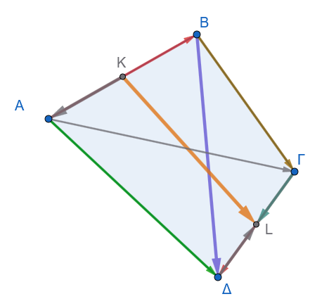{fig-align="center" width="350"}
:::

$\mathbf{1^{ος}}$ **τρόπος**

1.  Θεωρούμε τυχαίο σημείο αναφοράς $O$ στο επίπεδο.

    - Επειδή το $K$ είναι μέσο του ευθύγραμμου τμήματος $AB$, η διανυσματική του ακτίνα είναι: $$\vec{OK} = \frac{\vec{OA} + \vec{OB}}{2}$$

    - Επειδή το $L$ είναι μέσο του ευθύγραμμου τμήματος $ΓΔ$, η διανυσματική του ακτίνα είναι: $$\vec{OL} = \frac{\vec{OΓ} + \vec{OΔ}}{2}$$

    Υπολογίζουμε το διάνυσμα $\vec{KL}$: $$\vec{KL} = \vec{OL} - \vec{OK} = \frac{\vec{OΓ} + \vec{OΔ}}{2} - \frac{\vec{OA} + \vec{OB}}{2} = \frac{(\vec{OΓ} - \vec{OA}) + (\vec{OΔ} - \vec{OB})}{2}$$

    Επειδή $\vec{OΓ} - \vec{OA} = \vec{AΓ}$ και $\vec{OΔ} - \vec{OB} = \vec{BΔ}$, λαμβάνουμε: $$\vec{KL} = \frac{\vec{AΓ} + \vec{BΔ}}{2}$$

2.  Ομαδοποιώντας διαφορετικά τους όρους στο ίδιο κλάσμα: $$\vec{KL} = \frac{(\vec{OΔ} - \vec{OA}) + (\vec{OΓ} - \vec{OB})}{2} = \frac{\vec{AΔ} + \vec{BΓ}}{2}$$

    Πολλαπλασιάζοντας επί $2$: $$2\vec{KL} = \vec{AΔ} + \vec{BΓ} \iff \vec{AΔ} + \vec{BΓ} = 2\vec{KL}$$

------------------------------------------------------------------------

$\mathbf{2^{ος}}$ **τρόπος**

Από το σχήμα βλέπουμε ότι:

$$\vec{KL}=\begin{cases} \vec{ΚΒ}+\vec{ΒΓ}+\vec{ΓL} \\ \vec{KA}+\vec{ΑΔ}+\vec{ΔL}\end{cases}$$

Προσθέτοντας έχουμε $$2\vec{KL}=\vec{ΚΒ}+\vec{ΒΓ}+\vec{ΓL} + \vec{KA}+\vec{ΑΔ}+\vec{ΔL}$$

$$2\vec{KL}=\textcolor{red}{\cancel{\vec{ΚΒ}}}+\vec{ΒΓ}+\textcolor{green}{\cancel{\vec{ΓL}}} + \textcolor{red}{\cancel{\vec{KA}}}+\vec{ΑΔ}+\textcolor{green}{\cancel{\vec{ΔL}}}$$

και τελικά $$2\vec{KL}=\vec{ΒΓ}+\vec{ΑΔ}$$ Αποδείξαμε την (2)

Όμως $$\vec{ΑΓ}=\begin{cases} \textcolor{red}{\vec{ΑΒ}+\vec{ΒΓ}}\\ \vec{ΑΔ}+\vec{ΔΓ}\end{cases} \quad (1)$$ και

$$\vec{ΒΑ}=\begin{cases} \vec{ΒΓ}+\vec{ΓΔ}\\ \textcolor{red}{\vec{ΒA}+\vec{ΑΔ}}\end{cases} \quad  (2)$$

(1)+(2)$\overset{Κόκκινα}{\longrightarrow} \vec{AΓ}+\vec{ΒΔ}=\textcolor{red}{\cancel{\vec{ΑΒ}}+\vec{ΒΓ}}+\textcolor{red}{\cancel{\vec{ΒA}}+\vec{ΑΔ}}=\vec{ΒΓ}+\vec{AΔ}\quad$ Το οποίο όπως δείξαμε ισούται με $2\vec{KL}$

Άρα $$\vec{ΚL}=\dfrac{\vec{ΑΓ}+\vec{ΒΔ}}{2}$$
::::

------------------------------------------------------------------------

:::: {.math-box .example-box}
::: {.math-title .example-title}
**Εφαρμογή 2: Χαρακτηριστική Ιδιότητα & Διάνυσμα Θέσεως Κέντρου Βάρους**

**Εκφώνηση:**
:::

Δίνεται τρίγωνο $ABΓ$.

1.  Να αποδείξετε ότι το σημείο $G$ είναι το κέντρο βάρους (βαρύκεντρο) του τριγώνου $ABΓ$ αν και μόνο αν ισχύει: $$\vec{GA} + \vec{GB} + \vec{GΓ} = \vec{0}$$

2.  Αν $G$ είναι το κέντρο βάρους του τριγώνου $ABΓ$, να αποδείξετε ότι για οποιοδήποτε σημείο $O$ ισχύει: $$\vec{OG} = \frac{\vec{OA} + \vec{OB} + \vec{OΓ}}{3}$$
::::

:::: {.math-box .examplesolution-box}
::: {.math-title .examplesolution-title}
**Λύση:**

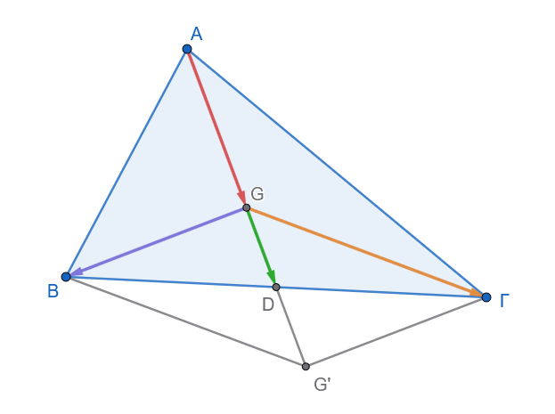{fig-align="center" width="450"}
:::

1.  **Ευθύ (**$\implies$): Έστω $G$ το κέντρο βάρους του τριγώνου $ABΓ$ και $D$ το μέσο της πλευράς $BΓ$.

    - Από τη Γεωμετρία γνωρίζουμε ότι το κέντρο βάρους διαιρεί τη διάμεσο $AD$ σε λόγο $2:1$ από την κορυφή, άρα $\vec{AG} = 2\vec{GD} \iff \vec{GA} = -2\vec{GD}$.

    - Επειδή το $D$ είναι μέσο της $BΓ$, ισχύει $\vec{GB} + \vec{GΓ} =\vec{GG'}= 2\vec{GD}$.

    Προσθέτοντας κατά μέλη: $$\vec{GA} + \vec{GB} + \vec{GΓ} = -2\vec{GD} + 2\vec{GD} = \vec{0}$$

    **Αντίστροφο (**$\impliedby$): Έστω ότι για ένα σημείο $G$ ισχύει $\vec{GA} + \vec{GB} + \vec{GΓ} = \vec{0}$.

    - Αν $D$ είναι το μέσο της $BΓ$, αντικαθιστούμε $\vec{GB} + \vec{GΓ} = 2\vec{GD}$: $$\vec{GA} + 2\vec{GD} = \vec{0} \iff \vec{AG} = 2\vec{GD}$$

    - Η σχέση αυτή δηλώνει ότι το $G$ βρίσκεται πάνω στη διάμεσο $AD$ και απέχει από την κορυφή $A$ διπλάσια απόσταση από ό,τι από το μέσο $D$, άρα το $G$ είναι το κέντρο βάρους του τριγώνου.

2.  Εκφράζουμε τη σχέση $\vec{GA} + \vec{GB} + \vec{GΓ} = \vec{0}$ με σημείο αναφοράς το $O$: $$(\vec{OA} - \vec{OG}) + (\vec{OB} - \vec{OG}) + (\vec{OΓ} - \vec{OG}) = \vec{0}$$ $$\vec{OA} + \vec{OB} + \vec{OΓ} - 3\vec{OG} = \vec{0} \iff 3\vec{OG} = \vec{OA} + \vec{OB} + \vec{OΓ}$$ $$\vec{OG} = \frac{\vec{OA} + \vec{OB} + \vec{OΓ}}{3}$$
::::

------------------------------------------------------------------------

:::: {.math-box .example-box}
::: {.math-title .example-title}
**Εφαρμογή 3: Μέτρο Αθροίσματος & Γεωμετρικός Τόπος**

**Εκφώνηση:**
:::

1.  Δίνονται διανύσματα $\vec{a}$ και $\vec{b}$ με μέτρα $|\vec{a}| = 5$ και $|\vec{b}| = 3$.
    Να βρείτε την ελάχιστη και τη μέγιστη τιμή που μπορεί να λάβει το μέτρο $|\vec{a} + \vec{b}|$ και να προσδιορίσετε τη σχετική θέση των διανυσμάτων σε κάθε περίπτωση.

2.  Δίνεται ευθύγραμμο τμήμα $AB$ μήκους $6\text{ cm}$.
    Να βρεθεί ο γεωμετρικός τόπος των σημείων $M$ του επιπέδου για τα οποία ισχύει: $$|\vec{MA} + \vec{MB}| = |\vec{MA} - \vec{MB}|$$
::::

:::: {.math-box .examplesolution-box}
::: {.math-title .examplesolution-title}
**Λύση:**

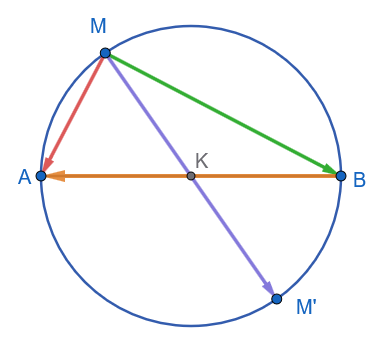{fig-align="center" width="300"}
:::

1.  Από την τριγωνική ανισότητα διανυσμάτων ισχύει η διπλή ανισότητα: $$||\vec{a}| - |\vec{b}|| \le |\vec{a} + \vec{b}| \le |\vec{a}| + |\vec{b}|$$

    Αντικαθιστώντας τα μέτρα $|\vec{a}| = 5$ και $|\vec{b}| = 3$: $$|5 - 3| \le |\vec{a} + \vec{b}| \le 5 + 3 \iff 2 \le |\vec{a} + \vec{b}| \le 8$$

    - **Μέγιστη τιμή:** $8$, όταν τα διανύσματα είναι **ομόρροπα** ($\vec{a} \uparrow\uparrow \vec{b}$).

    - **Ελάχιστη τιμή:** $2$, όταν τα διανύσματα είναι **αντίρροπα** ($\vec{a} \uparrow\downarrow \vec{b}$).

2.  Αναλύουμε τα δύο μέλη της δοσμένης εξίσωσης:

    - **Πρώτο μέλος:** Αν $K$ είναι το μέσο του ευθύγραμμου τμήματος $AB$, τότε $\vec{MA} + \vec{MB} = 2\vec{MK}$.

      Άρα: $$|\vec{MA} + \vec{MB}| = |2\vec{MK}| = 2|\vec{MK}| = 2(MK)$$

    - **Δεύτερο μέλος:** Από τον κανόνα αφαίρεσης διανυσμάτων ισχύει $\vec{MA} - \vec{MB} = \vec{BA}$.

      Άρα: $$|\vec{MA} - \vec{MB}| = |\vec{BA}| = (AB) = 6\text{ cm}$$

    Εξισώνοντας τα δύο μέλη: $$2(MK) = 6 \iff (MK) = 3\text{ cm}$$

    Επειδή το σημείο $K$ (μέσο του $AB$) είναι σταθερό, η σχέση $(MK) = 3\text{ cm}$ σημαίνει ότι το σημείο $M$ απέχει σταθερή απόσταση $3\text{ cm}$ από το $K$.

    **Συμπέρασμα:** Ο γεωμετρικός τόπος του σημείου $M$ είναι **κύκλος με κέντρο το μέσο** $K$ του τμήματος $AB$ και ακτίνα $R = 3\text{ cm}$ (δηλαδή ο κύκλος με διάμετρο το τμήμα $AB$).
::::

------------------------------------------------------------------------

### Ασκήσεις στην Έννοια & τις Εφαρμογές του Πολλαπλασιασμού Αριθμού με Διάνυσμα

#### **Ομάδα A: Αλγεβρικοί Χειρισμοί & Απλοποίηση Διανυσματικών Παραστάσεων**

1.  **Άσκηση 1:** Να λύσετε ως προς το διάνυσμα $\vec{x}$ τις παρακάτω εξισώσεις:

    - α) $3(\vec{x} + 2\vec{α}) - 2(\vec{x} - \vec{β}) = 4\vec{α} + 5\vec{β}$

    - β) $\dfrac{1}{2}(3\vec{x} + 5\vec{α}) = \dfrac{1}{3}(2\vec{x} - 7\vec{β})$

:::: my-callout-theory
::: {.my-callout-theory .callout-title}
Υπόδειξη (α)
:::

$3(\vec{x} + 2\vec{α}) - 2(\vec{x} - \vec{β}) = 4\vec{α} + 5\vec{β} \implies 3\vec x+6 \vec a -2 \vec x+2 \vec β =4 \vec a+5 \vec β \implies \\ 3 \vec x -2 \vec x= .......................$
::::

------------------------------------------------------------------------

2.  **Άσκηση 2:** Αν για τα διανύσματα $\vec{u}$ και $\vec{v}$ ισχύουν οι σχέσεις $\vec{u} - 2\vec{v} = 2\vec{α}$ και $3\vec{u} + \vec{v} = \vec{β}$, να εκφράσετε τα διανύσματα $\vec{u}$ και $\vec{v}$ ως γραμμικό συνδυασμό των $\vec{α}$ και $\vec{β}$.

:::: my-callout-theory
::: {.my-callout-theory .callout-title}
Υπόδειξη
:::

Λύστε το σύστημα $$\begin{cases} \vec{u} - 2\vec{v} = 2\vec{α} \\ 3\vec{u} + \vec{v} = \vec{β} \end{cases}$$
::::

------------------------------------------------------------------------

3.  **Άσκηση 3:** Να απλοποιήσετε τη διανυσματική παράσταση: $$\vec{w} = 2(\vec{AB} - 3\vec{BΓ}) + 3(\vec{BΓ} + 2\vec{AΓ}) - 4\vec{AΓ}$$

4.  **Άσκηση 4:** Δίνεται διάνυσμα $\vec{α} \neq \vec{0}$.
    Να προσδιορίσετε το μέτρο και την κατεύθυνση των διανυσμάτων $\vec{v} = -4\vec{α}$ και $\vec{u} = \dfrac{1}{|\vec{α}|}\vec{α}$.

------------------------------------------------------------------------

#### **Ομάδα B: Γραμμικός Συνδυασμός & Έκφραση Διανυσμάτων**

5.  **Άσκηση 5:** Δίνεται τρίγωνο $ABΓ$. Αν $M$ είναι το μέσο της $BΓ$, να εκφράσετε το διάνυσμα $\vec{AM}$ ως γραμμικό συνδυασμό των διανυσμάτων $\vec{AB}$ και $\vec{AΓ}$.

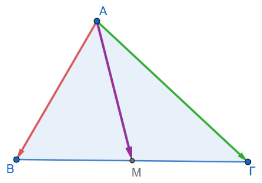{fig-align="center" width="360"}

:::: my-callout-theory
::: {.my-callout-theory .callout-title}
Υπόδειξη
:::

$\vec{ΑΒ} +\vec{ΑΓ}=2\vec{ΑΜ} \implies ...................$
::::

------------------------------------------------------------------------

6.  **Άσκηση 6:** Δίνεται παραλληλόγραμμο $ABΓΔ$ και $M$ το μέσο της πλευράς $AB$. Αν $\vec{AΔ} = \vec{α}$ και $\vec{AB} = \vec{β}$, να εκφράσετε τα διανύσματα $\vec{Δ M}$ και $\vec{ΔΓ}$ ως γραμμικό συνδυασμό των $\vec{α}$ και $\vec{β}$.

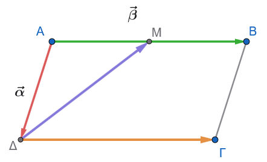{fig-align="center" width="300"}

:::: my-callout-theory
::: {.my-callout-theory .callout-title}
Υπόδειξη
:::

$\vec{ΑΜ}=\dfrac{\vec{β}}{2}$

$\vec{ΔM}=\vec{ΑΜ}-\vec{ΑΔ}=\dfrac{\vec{β}}{2}-\vec{α}= .......................$

$\vec{ΔΓ}=\vec{β}= 0\cdot \vec{a}+ .........$
::::

------------------------------------------------------------------------

7.  **Άσκηση 7:** Σε τρίγωνο $ABΓ$, θεωρούμε σημείο $Δ$ στην πλευρά $BΓ$ τέτοιο ώστε $\vec{BΔ} = 2\vec{ΔΓ}$. Να αποδείξετε ότι:

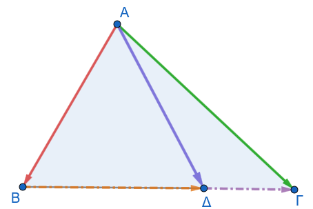{fig-align="center" width="360"}

$$\vec{AΔ} = \frac{1}{3}\vec{AB} + \frac{2}{3}\vec{AΓ}$$

:::: my-callout-theory
::: {.my-callout-theory .callout-title}
Υπόδειξη
:::

$\vec{ΑΔ}=\vec{ΑΒ}+\vec{ΒΔ} \qquad  (1)$

$\vec{AΔ}=\vec{ΑΓ}+(-\vec{ΔΓ}) \qquad  (2)$

Προσθέτουμε (1)+(2)=

$2\vec{ΑΔ}=\vec{ΑΒ}+\vec{ΑΓ}+\vec{ΒΔ}-\vec{ΔΓ} \implies 2\vec{ΑΔ}=\vec{ΑΒ}+\vec{ΑΓ}+\dfrac{1}{3}\vec{BΓ} \implies \\ 2\vec{ΑΔ}=\vec{ΑΒ}+\vec{ΑΓ}+\dfrac{1}{3}(\vec{AΓ}-\vec{ΑΒ}) \implies$

.............................................................

...........................................................
::::

------------------------------------------------------------------------

8.  **Άσκηση 8:** Δίνεται παραλληλόγραμμο $ABΓΔ$ με κέντρο $O$. Να εκφράσετε τα διανύσματα $\vec{AB}, \vec{BΓ}, \vec{ΓΔ}, \vec{Δ A}$ ως γραμμικό συνδυασμό των διανυσμάτων $\vec{α} = \vec{AO}$ και $\vec{β} = \vec{BO}$.

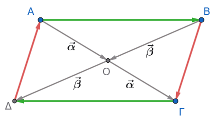{fig-align="center" width="350"}

:::: my-callout-theory
::: {.my-callout-theory .callout-title}
Υπόδειξη
:::

- $\vec{ΑΒ}=\vec{ΑO}+\vec{ΟΒ} = \vec{α}+(-\vec{β})=\vec{α}  -\vec{β}=1\cdot \vec a +(-1) \cdot \vec β$

- $\vec{ΒΓ}=\vec{β}+\vec{α} =\vec{α}+\vec{β}$

- ..........................................................

- ...........................................................
::::

------------------------------------------------------------------------

#### **Ομάδα Γ: Συνθήκη Παραλληλίας & Συνευθειακά Σημεία**

:::: {.math-box .exercise-box}
::: {.math-title .exercise-title}
9.  **Άσκηση 9:**
:::

Δίνονται τα μη συγγραμμικά διανύσματα $\vec{α}$ και $\vec{β}$.
Να βρείτε την τιμή του $κ \in \mathbb{R}$ ώστε τα διανύσματα $\vec{u} = (κ - 1)\vec{α} + \vec{β}$ και $\vec{v} = (3κ + 2)\vec{α} - 2\vec{β}$ να είναι παράλληλα.
::::

:::: {.math-box .solution-box}
::: {.math-title .solution-title}
Λύση
:::

Για να είναι τα διανύσματα $\vec{u}$ και $\vec{v}$ παράλληλα ($\vec{u} \parallel \vec{v}$), πρέπει να υπάρχει πραγματικός αριθμός $\lambda \in \mathbb{R}$ τέτοιος ώστε: $$\vec{v} = \lambda \vec{u}$$

Αντικαθιστούμε τα διανύσματα $\vec{u} = (\kappa - 1)\vec{\alpha} + \vec{\beta}$ και $\vec{v} = (3\kappa + 2)\vec{\alpha} - 2\vec{\beta}$: $$(3\kappa + 2)\vec{\alpha} - 2\vec{\beta} = \lambda \big((\kappa - 1)\vec{\alpha} + \vec{\beta}\big)$$ $$(3\kappa + 2)\vec{\alpha} - 2\vec{\beta} = \lambda(\kappa - 1)\vec{\alpha} + \lambda\vec{\beta}$$

Μεταφέρουμε όλους τους όρους στο αριστερό μέλος: $$\big[(3\kappa + 2) - \lambda(\kappa - 1)\big]\vec{\alpha} + (-2 - \lambda)\vec{\beta} = \vec{0}$$

------------------------------------------------------------------------

**Εξίσωση συντελεστών**

Επειδή τα διανύσματα $\vec{\alpha}$ και $\vec{\beta}$ είναι **μη συγγραμμικά**, οι συντελεστές τους πρέπει να είναι ίσοι με μηδέν: $$\begin{cases}
-2 - \lambda = 0 \\[5pt]
(3\kappa + 2) - \lambda(\kappa - 1) = 0
\end{cases}$$

------------------------------------------------------------------------

**Επίλυση**

Από την πρώτη εξίσωση βρίσκουμε: $$\lambda = -2$$

Αντικαθιστούμε την τιμή του $\lambda$ στη δεύτερη εξίσωση: $$(3\kappa + 2) - (-2)(\kappa - 1) = 0$$ $$(3\kappa + 2) + 2(\kappa - 1) = 0$$ $$3\kappa + 2 + 2\kappa - 2 = 0$$ $$5\kappa = 0 \implies \kappa = 0$$

------------------------------------------------------------------------

**Συμπέρασμα**

Η τιμή του $\kappa \in \mathbb{R}$ ώστε τα διανύσματα να είναι παράλληλα είναι: $$\kappa = 0$$
::::

------------------------------------------------------------------------

10. **Άσκηση 10:** Δίνεται τρίγωνο $ABΓ$. Θεωρούμε τα σημεία $Δ$ και $E$ τέτοια ώστε $\vec{AΔ} = 3\vec{AB}$ και $\vec{AE} = 3\vec{AΓ}$. Να αποδείξετε ότι τα διανύσματα $\vec{ΔE}$ και $\vec{BΓ}$ είναι παράλληλα.

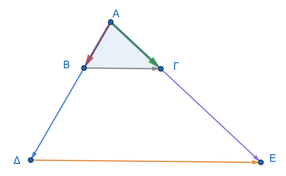{width="400"}

:::: my-callout-theory
::: {.my-callout-theory .callout-title}
Υπόδειξη
:::

$\vec{ΔΕ}=\vec{ΑΔ}-\vec{ΑΕ}=3\vec{ΑΒ}-3\vec{ΑΓ}=3(\vec{ΑΒ}-\vec{ΑΓ})=3\vec{ΒΓ} \implies$

..............................................................
::::

------------------------------------------------------------------------

:::: {.math-box .exercise-box}
::: {.math-title .exercise-title}
11. **Άσκηση 11:**
:::

Έστω $ABΓ$ τρίγωνο.
Θεωρούμε τα σημεία $E, Z$ τέτοια ώστε $\vec{ΑΕ} = \dfrac{4}{3}\vec{AB}$ και $\vec{AZ} = 2\vec{AΓ} - \vec{AE}$.
Να αποδείξετε ότι τα σημεία $E, Γ, Z$ είναι συνευθειακά.
::::

:::: {.math-box .solution-box}
::: {.math-title .solution-title}
Λύση

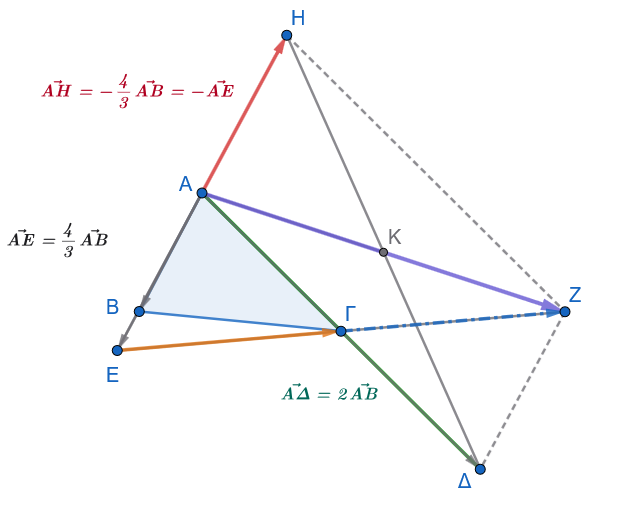{fig-align="center" width="400"}
:::

Για να αποδείξουμε ότι τα σημεία $E, \Gamma, Z$ είναι συνευθειακά, αρκεί να δείξουμε ότι τα διανύσματα $\vec{E\Gamma}$ και $\vec{EZ}$ (ή $\vec{\Gamma Z}$) είναι συγγραμμικά (δηλαδή $\vec{EZ} = \lambda \vec{E\Gamma}$ για κάποιο $\lambda \in \mathbb{R}$).

------------------------------------------------------------------------

**Μέθοδος 1: Μέσω της σχέσης των διανυσμάτων** $\vec{E\Gamma}$ και $\vec{EZ}$

1.  **Υπολογισμός του διανύσματος** $\vec{E\Gamma}$:

    Αναλύουμε το διάνυσμα $\vec{E\Gamma}$ με αρχή το σημείο $A$: $$\vec{E\Gamma} = \vec{A\Gamma} - \vec{AE}$$

2.  **Υπολογισμός του διανύσματος** $\vec{EZ}$:

    Ομοίως, αναλύουμε το $\vec{EZ}$ με αρχή το σημείο $A$: $$\vec{EZ} = \vec{AZ} - \vec{AE}$$

    Χρησιμοποιούμε τη δοσμένη σχέση $\vec{AZ} = 2\vec{A\Gamma} - \vec{AE}$: $$\vec{EZ} = (2\vec{A\Gamma} - \vec{AE}) - \vec{AE} = 2\vec{A\Gamma} - 2\vec{AE}$$

    Βγάζουμε κοινό παράγοντα το $2$: $$\vec{EZ} = 2(\vec{A\Gamma} - \vec{AE})$$

3.  **Σύγκριση:**

    Επειδή $\vec{A\Gamma} - \vec{AE} = \vec{E\Gamma}$, έχουμε άμεσα: $$\vec{EZ} = 2\vec{E\Gamma}$$

Επομένως, τα διανύσματα $\vec{EZ}$ και $\vec{E\Gamma}$ είναι συγγραμμικά με κοινό σημείο το $E$, πράγμα που σημαίνει ότι τα σημεία $E, \Gamma, Z$ είναι **συνευθειακά** (και μάλιστα το $\Gamma$ είναι το μέσον του τμήματος $EZ$).

------------------------------------------------------------------------

**Μέθοδος 2: Άμεση απόδειξη ότι το** $\Gamma$ είναι το μέσον του $EZ$

Από τη δοσμένη σχέση: $$\vec{AZ} = 2\vec{A\Gamma} - \vec{AE}$$

Μεταφέρουμε το $-\vec{AE}$ στο αριστερό μέλος: $$\vec{AE} + \vec{AZ} = 2\vec{A\Gamma} \iff \vec{A\Gamma} = \frac{\vec{AE} + \vec{AZ}}{2}$$

Η παραπάνω σχέση αποτελεί τη διανυσματική έκφραση του **μέσου ευθύγραμμου τμήματος** με σημείο αναφοράς το $A$.

Συνεπώς, το σημείο $\Gamma$ είναι το **μέσον** του τμήματος $EZ$, άρα τα σημεία $E, \Gamma, Z$ είναι αναγκαστικά **συνευθειακά**.
::::

------------------------------------------------------------------------

:::: {.math-box .exercise-box}
::: {.math-title .exercise-title}
12. **Άσκηση 12:**
:::

Δίνονται τρία σημεία $A, B, Γ$.
Αν ισχύει η σχέση $2\vec{PA} + 3\vec{PB} - 5\vec{PΓ} = \vec{0}$ για ένα σημείο $P$, να αποδείξετε ότι τα σημεία $A, B, Γ$ είναι συνευθειακά.
::::

:::: {.math-box .solution-box}
::: {.math-title .solution-title}
Λύση
:::

Δίνεται η σχέση: $$2\vec{PA} + 3\vec{PB} - 5\vec{P\Gamma} = \vec{0}$$

Αναλύουμε τα διανύσματα $\vec{PA}$ και $\vec{PB}$ μέσω του σημείου $\Gamma$ (ή θεωρούμε ως σημείο αναφοράς $P$ το ίδιο το $\Gamma$):

- $\vec{PA} = \vec{P\Gamma} + \vec{\Gamma A}$

- $\vec{PB} = \vec{P\Gamma} + \vec{\Gamma B}$

Αντικαθιστούμε στη σχέση:

$$2(\vec{P\Gamma} + \vec{\Gamma A}) + 3(\vec{P\Gamma} + \vec{\Gamma B}) - 5\vec{P\Gamma} = \vec{0}$$ $$2\vec{P\Gamma} + 2\vec{\Gamma A} + 3\vec{P\Gamma} + 3\vec{\Gamma B} - 5\vec{P\Gamma} = \vec{0}$$ $$(2 + 3 - 5)\vec{P\Gamma} + 2\vec{\Gamma A} + 3\vec{\Gamma B} = \vec{0}$$ $$0\vec{P\Gamma} + 2\vec{\Gamma A} + 3\vec{\Gamma B} = \vec{0}$$ $$2\vec{\Gamma A} + 3\vec{\Gamma B} = \vec{0}$$ $$3\vec{\Gamma B} = -2\vec{\Gamma A} \implies \vec{\Gamma B} = -\frac{2}{3}\vec{\Gamma A}$$

Επειδή τα διανύσματα $\vec{\Gamma B}$ και $\vec{\Gamma A}$ είναι συγγραμμικά και έχουν κοινό σημείο το $\Gamma$, τα σημεία $A, B, \Gamma$ είναι **συνευθειακά**.
::::

------------------------------------------------------------------------

13. **Άσκηση 13:** Αν για τα μη συγγραμμικά διανύσματα $\vec{α}$ και $\vec{β}$ ισχύει $(κ + λ - 2)\vec{α} + (2κ - λ + 5)\vec{β} = \vec{0}$, να υπολογίσετε τους πραγματικούς αριθμούς $κ$ και $λ$.

------------------------------------------------------------------------

#### **Ομάδα Δ: Διανυσματική Ακτίνα Μέσου & Βαρύκεντρο Τριγώνου**

14. **Άσκηση 14:** Αν $K, Λ$ είναι τα μέσα των πλευρών $AB$ και $AΓ$ τριγώνου $ABΓ$ αντίστοιχα, να αποδείξετε ότι για τυχαίο σημείο αναφοράς $O$ ισχύει: $$\vec{OK} + \vec{OΛ} = \vec{OA} + \vec{OM}$$ όπου $M$ είναι το μέσο της $BΓ$.

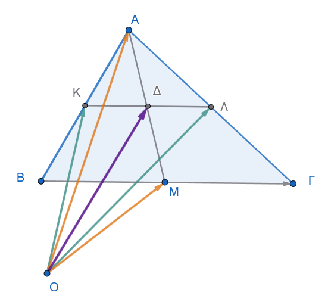{fig-align="center" width="400"}

:::: my-callout-theory
::: {.my-callout-theory .callout-title}
Υπόδειξη
:::

1.  $ΚΛ=||\dfrac{ΒΓ}{2}$

2.  Άρα και το $Δ$ μέσον της $ΑΜ$ και της $ΚΛ$ διότι $ΑΚΜΛ$ παραλληλόγραμμο.

3.  $$\vec{OK} + \vec{OΛ} =2\vec{OΔ} = \vec{OA} + \vec{OM}$$
::::

------------------------------------------------------------------------

15. **Άσκηση 15:** Δίνεται τετράπλευρο $ABΓΔ$. Αν $E$ είναι το μέσο της διαγωνίου $AΓ$ και $Z$ το μέσο της διαγωνίου $BΔ$, να αποδείξετε ότι για τυχαίο σημείο $O$ ισχύει: $$\vec{OA} + \vec{OB} + \vec{OΓ} + \vec{OΔ} = 2(\vec{OE} + \vec{OZ})$$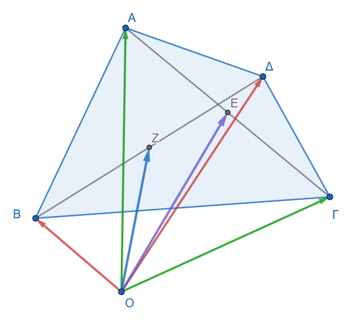{width="400"}

------------------------------------------------------------------------

:::: {.math-box .exercise-box}
::: {.math-title .exercise-title}
16. **Άσκηση 16:**
:::

Δίνεται τετράπλευρο ΑΒΓΔ και έστω Μ και Ν τα μέσα των διαγωνίων του ΑΓ και ΒΔ αντιστοίχως.
Να αποδείξετε ότι αν $4\vec{MN}=\vec{AΔ}-\vec{ΒΓ}$ τότε το τετράπλευρο αυτό είναι παραλληλόγραμμο.
::::

:::: {.math-box .solution-box}
::: {.math-title .solution-title}
Λύση

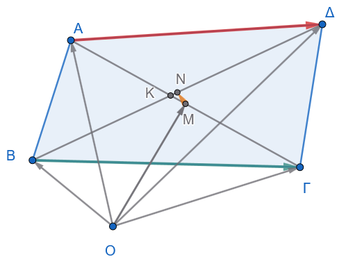{fig-align="center" width="370"}
:::

Θεωρούμε ένα αυθαίρετο σημείο αναφοράς $O$ στο επίπεδο και τα διανύσματα θέσης $\vec{OA}, \vec{OB}, \vec{O\Gamma}, \vec{O\Delta}$ των κορυφών του τετραπλεύρου $AB\Gamma\Delta$.

------------------------------------------------------------------------

**1: Έκφραση των διανυσμάτων θέσης των μέσων** $M$ και $N$

Επειδή το $M$ είναι το μέσον του τμήματος $A\Gamma$, το διάνυσμα θέσης του είναι: $$\vec{OM} = \frac{\vec{OA} + \vec{O\Gamma}}{2}$$

Επειδή το $N$ είναι το μέσον του τμήματος $B\Delta$, το διάνυσμα θέσης του είναι: $$\vec{ON} = \frac{\vec{OB} + \vec{O\Delta}}{2}$$

------------------------------------------------------------------------

**2: Έκφραση του διανύσματος** $\vec{MN}$

Το διάνυσμα $\vec{MN}$ εκφράζεται μέσω των διανυσμάτων θέσης ως εξής: $$\vec{MN} = \vec{ON} - \vec{OM}$$

Αντικαθιστούμε τα $\vec{OM}$ και $\vec{ON}$: $$\vec{MN} = \frac{\vec{OB} + \vec{O\Delta}}{2} - \frac{\vec{OA} + \vec{O\Gamma}}{2} = \frac{\vec{OB} + \vec{O\Delta} - \vec{OA} - \vec{O\Gamma}}{2}$$

Πολλαπλασιάζοντας και τα δύο μέλη με $4$: $$4\vec{MN} = 4 \cdot \frac{\vec{OB} + \vec{O\Delta} - \vec{OA} - \vec{O\Gamma}}{2} = 2(\vec{OB} + \vec{O\Delta} - \vec{OA} - \vec{O\Gamma})$$

------------------------------------------------------------------------

**3: Έκφραση της διαφοράς** $\vec{A\Delta} - \vec{B\Gamma}$

Εκφράζουμε τα διανύσματα $\vec{A\Delta}$ και $\vec{B\Gamma}$ μέσω των διανυσμάτων θέσης των άκρων τους: $$\vec{A\Delta} = \vec{O\Delta} - \vec{OA}$$ $$\vec{B\Gamma} = \vec{O\Gamma} - \vec{OB}$$

Επομένως: $$\vec{A\Delta} - \vec{B\Gamma} = (\vec{O\Delta} - \vec{OA}) - (\vec{O\Gamma} - \vec{OB}) = \vec{O\Delta} - \vec{OA} - \vec{O\Gamma} + \vec{OB}$$

Παρατηρούμε ότι: $$\vec{A\Delta} - \vec{B\Gamma} = \vec{OB} + \vec{O\Delta} - \vec{OA} - \vec{O\Gamma}$$

------------------------------------------------------------------------

**4: Χρήση της δοσμένης υπόθεσης**

Δίνεται ότι: $$4\vec{MN} = \vec{A\Delta} - \vec{B\Gamma}$$

Αντικαθιστώντας τις εκφράσεις που βρήκαμε: $$2(\vec{OB} + \vec{O\Delta} - \vec{OA} - \vec{O\Gamma}) = \vec{OB} + \vec{O\Delta} - \vec{OA} - \vec{O\Gamma}$$

Μεταφέρουμε όλους τους όρους στο αριστερό μέλος: $$2(\vec{OB} + \vec{O\Delta} - \vec{OA} - \vec{O\Gamma}) - (\vec{OB} + \vec{O\Delta} - \vec{OA} - \vec{O\Gamma}) = \vec{0}$$ $$\vec{OB} + \vec{O\Delta} - \vec{OA} - \vec{O\Gamma} = \vec{0}$$

------------------------------------------------------------------------

**5: Συμπέρασμα για το τετράπλευρο** $AB\Gamma\Delta$

Αναδιατάσσουμε τους όρους της εξίσωσης: $$\vec{OB} - \vec{OA} = \vec{O\Gamma} - \vec{O\Delta}$$

Από τον ορισμό των διανυσμάτων:

- $\vec{OB} - \vec{OA} = \vec{AB}$

- $\vec{O\Gamma} - \vec{O\Delta} = \vec{\Delta\Gamma}$

Άρα προκύπτει: $$\vec{AB} = \vec{\Delta\Gamma}$$

Επειδή τα διανύσματα των απέναντι πλευρών είναι ίσα ($\vec{AB} = \vec{\Delta\Gamma}$), οι πλευρές $AB$ και $\Delta\Gamma$ είναι παράλληλες και έχουν ίσα μήκη.

Συνεπώς, το τετράπλευρο $AB\Gamma\Delta$ είναι **παραλληλόγραμμο**.
::::

17. **Άσκηση 17:** Δίνεται παραλληλόγραμμο $ABΓΔ$ με κέντρο $O$ και τυχαίο σημείο $M$. Να αποδείξετε ότι: $$\vec{MA} + \vec{MB} + \vec{MΓ} + \vec{MΔ} = 4\vec{MO}$$

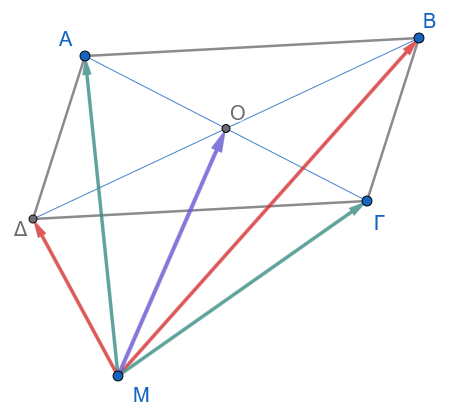{fig-align="center" width="350"}

:::: my-callout-theory
::: {.my-callout-theory .callout-title}
Υπόδειξη
:::

- Το Ο είναι μέσο των ΑΓ και ΒΔ.

- Στο τρίγωνο $\overset{\triangle}{ΜΑΓ} \quad$: $\vec{MA}+\vec{MΓ}=2\vec{ΜΟ}$

- Στο τρίγωνο $\overset{\triangle}{ΜΔΒ} \quad$: $\vec{MΔ}+\vec{MΒ}=2\vec{ΜΟ}$

- .....................................................................
::::

------------------------------------------------------------------------

#### **Ομάδα E: Σύνθετες Αποδείξεις & Γεωμετρικοί Σχηματισμοί**

18. **Άσκηση 18:** Σε τρίγωνο $ABΓ$, $M$ είναι το μέσο της $BΓ$. Στην προέκταση της $AM$ παίρνουμε σημείο $N$ τέτοιο ώστε $\vec{AN} = 3\vec{AM}$. Να εκφράσετε το διάνυσμα $\vec{BN}$ ως γραμμικό συνδυασμό των $\vec{AB}$ και $\vec{AΓ}$.

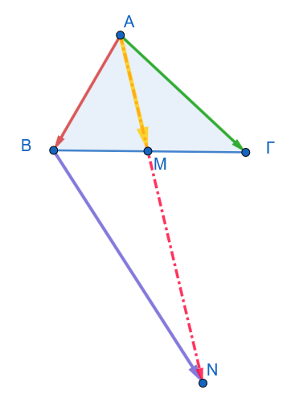{fig-align="center" width="270"}

:::: my-callout-theory
::: {.my-callout-theory .callout-title}
Υπόδειξη
:::

1.  $\vec{ΑΒ}+\vec{ΑΓ}=2\vec{ΑΜ} \implies \vec{AM}= ................$

2.  $\vec{ΒΝ}=\vec{ΑΝ}-\vec{ΑΒ}=3\vec{AM}-\vec{AB}=3\dfrac{\vec{ΑΒ}+\vec{ΑΓ}}{2}-\vec{ΑΒ}=$

................................................................
::::

------------------------------------------------------------------------

:::: {.math-box .exercise-box}
::: {.math-title .exercise-title}
19. **Άσκηση 19:**
:::

Δίνεται παραλληλόγραμμο $ABΓΔ$.
Στις πλευρές $AB$ και $AΔ$ παίρνουμε σημεία $E$ και $Z$ αντίστοιχα, τέτοια ώστε $\vec{AE} = \dfrac{1}{3}\vec{AB}$ και $\vec{AZ} = \dfrac{1}{4}\vec{AΔ}$.
Αν $K$ είναι το σημείο τομής των $EZ$ και $AΓ$, να βρεθεί ο λόγος $\dfrac{AK}{AΓ}$.
::::

:::: {.math-box .solution-box}
::: {.math-title .solution-title}
Λύση

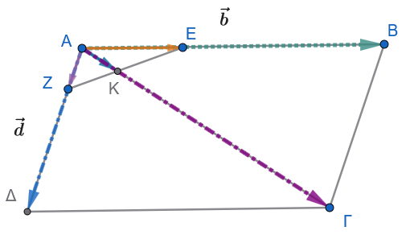{fig-align="center" width="400"}
:::

Θεωρούμε ως σημείο αναφοράς την κορυφή $A$ και θέτουμε τα μη συγγραμμικά διανύσματα: $$\vec{AB} = \vec{b} \quad \text{και} \quad \vec{A\Delta} = \vec{d}$$

Επειδή το $AB\Gamma\Delta$ είναι παραλληλόγραμμο, από τον κανόνα του παραλληλογράμμου ισχύει: $$\vec{A\Gamma} = \vec{AB} + \vec{A\Delta} = \vec{b} + \vec{d}$$

Από τα δεδομένα της άσκησης έχουμε: $$\vec{AE} = \frac{1}{3}\vec{AB} = \frac{1}{3}\vec{b}$$ $$\vec{AZ} = \frac{1}{4}\vec{A\Delta} = \frac{1}{4}\vec{d}$$

------------------------------------------------------------------------

**1: Το σημείο** $K$ ανήκει στην ευθεία $A\Gamma$

Εφόσον το $K$ είναι σημείο της διαγωνίου $A\Gamma$, τα διανύσματα $\vec{AK}$ και $\vec{A\Gamma}$ είναι ομόρροπα και συγγραμμικά.
Υπάρχει πραγματικός αριθμός $k \in (0, 1)$ τέτοιος ώστε: $$\vec{AK} = k \cdot \vec{A\Gamma} = k(\vec{b} + \vec{d}) = k\vec{b} + k\vec{d} \quad (1)$$

Παρατηρούμε ότι ο ζητούμενος λόγος είναι: $$\frac{AK}{A\Gamma} = \frac{|\vec{AK}|}{|\vec{A\Gamma}|} = k$$

------------------------------------------------------------------------

**2: Το σημείο** $K$ ανήκει στο ευθύγραμμο τμήμα $EZ$

Εφόσον το $K$ ανήκει στο τμήμα $EZ$, τα σημεία $E, K, Z$ είναι συνευθειακά.
Υπάρχει πραγματικός αριθμός $\lambda \in [0, 1]$ τέτοιος ώστε: $$\vec{EK} = \lambda \cdot \vec{EZ}$$

Αναλύουμε ως προς το σημείο $A$: $$\vec{AK} - \vec{AE} = \lambda(\vec{AZ} - \vec{AE})$$ $$\vec{AK} = (1 - \lambda)\vec{AE} + \lambda\vec{AZ}$$

Αντικαθιστούμε τα $\vec{AE} = \dfrac{1}{3}\vec{b}$ και $\vec{AZ} = \dfrac{1}{4}\vec{d}$: $$\vec{AK} = \frac{1 - \lambda}{3}\vec{b} + \frac{\lambda}{4}\vec{d} \quad (2)$$

------------------------------------------------------------------------

**3: Εξίσωση των συντελεστών**

Επειδή τα διανύσματα $\vec{b}$ και $\vec{d}$ είναι μη συγγραμμικά, η παράσταση του $\vec{AK}$ ως γραμμικός συνδυασμός τους είναι μοναδική.
Εξισώνοντας τις σχέσεις $(1)$ και $(2)$, προκύπτει το σύστημα: $$\begin{cases}
k = \dfrac{1 - \lambda}{3} \\[8pt]
k = \dfrac{\lambda}{4}
\end{cases}$$

------------------------------------------------------------------------

**4: Υπολογισμός του λόγου** $k$

Από τη δεύτερη εξίσωση έχουμε: $$\lambda = 4k$$

Αντικαθιστούμε στην πρώτη εξίσωση: $$k = \frac{1 - 4k}{3}$$ $$3k = 1 - 4k$$ $$7k = 1 \implies k = \frac{1}{7}$$

------------------------------------------------------------------------

**Συμπέρασμα**

Ο ζητούμενος λόγος είναι: $$\frac{AK}{A\Gamma} = \frac{1}{7}$$
::::

------------------------------------------------------------------------

20. **Άσκηση 20:** Δίνονται τα διανύσματα $\vec{α}, \vec{β}$ με $|\vec{α}| = 2$ και $\vec{u} = \vec{α} + 2\vec{β}$, $\vec{v} = 3\vec{α} - \vec{β}$. Αν τα διανύσματα $\vec{u}$ και $\vec{v}$ είναι παράλληλα, να αποδείξετε ότι τα διανύσματα $\vec{α}$ και $\vec{β}$ είναι παράλληλα και να υπολογίσετε το μέτρο του $\vec{β}$.

------------------------------------------------------------------------

21. **Άσκηση 21:** Δίνονται τέσσερα σημεία $A, B, Γ, Δ$. Αν για το σημείο $O$ ισχύει $\vec{OA} + \vec{OΓ} = \vec{OB} + \vec{OΔ}$, να αποδείξετε ότι το τετράπλευρο $ABΓΔ$ είναι παραλληλόγραμμο.

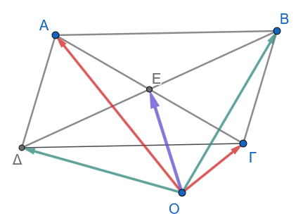{fig-align="center" width="350"}

:::: my-callout-theory
::: {.my-callout-theory .callout-title}
Υπόδειξη
:::

Στο τρίγωνο $\triangle{ΑΓΟ} : \quad$ $\vec{OA} + \vec{OΓ}=2\vec{OE} \quad$, όπου Ε το μέσον της ΑΓ.

Στο τρίγωνο $\triangle{ΔΒΟ} : \quad$ $\vec{OB} + \vec{OΔ}=2\vec{OE'} \quad$, όπου Ε' το μέσον της ΔΒ.

....................................................

........................................................
::::

------------------------------------------------------------------------

22. **Άσκηση 22:** Δίνεται τρίγωνο $ABΓ$ και $M, N, P$ τα μέσα των πλευρών $BΓ, Γ A, AB$ αντίστοιχα. Να αποδείξετε ότι:

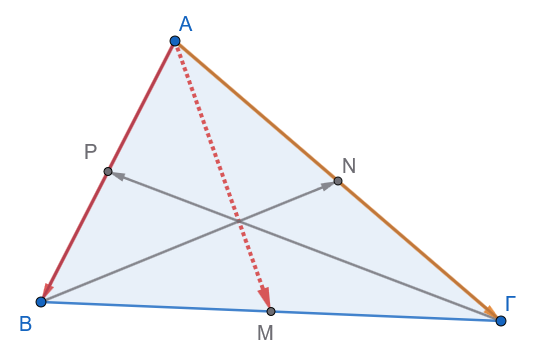{fig-align="center" width="400"}

$$\vec{AM} + \vec{BN} + \vec{Γ P} = \vec{0}$$

:::: my-callout-theory
::: {.my-callout-theory .callout-title}
Υπόδειξη
:::

$\vec{AB} + \vec{ΑΓ}=2 \vec{AM} \qquad  (1)$

Όμοια $\qquad \vec{BΑ} + \vec{ΒΓ}=2 \vec{ΒΝ} \qquad  (2)$

και ..........................................
(3)

Προσθέτουμε (1)+(2)+(3)= ............................................
::::

------------------------------------------------------------------------

:::: {.math-box .exercise-box}
::: {.math-title .exercise-title}
23. Εκφώνηση
:::

Τα σημεία Α, Β, Γ και Δ ενός επιπέδου έχουν διανύσματα θέσεως $\vec α, \vec β, 5\vec α$ και $3\vec β$ αντιστοίχως, όπου τα διανύσματα $\vec a$ και $\vec β$ είναι μη συγγραμμικά.
Να βρείτε το διάνυσμα θέσεως $\vec r$ του σημείου τομής των ευθειών ΑΒ και ΓΔ.
::::

:::: {.math-box .solution-box}
::: {.math-title .solution-title}
Λύση
:::

Έστω $E$ το σημείο τομής των ευθειών $AB$ και $\Gamma\Delta$, με διάνυσμα θέσεως $\vec{r} = \vec{OE}$ ως προς την αρχή $O$.

Τα δεδομένα διανύσματα θέσεως των σημείων είναι: $$\vec{OA} = \vec{\alpha}, \quad \vec{OB} = \vec{\beta}, \quad \vec{O\Gamma} = 5\vec{\alpha}, \quad \vec{O\Delta} = 3\vec{\beta}$$

------------------------------------------------------------------------

**1: Το σημείο** $E$ ανήκει στην ευθεία $AB$

Εφόσον το σημείο $E$ ανήκει στην ευθεία $AB$, τα διανύσματα $\vec{AE}$ και $\vec{AB}$ είναι συγγραμμικά.
Υπάρχει επομένως πραγματικός αριθμός $k \in \mathbb{R}$ τέτοιος ώστε: $$\vec{AE} = k \cdot \vec{AB}$$

Αναλύουμε τα διανύσματα ως προς το σημείο αναφοράς $O$: $$\vec{OE} - \vec{OA} = k(\vec{OB} - \vec{OA})$$ $$\vec{r} - \vec{\alpha} = k(\vec{\beta} - \vec{\alpha})$$ $$\vec{r} = (1 - k)\vec{\alpha} + k\vec{\beta} \quad (1)$$

------------------------------------------------------------------------

**2: Το σημείο** $E$ ανήκει στην ευθεία $\Gamma\Delta$

Εφόσον το σημείο $E$ ανήκει και στην ευθεία $\Gamma\Delta$, τα διανύσματα $\vec{\Gamma E}$ και $\vec{\Gamma\Delta}$ είναι συγγραμμικά.
Υπάρχει επομένως πραγματικός αριθμός $\lambda \in \mathbb{R}$ τέτοιος ώστε: $$\vec{\Gamma E} = \lambda \cdot \vec{\Gamma\Delta}$$

Αναλύουμε ως προς το $O$: $$\vec{OE} - \vec{O\Gamma} = \lambda(\vec{O\Delta} - \vec{O\Gamma})$$ $$\vec{r} - 5\vec{\alpha} = \lambda(3\vec{\beta} - 5\vec{\alpha})$$ $$\vec{r} = 5(1 - \lambda)\vec{\alpha} + 3\lambda\vec{\beta} \quad (2)$$

------------------------------------------------------------------------

**3: Εξίσωση των εκφράσεων του** $\vec{r}$

Εξισώνοντας τις σχέσεις $(1)$ και $(2)$: $$(1 - k)\vec{\alpha} + k\vec{\beta} = 5(1 - \lambda)\vec{\alpha} + 3\lambda\vec{\beta}$$ $$[(1 - k) - 5(1 - \lambda)]\vec{\alpha} + (k - 3\lambda)\vec{\beta} = \vec{0}$$

Επειδή τα διανύσματα $\vec{\alpha}$ και $\vec{\beta}$ είναι **μη συγγραμμικά** (γραμμικώς ανεξάρτητα), οι συντελεστές τους πρέπει να μηδενίζονται ταυτόχρονα: $$\begin{cases}
(1 - k) - 5(1 - \lambda) = 0 \\
k - 3\lambda = 0
\end{cases}$$

------------------------------------------------------------------------

**4: Επίλυση του συστήματος**

Από τη δεύτερη εξίσωση έχουμε: $$k = 3\lambda$$

Αντικαθιστούμε στην πρώτη εξίσωση: $$1 - 3\lambda - 5 + 5\lambda = 0$$ $$2\lambda - 4 = 0$$ $$2\lambda = 4 \implies \lambda = 2$$

Βρίσκουμε και το $k$: $$k = 3 \cdot 2 = 6$$

------------------------------------------------------------------------

**5: Υπολογισμός του διανύσματος θέσεως** $\vec{r}$

Αντικαθιστούμε την τιμή $k = 6$ στη σχέση $(1)$ \[ή ισοδύναμα $\lambda = 2$ στη σχέση $(2)$\]: $$\vec{r} = (1 - 6)\vec{\alpha} + 6\vec{\beta}$$ $$\vec{r} = -5\vec{\alpha} + 6\vec{\beta}$$
::::

------------------------------------------------------------------------

:::: {.math-box .exercise-box}
::: {.math-title .exercise-title}
24. Εκφώνηση
:::

**Συνευθειακότητα σημείων σε παραλληλόγραμμο με παραμέτρους**

Δίνεται παραλληλόγραμμο $PQRS$.
Στις πλευρές $PQ$ και $PS$ (ή στις προεκτάσεις τους) θεωρούμε σημεία $T$ και $U$ αντίστοιχα, τέτοια ώστε: $$\vec{PT} = \mu \vec{PQ} \quad \text{και} \quad \vec{PU} = \nu \vec{PS} \quad (\mu, \nu \neq 0)$$

Αν ισχύει η σχέση: $$\frac{2}{\mu} + \frac{3}{\nu} = 1$$ να αποδείξετε ότι η ευθεία $TU$ διέρχεται από ένα σταθερό σημείο $X$, το οποίο ορίζεται από τη σχέση $\vec{PX} = 2\vec{PQ} + 3\vec{PS}$.
::::

:::: {.math-box .solution-box}
::: {.math-title .solution-title}
Λύση

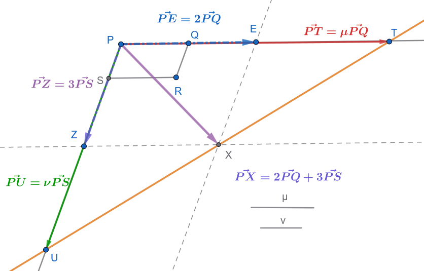{fig-align="center" width="500"}
:::

Για να αποδείξουμε ότι το σημείο $X$ ανήκει στην ευθεία $TU$ (δηλαδή τα σημεία $T, U, X$ είναι συνευθειακά), αρκεί να δείξουμε ότι τα διανύσματα $\vec{TU}$ και $\vec{TX}$ είναι συγγραμμικά: $$\vec{TX} = c \cdot \vec{TU} \quad \text{για κάποιο } c \in \mathbb{R}$$

Εκφράζουμε τα διανύσματα με αρχή το $P$:

1.  $\vec{TU} = \vec{PU} - \vec{PT} = \nu \vec{PS} - \mu \vec{PQ}$

2.  $\vec{TX} = \vec{PX} - \vec{PT} = (2\vec{PQ} + 3\vec{PS}) - \mu \vec{PQ} = (2 - \mu)\vec{PQ} + 3\vec{PS}$

Από τη δοσμένη συνθήκη $\dfrac{2}{\mu} + \dfrac{3}{\nu} = 1$, πολλαπλασιάζουμε με $\mu$: $$2 + \frac{3\mu}{\nu} = \mu \iff 2 - \mu = -\frac{3\mu}{\nu}$$

Αντικαθιστούμε το $(2 - \mu)$ στην έκφραση του $\vec{TX}$: $$\vec{TX} = -\frac{3\mu}{\nu}\vec{PQ} + 3\vec{PS} = \frac{3}{\nu} \left( -\mu \vec{PQ} + \nu \vec{PS} \right)$$

Παρατηρούμε ότι μέσα στην παρένθεση βρίσκεται ακριβώς το διάνυσμα $\vec{TU}$: $$\vec{TX} = \frac{3}{\nu} \vec{TU}$$

Επομένως, τα διανύσματα $\vec{TX}$ και $\vec{TU}$ είναι συγγραμμικά, πράγμα που αποδεικνύει ότι τα σημεία $T, U, X$ είναι συνευθειακά (η ευθεία $TU$ διέρχεται από το σταθερό σημείο $X$).
::::

------------------------------------------------------------------------

:::: {.math-box .exercise-box}
::: {.math-title .exercise-title}
25. Εκφώνηση
:::

**Σχέση δύο κέντρων αναφοράς και συντελεστών**

Δίνονται τέσσερα σημεία $A, B, \Gamma, \Delta$ του επιπέδου και δύο διαφορετικά σημεία αναφοράς $\Sigma_1$ και $\Sigma_2$ ($\Sigma_1 \neq \Sigma_2$).
Θεωρούμε τις παρακάτω τρεις προτάσεις:

1.  $\alpha \vec{\Sigma_1 A} + \beta \vec{\Sigma_1 B} + \gamma \vec{\Sigma_1 \Gamma} + \delta \vec{\Sigma_1 \Delta} = \vec{0}$

2.  $\alpha \vec{\Sigma_2 A} + \beta \vec{\Sigma_2 B} + \gamma \vec{\Sigma_2 \Gamma} + \delta \vec{\Sigma_2 \Delta} = \vec{0}$

3.  $\alpha + \beta + \gamma + \delta = 0$

Να αποδείξετε ότι αν ισχύουν οποιεσδήποτε δύο από τις παραπάνω προτάσεις, τότε ισχύει αναγκαστικά και η τρίτη.
::::

:::: {.math-box .solution-box}
::: {.math-title .solution-title}
Λύση
:::

Αναλύουμε τα διανύσματα με αρχή το σημείο $\Sigma_1$ μέσω του $\Sigma_2$.
Για κάθε σημείο $X \in \{A, B, \Gamma, \Delta\}$ ισχύει: $$\vec{\Sigma_1 X} = \vec{\Sigma_1 \Sigma_2} + \vec{\Sigma_2 X}$$

Αντικαθιστούμε στην έκφραση της πρότασης (1): $$\alpha \vec{\Sigma_1 A} + \beta \vec{\Sigma_1 B} + \gamma \vec{\Sigma_1 \Gamma} + \delta \vec{\Sigma_1 \Delta} = \vec{0}$$ $$\alpha(\vec{\Sigma_1 \Sigma_2} + \vec{\Sigma_2 A}) + \beta(\vec{\Sigma_1 \Sigma_2} + \vec{\Sigma_2 B}) + \gamma(\vec{\Sigma_1 \Sigma_2} + \vec{\Sigma_2 \Gamma}) + \delta(\vec{\Sigma_1 \Sigma_2} + \vec{\Sigma_2 \Delta}) = \vec{0}$$ $$(\alpha + \beta + \gamma + \delta)\vec{\Sigma_1 \Sigma_2} + \left( \alpha \vec{\Sigma_2 A} + \beta \vec{\Sigma_2 B} + \gamma \vec{\Sigma_2 \Gamma} + \delta \vec{\Sigma_2 \Delta} \right) = \vec{0} \quad (*)$$

Η ισότητα $(*)$ συνδέει απευθείας και τις τρεις σχέσεις:

- **Αν ισχύουν οι (1) και (2):**

  Τότε το δεύτερο μέλος της $(*)$ μηδενίζεται, άρα μένει $(\alpha + \beta + \gamma + \delta)\vec{\Sigma_1 \Sigma_2} = \vec{0}$.

  Επειδή $\Sigma_1 \neq \Sigma_2$, είναι $\vec{\Sigma_1 \Sigma_2} \neq \vec{0}$, οπότε αναγκαστικά $\alpha + \beta + \gamma + \delta = 0$ (ισχύει η 3).

- **Αν ισχύουν οι (1) και (3):**

  Επειδή $\alpha + \beta + \gamma + \delta = 0$, ο πρώτος όρος της $(*)$ μηδενίζεται, άρα μένει άμεσα $\alpha \vec{\Sigma_2 A} + \beta \vec{\Sigma_2 B} + \gamma \vec{\Sigma_2 \Gamma} + \delta \vec{\Sigma_2 \Delta} = \vec{0}$ (ισχύει η 2).

- **Αν ισχύουν οι (2) και (3):**

  Τότε και οι δύο όροι στο αριστερό μέλος της $(*)$ είναι ίσοι με το μηδενικό διάνυσμα, οπότε το άθροισμα $\alpha \vec{\Sigma_1 A} + \beta \vec{\Sigma_1 B} + \gamma \vec{\Sigma_1 \Gamma} + \delta \vec{\Sigma_1 \Delta}$ ισούται με $\vec{0}$ (ισχύει η 1).
::::

<iframe src="https://www.geogebra.org/calculator/zfrs4wf6?embed" width="730" height="600" allowfullscreen style="border: 1px solid #e4e4e4;border-radius: 4px;" frameborder="0">

</iframe>

:::: {.math-box .odigia-box}
::: {.math-title .odigia-title}
Οδηγία
:::

Από τα 5 εικονίδια που βρίσκονται κάτω δεξιά στην επιφάνεια εργασίας του geogebra, κάντε Κλικ στο τελευταίο εικονίδιο με το περίγραμμα για να εργαστείτε σε πλήρη οθόνη.
Πατήστε [Escape]{.kbd} για να βγείτε από την πλήρη οθόνη.

Με tap σε κενή περιοχή μετακινείτε την οθόνη .

Με τα εικονίδια δεξιά κάνετε μεγέθυνση ή σμίκρυνση.

Με το πρώτο εικονίδιο επαναφέρετε στο κέντρο.

- Αλλάξτε την τιμή των παραμέτρων α, β, γ και δ από τους αντίστοιχους δρομείς, έτσι ώστε το άθροισμα να κάνει 0.

- Επιλέξτε σημεία και μετά [Shift]{.kbd}+[\> ή \< ή ⋀ ή ⋁]{.kbd} για μεγαλύτερη ακρίβεια.
  Αλλάξτε την θέση τους στο επίπεδο μέχρι το διάνυσμα της συνισταμένης των γραμμικών συνδυασμών να πάρει τιμή μηδέν.
  (θα το δείτε στην αρχή των αξόνων)

Διερευνήστε όσα αναφέρονται παραπάνω.
::::

------------------------------------------------------------------------

:::: {.math-box .exercise-box}
::: {.math-title .exercise-title}
26. Εκφώνηση
:::

**Διανυσματική ακτίνα σημείου που διαιρεί τμήμα**

Έστω δύο σημεία $K$ και $\Lambda$ με διανύσματα θέσης $\vec{r}_K$ και $\vec{r}_\Lambda$ ως προς σημείο αναφοράς $O$.
Σημείο $P$ της ευθείας $K\Lambda$ διαιρεί το τμήμα $K\Lambda$ σε λόγο: $$\frac{PK}{P\Lambda} = \frac{p}{q} \quad (p, q > 0)$$

Να αποδείξετε ότι το διάνυσμα θέσης $\vec{r}_P$ του σημείου $P$ δίνεται από τον τύπο:

1.  $\vec{r}_P = \dfrac{q\vec{r}_K + p\vec{r}_\Lambda}{p + q}$, αν το $P$ είναι **εσωτερικό** σημείο του τμήματος $K\Lambda$.

2.  $\vec{r}_P = \dfrac{q\vec{r}_K - p\vec{r}_\Lambda}{q - p}$ ($p \neq q$), αν το $P$ είναι **εξωτερικό** σημείο του τμήματος $K\Lambda$.
::::

:::: {.math-box .solution-box}
::: {.math-title .solution-title}
Λύση
:::
>>> Κάντε το σχήμα για κάθε περίπτωση.

**1. Το** $P$ είναι εσωτερικό σημείο του $K\Lambda$

Εφόσον το $P$ βρίσκεται ανάμεσα στα $K$ και $\Lambda$, τα διανύσματα $\vec{KP}$ και $\vec{P\Lambda}$ είναι **ομόρροπα**.
Επομένως: $$\frac{|\vec{KP}|}{|\vec{P\Lambda}|} = \frac{p}{q} \implies q \vec{KP} = p \vec{P\Lambda}$$

Εκφράζουμε τα διανύσματα συναρτήσει του σημείου αναφοράς $O$: $$q(\vec{r}_P - \vec{r}_K) = p(\vec{r}_\Lambda - \vec{r}_P)$$ $$q\vec{r}_P - q\vec{r}_K = p\vec{r}_\Lambda - p\vec{r}_P$$

Συγκεντρώνουμε τους όρους με το $\vec{r}_P$ στο αριστερό μέλος: $$(p + q)\vec{r}_P = q\vec{r}_K + p\vec{r}_\Lambda$$ $$\vec{r}_P = \frac{q\vec{r}_K + p\vec{r}_\Lambda}{p + q}$$

------------------------------------------------------------------------

**2. Το** $P$ είναι εξωτερικό σημείο του $K\Lambda$

Εφόσον το $P$ βρίσκεται εκτός του τμήματος $K\Lambda$, τα διανύσματα $\vec{PK}$ και $\vec{P\Lambda}$ είναι **ομόρροπα** (έχουν την ίδια φορά κατά μήκος της ευθείας).

Επομένως: $$\frac{|\vec{PK}|}{|\vec{P\Lambda}|} = \frac{p}{q} \implies q \vec{PK} = p \vec{P\Lambda}$$

Αναλύουμε με τα διανύσματα θέσης: $$q(\vec{r}_K - \vec{r}_P) = p(\vec{r}_\Lambda - \vec{r}_P)$$ $$q\vec{r}_K - q\vec{r}_P = p\vec{r}_\Lambda - p\vec{r}_P$$

Αναδιατάσσουμε: $$(q - p)\vec{r}_P = q\vec{r}_K - p\vec{r}_\Lambda$$ $$\vec{r}_P = \frac{q\vec{r}_K - p\vec{r}_\Lambda}{q - p}$$
::::

------------------------------------------------------------------------

:::: callout-sos
::: {.callout-sos .callout-title}
Εύχομαι
:::

ΚΑΛΗ ΜΕΛΕΤΗ!
::::
