```{=html}
<!-- Φόρτωση βιβλιοθήκης GeoGebra -->
<script src="https://www.geogebra.org/apps/deployggb.js"></script>

<!-- Συνάρτηση δημιουργίας applets -->
<script>
function createGeoGebra(containerId, materialId, width = 700, height = 500) {
  var params = {
    "id": "ggb-" + containerId,
    "material_id": materialId,
    "width": width,
    "height": height,
    "showToolBar": true,
    "showMenuBar": false,
    "showAlgebraInput": true
  };
  
  var applet = new GGBApplet(params, '5.2');
  applet.inject(containerId);
}
</script>
```

## Συντεταγμένες στο Επίπεδο

------------------------------------------------------------------------

### Άξονας

:::: {.math-box .definition-box}
::: {.math-title .definition-title}
**Ορισμός:**

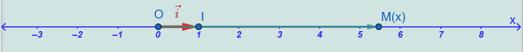{fig-align="center" width="700"}
:::

Πάνω σε μια ευθεία $x'x$ επιλέγουμε δύο σταθερά σημεία $O$ και $I$, έτσι ώστε το διάνυσμα $\vec{OI}$ να έχει μέτρο $1$ και να κατευθύνεται προς την ημιευθεία $Ox$.
Τότε λέμε ότι έχουμε ορίσει έναν **άξονα** με **αρχή** το σημείο $O$ και **μοναδιαίο διάνυσμα** το $\vec{i} = \vec{OI}$, τον οποίο συμβολίζουμε με $x'x$ ή $(O, \vec{i})$.

- **Στοιχεία Άξονα:**

  - **Αρχή του άξονα:** Το σημείο $O$.

  - **Μοναδιαίο διάνυσμα:** Το διάνυσμα $\vec{i} = \vec{OI}$ με $|\vec{i}| = 1$.

  - **Θετικός ημιάξονας:** Η ημιευθεία $Ox$.

  - **Αρνητικός ημιάξονας:** Η ημιευθεία $Ox'$.

- **Τετμημένη Σημείου στον Άξονα:** Για κάθε σημείο $M$ του άξονα $x'x$, επειδή $\vec{OM} \parallel \vec{i}$, υπάρχει μοναδικός πραγματικός αριθμός $x \in \mathbb{R}$ τέτοιος ώστε: $$\vec{OM} = x \cdot \vec{i}$$

  Ο αριθμός $x$ ονομάζεται **τετμημένη** του σημείου $M$ και το σημείο συμβολίζεται με $M(x)$.
  Αντίστροφα, σε κάθε πραγματικό αριθμό $x$ αντιστοιχεί μοναδικό σημείο $M(x)$ πάνω στον άξονα.
::::

------------------------------------------------------------------------

### Καρτεσιανό Επίπεδο

:::: {.math-box .definition-box}
::: {.math-title .definition-title}
**Ορισμός:**

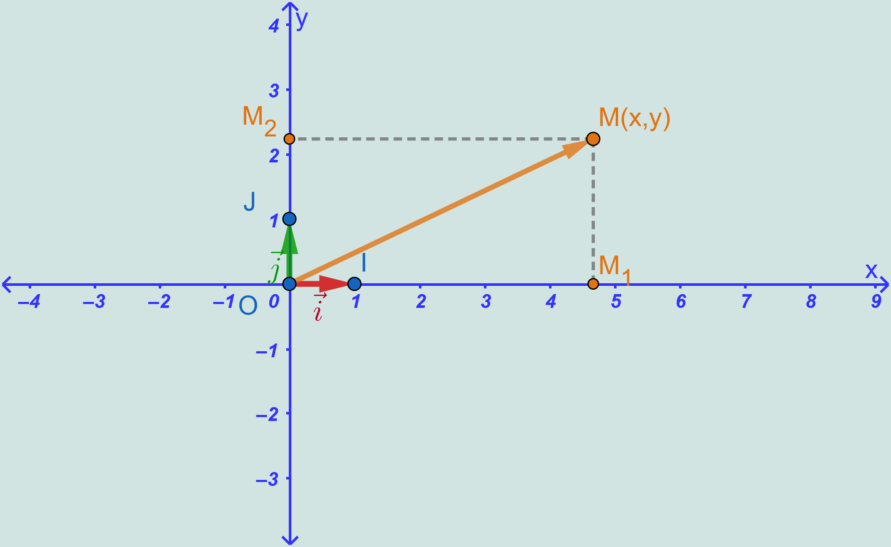{fig-align="center" width="600"}
:::

Πάνω σε ένα επίπεδο σχεδιάζουμε δύο κάθετους άξονες $x'x$ και $y'y$ με κοινή αρχή το $O$ και μοναδιαία διανύσματα τα $\vec{i}$ και $\vec{j}$ αντίστοιχα ($|\vec{i}| = |\vec{j}| = 1$ και $\vec{i} \perp \vec{j}$).
Το σύστημα αυτό ονομάζεται **ορθοκανονικό σύστημα συντεταγμένων στο επίπεδο** (ή **καρτεσιανό επίπεδο**) και συμβολίζεται με $Oxy$.

- **Στοιχεία Καρτεσιανού Επιπέδου:**

  - **Αρχή των αξόνων:** Το σημείο $O(0,0)$.

  - **Άξονας των τετμημένων:** Ο οριζόντιος άξονας $x'x$.

  - **Άξονας των τεταγμένων:** Ο κατακόρυφος άξονας $y'y$.

  - **Βάση του επιπέδου:** Το ζεύγος των μοναδιαίων και κάθετων διανυσμάτων $(\vec{i}, \vec{j})$.

- **Πώς βρίσκουμε τις Συντεταγμένες Σημείου:**

  Έστω $M$ ένα τυχαίο σημείο του επιπέδου $Oxy$.
  Από το $M$ φέρνουμε παράλληλη στον άξονα $y'y$ που τέμνει τον $x'x$ στο $M_1(x)$ και παράλληλη στον $x'x$ που τέμνει τον $y'y$ στο $M_2(y)$.

  - Ο αριθμός $x$ (τετμημένη του $M_1$) λέγεται **τετμημένη** του σημείου $M$.

  - Ο αριθμός $y$ (τετμημένη του $M_2$) λέγεται **τεταγμένη** του σημείου $M$.

  - Το διατεταγμένο ζεύγος $(x, y)$ ονομάζεται **συντεταγμένες** του σημείου $M$ και συμβολίζεται με $M(x, y)$.
    Σε κάθε σημείο του επιπέδου αντιστοιχεί μοναδικό ζεύγος $(x,y)$ και αντίστροφα.
::::

------------------------------------------------------------------------

### Συντεταγμένες Διανύσματος

:::: {.math-box .definition-box}
::: {.math-title .definition-title}
**Ορισμός & Γραμμικός Συνδυασμός των** $\vec{i}$ και $\vec{j}$:

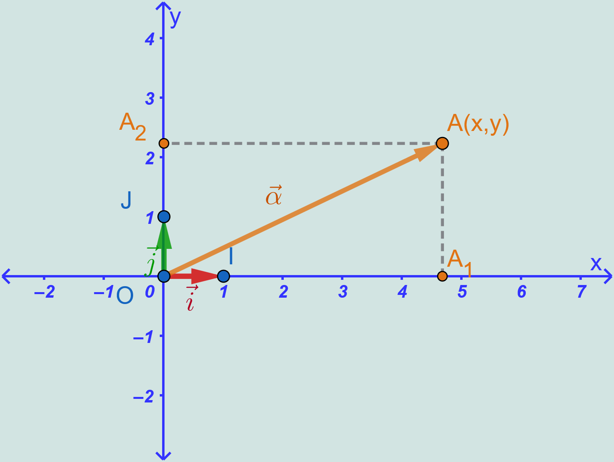{fig-align="center" width="500"}
:::

Έστω $\vec{α}$ ένα διάνυσμα του επιπέδου $Oxy$.
Με αρχή το $O$, σχεδιάζουμε το διάνυσμα $\vec{OA} = \vec{α}$.
Αν $A_1, A_2$ είναι οι προβολές του $A$ στους άξονες $x'x$ και $y'y$ αντίστοιχα, ισχύει $\vec{OA} = \vec{OA_1} + \vec{OA_2}$.

Επειδή $\vec{OA_1} = x\vec{i}$ και $\vec{OA_2} = y\vec{j}$, το διάνυσμα $\vec{α}$ γράφεται κατά μοναδικό τρόπο ως **γραμμικός συνδυασμός** των διανυσμάτων $\vec{i}$ και $\vec{j}$: $$\vec{α} = x\vec{i} + y\vec{j}$$

- Τα διανύσματα $x\vec{i}$ και $y\vec{j}$ λέγονται **συνιστώσες** του $\vec{α}$ κατά τις διευθύνσεις των $\vec{i}$ και $\vec{j}$.

- Οι μοναδικοί αριθμοί $x$ και $y$ λέγονται **συντεταγμένες** του $\vec{α}$ (τετμημένη και τεταγμένη αντίστοιχα) και συμβολίζουμε $\vec{α} = (x, y)$.
::::

------------------------------------------------------------------------

:::: {.math-box .apodeixi-box}
::: {.math-title .apodeixi-title}
**Απόδειξη Μοναδικότητας της Έκφρασης** $\vec{α} = x\vec{i} + y\vec{j}$:
:::

Έστω ότι το διάνυσμα $\vec{α}$ γράφεται και ως $\vec{α} = x'\vec{i} + y'\vec{j}$.
Τότε: $$x\vec{i} + y\vec{j} = x'\vec{i} + y'\vec{j} \iff (x - x')\vec{i} = (y' - y)\vec{j}$$

Αν υποθέσουμε ότι $x \neq x'$, δηλαδή $x - x' \neq 0$, τότε προκύπτει: $$\vec{i} = \frac{y' - y}{x - x'}\vec{j}$$

Η σχέση αυτή σημαίνει ότι $\vec{i} \parallel \vec{j}$, που είναι **άτοπο**, διότι τα διανύσματα $\vec{i}$ και $\vec{j}$ είναι κάθετα.
Συνεπώς ισχύει $x = x'$, οπότε και $(y' - y)\vec{j} = \vec{0} \implies y = y'$ (αφού $\vec{j} \neq \vec{0}$).

Άρα η αναπαράσταση κάθε διανύσματος στη μορφή $\vec{α} = x\vec{i} + y\vec{j}$ είναι **μοναδική**.
::::

------------------------------------------------------------------------

:::: {.math-box .definition-box}
::: {.math-title .definition-title}
**Ισότητα Διανυσμάτων:**
:::

Δύο διανύσματα $\vec{α} = (x_1, y_1)$ και $\vec{β} = (x_2, y_2)$ είναι ίσα αν και μόνο αν οι αντίστοιχες συντεταγμένες τους είναι ίσες: $$\vec{α} = \vec{β} \iff \begin{cases} x_1 = x_2 \\ y_1 = y_2 \end{cases}$$

Ειδικότερα, για το μηδενικό διάνυσμα ισχύει $\vec{0} = (0, 0) \iff x = 0$ και $y = 0$.
::::

------------------------------------------------------------------------

### Συντεταγμένες Γραμμικού Συνδυασμού Διανυσμάτων

Έστω τα διανύσματα $\vec{α} = (x_1, y_1)$ και $\vec{β} = (x_2, y_2)$ του επιπέδου $Oxy$ και $λ, \mu \in \mathbb{R}$.

:::: {.math-box .theorem-box}
::: {.math-title .theorem-title}
**Άθροισμα & Διαφορά Διανυσμάτων:**
:::

$$\vec{α} + \vec{β} = (x_1 + x_2, \, y_1 + y_2) \quad \text{και} \quad \vec{α} - \vec{β} = (x_1 - x_2, \, y_1 - y_2)$$
::::

:::: {.math-box .apodeixi-box}
::: {.math-title .apodeixi-title}
*Απόδειξη:*
:::

$\vec{α} \pm \vec{β} = (x_1\vec{i} + y_1\vec{j}) \pm (x_2\vec{i} + y_2\vec{j}) = (x_1 \pm x_2)\vec{i} + (y_1 \pm y_2)\vec{j} = (x_1 \pm x_2, y_1 \pm y_2)$.
::::

------------------------------------------------------------------------

:::: {.math-box .theorem-box}
::: {.math-title .theorem-title}
**Γινόμενο Αριθμού με Διάνυσμα:**
:::

$$λ \vec{α} = (λ x_1, \, λ y_1)$$
::::

:::: {.math-box .apodeixi-box}
::: {.math-title .apodeixi-title}
*Απόδειξη:*
:::

$λ \vec{α} = λ (x_1\vec{i} + y_1\vec{j}) = (λ x_1)\vec{i} + (λ y_1)\vec{j} = (λ x_1, λ y_1)$.
::::

------------------------------------------------------------------------

- **Συντεταγμένες Γραμμικού Συνδυασμού:** $$λ \vec{α} + \mu \vec{β} = (λ x_1 + \mu x_2, \, λ y_1 + \mu y_2)$$

------------------------------------------------------------------------

**Παραδείγματα**

1.  Αν $\vec α=(-2,5)$ και $\vec β=(3,1)$ τότε:

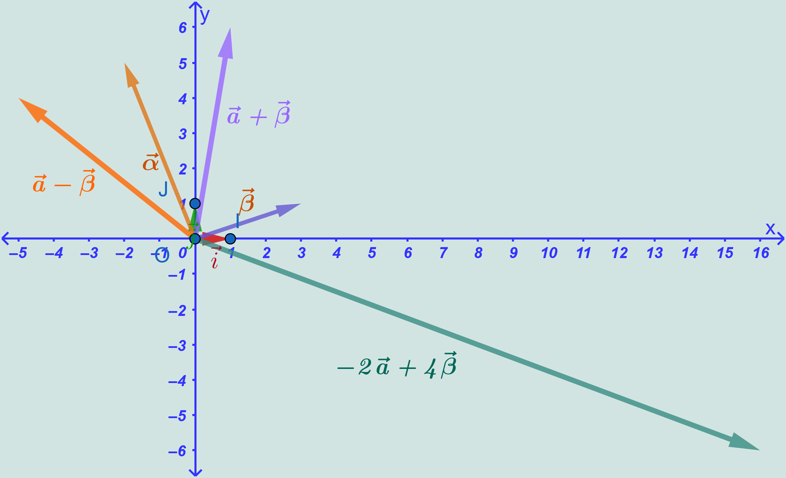{fig-align="center" width="600"}

- $\quad \vec α+\vec β=(-2+3, 5+1)=(1,6)$ και $\vec α-\vecβ=(-2-3, 5-1)=(-5,4)$

- $\quad -2\vec α+4\vec β=(4,-10)+(12,4)=(16, -6)$

2.  Αν $\vec α=(0,1)$ και $\vec β=(-1,0)$ τότε:

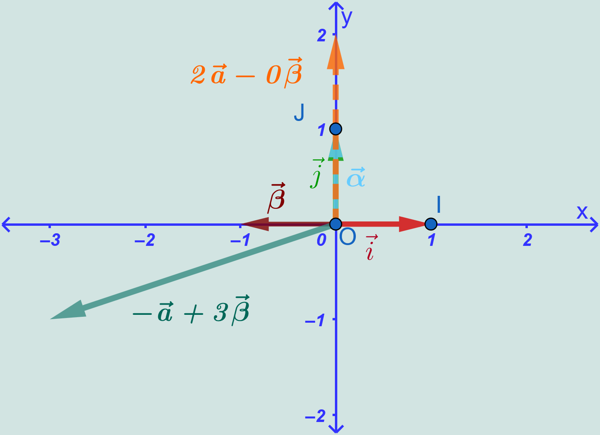{fig-align="center" width="400"}

- $\quad -\vec α+3\vec β=(0,-1)+(-3,0)=(-3,-1)$

- $\quad 2\vec α-0\cdot\vec β=(0,2)-(0,0)=(0,2)$

------------------------------------------------------------------------

### Συντεταγμένες Μέσου Τμήματος

:::: {.math-box .definition-box}
::: {.math-title .definition-title}
**Ορισμός & Τύποι:**
:::

Αν $A(x_1, y_1)$ και $B(x_2, y_2)$ είναι δύο σημεία του καρτεσιανού επιπέδου, οι συντεταγμένες $(x, y)$ του μέσου $M$ του ευθύγραμμου τμήματος $AB$ ισούνται με τον αριθμητικό μέσο όρο των συντεταγμένων των άκρων του: $$x = \frac{x_1 + x_2}{2} \quad \text{και} \quad y = \frac{y_1 + y_2}{2}$$
::::

:::: {.math-box .definitionsolution-box}
::: {.math-title .definitionsolution-title}
**Απόδειξη:**

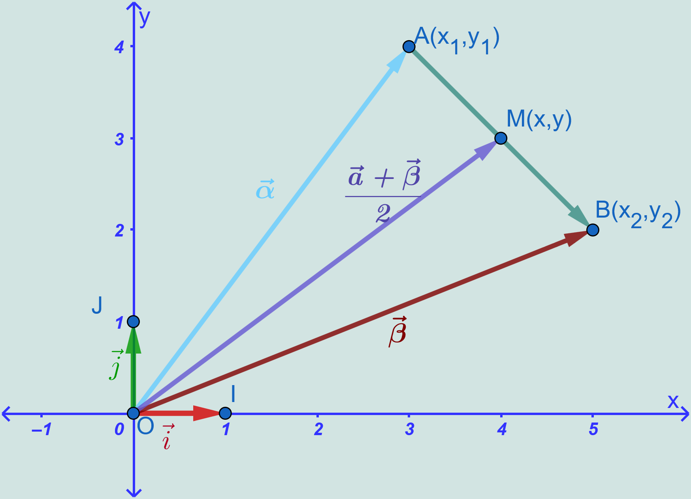{fig-align="center" width="500"}
:::

Επειδή το σημείο $M$ είναι το μέσο του τμήματος $AB$, από τη διανυσματική ακτίνα μέσου ισχύει: $$\vec{OM} = \frac{1}{2}(\vec{OA} + \vec{OB})$$

Εκφράζοντας τα διανύσματα με τις συντεταγμένες τους, έχουμε:

$$(x, y) = \frac{1}{2}\left[(x_1, y_1) + (x_2, y_2)\right] = \frac{1}{2}(x_1 + x_2, \, y_1 + y_2) = \left(\frac{x_1 + x_2}{2}, \, \frac{y_1 + y_2}{2}\right)$$

Εξισώνοντας τις αντίστοιχες συντεταγμένες προκύπτει $x = \dfrac{x_1 + x_2}{2}$ και $y = \dfrac{y_1 + y_2}{2}$.
::::

------------------------------------------------------------------------

### Συντεταγμένες Διανύσματος με Γνωστά Άκρα

:::: {.math-box .definition-box}
::: {.math-title .definition-title}
**Σχέσεις - Τύποι:**
:::

Οι συντεταγμένες $(x, y)$ του διανύσματος $\vec{AB}$ με αρχή το σημείο $A(x_1, y_1)$ και πέρας το σημείο $B(x_2, y_2)$ δίνονται από τις σχέσεις: $$\vec{AB} = (x_2 - x_1, \, y_2 - y_1)$$ $$\text{Τετμημένη } \vec{AB} = x_2 - x_1 = (\text{τετμημένη πέρατος}) - (\text{τετμημένη αρχής})$$ $$\text{Τεταγμένη } \vec{AB} = y_2 - y_1 = (\text{τεταγμένη πέρατος}) - (\text{τεταγμένη αρχής})$$
::::

:::: {.math-box .definitionsolution-box}
::: {.math-title .definitionsolution-title}
**Απόδειξη:**

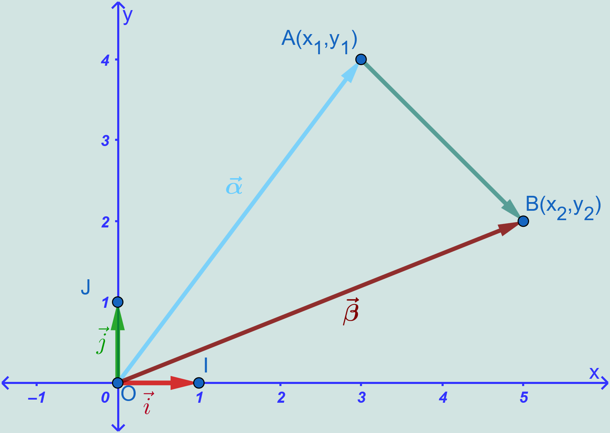{fig-align="center" width="450"}
:::

Από την ανάλυση διανύσματος με σημείο αναφοράς την αρχή $O(0,0)$ ισχύει $\vec{AB} = \vec{OB} - \vec{OA}$.
Επειδή $\vec{OB} = (x_2, y_2)$ και $\vec{OA} = (x_1, y_1)$, έχουμε: $$\vec{AB} = (x_2, y_2) - (x_1, y_1) = (x_2 - x_1, \, y_2 - y_1)$$
::::

------------------------------------------------------------------------

**Παράδειγμα:**

Αν $A(1, 2)$ και $B(3, 7)$, τότε οι συντεταγμένες του διανύσματος $\vec{AB}$ είναι:

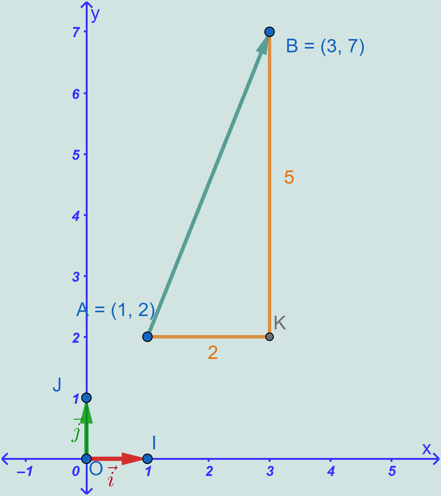{fig-align="center" width="350"}

$$\vec{AB} = (3 - 1, \, 7 - 2) = (2, 5)$$

------------------------------------------------------------------------

### Μέτρο Διανύσματος & Απόσταση Δύο Σημείων

:::: {.math-box .definition-box}
::: {.math-title .definition-title}
**Ορισμός & Τύπος Μέτρου Διανύσματος:**
:::

Το μέτρο ενός διανύσματος $\vec{α} = (x, y)$ δίνεται από τον τύπο: $$|\vec{α}| = \sqrt{x^2 + y^2}$$
::::

:::: {.math-box .definitionsolution-box}
::: {.math-title .definitionsolution-title}
**Απόδειξη Τύπου Μέτρου:**
:::

Έστω $\vec{α} = (x, y)$ και $A(x, y)$ το σημείο με διανυσματική ακτίνα $\vec{OA} = \vec{α}$.
Αν $A_1, A_2$ είναι οι προβολές του $A$ στους άξονες $x'x$ και $y'y$, τότε τα μήκη των πλευρών του ορθογωνίου $OA_1AA_2$ είναι $(OA_1) = |x|$ και $(OA_2) = |y|$.

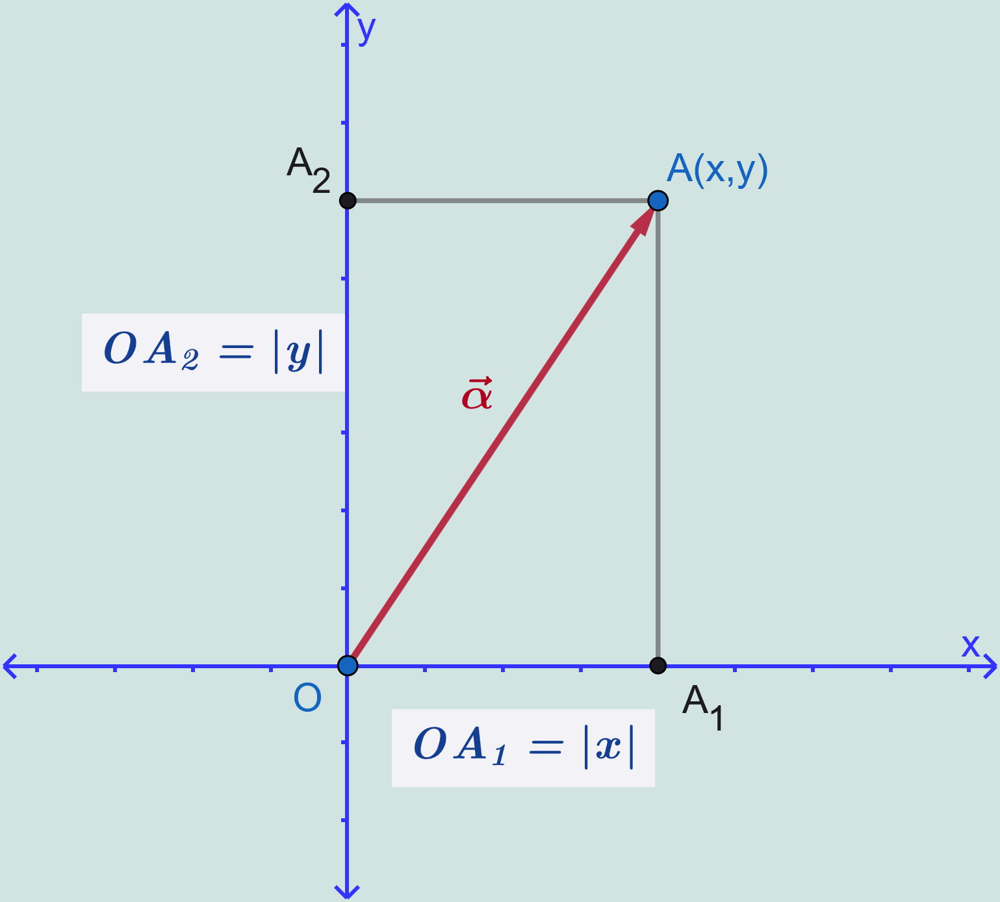{fig-align="center" width="350"}

Από το Πυθαγόρειο Θεώρημα στο ορθογώνιο τρίγωνο $OA_1A$ έχουμε: $$|\vec{α}|^2 = (OA)^2 = (OA_1)^2 + (A_1A)^2 = |x|^2 + |y|^2 = x^2 + y^2$$

Επειδή $|\vec{α}| \ge 0$, παίρνοντας τετραγωνική ρίζα λαμβάνουμε: $|\vec{α}| = \sqrt{x^2 + y^2}$.

- **Απόσταση Δύο Σημείων:**

  Η γεωμετρική απόσταση $(AB)$ μεταξύ δύο σημείων $A(x_1, y_1)$ και $B(x_2, y_2)$ ισούται με το μέτρο του διανύσματος $\vec{AB} = (x_2 - x_1, y_2 - y_1)$: $$(AB) = |\vec{AB}| = \sqrt{(x_2 - x_1)^2 + (y_2 - y_1)^2}$$
::::

------------------------------------------------------------------------

- **Παραδείγματα:**

  1.  Αν $\vec{α} = (5, 12)$, τότε $|\vec{α}| = \sqrt{5^2 + 12^2} = \sqrt{25 + 144} = \sqrt{169} = 13$.

  2.  Η απόσταση των σημείων $A(1, -2)$ και $B(4, 2)$ είναι $(AB) = \sqrt{(4 - 1)^2 + (2 - (-2))^2} = \sqrt{3^2 + 4^2} = 5$.

------------------------------------------------------------------------

:::: {.math-box .example-box}
::: {.math-title .example-title}
3.  Εκφώνηση
:::

Ένα τρίγωνο ΑΒΓ έχει κορυφές Α(-10,10), Β(5,-5) και Γ(15,5)

- Να υπολογίσετε τις τρεις πλευρές.

- Να αποδείξετε ότι είναι ορθογώνιο.

- Να υπολογίσετε την διάμεσο και το μέσο της υποτείνουσας.
::::

:::: {.math-box .examplesolution-box}
::: {.math-title .examplesolution-title}
**Λύση:**
:::

**1. Υπολογισμός των τριών πλευρών**

Εφαρμόζουμε τον τύπο της απόστασης $d = \sqrt{(x_2 - x_1)^2 + (y_2 - y_1)^2}$:

- **Πλευρά** $AB$: $$(AB) = \sqrt{(5 - (-10))^2 + (-5 - 10)^2} = \sqrt{15^2 + (-15)^2} = \\ \sqrt{225 + 225} = \sqrt{450} = 15\sqrt{2}$$

- **Πλευρά** $Bγ$: $$(Bγ) = \sqrt{(15 - 5)^2 + (5 - (-5))^2} = \sqrt{10^2 + 10^2} = \sqrt{100 + 100} = \sqrt{200} = 10\sqrt{2}$$

- **Πλευρά** $Aγ$: $$(Aγ) = \sqrt{(15 - (-10))^2 + (5 - 10)^2} = \sqrt{25^2 + (-5)^2} = \sqrt{625 + 25} = \sqrt{650} = 5\sqrt{26}$$

------------------------------------------------------------------------

**2. Απόδειξη ότι το τρίγωνο είναι ορθογώνιο**

Υπολογίζουμε τα τετράγωνα των μηκών των πλευρών:

- $(AB)^2 = 450$

- $(Bγ)^2 = 200$

- $(Aγ)^2 = 650$

Παρατηρούμε ότι: $$(AB)^2 + (Bγ)^2 = 450 + 200 = 650 = (Aγ)^2$$

Επομένως, ισχύει το **αντίστροφο του Πυθαγορείου Θεωρήματος**, άρα το τρίγωνο $ABγ$ είναι **ορθογώνιο** με ορθή γωνία την $\widehat{B} = 90^\circ$ και υποτείνουσα την πλευρά $Aγ$.

*(Εναλλακτικά, με διανύσματα:* $\vec{BA} = (-15, 15)$ και $\vec{Bγ} = (10, 10)$, οπότε $\vec{BA} \cdot \vec{Bγ} = -15 \cdot 10 + 15 \cdot 10 = 0 \implies \vec{BA} \perp \vec{Bγ}$).

------------------------------------------------------------------------

**3. Υπολογισμός του μέσου και της διαμέσου της υποτείνουσας**

Η υποτείνουσα είναι το τμήμα $Aγ$.

- **Συντεταγμένες του μέσου** $M$ της υποτείνουσας $Aγ$: $$x_M = \frac{x_A + x_γ}{2} = \frac{-10 + 15}{2} = \frac{5}{2} = 2{,}5$$ $$y_M = \frac{y_A + y_γ}{2} = \frac{10 + 5}{2} = \frac{15}{2} = 7{,}5$$

  Άρα το μέσο είναι το σημείο: $$M(2{,}5; 7{,}5) \quad \text{ή} \quad M\left(\frac{5}{2}, \frac{15}{2}\right)$$

- **Μήκος της διαμέσου** $BM$: Σε κάθε ορθογώνιο τρίγωνο, η διάμεσος προς την υποτείνουσα ισούται με το μισό της υποτείνουσας: $$(BM) = \frac{(Aγ)}{2} = \frac{5\sqrt{26}}{2}$$

  *(Επαλήθευση με τον τύπο της απόστασης από το* $B(5, -5)$): $$(BM) = \sqrt{\left(\frac{5}{2} - 5\right)^2 + \left(\frac{15}{2} - (-5)\right)^2} = \sqrt{\left(-\frac{5}{2}\right)^2 + \left(\frac{25}{2}\right)^2} =\\ \sqrt{\frac{25 + 625}{4}} = \sqrt{\frac{650}{4}} = \frac{5\sqrt{26}}{2}$$
::::

------------------------------------------------------------------------

### Συνθήκη Παραλληλίας Διανυσμάτων

:::: {.math-box .definition-box}
::: {.math-title .definition-title}
**Ορίζουσα Διανυσμάτων:**
:::

Ορίζουμε ως **ορίζουσα των διανυσμάτων** $\vec{α} = (x_1, y_1)$ και $\vec{β} = (x_2, y_2)$ τον αριθμό: $$\det(\vec{α}, \vec{β}) = \begin{vmatrix} x_1 & y_1 \\ x_2 & y_2 \end{vmatrix} = x_1 y_2 - x_2 y_1$$
::::

------------------------------------------------------------------------

:::: {.math-box .theorem-box}
::: {.math-title .theorem-title}
**Θεώρημα Συνθήκης Παραλληλίας:**
:::

Δύο διανύσματα $\vec{α} = (x_1, y_1)$ και $\vec{β} = (x_2, y_2)$ είναι παράλληλα αν και μόνο αν η ορίζουσά τους είναι ίση με το μηδέν: $$\vec{α} \parallel \vec{β} \iff \det(\vec{α}, \vec{β}) = 0 \iff x_1 y_2 - x_2 y_1 = 0$$
::::

:::: {.math-box .apodeixi-box}
::: {.math-title .apodeixi-title}
**Απόδειξη:**
:::

- **Ευθύ (**$\Rightarrow$): Έστω ότι $\vec{α} \parallel \vec{β}$.

  - Αν $\vec{β} \neq \vec{0}$, υπάρχει $λ \in \mathbb{R}$ τέτοιο ώστε $\vec{α} = λ \vec{β} \iff (x_1, y_1) = (λ x_2, λ y_2) \iff x_1 = λ x_2 \text{ και } y_1 = λ y_2$.
    Τότε: $\det(\vec{α}, \vec{β}) = x_1 y_2 - x_2 y_1 = (λ x_2) y_2 - x_2 (λ y_2) = 0$.

  - Αν $\vec{β} = \vec{0}$, τότε $x_2 = 0, y_2 = 0$, οπότε $\det(\vec{α}, \vec{0}) = x_1 \cdot 0 - 0 \cdot y_1 = 0$.

- **Αντίστροφο (**$\Leftarrow$): Έστω ότι $\det(\vec{α}, \vec{β}) = 0 \iff x_1 y_2 - x_2 y_1 = 0 \iff x_1 y_2 = x_2 y_1$.

  - Αν $x_2 \neq 0$, τότε $y_1 = \dfrac{x_1}{x_2} y_2$.
    Θέτοντας $λ = \dfrac{x_1}{x_2}$, έχουμε $x_1 = λ x_2$ και $y_1 = λ y_2$, άρα $\vec{α} = λ \vec{β} \implies \vec{α} \parallel \vec{β}$.

  - Αν $x_2 = 0$, τότε $x_1 y_2 = 0 \implies x_1 = 0$ ή $y_2 = 0$:

    - Αν $x_1 = 0$, τότε $\vec{α} = (0, y_1) \parallel y'y$ και $\vec{β} = (0, y_2) \parallel y'y$, οπότε $\vec{α} \parallel \vec{β}$.

    - Αν $y_2 = 0$, τότε $\vec{β} = (0,0) = \vec{0}$, το οποίο είναι παράλληλο σε κάθε διάνυσμα.
::::

------------------------------------------------------------------------

- **Παραδείγματα:**

  1.  Τα διανύσματα $\vec{α} = (3, -1)$ και $\vec{β} = (3, -3)$ δεν είναι παράλληλα διότι $\det(\vec{α}, \vec{β}) = 3(-3) - 3(-1) = -9 + 3 = -6 \neq 0$.

  2.  Τα διανύσματα $\vec{α} = (2, -4)$ και $\vec{β} = (-1, 2)$ είναι παράλληλα διότι $\det(\vec{α}, \vec{β}) = 2(2) - (-1)(-4) = 4 - 4 = 0$.

------------------------------------------------------------------------

### Συντελεστής Διεύθυνσης Διανύσματος

:::: {.math-box .definition-box}
::: {.math-title .definition-title}
**Ορισμός:**
:::

Έστω $\vec{α} = (x, y)$ ένα μη μηδενικό διάνυσμα και $A(x, y)$ το σημείο με $\vec{OA} = \vec{α}$.

- **Γωνία διανύσματος:** Η γωνία $θ \in [0, 2\pi)$ που διαγράφει ο θετικός ημιάξονας $Ox$ αν στραφεί κατά τη θετική φορά μέχρι να συμπέσει με την ημιευθεία $OA$.

- **Συντελεστής Διεύθυνσης:** Αν το διάνυσμα δεν είναι παράλληλο στον άξονα $y'y$ (δηλαδή $x \neq 0$), ορίζουμε ως **συντελεστή διεύθυνσης** του $\vec{α}$ τον πραγματικό αριθμό $λ_{\vec{α}}$ ή $λ$: $$λ = \frac{y}{x} = εφ θ \quad (x \neq 0)$$

- **Ειδικές Περιπτώσεις:**

  - Αν $y = 0$ ($x \neq 0$), το διάνυσμα είναι παράλληλο στον άξονα $x'x$ και $λ = 0$.

  - Αν $x = 0$, το διάνυσμα είναι παράλληλο στον άξονα $y'y$ και **δεν ορίζεται** συντελεστής διεύθυνσης.
::::

------------------------------------------------------------------------

:::: {.math-box .theorem-box}
::: {.math-title .theorem-title}
**Συνθήκη Παραλληλίας μέσω Συντελεστών Διεύθυνσης:**
:::

Αν τα διανύσματα $\vec{α} = (x_1, y_1)$ και $\vec{β} = (x_2, y_2)$ δεν είναι παράλληλα στον άξονα $y'y$ (δηλαδή $x_1 \neq 0$ και $x_2 \neq 0$), τότε: $$\vec{α} \parallel \vec{β} \iff λ_1 = λ_2$$
::::

:::: {.math-box .apodeixi-box}
::: {.math-title .apodeixi-title}
**Απόδειξη:**
:::

$$\vec{α} \parallel \vec{β} \iff \det(\vec{α}, \vec{β}) = 0 \iff x_1 y_2 - x_2 y_1 = 0 \iff x_1 y_2 = x_2 y_1$$

Διαιρώντας δια του γινομένου $x_1 x_2 \neq 0$, λαμβάνουμε: $$\frac{y_1}{x_1} = \frac{y_2}{x_2} \iff λ_1 = λ_2$$
::::

------------------------------------------------------------------------

- **Παραδείγματα:**

  1.  Το διάνυσμα $\vec{α} = (2, 6)$ έχει συντελεστή διεύθυνσης $λ = \dfrac{6}{2} = 3$ και σχηματίζει γωνία $\hat ω$ με $εφ \hat ω = 3$.

  2.  Τα διανύσματα $\vec{u} = (2, 4)$ και $\vec{v} = (5, 10)$ έχουν συντελεστές $λ_1 = \dfrac{4}{2} = 2$ και $λ_2 = \dfrac{10}{5} = 2$.

  Αφού $λ_1 = λ_2 = 2$, τα διανύσματα είναι παράλληλα ($\vec{u} \parallel \vec{v}$).

------------------------------------------------------------------------

### Ασκήσεις στις Συντεταγμένες στο Επίπεδο

#### **Ομάδα Α: Συντεταγμένες & Αλγεβρικές Πράξεις Διανυσμάτων**

1.  **Άσκηση 1:** Δίνονται τα διανύσματα $\vec{α} = (2, -3)$ και $\vec{β} = (-4, 1)$.

    - α) Να γραφούν τα διανύσματα ως γραμμικός συνδυασμός των μοναδιαίων διανυσμάτων $\vec{i}$ και $\vec{j}$.

    - β) Να βρεθούν οι συντεταγμένες των διανυσμάτων $\vec{u} = 3\vec{α} - 2\vec{β}$ και $\vec{v} = \dfrac{1}{2}\vec{α} + \vec{β}$.

:::: my-callout-theory
::: {.my-callout-theory .callout-title}
Υπόδειξη
:::

- α) $\vec a=2\vec i-3\vec j$ ..................

- β) $\vec u=3(2,-3)-2(-4,1)=(6,-9)+(8, -2)=(14, -11)$ ...........................
::::

------------------------------------------------------------------------

2.  **Άσκηση 2:** Αν $\vec{α} = (x + y, 4)$ και $\vec{β} = (2, x - y)$, να υπολογιστούν οι πραγματικοί αριθμοί $x$ και $y$ ώστε $\vec{α} = \vec{β}$.

:::: my-callout-theory
::: {.my-callout-theory .callout-title}
Υπόδειξη
:::

$\vec a = \vec β \implies \begin{cases} x+y=2 \\ x-y=4 \end{cases} \implies$ ...........
::::

------------------------------------------------------------------------

3.  **Άσκηση 3:** Δίνονται τα διανύσματα $\vec{α} = (1, 2)$, $\vec{β} = (-3, 1)$ και $\vec{γ} = (5, 3)$. Να εκφράσετε το διάνυσμα $\vec{γ}$ ως γραμμικό συνδυασμό των $\vec{α}$ και $\vec{β}$ ($\vec{γ} = κ \vec{α} + λ \vec{β}$).

:::: my-callout-theory
::: {.my-callout-theory .callout-title}
Υπόδειξη
:::

$\vec γ=κ\vec α+λ \vec β \implies \begin{cases} 5=κ-3λ \\ 3=2κ+λ \end{cases}$ ..............
::::

------------------------------------------------------------------------

4.  **Άσκηση 4:** Να λύσετε ως προς το διάνυσμα $\vec{x}$ τη διανυσματική εξίσωση: $$2(\vec{x} + (1, 4)) - 3(\vec{x} - (2, -1)) = (0, 5)$$

:::: my-callout-theory
::: {.my-callout-theory .callout-title}
Υπόδειξη
:::

$2 \vec x +2(1, 4) -3\vec x +3(2, -1)=(0, 5) \implies -\vec x=-(2,8)-(6, -3)+(0, 5) \implies......$
::::

------------------------------------------------------------------------

#### **Ομάδα Β: Συντεταγμένες Διανύσματος με Γνωστά Άκρα & Μέσο Τμήματος**

5.  **Άσκηση 5:** Δίνονται τα σημεία $A(-2, 3)$ και $B(4, -1)$.

    - α) Να υπολογιστούν οι συντεταγμένες του διανύσματος $\vec{AB}$ και του $\vec{BA}$.

    - β) Να βρεθούν οι συντεταγμένες του μέσου $M$ του ευθύγραμμου τμήματος $AB$.

6.  **Άσκηση 6:** Αν το σημείο $M(1, 4)$ είναι το μέσο του ευθύγραμμου τμήματος $AB$ και δίνεται το άκρο $A(-3, 2)$, να βρείτε τις συντεταγμένες του άκρου $B$.

:::: my-callout-theory
::: {.my-callout-theory .callout-title}
Υπόδειξη
:::

$\begin{cases} 1=\dfrac{-3+x_2}{2} \\ 4=\dfrac{2+y_2}{2} \end{cases}$ .......
::::

------------------------------------------------------------------------

7.  **Άσκηση 7:** Δίνονται οι κορυφές παραλληλογράμμου $ABCD$: $A(1, 1)$, $B(4, 2)$ και $C(5, 5)$. Να βρείτε τις συντεταγμένες της τέταρτης κορυφής $D$.

:::: my-callout-theory
::: {.my-callout-theory .callout-title}
Υπόδειξη
:::

Θα έχει ίσες τις απέναντι πλευρές

$AD=BC \implies \sqrt{(x_4-1)^2+(y_4-1)^2}=\sqrt{(5-4)^2+(5-2)^2}$

$ΑΒ=CD \implies \sqrt{(4-1)^2+(2-1)^2}=\sqrt{(x_4-5)^2+(y_4-5)^2}$

Λύνουμε το σύστημα
::::

------------------------------------------------------------------------

:::: {.math-box .exercise-box}
::: {.math-title .exercise-title}
8.  Εκφώνηση
:::

Δίνεται τρίγωνο $ABC$ με κορυφές $A(2, 4)$, $B(-1, 1)$ και $C(5, -3)$.

Αν $D, E, F$ είναι τα μέσα των πλευρών $BC, CA, AB$ αντίστοιχα, να αποδείξετε ότι τα τρίγωνα $ABC$ και $DEF$ έχουν το ίδιο κέντρο βάρους $G$ και να βρείτε τις συντεταγμένες του.
::::

:::: {.math-box .solution-box}
::: {.math-title .solution-title}
Λύση
:::

**1. Κέντρο βάρους του τριγώνου** $ABC$

Οι συντεταγμένες του κέντρου βάρους $G(x_G, y_G)$ ενός τριγώνου με κορυφές $A(x_A, y_A)$, $B(x_B, y_B)$ και $C(x_C, y_C)$ δίνονται από τους τύπους:

$$x_G = \frac{x_A + x_B + x_C}{3}$$ $$y_G = \frac{y_A + y_B + y_C}{3}$$

Αντικαθιστούμε τις συντεταγμένες των κορυφών $A(2, 4)$, $B(-1, 1)$ και $C(5, -3)$: $$x_G = \frac{2 + (-1) + 5}{3} = \frac{6}{3} = 2$$ $$y_G = \frac{4 + 1 + (-3)}{3} = \frac{2}{3}$$

Άρα, το κέντρο βάρους του τριγώνου $ABC$ είναι το σημείο: $$G\left(2, \; \frac{2}{3}\right)$$

------------------------------------------------------------------------

**2. Συντεταγμένες των μέσων** $D, E, F$

- **Το σημείο** $D$ είναι το μέσον της πλευράς $BC$: $$x_D = \frac{x_B + x_C}{2} = \frac{-1 + 5}{2} = \frac{4}{2} = 2$$ $$y_D = \frac{y_B + y_C}{2} = \frac{1 + (-3)}{2} = \frac{-2}{2} = -1$$

  Άρα: $D(2, -1)$

- **Το σημείο** $E$ είναι το μέσον της πλευράς $CA$: $$x_E = \frac{x_C + x_A}{2} = \frac{5 + 2}{2} = \frac{7}{2} = 3{,}5$$ $$y_E = \frac{y_C + y_A}{2} = \frac{-3 + 4}{2} = \frac{1}{2} = 0{,}5$$

  Άρα: $E\left(\dfrac{7}{2}, \; \dfrac{1}{2}\right)$

- **Το σημείο** $F$ είναι το μέσον της πλευράς $AB$: $$x_F = \frac{x_A + x_B}{2} = \frac{2 + (-1)}{2} = \frac{1}{2} = 0{,}5$$ $$y_F = \frac{y_A + y_B}{2} = \frac{4 + 1}{2} = \frac{5}{2} = 2{,}5$$

  Άρα: $F\left(\frac{1}{2}, \; \frac{5}{2}\right)$

------------------------------------------------------------------------

**3. Κέντρο βάρους του τριγώνου** $DEF$

Έστω $G'$ το κέντρο βάρους του τριγώνου $DEF$.
Οι συντεταγμένες του είναι: $$x_{G'} = \frac{x_D + x_E + x_F}{3} = \frac{2 + \frac{7}{2} + \frac{1}{2}}{3} = \frac{2 + \frac{8}{2}}{3} = \frac{2 + 4}{3} = \frac{6}{3} = 2$$

$$y_{G'} = \frac{y_D + y_E + y_F}{3} = \frac{-1 + \frac{1}{2} + \frac{5}{2}}{3} = \frac{-1 + \frac{6}{2}}{3} = \frac{-1 + 3}{3} = \frac{2}{3}$$

Άρα: $$G'\left(2, \; \frac{2}{3}\right)$$

------------------------------------------------------------------------

**Συμπέρασμα**

Παρατηρούμε ότι οι συντεταγμένες των δύο σημείων ταυτίζονται: $$G \equiv G'\left(2, \; \frac{2}{3}\right)$$

Επομένως, τα τρίγωνα $ABC$ και $DEF$ έχουν το **ίδιο κέντρο βάρους** $G\left(2, \; \frac{2}{3}\right)$.

*(Γενική διανυσματική παρατήρηση:* $\vec{OD} + \vec{OE} + \vec{OF} = \dfrac{\vec{OB}+\vec{OC}}{2} + \dfrac{\vec{OC}+\vec{OA}}{2} + \dfrac{\vec{OA}+\vec{OB}}{2} = \vec{OA} + \vec{OB} + \vec{OC}$, οπότε διαιρώντας με το $3$ προκύπτει πάντοτε $\vec{OG'} = \vec{OG}$ για κάθε τρίγωνο).
::::

------------------------------------------------------------------------

#### **Ομάδα Γ: Μέτρο Διανύσματος & Απόσταση Σημείων**

9.  **Άσκηση 9:** Να υπολογίσετε το μέτρο των διανυσμάτων:

    - α) $\vec{α} = (-6, 8)$

    - β) $\vec{β} = (3, -3)$

    - γ) $\vec{γ} = (\cos\theta, \sin\theta)$ για κάθε $\theta \in \mathbb{R}$.

10. **Άσκηση 10:** Να βρείτε την απόσταση $(AB)$ των σημείων $A(-1, 5)$ και $B(3, 2)$.

------------------------------------------------------------------------

11. **Άσκηση 11:** Δίνονται τα σημεία $A(x, 1)$ και $B(3, 5)$. Να προσδιορίσετε την τιμή του $x \in \mathbb{R}$ ώστε η απόσταση $(AB)$ να ισούται με $5$.

:::: my-callout-theory
::: {.my-callout-theory .callout-title}
Υπόδειξη
:::

$\sqrt{(3-x)^2+(5-1)^2}=5$
::::

------------------------------------------------------------------------

12. **Άσκηση 12:** Δίνεται διάνυσμα $\vec{α} = (3, 4)$. Να βρεθεί μοναδιαίο διάνυσμα $\vec{u}$ ($|\vec{u}| = 1$) που να είναι ομόρροπο του $\vec{α}$.

:::: my-callout-theory
::: {.my-callout-theory .callout-title}
Υπόδειξη

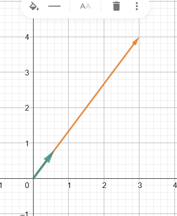{fig-align="center"}
:::

Αν x και y οι συντεταγμένες του μοναδιαίου, τότε θα έχουμε

$|\vec a|=\sqrt{3^2+4^2}=5$ και $|\vec u|=1=\sqrt{x^2+y^2}$.

Ακόμη θα ισχύει:

$\vec a =λ \vec u \implies (3,4)=(λx,λy) \implies 5= \sqrt{(λx)^2+(λy)^2}$ αφού θα είναι ομόρροπα.

$\implies  5=λ\sqrt{x^2+y^2} \implies 5=λ\cdot 1 \implies λ=5$

$\vec a =λ \vec u \implies (3,4)=(λx,λy) \implies 3=λx \ \ και \ \ 4=λy$ 

$x=........... \ \ , \ \ y=.............$ 
::::

------------------------------------------------------------------------

#### **Ομάδα Δ: Συνθήκη Παραλληλίας & Συνευθειακότητα**

13. **Άσκηση 13:** Να εξετάσετε αν είναι παράλληλα τα παρακάτω ζεύγη διανυσμάτων:

    - α) $\vec{α} = (2, -3)$ και $\vec{β} = (-6, 9)$

    - β) $\vec{u} = (4, 1)$ και $\vec{v} = (2, 3)$

14. **Άσκηση 14:** Να βρεθεί η τιμή του $λ \in \mathbb{R}$ ώστε τα διανύσματα $\vec{α} = (λ - 1, 2)$ και $\vec{β} = (3, λ + 4)$ να είναι παράλληλα.

:::: my-callout-theory
::: {.my-callout-theory .callout-title}
Υπόδειξη
:::

Πρέπει οι συντελεστές διεύθυνσης να είναι ίσοι $λ_{\vec α}=λ_{\vec β} \implies \dfrac{λ-1}{2}=\dfrac{λ+4}{3}  \implies$ .................$λ=-5$ ή $λ=2$

- Για $λ=-5 \implies  \vec α= ............... \quad , \quad \vec β= ..........$ και $\quad \vec α=-2\vec β \quad$ αντίρροπα.

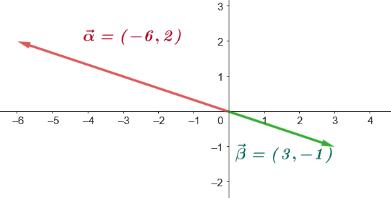{fig-align="center" width="300"}

- Για $λ=2 \implies  \vec α= ............... \quad , \quad \vec β= ..........$ και $\quad \vec α=\dfrac{1}{3}\vec β \quad$ ομόρροπα

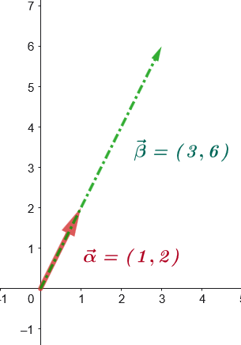{fig-align="center" width="200"}
::::

------------------------------------------------------------------------

:::: {.math-box .exercise-box}
::: {.math-title .exercise-title}
15. Εκφώνηση
:::
Να αποδείξετε ότι τα σημεία $A(1, 2)$, $B(3, 6)$ και $Γ(-1, -2)$ είναι συνευθειακά.
::::

:::: my-callout-theory
::: {.my-callout-theory .callout-title}
Υπόδειξη
:::
$λ_{ΑΒ}=\dfrac{6-2}{3-1}=2 \ \ , \ \ λ_{ΑΓ}=\dfrac{-2-2}{-1-1}=2$
::::

---

:::: {.math-box .exercise-box}
::: {.math-title .exercise-title}
16. Εκφώνηση
:::
Δίνονται τα σημεία $A(2, 3)$, $B(-1, 5)$ και $Γ(x, 1)$.

Να υπολογίσετε το $x \in \mathbb{R}$ ώστε τα σημεία $A, B, Γ$ να σχηματίζουν τρίγωνο (δηλαδή να μην είναι συνευθειακά).
::::

:::: {.math-box .solution-box}
::: {.math-title .solution-title}
Λύση
:::

Τα σημεία $A, B, \Gamma$ σχηματίζουν τρίγωνο αν και μόνο αν **δεν** είναι συνευθειακά. 

Αυτό σημαίνει ότι τα διανύσματα $\vec{AB}$ και $\vec{A\Gamma}$ **δεν** πρέπει να είναι παράλληλα (συγγραμμικά), δηλαδή η ορίζουσά τους πρέπει να είναι διάφορη του μηδενός:
$$\det(\vec{AB}, \vec{A\Gamma}) \neq 0$$

---

**1: Συντεταγμένες των διανυσμάτων $\vec{AB}$ και $\vec{A\Gamma}$**

* **Για το διάνυσμα $\vec{AB}$:**
  $$\vec{AB} = (x_B - x_A, \; y_B - y_A) = (-1 - 2, \; 5 - 3) = (-3, \; 2)$$

* **Για το διάνυσμα $\vec{A\Gamma}$:**
  $$\vec{A\Gamma} = (x_\Gamma - x_A, \; y_\Gamma - y_A) = (x - 2, \; 1 - 3) = (x - 2, \; -2)$$

---

**2: Υπολογισμός της ορίζουσας**

Η ορίζουσα των διανυσμάτων είναι:
$$\det(\vec{AB}, \vec{A\Gamma}) = \begin{vmatrix} -3 & 2 \\ x - 2 & -2 \end{vmatrix}$$

Αναπτύσσουμε την ορίζουσα:
$$\det(\vec{AB}, \vec{A\Gamma}) = (-3) \cdot (-2) - 2 \cdot (x - 2) = 6 - 2x + 4 = 10 - 2x$$

---

**3: Συνθήκη μη συνευθειακότητας**

Για να σχηματίζουν τα σημεία τρίγωνο, απαιτούμε:
$$\det(\vec{AB}, \vec{A\Gamma}) \neq 0$$
$$10 - 2x \neq 0$$
$$-2x \neq -10$$
$$x \neq 5$$

---

**Συμπέρασμα**

Τα σημεία $A, B, \Gamma$ σχηματίζουν τρίγωνο για κάθε:
$$x \in \mathbb{R} \setminus \{5\}$$
(δηλαδή για οποιονδήποτε πραγματικό αριθμό $x$ εκτός από το $5$).
::::

------------------------------------------------------------------------

#### **Ομάδα Ε: Συντελεστής Διεύθυνσης & Γεωμετρικές Εφαρμογές**

17. **Άσκηση 17:** Να υπολογίσετε τον συντελεστή διεύθυνσης $λ$ και τη γωνία $\phi$ που σχηματίζουν με τον θετικό ημιάξονα $Ox$ τα διανύσματα:

    - α) $\vec{α} = (2, 2)$

    - β) $\vec{β} = (-\sqrt{3}, 1)$

18. **Άσκηση 18:** Δίνονται τα σημεία $A(2, 5)$ και $B(6, 13)$.

    - α) Να βρείτε τον συντελεστή διεύθυνσης του διανύσματος $\vec{AB}$.

    - β) Να βρείτε τον συντελεστή διεύθυνσης της ευθείας που διέρχεται από τα σημεία $A$ και $B$.

19. **Άσκηση 19:** Δίνονται τα διανύσματα $\vec{α} = (κ + 1, 2)$ και $\vec{β} = (4, κ - 1)$ με $κ \neq -1$ και $κ \neq 1$.
    Να υπολογίσετε το $κ$ ώστε οι συντελεστές διεύθυνσης των διανυσμάτων να ικανοποιούν τη σχέση $λ_{\vec{α}} = λ_{\vec{β}}$.

---


:::: {.math-box .exercise-box}
::: {.math-title .exercise-title}
20. Εκφώνηση
:::
Δίνεται κύκλος με κέντρο το σημείο $K(2, 3)$ και ακτίνα $R = 5$.

  - α) Να εξετάσετε αν τα σημεία $A(5, 7)$ και $B(-1, -1)$ ανήκουν στον κύκλο.

  - β) Να αποδείξετε ότι το τμήμα $AB$ είναι διάμετρος του κύκλου, δείχνοντας ότι το $K$ είναι το μέσο του $AB$.

::::


:::: {.math-box .solution-box}
::: {.math-title .solution-title}
Λύση
:::
**α) Εξέταση αν τα σημεία $A$ και $B$ ανήκουν στον κύκλο**

Ένα σημείο ανήκει στον κύκλο αν και μόνο αν η **απόστασή του από το κέντρο $K(2, 3)$** ισούται με την ακτίνα $R = 5$.

Χρησιμοποιούμε τον τύπο της απόστασης δύο σημείων:
$$d = \sqrt{(x_2 - x_1)^2 + (y_2 - y_1)^2}$$

* **Για το σημείο $A(5, 7)$:**
  $$(KA) = \sqrt{(5 - 2)^2 + (7 - 3)^2} = \sqrt{3^2 + 4^2} = \sqrt{9 + 16} = \sqrt{25} = 5$$

  Επειδή $(KA) = R = 5$, το σημείο $A$ **ανήκει στον κύκλο**.

* **Για το σημείο $B(-1, -1)$:**
  $$(KB) = \sqrt{(-1 - 2)^2 + (-1 - 3)^2} = \sqrt{(-3)^2 + (-4)^2} = \sqrt{9 + 16} = \sqrt{25} = 5$$

  Επειδή $(KB) = R = 5$, και το σημείο $B$ **ανήκει στον κύκλο**.

---

**β) Απόδειξη ότι το τμήμα $AB$ είναι διάμετρος του κύκλου**

Ένα ευθύγραμμο τμήμα $AB$ είναι διάμετρος του κύκλου αν:

1. Τα άκρα του $A$ και $B$ ανήκουν στον κύκλο (το δείξαμε στο ερώτημα α).

2. Το κέντρο $K$ του κύκλου είναι το **μέσο** του τμήματος $AB$.

Υπολογίζουμε τις συντεταγμένες $(x_M, y_M)$ του μέσου $M$ του τμήματος $AB$:
$$x_M = \frac{x_A + x_B}{2} = \frac{5 + (-1)}{2} = \frac{4}{2} = 2$$
$$y_M = \frac{y_A + y_B}{2} = \frac{7 + (-1)}{2} = \frac{6}{2} = 3$$

Άρα το μέσο του $AB$ είναι το σημείο $M(2, 3)$, το οποίο ταυτίζεται με το κέντρο $K(2, 3)$.

Επομένως, το $K$ είναι το μέσο του $AB$, πράγμα που αποδεικνύει ότι το ευθύγραμμο τμήμα $AB$ είναι **διάμετρος** του κύκλου.

*(Εναλλακτικά μόνο με αποστάσεις: $(AB) = \sqrt{(-1-5)^2 + (-1-7)^2} = \sqrt{36 + 64} = 10 = 2R$, και αφού $(KA) + (KB) = 5 + 5 = 10 = (AB)$, τα σημεία $A, K, B$ είναι συνευθειακά και το $AB$ είναι διάμετρος).*
::::

------------------------------------------------------------------------

:::: {.math-box .exercise-box}
::: {.math-title .exercise-title}
21. Εκφώνηση
:::

Δίνεται το διάνυσμα $\vec{u} = (\mu^2 - 9, \; \mu^2 - 5\mu + 6)$ με $\mu \in \mathbb{R}$.
Να βρείτε την τιμή του $\mu$ ώστε:

1.  $\vec{u} = \vec{0}$

2.  $\vec{u} \neq \vec{0}$ και $\vec{u} \parallel y'y$ (παράλληλο στον άξονα $y'y$)
::::

:::: {.math-box .solution-box}
::: {.math-title .solution-title}
Λύση
:::

1.  Για να είναι $\vec{u} = \vec{0}$, πρέπει και οι δύο συντεταγμένες να είναι μηδέν ταυτόχρονα: $$\begin{cases} \mu^2 - 9 = 0 \implies \mu = 3 \ \text{ή} \ \mu = -3 \\ \mu^2 - 5\mu + 6 = 0 \implies (\mu - 2)(\mu - 3) = 0 \implies \mu = 2 \ \text{ή} \ \mu = 3 \end{cases}$$

Η κοινή λύση είναι $\mu = 3$.

2.  Για να είναι $\vec{u} \neq \vec{0}$ και $\vec{u} \parallel y'y$, πρέπει η τετμημένη του να είναι μηδέν και η τεταγμένη του μη μηδενική: $$x_{\vec{u}} = 0 \iff \mu = \pm 3 \quad \text{και} \quad y_{\vec{u}} \neq 0 \iff \mu \neq 2 \ \text{και} \ \mu \neq 3$$

Επομένως, απορρίπτεται το $\mu = 3$ και δεκτή τιμή είναι η $\mu = -3$.
::::

------------------------------------------------------------------------

:::: {.math-box .exercise-box}
::: {.math-title .exercise-title}
22. Εκφώνηση
:::

Δίνονται τα διανύσματα $\vec{\alpha} = (κ^2 - 4κ + 3, \; κ^2 - 1)$ και $\vec{\beta} = (2κ - 2, \; 3κ - 3)$ με $κ \in \mathbb{R}$.
Να βρεθεί η τιμή του $κ$ ώστε $\vec{\alpha} = \vec{\beta}$.
::::

:::: {.math-box .solution-box}
::: {.math-title .solution-title}
Λύση
:::

Δύο διανύσματα είναι ίσα όταν έχουν ίσες αντίστοιχες συντεταγμένες: $$\begin{cases} κ^2 - 4κ + 3 = 2κ - 2 \\ κ^2 - 1 = 3κ - 3 \end{cases}$$

1.  Από την πρώτη εξίσωση: $$κ^2 - 6κ + 5 = 0 \implies (κ - 1)(κ - 5) = 0 \implies κ = 1 \ \text{ή} \ κ = 5$$

2.  Από τη δεύτερη εξίσωση: $$κ^2 - 3κ + 2 = 0 \implies (κ - 1)(κ - 2) = 0 \implies κ = 1 \ \text{ή} \ κ = 2$$

Η κοινή λύση και των δύο εξισώσεων είναι $κ = 1$.
::::

------------------------------------------------------------------------

:::: {.math-box .exercise-box}
::: {.math-title .exercise-title}
23. Εκφώνηση
:::

Να βρείτε τον πραγματικό αριθμό $t$, ώστε τα διανύσματα $\vec{u} = (t, 2)$ και $\vec{v} = (8, t)$ να είναι **ομόρροπα**.
::::

:::: {.math-box .solution-box}
::: {.math-title .solution-title}
Λύση
:::

Δύο διανύσματα είναι ομόρροπα αν και μόνο αν υπάρχει $\lambda > 0$ τέτοιο ώστε $\vec{v} = \lambda \vec{u}$.

Επίσης, αφού είναι παράλληλα, η ορίζουσά τους είναι μηδέν: $$\det(\vec{u}, \vec{v}) = 0 \iff \begin{vmatrix} t & 2 \\ 8 & t \end{vmatrix} = 0 \iff t^2 - 16 = 0 \iff t = 4 \ \text{ή} \ t = -4$$

- **Για** $t = 4$: $\vec{u} = (4, 2)$ και $\vec{v} = (8, 4) = 2\vec{u}$ ($\lambda = 2 > 0$), άρα είναι **ομόρροπα**.

- **Για** $t = -4$: $\vec{u} = (-4, 2)$ και $\vec{v} = (8, -4) = -2\vec{u}$ ($\lambda = -2 < 0$), άρα είναι **αντίρροπα**.

Συνεπώς, η δεκτή τιμή είναι $t = 4$.
::::

------------------------------------------------------------------------

:::: {.math-box .exercise-box}
::: {.math-title .exercise-title}
24. Εκφώνηση
:::

Αν $\vec{w} = (-5, 12)$, να βρείτε όλα τα διανύσματα που είναι συγγραμμικά με το $\vec{w}$ και έχουν τριπλάσιο μέτρο από αυτό.
::::

:::: {.math-box .solution-box}
::: {.math-title .solution-title}
Λύση
:::

Έστω $\vec{z}$ το ζητούμενο διάνυσμα.
Επειδή $\vec{z} \parallel \vec{w}$, υπάρχει $k \in \mathbb{R}$ τέτοιο ώστε $\vec{z} = k\vec{w}$.

Για τα μέτρα ισχύει: $$|\vec{z}| = 3|\vec{w}| \iff |k| \cdot |\vec{w}| = 3|\vec{w}| \iff |k| = 3 \iff k = 3 \ \text{ή} \ k = -3$$

- Αν $k = 3$ (ομόρροπο): $\vec{z}_1 = 3(-5, 12) = (-15, 36)$

- Αν $k = -3$ (αντίρροπο): $\vec{z}_2 = -3(-5, 12) = (15, -36)$

Τα ζητούμενα διανύσματα είναι τα $(-15, 36)$ και $(15, -36)$.
::::

------------------------------------------------------------------------

:::: {.math-box .exercise-box}
::: {.math-title .exercise-title}
25. Εκφώνηση
:::

Σε καρτεσιανό σύστημα συντεταγμένων, οι τετμημένες δύο σημείων $P$ και $Q$ είναι οι ρίζες της εξίσωσης $x^2 - (2\alpha^2 - 5\alpha - 1)x - 9 = 0$.
Να βρείτε τις τιμές του $\alpha \in \mathbb{R}$, ώστε το μέσο του τμήματος $PQ$ να έχει τετμημένη ίση με $3$.
::::

:::: {.math-box .solution-box}
::: {.math-title .solution-title}
Λύση
:::

Η διακρίνουσα της εξίσωσης είναι $\Delta = (2\alpha^2 - 5\alpha - 1)^2 - 4(1)(-9) = (2\alpha^2 - 5\alpha - 1)^2 + 36 > 0$ για κάθε $\alpha \in \mathbb{R}$, άρα η εξίσωση έχει πάντα δύο πραγματικές και άνισες ρίζες $x_1, x_2$.

Από τους τύπους Vieta, το άθροισμα των ριζών είναι: $$S = x_1 + x_2 = 2\alpha^2 - 5\alpha - 1$$

Η τετμημένη του μέσου $M$ του τμήματος $PQ$ δίνεται από τον τύπο: $$x_M = \frac{x_1 + x_2}{2} = 3 \iff x_1 + x_2 = 6$$

Άρα: $$2\alpha^2 - 5\alpha - 1 = 6 \iff 2\alpha^2 - 5\alpha - 7 = 0$$

Λύνουμε το τριώνυμο: $$\Delta_\alpha = (-5)^2 - 4(2)(-7) = 25 + 56 = 81$$ $$\alpha = \frac{5 \pm 9}{4} \implies \alpha = \frac{7}{2} = 3{,}5 \quad \text{ή} \quad \alpha = -1$$
::::

------------------------------------------------------------------------

:::: {.math-box .exercise-box}
::: {.math-title .exercise-title}
26. Εκφώνηση
:::

Δίνονται τέσσερα σημεία $K(x_1, y_1), L(x_2, y_2), M(x_3, y_3), N(x_4, y_4)$.
Να βρείτε την αναγκαία και ικανή συνθήκη μεταξύ των συντεταγμένων τους ώστε τα σημεία αυτά να αποτελούν τα μέσα των διαδοχικών πλευρών ενός κυρτού τετραπλεύρου $ABCD$.
::::

:::: {.math-box .solution-box}
::: {.math-title .solution-title}
Λύση
:::

Έστω κυρτό τετράπλευρο $ABCD$ και $K, L, M, N$ τα μέσα των $AB, BC, CD, DA$ αντίστοιχα.

Από το θεώρημα Varignon, το τετράπλευρο που σχηματίζεται ενώνοντας τα μέσα των διαδοχικών πλευρών οποιουδήποτε τετραπλεύρου είναι **πάντα παραλληλόγραμμο** (αφού $\vec{KL} = \frac{1}{2}\vec{AC} = \vec{NM}$).

Επομένως, τα σημεία $K, L, M, N$ είναι μέσα των πλευρών τετραπλεύρου αν και μόνο αν το $KLMN$ είναι παραλληλόγραμμο, δηλαδή: $$\vec{KL} = \vec{NM}$$

Αναλύοντας σε συντεταγμένες: $$\begin{cases} x_2 - x_1 = x_3 - x_4 \\ y_2 - y_1 = y_3 - y_4 \end{cases} \iff \begin{cases} x_1 + x_3 = x_2 + x_4 \\ y_1 + y_3 = y_2 + y_4 \end{cases}$$

Δηλαδή, τα αθροίσματα των συντεταγμένων των απέναντι κορυφών πρέπει να είναι ίσα (οι διαγώνιοι $KM$ και $LN$ έχουν κοινό μέσο).
::::

------------------------------------------------------------------------

:::: {.math-box .exercise-box}
::: {.math-title .exercise-title}
27. Εκφώνηση
:::

Για οποιουδήποτε πραγματικούς αριθμούς $u_1, u_2, v_1, v_2, x, y$, να αποδείξετε γεωμετρικά ότι: $$\sqrt{(x - u_1)^2 + (y - v_1)^2} + \sqrt{(x - u_2)^2 + (y - v_2)^2} \ge \sqrt{(u_2 - u_1)^2 + (v_2 - v_1)^2}$$
::::

:::: {.math-box .solution-box}
::: {.math-title .solution-title}
Λύση
:::

Θεωρούμε στο καρτεσιανό επίπεδο τα σημεία:

- $M(x, y)$

- $A(u_1, v_1)$

- $B(u_2, v_2)$

Από τον τύπο της απόστασης δύο σημείων έχουμε:

- $(MA) = \sqrt{(x - u_1)^2 + (y - v_1)^2}$

- $(MB) = \sqrt{(x - u_2)^2 + (y - v_2)^2}$

- $(AB) = \sqrt{(u_2 - u_1)^2 + (v_2 - v_1)^2}$

Από την **τριγωνική ανισότητα** για τα σημεία $M, A, B$, γνωρίζουμε ότι για οποιοδήποτε τρίγωνο (ή εκφυλισμένο τρίγωνο σε ευθεία) ισχύει: $$(MA) + (MB) \ge (AB)$$

Αντικαθιστώντας τις παραστάσεις των αποστάσεων, προκύπτει άμεσα η ζητούμενη ανισότητα.
Η ισότητα ισχύει όταν το σημείο $M$ ανήκει στο ευθύγραμμο τμήμα $AB$.
::::

------------------------------------------------------------------------

:::: {.math-box .exercise-box}
::: {.math-title .exercise-title}
28. Εκφώνηση
:::

Έστω δύο μη συγγραμμικά διανύσματα $\vec{u}$ και $\vec{v}$.
Να αποδείξετε ότι αν ένα διάνυσμα $\vec{d}$ γράφεται ως γραμμικός συνδυασμός τους, η γραφή αυτή είναι μοναδική.
::::

:::: {.math-box .solution-box}
::: {.math-title .solution-title}
Λύση
:::

Υποθέτουμε ότι το διάνυσμα $\vec{d}$ εκφράζεται με δύο τρόπους ως γραμμικός συνδυασμός των $\vec{u}$ και $\vec{v}$: $$\vec{d} = x_1\vec{u} + y_1\vec{v} \quad \text{και} \quad \vec{d} = x_2\vec{u} + y_2\vec{v} \quad (x_1, x_2, y_1, y_2 \in \mathbb{R})$$

Εξισώνοντας τις δύο εκφράσεις: $$x_1\vec{u} + y_1\vec{v} = x_2\vec{u} + y_2\vec{v}$$

Μεταφέρουμε όλους τους όρους στο αριστερό μέλος: $$(x_1 - x_2)\vec{u} + (y_1 - y_2)\vec{v} = \vec{0}$$

Επειδή τα διανύσματα $\vec{u}$ και $\vec{v}$ είναι **μη συγγραμμικά**, είναι γραμμικώς ανεξάρτητα, πράγμα που σημαίνει ότι ο μόνος γραμμικός συνδυασμός τους που δίνει το μηδενικό διάνυσμα είναι αυτός με μηδενικούς συντελεστές: $$\begin{cases} x_1 - x_2 = 0 \implies x_1 = x_2 \\ y_1 - y_2 = 0 \implies y_1 = y_2 \end{cases}$$

Άρα οι συντελεστές ταυτίζονται, πράγμα που αποδεικνύει ότι η έκφραση είναι **μοναδική**.
::::

------------------------------------------------------------------------

:::: callout-sos
::: {.callout-sos .callout-title}
Εύχομαι
:::

ΚΑΛΗ ΜΕΛΕΤΗ!
::::
