```{=html}
<!-- Φόρτωση βιβλιοθήκης GeoGebra -->
<script src="https://www.geogebra.org/apps/deployggb.js"></script>

<!-- Συνάρτηση δημιουργίας applets -->
<script>
function createGeoGebra(containerId, materialId, width = 700, height = 500) {
  var params = {
    "id": "ggb-" + containerId,
    "material_id": materialId,
    "width": width,
    "height": height,
    "showToolBar": true,
    "showMenuBar": false,
    "showAlgebraInput": true
  };
  
  var applet = new GGBApplet(params, '5.2');
  applet.inject(containerId);
}
</script>
```

## Εσωτερικό Γινόμενο Διανυσμάτων

------------------------------------------------------------------------

### Εσωτερικό Γινόμενο Δύο Μη Μηδενικών Διανυσμάτων

#### **Ορισμός**

:::: {.math-box .definition-box}
::: {.math-title .definition-title}
Ορισμός

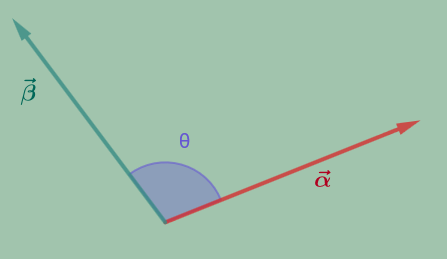{fig-align="center" width="350"}
:::

Ονομάζουμε **εσωτερικό γινόμενο** δύο μη μηδενικών διανυσμάτων $\vec{α}$ και $\vec{β}$, το οποίο συμβολίζεται με $\vec{α} \cdot \vec{β}$, τον πραγματικό αριθμό: $$\vec{α} \cdot \vec{β} = |\vec{α}| \cdot |\vec{β}| \cdot συνθ$$ όπου $θ = (\widehat{\vec{α}, \vec{β}})$ είναι η κυρτή γωνία που σχηματίζουν τα διανύσματα $\vec{α}$ και $\vec{β}$, με $0 \le θ \le \pi$.

- **Ειδική περίπτωση:** Αν τουλάχιστον ένα από τα διανύσματα είναι το μηδενικό διάνυσμα ($\vec{α} = \vec{0}$ ή $\vec{β} = \vec{0}$), τότε ορίζουμε συμβατικά $\vec{α} \cdot \vec{β} = 0$.
::::

------------------------------------------------------------------------

#### **Παραδείγματα**

1.  **Παράδειγμα με μέτρα και γωνία:** Αν τα διανύσματα $\vec{α}$ και $\vec{β}$ έχουν μέτρα $|\vec{α}| = 3$, $|\vec{β}| = 8$ και σχηματίζουν γωνία $θ = \dfrac{\pi}{3}$ ($60^\circ$), τότε: $$\vec{α} \cdot \vec{β} = 3 \cdot 8 \cdot συν\left(\frac{\pi}{3}\right) = 24 \cdot \frac{1}{2} = 12$$

2.  **Παράδειγμα σε ισόπλευρο τρίγωνο:** Έστω ισόπλευρο τρίγωνο $ABC$ πλευράς $a = 2$.

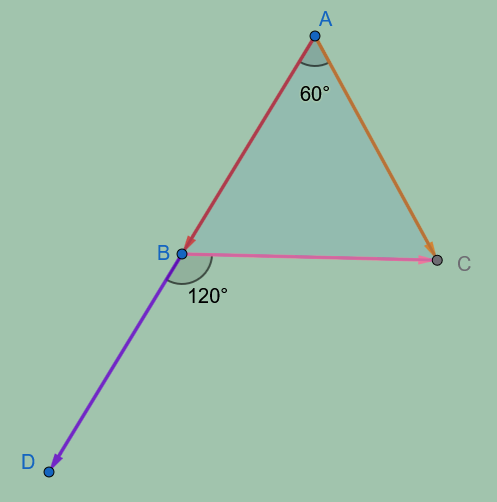{fig-align="center" width="400"}

- Για τα διανύσματα $\vec{AB}$ και $\vec{AC}$ με κοινή αρχή το $A$, η γωνία τους είναι $\hat{A} = 60^\circ$, οπότε: $$\vec{AB} \cdot \vec{AC} = |\vec{AB}| \cdot |\vec{AC}| \cdot συν 60^\circ = 2 \cdot 2 \cdot \frac{1}{2} = 2$$

- Για τα διανύσματα $\vec{AB}$ και $\vec{BC}$, μεταφέροντας το $\vec{AB}$ στη θέση $\vec{BD}$ ώστε να έχει κοινή αρχή με το $\vec{BC}$, η σχηματιζόμενη γωνία είναι παραπληρωματική της $\hat{B}$, δηλαδή $180^\circ - 60^\circ = 120^\circ$.
  Άρα: $$\vec{AB} \cdot \vec{BC} = |\vec{AB}| \cdot |\vec{BC}| \cdot συν 120^\circ = 2 \cdot 2 \cdot \left(-\frac{1}{2}\right) = -2$$

------------------------------------------------------------------------

#### **Συνέπειες του Ορισμού**

:::: {.math-box .property-box}
::: {.math-title .property-title}
Συνέπειες του ορισμού
:::

1.  **Αντιμεταθετική Ιδιότητα:** $\vec{α} \cdot \vec{β} = \vec{β} \cdot \vec{α}$.

2.  **Πρόσημο Εσωτερικού Γινομένου:**

    - Αν $θ$ οξεία ($0 \le θ < \dfrac{\pi}{2} \implies συνθ \gt 0$), τότε $\vec{α} \cdot \vec{β} > 0$.

    - Αν $θ$ αμβλεία ($\dfrac{\pi}{2} < θ \le \pi \implies συνθ \lt 0$), τότε $\vec{α} \cdot \vec{β} < 0$.

3.  **Συνθήκη Καθετότητας (Ορθογωνιότητας):** Δύο μη μηδενικά διανύσματα είναι κάθετα αν και μόνο αν το εσωτερικό τους γινόμενο ισούται με μηδέν: $$\vec{α} \perp \vec{β} \iff \vec{α} \cdot \vec{β} = 0 \quad \text{ γιατι τότε θα είναι }\quad συν90^ο=0$$

4.  **Συγγραμμικά Διανύσματα:**

    - Αν $\vec{α} \uparrow\uparrow \vec{β}$ (ομόρροπα, $θ = 0 \implies συν 0^ο=1$), τότε $\vec{α} \cdot \vec{β} = |\vec{α}| |\vec{β}|$.

    - Αν $\vec{α} \uparrow\downarrow \vec{β}$ (αντίρροπα, $θ = \pi \implies συν π=-1$ ), τότε $\vec{α} \cdot \vec{β} = -|\vec{α}| |\vec{β}|$.

5.  **Εσωτερικό Τετράγωνο:**

    Το γινόμενο $\vec{α} \cdot \vec{α}$ συμβολίζεται με $\vec{α}^2$ και ονομάζεται εσωτερικό τετράγωνο.
    Επειδή η γωνία του διανύσματος με τον εαυτό του είναι $θ = 0^\circ$, ισχύει: $$\vec{α}^2 = |\vec{α}|^2 \iff |\vec{α}| = \sqrt{\vec{α}^2}$$

6.  **Μοναδιαία Διανύσματα Βάσης** $\vec{i}, \vec{j}$: $$\vec{i} \cdot \vec{j} = \vec{j} \cdot \vec{i} = 0 \quad \text{και} \quad \vec{i}^2 = \vec{j}^2 = 1$$
::::

------------------------------------------------------------------------

### 2. Αναλυτική Έκφραση Εσωτερικού Γινομένου

#### **Σχέση & Πλήρης Απόδειξη**

:::: {.math-box .theorem-box}
::: {.math-title .theorem-title}
**Θεώρημα:**
:::

Σε ορθοκανονικό σύστημα συντεταγμένων $Oxy$, το εσωτερικό γινόμενο δύο διανυσμάτων $\vec{α} = (x_1, y_1)$ και $\vec{β} = (x_2, y_2)$ ισούται με το άθροισμα των γινομένων των ομώνυμων συντεταγμένων τους: $$\vec{α} \cdot \vec{β} = x_1 x_2 + y_1 y_2$$
::::

:::: {.math-box .apodeixi-box}
::: {.math-title .apodeixi-title}
**Απόδειξη:**

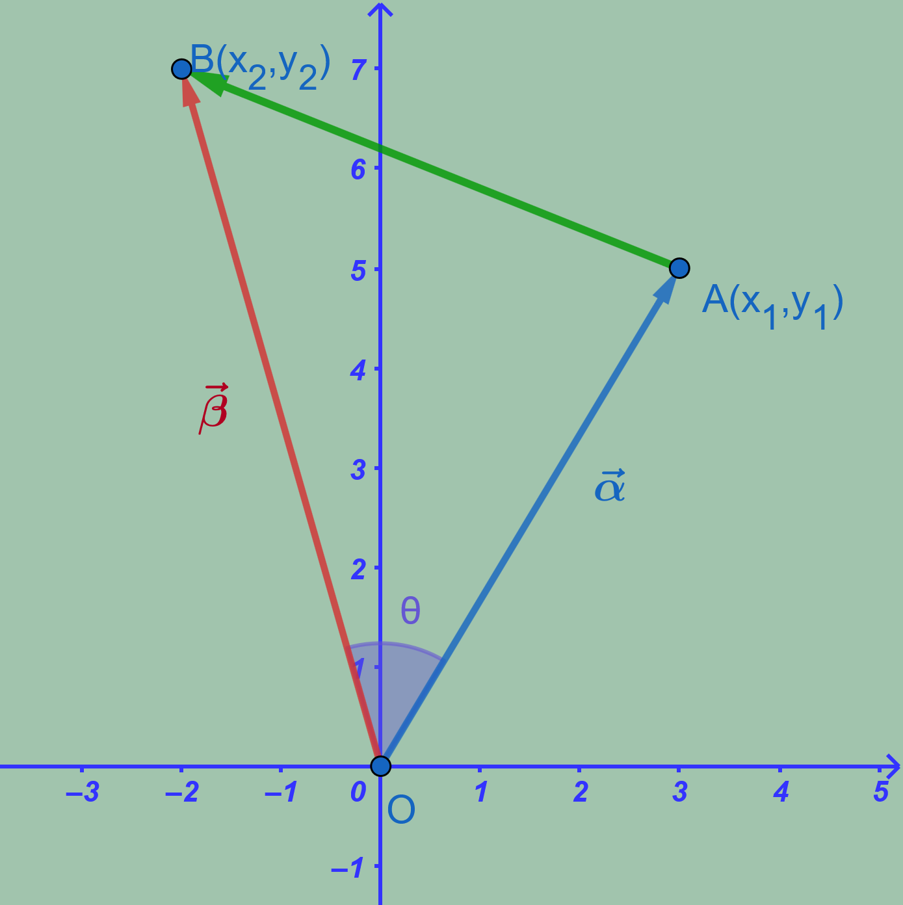{fig-align="center" width="400"}
:::

1.  Με αρχή το $O$, σχεδιάζουμε τα διανύσματα θέσης $\vec{OA} = \vec{α} = (x_1, y_1)$ και $\vec{OB} = \vec{β} = (x_2, y_2)$.

2.  Το διάνυσμα με αρχή το $A$ και πέρας το $B$ είναι $\vec{AB} = \vec{OB} - \vec{OA} = (x_2 - x_1, y_2 - y_1)$.

3.  Τα τετράγωνα των μέτρων των διανυσμάτων αυτών εκφράζονται αναλυτικά ως:

    - $|\vec{OA}|^2 = x_1^2 + y_1^2$

    - $|\vec{OB}|^2 = x_2^2 + y_2^2$

    - $|\vec{AB}|^2 = (x_2 - x_1)^2 + (y_2 - y_1)^2 = x_2^2 - 2x_1 x_2 + x_1^2 + y_2^2 - 2y_1 y_2 + y_1^2$

4.  Από τον Νόμο των Συνημιτόνων στο τρίγωνο $OAB$, για τη γωνία $θ = \widehat{AOB}$ ισχύει: $$|\vec{AB}|^2 = |\vec{OA}|^2 + |\vec{OB}|^2 - 2 |\vec{OA}| |\vec{OB}| συνθ$$

5.  Επειδή από τον γεωμετρικό ορισμό ισχύει $|\vec{OA}| |\vec{OB}| συνθ = \vec{α} \cdot \vec{β}$, αντικαθιστούμε στη σχέση: $$|\vec{AB}|^2 = |\vec{OA}|^2 + |\vec{OB}|^2 - 2 (\vec{α} \cdot \vec{β})$$

6.  Εξισώνοντας τις δύο εκφράσεις του $|\vec{AB}|^2$: $$x_1^2 - 2x_1 x_2 + x_2^2 + y_1^2 - 2y_1 y_2 + y_2^2 = (x_1^2 + y_1^2) + (x_2^2 + y_2^2) - 2 (\vec{α} \cdot \vec{β})$$ $$-2 (x_1 x_2 + y_1 y_2) = -2 (\vec{α} \cdot \vec{β}) \iff \vec{α} \cdot \vec{β} = x_1 x_2 + y_1 y_2$$
::::

------------------------------------------------------------------------

#### **Ιδιότητες & Αποδείξεις**

Για οποιαδήποτε διανύσματα $\vec{α} = (x_1, y_1)$, $\vec{β} = (x_2, y_2)$, $\vec{\gamma} = (x_3, y_3)$ και $λ \in \mathbb{R}$:

:::: {.math-box .property-box}
::: {.math-title .property-title}
1.  **Πολλαπλασιασμός με βαθμωτό αριθμό:**
:::

$$(λ \vec{α}) \cdot \vec{β} = \vec{α} \cdot (λ \vec{β}) = λ (\vec{α} \cdot \vec{β})$$
::::

:::: {.math-box .propertyproof-box}
::: {.math-title .propertyproof-title}
**Απόδειξη:**
:::

$(λ \vec{α}) \cdot \vec{β} = (λ x_1, λ y_1) \cdot (x_2, y_2) = (λ x_1) x_2 + (λ y_1) y_2 = λ (x_1 x_2 + y_1 y_2) = λ (\vec{α} \cdot \vec{β})$.
::::

:::: {.math-box .property-box}
::: {.math-title .property-title}
2.  **Επιμεριστική Ιδιότητα:**
:::

$$\vec{α} \cdot (\vec{β} + \vec{\gamma}) = \vec{α} \cdot \vec{β} + \vec{α} \cdot \vec{\gamma}$$
::::

:::: {.math-box .propertyproof-box}
::: {.math-title .propertyproof-title}
**Απόδειξη:**
:::

$\vec{α} \cdot (\vec{β} + \vec{\gamma}) = (x_1, y_1) \cdot (x_2 + x_3, y_2 + y_3) = x_1 (x_2 + x_3) + y_1 (y_2 + y_3) = (x_1 x_2 + y_1 y_2) + (x_1 x_3 + y_1 y_3) = \vec{α} \cdot \vec{β} + \vec{α} \cdot \vec{\gamma}$.
::::

:::: {.math-box .property-box}
::: {.math-title .property-title}
3.  **Συνθήκη Καθετότητας μέσω Συντελεστών Διεύθυνσης:**
:::

Αν τα διανύσματα $\vec{α}, \vec{β}$ δεν είναι παράλληλα στον άξονα $y'y$ ($x_1 \neq 0, x_2 \neq 0$), τότε: $$\vec{α} \perp \vec{β} \iff λ_1 λ_2 = -1$$
::::

:::: {.math-box .propertyproof-box}
::: {.math-title .propertyproof-title}
**Απόδειξη:**
:::

$\vec{α} \perp \vec{β} \iff \vec{α} \cdot \vec{β} = 0 \iff x_1 x_2 + y_1 y_2 = 0 \iff y_1 y_2 = -x_1 x_2$.

Διαιρώντας με $x_1 x_2 \neq 0$: $\dfrac{y_1}{x_1} \cdot \dfrac{y_2}{x_2} = -1 \iff λ_1 λ_2 = -1$.
::::

:::: {.math-box .property-box}
::: {.math-title .property-title}
4.  **Μη ισχύς Προσεταιριστικής Ιδιότητας:**
:::

Η ισότητα $(\vec{α} \cdot \vec{β}) \vec{\gamma} = \vec{α} (\vec{β} \cdot \vec{\gamma})$ **δεν ισχύει γενικά**, καθώς το πρώτο μέλος είναι διάνυσμα παράλληλο στο $\vec{\gamma}$, ενώ το δεύτερο είναι διάνυσμα παράλληλο στο $\vec{α}$.
::::

------------------------------------------------------------------------

### Συνημίτονο Γωνίας δύο Διανυσμάτων

#### **Σχέση & Απόδειξη**

:::: {.math-box .theorem-box}
::: {.math-title .theorem-title}
**Θεώρημα:**
:::

Το συνημίτονο της γωνίας $θ$ που σχηματίζουν δύο μη μηδενικά διανύσματα $\vec{α} = (x_1, y_1)$ και $\vec{β} = (x_2, y_2)$ δίνεται από τον τύπο: $$συνθ = \frac{\vec{α} \cdot \vec{β}}{|\vec{α}| |\vec{β}|} = \frac{x_1 x_2 + y_1 y_2}{\sqrt{x_1^2 + y_1^2} \cdot \sqrt{x_2^2 + y_2^2}}$$
::::

:::: {.math-box .apodeixi-box}
::: {.math-title .apodeixim-title}
**Απόδειξη:**
:::

1.  Από τον γεωμετρικό ορισμό του εσωτερικού γινομένου για μη μηδενικά διανύσματα ισχύει $\vec{α} \cdot \vec{β} = |\vec{α}| |\vec{β}| συνθ$.

2.  Επειδή $\vec{α} \neq \vec{0}$ και $\vec{β} \neq \vec{0}$, τα μέτρα είναι θετικοί αριθμοί ($|\vec{α}| |\vec{β}| \neq 0$).
    Διαιρώντας και τα δύο μέλη δια $|\vec{α}| |\vec{β}|$, λαμβάνουμε: $$συνθ = \frac{\vec{α} \cdot \vec{β}}{|\vec{α}| |\vec{β}|}$$

3.  Αντικαθιστώντας την αναλυτική έκφραση του εσωτερικού γινομένου $\vec{α} \cdot \vec{β} = x_1 x_2 + y_1 y_2$ και των μέτρων $|\vec{α}| = \sqrt{x_1^2 + y_1^2}$, $|\vec{β}| = \sqrt{x_2^2 + y_2^2}$, προκύπτει ο αναλυτικός τύπος.
::::

------------------------------------------------------------------------

#### **Παραδείγματα**

1.  **Υπολογισμός γωνίας:** Δίνονται τα διανύσματα $\vec{α} = (1, 2)$ και $\vec{β} = (3, 1)$.

    - $\vec{α} \cdot \vec{β} = 1 \cdot 3 + 2 \cdot 1 = 5$

    - $|\vec{α}| = \sqrt{1^2 + 2^2} = \sqrt{5}$ και $|\vec{β}| = \sqrt{3^2 + 1^2} = \sqrt{10}$

    - $συνθ = \dfrac{5}{\sqrt{5} \cdot \sqrt{10}} = \dfrac{5}{\sqrt{50}} = \dfrac{5}{5\sqrt{2}} = \dfrac{1}{\sqrt{2}} = \dfrac{\sqrt{2}}{2}$

    - Επειδή $0 \le θ \le \pi$, η γωνία των διανυσμάτων είναι $θ = \dfrac{\pi}{4}$ ($45^\circ$).

2.  **Εύρεση παραμέτρου για αμβλεία γωνία:** Να βρεθούν οι τιμές του $λ \in \mathbb{R}$ ώστε τα διανύσματα $\vec{α} = (λ - 1, 2)$ και $\vec{β} = (3, λ + 2)$ να σχηματίζουν αμβλεία γωνία.

    - Για να είναι η γωνία αμβλεία, πρέπει και αρκεί $\vec{α} \cdot \vec{β} < 0$: $$3(λ - 1) + 2(λ + 2) < 0 \iff 3λ - 3 + 2λ + 4 < 0 \iff 5λ + 1 < 0 \iff λ < -\frac{1}{5}$$

------------------------------------------------------------------------

### Προβολή Διανύσματος σε Διάνυσμα

#### **Ορισμός**

:::: {.math-box .definition-box}
::: {.math-title .definition-title}
Ορισμός

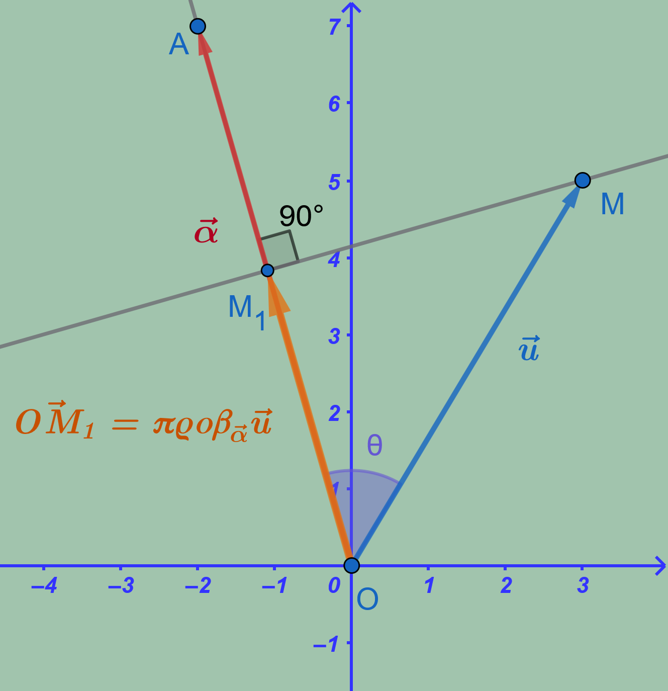{fig-align="center" width="400"}
:::

Έστω $\vec{α}$ ένα μη μηδενικό διάνυσμα ($\vec{α} \neq \vec{0}$) και $\vec{u}$ ένα τυχαίο διάνυσμα του επιπέδου.

Με αρχή ένα σημείο $O$, παίρνουμε τα διανύσματα $\vec{OA} = \vec{α}$ και $\vec{OM} = \vec{u}$.
Από το $M$ φέρνουμε κάθετο στη διεύθυνση της ευθείας $OA$ και έστω $M_1$ το ίχνος της καθέτου.

Το διάνυσμα $\vec{OM_1}$ ονομάζεται **προβολή του** $\vec{u}$ πάνω στο $\vec{α}$ και συμβολίζεται με $\text{προβ}_{\vec{α}}\vec{u}$: $$\text{προβ}_{\vec{α}}\vec{u} = \vec{OM_1}$$
::::

------------------------------------------------------------------------

#### **Απόδειξη Ανεξαρτησίας της Προβολής από την Επιλογή του Σημείου** $O$

:::: {.math-box .definition-box}
::: {.math-title .definition-title}
Απόδειξη Ανεξαρτησίας
:::

Έστω ότι επιλέγουμε ένα άλλο σημείο αναφοράς $O'$ και σχεδιάζουμε τα διανύσματα $\vec{O'A'} = \vec{α}$ και $\vec{O'M'} = \vec{u}$, με $M_1'$ το ίχνος της καθέτου από το $M'$ στην ευθεία $O'A'$.

- Επειδή $\vec{OA} = \vec{O'A'} = \vec{α}$ και $\vec{OM} = \vec{O'M'} = \vec{u}$, τα σχήματα $OMM_1$ και $O'M'M_1'$ προκύπτουν το ένα από το άλλο με παράλληλη μετατόπιση.

- Συνεπώς, τα προσανατολισμένα ευθύγραμμα τμήματα $OM_1$ και $O'M_1'$ είναι παράλληλα, ομόρροπα και ίσα σε μήκος, οπότε $\vec{OM_1} = \vec{O'M_1'}$.

- Άρα, το διάνυσμα $\text{προβ}_{\vec{α}}\vec{u}$ καθορίζεται μονοσήμαντα και είναι **απόλυτα ανεξάρτητο** από την επιλογή του σημείου $O$.
::::

------------------------------------------------------------------------

#### **Θεμελιώδης Σχέση & Τύποι Υπολογισμού Προβολής**

1.  **Θεμελιώδης Ισότητα:** $$\vec{α} \cdot \vec{u} = \vec{α} \cdot (\text{προβ}_{\vec{α}}\vec{u})$$

*Απόδειξη:*

{fig-align="center" width="400"}

$\vec{α} \cdot \vec{u} = \vec{α} \cdot (\vec{OM_1} + \vec{M_1M}) = \vec{α} \cdot \vec{OM_1} + \vec{α} \cdot \vec{M_1M} = \vec{α} \cdot \vec{OM_1} + 0 = \vec{α} \cdot \text{προβ}_{\vec{α}}\vec{u}$, διότι $\vec{α} \perp \vec{M_1M}$).

2.  **Αναλυτικός Τύπος Προβολής:**

Επειδή η προβολή $\text{προβ}_{\vec{α}}\vec{u}$ είναι διάνυσμα παράλληλο στο $\vec{α}$, υπάρχει $λ \in \mathbb{R}$ τέτοιο ώστε $\text{προβ}_{\vec{α}}\vec{u} = λ \vec{α}$.

Αντικαθιστώντας στη θεμελιώδη ισότητα: $$\vec{α} \cdot \vec{u} = \vec{α} \cdot (λ \vec{α}) = λ \vec{α}^2 = λ |\vec{α}|^2 \iff λ = \frac{\vec{α} \cdot \vec{u}}{|\vec{α}|^2}$$

Συνεπώς, ο τύπος της προβολής είναι: $$\text{προβ}_{\vec{α}}\vec{u} = \left( \frac{\vec{α} \cdot \vec{u}}{|\vec{α}|^2} \right) \vec{α}$$

------------------------------------------------------------------------

#### **Παραδείγματα**

1.  **Υπολογισμός Προβολής:** Δίνονται τα διανύσματα $\vec{α} = (2, 3)$ και $\vec{v} = (-1, 4)$.

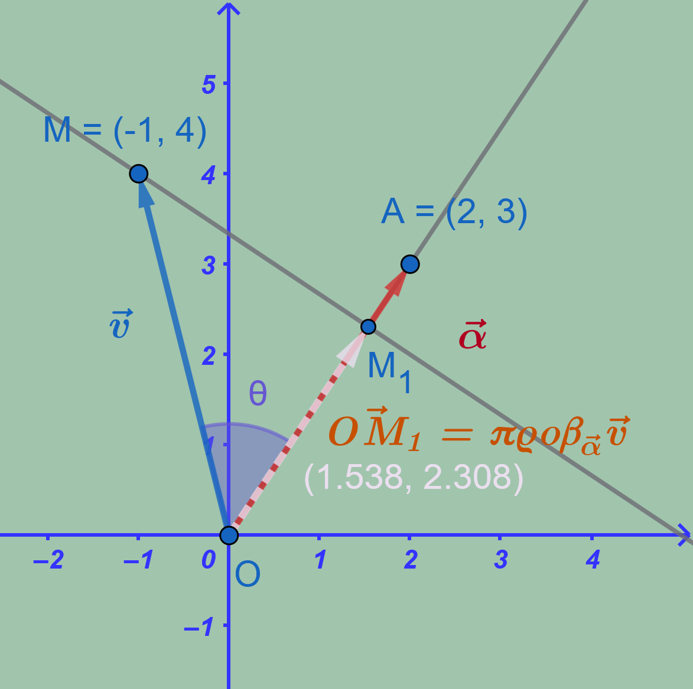{fig-align="center" width="350"}

- $\vec{α} \cdot \vec{v} = 2(-1) + 3(4) = 10$

- $|\vec{α}|^2 = 2^2 + 3^2 = 13$

- $\text{προβ}_{\vec{α}}\vec{v} = \dfrac{10}{13} (2, 3) = \left( \dfrac{20}{13}, \dfrac{30}{13} \right)$

2.  **Ορθογώνια Ανάλυση Διανύσματος:** Να αναλυθεί το διάνυσμα $\vec{v} = (4, 2)$ σε δύο συνιστώσες $\vec{v}_1, \vec{v}_2$ τέτοιες ώστε $\vec{v}_1 \parallel \vec{α}$ και $\vec{v}_2 \perp \vec{α}$, όπου $\vec{α} = (1, 3)$.

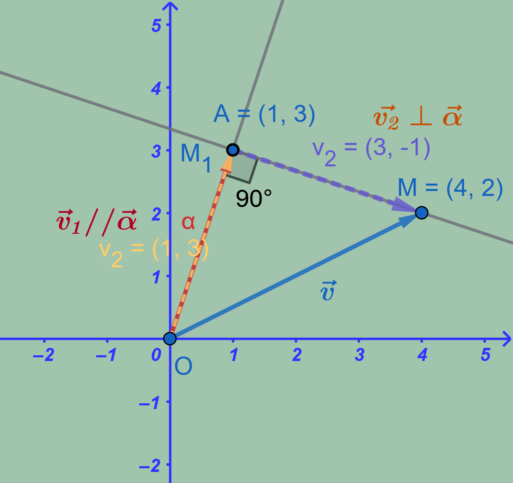{fig-align="center" width="350"}

- Η παράλληλη συνιστώσα είναι η προβολή: $\vec{v}_1 = \text{προβ}_{\vec{α}}\vec{v} = \left(\dfrac{1(4) + 3(2)}{1^2 + 3^2}\right) (1, 3) = \dfrac{10}{10} (1, 3) = (1, 3)$.

- Η κάθετη συνιστώσα είναι η διαφορά: $\vec{v}_2 = \vec{v} - \vec{v}_1 = (4, 2) - (1, 3) = (3, -1)$.

- Επαλήθευση καθετότητας: $\vec{v}_2 \cdot \vec{α} = 3(1) + (-1)(3) = 0 \implies \vec{v}_2 \perp \vec{α}$.

------------------------------------------------------------------------

### Ασκήσεις στο Εσωτερικό Γινόμενο Διανυσμάτων

#### **Ομάδα Α: Γεωμετρικοί Υπολογισμοί & Εσωτερικό Τετράγωνο**

:::: {.math-box .exercise-box}
::: {.math-title .exercise-title}
1.  Εκφώνηση
:::

Δίνονται τα διανύσματα $\vec{α}$ και $\vec{β}$ με μέτρα $|\vec{α}| = 2$, $|\vec{β}| = 5$ και γωνία $θ = \dfrac{2\pi}{3}$ ($120^\circ$).

- α) Να υπολογίσετε το εσωτερικό γινόμενο $\vec{α} \cdot \vec{β}$.

- β) Να υπολογίσετε το εσωτερικό γινόμενο $(2\vec{α} - \vec{β}) \cdot (\vec{α} + 3\vec{β})$.
::::

:::: {.math-box .solution-box}
::: {.math-title .solution-title}
Λύση
:::

**α) Υπολογισμός του εσωτερικού γινομένου** $\vec{\alpha} \cdot \vec{\beta}$

Από τον ορισμό του εσωτερικού γινομένου: $$\vec{\alpha} \cdot \vec{\beta} = |\vec{\alpha}| \cdot |\vec{\beta}| \cdot \cos\theta$$

Γνωρίζουμε ότι: $$\cos\left(\frac{2\pi}{3}\right) = \cos(120^\circ) = -\frac{1}{2}$$

Αντικαθιστώντας τα δεδομένα: $$\vec{\alpha} \cdot \vec{\beta} = 2 \cdot 5 \cdot \left(-\frac{1}{2}\right) = -5$$

------------------------------------------------------------------------

**β) Υπολογισμός του εσωτερικού γινομένου** $(2\vec{\alpha} - \vec{\beta}) \cdot (\vec{\alpha} + 3\vec{\beta})$

Αναπτύσσουμε το γινόμενο χρησιμοποιώντας τις επιμεριστικές ιδιότητες: $$(2\vec{\alpha} - \vec{\beta}) \cdot (\vec{\alpha} + 3\vec{\beta}) = 2\vec{\alpha}^2 + 6(\vec{\alpha} \cdot \vec{\beta}) - (\vec{\beta} \cdot \vec{\alpha}) - 3\vec{\beta}^2$$ $$= 2|\vec{\alpha}|^2 + 5(\vec{\alpha} \cdot \vec{\beta}) - 3|\vec{\beta}|^2$$

Υπολογίζουμε τα τετράγωνα των μέτρων: - $|\vec{\alpha}|^2 = 2^2 = 4$

- $|\vec{\beta}|^2 = 5^2 = 25$

Αντικαθιστούμε τις τιμές στην παράσταση: $$(2\vec{\alpha} - \vec{\beta}) \cdot (\vec{\alpha} + 3\vec{\beta}) = 2(4) + 5(-5) - 3(25)$$ $$= 8 - 25 - 75$$ $$= 8 - 100 = -92$$
::::

------------------------------------------------------------------------

2.  **Άσκηση 2:** Αν για τα διανύσματα $\vec{α}$ και $\vec{β}$ ισχύει $|\vec{α}| = 1$, $|\vec{β}| = 2$ και $\vec{α} \cdot \vec{β} = -1$, να υπολογίσετε το μέτρο του διανύσματος $\vec{u} = 2\vec{α} + 3\vec{β}$.

:::: my-callout-theory
::: {.my-callout-theory .callout-title}
Υπόδειξη
:::

$|\vec u|=\sqrt{\vec u^2}= \sqrt{(2\vec α+3 \vec β)^2} .......................... =2\sqrt{7}$
::::

------------------------------------------------------------------------

3.  **Άσκηση 3:** Δίνεται τετράγωνο $ABCD$ πλευράς $a$ και κέντρου $O$.
    Να υπολογίσετε τα εσωτερικά γινόμενα:

    - α) $\vec{AB} \cdot \vec{AD}$

    - β) $\vec{AB} \cdot \vec{AC}$

    - γ) $\vec{OA} \cdot \vec{OC}$

    - δ) $\vec{AB} \cdot \vec{CD}$

:::: my-callout-theory
::: {.my-callout-theory .callout-title}
Υπόδειξη
:::

$|\vec {AB}|=|\vec {AD}|=|\vec {CD}|=a$

$|\vec {AC}|=a\sqrt{2} \ \ , \ \ |\vec {OC}|=|\vec {OA}|=\dfrac{a\sqrt{2}}{2}$

Οι γωνίες μεταξύ των πλευρών είναι 90

Οι γωνίες μεταξύ πλευρών και διαγωνίων είναι 45

Οι γωνίες μεταξύ διαγωνίων είναι 90

Άρα $\vec{AB} \cdot \vec{AD}=α^2$

$\vec{AB} \cdot \vec{AC}=a \cdot a \sqrt{2}συν 45^ο= .........$

.........................................................
::::

------------------------------------------------------------------------

4.  **Άσκηση 4:** Αν για τα διανύσματα $\vec{α}, \vec{β}$ ισχύει $|\vec{α}| = 3$, $|\vec{β}| = 4$ και $|\vec{α} + \vec{β}| = 5$, να αποδείξετε ότι τα διανύσματα $\vec{α}$ και $\vec{β}$ είναι κάθετα.

:::: my-callout-theory
::: {.my-callout-theory .callout-title}
Υπόδειξη
:::

Αποδείξτε ότι ισχύει το Πυθαγόρειο Θεώρημα $|\vec a|^2+|\vec β|^2=|\vec a+ \vec β|^2$
::::

------------------------------------------------------------------------

#### **Ομάδα Β: Αναλυτική Έκφραση & Καθετότητα**

5.  **Άσκηση 5:** Δίνονται τα διανύσματα $\vec{α} = (x + 1, 2)$ και $\vec{β} = (3, x - 2)$. Να βρείτε την τιμή του $x \in \mathbb{R}$ ώστε $\vec{α} \perp \vec{β}$.

:::: my-callout-theory
::: {.my-callout-theory .callout-title}
Υπόδειξη
:::

Πρέπει $\vec a \cdot \vec β=0 \implies (x+1)3+2(x-2)=0$.
Λύνουμε την εξίσωση.
::::

------------------------------------------------------------------------

6.  **Άσκηση 6:** Δίνονται τα σημεία $A(1, 2)$, $B(3, -1)$ και $Γ(-2, 0)$.

- α) Να υπολογίσετε το εσωτερικό γινόμενο $\vec{AB} \cdot \vec{AΓ}$.

- β) Να αποδείξετε ότι το τρίγωνο $ABΓ$ είναι ορθογώνιο στο $A$.

:::: my-callout-theory
::: {.my-callout-theory .callout-title}
Υπόδειξη

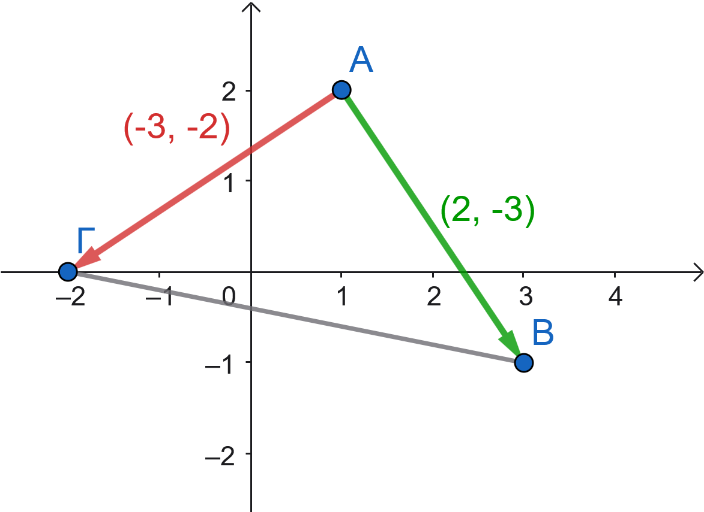{fig-align="center" width="300"}
:::

- α) $\vec{AB}=(3-1,-1-2)=(2,-3) \ \ , \ \ \vec{AΓ}= ................... =(-3,-2) \ \ , \ \ \vec {ΒΓ}= ...................$

$\vec{AB} \cdot \vec{AΓ}= ................$ Όμοια, υπολογίζουμε με συντεταγμένες $x_1x_2+y_1y_2$.

- β) Υπολογίζουμε τα μέτρα

$|\vec{AB}|=\sqrt{(3-1)^2+(-1-2)^2}= ......................$

$|\vec{AC}|=\sqrt{(-2-1)^2+(4-2)^2}= ......................$

$|\vec{BC}|=\sqrt{(-2-3)^2+(0+1)^2}= ......................$

Αποδεικνύουμε ότι ισχύει το Πυθαγόρειο Θεώρημα.

Επίσης βλέπουμε από το (α) ότι $\vec{ΑΒ} \cdot \vec{ΑΓ}=0$
::::

------------------------------------------------------------------------

7.  **Άσκηση 7:** Να βρεθεί διάνυσμα $\vec{v} = (x, y)$ με μέτρο $|\vec{v}| = 5$ το οποίο να είναι κάθετο στο διάνυσμα $\vec{α} = (4, -3)$.

:::: my-callout-theory
::: {.my-callout-theory .callout-title}
Υπόδειξη
:::

Πρέπει $\vec v \cdot \vec a=0 \implies x\cdot4+y \cdot (-3)=0$

και αφού $|\vec v|=5 \implies \sqrt{x^2+y^2}=5$

Λύνουμε το σύστημα $\begin{cases} 4x-3y=0 \\ \sqrt{x^2+y^2}=5 \end{cases}$ ....................
::::

------------------------------------------------------------------------

8.  **Άσκηση 8:** Δίνονται τα διανύσματα $\vec{α} = (2, -1)$ και $\vec{β} = (1, 3)$. Να προσδιορίσετε την παράμετρο $λ \in \mathbb{R}$ ώστε το διάνυσμα $\vec{u} = \vec{α} + λ \vec{β}$ να είναι κάθετο στο διάνυσμα $\vec{v} = 2\vec{α} - \vec{β}$.

:::: my-callout-theory
::: {.my-callout-theory .callout-title}
Υπόδειξη

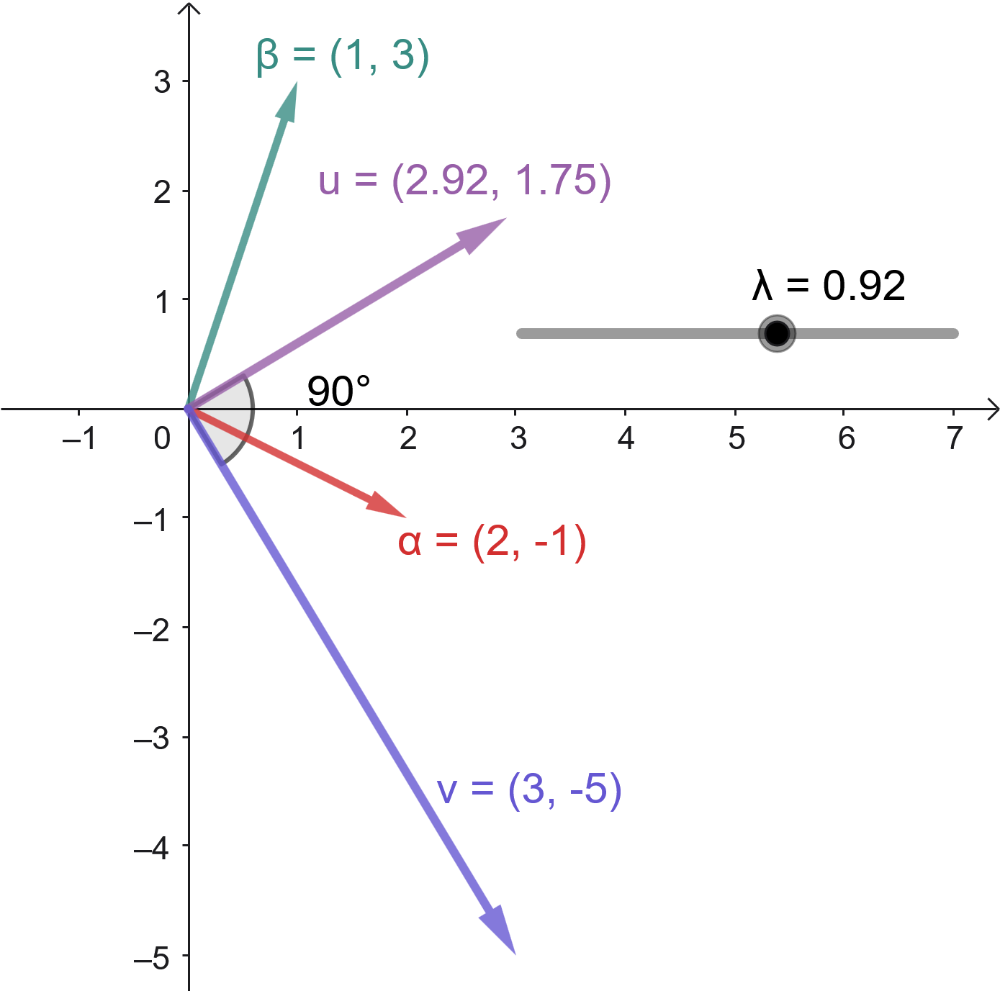{fig-align="center" width="350"}
:::

$\vec u =\vec α +λ \vec β = (2+λ,-1+3λ)$ και $\vec v=2\vec α -\vec β = (4-1, -2-3)=(3,-5)$

Πρέπει $\vec u \cdot \vec v = 0 \implies ((2+λ)3+(-1+3λ)(-5)=0$ Λύνουμε την εξίσωση.

..........................................................
::::

------------------------------------------------------------------------

#### **Ομάδα Γ: Γωνία Διανυσμάτων**

9.  **Άσκηση 9:** Να υπολογίσετε τη γωνία $θ$ που σχηματίζουν τα διανύσματα:

    - α) $\vec{α} = (1, \sqrt{3})$ και $\vec{β} = (\sqrt{3}, 1)$

    - β) $\vec{u} = (2, -2)$ και $\vec{v} = (0, 3)$

10. **Άσκηση 10:** Δίνονται τα σημεία $A(2, 1)$, $B(4, 3)$ και $Γ(2, 5)$.
    Να υπολογίσετε τη συνημίτονο της γωνίας $\hat{B}$ του τριγώνου $ABC$.

:::: my-callout-theory
::: {.my-callout-theory .callout-title}
Υπόδειξη

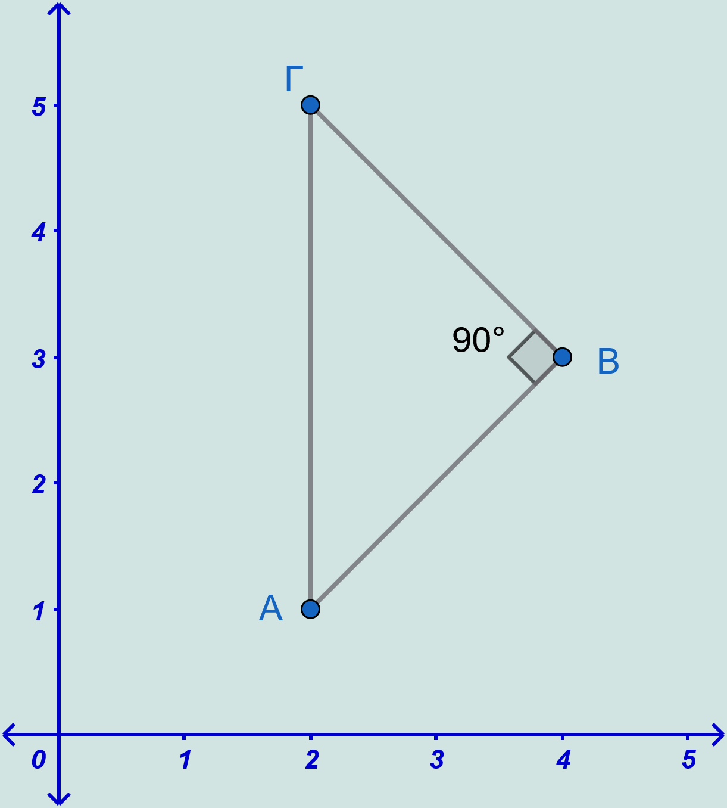{fig-align="center" width="400"}
:::

- $\mathbf{1^{ος}}$ **τρόπος - Το τρίγωνο είναι ορθογώνιο στο Β**

Υπολογίζουμε τα $ΑΒ=\sqrt{(4-2)^2+(3-1)^2}=2\sqrt{2} \quad$, $\quad AΓ=\sqrt{(2-2)^2+(5-1)^2}=4 \quad$ , $\quad ΒΓ=\sqrt{(2-4)^2+(5-3)^2}=2\sqrt{2}\qquad$ και μετά αποδεικνύουμε ότι το τρίγωνοι είναι ορθογώνιο με το Π.Θ.
Άρα $συν Β=0$

- $\mathbf{2^{ος}}$ **τρόπος - Υπολογίζουμε την γωνία**

$συν Β=\dfrac{\vec{AB}\cdot \vec{ΓB}}{|\vec{AB}|\cdot|\vec{ΓΒ}|}=\dfrac{4-4}{2\sqrt{2} \cdot 2\sqrt{2}} = .............$

- $\mathbf{3^{ος}}$ **τρόπος - Η προβολή του** $\vec{BA}$ στο $\vec{BΓ}$ είναι 0

$\text{προβ}_{\vec{BA}} \vec{ΒΓ}=\left( \dfrac{\vec{BA}\cdot \vec{BΓ}}{|\vec{BA}|^2} \right)\vec{BA}=\left( \dfrac{0}{8} \right)\vec{BA}=0$

- $\mathbf{4^{ος}}$ **τρόπος - Με του συντελεστές διεύθυνσης των** $\vec{AB}$ και $\vec{ΒΓ}$

$λ_1 \cdot λ_2=-1$ ...................................................
::::

------------------------------------------------------------------------

11. **Άσκηση 11:** Να βρείτε τις τιμές του $k \in \mathbb{R}$ ώστε τα διανύσματα $\vec{α} = (k, 2)$ και $\vec{β} = (1, k - 1)$ να σχηματίζουν:

    - α) Οξεία γωνία

    - β) Αμβλεία γωνία

:::: my-callout-theory
::: {.my-callout-theory .callout-title}
Υπόδειξη
:::

- α) Λύνουμε την ανισότητα $\vec a \cdot \vec β \gt 0$

- β) Λύνουμε την ανισότητα $\vec a \cdot \vec β \lt 0$
::::

------------------------------------------------------------------------

:::: {.math-box .exercise-box}
::: {.math-title .exercise-title}
12. Εκφώνηση
:::

Αν για τα μη μηδενικά διανύσματα $\vec{α}$ και $\vec{β}$ ισχύει $|\vec{α} + \vec{β}| = |\vec{α} - \vec{β}|$, να αποδείξετε αναλυτικά ότι η γωνία των διανυσμάτων είναι $θ = 90^\circ$.
::::

:::: {.math-box .solution-box}
::: {.math-title .solution-title}
Λύση
:::

Ξεκινάμε από τη δοσμένη ισότητα: $$|\vec{\alpha} + \vec{\beta}| = |\vec{\alpha} - \vec{\beta}|$$

Επειδή και τα δύο μέλη είναι θετικά, υψώνουμε στο τετράγωνο: $$|\vec{\alpha} + \vec{\beta}|^2 = |\vec{\alpha} - \vec{\beta}|^2$$

------------------------------------------------------------------------

**1. Ανάπτυξη των τετραγώνων των μέτρων**

Χρησιμοποιώντας τη σχέση $|\vec{u}|^2 = \vec{u}^2$: $$(\vec{\alpha} + \vec{\beta})^2 = (\vec{\alpha} - \vec{\beta})^2$$

Αναπτύσσουμε τις διανυσματικές ταυτότητες: $$|\vec{\alpha}|^2 + 2(\vec{\alpha} \cdot \vec{\beta}) + |\vec{\beta}|^2 = |\vec{\alpha}|^2 - 2(\vec{\alpha} \cdot \vec{\beta}) + |\vec{\beta}|^2$$

------------------------------------------------------------------------

**2. Απλοποίηση**

Αφαιρούμε από τα δύο μέλη τους όρους $|\vec{\alpha}|^2$ και $|\vec{\beta}|^2$: $$2(\vec{\alpha} \cdot \vec{\beta}) = -2(\vec{\alpha} \cdot \vec{\beta})$$

Μεταφέρουμε στο αριστερό μέλος: $$4(\vec{\alpha} \cdot \vec{\beta}) = 0 \iff \vec{\alpha} \cdot \vec{\beta} = 0$$

------------------------------------------------------------------------

**3. Υπολογισμός της γωνίας** $\theta$

Από τον ορισμό του εσωτερικού γινομένου: $$\vec{\alpha} \cdot \vec{\beta} = |\vec{\alpha}| \cdot |\vec{\beta}| \cdot \cos\theta$$

Άρα: $$|\vec{\alpha}| \cdot |\vec{\beta}| \cdot \cos\theta = 0$$

Επειδή τα διανύσματα $\vec{\alpha}$ και $\vec{\beta}$ είναι **μη μηδενικά** ($\vec{\alpha} \neq \vec{0}$ και $\vec{\beta} \neq \vec{0}$), τα μέτρα τους είναι θετικά: $$|\vec{\alpha}| \neq 0 \quad \text{και} \quad |\vec{\beta}| \neq 0$$

Συνεπώς, διαιρώντας με το γινόμενο των μέτρων τους: $$\cos\theta = 0$$

Επειδή η γωνία $\theta$ μεταξύ δύο διανυσμάτων ανήκει στο διάστημα $[0, 180^\circ]$ (ή $[0, \pi]$), η μοναδική λύση είναι: $$\theta = 90^\circ \quad \left(\text{ή } \theta = \frac{\pi}{2} \text{ rad}\right)$$

Δηλαδή, τα διανύσματα είναι κάθετα μεταξύ τους ($\vec{\alpha} \perp \vec{\beta}$).
::::

------------------------------------------------------------------------

#### **Ομάδα Δ: Προβολή Διανύσματος & Ανάλυση**

13. **Άσκηση 13:** Δίνονται τα διανύσματα $\vec{α} = (3, 1)$ και $\vec{v} = (5, 5)$.

    - α) Να υπολογίσετε τη διανυσματική προβολή $\text{προβ}_{\vec{α}}\vec{v}$.

    - β) Να υπολογίσετε το μέτρο της προβολής $|\text{προβ}_{\vec{α}}\vec{v}|$.

------------------------------------------------------------------------

:::: {.math-box .exercise-box}
::: {.math-title .exercise-title}
14. Εκφώνηση
:::

Δίνονται τα διανύσματα $\vec{α} = (-2, 4)$ και $\vec{v} = (1, 2)$.
Να αναλύσετε το διάνυσμα $\vec{v}$ σε δύο συνιστώσες $\vec{v}_1, \vec{v}_2$ τέτοιες ώστε $\vec{v}_1 \parallel \vec{α}$ και $\vec{v}_2 \perp \vec{α}$.
::::

:::: {.math-box .solution-box}
::: {.math-title .solution-title}
Λύση

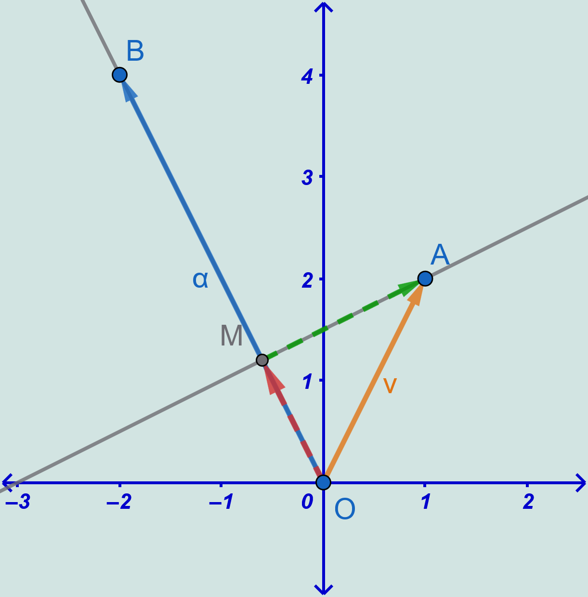{fig-align="center" width="300"}
:::

Ζητούμε να αναλύσουμε το διάνυσμα $\vec{v}$ σε δύο συνιστώσες $\vec{v}_1$ και $\vec{v}_2$ τέτοιες ώστε: $$\vec{v} = \vec{v}_1 + \vec{v}_2$$ με $\vec{v}_1 \parallel \vec{\alpha}$ και $\vec{v}_2 \perp \vec{\alpha}$.

------------------------------------------------------------------------

**1: Υπολογισμός του εσωτερικού γινομένου και του μέτρου του** $\vec{\alpha}$

Για τα διανύσματα $\vec{\alpha} = (-2, 4)$ και $\vec{v} = (1, 2)$:

- **Εσωτερικό γινόμενο** $\vec{\alpha} \cdot \vec{v}$: $$\vec{\alpha} \cdot \vec{v} = (-2) \cdot 1 + 4 \cdot 2 = -2 + 8 = 6$$

- **Τετράγωνο του μέτρου** $|\vec{\alpha}|^2$: $$|\vec{\alpha}|^2 = (-2)^2 + 4^2 = 4 + 16 = 20$$

------------------------------------------------------------------------

**2: Εύρεση της παράλληλης συνιστώσας** $\vec{v}_1$

Η συνιστώσα $\vec{v}_1$ που είναι παράλληλη στο $\vec{\alpha}$ ταυτίζεται με την **προβολή** του $\vec{v}$ πάνω στο $\vec{\alpha}$: $$\vec{v}_1 = \text{προβ}_{\vec{\alpha}}\vec{v} = \left(\frac{\vec{\alpha} \cdot \vec{v}}{|\vec{\alpha}|^2}\right) \vec{\alpha}$$

Αντικαθιστούμε τις τιμές: $$\vec{v}_1 = \frac{6}{20} \vec{\alpha} = \frac{3}{10} (-2, 4)$$ $$\vec{v}_1 = \left(\frac{3}{10} \cdot (-2), \; \frac{3}{10} \cdot 4\right) = \left(-\frac{3}{5}, \; \frac{6}{5}\right)$$

------------------------------------------------------------------------

**3: Εύρεση της κάθετης συνιστώσας** $\vec{v}_2$

Από τη σχέση $\vec{v} = \vec{v}_1 + \vec{v}_2$, λύνουμε ως προς $\vec{v}_2$: $$\vec{v}_2 = \vec{v} - \vec{v}_1$$

Αντικαθιστούμε: $$\vec{v}_2 = (1, 2) - \left(-\frac{3}{5}, \; \frac{6}{5}\right)$$ $$\vec{v}_2 = \left(1 - \left(-\frac{3}{5}\right), \; 2 - \frac{6}{5}\right) = \left(1 + \frac{3}{5}, \; \frac{10}{5} - \frac{6}{5}\right)$$ $$\vec{v}_2 = \left(\frac{8}{5}, \; \frac{4}{5}\right)$$

------------------------------------------------------------------------

**Έλεγχος Καθετότητας (**$\vec{v}_2 \perp \vec{\alpha}$)

Ελέγχουμε το εσωτερικό γινόμενο $\vec{v}_2 \cdot \vec{\alpha}$: $$\vec{v}_2 \cdot \vec{\alpha} = \frac{8}{5} \cdot (-2) + \frac{4}{5} \cdot 4 = -\frac{16}{5} + \frac{16}{5} = 0 \quad (\text{ισχύει})$$

------------------------------------------------------------------------

**Τελική Απάντηση**

Οι δύο συνιστώσες είναι: $$\vec{v}_1 = \left(-\frac{3}{5}, \; \frac{6}{5}\right) \quad \text{και} \quad \vec{v}_2 = \left(\frac{8}{5}, \; \frac{4}{5}\right)$$
::::

------------------------------------------------------------------------

:::: {.math-box .exercise-box}
::: {.math-title .exercise-title}
15. Εκφώνηση
:::

Αν $|\vec{α}| = 4$ και για το διάνυσμα $\vec{v}$ ισχύει $\vec{α} \cdot \vec{v} = 24$, να βρεθεί το διάνυσμα της προβολής $\text{προβ}_{\vec{α}}\vec{v}$.
::::

:::: {.math-box .solution-box}
::: {.math-title .solution-title}
Λύση
:::

Η προβολή του διανύσματος $\vec{v}$ πάνω στο διάνυσμα $\vec{\alpha}$ είναι ένα διάνυσμα παράλληλο στο $\vec{\alpha}$, δηλαδή: $$\vec{u} = \text{προβ}_{\vec{\alpha}}\vec{v} = \lambda \vec{\alpha}, \quad \lambda \in \mathbb{R}$$

Από τη βασική ιδιότητα της προβολής στο εσωτερικό γινόμενο ισχύει: $$\vec{\alpha} \cdot \vec{v} = \vec{\alpha} \cdot (\text{προβ}_{\vec{\alpha}}\vec{v})$$

Αντικαθιστώντας το $\text{προβ}_{\vec{\alpha}}\vec{v} = \lambda \vec{\alpha}$: $$\vec{\alpha} \cdot \vec{v} = \vec{\alpha} \cdot (\lambda \vec{\alpha}) = \lambda |\vec{\alpha}|^2$$

Συνεπώς: $$\lambda = \frac{\vec{\alpha} \cdot \vec{v}}{|\vec{\alpha}|^2}$$

------------------------------------------------------------------------

**Υπολογισμός**

Δίνονται:

- $\vec{\alpha} \cdot \vec{v} = 24$

- $|\vec{\alpha}| = 4 \implies |\vec{\alpha}|^2 = 4^2 = 16$

Άρα ο συντελεστής $\lambda$ είναι: $$\lambda = \frac{24}{16} = \frac{3}{2} = 1{,}5$$

------------------------------------------------------------------------

**Συμπέρασμα**

Το διάνυσμα της προβολής είναι: $$\text{προβ}_{\vec{\alpha}}\vec{v} = \frac{3}{2}\vec{\alpha}$$
::::

------------------------------------------------------------------------

16. **Άσκηση 16:** Δίνονται τα διανύσματα $\vec{α} = (1, 2)$ και $\vec{β} = (x, y)$. Αν η προβολή του $\vec{β}$ πάνω στο $\vec{α}$ είναι το διάνυσμα $\text{προβ}_{\vec{α}}\vec{β} = (2, 4)$, να αποδείξετε ότι $x + 2y = 10$.

:::: my-callout-theory
::: {.my-callout-theory .callout-title}
Υπόδειξη
:::

$\vec α=(1,2) \implies |\vec α|=\sqrt{5} \implies |\vec α|^2=5$

$\vec α \cdot \vec β=x+2y$

$\text{προβ}_{\vec{α}}\vec{β} = (2, 4)\implies \dfrac{x+2y}{5}(1,2)=(2,4) \implies$

$\begin{cases}\dfrac{x+2y}{5}=2 \\ \dfrac{2(x+2y)}{5}=4\end{cases} \implies .............$
::::

------------------------------------------------------------------------

#### **Ομάδα Ε: Σύνθετες Αποδείξεις & Γεωμετρικοί Τόποι**

:::: {.math-box .exercise-box}
::: {.math-title .exercise-title}
17. **Εκφώνηση (Τύπος Διαμέσου):**
:::

Δίνεται τρίγωνο $ABΓ$ και $AM$ η διάμεσός του.
Με τη βοήθεια των διανυσμάτων $\vec{AB}$ και $\vec{AΓ}$, να αποδείξετε τη σχέση: $$β^2 + γ^2 = 2μ_a^2 + \frac{α^2}{2}$$
::::

:::: {.math-box .solution-box}
::: {.math-title .solution-title}
Λύση

Σχεδιάστε ένα σχήμα.
:::

**Διανυσματική Απόδειξη του 1ου Θεωρήματος των Διαμέσων**

Στο τρίγωνο $AB\Gamma$, συμβολίζουμε τα μήκη των πλευρών και της διαμέσου με τους κλασικούς συμβολισμούς:

- $(B\Gamma) = \alpha \implies |\vec{B\Gamma}| = \alpha$

- $(A\Gamma) = \beta \implies |\vec{A\Gamma}| = \beta$

- $(AB) = \gamma \implies |\vec{AB}| = \gamma$

- $(AM) = \mu_\alpha \implies |\vec{AM}| = \mu_\alpha$

------------------------------------------------------------------------

**1: Έκφραση των διανυσμάτων** $\vec{AM}$ και $\vec{B\Gamma}$ μέσω των $\vec{AB}$ και $\vec{A\Gamma}$

1.  Επειδή το $M$ είναι το **μέσο** της πλευράς $B\Gamma$, από τον τύπο της διαμέσου με αρχή το $A$ έχουμε: $$\vec{AM} = \frac{\vec{AB} + \vec{A\Gamma}}{2}$$

2.  Για την πλευρά $\vec{B\Gamma}$, από τη διανυσματική αφαίρεση: $$\vec{B\Gamma} = \vec{A\Gamma} - \vec{AB}$$

------------------------------------------------------------------------

**2: Υπολογισμός των μέτρων** $\mu_\alpha^2$ και $\alpha^2$

Υπολογίζουμε τα τετράγωνα των μέτρων των παραπάνω διανυσμάτων:

1.  **Για τη διάμεσο** $\mu_\alpha^2$: $$\mu_\alpha^2 = |\vec{AM}|^2 = \vec{AM}^2 = \left(\frac{\vec{AB} + \vec{A\Gamma}}{2}\right)^2$$ $$\mu_\alpha^2 = \frac{\vec{AB}^2 + 2(\vec{AB} \cdot \vec{A\Gamma}) + \vec{A\Gamma}^2}{4}$$

    Πολλαπλασιάζουμε με $2$: $$2\mu_\alpha^2 = \frac{\vec{AB}^2 + 2(\vec{AB} \cdot \vec{A\Gamma}) + \vec{A\Gamma}^2}{2} \quad (1)$$

2.  **Για την πλευρά** $\alpha^2$: $$\alpha^2 = |\vec{B\Gamma}|^2 = \vec{B\Gamma}^2 = (\vec{A\Gamma} - \vec{AB})^2$$ $$\alpha^2 = \vec{A\Gamma}^2 - 2(\vec{AB} \cdot \vec{A\Gamma}) + \vec{AB}^2$$

    Διαιρούμε με το $2$: $$\frac{\alpha^2}{2} = \frac{\vec{AB}^2 - 2(\vec{AB} \cdot \vec{A\Gamma}) + \vec{A\Gamma}^2}{2} \quad (2)$$

------------------------------------------------------------------------

**3: Πρόσθεση των δύο σχέσεων**

Προσθέτουμε κατά μέλη τις ισότητες $(1)$ και $(2)$: $$2\mu_\alpha^2 + \frac{\alpha^2}{2} = \frac{\vec{AB}^2 + 2(\vec{AB} \cdot \vec{A\Gamma}) + \vec{A\Gamma}^2}{2} + \frac{\vec{AB}^2 - 2(\vec{AB} \cdot \vec{A\Gamma}) + \vec{A\Gamma}^2}{2}$$

Τα εσωτερικά γινόμενα $2(\vec{AB} \cdot \vec{A\Gamma})$ και $-2(\vec{AB} \cdot \vec{A\Gamma})$ είναι αντίθετα και απαλείφονται: $$2\mu_\alpha^2 + \frac{\alpha^2}{2} = \frac{2\vec{AB}^2 + 2\vec{A\Gamma}^2}{2}$$ $$2\mu_\alpha^2 + \frac{\alpha^2}{2} = \vec{AB}^2 + \vec{A\Gamma}^2$$

------------------------------------------------------------------------

**4: Συμπέρασμα**

Γνωρίζοντας ότι $\vec{AB}^2 = |\vec{AB}|^2 = \gamma^2$ και $\vec{A\Gamma}^2 = |\vec{A\Gamma}|^2 = \beta^2$, αντικαθιστούμε και έχουμε: $$2\mu_\alpha^2 + \frac{\alpha^2}{2} = \gamma^2 + \beta^2$$

δηλαδή: $$\beta^2 + \gamma^2 = 2\mu_\alpha^2 + \frac{\alpha^2}{2}$$
::::

------------------------------------------------------------------------

18. **Άσκηση 18:** Αν για τα διανύσματα $\vec{α}, \vec{β}, \vec{\gamma}$ ισχύει $\vec{α} + \vec{β} + \vec{\gamma} = \vec{0}$ και $|\vec{α}| = 3$, $|\vec{β}| = 4$, $|\vec{\gamma}| = 5$, να υπολογίσετε την παράσταση: $$A = \vec{α} \cdot \vec{β} + \vec{β} \cdot \vec{\gamma} + \vec{\gamma} \cdot \vec{α}$$

:::: my-callout-theory
::: {.my-callout-theory .callout-title}
Υπόδειξη

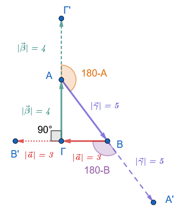{fig-align="center" width="300"}
:::

Αφού $\vec{α} + \vec{β} + \vec{\gamma} = \vec{0}$ σημαίνει ότι τα τρία διανύσματα σχηματίζουν τρίγωνο ΑΒΓ με πλευρές α, β και γ.

Αποδεικνύουμε ότι το τρίγωνο είναι ορθογώνιο στο Γ με το Π.Θ..

Άρα $\vec{α} \cdot \vec{β}  = \vec{0}$, $\qquad συν Β=\dfrac{3}{5} \implies συν(180^ο-Β)=-\dfrac{3}{5}$ και

$συν A=\dfrac{4}{5} \implies συν(180^ο-Α)=-\dfrac{4}{5}$

Τότε θα έχουμε: $A = \vec{α} \cdot \vec{β} + \vec{β} \cdot \vec{\gamma} + \vec{\gamma} \cdot \vec{α}=0+4\cdot5\cdot \left(-\dfrac{4}{5}\right)+5\cdot3\cdot \left(-\dfrac{3}{5}\right)= ................$
::::

------------------------------------------------------------------------

:::: {.math-box .exercise-box}
::: {.math-title .exercise-title}
17. **Εκφώνηση**
:::

Δίνονται δύο σταθερά σημεία $A(-3, 0)$ και $B(3, 0)$.
Να βρείτε τον γεωμετρικό τόπο των σημείων $M(x, y)$ του επιπέδου για τα οποία ισχύει: $$\vec{MA} \cdot \vec{MB} = 16$$
::::

:::: {.math-box .solution-box}
::: {.math-title .solution-title}
Λύση
:::

**Γεωμετρική Λύση (χωρίς καρτεσιανές εξισώσεις)**

Έστω $O$ το μέσο του ευθύγραμμου τμήματος $AB$.

Επειδή $A(-3, 0)$ και $B(3, 0)$, το μέσο $O$ είναι η αρχή των αξόνων $O(0, 0)$ και η απόσταση των σημείων από το $O$ είναι: $$(OA) = (OB) = 3$$ δηλαδή τα διανύσματα $\vec{OA}$ και $\vec{OB}$ είναι αντίθετα: $$\vec{OA} = -\vec{OB}$$

------------------------------------------------------------------------

**1: Ανάλυση των διανυσμάτων ως προς το μέσο** $O$

Για οποιοδήποτε σημείο $M$ του επιπέδου, αναλύουμε τα διανύσματα $\vec{MA}$ και $\vec{MB}$ μέσω του μέσου $O$: $$\vec{MA} = \vec{MO} + \vec{OA}$$ $$\vec{MB} = \vec{MO} + \vec{OB} = \vec{MO} - \vec{OA}$$

------------------------------------------------------------------------

**2: Ανάπτυξη του εσωτερικού γινομένου**

Το εσωτερικό γινόμενο γράφεται ως διαφορά τετραγώνων: $$\vec{MA} \cdot \vec{MB} = (\vec{MO} + \vec{OA}) \cdot (\vec{MO} - \vec{OA})$$ $$\vec{MA} \cdot \vec{MB} = \vec{MO}^2 - \vec{OA}^2$$ $$\vec{MA} \cdot \vec{MB} = |\vec{MO}|^2 - |\vec{OA}|^2$$ $$\vec{MA} \cdot \vec{MB} = (MO)^2 - (OA)^2$$

------------------------------------------------------------------------

**3: Χρήση της υπόθεσης**

Δίνεται ότι $\vec{MA} \cdot \vec{MB} = 16$.
Αντικαθιστούμε: $$(MO)^2 - (OA)^2 = 16$$

Γνωρίζουμε ότι $(OA) = 3$, άρα $(OA)^2 = 3^2 = 9$: $$(MO)^2 - 9 = 16$$ $$(MO)^2 = 25$$ $$(MO) = 5$$

------------------------------------------------------------------------

**Συμπέρασμα**

Η απόσταση του σημείου $M$ από το σταθερό σημείο $O(0, 0)$ είναι **σταθερή και ίση με** $5$: $$(MO) = 5$$

Επομένως, ο γεωμετρικός τόπος των σημείων $M$ είναι ο **κύκλος με κέντρο το μέσο** $O$ του τμήματος $AB$ και ακτίνα $R = 5$.
::::

------------------------------------------------------------------------

20. **Άσκηση 20:** Αν για τα μη μηδενικά διανύσματα $\vec{α}$ και $\vec{β}$ ισχύει $|\vec{α}| = |\vec{β}|$, να αποδείξετε ότι τα διανύσματα $\vec{u} = \vec{α} + \vec{β}$ και $\vec{v} = \vec{α} - \vec{β}$ είναι μεταξύ τους κάθετα.

:::: my-callout-theory
::: {.my-callout-theory .callout-title}
Υπόδειξη
:::

$|\vec{α}| = |\vec{β}| \implies |\vec α|^2=|\vec β|^2 \implies \vec a^2=\vec β^2$ και

$|\vec{α}|\cdot|\vec{β}| \implies |\vec α|^2=|\vec β|^2 \implies \vec a^2=\vec β^2$

Έτσι έχουμε $\vec u \cdot \vec v=(\vec a+\vec β)(\vec a-\vec β)=\vec a^2-\vec β^2=0$

Επομένως .................................
::::

21. Στο παρακάτω σχήμα να υπολογίσετε το μέτρο της συνισταμένης των δυνάμεων $F_1$ και $F_2$ καθώς και την γωνία διεύθυνσης της.

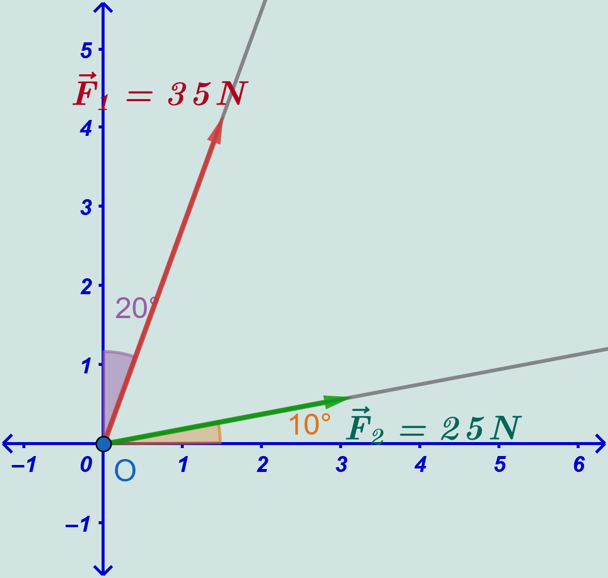{fig-align="center" width="300"}

:::: my-callout-theory
::: {.my-callout-theory .callout-title}
Υπόδειξη
:::

Χρησιμοποιήστε τον κανόνα του παραλληλογράμμου για να βρείτε το διάνυσμα της συνισταμένης.

Χρησιμοποιήστε τον νόμο των συνημιτόνων για να βρείτε το μέτρο της.

Χρησιμοποιήστε τον νόμο των ημιτόνων για να βρείτε την γωνία της συνισταμένης και της $\vec F_2$
::::

------------------------------------------------------------------------

22. Στο παρακάτω σχήμα να υπολογίσετε τα μέτρα των συνιστωσών $\vec F_1$ και $\vec F_2$ καθώς και το $\vec F_1 \cdot \vec F_2$

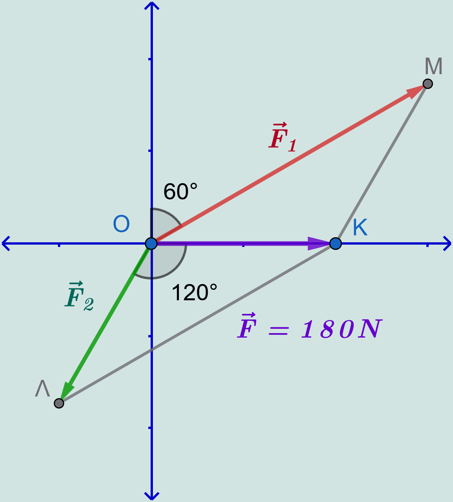{fig-align="center" width="300"}

:::: my-callout-theory
::: {.my-callout-theory .callout-title}
Υπόδειξη
:::

Χρησιμοποιήστε τον νόμο των ημιτόνων αφού πρώτα βρείτε τις απαραίτητες γωνίες.

Παρατηρήστε τα μέτρα των $\vec F$ και $\vec F_2$
::::

------------------------------------------------------------------------

### Επαναληπτικό Διαγώνισμα Αξιολόγησης: Διανύσματα Β' Λυκείου

**Μάθημα:** Μαθηματικά Προσανατολισμού Θετικών Σπουδών Τάξη: Β' Λυκείου

**Εξεταζόμενη Ύλη:** Κεφάλαιο 1 — Διανύσματα (1.1 έως 1.5) Διάρκεια: 3 Ώρες

Οδηγίες για τους Εξεταζόμενους

1.  Το διαγώνισμα αποτελείται από τέσσερα θέματα (Θέμα Α, Θέμα Β, Θέμα Γ, Θέμα Δ) ίσης βαθμολογικής αξίας (25 μονάδες το καθένα).

2.  Όλοι οι υπολογισμοί και οι αποδείξεις πρέπει να αιτιολογούνται πλήρως με βάση τη θεωρία του σχολικού βιβλίου.

3.  Στο τέλος του διαγωνίσματος παρατίθεται πλήρες παράρτημα με τις αναλυτικές λύσεις και τις απαντήσεις των θεμάτων.

**Θέμα Α (Θεωρία)**

**Α1. Θεώρημα Αναλυτικής Έκφρασης Εσωτερικού Γινομένου (Μονάδες 7)**

Σε ένα ορθοκανονικό σύστημα συντεταγμένων Oxy, θεωρούμε τα μη μηδενικά διανύσματα $\vec{a} = (x_1, y_1)$ και $\vec{b} = (x_2, y_2)$.
Να αποδείξετε ότι το εσωτερικό γινόμενο των διανυσμάτων $\vec{a}$ και $\vec{b}$ δίνεται από τον τύπο: $\vec{a} \cdot \vec{b} = x_1 x_2 + y_1 y_2$

**Α2. Ορισμός & Συντελεστής Διεύθυνσης (Μονάδες 4)**

Έστω $\vec{a} = (x, y)$ ένα διάνυσμα του επιπέδου Oxy, το οποίο δεν είναι παράλληλο στον άξονα y'y ($x \neq 0$).

- Πώς ορίζεται ο συντελεστής διεύθυνσης $λ_{\vec{a}}$ του διανύσματος $\vec{a}$;

- Ποια είναι η γεωμετρική σημασία του συντελεστή διεύθυνσης σε σχέση με τη γωνία $\phi$ που σχηματίζει το διάνυσμα με τον θετικό ημιάξονα Ox;

**Α3. Ερωτήσεις Σωστού / Λάθους (Μονάδες 10)**

Να χαρακτηρίσετε τις παρακάτω προτάσεις ως Σωστή (Σ) ή Λανθασμένη (Λ), σημειώνοντας την απάντησή σας στο τετράδιό σας:

1.  Αν για δύο μη μηδενικά διανύσματα $\vec{a}$ και $\vec{b}$ ισχύει $\vec{a} \cdot \vec{b} = 0$, τότε υποχρεωτικά $\vec{a} = \vec{0} \ \ ή \ \  \vec{b} = \vec{0}$.

2.  Η διανυσματική ακτίνα $\vec{OM}$ του μέσου M ενός ευθύγραμμου τμήματος AB ως προς σημείο αναφοράς O δίνεται από τον τύπο $\vec{OM} = \dfrac{\vec{OA} + \vec{OB}}{2}$.

3.  Αν $\det(\vec{a}, \vec{b}) = 0$ για δύο μη μηδενικά διανύσματα $\vec{a}  \ \ και \ \  \vec{b}$, τότε τα διανύσματα είναι παράλληλα ($\vec{a} \parallel \vec{b}$).

4.  Για οποιαδήποτε διανύσματα $\vec{a}, \vec{b}, \vec{c}$ ισχύει η προσεταιριστική ιδιότητα στο εσωτερικό γινόμενο: $(\vec{a} \cdot \vec{b})\vec{c} = \vec{a}(\vec{b} \cdot \vec{c})$.

5.  Αν δύο διανύσματα $\vec{a} \ \ και \ \  \vec{b}$ είναι αντίρροπα ($\vec{a} \uparrow\downarrow \vec{b}$), τότε $\vec{a} \cdot \vec{b} = -|\vec{a}| |\vec{b}|$.

**Α4. Αντιστοίχιση Ιδιοτήτων (Μονάδες 4)**

Να αντιστοιχίσετε κάθε γεωμετρική συνθήκη της Στήλης 1 με την αναλυτική της έκφραση στη Στήλη 2:

| ***Στήλη 1 (Γεωμετρική Συνθήκη)*** | ***Στήλη 2 (Αναλυτική Έκφραση)*** |
|-------------------------------------|-----------------------------------|
| ***1. Καθετότητα διανυσμάτων*** $\vec{a} \perp \vec{b}$ | ***α.*** $x_1 y_2 - x_2 y_1 = 0$ |
| ***2. Παραλληλία διανυσμάτων*** $\vec{a} \parallel \vec{b}$ | ***β.*** $x_1 x_2 + y_1 y_2 = 0$ |
| ***3. Ομόρροπα διανύσματα*** $\vec{a} \uparrow\uparrow \vec{b}$ | ***γ.*** $λ_1 \cdot λ_2 = -1 (x_1 x_2 \neq 0)$ |
| ***4. Κάθετες ευθείες με συντελεστές*** $λ_1, λ_2$ | ***δ.*** $\vec{a} \cdot \vec{b} =|\vec α| \cdot |\vec β|$ |

**Θέμα Β (Αλγεβρικοί Χειρισμοί & Συντεταγμένες)**

Δίνονται τα σημείο $A(2, -1), B(-1, 3) και C(5, 7)$ του καρτεσιανού επιπέδου Oxy, καθώς και τα διανύσματα $\vec{u} = \vec{AB} \ \ και \ \ \vec{v} = \vec{AC}$.

**Β1. Συντεταγμένες & Μέτρα (Μονάδες 6)**

1.  Να υπολογίσετε τις συντεταγμένες των διανυσμάτων $\vec{u} \ \ και \ \ \vec{v}$.

2.  Να υπολογίσετε τα μέτρα $\|\vec{u}\| \ \  και \ \  \|\vec{v}\|$.

**Β2. Γραμμικός Συνδυασμός & Παραλληλία (Μονάδες 9)**

Θεωρούμε το διάνυσμα $\vec{w} = (k + 1) \vec{u} + \vec{v}$, όπου $k \in \mathbb{R}$.

1.  Να εκφράσετε τις συντεταγμένες του διανύσματος $\vec{w}$ ως συνάρτηση του k.

2.  Να βρείτε την τιμή του $k \in \mathbb{R}$ ώστε το διάνυσμα $\vec{w}$ να είναι παράλληλο στον άξονα y'y.

**Β3. Μέσο Τμήματος & Συνευθειακότητα (Μονάδες 10)**

Έστω M το μέσο του ευθύγραμμου τμήματος BC.

1.  Να βρείτε τις συντεταγμένες του σημείου M.

2.  Να προσδιορίσετε τις συντεταγμένες του σημείου D ώστε το τετράπλευρο ABDC να είναι παραλληλόγραμμο.

**Θέμα Γ (Διανυσματικές Σχέσεις & Γωνία Διανυσμάτων)**

Δίνεται τρίγωνο ABC και τα διανύσματα $\vec{a} = \vec{AB} \ \ και \ \  \vec{b} = \vec{AC}$, με μέτρα $\|\vec{a}\| = 2, \|\vec{b}\| = 4$ και γωνία $(\widehat{\vec{a}, \vec{b}}) = \dfrac{\pi}{3} \ \ \ (60^\circ)$.

**Γ1. Εσωτερικό Γινόμενο & Μήκος Διαμέσου (Μονάδες 8)**

1.  Να υπολογίσετε το εσωτερικό γινόμενο $\vec{a} \cdot \vec{b}$.

2.  Αν M είναι το μέσο της πλευράς BC, να αποδείξετε ότι $\vec{AM} = \dfrac{1}{2}\vec{a} + \dfrac{1}{2}\vec{b}$ και να υπολογίσετε το μήκος της διαμέσου AM.

**Γ2. Καθετότητα Διανυσμάτων (Μονάδες 9)**

Θεωρούμε τα διανύσματα $\vec{x} = 2\vec{a} + λ \vec{b}$ και $\vec{y} = \vec{a} - \vec{b}$, όπου $λ \in \mathbb{R}$.

1.  Να υπολογίσετε την παράσταση $\vec{x} \cdot \vec{y}$ ως συνάρτηση του $λ$.

2.  Να βρείτε την τιμή του $λ$ ώστε τα διανύσματα $\vec{x}$ και $\vec{y}$ να είναι κάθετα ($\vec{x} \perp \vec{y}$).

**Γ3. Γωνία Διανυσμάτων (Μονάδες 8)**

Για την τιμή του $λ$ που βρήκατε στο ερώτημα Γ2.2:

1.  Να υπολογίσετε το μέτρο του διανύσματος $\vec{y}$.

2.  Να υπολογίσετε το συνημίτονο της γωνίας που σχηματίζει το διάνυσμα $\vec{a}$ με το διάνυσμα $\vec{y}$.

**Θέμα Δ (Σύνθετη Άσκηση: Εσωτερικό Γινόμενο, Προβολή & Γεωμετρικός Τόπος)**

Σε ορθοκανονικό σύστημα συντεταγμένων Oxy, δίνονται τα διανύσματα $\vec{a} = (1, 2) \ \ και \ \  \vec{b} = (3, -1)$.

**Δ1. Ανάλυση & Προβολή Διανύσματος (Μονάδες 9)**

1.  Να υπολογίσετε το εσωτερικό γινόμενο $\vec{a} \cdot \vec{b}$ και το μέτρο $\|\vec{a}\|$.

2.  Να βρείτε τη διανυσματική προβολή του διανύσματος $\vec{b}$ πάνω στο διάνυσμα $\vec{a}$, δηλαδή το διάνυσμα $\text{προβ}\_{\vec{α}} \ \vec{b}$.

3.  Να αναλύσετε το διάνυσμα $\vec{b}$ σε δύο κάθετες συνιστώσες $\vec{b}_1 \ \ και \ \  \vec{b}_2$, τέτοιες ώστε $\vec{b}_1 \parallel \vec{a} \ \  και \ \ \vec{b}_2 \perp \vec{a}$.

**Δ2. Γεωμετρικός Τόπος Σημείου (Μονάδες 8)**

Θεωρούμε τα σταθερά σημεία A(1, 2) και B(3, -1) με διανυσματικά διανύσματα θέσεως $\vec{OA} = \vec{a}$ και $\vec{OB} = \vec{b}$ αντίστοιχα.

1.  Να βρείτε την εξίσωση του γεωμετρικού τόπου των σημείων M(x, y) του επιπέδου για τα οποία ισχύει η διανυσματική σχέση: $\vec{MA} \cdot \vec{MB} = 0$

2.  Να αναγνωρίσετε το είδος της γραμμής που παριστάνει ο γεωμετρικός τόπος και να προσδιορίσετε τα γεωμετρικά της στοιχεία (κέντρο και ακτίνα).

**Δ3. Εμβαδόν & Σύνθετη Ιδιότητα (Μονάδες 8)**

1.  Να υπολογίσετε την ορίζουσα $\det(\vec{a}, \vec{b})$.

2.  Να υπολογίσετε το εμβαδόν του τριγώνου OAB που σχηματίζουν τα διανύσματα θέσεως των σημείων A και B με την αρχή των αξόνων O(0, 0).

------------------------------------------------------------------------

#### Απαντήσεις των Θεμάτων

**Θέμα Α (Θεωρία)**

**Α1. Θεώρημα Αναλυτικής Έκφρασης Εσωτερικού Γινομένου**

Θεωρούμε τα μοναδιαία διανύσματα $\vec{i} = (1, 0)$ και $\vec{j} = (0, 1)$ των αξόνων $Ox$ και $Oy$ αντίστοιχα.

Από τους ορισμούς του μέτρου και της καθετότητας ισχύουν:

- $\vec{i}^2 = |\vec{i}|^2 = 1^2 = 1$

- $\vec{j}^2 = |\vec{j}|^2 = 1^2 = 1$

- $\vec{i} \cdot \vec{j} = 0$, επειδή $\vec{i} \perp \vec{j}$

Τα διανύσματα $\vec{a} = (x_1, y_1)$ και $\vec{b} = (x_2, y_2)$ αναλύονται στα μοναδιαία διανύσματα ως εξής: $$\vec{a} = x_1\vec{i} + y_1\vec{j} \quad \text{και} \quad \vec{b} = x_2\vec{i} + y_2\vec{j}$$

Υπολογίζουμε το εσωτερικό τους γινόμενο εκτελώντας τις πράξεις με βάση τις επιμεριστικές ιδιότητες: $$\vec{a} \cdot \vec{b} = (x_1\vec{i} + y_1\vec{j}) \cdot (x_2\vec{i} + y_2\vec{j})$$ $$\vec{a} \cdot \vec{b} = x_1 x_2 \vec{i}^2 + x_1 y_2 (\vec{i} \cdot \vec{j}) + y_1 x_2 (\vec{j} \cdot \vec{i}) + y_1 y_2 \vec{j}^2$$

Αντικαθιστώντας τις γνωστές σχέσεις $\vec{i}^2 = \vec{j}^2 = 1$ και $\vec{i} \cdot \vec{j} = 0$, έχουμε: $$\vec{a} \cdot \vec{b} = x_1 x_2 \cdot 1 + x_1 y_2 \cdot 0 + y_1 x_2 \cdot 0 + y_1 y_2 \cdot 1$$ $$\vec{a} \cdot \vec{b} = x_1 x_2 + y_1 y_2$$

------------------------------------------------------------------------

**Α2. Ορισμός & Συντελεστής Διεύθυνσης**

1.  **Ορισμός:** Συντελεστής διεύθυνσης $λ_{\vec{a}}$ ενός διανύσματος $\vec{a} = (x, y)$ με $x \neq 0$ ορίζεται ο λόγος της τεταγμένης του προς την τετμημένη του: $$λ_{\vec{a}} = \frac{y}{x}$$

2.  **Γεωμετρική σημασία:** Ο συντελεστής διεύθυνσης ισούται με την εφαπτομένη της γωνίας $\phi$ που σχηματίζει το διάνυσμα $\vec{a}$ με τον θετικό ημιάξονα $Ox$: $$λ_{\vec{a}} = εφ\phi$$ όπου $\phi \in [0, \pi) \setminus \left\{\dfrac{\pi}{2}\right\}$.

------------------------------------------------------------------------

**Α3. Ερωτήσεις Σωστού / Λάθους**

1.  **Λάθος (Λ):** Μπορεί δύο διανύσματα να είναι μη μηδενικά και να έχουν εσωτερικό γινόμενο μηδέν, αρκεί να είναι κάθετα μεταξύ τους ($\vec{a} \perp \vec{b}$).

2.  **Σωστό (Σ):** Είναι ο θεμελιώδης τύπος της διανυσματικής ακτίνας μέσου τμήματος.

3.  **Σωστό (Σ):** Η ορίζουσα δύο διανυσμάτων ισούται με μηδέν αν και μόνο αν τα διανύσματα είναι παράλληλα (συγγραμμικά).

4.  **Λάθος (Λ):** Το εσωτερικό γινόμενο δεν έχει προσεταιριστική ιδιότητα.
    Το $(\vec{a} \cdot \vec{b})\vec{c}$ είναι διάνυσμα παράλληλο στο $\vec{c}$, ενώ το $\vec{a}(\vec{b} \cdot \vec{c})$ είναι παράλληλο στο $\vec{a}$.

5.  **Σωστό (Σ):** Για αντίρροπα διανύσματα η γωνία τους είναι $180^\circ$ ($\pi\text{ rad}$), οπότε $συν\pi = -1$, άρα $\vec{a} \cdot \vec{b} = -|\vec{a}||\vec{b}|$.

------------------------------------------------------------------------

**Α4. Αντιστοίχιση Ιδιοτήτων**

- **1** $\rightarrow$ β: Καθετότητα διανυσμάτων $\vec{a} \perp \vec{b} \iff x_1 x_2 + y_1 y_2 = 0$

- **2** $\rightarrow$ α: Παραλληλία διανυσμάτων $\vec{a} \parallel \vec{b} \iff x_1 y_2 - x_2 y_1 = 0$

- **3** $\rightarrow$ δ: Ομόρροπα διανύσματα $\vec{a} \uparrow \uparrow \vec{b} \iff \vec{a} \cdot \vec{b} =|\vec{a}| \cdot |\vec{b}|$

- **4** $\rightarrow$ γ: Κάθετες ευθείες με συντελεστές διεύθυνσης $λ_1 \cdot λ_2 = -1$

------------------------------------------------------------------------

**Θέμα Β (Αλγεβρικοί Χειρισμοί & Συντεταγμένες)**

Δίνονται τα σημεία $A(2, -1)$, $B(-1, 3)$ και $C(5, 7)$.

**Β1. Συντεταγμένες & Μέτρα**

1.  **Συντεταγμένες των διανυσμάτων** $\vec{u}$ και $\vec{v}$:

    - $\vec{u} = \vec{AB} = (x_B - x_A, \; y_B - y_A) = (-1 - 2, \; 3 - (-1)) = (-3, \; 4)$

    - $\vec{v} = \vec{AC} = (x_C - x_A, \; y_C - y_A) = (5 - 2, \; 7 - (-1)) = (3, \; 8)$

2.  **Μέτρα των διανυσμάτων:**

    - $|\vec{u}| = \sqrt{(-3)^2 + 4^2} = \sqrt{9 + 16} = \sqrt{25} = 5$

    - $|\vec{v}| = \sqrt{3^2 + 8^2} = \sqrt{9 + 64} = \sqrt{73}$

------------------------------------------------------------------------

**Β2. Γραμμικός Συνδυασμός & Παραλληλία**

1.  **Έκφραση του** $\vec{w}$ συναρτήσει του $k$: $$\vec{w} = (k + 1)\vec{u} + \vec{v}$$ $$\vec{w} = (k + 1)(-3, \; 4) + (3, \; 8)$$ $$\vec{w} = (-3(k + 1) + 3, \; 4(k + 1) + 8)$$ $$\vec{w} = (-3k - 3 + 3, \; 4k + 4 + 8)$$ $$\vec{w} = (-3k, \; 4k + 12)$$

2.  **Τιμή του** $k$ ώστε $\vec{w} \parallel y'y$:

    Ένα διάνυσμα είναι παράλληλο στον άξονα $y'y$ αν και μόνο αν η τετμημένη του είναι μηδέν ($x_{\vec{w}} = 0$) και η τεταγμένη του είναι διάφορη του μηδενός ($y_{\vec{w}} \neq 0$): $$-3k = 0 \iff k = 0$$

    Για $k = 0$, η τεταγμένη είναι $y_{\vec{w}} = 4(0) + 12 = 12 \neq 0$.

    Επομένως, η ζητούμενη τιμή είναι: $$k = 0$$

------------------------------------------------------------------------

**Β3. Μέσο Τμήματος & Παραλληλόγραμμο**

1.  **Συντεταγμένες του μέσου** $M$ του $BC$: $$x_M = \frac{x_B + x_C}{2} = \frac{-1 + 5}{2} = \frac{4}{2} = 2$$ $$y_M = \frac{y_B + y_C}{2} = \frac{3 + 7}{2} = \frac{10}{2} = 5$$

    Άρα: $M(2, \; 5)$

2.  **Συντεταγμένες του σημείου** $D$ ώστε το $ABDC$ να είναι παραλληλόγραμμο:

    Στο παραλληλόγραμμο $ABDC$, οι απέναντι πλευρές είναι ίσες ως διανύσματα: $$\vec{AB} = \vec{CD}$$

    Έστω $D(x_D, y_D)$.
    Τότε: $$\vec{CD} = (x_D - x_C, \; y_D - y_C) = (x_D - 5, \; y_D - 7)$$

    Επειδή $\vec{AB} = (-3, \; 4)$, εξισώνουμε τις συντεταγμένες: $$\begin{cases} x_D - 5 = -3 \implies x_D = 2 \\ y_D - 7 = 4 \implies y_D = 11 \end{cases}$$

    Άρα: $D(2, \; 11)$

------------------------------------------------------------------------

**Θέμα Γ (Διανυσματικές Σχέσεις & Γωνία Διανυσμάτων)**

Δίνεται $|\vec{a}| = 2$, $|\vec{b}| = 4$ και $(\widehat{\vec{a}, \vec{b}}) = 60^\circ = \dfrac{\pi}{3}$.

**Γ1. Εσωτερικό Γινόμενο & Μήκος Διαμέσου**

1.  **Υπολογισμός του** $\vec{a} \cdot \vec{b}$: $$\vec{a} \cdot \vec{b} = |\vec{a}| \cdot |\vec{b}| \cdot συν 60^\circ = 2 \cdot 4 \cdot \frac{1}{2} = 4$$

2.  **Απόδειξη για το** $\vec{AM}$ και μήκος της διαμέσου:

    Επειδή το σημείο $M$ είναι το μέσον της πλευράς $BC$, από τον ορισμό του μέσου: $$\vec{BM} = \vec{MC} \iff \vec{AM} - \vec{AB} = \vec{AC} - \vec{AM} \iff 2\vec{AM} = \vec{AB} + \vec{AC}$$ $$\vec{AM} = \frac{1}{2}\vec{a} + \frac{1}{2}\vec{b}$$

    Υπολογίζουμε το μέτρο στο τετράγωνο: $$|\vec{AM}|^2 = \left(\frac{1}{2}\vec{a} + \frac{1}{2}\vec{b}\right)^2 = \frac{1}{4}\left(\vec{a}^2 + 2\vec{a}\cdot\vec{b} + \vec{b}^2\right)$$ $$|\vec{AM}|^2 = \frac{1}{4}\left(|\vec{a}|^2 + 2(\vec{a}\cdot\vec{b}) + |\vec{b}|^2\right) = \frac{1}{4}(2^2 + 2 \cdot 4 + 4^2) = \frac{1}{4}(4 + 8 + 16) = \frac{28}{4} = 7$$

    Άρα το μήκος της διαμέσου είναι: $$(AM) = |\vec{AM}| = \sqrt{7}$$

------------------------------------------------------------------------

**Γ2. Καθετότητα Διανυσμάτων**

1.  **Υπολογισμός του** $\vec{x} \cdot \vec{y}$: $$\vec{x} \cdot \vec{y} = (2\vec{a} + λ\vec{b}) \cdot (\vec{a} - \vec{b})$$ $$\vec{x} \cdot \vec{y} = 2\vec{a}^2 - 2(\vec{a} \cdot \vec{b}) + λ(\vec{a} \cdot \vec{b}) - λ\vec{b}^2$$ $$= 2|\vec{a}|^2 + (λ - 2)(\vec{a} \cdot \vec{b}) - λ|\vec{b}|^2$$

    Αντικαθιστούμε $|\vec{a}|^2 = 4$, $|\vec{b}|^2 = 16$ και $\vec{a} \cdot \vec{b} = 4$: $$\vec{x} \cdot \vec{y} = 2(4) + 4(λ - 2) - 16λ = 8 + 4λ - 8 - 16λ = -12λ$$

2.  **Τιμή του** $λ$ ώστε $\vec{x} \perp \vec{y}$: $$\vec{x} \perp \vec{y} \iff \vec{x} \cdot \vec{y} = 0 \iff -12λ = 0 \iff λ = 0$$

------------------------------------------------------------------------

**Γ3. Γωνία Διανυσμάτων**

Για $λ = 0$, είναι $\vec{y} = \vec{a} - \vec{b}$.

1.  **Μέτρο του** $\vec{y}$: $$|\vec{y}|^2 = (\vec{a} - \vec{b})^2 = |\vec{a}|^2 - 2(\vec{a} \cdot \vec{b}) + |\vec{b}|^2 = 4 - 2(4) + 16 = 12$$ $$|\vec{y}| = \sqrt{12} = 2\sqrt{3}$$

2.  **Συνημίτονο της γωνίας** $(\widehat{\vec{a}, \vec{y}})$:

    Υπολογίζουμε το αριθμητικό γινόμενο: $$\vec{a} \cdot \vec{y} = \vec{a} \cdot (\vec{a} - \vec{b}) = |\vec{a}|^2 - \vec{a} \cdot \vec{b} = 4 - 4 = 0$$

    Συνεπώς: $$συν(\widehat{\vec{a}, \vec{y}}) = \frac{\vec{a} \cdot \vec{y}}{|\vec{a}| \cdot |\vec{y}|} = \frac{0}{2 \cdot 2\sqrt{3}} = 0$$ *(Άρα η γωνία μεταξύ τους είναι* $90^\circ$ ή $\dfrac{\pi}{2}\text{ rad}$).

------------------------------------------------------------------------

**Θέμα Δ (Σύνθετη Άσκηση)**

Δίνονται $\vec{a} = (1, 2)$ και $\vec{b} = (3, -1)$.

**Δ1. Ανάλυση & Προβολή Διανύσματος**

1.  **Εσωτερικό γινόμενο και μέτρο:**

    - $\vec{a} \cdot \vec{b} = 1 \cdot 3 + 2 \cdot (-1) = 3 - 2 = 1$

    - $|\vec{a}| = \sqrt{1^2 + 2^2} = \sqrt{1 + 4} = \sqrt{5}$

2.  **Διανυσματική προβολή** $\text{προβ}_{\vec{a}}\vec{b}$:

    Από τον τύπο της προβολής: $$\text{προβ}_{\vec{a}}\vec{b} = \left(\frac{\vec{a} \cdot \vec{b}}{|\vec{a}|^2}\right)\vec{a} = \frac{1}{5}\vec{a} = \frac{1}{5}(1, 2) = \left(\frac{1}{5}, \; \frac{2}{5}\right)$$

3.  **Ανάλυση σε κάθετες συνιστώσες:**

    - Η συνιστώσα $\vec{b}_1$ παράλληλη στο $\vec{a}$ είναι η προβολή του: $$\vec{b}_1 = \text{προβ}_{\vec{a}}\vec{b} = \left(\frac{1}{5}, \; \frac{2}{5}\right)$$

    - Η κάθετη συνιστώσα $\vec{b}_2$ προκύπτει από τη διαφορά $\vec{b}_2 = \vec{b} - \vec{b}_1$: $$\vec{b}_2 = (3, -1) - \left(\frac{1}{5}, \; \frac{2}{5}\right) = \left(3 - \frac{1}{5}, \; -1 - \frac{2}{5}\right) = \left(\frac{14}{5}, \; -\frac{7}{5}\right)$$

------------------------------------------------------------------------

**Δ2. Γεωμετρικός Τόπος Σημείου**

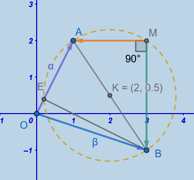{fig-align="center" width="250"}

**Δ2. Γεωμετρικός Τόπος (Χωρίς Εξίσωση Κύκλου)**

Δίνονται τα σταθερά σημεία $A(1, 2)$ και $B(3, -1)$ και η σχέση: $$\vec{MA} \cdot \vec{MB} = 0$$

για ένα σημείο Μ.
Να βρείτε τον γεωμετρικό τόπο του σημείου Μ.

**1. Γεωμετρική ερμηνεία**

- Αν $M \neq A$ και $M \neq B$, η σχέση $\vec{MA} \cdot \vec{MB} = 0$ σημαίνει ότι τα διανύσματα είναι κάθετα: $$\vec{MA} \perp \vec{MB} \iff \widehat{AMB} = 90^\circ$$

Δηλαδή, από το σημείο $M$ το σταθερό ευθύγραμμο τμήμα $AB$ «φαίνεται» υπό **ορθή γωνία**.

- Αν $M \equiv A$ ή $M \equiv B$, η σχέση $0 = 0$ ικανοποιείται προφανώς.

Από την Ευκλείδεια Γεωμετρία, ο γεωμετρικός τόπος των σημείων που «βλέπουν» ένα σταθερό τμήμα υπό ορθή γωνία είναι ο **κύκλος με διάμετρο το τμήμα** $AB$.

------------------------------------------------------------------------

**2. Προσδιορισμός Κέντρου και Ακτίνας**

- **Κέντρο** $K$:

  Είναι το **μέσο** της διαμέτρου $AB$: $$x_K = \frac{x_A + x_B}{2} = \frac{1 + 3}{2} = 2$$ $$y_K = \frac{y_A + y_B}{2} = \frac{2 + (-1)}{2} = \frac{1}{2} = 0{,}5$$

  Άρα: $$K\left(2, \; \frac{1}{2}\right)$$

- **Ακτίνα** $R$:

  Είναι το μισό του μήκους της διαμέτρου $AB$: $$(AB) = \sqrt{(3 - 1)^2 + (-1 - 2)^2} = \sqrt{2^2 + (-3)^2} = \sqrt{4 + 9} = \sqrt{13}$$

  Συνεπώς: $$R = \frac{(AB)}{2} = \frac{\sqrt{13}}{2}$$

------------------------------------------------------------------------

**Δ3. Εμβαδόν Τριγώνου** $OAB$ (Χωρίς Ορίζουσα — Μέσω Προβολής & Ύψους)

Θεωρούμε ως **βάση** του τριγώνου $OAB$ την πλευρά $OA$, η οποία αντιστοιχεί στο διάνυσμα θέσης $\vec{a} = (1, 2)$.

------------------------------------------------------------------------

**1: Μήκος της βάσης** $(OA)$

$$\text{Βάση } b = (OA) = |\vec{a}| = \sqrt{1^2 + 2^2} = \sqrt{5}$$

------------------------------------------------------------------------

**2: Εύρεση του ύψους** $h$ μέσω της κάθετης συνιστώσας (προβολής)

Το ύψος $BE=h$ από την κορυφή $B$ προς την ευθεία της βάσης $OA$ είναι το μήκος της συνιστώσας του $\vec{b} = \vec{OB}$ που είναι **κάθετη** στο $\vec{a}$.

Από το ερώτημα **Δ1.3**, αναλύσαμε το $\vec{b}$ σε δύο συνιστώσες: $$\vec{b} = \vec{b}_1 + \vec{b}_2 \quad \text{με} \quad \vec{b}_1 \parallel \vec{a} \quad \text{και} \quad \vec{b}_2 \perp \vec{a}$$ όπου: $$\vec{b}_1 = \text{προβ}_{\vec{a}}\vec{b} = \left(\frac{1}{5}, \; \frac{2}{5}\right)$$ $$\vec{b}_2 = \vec{b} - \text{προβ}_{\vec{a}}\vec{b} = \left(\frac{14}{5}, \; -\frac{7}{5}\right)$$

Το διάνυσμα $\vec{b}_2$ εκφράζει ακριβώς το διάνυσμα του **ύψους** του τριγώνου!\
Επομένως, το μήκος του ύψους $h$ είναι το μέτρο του $\vec{b}_2$: $$h = |\vec{b}_2| = \sqrt{\left(\frac{14}{5}\right)^2 + \left(-\frac{7}{5}\right)^2} = \sqrt{\frac{196 + 49}{25}} = \sqrt{\frac{245}{25}} = \frac{\sqrt{49 \cdot 5}}{5} = \frac{7\sqrt{5}}{5}$$

------------------------------------------------------------------------

**3: Υπολογισμός του Εμβαδού**

Χρησιμοποιούμε τον βασικό γεωμετρικό τύπο του εμβαδού τριγώνου: $$(OAB) = \frac{1}{2} \cdot \text{βάση} \cdot \text{ύψος} = \frac{1}{2} \cdot b \cdot h$$

Αντικαθιστούμε: $$(OAB) = \frac{1}{2} \cdot \sqrt{5} \cdot \frac{7\sqrt{5}}{5} = \frac{1}{2} \cdot \frac{7 \cdot 5}{5} = \frac{7}{2} = 3{,}5 \text{ τ.μ.}$$

------------------------------------------------------------------------

### ΕΠΑΝΑΛΗΠΤΙΚΟ ΔΙΑΓΩΝΙΣΜΑ ΑΞΙΟΛΟΓΗΣΗΣ

**ΜΑΘΗΜΑ:** Μαθηματικά Β' Λυκείου (Προσανατολισμού Θετικών Σπουδών)\
**ΕΝΟΤΗΤΑ:** Κεφάλαιο 1 - Διανύσματα\
**ΔΙΑΡΚΕΙΑ:** 3 Ώρες

------------------------------------------------------------------------

**ΘΕΜΑ Α**

**Α1.** Έστω δύο διανύσματα $\vec{a} = (x_1, y_1)$ και $\vec{b} = (x_2, y_2)$ σε ένα ορθοκανονικό σύστημα συντεταγμένων $Oxy$.
Να αποδείξετε ότι το εσωτερικό γινόμενο των διανυσμάτων $\vec{a}$ και $\vec{b}$ δίνεται από τον τύπο: $$\vec{a} \cdot \vec{b} = x_1 x_2 + y_1 y_2$$ *(Μονάδες 10)*

**Α2.**

1.  Τι ονομάζεται εσωτερικό γινόμενο δύο μη μηδενικών διανυσμάτων $\vec{a}$ και $\vec{b}$; *(Μονάδες 3)*

2.  Πότε ορίζεται ο συντελεστής διεύθυνσης $λ$ ενός διανύσματος $\vec{a} = (x, y)$ και από ποιον τύπο δίνεται; *(Μονάδες 2)*

**Α3.** Να χαρακτηρίσετε τις προτάσεις που ακολουθούν, γράφοντας στο τετράδιό σας τη λέξη **Σωστό** ή **Λάθος** δίπλα στο γράμμα που αντιστοιχεί σε κάθε πρόταση:

1.  Για οποιαδήποτε διανύσματα $\vec{a}, \vec{b}, \vec{c}$ ισχύει η ισότητα $(\vec{a} \cdot \vec{b}) \vec{c} = \vec{a} (\vec{b} \cdot \vec{c})$.

2.  Αν $\vec{a} \parallel \vec{b}$ με $\vec{b} \neq \vec{0}$, τότε υπάρχει μοναδικός πραγματικός αριθμός $λ \in \mathbb{R}$ ώστε $\vec{a} = λ \vec{b}$.

3.  Δύο διανύσματα $\vec{a} = (x_1, y_1)$ και $\vec{b} = (x_2, y_2)$ είναι κάθετα αν και μόνο αν $x_1 y_2 - x_2 y_1 = 0$.

4.  Για οποιοδήποτε ευθύγραμμο τμήμα $AB$ με μέσο $M$ και τυχαίο σημείο αναφοράς $O$ ισχύει $\vec{OM} = \frac{\vec{OA} + \vec{OB}}{2}$.

5.  Για κάθε διάνυσμα $\vec{a}$ ισχύει $|\vec{a}|^2 = \vec{a}^2$.
    *(Μονάδες 5* $\times$ 2 = 10)

------------------------------------------------------------------------

**ΘΕΜΑ Β**

Δίνονται τα διανύσματα $\vec{a} = (2, -1)$, $\vec{b} = (-1, 3)$ και $\vec{c} = (5, -5)$.

**Β1.** Να βρεθούν οι συντεταγμένες του διανύσματος $\vec{u} = 3\vec{a} - 2\vec{b} + \vec{c}$ και να υπολογιστεί το μέτρο του $|\vec{u}|$.\
*(Μονάδες 6)*

**Β2.** Να εκφράσετε το διάνυσμα $\vec{c}$ ως γραμμικό συνδυασμό των διανυσμάτων $\vec{a}$ και $\vec{b}$ (δηλαδή να βρεθούν πραγματικοί αριθμοί $k, m$ ώστε $\vec{c} = k\vec{a} + m\vec{b}$).\
*(Μονάδες 6)*

**Β3.** Να υπολογίσετε το εσωτερικό γινόμενο $\vec{a} \cdot \vec{b}$ και τη γωνία $θ = (\widehat{\vec{a}, \vec{b}})$.\
*(Μονάδες 6)*

**Β4.** Να βρείτε την προβολή του διανύσματος $\vec{c}$ πάνω στο διάνυσμα $\vec{a}$ (δηλαδή το διάνυσμα $\text{προβ}_{\vec{a}}\vec{c}$).\
*(Μονάδες 7)*

------------------------------------------------------------------------

**ΘΕΜΑ Γ**

Δίνεται τρίγωνο $ABC$ και έστω $M$ το μέσο της πλευράς $BC$.
Θεωρούμε σημείο $D$ τέτοιο ώστε $\vec{AD} = \dfrac{2}{3}\vec{AB}$ και σημείο $E$ τέτοιο ώστε $\vec{AE} = 2\vec{AC} - \vec{AB}$.

**Γ1.** Να εκφράσετε τα διανύσματα $\vec{AM}$ και $\vec{DE}$ ως γραμμικό συνδυασμό των διανυσμάτων $\vec{AB}$ και $\vec{AC}$.\
*(Μονάδες 8)*

**Γ2.** Να αποδείξετε ότι τα σημεία $D, C, E$ είναι συνευθειακά.\
*(Μονάδες 8)*

**Γ3.** Αν $G$ είναι το κέντρο βάρους (βαρύκεντρο) του τριγώνου $ABC$, να αποδείξετε ότι για οποιοδήποτε σημείο $P$ του επιπέδου ισχύει: $$\vec{PA} + \vec{PB} + \vec{PC} = 3\vec{PG}$$ *(Μονάδες 9)*

------------------------------------------------------------------------

**ΘΕΜΑ Δ**

Δίνονται τα διανύσματα $\vec{u}$ και $\vec{v}$ για τα οποία ισχύουν οι σχέσεις: $$|\vec{u}| = 2, \quad |\vec{v}| = 3 \quad \text{και} \quad (2\vec{u} + \vec{v}) \cdot (\vec{u} - \vec{v}) = -3$$

**Δ1.** Να αποδείξετε ότι $\vec{u} \cdot \vec{v} = 2$ και να βρείτε τη γωνία $θ$ των διανυσμάτων $\vec{u}$ και $\vec{v}$.\
*(Μονάδες 6)*

**Δ2.** Να υπολογίσετε το μέτρο του διανύσματος $\vec{w} = \vec{u} + 2\vec{v}$.\
*(Μονάδες 6)*

**Δ3.** Να αναλύσετε το διάνυσμα $\vec{w}$ σε δύο συνιστώσες $\vec{w}_1$ και $\vec{w}_2$, τέτοιες ώστε $\vec{w}_1 \parallel \vec{u}$ και $\vec{w}_2 \perp \vec{u}$.\
*(Μονάδες 6)*

**Δ4.** Δίνονται τα σταθερά σημεία $A(-1, 2)$ και $B(3, 4)$.
Να βρεθεί ο γεωμετρικός τόπος των σημείων $M(x, y)$ του επιπέδου για τα οποία ισχύει: $$\vec{MA} \cdot \vec{MB} = 5$$ *(Μονάδες 7)*

------------------------------------------------------------------------

#### ΑΝΑΛΥΤΙΚΕΣ ΛΥΣΕΙΣ & ΟΔΗΓΟΣ ΒΑΘΜΟΛΟΓΗΣΗΣ

------------------------------------------------------------------------

**ΘΕΜΑ Α**

**Α1.** Βλέπε σχολικό βιβλίο, παράγραφος 1.4:

Με αρχή την αρχή των αξόνων $O(0,0)$, θεωρούμε $\vec{OA} = \vec{a} = (x_1, y_1)$ και $\vec{OB} = \vec{b} = (x_2, y_2)$.

Τότε $\vec{AB} = \vec{b} - \vec{a} = (x_2 - x_1, y_2 - y_1)$.

Από τον Νόμο των Συνημιτόνων στο τρίγωνο $OAB$: $$|\vec{AB}|^2 = |\vec{OA}|^2 + |\vec{OB}|^2 - 2|\vec{OA}||\vec{OB}|συνθ$$

Επειδή $|\vec{OA}||\vec{OB}|συνθ = \vec{a} \cdot \vec{b}$, έχουμε: $$(x_2 - x_1)^2 + (y_2 - y_1)^2 = (x_1^2 + y_1^2) + (x_2^2 + y_2^2) - 2(\vec{a} \cdot \vec{b})$$ $$x_2^2 - 2x_1 x_2 + x_1^2 + y_2^2 - 2y_1 y_2 + y_1^2 = x_1^2 + y_1^2 + x_2^2 + y_2^2 - 2(\vec{a} \cdot \vec{b})$$ $$-2(x_1 x_2 + y_1 y_2) = -2(\vec{a} \cdot \vec{b}) \iff \vec{a} \cdot \vec{b} = x_1 x_2 + y_1 y_2$$

**Α2.**

1.  Εσωτερικό γινόμενο δύο μη μηδενικών διανυσμάτων $\vec{a}$ και $\vec{b}$ ονομάζεται ο πραγματικός αριθμός $\vec{a} \cdot \vec{b} = |\vec{a}| |\vec{b}| συνθ$, όπου $θ = (\widehat{\vec{a}, \vec{b}})$.

2.  Ο συντελεστής διεύθυνσης $λ$ ορίζεται όταν το διάνυσμα δεν είναι παράλληλο στον άξονα $y'y$ (δηλαδή $x \neq 0$) και δίνεται από τον τύπο $λ = \dfrac{y}{x} = εφ\phi$.

**Α3.**

1.  **Λάθος** (Η προσεταιριστική ιδιότητα δεν ισχύει στο εσωτερικό γινόμενο).

2.  **Σωστό** (Θεώρημα συνθήκης παραλληλίας).

3.  **Λάθος** (Η συνθήκη καθετότητας είναι $x_1 x_2 + y_1 y_2 = 0$).

4.  **Σωστό** (Διανυσματική ακτίνα μέσου).

5.  **Σωστό** (Ιδιότητα εσωτερικού τετραγώνου).

------------------------------------------------------------------------

**ΘΕΜΑ Β**

**Β1.**

$$\vec{u} = 3(2, -1) - 2(-1, 3) + (5, -5) = (6, -3) + (2, -6) + (5, -5) = \\ (6 + 2 + 5, -3 - 6 - 5) = (13, -14)$$ $$|\vec{u}| = \sqrt{13^2 + (-14)^2} = \sqrt{169 + 196} = \sqrt{365}$$

**Β2.**

Αναζητούμε $k, m \in \mathbb{R}$ ώστε $\vec{c} = k\vec{a} + m\vec{b}$: $$(5, -5) = k(2, -1) + m(-1, 3) \iff (5, -5) = (2k - m, -k + 3m)$$

Σχηματίζουμε το σύστημα: $$\begin{cases} 2k - m = 5 \\ -k + 3m = -5 \end{cases}$$

Πολλαπλασιάζουμε τη δεύτερη εξίσωση επί $2$: $$-2k + 6m = -10$$

Προσθέτοντας κατά μέλη με την πρώτη: $$5m = -5 \iff m = -1$$

Αντικαθιστώντας στην πρώτη εξίσωση: $$2k - (-1) = 5 \iff 2k + 1 = 5 \iff 2k = 4 \iff k = 2$$

Άρα $\vec{c} = 2\vec{a} - \vec{b}$.

**Β3.**

$$\vec{a} \cdot \vec{b} = 2(-1) + (-1)(3) = -2 - 3 = -5$$ $$|\vec{a}| = \sqrt{2^2 + (-1)^2} = \sqrt{5}, \quad |\vec{b}| = \sqrt{(-1)^2 + 3^2} = \sqrt{10}$$ $$συνθ = \frac{\vec{a} \cdot \vec{b}}{|\vec{a}||\vec{b}|} = \frac{-5}{\sqrt{5}\sqrt{10}} = \frac{-5}{\sqrt{50}} = \frac{-5}{5\sqrt{2}} = -\frac{1}{\sqrt{2}} = -\frac{\sqrt{2}}{2}$$

Επειδή $0 \le θ \le \pi$, προκύπτει ότι $θ = 135^\circ = \dfrac{3\pi}{4}$.

**Β4.**

Ο τύπος της προβολής είναι: $$\text{προβ}_{\vec{a}}\vec{c} = \left( \frac{\vec{a} \cdot \vec{c}}{|\vec{a}|^2} \right) \vec{a}$$ Υπολογίζουμε: $$\vec{a} \cdot \vec{c} = 2(5) + (-1)(-5) = 10 + 5 = 15$$ $$|\vec{a}|^2 = (\sqrt{5})^2 = 5$$ Άρα: $$\text{προβ}_{\vec{a}}\vec{c} = \frac{15}{5} \vec{a} = 3\vec{a} = 3(2, -1) = (6, -3)$$

------------------------------------------------------------------------

**ΘΕΜΑ Γ**

**Γ1.**

- Επειδή το $M$ είναι μέσο της $BC$, ισχύει: $$\vec{AM} = \frac{1}{2}\vec{AB} + \frac{1}{2}\vec{AC}$$

- Για το διάνυσμα $\vec{DE}$: $$\vec{DE} = \vec{AE} - \vec{AD} = (2\vec{AC} - \vec{AB}) - \frac{2}{3}\vec{AB} = -\frac{5}{3}\vec{AB} + 2\vec{AC}$$

**Γ2.**

Εκφράζουμε το διάνυσμα $\vec{DC}$: $$\vec{DC} = \vec{AC} - \vec{AD} = \vec{AC} - \frac{2}{3}\vec{AB} = -\frac{2}{3}\vec{AB} + \vec{AC}$$

Παρατηρούμε ότι: $$\vec{DE} = -\frac{5}{3}\vec{AB} + 2\vec{AC} = 2 \left( -\frac{5}{6}\vec{AB} + \vec{AC} \right)$$

Επίσης: $$\vec{DE} = \frac{5}{2} \left( -\frac{2}{3}\vec{AB} + \frac{4}{5}\vec{AC} \right)$$

Εναλλακτικά, υπολογίζουμε την ορίζουσα/σχέση παραλληλίας των $\vec{DC}$ και $\vec{DE}$: $$\vec{DE} = \frac{5}{2} \vec{DC}$$

(Πράγματι: $\dfrac{5}{2} \cdot (-\dfrac{2}{3}) = -\dfrac{5}{3}$ και $\dfrac{5}{2} \cdot 1 = \dfrac{5}{2}$, οπότε ελέγχουμε τις συντεταγμένες ως προς τη βάση $(\vec{AB}, \vec{AC})$: $\vec{DE} = \dfrac{5}{2}\vec{DC}$).

Επειδή $\vec{DE} = λ \vec{DC}$ με κοινό σημείο το $D$, τα σημεία $D, C, E$ είναι συνευθειακά.

**Γ3.**

Για το κέντρο βάρους $G$ του τριγώνου $ABC$ ισχύει η χαρακτηριστική ιδιότητα: $$\vec{GA} + \vec{GB} + \vec{GC} = \vec{0}$$

Εκφράζουμε με σημείο αναφοράς το $P$: $$(\vec{PA} - \vec{PG}) + (\vec{PB} - \vec{PG}) + (\vec{PC} - \vec{PG}) = \vec{0}$$ $$\vec{PA} + \vec{PB} + \vec{PC} - 3\vec{PG} = \vec{0} \iff \vec{PA} + \vec{PB} + \vec{PC} = 3\vec{PG}$$

------------------------------------------------------------------------

**ΘΕΜΑ Δ**

**Δ1. Απόδειξη ότι $\vec{u} \cdot \vec{v} = 2$ και εύρεση της γωνίας $\theta$**

Αναπτύσσουμε το δοσμένο εσωτερικό γινόμενο εκτελώντας τις επιμεριστικές πράξεις:
$$(2\vec{u} + \vec{v}) \cdot (\vec{u} - \vec{v}) = -3$$
$$2\vec{u}^2 - 2(\vec{u} \cdot \vec{v}) + (\vec{v} \cdot \vec{u}) - \vec{v}^2 = -3$$
$$2|\vec{u}|^2 - (\vec{u} \cdot \vec{v}) - |\vec{v}|^2 = -3$$

Αντικαθιστούμε τα μέτρα $|\vec{u}| = 2$ (άρα $|\vec{u}|^2 = 2^2 = 4$) και $|\vec{v}| = 3$ (άρα $|\vec{v}|^2 = 3^2 = 9$):
$$2(4) - (\vec{u} \cdot \vec{v}) - 9 = -3$$
$$8 - (\vec{u} \cdot \vec{v}) - 9 = -3$$
$$-1 - (\vec{u} \cdot \vec{v}) = -3$$
$$-(\vec{u} \cdot \vec{v}) = -3 + 1$$
$$-(\vec{u} \cdot \vec{v}) = -2 \implies \vec{u} \cdot \vec{v} = 2$$

* **Εύρεση της γωνίας $\theta$:**  

  Από τον ορισμό του εσωτερικού γινομένου:
  $$\cos\theta = \frac{\vec{u} \cdot \vec{v}}{|\vec{u}| \cdot |\vec{v}|} = \frac{2}{2 \cdot 3} = \frac{1}{3}$$
  Συνεπώς:
  $$\theta = \arccos\left(\frac{1}{3}\right)$$

---

**Δ2. Υπολογισμός του μέτρου του διανύσματος $\vec{w} = \vec{u} + 2\vec{v}$**

Υπολογίζουμε πρώτα το τετράγωνο του μέτρου του διανύσματος $\vec{w}$:
$$|\vec{w}|^2 = (\vec{u} + 2\vec{v})^2 = |\vec{u}|^2 + 4(\vec{u} \cdot \vec{v}) + 4|\vec{v}|^2$$

Αντικαθιστούμε τις γνωστές τιμές $|\vec{u}|^2 = 4$, $|\vec{v}|^2 = 9$ και $\vec{u} \cdot \vec{v} = 2$:
$$|\vec{w}|^2 = 4 + 4(2) + 4(9) = 4 + 8 + 36 = 48$$

Παίρνουμε την τετραγωνική ρίζα:
$$|\vec{w}| = \sqrt{48} = \sqrt{16 \cdot 3} = 4\sqrt{3}$$

---

**Δ3. Ανάλυση του $\vec{w}$ σε συνιστώσες $\vec{w}_1 \parallel \vec{u}$ και $\vec{w}_2 \perp \vec{u}$**

1. **Η παράλληλη συνιστώσα $\vec{w}_1$** ισούται με τη διανυσματική προβολή του $\vec{w}$ πάνω στο $\vec{u}$:
   $$\vec{w}_1 = \text{προβ}_{\vec{u}}\vec{w} = \left(\frac{\vec{w} \cdot \vec{u}}{|\vec{u}|^2}\right)\vec{u}$$

   Υπολογίζουμε το εσωτερικό γινόμενο $\vec{w} \cdot \vec{u}$:
   $$\vec{w} \cdot \vec{u} = (\vec{u} + 2\vec{v}) \cdot \vec{u} = |\vec{u}|^2 + 2(\vec{u} \cdot \vec{v}) = 4 + 2(2) = 8$$

   Συνεπώς:
   $$\vec{w}_1 = \frac{8}{4}\vec{u} = 2\vec{u}$$

2. **Η κάθετη συνιστώσα $\vec{w}_2$** βρίσκεται από τη σχέση $\vec{w} = \vec{w}_1 + \vec{w}_2$:
   $$\vec{w}_2 = \vec{w} - \vec{w}_1 = (\vec{u} + 2\vec{v}) - 2\vec{u} = 2\vec{v} - \vec{u}$$

---

**Δ4. Γεωμετρικός Τόπος του σημείου $M$ (Καθαρά Γεωμετρική Λύση)**

Δίνονται τα σταθερά σημεία $A(-1, 2)$ και $B(3, 4)$ και η σχέση $\vec{MA} \cdot \vec{MB} = 5$.

**1: Χρήση του μέσου $K$ του τμήματος $AB$**

Έστω $K$ το μέσο του ευθύγραμμου τμήματος $AB$. Οι συντεταγμένες του είναι:
$$x_K = \frac{x_A + x_B}{2} = \frac{-1 + 3}{2} = \frac{2}{2} = 1$$
$$y_K = \frac{y_A + y_B}{2} = \frac{2 + 4}{2} = \frac{6}{2} = 3$$

Άρα $K(1, 3)$.

Το μήκος του τμήματος $KA$ (η απόσταση του $A$ από το μέσο $K$) είναι:
$$(KA) = \sqrt{(x_A - x_K)^2 + (y_A - y_K)^2} = \sqrt{(-1 - 1)^2 + (2 - 3)^2} = \sqrt{(-2)^2 + (-1)^2} = \sqrt{4 + 1} = \sqrt{5}$$

Άρα:
$$(KA)^2 = 5$$

---

**2: Ανάλυση των διανυσμάτων ως προς το μέσο $K$**

Επειδή το $K$ είναι μέσο του $AB$, τα διανύσματα $\vec{KA}$ και $\vec{KB}$ είναι αντίθετα ($\vec{KB} = -\vec{KA}$).  

Αναλύουμε τα διανύσματα $\vec{MA}$ και $\vec{MB}$ με αρχή το σημείο $K$:
$$\vec{MA} = \vec{MK} + \vec{KA}$$
$$\vec{MB} = \vec{MK} + \vec{KB} = \vec{MK} - \vec{KA}$$

---

**3: Ανάπτυξη του εσωτερικού γινομένου**

Το εσωτερικό γινόμενο αναπτύσσεται ως διαφορά τετραγώνων:
$$\vec{MA} \cdot \vec{MB} = (\vec{MK} + \vec{KA}) \cdot (\vec{MK} - \vec{KA}) = \vec{MK}^2 - \vec{KA}^2 = |\vec{MK}|^2 - |\vec{KA}|^2$$
$$\vec{MA} \cdot \vec{MB} = (MK)^2 - (KA)^2$$

---

**4: Προσδιορισμός της απόστασης $(MK)$**

Αντικαθιστούμε τα δεδομένα στη σχέση $\vec{MA} \cdot \vec{MB} = 5$:
$$(MK)^2 - (KA)^2 = 5$$
$$(MK)^2 - 5 = 5$$
$$(MK)^2 = 10 \implies (MK) = \sqrt{10}$$

---

**Συμπέρασμα**

Η απόσταση του σημείου $M$ από το σταθερό σημείο $K(1, 3)$ παραμένει **σταθερή και ίση με $\sqrt{10}$**:
$$(MK) = \sqrt{10}$$

Επομένως, ο γεωμετρικός τόπος των σημείων $M$ είναι ο **κύκλος με κέντρο το σημείο $K(1, 3)$ (μέσο του $AB$) και ακτίνα $R = \sqrt{10}$**.

------------------------------------------------------------------------

:::: callout-sos
::: {.callout-sos .callout-title}
Εύχομαι
:::

ΚΑΛΗ ΜΕΛΕΤΗ!
::::
