```{=html}
<!-- Φόρτωση βιβλιοθήκης GeoGebra -->
<script src="https://www.geogebra.org/apps/deployggb.js"></script>

<!-- Συνάρτηση δημιουργίας applets -->
<script>
function createGeoGebra(containerId, materialId, width = 700, height = 500) {
  var params = {
    "id": "ggb-" + containerId,
    "material_id": materialId,
    "width": width,
    "height": height,
    "showToolBar": true,
    "showMenuBar": false,
    "showAlgebraInput": true
  };
  
  var applet = new GGBApplet(params, '5.2');
  applet.inject(containerId);
}
</script>
```

## Εξίσωση Ευθείας

------------------------------------------------------------------------

### Εξίσωση Γραμμής

:::: {.math-box .definition-box}
::: {.math-title .definition-title}
**Ορισμός:**
:::

**Εξίσωση μιας γραμμής** $\mathcal{C}$ στο καρτεσιανό επίπεδο $Oxy$ ονομάζεται μια εξίσωση με δύο μεταβλητές $x$ και $y$, η οποία επαληθεύεται από τις συντεταγμένες $(x, y)$ όλων των σημείων που ανήκουν στη γραμμή $\mathcal{C}$ και μόνο από αυτές.
::::

- **Παραδείγματα:**

  - Η εξίσωση $x^2 + y^2 = 4$ παριστάνει κύκλο με κέντρο την αρχή των αξόνων $O(0,0)$ και ακτίνα $R = 2$.

  - Η εξίσωση $2x - y + 1 = 0$ παριστάνει ευθεία γραμμή στο επίπεδο.

------------------------------------------------------------------------

### Συντελεστής Διεύθυνσης Ευθείας

:::: {.math-box .definition-box}
::: {.math-title .definition-title}
**Γωνία Ευθείας με τον Άξονα** $x'x$:
:::

- Αν μια ευθεία $ε$ τέμνει τον άξονα $x'x$ στο σημείο $A$, **γωνία** $\omega$ της ευθείας $ε$ με τον άξονα $x'x$ ορίζεται η γωνία που διαγράφει ο θετικός ημιάξονας $Ax$ όταν στραφεί γύρω από το $A$ κατά τη θετική (αντιωρολογιακή) φορά μέχρι να συμπέσει για πρώτη φορά με την ευθεία $ε$.

- Αν η ευθεία $ε$ είναι παράλληλη προς τον άξονα $x'x$ ή συμπίπτει με αυτόν, ορίζουμε συμβατικά $\omega = 0^\circ$ (ή $0\text{ rad}$).

- Σε κάθε περίπτωση, η γωνία $\omega$ ικανοποιεί τον περιορισμό: $$0^\circ \le \omega < 180^\circ \quad \text{ή} \quad 0 \le \omega < \pi$$
::::

------------------------------------------------------------------------

:::: {.math-box .definition-box}
::: {.math-title .definition-title}
**Ορισμός Συντελεστή Διεύθυνσης (Κλίσης):**
:::

**Συντελεστής διεύθυνσης** (ή **κλίση**) μιας ευθείας $ε$ ονομάζεται η εφαπτομένη της γωνίας $\omega$ που σχηματίζει η ευθεία με τον άξονα $x'x$: $$λ = εφ\omega$$
::::

------------------------------------------------------------------------

:::: {.math-box .proposal-box}
::: {.math-title .proposal-title}
- **Όταν η ευθεία τέμνει τον άξονα** $x'x$:
:::

Αν η γωνία $\omega$ είναι οξεία ($0^\circ < \omega < 90^\circ$), ο συντελεστής διεύθυνσης είναι θετικός ($λ > 0$).

Αν η γωνία $\omega$ είναι αμβλεία ($90^\circ < \omega < 180^\circ$), ο συντελεστής διεύθυνσης είναι αρνητικός ($λ < 0$).
::::

:::: {.math-box .proposal-box}
::: {.math-title .proposal-title}
- **Όταν η ευθεία είναι παράλληλη στον άξονα** $x'x$:
:::

Η γωνία είναι $\omega = 0^\circ$, οπότε $λ = εφ 0^\circ = 0$.
::::

:::: {.math-box .proposal-box}
::: {.math-title .proposal-title}
- **Όταν η ευθεία είναι κάθετη στον άξονα** $x'x$ (Κατακόρυφη ευθεία):
:::

Η γωνία είναι $\omega = 90^\circ$.
Επειδή η εφαπτομένη των $90^\circ$ δεν ορίζεται, **δεν ορίζεται συντελεστής διεύθυνσης** για τις κατακόρυφες ευθείες.
::::

------------------------------------------------------------------------

:::: {.math-box .definition-box}
::: {.math-title .definition-title}
**Συντελεστής Διεύθυνσης Ευθείας από Δύο Σημεία** $A$ και $B$:
:::

Ο συντελεστής διεύθυνσης $λ$ μιας μη κατακόρυφης ευθείας $ε$ που διέρχεται από τα σημεία $A(x_1, y_1)$ και $B(x_2, y_2)$ με $x_1 \neq x_2$ δίνεται από τον τύπο: $$λ = \frac{y_2 - y_1}{x_2 - x_1}$$
::::

------------------------------------------------------------------------

:::: {.math-box .proposal-box}
::: {.math-title .proposal-title}
- **Παράλληλη Ευθεία και Διάνυσμα:**
:::

Όταν μια ευθεία $ε$ είναι παράλληλη προς ένα μη μηδενικό διάνυσμα $\vec{\delta} = (x_\delta, y_\delta)$ (με $x_\delta \neq 0$), η ευθεία και το διάνυσμα σχηματίζουν την ίδια γωνία (ή γωνίες που διαφέρουν κατά $\pi$) με τον άξονα $x'x$.
Συνεπώς: $$λ_ε = λ_{\vec{\delta}} = \frac{y_\delta}{x_\delta}$$
::::

- **Παραδείγματα:**

  1.  Αν μια ευθεία σχηματίζει γωνία $\omega = 45^\circ$ με τον άξονα $x'x$, ο συντελεστής διεύθυνσής της είναι $λ = εφ 45^\circ = 1$.

  2.  Η ευθεία που διέρχεται από τα σημεία $A(1, -2)$ και $B(-1, 4)$ έχει συντελεστή διεύθυνσης: $$λ = \frac{4 - (-2)}{-1 - 1} = \frac{6}{-2} = -3$$

  3.  Αν η ευθεία $ε$ είναι παράλληλη στο διάνυσμα $\vec{\delta} = (2, 6)$, ο συντελεστής διεύθυνσής της είναι $λ = \dfrac{6}{2} = 3$.

------------------------------------------------------------------------

### Συνθήκες Καθετότητας και Παραλληλίας Ευθειών

Έστω δύο μη κατακόρυφες ευθείες $ε_1$ και $ε_2$ με συντελεστές διεύθυνσης $λ_1$ και $λ_2$ αντίστοιχα.

:::: {.math-box .proposal-box}
::: {.math-title .proposal-title}
- **Συνθήκη Παραλληλίας:**
:::

Δύο ευθείες είναι παράλληλες (ή συμπίπτουν) αν και μόνο αν οι συντελεστές διεύθυνσής τους είναι ίσοι: $$ε_1 \parallel ε_2 \iff λ_1 = λ_2$$
::::

:::: {.math-box .proposal-box}
::: {.math-title .proposal-title}
- **Συνθήκη Καθετότητας:**
:::

Δύο ευθείες είναι κάθετες αν και μόνο αν το γινόμενο των συντελεστών διεύθυνσής τους ισούται με $-1$: $$ε_1 \perp ε_2 \iff λ_1 \cdot λ_2 = -1 \iff λ_2 = -\frac{1}{λ_1}$$
::::

- **Παραδείγματα:**

  1.  Οι ευθείες $ε_1: y = 2x + 5$ και $ε_2: y = 2x - 7$ είναι παράλληλες διότι $λ_1 = λ_2 = 2$.

  2.  Οι ευθείες $\zeta_1: y = 3x + 1$ και $\zeta_2: y = -\dfrac{1}{3}x + 4$ είναι κάθετες διότι $λ_1 \cdot λ_2 = 3 \cdot \left(-\dfrac{1}{3}\right) = -1$.

------------------------------------------------------------------------

### Μορφές Εξίσωσης Ευθείας

:::: {.math-box .definition-box}
::: {.math-title .definition-title}
**Εξίσωση Ευθείας με Γνωστό Σημείο** $A(x_0, y_0)$ και Συντελεστή Διεύθυνσης $λ$:
:::

Η εξίσωση μιας μη κατακόρυφης ευθείας $ε$ που διέρχεται από το σημείο $A(x_0, y_0)$ και έχει συντελεστή διεύθυνσης $λ$ είναι: $$y - y_0 = λ(x - x_0)$$
::::

------------------------------------------------------------------------

:::: {.math-box .definition-box}
::: {.math-title .definition-title}
**Εξίσωση Ευθείας που Περνάει από Δύο Σημεία** $A(x_1, y_1)$ και $B(x_2, y_2)$ (με $x_1 \neq x_2$):
:::

Υπολογίζουμε πρώτα τον συντελεστή $λ = \dfrac{y_2 - y_1}{x_2 - x_1}$ και η εξίσωση διαμορφώνεται ως: $$y - y_1 = \frac{y_2 - y_1}{x_2 - x_1}(x - x_1)$$
::::

------------------------------------------------------------------------

:::: {.math-box .definition-box}
::: {.math-title .definition-title}
**Εξίσωση Κατακόρυφης Ευθείας (Παράλληλης στον** $y'y$):
:::

Όταν η ευθεία είναι κάθετη στον άξονα $x'x$, όλα τα σημεία της έχουν την ίδια τετμημένη $x_0$.
Η εξίσωσή της είναι: $$x = x_0$$

- Ειδικά, ο **άξονας των τεταγμένων** $y'y$ έχει εξίσωση $x = 0$.
::::

------------------------------------------------------------------------

:::: {.math-box .definition-box}
::: {.math-title .definition-title}
**Εξίσωση Οριζόντιας Ευθείας (Παράλληλης στον** $x'x$):
:::

Όταν η ευθεία είναι παράλληλη στον άξονα $x'x$ και διέρχεται από το σημείο $A(x_0, y_0)$, η κλίση της είναι $λ = 0$.
Η εξίσωσή της είναι: $$y = y_0$$

- Ειδικά, ο **άξονας των τετμημένων** $x'x$ έχει εξίσωση $y = 0$.
::::

- **Παραδείγματα:**

  1.  Η ευθεία που διέρχεται από το σημείο $A(-1, 2)$ και έχει συντελεστή διεύθυνσης $λ = -3$ έχει εξίσωση: $$y - 2 = -3(x - (-1)) \iff y - 2 = -3x - 3 \iff y = -3x - 1$$

  2.  Η ευθεία που διέρχεται από τα σημεία $A(1, 3)$ και $B(4, 9)$ έχει $λ = \dfrac{9 - 3}{4 - 1} = 2$, οπότε η εξίσωσή της είναι: $$y - 3 = 2(x - 1) \iff y = 2x + 1$$

  3.  Η κατακόρυφη ευθεία που διέρχεται από το σημείο $P(5, -2)$ έχει εξίσωση $x = 5$.

  4.  Η οριζόντια ευθεία που διέρχεται από το σημείο $Q(-3, 4)$ έχει εξίσωση $y = 4$.

------------------------------------------------------------------------

### Ειδικές Περιπτώσεις Εξίσωσης Ευθείας

:::: {.math-box .definition-box}
::: {.math-title .definition-title}
**Μορφή** $y = λ x + \beta$ (Ρητή Μορφή):
:::

- Παριστάνει ευθεία με συντελεστή διεύθυνσης $λ$, η οποία τέμνει τον άξονα των τεταγμένων $y'y$ στο σημείο $E(0, \beta)$.

- Το $\beta$ ονομάζεται **τεταγμένη επί την αρχή**.
::::

------------------------------------------------------------------------

:::: {.math-box .definition-box}
::: {.math-title .definition-title}
**Μορφή** $y = λ x$ (Ευθεία που διέρχεται από την Αρχή των Αξόνων):
:::

- Όταν μια ευθεία διέρχεται από το σημείο $O(0,0)$, η σταθερά $\beta$ μηδενίζεται ($\beta = 0$), δίνοντας την εξίσωση $y = λ x$.

- **Διχοτόμος 1ου και 3ου τεταρτημορίου (**$\delta_1$): Σχηματίζει γωνία $\omega = 45^\circ$ ($λ = εφ 45^\circ = 1$), οπότε έχει εξίσωση: $$y = x$$

- **Διχοτόμος 2ου και 4ου τεταρτημορίου (**$\delta_2$): Σχηματίζει γωνία $\omega = 135^\circ$ ($λ = εφ 135^\circ = -1$), οπότε έχει εξίσωση: $$y = -x$$
::::

- **Παραδείγματα:**

  1.  Η ευθεία $y = 4x - 3$ έχει συντελεστή διεύθυνσης $λ = 4$ και τέμνει τον άξονα $y'y$ στο σημείο $(0, -3)$.

  2.  Η ευθεία $y = -2x$ διέρχεται από την αρχή των αξόνων $O(0,0)$ και έχει κλίση $λ = -2$.

------------------------------------------------------------------------

### Εφαρμογές

:::: {.math-box .example-box}
::: {.math-title .example-title}
1.  Εκφώνηση
:::

Σε ένα πολεοδομικό σχέδιο με ορθοκανονικό σύστημα συντεταγμένων, σχεδιάζεται ένα τριγωνικό πάρκο με κορυφές τα σημεία:

- $K(-2,\,1)$

- $Λ(2,\,5)$

- $M(6,\,-3)$

Να βρεθούν οι εξισώσεις:

1.  **Του ύψους** που άγεται από την κορυφή $K$ προς την πλευρά $Λ M$ (διαδρομή αποστράγγισης).

2.  **Της διαμέσου** που άγεται από την κορυφή $Λ$ προς την πλευρά $K M$ (κεντρικό μονοπάτι πρόσβασης).

3.  **Της μεσοκαθέτου** της πλευράς $K M$ (γραμμή τοποθέτησης φωτισμού).
::::

:::: {.math-box .examplesolution-box}
::: {.math-title .examplesolution-title}
Λύση

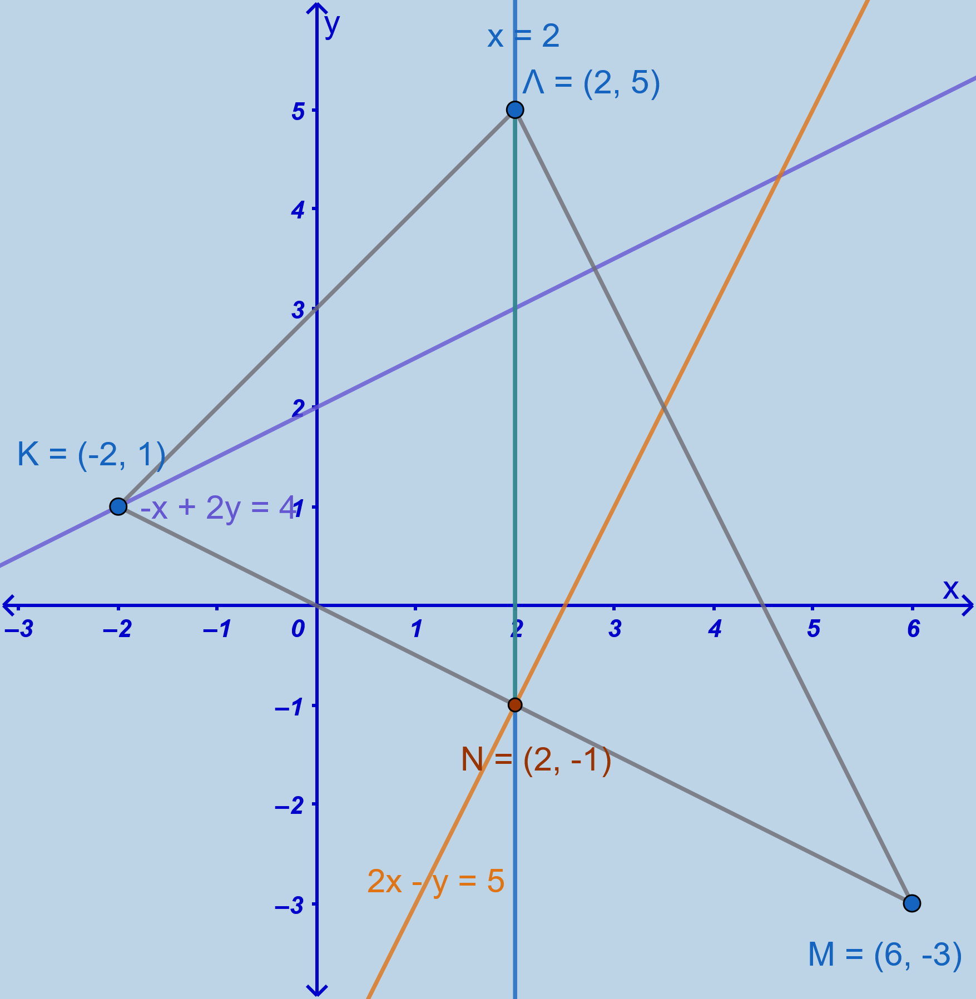{fig-align="center" width="400"}
:::

**1. Εξίσωση του ύψους από την κορυφή** $K$

Το ύψος που ξεκινά από το $K$ είναι κάθετο στην ευθεία της απέναντι πλευράς $Λ M$.

- Αρχικά, υπολογίζουμε τον συντελεστή διεύθυνσης $λ_{Λ M}$ της πλευράς $Λ M$: $$λ_{Λ M} = \frac{y_M - y_{Λ}}{x_M - x_{Λ}} = \frac{-3 - 5}{6 - 2} = \frac{-8}{4} = -2$$

- Επειδή το ύψος $υ_K$ είναι κάθετο στην πλευρά $Λ M$ ($υ_K \perp Λ M$), ισχύει: $$λ_{υ_K} \cdot λ_{Λ M} = -1 \implies λ_{υ_K} \cdot (-2) = -1 \implies λ_{υ_K} = \frac{1}{2}$$

- Η ευθεία του ύψους διέρχεται από το σημείο $K(-2,\,1)$ και έχει κλίση $λ_{υ_K} = \dfrac{1}{2}$: $$y - y_K = λ_{υ_K} \cdot (x - x_K)$$ $$y - 1 = \frac{1}{2}(x - (-2))$$ $$y - 1 = \frac{1}{2}(x + 2)$$ $$2(y - 1) = x + 2$$ $$2y - 2 = x + 2$$ $$x - 2y + 4 = 0$$

------------------------------------------------------------------------

**2. Εξίσωση της διαμέσου από την κορυφή** $Λ$

Η διάμεσος από την κορυφή $Λ$ ενώνει το σημείο $Λ$ με το μέσο $N$ της απέναντι πλευράς $K M$.

- Βρίσκουμε τις συντεταγμένες του μέσου $N$ του τμήματος $K M$, όπου $K(-2,\,1)$ και $M(6,\,-3)$: $$x_N = \frac{x_K + x_M}{2} = \frac{-2 + 6}{2} = \frac{4}{2} = 2$$ $$y_N = \frac{y_K + y_M}{2} = \frac{1 + (-3)}{2} = \frac{-2}{2} = -1$$ Άρα, το μέσο είναι το σημείο $N(2,\,-1)$.

- Παρατηρούμε τις συντεταγμένες των σημείων $Λ(2,\,5)$ και $N(2,\,-1)$: Έχουν την ίδια τετμημένη ($x_{Λ} = x_N = 2$).

  Συνεπώς, η ευθεία που διέρχεται από τα $Λ$ και $N$ είναι κατακόρυφη και έχει εξίσωση: $$x = 2$$

------------------------------------------------------------------------

**3. Εξίσωση της μεσοκαθέτου της πλευράς** $K M$

Η μεσοκάθετος της πλευράς $K M$ διέρχεται από το μέσο της $N(2,\,-1)$ και είναι κάθετη στο ευθύγραμμο τμήμα $K M$.

- Υπολογίζουμε τον συντελεστή διεύθυνσης της πλευράς $K M$: $$λ_{KM} = \frac{y_M - y_K}{x_M - x_K} = \frac{-3 - 1}{6 - (-2)} = \frac{-4}{8} = -\frac{1}{2}$$

- Έστω $ε$ η μεσοκάθετος.
  Επειδή $ε \perp KM$: $$λ_{ε} \cdot λ_{KM} = -1 \implies λ_{ε} \cdot \left(-\frac{1}{2}\right) = -1 \implies λ_{ε} = 2$$

- Η ευθεία $ε$ διέρχεται από το μέσο $N(2,\,-1)$ με κλίση $λ_{ε} = 2$: $$y - y_N = λ_{ε} \cdot (x - x_N)$$ $$y - (-1) = 2(x - 2)$$ $$y + 1 = 2x - 4$$ $$2x - y - 5 = 0$$
::::

------------------------------------------------------------------------

:::: {.math-box .example-box}
::: {.math-title .example-title}
2.  Εκφώνηση
:::

Σε ένα πείραμα οπτικής, μια επίπεδη ανακλαστική επιφάνεια (κάτοπτρο) αναπαρίσταται σε καρτεσιανό επίπεδο από την ευθεία: $$ε: y = -\frac{1}{3}x + 4$$

Μια φωτεινή πηγή βρίσκεται τοποθετημένη στο σημείο $P(1,\,1)$.

Να βρεθούν οι συντεταγμένες του σημείου $P'(x',\,y')$, το οποίο αντιστοιχεί στο είδωλο (συμμετρικό σημείο) της φωτεινής πηγής $P$ ως προς την ευθεία $ε$.
::::

:::: {.math-box .examplesolution-box}
::: {.math-title .examplesolution-title}
Λύση

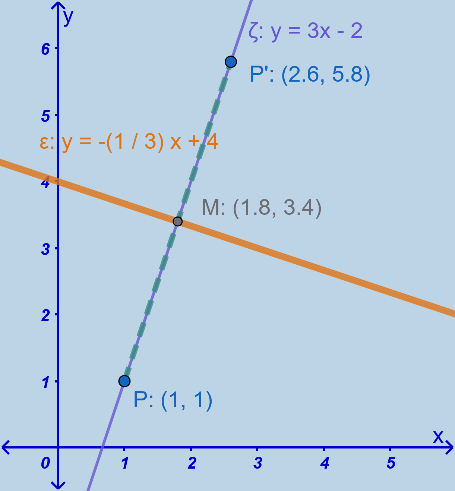{fig-align="center" width="350"}
:::

Για να βρούμε το συμμετρικό σημείο $P'$ ενός σημείου $P$ ως προς μια ευθεία $ε$:

1.  Βρίσκουμε την ευθεία $\zeta$ που διέρχεται από το $P$ και είναι κάθετη στην $ε$.

2.  Βρίσκουμε το σημείο τομής $M$ των ευθειών $ε$ και $\zeta$ (η προβολή του $P$ πάνω στην $ε$).

3.  Το σημείο $M$ είναι το μέσο του ευθύγραμμου τμήματος $PP'$, οπότε υπολογίζουμε τις συντεταγμένες του $P'$.

------------------------------------------------------------------------

**1: Εξίσωση της κάθετης ευθείας** $\zeta$

- Ο συντελεστής διεύθυνσης της ευθείας $ε$ είναι: $$λ_{ε} = -\frac{1}{3}$$

- Επειδή η ευθεία $\zeta$ είναι κάθετη στην $ε$ ($\zeta \perp ε$): $$λ_{\zeta} \cdot λ_{ε} = -1 \implies λ_{\zeta} \cdot \left(-\frac{1}{3}\right) = -1 \implies λ_{\zeta} = 3$$

- Η ευθεία $\zeta$ διέρχεται από το σημείο $P(1,\,1)$ και έχει κλίση $λ_{\zeta} = 3$: $$y - y_P = λ_{\zeta} \cdot (x - x_P)$$ $$y - 1 = 3(x - 1)$$ $$y - 1 = 3x - 3$$ $$\zeta: y = 3x - 2$$

------------------------------------------------------------------------

**2: Εύρεση του σημείου τομής** $M$

Λύνουμε το σύστημα των εξισώσεων των ευθειών $ε$ και $\zeta$: $$\begin{cases} 
y = -\dfrac{1}{3}x + 4 \\ 
y = 3x - 2 
\end{cases}$$

Εξισώνουμε τα $y$: $$3x - 2 = -\frac{1}{3}x + 4$$

Πολλαπλασιάζουμε όλους τους όρους με το $3$ για να απαλείψουμε τον παρονομαστή: $$3 \cdot (3x - 2) = 3 \cdot \left(-\frac{1}{3}x + 4\right)$$ $$9x - 6 = -x + 12$$ $$9x + x = 12 + 6$$ $$10x = 18$$ $$x = \frac{18}{10} = \frac{9}{5}$$

Αντικαθιστούμε το $x = \frac{9}{5}$ στην εξίσωση $y = 3x - 2$: $$y = 3 \cdot \frac{9}{5} - 2 = \frac{27}{5} - \frac{10}{5} = \frac{17}{5}$$

Άρα, το σημείο τομής (η ορθή προβολή του $P$ πάνω στην $ε$) είναι: $$M\left(\frac{9}{5},\,\frac{17}{5}\right)$$

------------------------------------------------------------------------

**3: Υπολογισμός του συμμετρικού σημείου** $P'$

Το σημείο $M$ είναι το μέσο του τμήματος $PP'$.
Επομένως, ισχύουν οι τύποι των συντεταγμένων του μέσου: $$x_M = \frac{x_P + x'}{2} \quad \text{και} \quad y_M = \frac{y_P + y'}{2}$$

- Για την τετμημένη $x'$: $$\frac{9}{5} = \frac{1 + x'}{2} \implies 2 \cdot \frac{9}{5} = 1 + x' \implies \frac{18}{5} = 1 + x'$$ $$x' = \frac{18}{5} - 1 = \frac{18}{5} - \frac{5}{5} = \frac{13}{5}$$

- Για την τεταγμένη $y'$: $$\frac{17}{5} = \frac{1 + y'}{2} \implies 2 \cdot \frac{17}{5} = 1 + y' \implies \frac{34}{5} = 1 + y'$$ $$y' = \frac{34}{5} - 1 = \frac{34}{5} - \frac{5}{5} = \frac{29}{5}$$

------------------------------------------------------------------------

**Τελικό Αποτέλεσμα**

Οι συντεταγμένες του συμμετρικού σημείου είναι: $$P'\left(\frac{13}{5},\,\frac{29}{5}\right) \quad \text{ή σε δεκαδική μορφή} \quad P'(2{,}6,\,5{,}8)$$
::::

------------------------------------------------------------------------

### Ασκήσεις στην Εξίσωση Ευθείας

#### **Ομάδα Α: Γωνία & Συντελεστής Διεύθυνσης**

1.  **Άσκηση 1:** Να υπολογίσετε τον συντελεστή διεύθυνσης $λ$ και τη γωνία $\omega$ που σχηματίζει με τον άξονα $x'x$ η ευθεία που διέρχεται από τα σημεία $A(\sqrt{3}, 1)$ και $B(2\sqrt{3}, 4)$.

2.  **Άσκηση 2:** Δίνεται διάνυσμα $\vec{u} = (\kappa - 1, 2\kappa + 3)$.
    Να βρεθεί ο πραγματικός αριθμός $\kappa$ ώστε η ευθεία $ε$, που είναι παράλληλη στο $\vec{u}$, να σχηματίζει γωνία $\omega = 135^\circ$ με τον άξονα $x'x$.

:::: my-callout-theory
::: {.my-callout-theory .callout-title}
Υπόδειξη
:::

$\vec u // ε \implies λ_{\vec u}=λ_ε=εφ 135^ο=-1 \implies λ_{\vec u}=\dfrac{2κ+3}{κ-1}=-1 \implies κ=........$
::::

------------------------------------------------------------------------

3.  **Άσκηση 3:** Να εξετάσετε αν τα σημεία $A(1, 2)$, $B(3, 8)$ και $Γ(-2, -7)$ είναι συνευθειακά, συγκρίνοντας τους συντελεστές διεύθυνσης $λ_{AB}$ και $λ_{BΓ}$.

:::: my-callout-theory
::: {.my-callout-theory .callout-title}
Υπόδειξη
:::

Πρέπει $λ_{ΑΒ}=λ_{ΒΓ} \implies \dfrac{8-2}{3-1}=\dfrac{-7-8)}{-2-3} \implies ...............$
::::

------------------------------------------------------------------------

4.  **Άσκηση 4:** Δίνονται τα σημεία $A(2, 5)$ και $B(x, 11)$. Να υπολογίσετε το $x \in \mathbb{R}$ ώστε ο συντελεστής διεύθυνσης της ευθείας $AB$ να ισούται με $λ = 3$.

:::: my-callout-theory
::: {.my-callout-theory .callout-title}
Υπόδειξη
:::

Πρέπει $λ_{ΑΒ}=\dfrac{11-5}{x-2}=3$.
Λύνουμε την εξίσωση.
::::

------------------------------------------------------------------------

#### **Ομάδα Β: Συνθήκες Παραλληλίας & Καθετότητας**

5.  **Άσκηση 5:** Δίνονται οι ευθείες $ε_1: y = (2\kappa - 1)x + 4$ και $ε_2: y = (\kappa + 3)x - 2$. Να προσδιορίσετε την τιμή του $\kappa \in \mathbb{R}$ ώστε οι ευθείες να είναι παράλληλες ($ε_1 \parallel ε_2$).

:::: my-callout-theory
::: {.my-callout-theory .callout-title}
Υπόδειξη
:::

Πρέπει $λ_{ε_1}=λ_{ε_2} \implies 2κ-1=κ+3 \implies.........$ Λύνουμε την εξίσωση.
::::

------------------------------------------------------------------------

6.  **Άσκηση 6:** Δίνονται οι ευθείες $\zeta_1: y = λ x - 5$ και $\zeta_2: y = (λ + 2)x + 1$. Να βρεθεί ο αριθμός $λ$ ώστε οι ευθείες να είναι κάθετες ($\zeta_1 \perp \zeta_2$).

:::: my-callout-theory
::: {.my-callout-theory .callout-title}
Υπόδειξη
:::

Πρέπει $λ_{ζ_1} \cdot λ_{ζ_2}=-1 \implies λ(λ+2)=-1$ Λύνουμε την εξίσωση.
::::

------------------------------------------------------------------------

7.  **Άσκηση 7:** Να βρείτε την εξίσωση της ευθείας που διέρχεται από το σημείο $P(2, -3)$ και είναι:

    - α) παράλληλη στην ευθεία $\eta: y = 4x - 1$.

    - β) κάθετη στην ευθεία $\eta: y = 4x - 1$.

:::: my-callout-theory
::: {.my-callout-theory .callout-title}
Υπόδειξη

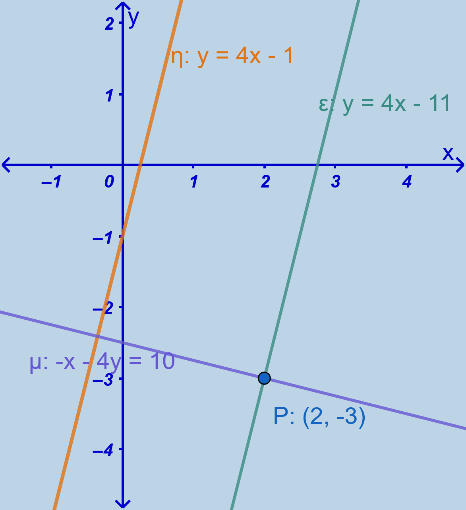{fig-align="center" width="350"}
:::

- α) Αν ε η παράλληλη, τότε $λ_ε=4$

Η ευθεία που περνάει από το Ρ(2,-3) και έχει συντελεστή διεύθυνσης 4 είναι $y-(-3)=4(x-2) \implies .........................$

- β) Αν μ η κάθετη, τότε $4 \cdot λ_μ=-1 \implies λ_μ=-\dfrac{1}{4}$ και η ευθεία θα είναι $y-(-3)=-\dfrac{1}{4}(x-2)$ ...............................................
::::

------------------------------------------------------------------------

8.  **Άσκηση 8:** Δίνεται η ευθεία $ε: y = -\dfrac{2}{3}x + 5$ και το διάνυσμα $\vec{v} = (a, 1 - a)$. Να βρεθεί το $a \in \mathbb{R}$ ώστε η ευθεία $ε$ να είναι παράλληλη στο διάνυσμα $\vec{v}$.

:::: my-callout-theory
::: {.my-callout-theory .callout-title}
Υπόδειξη
:::

Πρέπει $λ_ε=λ{\vec v} \implies -\dfrac{2}{3}=\dfrac{1-a}{a}$ Λύνουμε την εξίσωση.
::::

------------------------------------------------------------------------

#### **Ομάδα Γ: Εύρεση Εξίσωσης Ευθείας**

9.  **Άσκηση 9:** Να υπολογίσετε την εξίσωση της ευθείας που διέρχεται από το σημείο $A(3, -2)$ και σχηματίζει γωνία $\omega = 60^\circ$ με τον άξονα $x'x$.

:::: my-callout-theory
::: {.my-callout-theory .callout-title}
Υπόδειξη
:::

Σημαίνει ότι $λ_ε=εφ ω=εφ 60^ο=\sqrt{3} \implies y-(-2)=\sqrt{3}(x-3) \implies y= .................$
::::

------------------------------------------------------------------------

10. **Άσκηση 10:** Να βρεθεί η εξίσωση της ευθείας που διέρχεται από τα σημεία $A(-2, 5)$ και $B(4, -1)$.

11. **Άσκηση 11:** Να γράψετε την εξίσωση της ευθείας που διέρχεται από το σημείο $M(-4, 7)$ και είναι:

    - α) παράλληλη στον άξονα των τετμημένων $x'x$.

    - β) κάθετη στον άξονα των τετμημένων $x'x$.

12. **Άσκηση 12:** Δίνεται τρίγωνο $ABΓ$ με κορυφές $A(-1, 2)$, $B(1, 5)$ και $Γ(4, 1)$.
    Να βρείτε την εξίσωση του ύψους που άγεται από την κορυφή $A$ προς την πλευρά $BΓ$.

:::: my-callout-theory
::: {.my-callout-theory .callout-title}
Υπόδειξη
:::

1.  Συντελεστής διεύθυνσης της ΒΓ $λ_{ΒΓ}=\dfrac{1-5}{4-1}=.................$

2.  Πρέπει $λ_{ΑΓ} \cdot λ_{υ_Α}=-1 \implies λ_{υ_Α}= ................$

3.  Η εξίσωση θα είναι $y-2=λ_{υ_Α}(x-(-1))$
::::

------------------------------------------------------------------------

#### **Ομάδα Δ: Ειδικές Περιπτώσεις & Γεωμετρικοί Σχηματισμοί**

13. **Άσκηση 13:** Να βρεθεί η εξίσωση της ευθείας που διέρχεται από το σημείο $A(0, -4)$ και έχει συντελεστή διεύθυνσης $λ = 5$.

14. **Άσκηση 14:** Να προσδιορίσετε την εξίσωση της ευθείας που διέρχεται από την αρχή των αξόνων $O(0,0)$ και από το σημείο $K(-3, 6)$.

:::: my-callout-theory
::: {.my-callout-theory .callout-title}
Υπόδειξη
:::

Είναι της μορφής $y=λx$ με $λ=\dfrac{6}{-3}$.
Βρείτε την εξίσωση και κάντε επαλήθευση.
::::

------------------------------------------------------------------------

15. **Άσκηση 15:** Να υπολογίσετε τις συντεταγμένες του σημείου τομής της διχοτόμου $y = x$ με την ευθεία $ε: y = -2x + 9$.

:::: my-callout-theory
::: {.my-callout-theory .callout-title}
Υπόδειξη
:::
::::

------------------------------------------------------------------------

16. **Άσκηση 16:** Να εξετάσετε αν η ευθεία $y = (κ^2 + 1)x - 3$ μπορεί να σχηματίσει αμβλεία γωνία με τον άξονα $x'x$ για κάποια τιμή του $κ \in \mathbb{R}$.

:::: my-callout-theory
::: {.my-callout-theory .callout-title}
Υπόδειξη
:::

Πρέπει $λ<0 \implies κ^2+1<0$ αδύνατον γιατί $κ^2+1>0 ,\quad\forall κ \in \mathbb R$
::::

------------------------------------------------------------------------

#### **Ομάδα Ε: Σύνθετες Ασκήσεις & Μεσοκάθετοι**

17. **Άσκηση 17:** Δίνονται τα σημεία $A(1, 3)$ και $B(5, -1)$. Να βρείτε την εξίσωση της μεσοκαθέτου του ευθύγραμμου τμήματος $AB$.

:::: my-callout-theory
::: {.my-callout-theory .callout-title}
Υπόδειξη

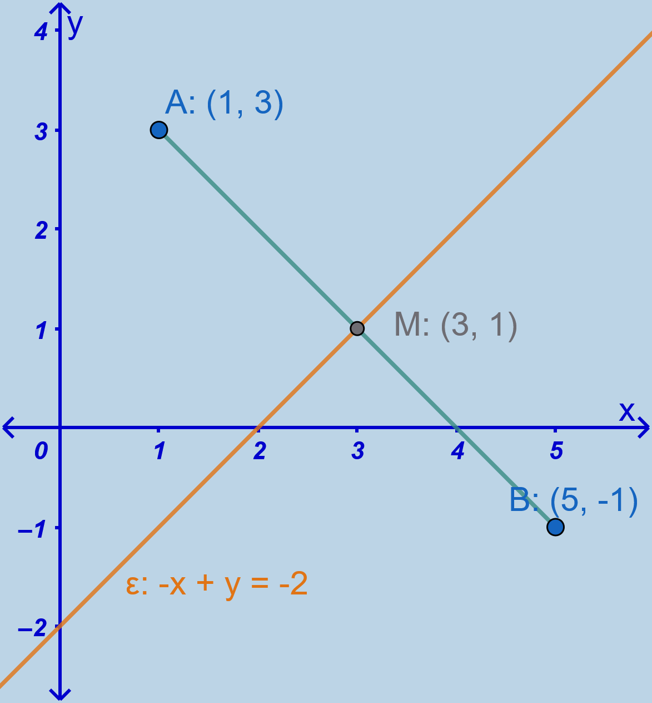{fig-align="center" width="350"}
:::

1.  Βρίσκουμε τον συντελεστή διεύθυνσης της ΑΒ $λ_{ΑΒ}=\dfrac{-1-3}{5-1}=.......$

2.  Βρίσκουμε το μέσον της AB $Μ\left(\dfrac{1+5}{2}, \dfrac{3+(-1)}{2}\right)=M(3,1)$

3.  $λ_{μεσοκαθέτου} \cdot λ_{ΑΒ}=-1 \implies λ_{μεσοκαθέτου}= .............$

Εξίσωση μεσοκαθέτου $y-1=λ_{μεσοκαθέτου}(x-3)$
::::

------------------------------------------------------------------------

18. **Άσκηση 18:** Να υπολογιστεί το εμβαδόν του τριγώνου που σχηματίζεται από την ευθεία $ε: y = 2x - 6$ και τους άξονες συντεταγμένων $x'x$ και $y'y$.

:::: my-callout-theory
::: {.my-callout-theory .callout-title}
Υπόδειξη

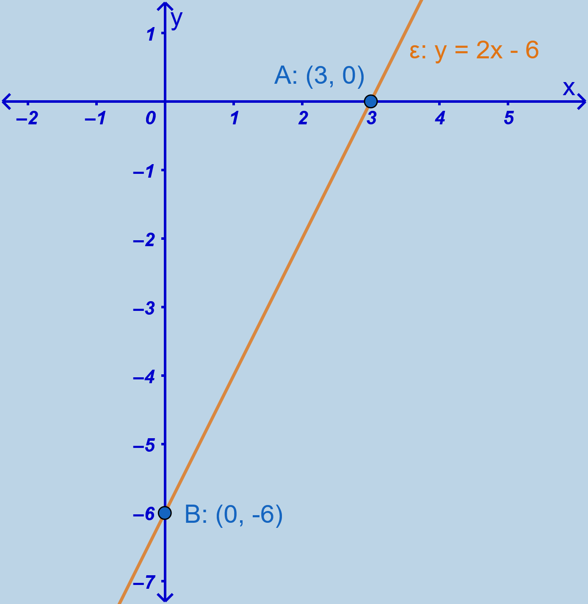{fig-align="center" width="350"}
:::

1.  Σημείο τομής με το άξονα x'x : Για $y=0 \implies 2x-6=0 \implies x=3$

2.  Σημείο τομής με το άξονα y'y : Για $x=0 \implies y=-6$

3.  Εμβαδόν = $\dfrac{1}{2}βυ= .................$
::::

------------------------------------------------------------------------

19. **Άσκηση 19:** Δίνεται η οικογένεια ευθειών $ε_λ: y - 2 = λ(x + 3)$, με $λ \in \mathbb{R}$. Να αποδείξετε ότι όλες οι ευθείες της οικογένειας διέρχονται από το ίδιο σταθερό σημείο $P$ και να προσδιορίσετε τις συντεταγμένες του.

:::: my-callout-theory
::: {.my-callout-theory .callout-title}
Υπόδειξη
:::

Εξ ορισμού η ευθεία $y-y_0=λ(x-x_0)$ περνάει από το σημείο $Ρ(x_0, y_0)$ και έχει συντελεστή διεύθυνσης λ.
Άρα η $ε_λ: y - 2 = λ(x + 3)$ περνάει από το σημείο Ρ(-3,2) και έχει συντελεστή διεύθυνσης λ.

Σχεδιάστε τρεις διαφορετικές ευθείες για τρία διαφορετικά λ (το ένα αρνητικό) για να διαπιστώσετε ότι πράγματι αυτό ισχύει.
::::

------------------------------------------------------------------------

20. **Άσκηση 20:** Δίνονται οι παράλληλες ευθείες $ε_1: y = 3x + 2$ και $ε_2: y = 3x - 8$. Να βρεθεί η εξίσωση της μεσοπαράλληλης ευθείας τους.

:::: my-callout-theory
::: {.my-callout-theory .callout-title}
Υπόδειξη

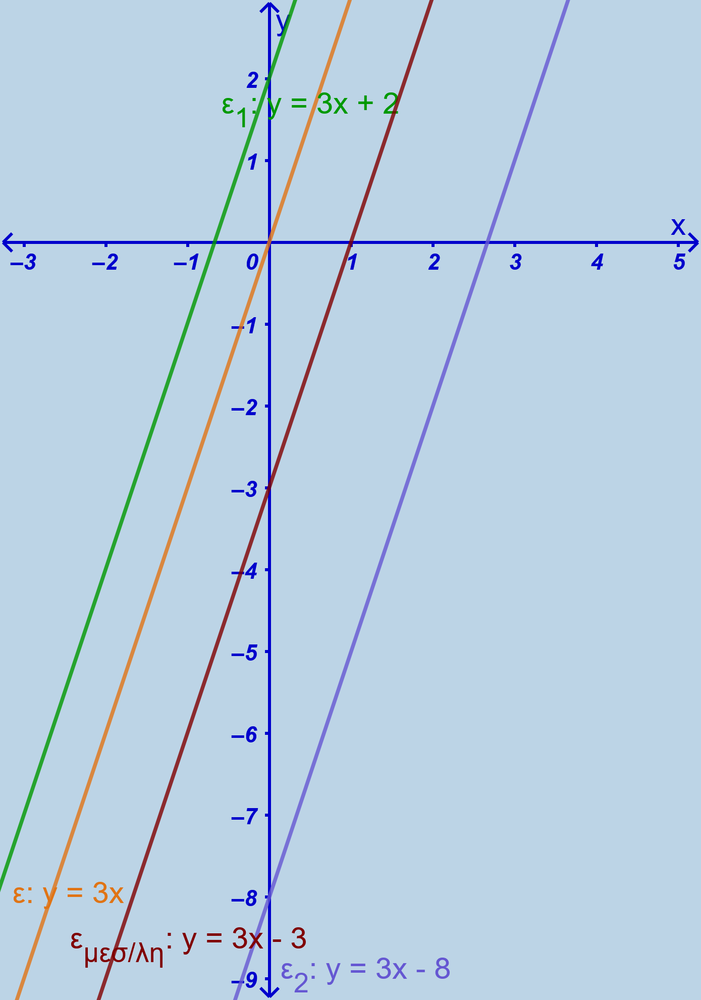{fig-align="center" width="350"}
:::

1.  Γνωρίζουμε ότι η $ε_1: y = 3x + 2$ είναι η $y = 3x$ μετατοπισμένη προς τα πάνω 2 μονάδες.

2.  Η $ε_2: y = 3x - 8$ είναι η $y=3x$ μετατοπισμένη προς τα κάτω κατά 8 μονάδες.
    Άρα η $ε_2: y = 3x - 8$ είναι μετατοπισμένη σε σχέση με τη $ε_1$ κατά 10 μονάδες προς τα κάτω.

3.  Επομένως η μεσοπαράλληλος θα είναι μετατοπισμένη 5 μονάδες προς τα κάτω σε σχέση με την $ε_1$ ή 3 μονάδες προς τα κάτω σε σχέση με την $ε: y=3x$.
    Δηλαδή θα έχει εξίσωση $ε_μ=3x-3$
::::

------------------------------------------------------------------------

:::: {.math-box .exercise-box}
::: {.math-title .exercise-title}
21. Εκφώνηση
:::

Θεωρούμε τρίγωνο ΑΒΓ με κορυφές A(0, 4), B(-3, -2), Γ(4, 1).
Να βρείτε:

(i) Την εξίσωση του ύψους ΑΔ

(ii) Την εξίσωση της μεσοκαθέτου ΕΜ στην ΒΓ.

(iii) Να επιβεβαιώσετε οτι $ΑΔ//ΕΜ$

(iv) Την διάμεσο ΑΜ και να επιβεβαιώσετε οτι οι εντός εναλλάξ γωνίες $\widehat{ΑΜΕ}$ και $\widehat{ΜΑΔ}$ είναι ίσες.
::::

:::: {.math-box .solution-box}
::: {.math-title .solution-title}
Λύση

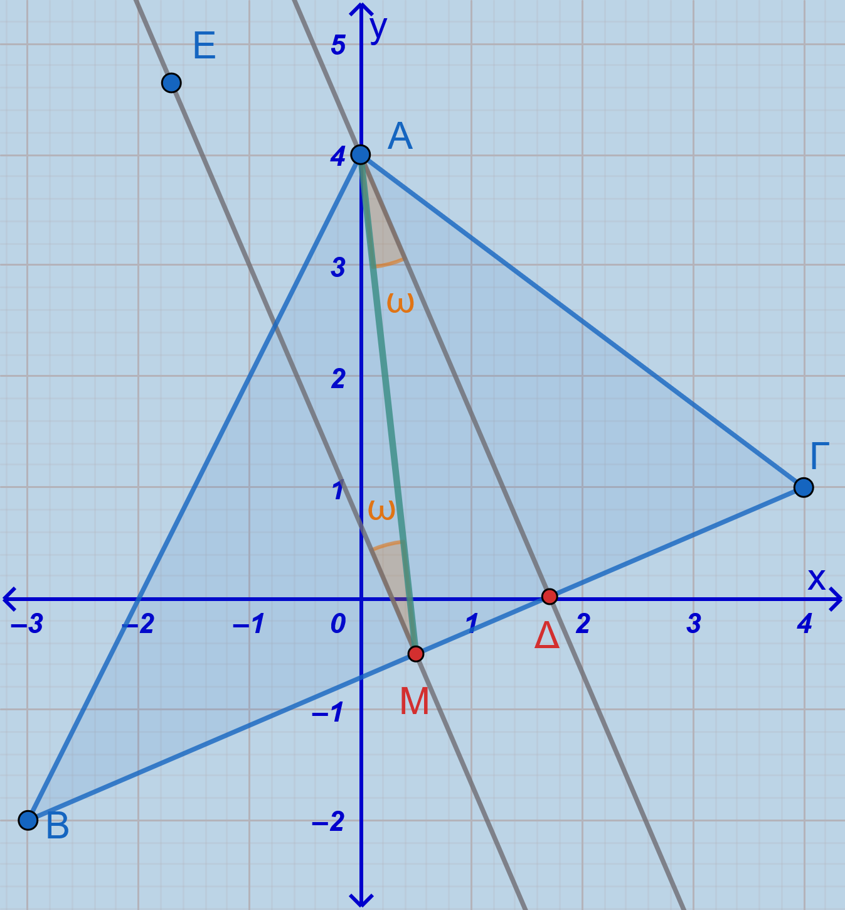{fig-align="center" width="300"}
:::

**(i) Εξίσωση του ύψους** $A\Delta$

Το ύψος $A\Delta$ άγεται από την κορυφή $A(0,\,4)$ και είναι κάθετο στην πλευρά $B\Gamma$.

- Αρχικά, βρίσκουμε τον συντελεστή διεύθυνσης $λ_{B\Gamma}$ της πλευράς $B\Gamma$, όπου $B(-3,\,-2)$ και $\Gamma(4,\,1)$: $$λ_{B\Gamma} = \frac{y_\Gamma - y_B}{x_\Gamma - x_B} = \frac{1 - (-2)}{4 - (-3)} = \frac{1 + 2}{4 + 3} = \frac{3}{7}$$

- Επειδή $A\Delta \perp B\Gamma$, ισχύει: $$λ_{A\Delta} \cdot λ_{B\Gamma} = -1 \implies λ_{A\Delta} \cdot \frac{3}{7} = -1 \implies λ_{A\Delta} = -\frac{7}{3}$$

- Η εξίσωση της ευθείας του ύψους $A\Delta$ (διέρχεται από το $A(0,\,4)$): $$y - y_A = λ_{A\Delta} \cdot (x - x_A)$$ $$y - 4 = -\frac{7}{3}(x - 0)$$ $$3(y - 4) = -7x$$ $$3y - 12 = -7x$$ $$7x + 3y - 12 = 0 \quad \text{ή} \quad y = -\frac{7}{3}x + 4$$

------------------------------------------------------------------------

**(ii) Εξίσωση της μεσοκαθέτου** $EM$ στην $B\Gamma$

Η μεσοκάθετος $EM$ διέρχεται από το μέσο $M$ της πλευράς $B\Gamma$ και είναι κάθετη στην $B\Gamma$.

- Υπολογίζουμε τις συντεταγμένες του μέσου $M$ του τμήματος $B\Gamma$: $$x_M = \frac{x_B + x_\Gamma}{2} = \frac{-3 + 4}{2} = \frac{1}{2}$$ $$y_M = \frac{y_B + y_\Gamma}{2} = \frac{-2 + 1}{2} = -\frac{1}{2}$$

  Άρα, το μέσο είναι το σημείο $M\left(\dfrac{1}{2},\,-\dfrac{1}{2}\right)$.

- Επειδή $EM \perp B\Gamma$, ο συντελεστής διεύθυνσής της είναι: $$λ_{EM} = -\frac{1}{λ_{B\Gamma}} = -\frac{7}{3}$$

- Η εξίσωση της μεσοκαθέτου $EM$ είναι: $$y - y_M = λ_{EM} \cdot (x - x_M)$$ $$y - \left(-\frac{1}{2}\right) = -\frac{7}{3}\left(x - \frac{1}{2}\right)$$ $$y + \frac{1}{2} = -\frac{7}{3}x + \frac{7}{6}$$

  Πολλαπλασιάζουμε με το $6$: $$6y + 3 = -14x + 7$$ $$14x + 6y - 4 = 0 \iff 7x + 3y - 2 = 0 \quad \text{ή} \quad y = -\frac{7}{3}x + \frac{2}{3}$$

------------------------------------------------------------------------

**(iii) Επιβεβαίωση ότι** $A\Delta \parallel EM$

- Ο συντελεστής διεύθυνσης του ύψους $A\Delta$ είναι $λ_{A\Delta} = -\dfrac{7}{3}$.

- Ο συντελεστής διεύθυνσης της μεσοκαθέτου $EM$ είναι $λ_{EM} = -\dfrac{7}{3}$.

Επειδή: $$λ_{A\Delta} = λ_{EM} = -\frac{7}{3}$$ και οι σταθεροί όροι των εξισώσεών τους διαφέρουν ($4 \neq \dfrac{2}{3}$), οι δύο ευθείες είναι διακριτές και **παράλληλες** ($A\Delta \parallel EM$).

*(Γεωμετρικά, αυτό ισχύει άμεσα διότι δύο ευθείες του ιδίου επιπέδου που είναι κάθετες στην ίδια ευθεία* $B\Gamma$ είναι μεταξύ τους παράλληλες).

------------------------------------------------------------------------

**(iv) Εξίσωση της διαμέσου** $AM$ και ισότητα των γωνιών $\widehat{AME}$ και $\widehat{MA\Delta}$

- **Εξίσωση της διαμέσου** $AM$:

  Η διάμεσος συνδέει την κορυφή $A(0,\,4)$ με το μέσο $M\left(\dfrac{1}{2},\,-\dfrac{1}{2}\right)$.

  - Ο συντελεστής διεύθυνσης της ευθείας $AM$ είναι: $$λ_{AM} = \frac{y_M - y_A}{x_M - x_A} = \frac{-\dfrac{1}{2} - 4}{\dfrac{1}{2} - 0} = \frac{-\dfrac{9}{2}}{\dfrac{1}{2}} = -9$$

  - Η εξίσωση της ευθείας $AM$ είναι: $$y - y_A = λ_{AM}(x - x_A)$$ $$y - 4 = -9(x - 0)$$ $$y = -9x + 4 \quad \text{ή} \quad 9x + y - 4 = 0$$

- **Επιβεβαίωση ισότητας των εντός εναλλάξ γωνιών** $\widehat{AME}$ και $\widehat{MA\Delta}$:

  - **Γεωμετρική θεώρηση:**

    Οι ευθείες $A\Delta$ και $EM$ αποδείχθηκαν παράλληλες ($A\Delta \parallel EM$) στο ερώτημα (iii).

    Η ευθεία $AM$ αποτελεί τέμνουσα αυτών των δύο παραλλήλων ευθειών.

    Κατά συνέπεια, οι γωνίες $\widehat{AME}$ και $\widehat{MA\Delta}$ σχηματίζονται από δύο παράλληλες ευθείες που τέμνονται από την ίδια ευθεία, άρα ως **εντός εναλλάξ γωνίες** είναι ίσες: $$\widehat{AME} = \widehat{MA\Delta}$$

  - **Αναλυτική επιβεβαίωση (μέσω κλίσεων):**

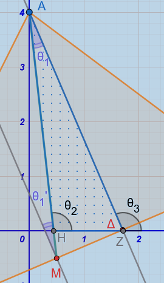{fig-align="center"}

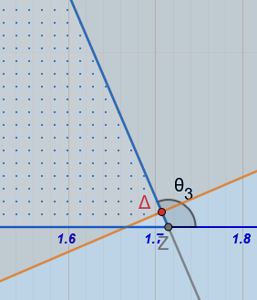{fig-align="center"}

Στο τρίγωνο ΑΗΖ είναι: $θ_2=\angle{AHZ}$ , $θ_3=\angle{(ΑΖ,x'x)} \quad$, $θ_1=θ_3-θ_2$

$θ_2$ η γωνία κλίσης της ΑΜ και $θ_3$ η γωνία κλίσης της ΑΔ.
Άρα $λ_{ΑΜ}=εφ θ_2$ και $λ_{ΑΔ}=εφ θ_3$

Αλλά γνωρίζουμε ότι $εφθ_1=εφ(θ_3-θ_2)=\dfrac{εφθ_3-εφθ_2}{1+εφθ_3\cdot εφθ_2}$

Αντικαθιστώντας θα έχουμε:

$$εφ \theta_1 = \left| \frac{λ_{AM} - λ_{A\Delta}}{1 + λ_{AM} \cdot λ_{A\Delta}} \right| = \left| \frac{-9 - \left(-\dfrac{7}{3}\right)}{1 + (-9)\left(-\dfrac{7}{3}\right)} \right| = \left| \frac{-9 + \dfrac{7}{3}}{1 + 21} \right| = \left| \frac{-\dfrac{20}{3}}{22} \right| = \frac{20}{66} = \frac{10}{33}$$

Ομοίως, για τη γωνία $\theta_1'$ μεταξύ των ευθειών $AM$ και $EM$, εφόσον $λ_{EM} = λ_{A\Delta} = -\dfrac{7}{3}$: $$εφ \theta_1' = \left| \frac{λ_{AM} - λ_{EM}}{1 + λ_{AM} \cdot λ_{EM}} \right| = \frac{10}{33}$$

Επειδή $εφ \theta_1 = εφ \theta_1'$, επιβεβαιώνεται και αναλυτικά ότι: $$\widehat{AME} = \widehat{MA\Delta}$$
::::

------------------------------------------------------------------------

:::: {.math-box .exercise-box}
::: {.math-title .exercise-title}
22. Εκφώνηση
:::

Δίνονται τα σημεία Α(-1, 4), B(-4, 1), Γ(-1, -2) και Δ( 2, 1).

Να δείξετε ότι:

α) το τετράπλευρο ΑΒΓΔ είναι τετράγωνο.

β) Να βρείτε τις εξισώσεις των διαγωνίων του.

γ) Να βρείτε τις εξισώσεις των διαμέσων ΑΜ του τριγώνου ΑΒΓ και ΓΛ του τριγώνου ΑΓΔ και να αποδείξετε ότι είναι παράλληλες.
::::

:::: {.math-box .solution-box}
::: {.math-title .solution-title}
Λύση

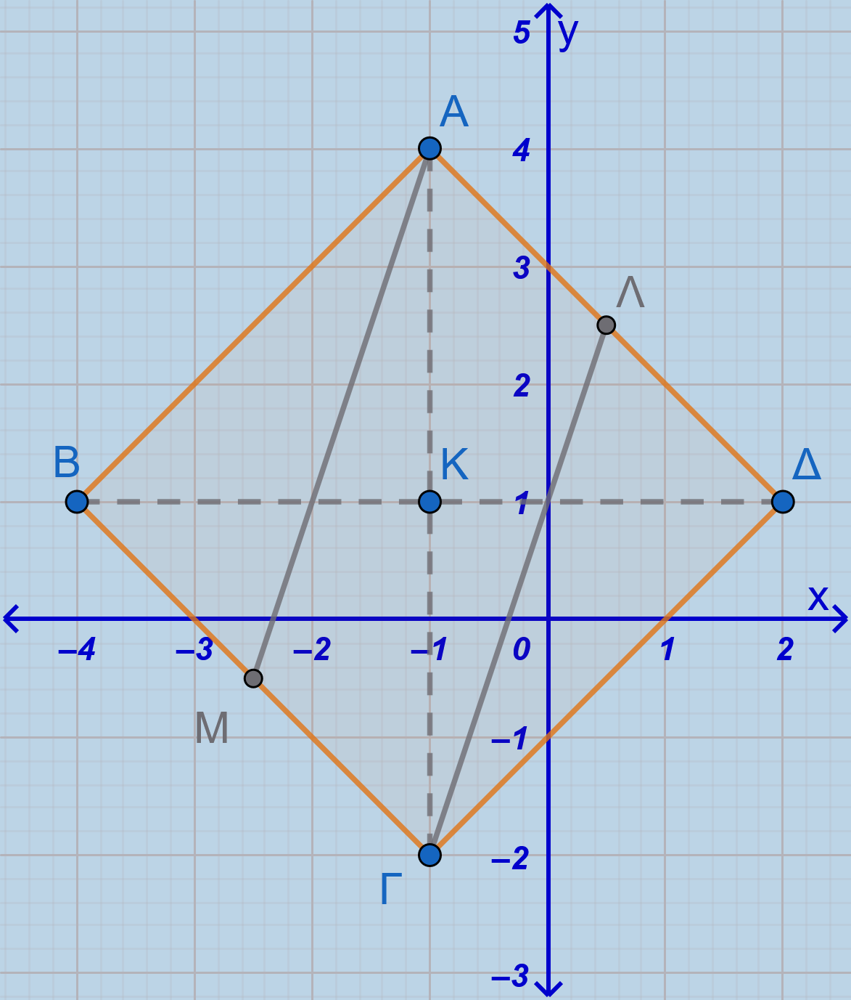{fig-align="center" width="300"}
:::

**α) Απόδειξη ότι το τετράπλευρο** $ΑΒΓΔ$ είναι τετράγωνο

Για να είναι ένα τετράπλευρο τετράγωνο, αρκεί να δείξουμε ότι όλες οι πλευρές του είναι ίσες (άρα είναι ρόμβος) και μία γωνία του είναι ορθή ($90^\circ$).

- **Υπολογισμός των μηκών των πλευρών:** $$AB = \sqrt{\left(-4 - (-1)\right)^2 + (1 - 4)^2} = \sqrt{(-3)^2 + (-3)^2} = \sqrt{9 + 9} = \sqrt{18} = 3\sqrt{2}$$ $$B\Gamma = \sqrt{\left(-1 - (-4)\right)^2 + (-2 - 1)^2} = \sqrt{3^2 + (-3)^2} = \sqrt{9 + 9} = \sqrt{18} = 3\sqrt{2}$$ $$\Gamma\Delta = \sqrt{\left(2 - (-1)\right)^2 + (1 - (-2))^2} = \sqrt{3^2 + 3^2} = \sqrt{9 + 9} = \sqrt{18} = 3\sqrt{2}$$ $$\Delta A = \sqrt{\left(-1 - 2\right)^2 + (4 - 1)^2} = \sqrt{(-3)^2 + 3^2} = \sqrt{9 + 9} = \sqrt{18} = 3\sqrt{2}$$

  Εφόσον $AB = B\Gamma = \Gamma\Delta = \Delta A = 3\sqrt{2}$, το τετράπλευρο $ΑΒΓΔ$ είναι **ρόμβος**.

- **Έλεγχος καθετότητας δύο διαδοχικών πλευρών (**$AB$ και $B\Gamma$):

  - Ο συντελεστής διεύθυνσης της πλευράς $AB$ είναι: $$λ_{AB} = \frac{1 - 4}{-4 - (-1)} = \frac{-3}{-3} = 1$$
  - Ο συντελεστής διεύθυνσης της πλευράς $B\Gamma$ είναι: $$λ_{B\Gamma} = \frac{-2 - 1}{-1 - (-4)} = \frac{-3}{3} = -1$$

  Παρατηρούμε ότι: $$λ_{AB} \cdot λ_{B\Gamma} = 1 \cdot (-1) = -1 \implies AB \perp B\Gamma$$

  Επομένως, η γωνία $\widehat{B}$ είναι ορθή ($90^\circ$).

  Ένας ρόμβος με μία ορθή γωνία είναι **τετράγωνο**.

------------------------------------------------------------------------

**β) Εξισώσεις των διαγωνίων του τετραγώνου**

Οι διαγώνιοι του τετραγώνου $ΑΒΓΔ$ είναι τα τμήματα $A\Gamma$ και $B\Delta$.

1.  **Διαγώνιος** $A\Gamma$: Τα σημεία είναι $A(-1,\,4)$ και $\Gamma(-1,\,-2)$.
    Παρατηρούμε ότι έχουν την ίδια τετμημένη ($x_A = x_\Gamma = -1$).
    Συνεπώς, η ευθεία είναι κατακόρυφη με εξίσωση: $$x = -1$$

2.  **Διαγώνιος** $B\Delta$: Τα σημεία είναι $B(-4,\,1)$ και $\Delta(2,\,1)$.
    Παρατηρούμε ότι έχουν την ίδια τεταγμένη ($y_B = y_\Delta = 1$).
    Συνεπώς, η ευθεία είναι οριζόντια με εξίσωση: $$y = 1$$

------------------------------------------------------------------------

**γ) Εξισώσεις των διαμέσων** $AM$ και $\Gammaλ$ και απόδειξη ότι είναι παράλληλες

- **Εύρεση της διαμέσου** $AM$ του τριγώνου $AB\Gamma$:
  - Το σημείο $M$ είναι το μέσο της πλευράς $B\Gamma$, όπου $B(-4,\,1)$ και $\Gamma(-1,\,-2)$: $$x_M = \frac{x_B + x_\Gamma}{2} = \frac{-4 + (-1)}{2} = -\frac{5}{2}$$ $$y_M = \frac{y_B + y_\Gamma}{2} = \frac{1 + (-2)}{2} = -\frac{1}{2}$$ Άρα: $M\left(-\dfrac{5}{2},\,-\dfrac{1}{2}\right)$.

  - Ο συντελεστής διεύθυνσης της ευθείας $AM$ (με $A(-1,\,4)$) είναι: $$λ_{AM} = \frac{y_M - y_A}{x_M - x_A} = \dfrac{-\dfrac{1}{2} - 4}{-\dfrac{5}{2} - (-1)} = \frac{-\dfrac{9}{2}}{-\dfrac{3}{2}} = \frac{-9}{-3} = 3$$

  - Η εξίσωση της ευθείας $AM$ είναι: $$y - y_A = λ_{AM}(x - x_A)$$ $$y - 4 = 3(x - (-1))$$ $$y - 4 = 3(x + 1)$$ $$y = 3x + 7 \quad \text{ή} \quad 3x - y + 7 = 0$$

------------------------------------------------------------------------

- **Εύρεση της διαμέσου** $\Gammaλ$ του τριγώνου $A\Gamma\Delta$:
  - Το σημείο $λ$ είναι το μέσο της πλευράς $A\Delta$, όπου $A(-1,\,4)$ και $\Delta(2,\,1)$: $$x_λ = \frac{x_A + x_\Delta}{2} = \frac{-1 + 2}{2} = \frac{1}{2}$$ $$y_λ = \frac{y_A + y_\Delta}{2} = \frac{4 + 1}{2} = \frac{5}{2}$$ Άρα: $λ\left(\dfrac{1}{2},\,\dfrac{5}{2}\right)$.

  - Ο συντελεστής διεύθυνσης της ευθείας $\Gammaλ$ (με $\Gamma(-1,\,-2)$) είναι: $$λ_{\Gammaλ} = \frac{y_λ - y_\Gamma}{x_λ - x_\Gamma} = \frac{\dfrac{5}{2} - (-2)}{\dfrac{1}{2} - (-1)} = \frac{\dfrac{9}{2}}{\dfrac{3}{2}} = 3$$

  - Η εξίσωση της ευθείας $\Gammaλ$ είναι: $$y - y_\Gamma = λ_{\Gammaλ}(x - x_\Gamma)$$ $$y - (-2) = 3(x - (-1))$$ $$y + 2 = 3(x + 1)$$ $$y + 2 = 3x + 3$$ $$y = 3x + 1 \quad \text{ή} \quad 3x - y + 1 = 0$$

------------------------------------------------------------------------

- **Απόδειξη ότι οι διάμεσοι είναι παράλληλες:** Οι συντελεστές διεύθυνσης των δύο ευθειών είναι: $$λ_{AM} = 3 \quad \text{και} \quad λ_{\Gammaλ} = 3$$

  Επειδή $λ_{AM} = λ_{\Gammaλ}$ και οι σταθεροί τους όροι διαφέρουν ($7 \neq 1$), οι ευθείες των διαμέσων $AM$ και $\Gammaλ$ είναι **παράλληλες** ($AM \parallel \Gammaλ$).
::::

------------------------------------------------------------------------

:::: {.math-box .exercise-box}
::: {.math-title .exercise-title}
23. Εκφώνηση
:::

Να βρείτε τις εξισώσεις των ευθειών που διέρχονται από το σημείο $A(3,\,1)$ και σχηματίζουν με τους άξονες ισοσκελές τρίγωνο.
::::

:::: {.math-box .solution-box}
::: {.math-title .solution-title}
Λύση

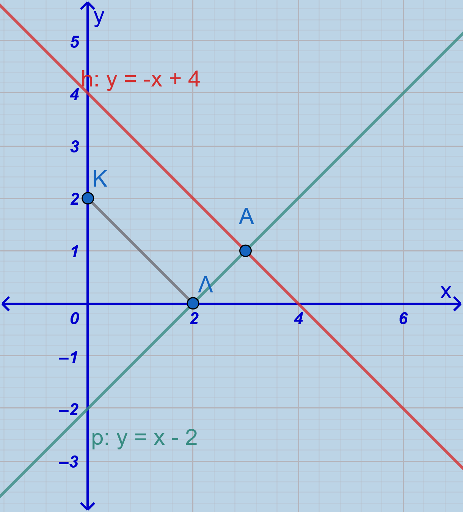{fig-align="center" width="300"}
:::

**Θεωρητική Ανάλυση**

Ένα τρίγωνο που σχηματίζεται από μια ευθεία και τους ορθογώνιους άξονες $x'x$ και $y'y$ είναι ορθογώνιο στην αρχή των αξόνων $O(0,\,0)$.

Για να είναι το τρίγωνο **ισοσκελές**, οι δύο κάθετες πλευρές του πάνω στους άξονες πρέπει να έχουν ίσα μήκη.
Επομένως, οι οξείες γωνίες του τριγώνου είναι ίσες με $45^\circ$.

Αυτό σημαίνει ότι η ευθεία σχηματίζει με τον άξονα $x'x$ γωνία $\omega = 45^\circ$ ή $\omega = 135^\circ$.
Συνεπώς, ο συντελεστής διεύθυνσης $λ$ της ευθείας μπορεί να είναι: $$λ = εφ(45^\circ) = 1 \quad \text{ή} \quad λ = εφ(135^\circ) = -1$$

*(Σημείωση: Η ευθεία δεν μπορεί να διέρχεται από το* $O(0,\,0)$, διότι τότε δεν ορίζεται τρίγωνο με τους άξονες).

------------------------------------------------------------------------

**Εύρεση των Εξισώσεων**

Κάθε ευθεία που διέρχεται από το σημείο $A(3,\,1)$ έχει εξίσωση της μορφής: $$y - y_A = λ(x - x_A) \implies y - 1 = λ(x - 3)$$

------------------------------------------------------------------------

**Περίπτωση 1:** $λ = 1$

Αντικαθιστούμε $λ = 1$: $$y - 1 = 1 \cdot (x - 3)$$ $$y - 1 = x - 3$$ $$x - y - 2 = 0 \quad \text{ή} \quad y = x - 2$$

- **Έλεγχος των σημείων τομής με τους άξονες:**

  - Για $y = 0 \implies x = 2$, άρα τέμνει τον $x'x$ στο σημείο $B(2,\,0)$ με μήκος $OB = |2| = 2$.

  - Για $x = 0 \implies y = -2$, άρα τέμνει τον $y'y$ στο σημείο $\Gamma(0,\,-2)$ με μήκος $O\Gamma = |-2| = 2$.

Εφόσον $OB = O\Gamma = 2 \neq 0$, σχηματίζεται ισοσκελές ορθογώνιο τρίγωνο.

------------------------------------------------------------------------

**Περίπτωση 2:** $λ = -1$

Αντικαθιστούμε $λ = -1$: $$y - 1 = -1 \cdot (x - 3)$$ $$y - 1 = -x + 3$$ $$x + y - 4 = 0 \quad \text{ή} \quad y = -x + 4$$

- **Έλεγχος των σημείων τομής με τους άξονες:**

  - Για $y = 0 \implies x = 4$, άρα τέμνει τον $x'x$ στο σημείο $\Delta(4,\,0)$ με μήκος $O\Delta = |4| = 4$.

  - Για $x = 0 \implies y = 4$, άρα τέμνει τον $y'y$ στο σημείο $E(0,\,4)$ με μήκος $OE = |4| = 4$.

Εφόσον $O\Delta = OE = 4 \neq 0$, σχηματίζεται ισοσκελές ορθογώνιο τρίγωνο.

------------------------------------------------------------------------

**Τελικές Εξισώσεις**

Οι ζητούμενες ευθείες είναι: 1. $ε_1: x - y - 2 = 0$ 2. $ε_2: x + y - 4 = 0$
::::

------------------------------------------------------------------------

:::: {.math-box .exercise-box}
::: {.math-title .exercise-title}
24. Τηλεπικοινωνιακό Δίκτυο Τριών Σταθμών
:::

Σε ένα τοπογραφικό διάγραμμα, τρεις σταθμοί αναμετάδοσης $A, B, \Gamma$ σχηματίζουν τρίγωνο $AB\Gamma$.
Ο κεντρικός σταθμός $A$ βρίσκεται στο σημείο $A(2,\,5)$.
Δύο κατευθυντήριες γραμμές σημάτων, που αντιστοιχούν στα **ύψη** που άγονται από τους σταθμούς $B$ και $\Gamma$, έχουν εξισώσεις: $$υ_B: y = 2x - 1 \quad \text{και} \quad υ_\Gamma: y = -\frac{1}{3}x + 2$$

Να βρεθούν:

1.  Οι εξισώσεις των ευθειών των πλευρών $A\Gamma$ και $AB$.

2.  Οι συντεταγμένες των σταθμών $B$ και $\Gamma$.

3.  Η εξίσωση της ευθείας της πλευράς $B\Gamma$.
::::

:::: {.math-box .solution-box}
::: {.math-title .solution-title}
Λύση
:::

**1: Εξισώσεις των πλευρών** $A\Gamma$ και $AB$

- **Πλευρά** $A\Gamma$:

  Το ύψος $υ_B$ είναι κάθετο στην πλευρά $A\Gamma$ ($υ_B \perp A\Gamma$).
  Ο συντελεστής διεύθυνσης του $υ_B$ είναι $λ_{υ_B} = 2$.

  Επομένως: $$λ_{A\Gamma} \cdot λ_{υ_B} = -1 \implies λ_{A\Gamma} \cdot 2 = -1 \implies λ_{A\Gamma} = -\frac{1}{2}$$

  Η ευθεία $A\Gamma$ διέρχεται από το $A(2,\,5)$: $$y - 5 = -\frac{1}{2}(x - 2)$$ $$2(y - 5) = -(x - 2)$$ $$2y - 10 = -x + 2$$ $$x + 2y - 12 = 0 \quad \text{ή} \quad y = -\frac{1}{2}x + 6$$

- **Πλευρά** $AB$:

  Το ύψος $υ_\Gamma$ είναι κάθετο στην πλευρά $AB$ ($υ_\Gamma \perp AB$).

  Ο συντελεστής διεύθυνσης του $υ_\Gamma$ είναι $λ_{υ_\Gamma} = -\frac{1}{3}$.

  Επομένως: $$λ_{AB} \cdot λ_{υ_\Gamma} = -1 \implies λ_{AB} \cdot \left(-\frac{1}{3}\right) = -1 \implies λ_{AB} = 3$$

  Η ευθεία $AB$ διέρχεται από το $A(2,\,5)$: $$y - 5 = 3(x - 2)$$ $$y - 5 = 3x - 6$$ $$3x - y - 1 = 0 \quad \text{ή} \quad y = 3x - 1$$

------------------------------------------------------------------------

**2: Συντεταγμένες των κορυφών** $B$ και $\Gamma$

- **Κορυφή** $B$:

  Το σημείο $B$ αποτελεί την τομή της πλευράς $AB$ και του ύψους $υ_B$: $$\begin{cases}
  y = 3x - 1 \\
  y = 2x - 1
  \end{cases}$$

  Εξισώνουμε: $$3x - 1 = 2x - 1 \implies x = 0$$

  Αντικαθιστώντας $x = 0$: $y = 2(0) - 1 = -1$.

  Άρα: $B(0,\,-1)$.

- **Κορυφή** $\Gamma$:

  Το σημείο $\Gamma$ αποτελεί την τομή της πλευράς $A\Gamma$ και του ύψους $υ_\Gamma$: $$\begin{cases}
  y = -\dfrac{1}{2}x + 6 \\
  y = -\dfrac{1}{3}x + 2
  \end{cases}$$

  Εξισώνουμε: $$-\frac{1}{2}x + 6 = -\frac{1}{3}x + 2$$

  Πολλαπλασιάζουμε με το $6$: $$-3x + 36 = -2x + 12$$ $$-x = -24 \implies x = 24$$

  Αντικαθιστώντας $x = 24$: $y = -\dfrac{1}{3}(24) + 2 = -8 + 2 = -6$.

  Άρα: $\Gamma(24,\,-6)$.

------------------------------------------------------------------------

**3: Εξίσωση της πλευράς** $B\Gamma$

Η πλευρά $B\Gamma$ συνδέει τα σημεία $B(0,\,-1)$ και $\Gamma(24,\,-6)$:

- Ο συντελεστής διεύθυνσης είναι: $$λ_{B\Gamma} = \frac{-6 - (-1)}{24 - 0} = \frac{-5}{24} = -\frac{5}{24}$$

- Η εξίσωση της ευθείας $B\Gamma$ (διέρχεται από το $B(0,\,-1)$): $$y - (-1) = -\frac{5}{24}(x - 0)$$ $$y + 1 = -\frac{5}{24}x$$ $$24(y + 1) = -5x$$ $$5x + 24y + 24 = 0$$
::::

------------------------------------------------------------------------

:::: {.math-box .exercise-box}
::: {.math-title .exercise-title}
25. Θέμα αναφοράς: Χωροθέτηση Γραμμής Μεταφοράς Ενέργειας
:::

Σε ένα ενεργειακό δίκτυο, δύο κύριοι αγωγοί αναπαρίστανται από τις ευθείες: $$ε_1: y = 2x - 3 \quad \text{και} \quad ε_2: y = -x + 6$$

Πρέπει να κατασκευαστεί μια ευθεία γραμμή διασύνδεσης που να διέρχεται από έναν υποσταθμό $M(3,\,4)$ και να τέμνει τους αγωγούς $ε_1$ και $ε_2$ στα σημεία $A$ και $B$ αντίστοιχα, έτσι ώστε ο υποσταθμός $M$ να αποτελεί ακριβώς το **μέσο** του ευθύγραμμου τμήματος $AB$.

Να βρεθεί η εξίσωση της γραμμής διασύνδεσης.
::::

:::: {.math-box .solution-box}
::: {.math-title .solution-title}
Λύση
:::

**1: Παραμετρική έκφραση των σημείων** $A$ και $B$

- Το σημείο $A$ ανήκει στην ευθεία $ε_1: y = 2x - 3$.
  Έστω $x_A = t$, τότε: $$A(t,\, 2t - 3)$$

- Το σημείο $B$ ανήκει στην ευθεία $ε_2: y = -x + 6$.
  Έστω $x_B = s$, τότε: $$B(s,\, -s + 6)$$

------------------------------------------------------------------------

**2: Χρήση των συνθηκών του μέσου** $M(3,\,4)$

Επειδή το σημείο $M(3,\,4)$ είναι το μέσο του τμήματος $AB$: $$x_M = \frac{x_A + x_B}{2} \implies 3 = \frac{t + s}{2} \implies t + s = 6 \quad \text{(1)}$$ $$y_M = \frac{y_A + y_B}{2} \implies 4 = \frac{(2t - 3) + (-s + 6)}{2} \implies 2t - s + 3 = 8 \implies 2t - s = 5 \quad \text{(2)}$$

------------------------------------------------------------------------

**3: Επίλυση του γραμμικού συστήματος**

Προσθέτουμε κατά μέλη τις εξισώσεις (1) και (2): $$(t + s) + (2t - s) = 6 + 5$$ $$3t = 11 \implies t = \frac{11}{3}$$

Από την εξίσωση (1): $$s = 6 - t = 6 - \frac{11}{3} = \frac{7}{3}$$

------------------------------------------------------------------------

**4: Προσδιορισμός του σημείου** $A$ (ή $B$) και της ευθείας

- Υπολογίζουμε τις συντεταγμένες του σημείου $A$: $$x_A = \frac{11}{3}$$ $$y_A = 2\left(\frac{11}{3}\right) - 3 = \frac{22}{3} - \frac{9}{3} = \frac{13}{3}$$

  Άρα: $A\left(\dfrac{11}{3},\,\dfrac{13}{3}\right)$.

- Η ζητούμενη ευθεία διέρχεται από το $M(3,\,4)$ και το $A\left(\frac{11}{3},\,\frac{13}{3}\right)$.

  Υπολογίζουμε τον συντελεστή διεύθυνσης $λ$: $$λ = \frac{y_A - y_M}{x_A - x_M} = \frac{\dfrac{13}{3} - 4}{\dfrac{11}{3} - 3} = \frac{\dfrac{13}{3} - \dfrac{12}{3}}{\dfrac{11}{3} - \dfrac{9}{3}} = \frac{\dfrac{1}{3}}{\dfrac{2}{3}} = \frac{1}{2}$$

- Η εξίσωση της ευθείας που διέρχεται από το $M(3,\,4)$ με κλίση $λ = \frac{1}{2}$ είναι: $$y - 4 = \frac{1}{2}(x - 3)$$ $$2(y - 4) = x - 3$$ $$2y - 8 = x - 3$$ $$x - 2y + 5 = 0 \quad \text{ή} \quad y = \frac{1}{2}x + \frac{5}{2}$$
::::

------------------------------------------------------------------------

:::: callout-sos
::: {.callout-sos .callout-title}
Εύχομαι
:::

ΚΑΛΗ ΜΕΛΕΤΗ!
::::
